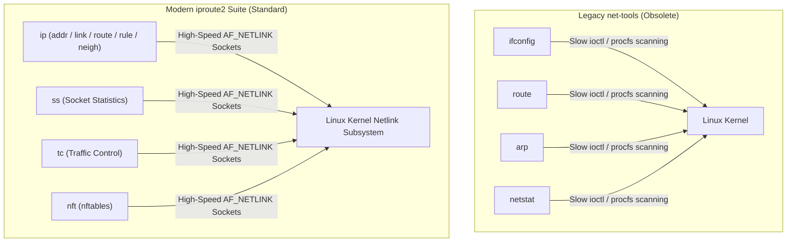
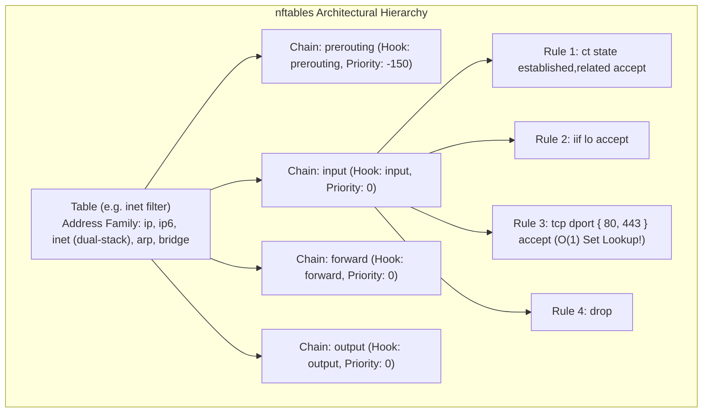
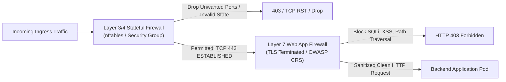
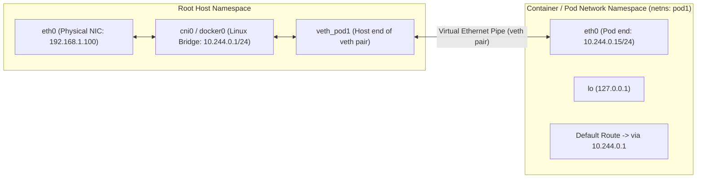
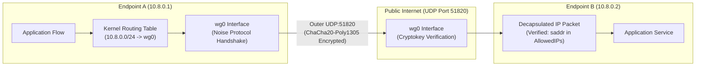
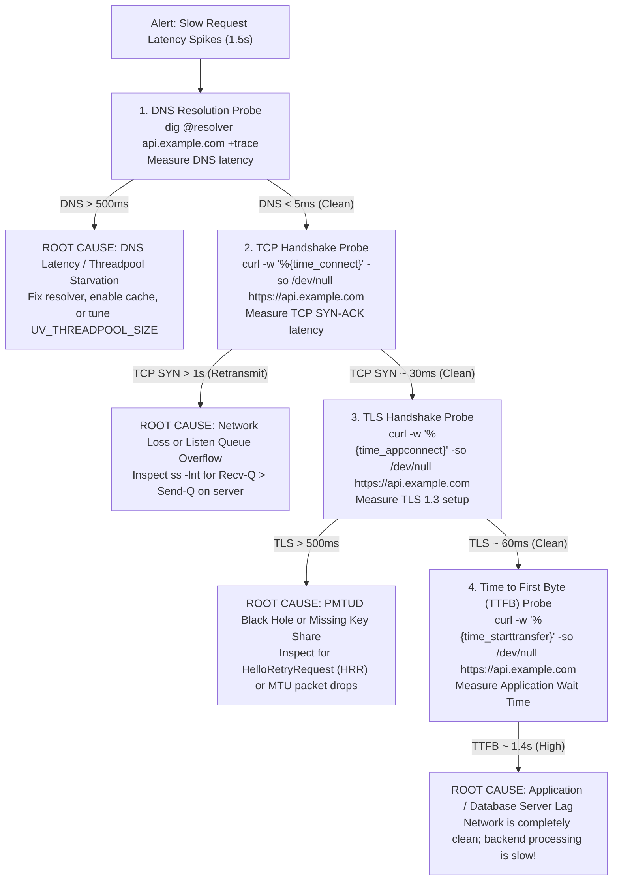

# Module 14: Linux Network Operations, Packet Diagnostics & Troubleshooting Runbooks

Operating systems software engineering requires bridging high-level network theory with the concrete diagnostic tools provided by the Linux kernel. A staff engineer diagnosing a production latency regression or packet drop must navigate kernel socket queues, interface ring buffers, Berkeley Packet Filters (BPF), network namespaces, traffic shaping, and firewall connection tracking tables. This module provides an exhaustive operational reference for the modern Linux network stack: replacing legacy `net-tools` with `iproute2`, deep socket diagnostics via `ss`, packet dissection with `tcpdump` BPF primitives, `nftables` and `conntrack` mechanics, container networking via `veth` pairs in network namespaces, and a deterministic step-by-step troubleshooting runbook decomposing latency into DNS, TCP, TLS, and application processing phases.

---

## 1. Modern Interface & Routing Management: `iproute2`

For over twenty years, system administrators relied on the `net-tools` suite (`ifconfig`, `route`, `arp`, `netstat`). These tools interact with the kernel via obsolete `ioctl()` system calls, cannot display modern routing tables, cannot manage network namespaces, and were declared obsolete in the Linux kernel in 2001.

The standard Linux network management utility suite is **`iproute2`**, communicating directly with kernel subsystems over the high-speed **Netlink IPC socket protocol (`AF_NETLINK`)**.



### The 5 Core `ip` Command Categories

| Command & Subcommand | Functional Purpose | Equivalent Legacy Command |
| :-- | :-- | :-- |
| **`ip addr show [dev]`** | Displays and configures IPv4/IPv6 addresses, flags, and broadcast scopes. | `ifconfig` |
| **`ip link set dev <name> up/down`** | Manages physical/virtual link state, MTU, and promiscuous mode. | `ifconfig <name> up/down` |
| **`ip route show [table <id>]`** | Displays and manages kernel routing tables, multipath ECMP, and metrics. | `route -n` |
| **`ip rule show`** | Inspects and manages the Routing Policy Database (RPDB) for policy routing. | _No legacy equivalent_ |
| **`ip neigh show [dev]`** | Displays and manipulates ARP (IPv4) and NDP (IPv6) neighbor caches. | `arp -n` |

### Essential `iproute2` Operational Commands

```bash
# 1. Assign IP address and CIDR mask to interface
ip addr add 192.168.10.50/24 dev eth0

# 2. Modify interface MTU (e.g., enabling 9000-byte Jumbo frames)
ip link set dev eth0 mtu 9000

# 3. Add a static network route via a specific gateway
ip route add 10.20.0.0/16 via 192.168.10.1 dev eth0

# 4. Configure Equal-Cost Multi-Path (ECMP) over dual gateways
ip route add default scope global \
    nexthop via 192.168.10.1 dev eth0 weight 1 \
    nexthop via 10.0.0.1 dev eth1 weight 1

# 5. Flush a corrupted neighbor (ARP) cache entry
ip neigh flush dev eth0
```

---

## 2. Advanced Socket Diagnostics: Deciphering `ss`

The `ss` (Socket Statistics) command inspects internal kernel socket data structures directly via Netlink (`sock_diag`), executing orders of magnitude faster than `netstat` (which crawled `/proc/net/tcp` line-by-line).

```bash
ss -tanpi '( dport = :443 or sport = :443 )'
```

Flags:

- `-t`: TCP sockets (`-u` for UDP).
- `-a`: All sockets (listening and established).
- `-n`: Numeric output (do not resolve IP to hostname or port to service name).
- `-p`: Show process name and Process ID (PID) owning the socket.
- `-i`: Display internal kernel TCP metrics (`cwnd`, `rtt`, `pacing_rate`, `retrans`).

### The Critical Semantic Difference: Recv-Q & Send-Q

The interpretation of the `Recv-Q` and `Send-Q` columns in `ss` **inverts completely** depending on whether the socket is in the `LISTEN` state or the `ESTABLISHED` state!

```
LISTEN Sockets (e.g. ss -lnt):
  State   Recv-Q  Send-Q  Local Address:Port
  LISTEN  129     128     0.0.0.0:80
          ▲       ▲
          │       └── Send-Q = Maximum Backlog Limit (min(listen_backlog, somaxconn))
          └────────── Recv-Q = Current completed 3-way handshakes awaiting accept()
          * Recv-Q > Send-Q indicates ACCEPT QUEUE OVERFLOW! Clients experiencing latency!

ESTABLISHED Sockets (e.g. ss -nt):
  State   Recv-Q  Send-Q  Local Address:Port
  ESTAB   0       65420   192.168.1.10:48912   203.0.113.10:443
          ▲       ▲
          │       └── Send-Q = Bytes buffered in kernel, SENT but UNACKNOWLEDGED by remote peer
          └────────── Recv-Q = Bytes received from remote peer, BUFFERED awaiting app read()
          * High Recv-Q = Application thread is blocked or slow at reading!
          * High Send-Q = Network bottleneck or remote receiver window rwnd is full!
```

---

## 3. Packet Capturing & Berkeley Packet Filters (BPF)

When diagnosing network anomalies, raw packet captures provide ground-truth evidence. **`tcpdump`** captures packets from kernel memory using the `libpcap` library and the Linux kernel's in-socket **Berkeley Packet Filter (cBPF / eBPF)** virtual machine.

```bash
# Capture full uncompressed packets on interface eth0, skipping DNS resolution, writing to file
tcpdump -i eth0 -nn -s0 -w /tmp/incident.pcap "tcp port 443"
```

- `-i eth0`: Listen on interface `eth0` (`-i any` captures on all interfaces, but disables hardware offloading).
- `-nn`: Do not resolve hostnames (prevents `tcpdump` from generating its own DNS queries during an outage!) and do not resolve port numbers.
- `-s0`: Snapshot length 0 captures the entire unclipped packet (`snaplen = 262144`).
- `-w file.pcap`: Writes raw binary pcap to disk for offline Wireshark analysis.

### Advanced BPF Filter Primitives

Berkeley Packet Filter expressions execute inside kernel space _before_ packets are copied to user space, eliminating CPU overhead for filtered traffic:

```bash
# 1. Filter SYN packets without ACK (Detecting new incoming connection attempts)
tcpdump -nn "tcp[tcpflags] & (tcp-syn) != 0 and tcp[tcpflags] & (tcp-ack) == 0"

# 2. Filter TCP RST packets (Hunting connection resets)
tcpdump -nn "tcp[tcpflags] & (tcp-rst) != 0"

# 3. Filter packets matching TTL = 1 (Traceroute probes or routing loops)
tcpdump -nn "ip[8] == 1"

# 4. Filter DNS queries directed to port 53 excluding local resolver
tcpdump -nn "udp port 53 and not host 127.0.0.1"
```

---

## 4. Modern Firewalling: `nftables` & `conntrack` Mechanics

Introduced in Linux 3.13, **`nftables`** replaced the legacy `iptables`, `ip6tables`, `arptables`, and `ebtables` tools with a unified, bytecode-driven packet classification engine.



### Why `nftables` Outperforms `iptables`

1. **Unified Dual-Stack Tables (`inet`)**: A single table handles both IPv4 and IPv6 simultaneously, eliminating duplicated rulesets across `iptables` and `ip6tables`.
2. **$O(1)$ Native Sets & Dictionaries**: In `iptables`, matching 100 ports or 500 IP addresses required 500 sequential linear rule evaluations ($O(N)$). In `nftables`, sets (`tcp dport { 80, 443, 8000-8080 }`) are evaluated in **$O(1)$ constant time** using kernel red-black trees or hash tables.
3. **Atomic Ruleset Swaps**: Updating rules in `nftables` executes as an atomic kernel transaction; packets are never evaluated against half-applied rulesets.

### The Connection Tracking Table: `conntrack`

Stateful firewall rules (`ct state established,related accept`) and NAT depend on the kernel's **`nf_conntrack`** subsystem. Every active flow occupies a memory entry in the connection tracking table:

```bash
# View active conntrack flows
conntrack -L -p tcp
# tcp 6 431999 ESTABLISHED src=192.168.1.10 dst=203.0.113.5 sport=54210 dport=443 [ASSURED] ...
```

### The Production Failure Mode: Conntrack Table Full

On NAT gateways, Kubernetes nodes, or servers subjected to high-volume UDP traffic (e.g., DNS or WebRTC):

- If the number of concurrent connections exceeds the configured maximum, the kernel logs:
  ```text
  nf_conntrack: table full, dropping packet
  ```
- **The Failure**: The kernel drops incoming packets immediately, regardless of whether CPU or memory is saturated!
- **Inspection & Tuning**:
  ```bash
  # Check current entries vs maximum limit
  sysctl net.netfilter.nf_conntrack_count
  sysctl net.netfilter.nf_conntrack_max

  # Increase conntrack table size
  sysctl -w net.netfilter.nf_conntrack_max=1048576
  ```

### Stateful Packet Filtering vs. Web Application Firewalls (WAF)

Network security architectures enforce controls across distinct layers of the OSI stack, separating transport-level stateful packet filtering from Layer 7 application payload inspection:



| Security Dimension | Stateful Packet Filter (`nftables` / Cloud SG) | Web Application Firewall (WAF / OWASP ModSecurity) |
| :-- | :-- | :-- |
| **Operational Layer** | Layer 3 (Network) & Layer 4 (Transport). | Layer 7 (Application). |
| **Inspection Scope** | IP 5-tuple: Source/Dest IP, Source/Dest Port, Protocol, TCP flags, Connection State. | Full HTTP URI, query parameters, headers, cookies, and decoded JSON/multipart request bodies. |
| **TLS Visibility** | Blind to encrypted payload: cannot inspect plaintext inside HTTPS streams. | Terminates TLS session directly (or sits behind TLS reverse proxy) to perform Deep Packet Inspection (DPI). |
| **Threat Mitigation** | Port scans, SYN floods, unauthorized subnet access, IP spoofing, invalid connection states. | OWASP Top 10: SQL injection (`' OR 1=1--`), Cross-Site Scripting (XSS), Log4j RCE, path traversal, API abuse. |
| **Performance Overhead** | Sub-microsecond latency, evaluated at wire speed in Linux kernel or NIC hardware. | Several milliseconds latency: requires request body buffering, regex evaluation, and token parsing. |

In production defense-in-depth architectures, Cloud Security Groups and `nftables` lock down exposed Layer 4 ports (admitting only TCP port 443), while an edge WAF terminates TLS and inspects HTTP payloads before routing traffic to internal microservice clusters.

---

## 5. Network Isolation: Namespaces (`netns`) & Virtual Ethernet (`veth`)

Container runtimes (Docker, Podman, Kubernetes) achieve network isolation using Linux **Network Namespaces (`netns`)**. A network namespace provides an independent, isolated copy of the network stack: its own interfaces, IP addresses, routing tables, socket lists, and firewall rules.



### Building a Container Network Pair from Scratch

A **Virtual Ethernet (`veth`) pair** acts as a virtual bidirectional cable: packets injected into one end emerge immediately out of the peer interface:

```bash
# 1. Create an isolated network namespace
ip netns add worker-ns

# 2. Create a veth pair (veth-host <--> veth-container)
ip link add veth-host type veth peer name veth-worker

# 3. Move the worker interface into the isolated namespace
ip link set veth-worker netns worker-ns

# 4. Configure interfaces and IP addresses
ip addr add 10.100.1.1/24 dev veth-host
ip link set dev veth-host up

ip netns exec worker-ns ip addr add 10.100.1.2/24 dev veth-worker
ip netns exec worker-ns ip link set dev veth-worker up
ip netns exec worker-ns ip link set dev lo up

# 5. Add default gateway inside the namespace
ip netns exec worker-ns ip route add default via 10.100.1.1

# 6. Verify end-to-end ping across the namespace boundary!
ip netns exec worker-ns ping -c 2 10.100.1.1
```

---

## 6. VPNs & Modern Tunneling: WireGuard Mechanics

Virtual Private Networks (VPNs) create secure, encrypted overlay links across untrusted public IP networks. In historical infrastructure, VPNs relied on IPsec (IKEv1/IKEv2) or OpenVPN (Layer 2 TAP / Layer 3 TUN over user-space OpenSSL). Built directly into the Linux kernel (v5.6+), **WireGuard** (RFC 8439 / Noise Protocol Framework) replaces legacy multi-hundred-thousand-line IPsec codebases with a minimal, high-performance ~4,000-line kernel implementation.

### Cryptokey Routing & The Noise Protocol

WireGuard abstracts network security through **Cryptokey Routing**: it associates public encryption keys directly with authorized internal IP addresses (`AllowedIPs`), operating as an ordinary Layer 3 network interface (`wg0`):



The protocol mechanics establish high-assurance guarantees:

1. **1-RTT Handshake**: Utilizes the Noise Protocol Framework (`Noise_IKpsk2`) over standard UDP port 51820, establishing ephemeral symmetric session keys via Curve25519 ECDH in a single round-trip.
2. **Modern Cryptographic Suite**: Mandates **ChaCha20** for symmetric encryption, **Poly1305** for message authentication (AEAD), **BLAKE2s** for cryptographic hashing, and **SipHash24** for hash table lookups, avoiding legacy cipher negotiation vulnerabilities.
3. **Silent Operation (Stealth)**: WireGuard never responds to unauthenticated packets. If an incoming packet lacks valid cryptographic credentials or timestamp replay protection, it is silently dropped without emitting ICMP errors or TCP RSTs, rendering WireGuard endpoints invisible to port scans.

```bash
# Inspect WireGuard interface configuration and active handshake telemetry
wg show
# Output:
# interface: wg0
#   public key: 4BqL...=
#   private key: (hidden)
#   listening port: 51820
# peer: 9vZw...=
#   endpoint: 203.0.113.10:51820
#   allowed ips: 10.8.0.2/32
#   latest handshake: 42 seconds ago
#   transfer: 1.42 MiB received, 4.18 MiB sent
```

> [!WARNING]
> **Production Pitfall: Overlapping RFC 1918 Subnets in Split Tunnels** A pervasive VPN operational failure occurs when configuring remote client split-tunneling where the enterprise office subnet (`192.168.1.0/24`) collides with the remote employee's home local area network (`192.168.1.0/24`). Because the local route table prioritizes the local subnet interface metric, packets destined for office corporate servers route to the employee's local home router instead, triggering connection timeouts and split-tunnel routing ambiguity. Production enterprise VPNs mandate non-conflicting carrier-grade or dedicated RFC 1918 blocks (e.g., `10.240.0.0/16` or `172.16.0.0/12`).

---

## 7. Cloud Virtualization & Overlay Networks: VXLAN (RFC 7348)

In modern hyperscale cloud datacenters and Kubernetes Container Network Interfaces (CNIs such as Cilium and Flannel), physical leaf-spine switches operate as a purely Layer 3 IP routing underlay. To provide isolated, multi-tenant Layer 2 broadcast domains without physical recabling or spanning-tree limits, modern infrastructure utilizes **Virtual eXtensible Local Area Network (VXLAN / RFC 7348)**.

### The Breakdown of IEEE 802.1Q VLANs

Traditional datacenter isolation relied on IEEE 802.1Q VLANs. However:

- VLAN headers allocate a 12-bit VLAN Identifier (VID), strictly capping network segmentation at **4,096 VLANs**—wholly inadequate for multi-tenant cloud platforms hosting millions of customer networks.
- VLANs require Layer 2 adjacency across switches, forcing datacenters into fragile Spanning Tree Protocol (STP) topologies that disable redundant links to prevent broadcast storms.

### VXLAN Encapsulation & The 50-Byte MTU Overhead Trap

VXLAN encapsulates guest Layer 2 Ethernet frames directly inside standard Layer 4 UDP datagrams transmitted across the Layer 3 underlay:

```
+---------------------------------------------------------------------------------------------------+
| Outer Ethernet Header (14 Bytes): Dst MAC | Src MAC | EtherType (0x0800 = IPv4)                   |
| +-----------------------------------------------------------------------------------------------+ |
| | Outer IPv4 Header (20 Bytes): Src VTEP IP | Dst VTEP IP | Protocol 17 (UDP)                   | |
| | +-------------------------------------------------------------------------------------------+ | |
| | | Outer UDP Header (8 Bytes): Src Port (Flow Hash) | Dst Port (4789) | UDP Length           | | |
| | | +---------------------------------------------------------------------------------------+ | | |
| | | | VXLAN Header (8 Bytes): Flags | 24-bit VXLAN Network Identifier (VNI = 16.7M Segments)| | | |
| | | | +-----------------------------------------------------------------------------------+ | | | |
| | | | | Inner Guest Ethernet Frame: Dst MAC | Src MAC | EtherType | IP Payload | FCS      | | | | |
| | | | +-----------------------------------------------------------------------------------+ | | | |
| | | +---------------------------------------------------------------------------------------+ | | |
| | +-------------------------------------------------------------------------------------------+ | |
| +-----------------------------------------------------------------------------------------------+ |
| Outer Frame Check Sequence (FCS / CRC32 - 4 Bytes)                                                |
+---------------------------------------------------------------------------------------------------+
```

Key architectural components:

1. **24-bit VXLAN Network Identifier (VNI)**: Expands the segment namespace from 4,096 to **$2^{24} = 16,777,216$ virtual networks**, enabling granular multi-tenancy.
2. **VXLAN Tunnel Endpoint (VTEP)**: The software (Linux kernel `vxlan` driver) or hardware entity (datacenter top-of-rack ASIC) that terminates the overlay. The VTEP inspects inner MAC addresses, encapsulates frames with the appropriate VNI, and routes UDP packets to the destination VTEP.
3. **Entropy Source Port Hashing**: The outer UDP source port is dynamically computed as a hash of the inner Layer 3/4 headers. This allows the physical Layer 3 underlay routers to load-balance VXLAN tunnels across multiple Equal-Cost Multi-Path (ECMP) fiber links without inspecting inner packet payloads.

```bash
# Create a Linux VXLAN overlay device with VNI 100 on UDP port 4789
ip link add vxlan0 type vxlan id 100 dstport 4789 dev eth0
ip addr add 10.200.1.1/24 dev vxlan0
ip link set dev vxlan0 up
```

> [!CAUTION]
> **The 50-Byte MTU Fragmentation Trap** The outer headers of a VXLAN packet consume **50 bytes of wire overhead** ($14\text{B Outer Ethernet} + 20\text{B Outer IPv4} + 8\text{B UDP} + 8\text{B VXLAN}$). If the physical underlay network enforces the standard 1500-byte Ethernet MTU, and a guest virtual machine or container attempts to send a standard 1500-byte packet, the resulting 1550-byte outer packet exceeds the underlay MTU. This triggers catastrophic underlay router IP fragmentation (severely degrading forwarding performance) or silent packet drops if the Don't Fragment (DF) bit is set. Production datacenters must either:
>
> 1. Configure the physical underlay to support **Jumbo Frames** ($\text{MTU} \ge 1600\text{ bytes}$), or
> 2. Clamp the guest interface MTU down to **1450 bytes** (`1500 - 50 = 1450`).

---

## 8. Traffic Control (`tc`) & Network Emulation (`netem`)

To test how applications behave under degraded network conditions (e.g., testing QUIC connection migration or TCP CUBIC behavior on lossy satellite links), engineers use the Linux **Traffic Control (`tc`)** subsystem and the **`netem` (Network Emulation)** queuing discipline (`qdisc`).

```bash
# 1. Add 100 ms of deterministic latency with 10 ms jitter to eth0
tc qdisc add dev eth0 root netem delay 100ms 10ms

# 2. Add 2% random packet loss
tc qdisc change dev eth0 root netem delay 100ms 10ms loss 2%

# 3. Simulate packet reordering (25% of packets delayed by 10ms)
tc qdisc change dev eth0 root netem reorder 25% 50% delay 10ms

# 4. Rate-limit interface bandwidth to 10 Mbps using Token Bucket Filter (tbf)
tc qdisc add dev eth0 root tbf rate 10mbit burst 32kbit latency 400ms

# 5. Delete all traffic control rules (reset to default pfifo_fast / fq)
tc qdisc del dev eth0 root
```

---

## 9. The End-to-End Network Troubleshooting Runbook

When an engineer receives an alert stating _"Service API latency has spiked to 1.5 seconds"_, naive engineers jump to guessing application code. A systematic network engineer applies the **Deterministic Layered Troubleshooting Runbook**:



### The `curl -w` Precision Timing Breakdown

A single command exposes the exact millisecond timing of each protocol layer:

```bash
curl -w @- -o /dev/null -s https://api.example.com <<'EOF'
    DNS Lookup Time:        %{time_namelookup} s
    TCP Connect Time:       %{time_connect} s
    TLS AppConnect Time:    %{time_appconnect} s
    Time to First Byte:     %{time_starttransfer} s
    ---------------------------------------------
    Total Request Time:     %{time_total} s
EOF
```

```text
Output Interpretation:
    DNS Lookup Time:        0.004 s  (4 ms   - DNS cache hit)
    TCP Connect Time:       0.038 s  (34 ms  - 1-RTT physical TCP handshake)
    TLS AppConnect Time:    0.072 s  (34 ms  - 1-RTT TLS 1.3 handshake)
    Time to First Byte:     1.450 s  (1,378 ms - SERVER APPLICATION PROCESSING TIME!)
    ---------------------------------------------
    Total Request Time:     1.455 s
```

- **Conclusion**: The network transport (DNS, TCP, TLS) took a combined total of **$72\text{ ms}$**. The remaining **$1,378\text{ ms}$** was spent by the server application executing database queries. The network is completely exonerated in under 5 seconds!

---

## 10. Then vs. Now: Linux Networking Ops Evolution

| Dimension | Legacy Practice (Then) | Modern Architecture (Now) | Rationale for Transition |
| :-- | :-- | :-- | :-- |
| **Interface Config** | `ifconfig` and `route` using slow `ioctl()` system calls. | `iproute2` (`ip addr`, `ip route`) via Netlink sockets. | Supports policy routing, VRFs, namespaces, and modern tunneling. |
| **Socket Inspection** | `netstat` scanning textual `/proc/net/tcp` entries ($O(N)$). | `ss` querying kernel Netlink `sock_diag` binary subsystem. | Prevents multi-minute server hangs when scanning 100,000+ active connections. |
| **Firewall Rules** | `iptables` linear rule scanning ($O(N)$ CPU scaling). | `nftables` bytecode execution with $O(1)$ set matching. | Drastically reduces packet processing CPU overhead under complex firewall rulesets. |
| **Container Networking** | Physical VLAN tagging or heavy user-space tap interfaces. | Linux Network Namespaces (`netns`) and `veth` pairs. | Zero-overhead lightweight kernel virtualization of network stacks. |
| **Traffic Emulation** | Physical hardware network delay generators or external testboxes. | In-kernel `tc qdisc` with `netem` delay, loss, and jitter injection. | Enables fully automated, programmatic CI/CD integration testing of network resilience. |

---

## Version History & Architectural Evolution

| Version / Milestone | Year | Architectural Shifts & Key Capabilities | Deprecations & Breaking Hazards |
| --- | :-: | --- | --- |
| **HTTP/1.1 & Classic Linux Sockets** (RFC 2616 / RFC 7230) | 1999–2011 | Persistent TCP keep-alive connections; chunked transfer encoding; `select()` and `poll()` socket polling; legacy `ioctl()` network interface configuration (`ifconfig`, `route`). | Application-level Head-of-Line (HoL) blocking on pipelined requests; $O(N)$ socket file-descriptor exhaustion; ASCII header overhead on every round-trip. |
| **Linux Epoll & Kernel Namespaces** | 2002–2013 | Introduction of `epoll` (`EPOLLIN`, `EPOLLOUT`, edge vs. level triggering) solving the C10K concurrency problem; Linux network namespaces (`netns`) and `veth` virtual Ethernet pairs providing foundational container network isolation. | `/proc/net/tcp` linear parsing tools (`netstat`) cause multi-second kernel stalls under large socket volumes (> 100k open connections). |
| **HTTP/2 & RFC 7540** | 2015 | Binary framing layer; full multiplexing of parallel streams over a single TCP connection; HPACK table header compression; stream priority trees and flow control frames. | Single TCP packet loss halts all multiplexed streams simultaneously due to kernel-level TCP byte-stream Head-of-Line blocking; HTTP/2 Server Push deprecated due to cache races. |
| **Linux Kernel eBPF & XDP Subsystems** | 2016–2019 | eBPF bytecode execution inside the Linux kernel; eXpress Data Path (XDP) running packet filters at the network device driver RX ring before `sk_buff` allocation; `nftables` bytecode VM replacing `iptables`. | Legacy linear `iptables` rulesets incur severe $O(N)$ CPU scaling penalties under complex Kubernetes service meshes; raw packet pointers require strict eBPF verifier alignment. |
| **TLS 1.3 & WireGuard** (RFC 8446 / Linux 5.6) | 2018–2020 | TLS 1.3 1-RTT handshake (and 0-RTT PSK resumption); encrypted handshake metadata; WireGuard in-kernel cryptokey routing replacing complex IPsec IKEv2 daemons. | Legacy static RSA key exchange and CBC cipher suites purged; 0-RTT replay vulnerability hazards require explicit anti-replay server cache validation. |
| **HTTP/3 & QUIC** (RFC 9000 / RFC 9114) | 2021–2026 | Transport shifted from TCP to UDP; native stream-level multiplexing without TCP Head-of-Line blocking; integrated TLS 1.3 encryption; 64-bit Connection IDs enabling seamless WiFi-to-cellular connection migration. | UDP traffic rate-limiting or blocking by conservative enterprise middleboxes; increased user-space CPU utilization for high-throughput packet processing relative to in-kernel TCP offload. |

---

## 11. Interview Drill: Questions & Model Answers

### Q1: In the output of `ss -lnt`, what do the `Recv-Q` and `Send-Q` columns indicate? How does this differ from their meaning on an established connection?

<details><summary>Answer</summary>

**Inversion Between Listening and Established Sockets.**

- **On a `LISTEN` socket (`ss -lnt`)**:
  - `Send-Q`: The configured maximum **Accept Queue (backlog) limit**, determined by $\min(\text{backlog}, \text{sysctl } \texttt{net.core.somaxconn})$.
  - `Recv-Q`: The current number of completed 3-way handshakes waiting in the Accept Queue for the application process to call `accept()`.
  - _If `Recv-Q > Send-Q`, the Accept Queue is overflowing, and the kernel is dropping incoming connections._
- **On an `ESTABLISHED` socket (`ss -nt`)**:
  - `Send-Q`: The number of bytes queued in kernel memory that have been sent but **not yet acknowledged (ACKed)** by the remote peer.
  - `Recv-Q`: The number of bytes received from the remote peer that are queued in kernel memory **waiting for the local application to read them**.
- Ref: Linux `ss` manual; Kerrisk, "The Linux Programming Interface", Chapter 59.

</details>

### Q2: Why does `nftables` evaluate sets of hundreds of IP addresses in $O(1)$ constant time while legacy `iptables` degrades linearly ($O(N)$)?

<details><summary>Answer</summary>

**Native Kernel Set Structures vs. Linear Chain Traversal.**

- In legacy `iptables`, if an operator blocked 1,000 IP addresses, `iptables` appended 1,000 discrete rules to the `INPUT` chain. Every incoming packet was evaluated against each rule sequentially until a match was found (linear search, $O(N)$ complexity). Under heavy traffic, traversing thousands of rules per packet consumed enormous CPU time.
- In `nftables`, sets (`ip saddr { 192.0.2.1, 198.51.100.0/24, ... }`) are built directly into the kernel syntax as first-class primitives.
- The kernel stores set elements in optimized data structures—either **Red-Black balanced search trees** (for ranges/intervals) or **hash tables** (for exact IP/port matches).
- When a packet arrives, `nftables` performs a single $O(1)$ hash table lookup or $O(\log N)$ tree search, completely eliminating linear chain traversal bottlenecks.
- Ref: Netfilter Core Team, "nftables Architecture Documentation"; LWN, "The State of nftables".

</details>

### Q3: An infrastructure engineer notices that a high-traffic NAT gateway is dropping UDP packets, yet CPU utilization is at 15% and network bandwidth is at 20% of capacity. Kernel dmesg logs: `nf_conntrack: table full, dropping packet`. What is the root cause and remedy?

<details><summary>Answer</summary>

**Connection Tracking Table Saturation.**

- Every stateful network flow traversing a Linux firewall or NAT gateway creates an entry in the kernel's connection tracking hash table (`nf_conntrack`).
- Under high-volume UDP traffic (such as DNS queries or WebRTC streams), because UDP is connectionless, the kernel assigns a conservative timeout (default 30 seconds) before purging idle UDP entries.
- If the rate of new UDP flows exceeds the expiration rate, the table reaches its capacity ceiling defined by `net.netfilter.nf_conntrack_max`.
- Once full, the kernel refuses to allocate new tracking entries and **drops all subsequent packets immediately**, regardless of free CPU or bandwidth capacity.
- **Remedies**:
  1. Increase table size: `sysctl -w net.netfilter.nf_conntrack_max=1048576`.
  2. Reduce idle UDP timeouts: `sysctl -w net.netfilter.nf_conntrack_udp_timeout=10`.
  3. Bypass connection tracking for trusted stateless traffic using the `NOTRACK` target in `raw` tables: `nft add rule inet raw prerouting udp dport 53 notrack`.
- Ref: Netfilter conntrack documentation; Cloudflare, "Conntrack Tales: One Million Connections".

</details>

### Q4: How do virtual ethernet (`veth`) pairs and network namespaces (`netns`) enable network isolation in container runtimes like Docker and Kubernetes?

<details><summary>Answer</summary>

**Virtual Point-to-Point Cable Bridging Namespaces.**

- A Linux **Network Namespace (`netns`)** provides an isolated instance of the network subsystem, containing its own private loopback interface, routing table, firewall rules, and socket list.
- A **`veth` pair** is a pair of interconnected virtual Ethernet interfaces that act like a two-ended physical Ethernet cable. Packets transmitted into one interface instantly emerge as ingress packets on the peer interface.
- **Container Architecture**:
  1. The container runtime creates a new namespace for the container (`pod1-ns`).
  2. The runtime creates a `veth` pair: `veth-host` and `veth-container`.
  3. `veth-container` is moved into `pod1-ns`, renamed to `eth0`, and assigned the container's private IP (e.g., `10.244.0.15`).
  4. `veth-host` remains in the root host namespace and is plugged into a virtual Linux bridge (`cni0` or `docker0`).
  5. The container configures its default route pointing to the bridge IP, routing all container traffic across the virtual ethernet boundary cleanly and securely.
- Ref: Linux kernel documentation (`Documentation/networking/veth.rst`); Kubernetes CNI Specification.

</details>

### Q5: In the `curl -w` diagnostic breakdown, what does a large discrepancy between `time_appconnect` and `time_starttransfer` indicate?

<details><summary>Answer</summary>

**Application Server Processing Bottleneck (TTFB).**

- `time_appconnect`: The timestamp (in seconds) when the **TLS handshake completes** (the secure transport pipe is fully established and the HTTP request has been sent).
- `time_starttransfer`: The timestamp when the client receives the **very first byte of the HTTP response headers** (Time to First Byte / TTFB).
- The difference ($\text{time\_starttransfer} - \text{time\_appconnect}$) measures the exact duration the server spent processing the request: reading backend database rows, running application code, or calling external APIs.
- If `time_appconnect` is small (e.g., 50 ms) and `time_starttransfer` is large (e.g., 1.8 seconds), it proves definitively that **the network, routing, TCP, and TLS layers are completely healthy**, and the latency problem resides entirely within the backend application server or database.
- Ref: curl manual (`curl --write-out`); High Performance Browser Networking.

</details>

### Q6: How does WireGuard's Cryptokey Routing design fundamentally differ from IPsec's Security Policy Database (SPD) and Security Association (SA)?

<details><summary>Answer</summary>

**Simplicity and Deterministic IP-Key Binding.**

- In IPsec, packet forwarding requires consulting a complex, multi-tiered Security Policy Database (SPD) and Security Association Database (SAD) negotiated dynamically via IKEv1/IKEv2 daemon daemons in user space. Complex policy selectors (subnets, protocols, ports) map to dynamically renegotiated crypto SAs with separate SPI identifiers.
- WireGuard discards the entire SA/SPD paradigm in favor of **Cryptokey Routing**:
  1. The WireGuard interface (`wg0`) acts as a standard Layer 3 IP interface in the kernel routing table.
  2. The configuration simply binds a peer's permanent public key directly to an `AllowedIPs` list of IP prefixes (e.g. `AllowedIPs = 10.8.0.2/32`).
  3. When sending: if the destination IP matches `10.8.0.2`, the packet is encrypted using the session key associated with that specific public key.
  4. When receiving: when a packet decrypts successfully with a peer's key, the plaintext inner packet's source IP is verified against `AllowedIPs`. If it does not match, the packet is instantly dropped.
- This creates an inviolable cryptographic guarantee: a peer can never spoof an IP address outside its explicitly assigned `AllowedIPs`.
- Ref: Donenfeld, "WireGuard: Next Generation Kernel Network Tunnel", NDSS 2017.

</details>

### Q7: Explain why VXLAN encapsulation adds exactly 50 bytes of wire overhead to every packet, and describe what happens when guest interfaces run with standard 1500-byte MTU on an unconfigured underlay network.

<details><summary>Answer</summary>

**Encapsulation Overhead & Underlay MTU Black Holes.**

- **The 50-Byte Calculation**:
  - Outer Ethernet Header: 14 bytes (6B Dst MAC + 6B Src MAC + 2B EtherType `0x0800`).
  - Outer IPv4 Header: 20 bytes (fixed base header without options).
  - Outer UDP Header: 8 bytes (Src Port hash, Dst Port 4789, Length, Checksum).
  - VXLAN Header: 8 bytes (Flags, 24-bit VNI, reserved bytes).
  - Total overhead: $14 + 20 + 8 + 8 = 50\text{ bytes}$.
- **The Failure**:
  - If a guest VM or container transmits a standard Ethernet packet with MTU 1500 bytes (e.g., a 1460-byte TCP MSS payload + 40 bytes IP/TCP headers), the VTEP encapsulates it into an outer UDP/IP packet of $1500 + 50 = 1550\text{ bytes}$.
  - If the physical underlay leaf-spine switches have not been configured for Jumbo Frames (standard MTU 1500 bytes):
    - If the outer packet has DF=1 (Don't Fragment), the physical switch silently drops the packet.
    - If PMTUD is blocked by firewalls, the TCP connection hangs indefinitely during large data transfers (e.g. TLS certificates or HTTP POSTs) while small SYN/ACK packets (60 bytes) pass without issue.
  - **Remedy**: Cloud datacenters mandate physical underlay MTU of at least 1600 bytes, or CNIs automatically clamp guest interface MTU to 1450 bytes.
- Ref: RFC 7348 Section 5; Mahalingam et al., "VXLAN: A Framework for Overlaying Virtualized Layer 2 Networks over Layer 3 Networks".

</details>

### Q8: Why can a Web Application Firewall (WAF) detect an SQL injection attack in an HTTPS request, whereas an `nftables` stateful firewall cannot?

<details><summary>Answer</summary>

**Transport Layer vs. Application Layer Protocol Inspection.**

- **`nftables` operates at Layer 3/4**: It inspects packet headers (IP addresses, TCP ports, connection tracking states `NEW`/`ESTABLISHED`). Once a TCP handshake completes on port 443, the packet payload contains opaque, encrypted TLS ciphertext (`Application Data` records). `nftables` has no access to TLS encryption keys, cannot decrypt the stream, and cannot assemble TCP byte streams across fragmented packets. To `nftables`, malicious SQL injection payload `' OR '1'='1` appears as random binary ciphertext.
- **WAF operates at Layer 7**: The WAF terminates the TLS session directly using the server's certificate and private key. It reassembles the TCP byte stream, decrypts the TLS record layer, parses the HTTP/1.1 or HTTP/2 protocol frames, URL-decodes the request parameters, and evaluates the plaintext request body against regex rule sets (such as OWASP ModSecurity Core Rule Set) looking for SQL syntactic patterns before passing clean traffic to upstream application servers.
- Ref: OWASP Web Application Firewall Guide; RFC 9110 HTTP Semantics.

</details>
