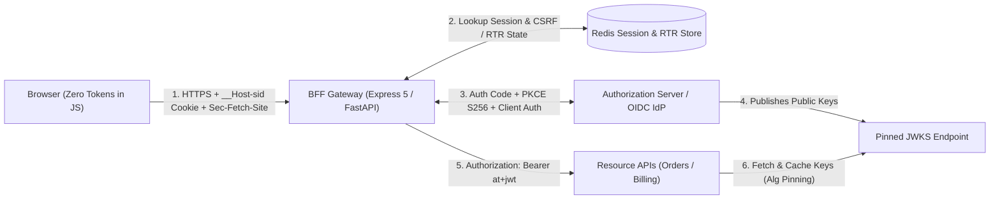

# Security & Identity Architecture Fast-Lookup Cheatsheet

A high-density technical reference sheet covering cryptographic wire structures, password hashing parameters, X.509 certificate fields, cookie flags, OAuth 2.1 / OIDC token formats, WebAuthn bitfields, ReBAC/Cedar policy syntax, and operational security tooling.

---

## 1. STRIDE Threat Matrix & DFD Element Mapping

| DFD Element | Applicable STRIDE Threats | Primary Countermeasures |
| :-- | :-- | :-- |
| **External Entity** | **S, R** (Spoofing, Repudiation) | Mutual TLS, WebAuthn, OAuth 2.1 PKCE, Digital Signatures, Audit Logging |
| **Process** | **S, T, R, I, D, E** (All 6 threats) | Sandboxing, Seccomp, Memory safety, Input validation, Least privilege, Memory-hard KDFs |
| **Data Store** | **T, R, I, D** (Tampering, Repudiation, Info Disclosure, DoS) | Encryption at rest (AES-GCM/KMS), Immutable append-only audit logs, RLS, Storage quotas |
| **Data Flow** | **T, I, D** (Tampering, Info Disclosure, DoS) | TLS 1.3 encryption, AEAD message authentication, Rate limiting, Token bucket |

---

## 2. Cryptographic Primitives & Key Sizing Matrix

| Primitive Type | Algorithm | Minimum Key Size | Recommended Standard | Security Notes |
| :-- | :-- | :-- | :-- | :-- |
| **Symmetric AEAD** | **AES-256-GCM** | 256 bits | 96-bit Nonce, 128-bit Tag | Nonce MUST NEVER repeat under same key ($<2^{32}$ msgs). |
| **Symmetric AEAD** | **ChaCha20-Poly1305** | 256 bits | 96-bit Nonce, 128-bit Tag | Faster on CPUs without AES-NI hardware instructions. |
| **Message Auth** | **HMAC-SHA-256** | $\ge 256$ bits | SHA-256 | Immune to length extension attacks; use constant-time eq. |
| **Digital Signature** | **Ed25519 (EdDSA)** | 256 bits | Curve25519 | Deterministic, side-channel immune, 64-byte signature. |
| **Digital Signature** | **ECDSA (P-256)** | 256 bits | NIST P-256 (secp256r1) | Requires RFC 6979 deterministic nonce generation. |
| **Key Agreement** | **X25519 (ECDH)** | 256 bits | Curve25519 | Constant-time, 32-byte public keys and shared secrets. |
| **Key Derivation** | **HKDF (RFC 5869)** | Input key | SHA-256 | Two-phase: `Extract` (salt + IKM $\to$ PRK), `Expand` (PRK + info $\to$ OKM). |
| **Post-Quantum KEM** | **ML-KEM (FIPS 203)** | 768 / 1024 | Module Lattice | Replaces classical ECDH against future quantum attacks. |
| **Post-Quantum Sign** | **ML-DSA (FIPS 204)** | 65 / 87 | Module Lattice | Replaces RSA/ECDSA digital signatures. |

---

## 3. Password Hashing & Secrets at Rest

### Recommended Argon2id Parameters (RFC 9106 / OWASP 2026)

```ini
Algorithm    = Argon2id (Type 2)
Memory (m)   = 65536 KiB (64 MiB) [Interactive: 19456 KiB / 19 MiB]
Passes (t)   = 3 iterations      [Interactive: 2 iterations]
Parallel (p) = 4 threads         [Interactive: 1 thread]
Salt Length  = 128 bits (16 bytes CSPRNG randomBytes)
Tag Length   = 256 bits (32 bytes output digest)
KMS Pepper   = Optional 256-bit secret stored in KMS, passed as secret parameter
```

### Password Function Comparison

| Algorithm | Memory-Hard? | GPU Resistance | Max Password Length | Status |
| :-- | :-: | :-: | :-: | :-- |
| **Argon2id** | **Yes** | **Extreme** | Unbounded | **Gold Standard (NIST / OWASP)** |
| **scrypt** | **Yes** | **High** | Unbounded | Approved alternative |
| **bcrypt** | No (Cache-hard) | Medium | **Strict 72-Byte Truncation** | Legacy acceptable; avoid in new systems |
| **PBKDF2** | **No** | **Zero** | Unbounded | Requires $>600,000$ iterations (HMAC-SHA256) |
| **SHA-256/MD5** | **No** | **Zero** | Unbounded | **BANNED FOR PASSWORDS** |

---

## 4. X.509 v3 Certificate Layout & Verification

### X.509 Certificate ASN.1 Structure (RFC 5280)

```
Certificate ::= SEQUENCE {
  tbsCertificate       TBSCertificate,
  signatureAlgorithm   AlgorithmIdentifier,
  signatureValue       BIT STRING
}

TBSCertificate ::= SEQUENCE {
  version          [0]  EXPLICIT Version DEFAULT v1 (v3 = 2),
  serialNumber          CertificateSerialNumber,
  signature             AlgorithmIdentifier,
  issuer                Name,
  validity              Validity { notBefore Time, notAfter Time },
  subject               Name,
  subjectPublicKeyInfo  SubjectPublicKeyInfo,
  issuerUniqueID   [1]  IMPLICIT UniqueIdentifier OPTIONAL,
  subjectUniqueID  [2]  IMPLICIT UniqueIdentifier OPTIONAL,
  extensions       [3]  EXPLICIT Extensions OPTIONAL
}
```

### Critical Extensions Reference

- **Basic Constraints** (`2.5.29.19`, Critical): `cA: TRUE/FALSE`, `pathLenConstraint: integer`.
- **Subject Alternative Name (SAN)** (`2.5.29.17`): `dNSName: *.example.com`, `uRI: spiffe://...`, `iPAddress: 10.0.0.1`.
- **Key Usage** (`2.5.29.15`, Critical): `digitalSignature`, `keyEncipherment`, `keyCertSign`, `cRLSign`.
- **Extended Key Usage (EKU)** (`2.5.29.37`): `serverAuth (1.3.6.1.5.5.7.3.1)`, `clientAuth (1.3.6.1.5.5.7.3.2)`.

### CA/Browser Forum SC-081 Maximum Certificate Validity Roadmap

| Issuance Date           | Maximum Allowed Validity | Primary Deployment Strategy                 |
| :---------------------- | :----------------------: | :------------------------------------------ |
| Prior to March 2026     |         398 days         | Manual or semi-automated renewal            |
| March 2026 – March 2027 |         200 days         | Mandatory ACME / Vault orchestration        |
| March 2027 – March 2029 |         100 days         | Automated CI/CD certificate pipeline        |
| **After March 2029**    |       **47 days**        | **Fully automated ephemeral ACME renewals** |

---

## 5. Modern Web & Cookie Defense Headers

### Cookie Flag Security Matrix

```http
Set-Cookie: __Host-sid=a98f12c8e3...; Secure; HttpOnly; SameSite=Strict; Path=/; Max-Age=3600
```

| Flag / Attribute | Rule & Behavior | Attack Mitigated |
| :-- | :-- | :-- |
| **`__Host-` Prefix** | Must be `Secure`, no `Domain` attribute, `Path=/`, HTTPS origin only. | Subdomain tampering, cookie tossing |
| **`HttpOnly`** | Inaccessible to JavaScript `document.cookie`. | Session theft via Cross-Site Scripting (XSS) |
| **`Secure`** | Transmitted exclusively over encrypted HTTPS connections. | Plaintext sniffing, man-in-the-middle theft |
| **`SameSite=Strict`** | Cookie never sent on cross-site requests (even incoming top-level GET). | Cross-Site Request Forgery (CSRF) |
| **`SameSite=Lax`** | Sent on top-level navigation GET; blocked on cross-site POST/PUT. | Standard balance for public landing pages |

### Essential HTTP Security Headers

```http
# Strict Content Security Policy with Cryptographic Nonce
Content-Security-Policy: default-src 'self'; script-src 'self' 'nonce-R4nd0mN0nc3' 'strict-dynamic'; object-src 'none'; base-uri 'none'; frame-ancestors 'none';

# Zero-Trust Transport Security (2 years + includeSubDomains + preload)
Strict-Transport-Security: max-age=63072000; includeSubDomains; preload

# Framing & Sniffing Defense
X-Frame-Options: DENY
X-Content-Type-Options: nosniff
Referrer-Policy: strict-origin-when-cross-origin
Cross-Origin-Opener-Policy: same-origin
Cross-Origin-Resource-Policy: same-origin
```

---

## 6. OAuth 2.1 & OIDC Quick Reference

### OAuth 2.1 Grant Type Matrix

| Grant Type | Status in OAuth 2.1 | Client Types | Security Mechanism |
| :-- | :-: | :-- | :-- |
| **Authorization Code** | **MANDATORY** | Public & Confidential | **Mandatory PKCE (S256)**, exact redirect URI |
| **Client Credentials** | **Supported** | Confidential Only | Machine-to-machine mutual TLS or private key JWT |
| **Refresh Token** | **Supported** | Public & Confidential | **Refresh Token Rotation (RTR) + Family Revocation** |
| **Implicit Grant** | **REMOVED / FORBIDDEN** | None | Insecure token exposure in URL fragment |
| **Resource Owner Password (ROPC)** | **REMOVED / FORBIDDEN** | None | Credential theft, phishing, bypasses MFA |

### PKCE S256 Formula

$$\text{code-verifier} = \text{CSPRNG(32 bytes, Base64URL)}$$ $$\text{code-challenge} = \text{BASE64URL}(\text{SHA256}(\text{code-verifier}))$$ $$\text{code-challenge-method} = \text{"S256"} \quad (\text{"plain" is strictly forbidden})$$

---

## 7. JOSE & Token Hardening

### JSON Web Signature (JWS) Structure

```
Compact JWS: <Base64URL Header>.<Base64URL Payload>.<Base64URL Signature>
```

- **Mandatory Validation Checklist (RFC 8725 BCP)**:
  1. Header MUST declare explicit algorithm (`alg: "RS256"` or `"EdDSA"`).
  2. Library MUST use an explicit algorithm allowlist (reject `"none"` and symmetric/asymmetric confusion).
  3. Validate signature against trusted key from JWKS before reading payload.
  4. Verify standard temporal claims: `exp` (current time $< exp$), `nbf` (current time $\ge nbf$), `iat` (reasonable clock skew $\le 60\text{s}$).
  5. Enforce explicit typing: Header `typ: "at+jwt"` for access tokens (RFC 9068) to prevent ID token confusion.

### Demonstrating Proof-of-Possession (DPoP - RFC 9449)

- **Header**: `{"typ": "dpop+jwt", "alg": "ES256", "jwk": { ...client public key... }}`
- **Payload**:
  - `htm`: HTTP Request Method (e.g., `"POST"`).
  - `htu`: HTTP Target URI without query/fragment (e.g., `"https://api.example.com/orders"`).
  - `ath`: Base64URL-encoded SHA-256 hash of the Access Token string: $\text{BASE64URL}(\text{SHA256}(\text{accessToken}))$.
  - `jti`: Unique random UUID to prevent proof replay.
  - `iat`: Timestamp within $\pm 60$ seconds.

---

## 8. WebAuthn Level 3 `authenticatorData` Binary Layout

```
 0                   1                   2                   3
 0 1 2 3 4 5 6 7 8 9 0 1 2 3 4 5 6 7 8 9 0 1 2 3 4 5 6 7 8 9 0 1
+-+-+-+-+-+-+-+-+-+-+-+-+-+-+-+-+-+-+-+-+-+-+-+-+-+-+-+-+-+-+-+-+
|                                                               |
|                        rpIdHash (32 Bytes)                    |
|                SHA-256 hash of Relying Party ID               |
|                                                               |
+-+-+-+-+-+-+-+-+-+-+-+-+-+-+-+-+-+-+-+-+-+-+-+-+-+-+-+-+-+-+-+-+
|     flags     |               signCount (4 Bytes)             |
+-+-+-+-+-+-+-+-+-+-+-+-+-+-+-+-+-+-+-+-+-+-+-+-+-+-+-+-+-+-+-+-+
|      [attestedCredentialData (variable length if AT flag)]    |
|      [extensions (CBOR map if ED flag set)]                   |
+-+-+-+-+-+-+-+-+-+-+-+-+-+-+-+-+-+-+-+-+-+-+-+-+-+-+-+-+-+-+-+-+
```

### Flags Byte Breakdown (Byte Index 32)

| Bit Mask | Flag Name | Meaning When Set (`1`) |
| :-: | :-- | :-- |
| `0x01` (Bit 0) | **UP** (User Present) | Physical user interaction confirmed (capacitive touch/button). |
| `0x04` (Bit 2) | **UV** (User Verified) | Local biometric (face/fingerprint) or PIN verified on device. |
| `0x08` (Bit 3) | **BE** (Backup Eligibility) | Credential is multi-device / passkey capable. |
| `0x10` (Bit 4) | **BS** (Backup State) | Credential is currently backed up to user's cloud keychain. |
| `0x40` (Bit 6) | **AT** (Attested Credential) | `attestedCredentialData` is included (registration ceremony). |
| `0x80` (Bit 7) | **ED** (Extension Data) | Extension output CBOR map is appended. |

---

## 9. ReBAC & Cedar Policy Syntax

### Google Zanzibar Relationship Tuple Syntax

```
<namespace>:<object_id>#<relation>@<user_or_userset>

# Example Tuples:
folder:contracts#owner@user:alice
document:nda_2026#parent@folder:contracts
document:nda_2026#editor@folder:contracts#owner
```

### Cedar Policy Language Template (AWS Verified Permissions)

```cedar
// Explicit forbid takes precedence over any permit
forbid (
    principal in Role::"Contractor",
    action == Action::"deleteDocument",
    resource
);

permit (
    principal in Role::"Editor",
    action in [Action::"viewDocument", Action::"editDocument"],
    resource
)
when {
    resource.department == principal.department &&
    context.mfa_authenticated == true
};
```

---

## 10. Security Operations Command Cheat Sheet

```bash
# 1. Generate X.509 Elliptic Curve Key Pair and Self-Signed Certificate
openssl req -x509 -newkey ed25519 -keyout key.pem -out cert.pem -days 47 -nodes -subj "/CN=api.internal"

# 2. Inspect Certificate SAN, Validity, and Extensions
openssl x509 -in cert.pem -text -noout | grep -A 2 "Subject Alternative Name"

# 3. Verify Active Listening Sockets and Connections
ss -tulpen

# 4. Generate CycloneDX Software Bill of Materials (SBOM) for Node.js
npx @cyclonedx/cyclonedx-npm --output-file sbom.json

# 5. Scan Container Image for Known CVEs (Fail on High/Critical)
trivy image --severity HIGH,CRITICAL --exit-code 1 myapp:v1.0.0

# 6. Verify Container Signature and Provenance via Sigstore Cosign
cosign verify --key cosign.pub ghcr.io/org/app:v1.0.0

# 7. Audit npm Dependencies and Output JSON Report
npm audit --json > audit-report.json
```

---

## 11. Auth, JWT & OAuth 2.0/2.1 Production Handbook

### Foundations & Session vs Token-Based Auth

Authentication proves _who_ the principal is (AuthN); authorization decides _what_ the principal may access (AuthZ). Production systems choose between server-side session handles, self-contained signed JWTs, and opaque reference tokens based on revocation speed, horizontal scaling, and browser threat boundaries.

| Dimension | Stateful Session Cookie (BFF + Redis) | Stateless Signed JWT (`at+jwt`) | Opaque Token + Introspection (RFC 7662) |
| :-- | :-- | :-- | :-- |
| **Credential Format** | CSPRNG opaque session ID (128+ bits) | Compact JWS (`Header.Payload.Sig`) | High-entropy random token string |
| **Verification Seam** | Redis/DB session lookup per request | Local CPU signature check via cached JWKS | Network RPC to AS `/introspect` endpoint |
| **Revocation Velocity** | **Instant** (delete key in Redis) | **Delayed** until `exp` (unless denylisted) | **Instant** (AS marks token inactive) |
| **Wire Payload Size** | Minimal (~32–64 bytes in `Cookie`) | Large (~600–2,000 bytes in `Authorization`) | Minimal (~32–64 bytes in `Authorization`) |
| **Browser Surface** | XSS-proof (`HttpOnly`), needs CSRF defense | High XSS risk if stored in JS storage | Intended for BFF/backend-to-backend |
| **Primary Use Case** | Browser web apps & BFF sessions | Microservice APIs & short-lived access tokens | Centralized kill-switch & third-party APIs |

### JWT Deep Dive: Claims, Typing, Lifecycle & Attack Mitigations

RFC 7519 defines seven standard **registered claims**; RFC 9068, OIDC Core 1.0, and RFC 9449 specialize the JOSE `typ` header so distinct token classes never cross-verify.

| Claim / Header | Standard | Purpose & Production Validation Rule |
| :-- | :-- | :-- |
| **`iss`** | RFC 7519 | Exact URI of issuing Authorization Server; verify against pinned config. |
| **`sub`** | RFC 7519 | Immutable principal identifier (never use mutable email as primary key). |
| **`aud`** | RFC 7519 | Intended Resource Server URI or `client_id`; reject tokens minted for other APIs. |
| **`exp` / `nbf` / `iat`** | RFC 7519 | Short lifetime (`5m–15m` for access tokens); enforce clock skew leeway $\le 60\text{s}$. |
| **`jti`** | RFC 7519 | Unique token ID for replay caches (mandatory in DPoP proofs) and audit tracing. |
| **`typ: "at+jwt"`** | RFC 9068 | Explicit Access Token media type; prevents ID tokens from being accepted as API tokens. |
| **`typ: "JWT"`** | OIDC Core 1.0 | ID Token carrying `nonce`, `auth_time`, `at_hash`, `acr`/`amr`, and `azp`. |
| **`typ: "dpop+jwt"`** | RFC 9449 | Proof-of-possession JWT carrying `jwk`, `htm`, `htu`, `ath`, `jti`, and optional `nonce`. |

**End-to-end token lifecycle:**

1. **Mint**: AS signs short-lived access token (`EdDSA` or `RS256`, `typ: "at+jwt"`, `kid` set) and pairs it with a single-use refresh token belonging to a tracked token family.
2. **Verify**: Resource API resolves `kid` from a pinned `/.well-known/jwks.json` endpoint, restricts `algorithms` via an explicit allowlist, validates signature, and enforces `typ`, `iss`, `aud`, `exp`, `nbf`, and `scope`.
3. **Refresh & Rotate**: Client/BFF exchanges refresh token at `/token`; AS invalidates the old refresh token and mints a replacement in the same family (RFC 9700 §4.14).
4. **Revoke**: On logout, compromise, or refresh token reuse detection, BFF deletes the Redis session and AS revokes the entire refresh token family (plus introspection/short `exp` expiry).

| Attack Vector | Vulnerable Behavior | Mandatory Mitigation (RFC 8725) |
| :-- | :-- | :-- |
| **`alg: "none"` Bypass** | Verifier skips signature check when header says `alg: "none"`. | Hardcode asymmetric `algorithms` allowlist (`['EdDSA']` or `['RS256']`). |
| **`RS256` / `HS256` Confusion** | Library uses `header.alg`; attacker signs HS256 using public PEM. | Pin one key type to one asymmetric algorithm allowlist. |
| **`kid` Path Traversal / SQLi** | Unsanitized `header.kid` concatenated into file path or SQL query. | Treat `kid` strictly as an opaque lookup key in an in-memory JWKS map. |
| **`jku` / `x5u` SSRF** | Verifier fetches remote key URL from untrusted token header. | Ignore `jku`/`x5u` completely; pin JWKS URI from AS discovery config. |
| **Token & Audience Confusion** | Accepting ID tokens on APIs or cross-service `aud` tokens. | Require `typ === "at+jwt"`, exact `iss`, and exact service-specific `aud`. |

### OAuth 2.0 vs OAuth 2.1 Grant Types, PKCE & OIDC Core 1.0

**OAuth 2.1** consolidates RFC 6749 with **RFC 9700 (OAuth 2.0 Security BCP, Jan 2025)** and **RFC 9207** (`iss` parameter):

| Capability | OAuth 2.0 (RFC 6749, 2012) | OAuth 2.1 + RFC 9700 (Now) |
| :-- | :-- | :-- |
| **Implicit Grant (`response_type=token`)** | Allowed for SPAs | **Removed / Forbidden** (leaks tokens in URL fragments, history, `Referer`). |
| **Password Grant (ROPC)** | Allowed for legacy logins | **Removed / Forbidden** (breaks MFA/passkeys and exposes master credentials). |
| **PKCE (`S256`, RFC 7636)** | Optional extension | **Mandatory** for both public and confidential clients; `plain` forbidden. |
| **Redirect URI Matching** | Wildcards & prefixes common | **Exact byte-for-byte match** required (exception: loopback ephemeral ports). |
| **Mix-Up Defense** | Unspecified | AS returns `iss` on redirect (RFC 9207); client verifies before `/token` call. |
| **Refresh Tokens** | Long-lived reusable bearer | **Sender-constrained** (DPoP/mTLS) or **RTR with reuse revocation**. |

**Auth Code + PKCE Flow**: Client creates CSPRNG `state` (CSRF), `nonce` (OIDC replay), and `code_verifier` $\to$ sends `code_challenge = BASE64URL(SHA256(code_verifier))` with `code_challenge_method=S256` to `/authorize` $\to$ AS redirects back with `code`, `state`, `iss` $\to$ client verifies `state` + `iss`, then exchanges `code` + `code_verifier` via back-channel `POST /token`.

**OIDC Core 1.0 Summary**: Adds authentication on top of OAuth 2.1 via the signed **ID Token** (`iss`, `sub`, `aud` = `client_id`, `exp`, `iat`, `nonce`, `auth_time`, `acr`, `amr`, `azp`, `at_hash`). Always verify `nonce` (constant-time equality), verify `at_hash` when an access token accompanies the ID token, and require `email_verified === true` before linking accounts by email (prevents nOAuth takeover).

### Token Storage Best Practices Matrix

| Storage Strategy | XSS Exposure | CSRF Exposure | Production Verdict |
| :-- | :-- | :-- | :-- |
| **BFF + `__Host-` Cookie (`HttpOnly; Secure; SameSite=Lax`)** | **Immune** (tokens stay server-side) | Mitigated via `SameSite` + `Sec-Fetch-Site` / CSRF token | **Default recommendation for web apps**. |
| **In-Memory JS + DPoP (RFC 9449)** | Same-session XSS can invoke proof key | Immune (explicit `Authorization: DPoP` header) | Acceptable when BFF is infeasible; lost on tab reload. |
| **`localStorage` / `sessionStorage`** | **Fatal** (any XSS reads bearer tokens) | Immune | **Anti-pattern**; never store long-lived tokens or refresh tokens here. |

### Full Auth System Architecture



### Production Auth Q&A & Reusable Config Templates

- **Q: Why use a BFF instead of storing tokens in an SPA?** A BFF moves tokens off the browser origin completely: an XSS payload cannot exfiltrate `access_token` or `refresh_token` from `HttpOnly` server-backed sessions, and refresh rotation stays atomic server-side.
- **Q: How do you revoke a stateless JWT immediately?** Keep access token `exp` short (`5m`), store refresh token families in Redis for instant kill on logout/reuse, and pair high-risk operations with opaque tokens or a short-TTL Redis `jti` denylist.
- **Q: What breaks `__Host-` cookies in local/proxy deployments?** `__Host-` requires `Secure` (HTTPS), `Path=/`, and **no** `Domain` attribute; behind TLS-terminating load balancers, enable `app.set('trust proxy', 1)` (Express) or forward `X-Forwarded-Proto` carefully.
- **Q: What single `jose` / `PyJWT` mistake causes critical auth bypasses?** Passing a public key to `verify()` without pinning `algorithms`, `typ`, `issuer`, and `audience`, which enables `alg:none`, RS256/HS256 confusion, and ID-token-as-access-token substitution.
- **Q: How do you prevent false-positive RTR revocations from concurrent tabs?** Serialize refresh requests per session/family with a short Redis distributed lock (`SET NX PX`) and retain a brief grace window (`5s–10s`) before marking a rotated token compromised, or keep refresh solely inside the BFF.

**Express 5 (`express@5.3.0` + `jose`) Cookie & JWT Guard Template** (verified in [`examples/15-express-auth-bff.test.ts`](./examples/15-express-auth-bff.test.ts)):

```typescript
// Express 5 BFF session cookie (__Host- requires Secure, Path=/, and NO Domain)
res.setHeader(
  'Set-Cookie',
  `__Host-sid=${sid}; HttpOnly; Secure; SameSite=Lax; Path=/; Max-Age=3600`,
);

// RFC 8725 JWT verification middleware (pinned JWKS + algorithm + typ + aud + iss)
const { payload } = await jose.jwtVerify(token, remoteJwks, {
  algorithms: ['EdDSA'],
  typ: 'at+jwt',
  issuer: 'https://auth.example.com',
  audience: 'https://orders-api.example.com',
  clockTolerance: 60,
  requiredClaims: ['iss', 'sub', 'aud', 'exp', 'iat', 'jti'],
});
```

**FastAPI (`fastapi@0.165.0` + `pyjwt`) Cookie & JWT Guard Template** (verified in [`examples/python/auth_service.py`](./examples/python/auth_service.py)):

```python
# FastAPI BFF session cookie
response.set_cookie(
    key="__Host-sid",
    value=sid,
    httponly=True,
    secure=True,
    samesite="lax",
    path="/",
    max_age=3600,
)

# RFC 8725 JWT verification (strict typ, algorithms allowlist, aud, iss, required claims)
header = jwt.get_unverified_header(token)
if header.get("typ") != "at+jwt":
    raise HTTPException(status_code=401, detail="invalid_token_type")
claims = jwt.decode(
    token,
    public_key,
    algorithms=["RS256"],
    audience="https://api.example.com",
    issuer="https://auth.example.com",
    leeway=60,
    options={"require": ["exp", "iat", "iss", "aud", "sub", "jti"]},
)
```
