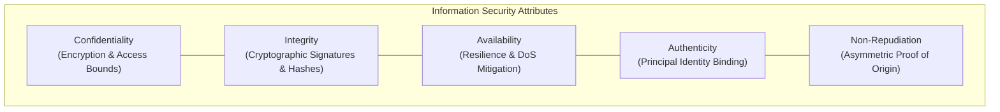
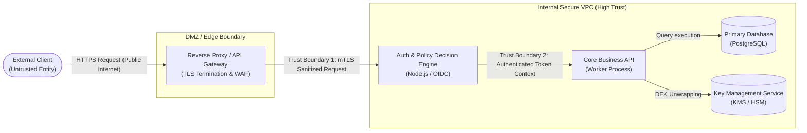
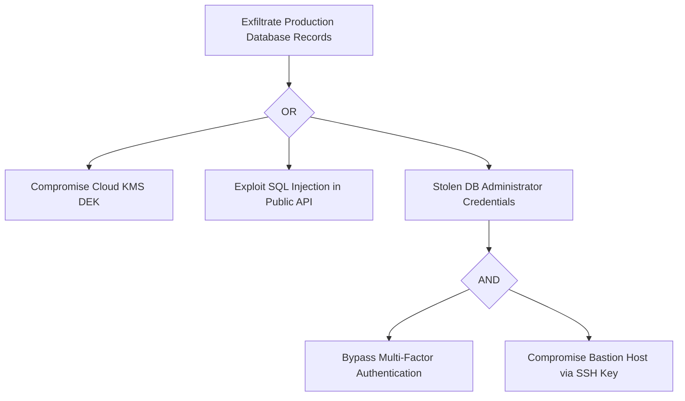

# Module 01 — Threat Modeling, Security Principles & ASVS 5.0

Modern software systems operate across hostile, multi-tenant network perimeters where defensive assumptions must be formally grounded rather than improvised. Security is not an operational feature layered atop finished code; it is an architectural discipline governing state boundaries, data flows, cryptographic trust roots, and failure recovery. This module establishes the formal foundations of systems security: the expanded CIA triad, trust boundary decomposition, STRIDE threat modeling, attack trees, core defensive axioms, and the OWASP Application Security Verification Standard (ASVS 5.0) mapped against the OWASP Top 10:2025 taxonomy.

---

## 1. Information Security Triad & Architectural Principles

### Formal Definition of Security Attributes
Security architecture models the protection of computational assets across five core formal dimensions:

1. **Confidentiality ($\mathcal{C}$)**: The mathematical and architectural property ensuring that data objects $D$ and system states $S$ are inaccessible and unreadable to unauthorized entities $E \notin \mathcal{A}_{\text{read}}$. Evaluated through cryptographic encryption, hardware isolation boundaries, and memory access control.
2. **Integrity ($\mathcal{I}$)**: The assurance that data objects and code execution paths cannot be created, modified, reordered, or deleted by unauthorized actors $E \notin \mathcal{A}_{\text{write}}$ without detection. Formally enforced via cryptographic message authentication codes (MACs), digital signatures, and append-only cryptographic hashes.
3. **Availability ($\mathcal{A}$)**: The guarantee that authorized entities $E \in \mathcal{A}_{\text{access}}$ can reliably read, write, and execute authorized services within defined service level objectives ($\text{SLO}_{\text{latency}} \le \tau_{\max}$) despite hostile traffic bursts, hardware faults, or denial-of-service attempts.
4. **Authenticity**: The verifiable binding between a transmitted message or assertion and the real-world identity of its originating principal, proving the message genuinely originated from the asserted source.
5. **Non-Repudiation**: The cryptographic property ensuring that a principal who performed a transaction or signed a payload cannot subsequently deny having authored it, guaranteed by asymmetric digital signatures whose private keys remain exclusively in the principal's control.



---

## 2. Trust Boundaries & Data Flow Diagrams (DFDs)

A **Trust Boundary** is an explicit line of demarcation separating two system components operating at different privilege levels, administrative domains, or authentication contexts. Crossing a trust boundary mandates that all inputs, headers, tokens, and payloads undergo strict sanitization, authentication, and authorization before processing.

### Elements of Security Data Flow Diagrams
To model system attack surfaces, security architects construct Level-1 and Level-2 Data Flow Diagrams consisting of four discrete primitives:
- **External Entities (Principals)**: Users, third-party webhooks, or external microservices outside administrative control.
- **Processes**: Computation execution environments (Node.js runtimes, worker processes, API gateways).
- **Data Stores**: Persistent or ephemeral state repositories (PostgreSQL databases, Redis caches, local disk filesystems).
- **Data Flows**: Network communication channels (HTTPS API calls, gRPC streams, IPC pipes).



---

## 3. The STRIDE Threat Modeling Framework

Developed by Loren Kohnfelder and Praerit Garg at Microsoft, the **STRIDE** methodology systematically evaluates threats by examining each element of a system architecture against six distinct threat categories.

| Threat Category | Violated Security Property | Description & Attack Vector | Canonical Mitigation |
| :--- | :--- | :--- | :--- |
| **S — Spoofing** | Authenticity | An attacker assumes the identity of a legitimate user, system process, or external service (e.g. forged JWTs, ARP spoofing, stolen credentials). | Asymmetric digital signatures, mutual TLS (mTLS), WebAuthn passkeys, cryptographic nonce checks. |
| **T — Tampering** | Integrity | Malicious alteration of data at rest, data in transit, or code execution state (e.g. SQL injection, man-in-the-middle payload modification). | AEAD symmetric encryption, HMAC authentication tags, write-ahead log checksums, memory safety. |
| **R — Repudiation** | Non-Repudiation | An attacker performs an unauthorized action and falsely denies involvement due to absent or forgeable audit logging. | Cryptographically signed, append-only tamper-evident audit logs, PKI digital signatures. |
| **I — Information Disclosure** | Confidentiality | Unauthorized exposure of protected data to an unauthorized observer (e.g. data breach, verbose stack traces, SSRF metadata leakage). | Encryption at rest and in transit (TLS 1.3, AES-256-GCM), least-privilege scoping, field-level redaction. |
| **D — Denial of Service** | Availability | Exhaustion of computational, network, or memory resources preventing legitimate users from accessing the system. | Token bucket rate limiting, SYN cookies, non-blocking asynchronous I/O, resource quotas. |
| **E — Elevation of Privilege** | Authorization (Least Privilege) | An unprivileged user or compromised worker executes actions reserved for administrators or root processes (e.g. BOLA/IDOR). | Strict server-side authorization enforcement (ReBAC/ABAC), container capabilities dropping (`no-new-privileges`). |

### Element-to-Threat Mapping Matrix
Not every DFD element is susceptible to every STRIDE threat. Security modeling applies this canonical mapping:

```
Element Type     | S | T | R | I | D | E |
-----------------+---+---+---+---+---+---+
External Entity  | X |   | X |   |   |   |
Process          | X | X | X | X | X | X |
Data Store       |   | X | X | X | X |   |
Data Flow        |   | X |   | X | X |   |
```

---

## 4. Attack Trees & Scoring Methodologies

An **Attack Tree** is a formal, conceptual diagram representing the combinatorial paths through which an adversary can compromise a root security goal. The root node represents the attacker's ultimate objective (e.g., "Exfiltrate Production Database Records"), while sub-nodes represent component attack steps connected via boolean **AND** and **OR** logic.



### Attack Scoring: DREAD vs Modern CVSS & SSVC
Historically, Microsoft utilized the **DREAD** scoring model (Damage, Reproducibility, Exploitability, Affected Users, Discoverability). However, modern security engineering has largely abandoned DREAD due to severe mathematical flaws:
- **Discoverability Incentive**: Rating vulnerabilities higher because they are "hard to discover" incentivizes security through obscurity.
- **Subjective Ordinal Averaging**: Averaging ordinal numbers (1–10) violates measurement theory because the distance between 3 and 4 is not quantitatively equivalent to the distance between 8 and 9.

Modern infrastructure teams replace DREAD with:
- **CVSS v4.0 (Common Vulnerability Scoring System)**: Macro-metric capturing attack vector, attack complexity, privileges required, user interaction, and scope impact.
- **EPSS (Exploit Prediction Scoring System)**: Machine-learning model estimating the empirical probability ($0.0 \le P \le 1.0$) that a software vulnerability will be weaponized in the wild within 30 days.
- **SSVC (Stakeholder-Specific Vulnerability Categorization)**: A decision-tree framework prioritizing mitigation actions (Track, Attend, Act) based on exploitation status, utility, and safety impact.

---

## 5. Axiomatic Security Design Principles

Originally formulated by Jerome Saltzer and Michael Schroeder (1975), these foundational axioms guide all production security architecture:

1. **Least Privilege**: Every program, process, and user principal must operate using the minimal set of privileges necessary to execute its legitimate task. Database connections for user authentication must have `SELECT` on credentials, not `DROP TABLE`.
2. **Defense in Depth**: Defensive mechanisms must be layered across distinct infrastructural tiers (e.g. WAF $\to$ Network ACLs $\to$ mTLS $\to$ Application RBAC $\to$ Database Row-Level Security $\to$ KMS Encryption). No single point of failure should compromise the system.
3. **Fail-Safe Defaults (Secure Defaults)**: Default configurations must default to denial of access. If an exception occurs or authorization evaluation terminates abnormally, the transaction must abort (`fail-closed`).
4. **Complete Mediation**: Every single access request to every resource must be authenticated and authorized at the point of access. Access rights cannot be cached once at connection start and trusted indefinitely.
5. **Economy of Mechanism**: Security mechanisms must be designed as simply and compactly as possible. Complex authorization state machines create unanalyzable edge cases and bypass routes.
6. **Open Design (Kerckhoffs's Principle)**: The security of a system must depend entirely on the secrecy of the cryptographic keys, not on the secrecy of the design, algorithm, or codebase.

---

## 6. OWASP ASVS 5.0 & OWASP Top 10:2025

The **OWASP Application Security Verification Standard (ASVS 5.0.0)** establishes an authoritative, level-based verification framework defining security requirements across 17 technical chapters:

- **Level 1 (Opportunistic)**: Basic controls verified via automated testing and black-box penetration testing. Protects against opportunistic, automated scanning attacks.
- **Level 2 (Standard Enterprise)**: Comprehensive verification covering architectural controls, source code audit, and threat modeling. Recommended for all web applications handling sensitive personal or financial transactions.
- **Level 3 (Advanced / Defense-in-Depth)**: Rigorous verification for high-assurance critical infrastructure, medical devices, and defense applications. Requires formal architecture validation and modular component isolation.

### Mapping the OWASP Top 10:2025 Standard
The 2025 edition of the OWASP Top 10 reflects modern cloud-native architectures, API abuse vectors, and software supply chain dependencies:

| Category Code | Vulnerability Title | Core Mechanics & Primary Risk | Primary Mitigation |
| :--- | :--- | :--- | :--- |
| **A01:2025** | **Broken Access Control** | BOLA, IDOR, privilege escalation, and Server-Side Request Forgery (SSRF) allowing unauthenticated access to internal resources or cloud metadata. | Mandatory server-side ownership checks on every resource ID; disable HTTP redirects on server-side URL fetchers; strictly isolate metadata endpoints. |
| **A02:2025** | **Security Misconfiguration** | Unhardened cloud defaults, open S3 buckets, exposed debugging endpoints (`/debug/pprof`), and missing security headers. | Infrastructure as Code (IaC) linting, automated CIS benchmarks, and stripping debug tooling in production containers. |
| **A03:2025** | **Software Supply Chain Failures** | Compromised third-party packages, dependency confusion attacks, typosquatting, and unverified GitHub Actions workflows. | Pinned lockfiles (`package-lock.json`), `npm ci --ignore-scripts`, cryptographic package signing, and SBOM validation. |
| **A04:2025** | **Cryptographic Failures** | Transmission of cleartext data, deprecated ciphers (RC4, 3DES), hardcoded symmetric keys, and non-constant-time comparisons. | Enforcing TLS 1.3, modern AEAD ciphers (AES-256-GCM, ChaCha20-Poly1305), and using `crypto.timingSafeEqual`. |
| **A05:2025** | **Injection** | SQL, NoSQL, OS Command, and Server-Side Template Injection where untrusted user input is concatenated into query interpreters. | Parameterized queries, prepared statements, and separating data from control plane instructions. |
| **A06:2025** | **Insecure Design** | Architectural flaws lacking threat modeling, missing business-logic validation, and vulnerable password reset flows. | Threat modeling early in the SDLC (STRIDE), reference architectures, and unit-tested business invariant checks. |
| **A07:2025** | **Authentication Failures** | Permitting credential stuffing, brute-force attacks, session fixation, and weak password hashing algorithms. | Argon2id password hashing, WebAuthn phishing-resistant passkeys, and account lockout rate limits. |
| **A08:2025** | **Software and Data Integrity Failures** | Insecure object deserialization, trusting unverified CI/CD artifacts, and untrusted auto-updates. | Digital signatures on updates, disabling Java/Python pickle deserialization, and verifying SLSA provenance. |
| **A09:2025** | **Security Logging and Alerting Failures** | Failure to log authorization failures, logging plaintext credentials or tokens, and lack of real-time alerting. | Centralized immutable audit trails, structured JSON logs, and real-time SIEM alerts with automated redaction. |
| **A10:2025** | **Mishandling of Exceptional Conditions** | Fail-open exception handlers, unhandled promise rejections, and crashing worker processes under malformed network packets. | Comprehensive exception handling defaulting to deny; strict fuzzing and deterministic unit testing of error paths. |

---

## 7. Then vs Now: Evolution of Threat Modeling & Security Standards

| Architectural Dimension | Historical Paradigm (Then) | Modern Production Architecture (Now) |
| :--- | :--- | :--- |
| **Perimeter Model** | "Castle and Moat": Network firewall at edge; everything inside internal corporate LAN trusted implicitly. | **Zero Trust Architecture (NIST SP 800-207)**: Every request verified continuously; mTLS between all microservices. |
| **Threat Prioritization** | DREAD ordinal scoring based on subjective engineer impressions and "discoverability". | **EPSS Probability & SSVC Decision Trees**: Objective, empirical exploit forecasting combined with automated triage. |
| **Verification Standards** | Periodic annual third-party black-box penetration tests right before production launch. | **Continuous Verification (ASVS 5.0)**: CI/CD integrated SAST, DAST, SCA, and deterministic unit-tested security proofs. |
| **Supply Chain Posture** | Trusting public package registries blindly; running `npm install` without lockfile pinning. | **Strict Supply Chain Isolation**: `npm ci --ignore-scripts`, SBOM artifact tracking, and cryptographically verified provenance. |

---

## 8. Interview Drill: Senior Infrastructure & Security Engineering

<details>
<summary>1. An engineer proposes calculating a "DREAD score" to prioritize three newly discovered API vulnerabilities. Why would a Principal Security Architect reject this approach?</summary>

DREAD calculates a score by taking the arithmetic mean of five subjective ordinal metrics: Damage, Reproducibility, Exploitability, Affected Users, and Discoverability. 
First, averaging ordinal values violates basic mathematical measurement theory because the qualitative intervals between points are non-linear and arbitrary. 
Second, including "Discoverability" rewards "security through obscurity"—treating a vulnerability as lower risk merely because it has not yet been discovered by an external scanner. 
Modern systems engineering replaces DREAD with empirical vulnerability forecasting: **CVSS v4.0** for intrinsic severity, **EPSS** for the probabilistic likelihood of in-the-wild exploitation within 30 days, and **SSVC (Stakeholder-Specific Vulnerability Categorization)** to generate deterministic operational outcomes (e.g. Act immediately vs Attend).
</details>

<details>
<summary>2. Explain the difference between Fail-Safe Defaults and Complete Mediation, and provide a concrete software failure example for each.</summary>

- **Fail-Safe Defaults**: Dictates that the baseline state of any decision must be denial of access, and any exceptional or unexpected error condition must result in rejection (`fail-closed`).
  - *Failure Example*: An authorization middleware wraps access evaluation in a `try...catch` block. When a database timeout occurs, the catch block catches the error, logs a warning, and inadvertently calls `next()` instead of `return res.status(500)`, allowing an unauthenticated user to access the route (an A10:2025 failure).
- **Complete Mediation**: Mandates that every single access to every resource must be validated at the exact moment of execution, rather than caching an authorization check once and assuming it persists.
  - *Failure Example*: A web application validates that a user is an administrator during initial login and stores `isAdmin = true` in an immutable JWT. If the user is terminated or demoted, subsequent requests continue to execute administrative actions until the JWT expires, because the individual API endpoints do not mediate against active authorization state.
</details>

<details>
<summary>3. In an architecture review, an engineering lead argues that an internal microservice running inside an AWS Private VPC does not need TLS or authentication because "it's behind the VPC firewall." How do you challenge this using STRIDE?</summary>

Relying solely on network perimeter boundaries violates Defense in Depth and fails multiple STRIDE categories:
- **Spoofing**: Any rogue container, misconfigured debugging pod, or compromised developer laptop connected via internal VPN can forge TCP packets or spoof internal DNS hostnames to impersonate a legitimate microservice.
- **Tampering & Information Disclosure**: Unencrypted plaintext traffic across internal VPC subnets is vulnerable to packet sniffing if a container breakout occurs on the same physical host, or if an attacker compromises a monitoring agent or network tap.
- **Elevation of Privilege**: If an edge service suffers an SSRF vulnerability (OWASP A01:2025), an external attacker can instruct the edge proxy to issue HTTP requests directly to the unauthenticated internal service, instantly escalating privileges to internal administrative APIs.
Zero Trust mandates that all services authenticate peer identity via mutual TLS (mTLS) with cryptographically validated certificates regardless of network placement.
</details>

<details>
<summary>4. Why was Server-Side Request Forgery (SSRF) merged into category A01:2025 (Broken Access Control) in the OWASP Top 10:2025 update?</summary>

In previous OWASP editions (such as 2021), SSRF had its own standalone category (A10:2021). However, architectural root-cause analysis revealed that SSRF is fundamentally a broken access control mechanism: the software application acts as an unauthorized proxy, allowing an unprivileged user to bypass network boundary access controls and reach protected systems (such as the cloud instance metadata service at `169.254.169.254` or internal loopback admin consoles). By recognizing SSRF as an access control failure rather than a distinct protocol error, security teams apply unified authorization mediation and egress boundary filtering.
</details>

<details>
<summary>5. How does the OWASP ASVS 5.0 level structure assist an engineering organization in balancing security rigor against developmental velocity?</summary>

ASVS 5.0 explicitly defines three progressive verification tiers:
- **Level 1** provides a minimum baseline of defensive controls suitable for all software, designed to be verified cheaply via automated CI/CD security tools and black-box tests.
- **Level 2** targets standard enterprise applications processing sensitive personal, health, or financial transactions, requiring threat modeling, architectural code reviews, and structured cryptographic verification.
- **Level 3** is reserved for high-criticality assets (banking cores, medical life-support software, industrial SCADA systems) where failure threatens organizational survival or human life, justifying the high operational cost of formal verification and complete component sandboxing.
This prevents engineering teams from either over-engineering low-risk internal utilities or dangerously under-securing mission-critical financial ledger pipelines.
</details>
