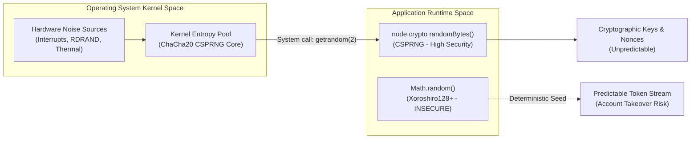
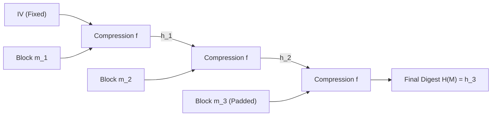
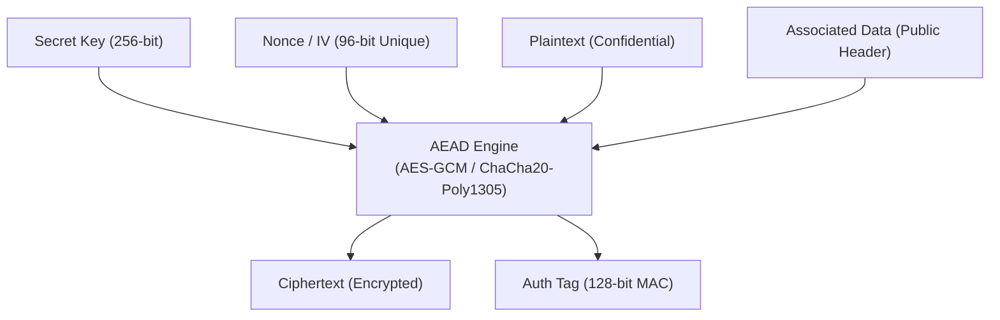
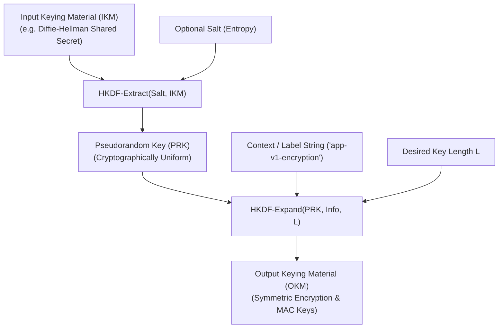
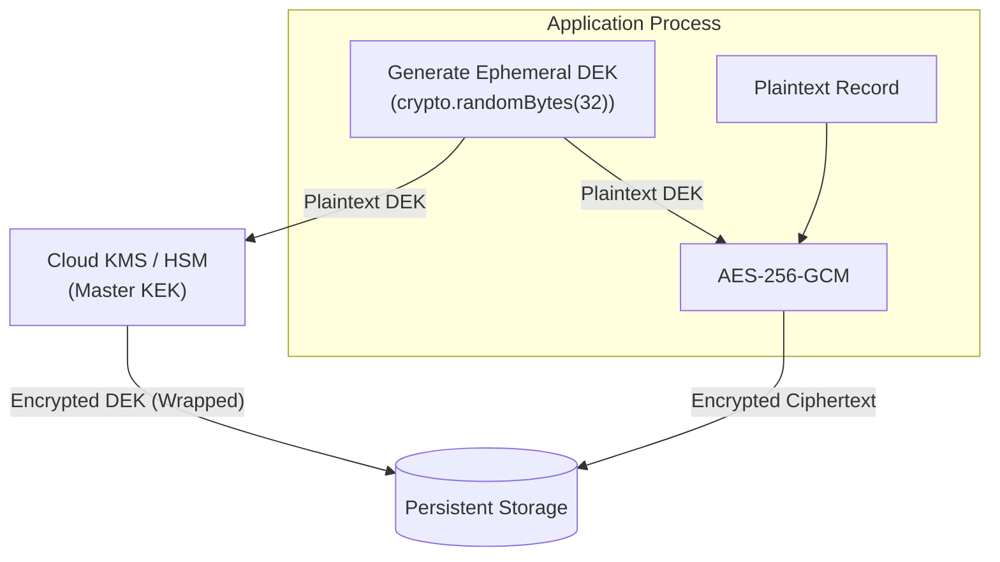

# Module 02 — Cryptographic Primitives for Software Engineers

Cryptographic algorithms are the mathematical building blocks of digital security. However, software engineers rarely design raw cryptographic primitives; instead, their architectural challenge is selecting, combining, and operating them without introducing catastrophic side-channel, nonce-reuse, or implementation vulnerabilities. Using a mathematically sound cipher incorrectly frequently yields zero confidentiality or integrity. This module covers cryptographic engineering essentials: cryptographically secure pseudorandom number generators (CSPRNG), collision-resistant hashing, the Merkle-Damgård length extension attack, constant-time comparison, Authenticated Encryption with Associated Data (AEAD), the AES-GCM nonce-reuse catastrophe, asymmetric signatures, Diffie-Hellman key exchange, HKDF, and envelope encryption.

---

## 1. Randomness: CSPRNG vs Insecure PRNGs

Cryptographic security relies on unpredictability. All symmetric keys, initialization vectors, salts, nonces, and session tokens must originate from a **Cryptographically Secure Pseudorandom Number Generator (CSPRNG)**.

### Mathematical Entropy & Algorithmic Failure
Standard library pseudorandom functions (e.g. `Math.random()` in JavaScript, `rand()` in C) utilize linear congruential generators (LCGs) or the Mersenne Twister algorithm (MT19937). These algorithms are designed for statistical uniform distribution and simulation velocity, not security. Given a few consecutive outputs from `Math.random()`, an attacker can reconstruct the internal 64-bit or 19937-bit state vector in microseconds and deterministically predict all past and future outputs.

A **CSPRNG** (such as Linux `/dev/urandom`, POSIX `getrandom(2)`, or Node.js `node:crypto.randomBytes()`) satisfies two mandatory cryptographic properties:
1. **Next-Bit Unpredictability**: Given the first $k$ bits of an output sequence, no polynomial-time algorithm can predict the $(k+1)$-th bit with probability significantly greater than $0.5$ ($P(\text{bit} = 1) \le 0.5 + \epsilon$).
2. **State Compromise Extension Resistance (Forward & Backward Secrecy)**: Even if an attacker learns the internal state of the generator at time $t$, they cannot deduce prior outputs ($t < \tau$) or future outputs ($t > \tau$) once fresh entropy is harvested from hardware interrupts, thermal noise, and CPU jitter.



---

## 2. Cryptographic Hashing & The Length Extension Attack

A cryptographic hash function $H: \{0, 1\}^* \to \{0, 1\}^n$ maps an arbitrary-length message to a fixed-size $n$-bit digest. It must satisfy three formal properties:
- **Preimage Resistance (One-Wayness)**: Given $y = H(x)$, it is computationally infeasible to find any $x'$ such that $H(x') = y$ (work factor $\mathcal{O}(2^n)$).
- **Second Preimage Resistance (Weak Collision Resistance)**: Given $x$, it is infeasible to find $x' \ne x$ such that $H(x') = H(x)$ (work factor $\mathcal{O}(2^n)$).
- **Collision Resistance (Strong Collision Resistance)**: It is infeasible to find any distinct pair $(x_1, x_2)$ such that $H(x_1) = H(x_2)$. Due to the Birthday Paradox, the work factor is $\mathcal{O}(2^{n/2})$.

### The Merkle-Damgård Construction & Length Extension
Classic hash algorithms (MD5, SHA-1, SHA-256, SHA-512) follow the **Merkle-Damgård construction**: the message is split into fixed-size blocks (e.g. 512 bits) with padding, and processed iteratively through a compression function $f$:
$$h_0 = \text{IV}, \quad h_i = f(h_{i-1}, m_i), \quad H(M) = h_k$$



Because the output digest $H(M)$ is simply the internal state $h_k$ after processing the final block, Merkle-Damgård hashes are vulnerable to **Length Extension Attacks**. If an application attempts to construct a message authentication code naively via:
$$\text{MAC} = H(\text{secret} \parallel \text{message})$$
An attacker who knows $H(\text{secret} \parallel \text{message})$ and the length of $\text{secret} \parallel \text{message}$ can initialize the compression function with state $h = H(\text{secret} \parallel \text{message})$, append arbitrary extension data $m_{\text{new}}$, and calculate the valid hash of the concatenated message:
$$H(\text{secret} \parallel \text{message} \parallel \text{padding} \parallel m_{\text{new}})$$
without ever knowing the secret key!

### The Solution: HMAC (RFC 2104)
To eliminate length extension attacks, RFC 2104 defines **HMAC (Hash-based Message Authentication Code)** using nested hashing with two distinct constants (`ipad = 0x36`, `opad = 0x5c`):
$$\text{HMAC}(K, M) = H\Big((K \oplus \text{opad}) \parallel H\big((K \oplus \text{ipad}) \parallel M\big)\Big)$$
Because the outer hash encrypts/digests the inner hash output, the internal Merkle-Damgård state is completely hidden, preventing length extension. Modern algorithms such as **SHA-3 (Keccak Sponge construction)** and **BLAKE3** are naturally immune to length extension by design.

---

## 3. Side-Channel Attacks & Constant-Time Comparison

In software security, how a calculation executes is often as dangerous as what it calculates. Standard string and buffer comparisons (`===` in JavaScript, `strcmp()` in C) operate via **early exit**: they iterate byte-by-byte and immediately return `false` upon encountering the first differing byte.

```typescript
// INSECURE: Leaks secret length and byte values via CPU timing
function insecureCompare(a: Buffer, b: Buffer): boolean {
  if (a.length !== b.length) return false;
  for (let i = 0; i < a.length; i++) {
    if (a[i] !== b[i]) return false; // Early exit leaks timing!
  }
  return true;
}
```

### The Timing Oracle Attack
If an attacker measures the response time of an API verifying an HMAC signature across thousands of requests with sub-microsecond precision, an input that matches the first byte will take slightly longer to fail than an input that fails on byte 0. By iteratively testing all 256 byte values for index 0 until finding the maximum latency spike, the attacker learns byte 0. Repeating this for all indices allows an attacker to forge valid HMAC signatures and authentication tokens without knowing the secret key.

### Constant-Time Execution
To eliminate timing channels, software must execute comparison operations in **constant time** regardless of where or whether bytes differ. In Node.js, `crypto.timingSafeEqual(bufA, bufB)` executes constant-time XOR comparison:
```typescript
import crypto from "node:crypto";

function secureCompare(a: Buffer, b: Buffer): boolean {
  // Constant-time requires identical buffer lengths
  if (a.length !== b.length) return false;
  return crypto.timingSafeEqual(a, b);
}
```

---

## 4. Authenticated Encryption with Associated Data (AEAD)

Historical cryptographic designs attempted to combine encryption and authentication separately (e.g. Encrypt-and-MAC, MAC-then-Encrypt). Decades of practical attacks (such as padding oracle attacks against CBC mode in TLS) proved that separating secrecy from authenticity produces subtle, exploitable vulnerabilities.

Modern cryptographic standards mandate **AEAD (Authenticated Encryption with Associated Data)**. An AEAD cipher takes four inputs:
1. **Secret Key ($K$)**: Symmetric secret (e.g. 256 bits).
2. **Nonce ($N$)**: Number used once; unique per message under the same key.
3. **Plaintext ($P$)**: The confidential data to be encrypted.
4. **Associated Data ($AD$)**: Unencrypted metadata (e.g. packet headers, tenant IDs) that must be cryptographically bound to the ciphertext to prevent tampering.

It outputs:
- **Ciphertext ($C$)**: Encrypted bytes of identical length to plaintext.
- **Authentication Tag ($T$)**: Cryptographic MAC (typically 128 bits / 16 bytes) verifying that neither $C$ nor $AD$ has been modified.



### Dominant AEAD Ciphers
- **AES-GCM (Galois/Counter Mode)**: Combines AES counter-mode encryption (CTR) with Galois field multiplication ($\text{GF}(2^{128})$) for high-speed hardware-accelerated authentication (Intel AES-NI instructions). Standardized in RFC 5116.
- **ChaCha20-Poly1305**: Combines the ChaCha20 stream cipher with the Poly1305 authenticator (RFC 8439). Designed by Daniel J. Bernstein, it executes in constant time purely on standard CPU registers, making it immune to cache-timing attacks on mobile CPUs lacking AES hardware instructions.

---

## 5. The AES-GCM Nonce-Reuse Catastrophe

The most critical operational failure mode in modern symmetric cryptography is **reusing a Nonce with the same key in AES-GCM**.

### Mathematical Mechanics of the Breakdown
In AES-GCM, encryption is performed using Counter Mode:
$$C_i = P_i \oplus \text{AES}_K(\text{Nonce} \parallel i)$$
If two distinct messages $P_1$ and $P_2$ are encrypted using the identical Key $K$ and Nonce $N$, the keystream is identical:
$$C_1 \oplus C_2 = (P_1 \oplus \text{Keystream}) \oplus (P_2 \oplus \text{Keystream}) = P_1 \oplus P_2$$
An attacker instantly learns the XOR difference of the plaintexts.

Worse, AES-GCM calculates its authentication tag $T$ using **GHASH**, which evaluates a polynomial over the Galois field $\text{GF}(2^{128})$ where the coefficients are the ciphertext blocks and the indeterminate is the hash key $H = \text{AES}_K(0^{128})$:
$$T = \text{GHASH}_H(C, AD) \oplus \text{AES}_K(\text{Nonce} \parallel 1)$$
When two messages share the same Nonce, the term $\text{AES}_K(\text{Nonce} \parallel 1)$ cancels out when XORing the authentication tags:
$$T_1 \oplus T_2 = \text{GHASH}_H(C_1, AD_1) \oplus \text{GHASH}_H(C_2, AD_2)$$
This produces a polynomial equation in $H$ with known coefficients. An attacker can factor this polynomial to extract the internal authentication key $H$. Once $H$ is recovered, the attacker can forge valid authentication tags for arbitrary spoofed ciphertexts, completely destroying the integrity of all future communications under that key.

```
+-----------------------------------------------------------------------------------+
|                           THE BIRTHDAY PARADOX IN AES-GCM                         |
| Standard AES-GCM specifies a 96-bit Nonce. If nonces are generated randomly:      |
|                                                                                   |
| By the Birthday Paradox, the probability of a collision reaches 50% after:        |
|                  N ≈ √(2^96) = 2^48 messages                                      |
| However, to maintain a collision probability below 2^-32 (NIST SP 800-38D):       |
|                  Max Safe Random Invocations ≈ 2^32 (approx. 4.29 billion)        |
|                                                                                   |
| If keys are long-lived or nonces wrap on process restart, catastrophic compromise |
| occurs. Solution: Use AES-GCM-SIV (RFC 8452) or deterministic 64-bit counters.    |
+-----------------------------------------------------------------------------------+
```

---

## 6. Asymmetric Primitives: Signatures & Key Exchange

Symmetric cryptography requires both parties to share a secret key in advance. Asymmetric cryptography utilizes mathematically coupled key pairs: a **Private Key** (kept confidential) and a **Public Key** (distributed publicly).

### Digital Signatures: Ed25519 vs ECDSA vs RSA-PSS
Digital signatures provide authenticity and non-repudiation: only the private key holder can generate a signature, but anyone possessing the public key can verify it.

- **Ed25519 (RFC 8032)**: Edwards-curve Digital Signature Algorithm over Curve25519. It uses deterministic nonce generation ($r = H(k \parallel M)$), completely eliminating the devastating random-nonce disclosure flaw of classic ECDSA. It operates in constant time and provides 128 bits of cryptographic security with compact 32-byte public keys and 64-byte signatures.
- **ECDSA (FIPS 186-4)**: Elliptic Curve DSA over NIST curves (P-256, P-384). **Critical Pitfall**: If the per-signature random nonce $k$ has even a tiny mathematical bias or is ever reused across two signatures, the private key can be algebraically extracted using the Hidden Number Problem (the famous PlayStation 3 root key compromise). RFC 6979 mitigates this by deriving $k$ deterministically.
- **RSA-PSS (RFC 8017)**: Probabilistic Signature Scheme over large composite integers ($n = pq$). Far superior to legacy PKCS#1 v1.5 padding, but requires large keys (3072+ bits) and high computational overhead compared to Ed25519.

### Key Exchange: X25519 Diffie-Hellman (RFC 7748)
Diffie-Hellman allows two parties with no prior shared secrets to establish a common symmetric encryption key across an untrusted, monitored network:
1. Alice generates private key $a$ and public key $A = a \cdot G$.
2. Bob generates private key $b$ and public key $B = b \cdot G$.
3. Over the wire, they exchange public keys $A$ and $B$.
4. Alice computes shared secret $S = a \cdot B = a(b \cdot G)$.
5. Bob computes shared secret $S = b \cdot A = b(a \cdot G)$.
Both arrive at identical shared secret $S$ without exposing $a$ or $b$. **X25519** implements this over the Montgomery curve Curve25519, guaranteeing immunity to side-channel attacks and invalid curve attacks.

---

## 7. Key Derivation (HKDF) & Envelope Encryption

Raw shared secrets originating from Diffie-Hellman or passwords are not uniformly distributed bitstrings and cannot be used directly as symmetric cipher keys.

### HKDF: HMAC-based Extract-and-Expand Key Derivation (RFC 5869)
HKDF standardizes key derivation across two distinct phases:



1. **Extract**: `PRK = HMAC-Hash(Salt, IKM)` concentrates non-uniform entropy into a uniformly distributed pseudorandom key (PRK).
2. **Expand**: `OKM = HKDF-Expand(PRK, Info, L)` expands the PRK to arbitrary output length $L$ conditioned on a domain-separation context string (`Info`), allowing the generation of independent encryption and authentication keys from a single master secret.

### Envelope Encryption
Encrypting large production databases directly with a master root key stored in an HSM or Cloud KMS is slow, expensive, and creates a single point of failure. Modern architectures implement **Envelope Encryption**:



1. A long-lived **Key Encryption Key (KEK)** resides permanently inside the secure hardware boundary of an HSM/KMS and never leaves memory.
2. The application requests a new **Data Encryption Key (DEK)**. The KMS generates a random 256-bit DEK, encrypts it with the KEK, and returns both the Plaintext DEK and the Encrypted DEK.
3. The application encrypts the local database record using the Plaintext DEK via AES-256-GCM.
4. The Plaintext DEK is immediately purged from RAM.
5. The Encrypted DEK is stored alongside the ciphertext. To decrypt later, the application sends only the Encrypted DEK to the KMS for unwrapping.

---

## 8. Then vs Now: Evolution of Cryptographic Engineering

| Cryptographic Need | Historical Implementation (Then) | Modern Standard (Now) | Rationale for Change |
| :--- | :--- | :--- | :--- |
| **Symmetric Encryption** | AES-CBC + HMAC-SHA256 (Separate Encrypt-then-MAC) | **AES-256-GCM** or **ChaCha20-Poly1305 (AEAD)** | CBC mode is plagued by padding oracle attacks (POODLE, Lucky13). AEAD integrates authentication atomically. |
| **MAC Construction** | Naive Hashing: $H(K \parallel M)$ | **HMAC-SHA256** or **BLAKE3** | Merkle-Damgård hashes are fatally broken by Length Extension attacks. |
| **Digital Signatures** | RSA with PKCS#1 v1.5 padding | **Ed25519 (RFC 8032)** | RSA PKCS#1 v1.5 suffers Bleichenbacher million-message oracle attacks. Ed25519 is fast, constant-time, and compact. |
| **Key Exchange** | Classic Diffie-Hellman over Finite Fields ($p = 2048$) | **X25519 (RFC 7748)** | Finite field DH is vulnerable to Logjam parameter downgrade attacks and side-channel timing leaks. |
| **String Comparison** | Early-exit equality: `if (a === b)` | **`crypto.timingSafeEqual()`** | Early-exit comparisons create microsecond timing oracles allowing iterative key forgery. |

---

## 9. Interview Drill: Applied Cryptography

<details>
<summary>1. A developer implements a webhook verification handler using `if (computedHmac === clientHmac)`. How can an attacker exploit this vulnerability over an internet connection?</summary>

Standard string equality `===` evaluates characters sequentially and terminates execution immediately upon encountering the first mismatching character (early-exit). 
An attacker sends thousands of requests measuring the round-trip latency with high-precision statistical sampling. An HMAC guess whose first byte is correct will take several clock cycles longer to fail than a guess whose first byte is wrong. By iterating over all 256 possible values for byte 0, the attacker isolates the value that generates the statistically highest average response time. 
The attacker then fixes byte 0 and iterates through byte 1, repeating this process linearly ($\mathcal{O}(256 \times 32)$ rather than $\mathcal{O}(256^{32})$) to forge valid signatures without ever knowing the HMAC secret key.
</details>

<details>
<summary>2. Explain the mathematical reason why an attacker can decrypt ciphertext if a 96-bit Nonce is reused in AES-GCM.</summary>

In AES-GCM, encryption is executed in Counter Mode ($C_i = P_i \oplus S_i$), where keystream $S_i = \text{AES}_K(\text{Nonce} \parallel i)$. Because the keystream is a pure function of $(K, \text{Nonce})$, reusing the nonce generates the exact same keystream for two messages.
When an attacker XORs the two ciphertexts:
$$C_1 \oplus C_2 = (P_1 \oplus S) \oplus (P_2 \oplus S) = P_1 \oplus P_2$$
The keystream completely cancels out, immediately exposing the XOR difference of the original plaintexts.
Furthermore, the authentication tag $T$ is computed using the GHASH polynomial over $\text{GF}(2^{128})$ with a secret hash key $H$. Reusing the nonce allows the attacker to subtract the tags, formulate a polynomial equation in $H$, and solve for $H$, granting the ability to forge valid authentication tags for arbitrary spoofed payloads.
</details>

<details>
<summary>3. Why is $H(\text{secret} \parallel \text{message})$ an insecure MAC when $H$ is SHA-256, but secure when $H$ is SHA-3?</summary>

SHA-256 utilizes the Merkle-Damgård construction, where the output hash digest is identical to the internal state of the compression function after processing the final padded message block. Because of this, an observer who sees $H(\text{secret} \parallel \text{message})$ can use that hash as the starting internal state vector, append additional message blocks, and calculate a mathematically valid hash for the extended message without knowing the secret prefix (a Length Extension Attack).
SHA-3 uses the Keccak **sponge construction** (absorbing and squeezing). It absorbs input into a large internal state (1600 bits) but squeezes out only a truncated subset (e.g. 256 bits). Because the internal state is hidden and larger than the output digest, length extension is mathematically impossible.
</details>

<details>
<summary>4. What is the role of HKDF-Extract versus HKDF-Expand in key derivation?</summary>

HKDF separates key derivation into two orthogonal phases:
- **HKDF-Extract** takes non-uniform input keying material (IKM, such as a Diffie-Hellman shared secret) and an optional salt, and compresses it using an HMAC PRF into a fixed-length Pseudorandom Key (PRK) that is statistically indistinguishable from a uniform random bitstring.
- **HKDF-Expand** takes the uniform PRK, an application-specific context string (`Info`), and an output length $L$, and expands the PRK into independent, cryptographically isolated output keys (e.g., separate encryption, MAC, and IV keys). The context string ensures that deriving keys for different purposes from the same PRK produces mathematically independent results.
</details>

<details>
<summary>5. How does Envelope Encryption prevent security performance bottlenecks and simplify key rotation?</summary>

In Envelope Encryption, large data volumes are encrypted locally using a symmetric Data Encryption Key (DEK) via high-speed hardware AES-NI instructions. The DEK is ephemeral and used only for that record. The central KMS/HSM is only called to encrypt or decrypt the tiny 32-byte DEK using a master Key Encryption Key (KEK).
This resolves two critical operational problems:
1. **Performance & Scalability**: Multi-gigabyte database records do not need to be streamed over the network to the KMS; only the 32-byte DEKs are sent.
2. **Key Rotation**: When the master KEK is rotated, petabytes of historical database records do not need to be decrypted and re-encrypted. The system simply fetches the stored encrypted DEKs, decrypts them with the old KEK, re-encrypts them with the new KEK, and saves the updated wrapped DEKs.
</details>
