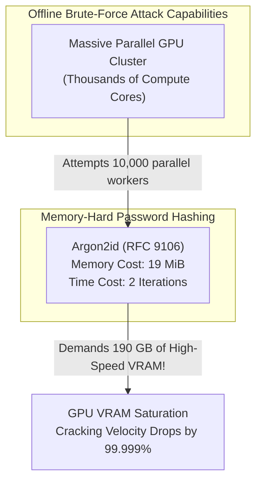
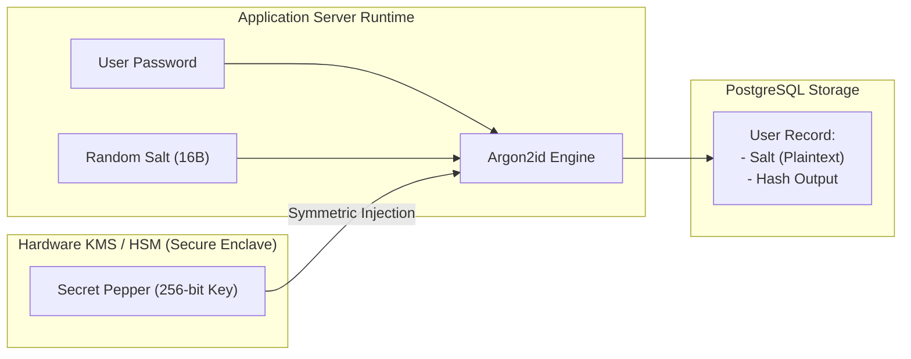
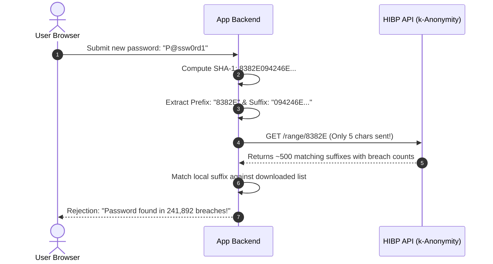

# Module 03 — Passwords, Credential Defense & Secrets at Rest

Storing credentials and infrastructure secrets is one of the highest-risk operational responsibilities in software engineering. Passwords cannot be encrypted reversibly; they must be transformed using slow, memory-hard cryptographic hash functions that render offline brute-force and specialized ASIC attacks economically impossible. Simultaneously, infrastructure API keys, database connection strings, and certificates must be decoupled from application source code using dynamic secrets managers and envelope encryption. This module analyzes password hashing architectures, Argon2id mechanics, bcrypt's silent 72-byte truncation flaw, salts vs peppers, $k$-anonymity breach checking, and enterprise secrets management with Vault and SOPS.

---

## 1. Password Hashing: Why Standard Hashes Fail

A catastrophic architectural mistake is hashing user passwords with standard cryptographic algorithms like SHA-256 or BLAKE3:
$$\text{Hash} = \text{SHA-256}(\text{password})$$

Standard hash functions are designed for high throughput: a modern consumer GPU (e.g. NVIDIA RTX 4090) can compute over **25 billion SHA-256 hashes per second**. A customized ASIC cluster can evaluate trillions per second. If an attacker dumps an application database containing SHA-256 hashes, they can brute-force 8-character alphanumeric passwords within minutes.

### The Requirements for Password Hashing
Password hashing functions must be intentionally **slow**, **parameterizable**, and **memory-hard**:
1. **CPU/Time Cost ($t$)**: Dictates the number of iterative rounds of computation to slow down evaluation.
2. **Memory Cost ($m$)**: Dictates the physical RAM footprint required to compute a single hash. This is the ultimate defense against GPUs and ASICs: while a GPU possesses thousands of parallel arithmetic cores, its high-speed on-chip cache per thread is minuscule (~several kilobytes). Forcing each hash calculation to allocate 19 MiB of memory saturates memory bus bandwidth, reducing GPU cracking velocity from billions to a few dozen hashes per second.
3. **Parallelism Cost ($p$)**: Dictates the number of independent execution threads or lanes utilized during calculation.



---

## 2. Algorithm Comparison: Argon2id, bcrypt & scrypt

| Algorithm | Standardization | Primary Strength | Known Vulnerability or Constraint | Recommended Status |
| :--- | :--- | :--- | :--- | :--- |
| **Argon2id** | **RFC 9106** (Winner of Password Hashing Competition) | Hybrid memory-hard design immune to GPU acceleration and side-channel cache-timing attacks. | Requires modern runtime support (Node 26 native `crypto.argon2Sync`). | **Gold Standard (Mandatory for new systems)** |
| **scrypt** | **RFC 7914** | First standardized memory-hard function; highly resistant to hardware ASICs. | Vulnerable to side-channel cache-timing attacks if memory access patterns are snooped. | **Strong Alternative** |
| **bcrypt** | OpenBSD (Blowfish-based) | Proven 25-year production track record; resistant to raw CPU acceleration. | **Silent 72-Byte Truncation Flaw**: Ignores all characters after byte 72. Negligible memory footprint (~4 KB), allowing GPU clustering. | **Legacy / Maintenance Only** |
| **PBKDF2** | RFC 8018 / NIST SP 800-132 | Broad FIPS compliance and ubiquitous platform support. | **Zero Memory Hardness**: Pure CPU loop; trivially cracked on modern GPUs. | **Deprecated for new designs** |

### The Silent 72-Byte Truncation Flaw in bcrypt
The bcrypt algorithm initializes a Blowfish state array with an expanded password. Due to Blowfish's original key schedule, bcrypt silently truncates input passwords at **exactly 72 bytes**. 
If a user submits a 100-character passphrase, bcrypt hashes only the first 72 bytes and discards the remaining 28 bytes without throwing an error:
```typescript
// INSECURE BEHAVIOR: Both passwords produce identical bcrypt hashes!
const pass1 = "A".repeat(72) + "SECRET_KEY_ONE";
const pass2 = "A".repeat(72) + "DIFFERENT_KEY_TWO";
// bcrypt.compareSync(pass2, hash1) === true!
```
Developers attempting to mitigate this by pre-hashing the password with `sha256(password)` frequently introduce formatting bugs (hex strings vs raw binary buffers) or destroy password entropy if not executed uniformly. **Argon2id has no 72-byte ceiling and natively supports arbitrary password lengths up to $2^{32}-1$ bytes.**

### Recommended OWASP Argon2id Parameters (RFC 9106)
- **Algorithm**: `argon2id` (combines Argon2d data-dependent memory access for GPU resistance with Argon2i data-independent memory access for side-channel resistance).
- **Memory ($m$)**: $19\text{ MiB}$ ($19456\text{ KiB}$).
- **Iterations ($t$)**: $2$ passes.
- **Parallelism ($p$)**: $1$ thread (or match host CPU core count).
- **Hash Length**: $32$ bytes.
- **Salt Length**: $16$ bytes generated via CSPRNG.

---

## 3. Salting vs Peppering Architecture

### The Role of the Cryptographic Salt
A **Salt** is a unique, cryptographically random bitstring (minimum 16 bytes) generated by a CSPRNG for every user account. It is prepended or appended to the password before hashing:
$$\text{Hash} = \text{Argon2id}(\text{password}, \text{salt})$$
- **Defense Target**: Eliminates **Rainbow Table** attacks (precomputed tables of billions of hashed common passwords) and prevents duplicate passwords from generating identical hashes across different users.
- **Storage**: The salt is stored in plaintext in the database directly alongside the hash (or encoded directly into the PHC formatted hash string: `$argon2id$v=19$m=19456,t=2,p=1$c2FsdHNhbHQ$...`). The salt does not need to be secret; its sole mathematical function is ensuring uniqueness.

### The Role of the Cryptographic Pepper
A **Pepper** is a high-entropy secret key (256 bits) that is combined with the password before hashing, but **never stored in the database**:
$$\text{Hash} = \text{Argon2id}(\text{password} \parallel \text{Pepper}, \text{salt}) \quad \text{or} \quad \text{Hash} = \text{HMAC}_{\text{Pepper}}(\text{Argon2id}(\text{password}, \text{salt}))$$
- **Defense Target**: Protects against database leak dumps. If an attacker executes a SQL injection or exfiltrates a database snapshot, they acquire the hashes and salts, but cannot compute offline brute-force attacks because they lack the Pepper.
- **Storage**: The Pepper resides exclusively in a hardware HSM, Cloud KMS, or a dedicated secrets manager.



---

## 4. Breached Password Defense & $k$-Anonymity

Users routinely reuse passwords across multiple external web platforms. When a third-party site is breached, credential-stuffing bots immediately replay those username/password pairs against banking and SaaS logins.

To prevent users from selecting known compromised credentials, NIST SP 800-63B mandates checking candidate passwords against breached password databases (e.g. Troy Hunt's *Have I Been Pwned* / HIBP, containing over 800 million compromised credentials).

### The Privacy Problem & The $k$-Anonymity Solution
An application cannot send the user's plaintext password (or its complete SHA-1/SHA-256 hash) across the network to an external API, as this would expose user credentials to the third-party service.

HIBP solves this using **$k$-Anonymity Mathematical Modeling**:
1. The client hashes the password with SHA-1:
   $$\text{SHA-1}("P@ssw0rd1") = \text{8382E094246E26601D9D994EAE352B118CD75EB4}$$
2. The client splits the 40-character hex string into a **5-character prefix** and a **35-character suffix**:
   - Prefix: `8382E`
   - Suffix: `094246E26601D9D994EAE352B118CD75EB4`
3. The client queries the public API with **only the 5-character prefix**:
   `GET https://api.pwnedpasswords.com/range/8382E`
4. The API returns a list of hundreds of hash suffixes that share that identical 5-character prefix, along with their empirical compromise frequency counts.
5. The client searches the returned suffix list locally in memory. If the local suffix appears in the list, the password is breached and rejected.

Because $16^5 = 1,048,576$ possible prefixes exist, every prefix maps to thousands of unrelated passwords. The external API learns nothing about which specific password the user entered.



---

## 5. Enterprise Secrets Management Architecture

Hardcoding API keys, private certificates, or database credentials inside source code repositories (or baking them into container images) guarantees catastrophic compromise.

### The Secret Lifecycle Hierarchy
```
Root of Trust (Hardware HSM / Cloud KMS Master Key)
  └── Key Encryption Key (KEK)
       └── Secrets Store (HashiCorp Vault / OpenBao / AWS Secrets Manager)
            ├── Dynamic Short-Lived Database Credentials (TTL = 1 hour)
            ├── Ephemeral Mutual-TLS Certificates (TTL = 24 hours)
            └── Static Third-Party API Keys (Encrypted with KEK)
```

### Static vs Dynamic Secrets
- **Static Secrets**: Long-lived API keys (e.g. Stripe API key). Vulnerable to leakage over time; requires manual rotation drills.
- **Dynamic Secrets (Vault / OpenBao Pattern)**: Credentials that do not exist until requested by an authenticated workload, generated on-the-fly with a strictly enforced Time-To-Live (TTL) (e.g. 15 minutes). When the TTL expires, the secrets manager connects directly to the database and executes `REVOKE` / `DROP ROLE`, ensuring that leaked credentials become inert automatically.

### Encrypted Git Repositories: SOPS with Age
For GitOps workflows where infrastructure configuration files must reside in Git, teams utilize **SOPS (Secrets OPerationS)**:
- SOPS encrypts only the sensitive values inside YAML/JSON files while leaving the keys and hierarchy unencrypted in plaintext (allowing clean `git diff` reviews).
- Values are encrypted using modern public-key cryptography (**Age**, RFC 9849) or Cloud KMS. Developers keep their private Age keys in local secure storage, preventing repository leaks from exposing infrastructure keys.

---

## 6. Then vs Now: Evolution of Credential Defense

| Dimension | Historical Paradigm (Then) | Modern Architecture (Now) |
| :--- | :--- | :--- |
| **Password Storage** | MD5 or single-round SHA-256 with static salts. | **Argon2id (RFC 9106)** with $m=19\text{ MiB}, t=2, p=1$ and KMS Pepper. |
| **Length Limits** | bcrypt with silent 72-byte truncation ceiling. | **Unbounded Argon2id** supporting multi-sentence passphrases. |
| **Breach Defense** | Enforcing arbitrary symbol/number rotation rules every 90 days. | **$k$-Anonymity Breached Database Checking** on selection; no forced expiration. |
| **Secrets in Code** | Storing database passwords in local `.env` files checked into Git. | **Dynamic Secrets Managers (Vault)** and **SOPS-encrypted Age files** in GitOps. |
| **Secret Rotation** | Annual manual password change spreadsheets. | **Automated Ephemeral Dynamic Credentials** with sub-hour TTLs. |

---

## 7. Interview Drill: Credential Engineering & Secrets Operations

<details>
<summary>1. A developer argues: "We don't need Argon2id because we pre-hash all passwords with SHA-256 before feeding them into bcrypt, which solves bcrypt's 72-byte limit and makes it super fast." Critique this architecture.</summary>

This proposal exhibits multiple fatal flaws:
1. **Pre-hashing Format Bugs**: If the developer hashes the password with SHA-256 and converts it to a standard hex string, the resulting string is 64 hexadecimal characters long (64 bytes), which happens to fit within bcrypt's 72-byte limit. However, if they change the hash or formatting, truncation resumes.
2. **GPU Acceleration of the Pre-image**: bcrypt possesses minimal memory hardness (~4 KB of Blowfish state). Because SHA-256 is blindingly fast, an attacker who obtains the bcrypt hashes can still spin up thousands of GPU threads to attack the combined function, whereas Argon2id's 19 MiB memory footprint completely cripples GPU parallelism.
3. **Needless Architectural Fragility**: Layering SHA-256 in front of bcrypt adds operational complexity and custom cryptographic assembly when modern runtimes (such as Node 26) natively provide standardized, battle-tested Argon2id out of the box with zero 72-byte truncation issues.
</details>

<details>
<summary>2. Explain how a Pepper differs from a Salt, where each is stored, and what threat model a Pepper defends against.</summary>

- **Salt**: A random bitstring (16+ bytes) generated uniquely for each user. It is stored directly alongside the hash in the database. Its purpose is to ensure that two identical passwords produce completely different hashes, destroying the utility of precomputed Rainbow Tables.
- **Pepper**: A single high-entropy secret key (256 bits) applied across all password hashes. It is **never** stored in the database; it resides in a secure external hardware enclave (Cloud KMS or HSM).
- **Threat Model**: A Pepper defends against offline brute-force cracking following a **database dump compromise** (e.g. via SQL injection or unauthorized backup access). An attacker possessing the database table has all salts and hashes, but without the external Pepper key, they cannot execute offline dictionary attacks.
</details>

<details>
<summary>3. In HIBP's $k$-anonymity API, why does the client send only the first 5 characters of the SHA-1 hash, and how does this protect user privacy?</summary>

A 5-character hexadecimal prefix represents $16^5 = 1,048,576$ possible buckets. Given the hundreds of millions of compromised passwords in existence, each 5-character prefix is shared by hundreds or thousands of completely different passwords.
When the client transmits `GET /range/8382E`, the HIBP server only learns that the user's password falls into a bucket containing thousands of potential values. The server cannot determine which specific suffix in that bucket the user entered. The final search matching the 35-character suffix occurs entirely on the client's local machine, ensuring the user's password never leaves the application boundary.
</details>

<details>
<summary>4. What are Dynamic Secrets, and why are they fundamentally superior to static database passwords stored in environment variables?</summary>

Static credentials stored in environment variables (`DATABASE_PASSWORD=secret`) persist indefinitely. If an attacker breaches the application server or exploits a log injection vulnerability, that password remains valid until a human manually rotates it.
Dynamic secrets managers (such as HashiCorp Vault) do not store pre-existing database credentials. When an application starts, it authenticates to Vault, which connects to PostgreSQL and dynamically executes:
`CREATE ROLE app_worker_123 WITH LOGIN PASSWORD 'rand' VALID UNTIL 'in 1 hour';`
Vault hands these ephemeral credentials to the application. If the credentials leak, they automatically expire within an hour. Furthermore, every application instance receives a unique database username, enabling granular forensic audit attribution.
</details>

<details>
<summary>5. Why does NIST SP 800-63B explicitly advise AGAINST periodic mandatory password expiration (e.g. forcing users to change passwords every 90 days)?</summary>

Empirical security research across millions of enterprise users demonstrated that forcing periodic password resets causes users to select predictable, mathematically weaker password patterns (e.g. `Spring2025!` $\to$ `Summer2025!`). 
NIST SP 800-63B recommends:
1. Allowing long, memorable passphrases without arbitrary complexity constraints.
2. Checking passwords against breached credential databases on creation and change.
3. Forcing password changes **only** upon confirmed evidence of account compromise.
4. Mandating phishing-resistant multi-factor authentication (WebAuthn / Passkeys).
</details>
