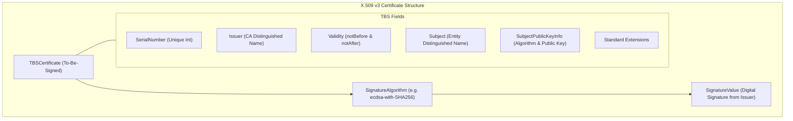
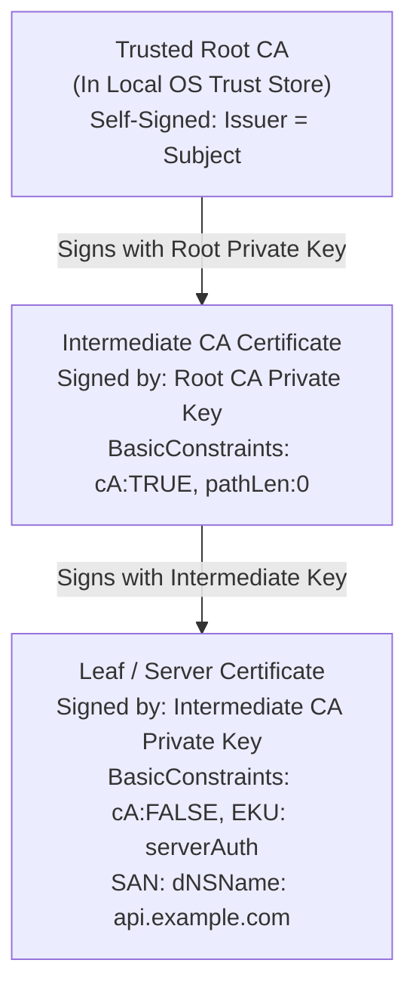
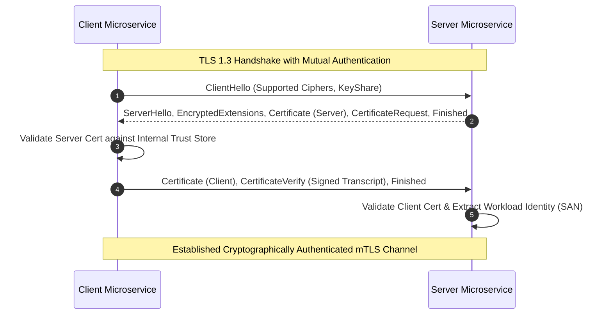

# Module 04 — Public Key Infrastructure, X.509 & Mutual TLS (mTLS)

Trust on the internet is anchored in Public Key Infrastructure (PKI). Without a verifiable cryptographic mechanism to bind a public encryption key to an asserted real-world identity (such as a domain name or a microservice identifier), secure key exchange algorithms like Diffie-Hellman are completely vulnerable to on-path Man-in-the-Middle (MITM) impersonation. This module analyzes the X.509 certificate standard, RFC 5280 certification path validation, revocation systems (CRL, OCSP, CRLite), the ACME protocol, CA/Browser Forum SC-081 certificate lifespan reductions, and Mutual TLS (mTLS) workload identity architectures using SPIFFE/SPIRE.

---

## 1. X.509 Certificate Architecture (RFC 5280)

An **X.509 v3 Certificate** is an ASN.1 structured, DER/PEM encoded digital credential signed by a trusted Certification Authority (CA) that cryptographically binds a Subject's identity to their public key.

### Critical X.509 Extensions (RFC 5280)
1. **Subject Alternative Name (SAN)**:
   - **Crucial Rule**: Modern TLS clients (browsers, cURL, Go, Node.js) completely ignore the legacy `Common Name` (CN) attribute in the Subject field. Hostname validation is performed **exclusively** against the SAN extension (`dNSName: api.example.com`, `iPAddress: 192.0.2.1`, or `uniformResourceIdentifier: spiffe://...`).
2. **Basic Constraints (`2.5.29.19`)**:
   - `cA: BOOLEAN`: Indicates whether the certified public key belongs to a Certification Authority authorized to issue child certificates. Leaf certificates must strictly set `cA: FALSE`.
   - `pathLenConstraint: INTEGER`: Limits the maximum number of intermediate CAs that may follow this certificate in a valid certificate path.
3. **Key Usage (`2.5.29.15`) & Extended Key Usage (EKU, `2.5.29.37`)**:
   - Restricts the cryptographic purposes for which the public key may be utilized:
     - `digitalSignature`: Required for TLS handshake signature verification.
     - `keyEncipherment`: Used in legacy RSA key transport.
     - `serverAuth` (`1.3.6.1.5.5.7.3.1`): Permits the certificate to authenticate a TLS server.
     - `clientAuth` (`1.3.6.1.5.5.7.3.2`): Permits the certificate to authenticate a client in Mutual TLS (mTLS).
4. **Name Constraints (`2.5.29.30`)**:
   - Enables root or intermediate CAs to restrict child certificate issuance to specific domain subtrees (e.g. permitted subtree `.corp.example.com`).

---

## 2. Certification Path Building & Validation (RFC 5280)

When a client establishes a TLS connection, the server presents a certificate chain:
$$\text{Leaf Certificate} \to \text{Intermediate CA } 1 \to \dots \to \text{Intermediate CA } N$$

The client validates the chain against its local **Trust Store** (a pre-installed collection of trusted Root CA public keys maintained by the operating system or browser).

### Path Validation Invariants (RFC 5280 §6.1)
To accept a certificate as valid, the verifying client enforces these non-negotiable checks:
1. **Signature Verification**: For each certificate $C_i$, the signature must be valid when verified against the public key of the preceding issuer certificate $C_{i-1}$ in the chain.
2. **Temporal Validity**: Current time $t$ must strictly satisfy:
   $$C_i.\text{notBefore} \le t \le C_i.\text{notAfter}$$
3. **Revocation Status**: The certificate must not appear in any active revocation list.
4. **CA Hierarchy Constraints**: Every intermediate certificate in the path must assert `cA: TRUE`. If `pathLenConstraint = 0`, the intermediate may issue leaf certificates only, not further sub-CAs.
5. **Name Matching**: The target hostname requested by the client (SNI) must match at least one entry in the leaf certificate's SAN list. Wildcards (`*.example.com`) match only a single DNS label (they match `foo.example.com` but not `bar.foo.example.com`).

---

## 3. Revocation Mechanics: CRL, OCSP & CRLite

If a private key is compromised or a certificate is mis-issued, the CA must revoke it before its scheduled expiration date.

### The Evolution of Revocation Systems
1. **Certificate Revocation Lists (CRL, RFC 5280)**:
   - The CA periodically signs and publishes a large list of all revoked serial numbers.
   - *Failure Mode*: Bandwidth explosion. As CRLs grow to tens of megabytes, client lookups induce severe latency or fail open on mobile connections.
2. **Online Certificate Status Protocol (OCSP, RFC 6960)**:
   - A real-time client-to-CA protocol: the browser queries the CA's OCSP responder directly asking "Is certificate serial number $S$ revoked?".
   - *Failure Mode*: Privacy leak (the CA learns every website the user visits) and latency tax. If the OCSP responder is slow or blocked, browsers fall back to "soft-fail" (ignoring the check), allowing attackers to bypass revocation simply by blocking OCSP packets!
3. **OCSP Stapling (RFC 6066) & Must-Staple**:
   - The server periodically fetches a signed, time-stamped OCSP assertion directly from the CA and "staples" it into the TLS handshake. The client verifies the staple without contacting the CA.
4. **CRLite & Centralized Revocation Sets**:
   - Modern browsers (Firefox, Chrome) push compressed, probabilistic data structures (cascading Bloom filters) of all known revoked certificates directly to the browser client during daily updates, enabling instantaneous, privacy-preserving, $O(1)$ offline revocation checks.

### Certificate Transparency (CT, RFC 6962 / RFC 9162)
To prevent rogue or coerced CAs from issuing fraudulent certificates secretly, all public CAs must submit newly issued certificates to public, append-only, cryptographically auditable **Certificate Transparency (CT) Logs** backed by Merkle trees. CAs return a **Signed Certificate Timestamp (SCT)** embedded into the certificate. Modern browsers immediately reject public HTTPS certificates that lack valid SCTs.

---

## 4. ACME Protocol & Lifespan Shortening (SC-081)

Historically, certificates were ordered manually and issued for 3 to 5 years. This led to massive operational outages when certificates silently expired, and meant compromised keys remained valid for half a decade.

### The ACME Protocol (RFC 8555)
The **Automated Certificate Management Environment (ACME)** protocol, pioneered by Let's Encrypt, automates certificate issuance and renewal via machine-to-machine interactions over HTTPS.
- **HTTP-01 Challenge**: The ACME server instructs the client to provision a cryptographically random token at `http://<domain>/.well-known/acme-challenge/<token>`. The ACME server fetches the URL over the public internet to prove domain ownership.
- **DNS-01 Challenge**: The client provisions a `_acme-challenge.<domain>` TXT record in authoritative DNS containing a SHA-256 digest of the key authorization. Required for wildcard certificates (`*.example.com`).

### CA/Browser Forum Ballot SC-081
The CA/Browser Forum has aggressively shortened public certificate maximum lifespans:
- **Historical (Pre-2015)**: 5 years (1,825 days).
- **2020**: Capped at 398 days (~13 months).
- **Ballot SC-081 (Mandated 2026–2028 Transition)**: Shortens public certificate lifespans to **47 days by March 2027**, and **10 days by 2028**. Let's Encrypt now issues **6-day certificates** for high-automation environments.
This policy forces engineering organizations to automate 100% of their PKI renewal workflows: manual certificate renewal is no longer operationally viable.

---

## 5. Mutual TLS (mTLS) & Workload Identity (SPIFFE/SPIRE)

Standard TLS provides one-way authentication: the client verifies the server's identity, but the server does not authenticate the client at Layer 4.

In **Mutual TLS (mTLS)**, both parties exchange and validate X.509 certificates during the TLS handshake:
1. The server transmits `CertificateRequest` specifying acceptable CA root distinguished names.
2. The client transmits its own `Certificate` followed by `CertificateVerify` (signing the handshake transcript with its private key to prove key possession).
3. The server validates the client's certificate chain against an internal private CA trust store.

### SPIFFE/SPIRE Workload Identity
In microservice architectures, relying on IP addresses for authorization is insecure due to dynamic IP churn in Kubernetes. The **SPIFFE (Secure Production Identity Framework for Everyone)** standard defines a uniform identity format encoded directly into the SAN extension of mTLS X.509 certificates (SVIDs):

$$\text{spiffe://domain.internal/ns/production/sa/order-service}$$

- **Trust Domain**: `domain.internal`
- **Workload Path**: `/ns/production/sa/order-service`

When Service A calls Service B over mTLS:
1. Service B terminates mTLS and validates Service A's X.509 certificate against the private SPIFFE CA.
2. Service B extracts the SPIFFE ID from `cert.subjectAltName`.
3. Service B's authorization engine (e.g. OpenFGA or Cedar) enforces policy based on the authenticated SPIFFE identity:
   `permit(principal == "spiffe://.../order-service", action == "charge", resource == "billing-queue");`

---

## 6. Then vs Now: Evolution of PKI & Workload Identity

| PKI Dimension | Historical Paradigm (Then) | Modern Production Architecture (Now) |
| :--- | :--- | :--- |
| **Validation Target** | Common Name (CN) string in Subject field. | **Subject Alternative Name (SAN)** exclusively; CN ignored. |
| **Certificate Lifespan**| 1 to 3 years; manual renewal spreadsheets. | **6 to 47 days (SC-081)**; automated via ACME (RFC 8555). |
| **Revocation** | Slow, monolithic CRL downloads or soft-failing OCSP. | **CRLite offline sets** & **OCSP Stapling with Must-Staple**. |
| **Issuance Audit** | Private, opaque CA issuance with no public records. | **Mandatory Certificate Transparency (CT)** with embedded SCTs. |
| **Service Identity** | IP whitelisting and cleartext bearer API tokens. | **mTLS with SPIFFE/SPIRE X.509 SVIDs** issued ephemerally. |

---

## 7. Interview Drill: PKI & Workload Identity

1. A microservice team configures a certificate with `Common Name: api.corp.internal` but omits the Subject Alternative Name (SAN) extension. Modern clients reject the connection with an invalid certificate error. Why?

Under RFC 6125 and RFC 5280, modern TLS implementations (including Chrome, Firefox, Go `crypto/tls`, and Node.js) have completely deprecated the use of the `Common Name` (CN) field for subject identity validation. 
Validating against CN was ambiguous because the field was historically a human-readable display string without strict syntax rules or multi-domain support. Modern clients require that all domain names, IP addresses, and URI identities be explicitly enumerated within the **Subject Alternative Name (SAN)** extension (`dNSName` or `iPAddress`). If the SAN extension is absent, the client treats the certificate as having no valid identities and aborts the connection.

2. Why does "soft-fail" OCSP revocation checking fail to protect users against an active Man-in-the-Middle attacker?

In soft-fail OCSP checking, if the client cannot reach the CA's OCSP responder (due to network timeout, DNS resolution failure, or server error), the client assumes the certificate is valid and proceeds with the connection. 
An active Man-in-the-Middle attacker who has compromised a revoked certificate and key simply drops or intercepts all outgoing client traffic to the CA's OCSP responder IP address or port 80. The client experiences an OCSP timeout, "soft-fails", and accepts the attacker's compromised, revoked certificate without warning. Only hard-fail with OCSP Must-Staple or centralized CRLite sets defeats this attack.

3. What is the role of the `BasicConstraints` extension, and what catastrophic security vulnerability occurs if an intermediate CA issues a certificate with `cA: TRUE` to a public web server?

The `BasicConstraints` extension dictates whether a certificate belongs to a Certification Authority (`cA: TRUE`) or an end-entity leaf node (`cA: FALSE`). 
If a CA accidentally issues a certificate with `cA: TRUE` to a customer's web server, that customer now possesses a valid intermediate Certification Authority key recognized by all browsers that trust the root. The customer can use their private key to sign fraudulent, validly-chained certificates for *any domain in the world* (e.g. `google.com`, `bankofamerica.com`), completely breaking the global PKI trust model.

4. Explain how SPIFFE IDs solve the ephemeral IP problem in Kubernetes microservice security.

In dynamic container orchestrators like Kubernetes, pods are created and destroyed continuously, recycling ephemeral IP addresses every few minutes. Relying on IP-based firewall rules (Layer 3/4) to authenticate microservices is fragile, slow to propagate, and susceptible to IP spoofing. 
SPIFFE assigns each logical workload an immutable URI identity string (`spiffe://cluster.local/ns/prod/sa/payment-service`) encoded directly into an ephemeral X.509 certificate issued via mTLS. When pods communicate, identity is verified cryptographically via the mTLS handshake regardless of which physical node or IP address the pod occupies.

5. How will CA/Browser Forum Ballot SC-081 impact enterprise PKI operations over the next three years?

Ballot SC-081 systematically reduces the maximum validity period of public TLS certificates:
- By March 2027, certificates will be capped at 47 days.
- By 2028, lifespans drop to approximately 10 days.
This change renders manual certificate procurement and ticket-based deployment completely obsolete. Any enterprise that does not fully automate its certificate issuance and renewal pipelines using ACME (RFC 8555) or automated Kubernetes controllers (e.g. `cert-manager`) will face continuous production outages as certificates expire every few weeks.

