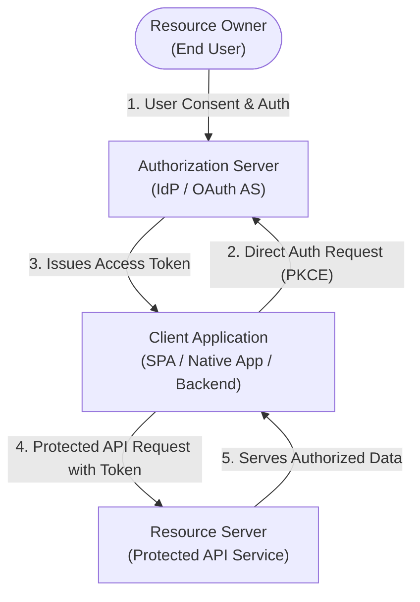
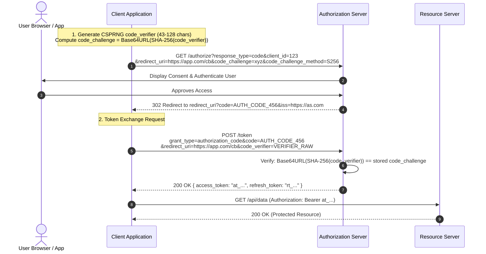
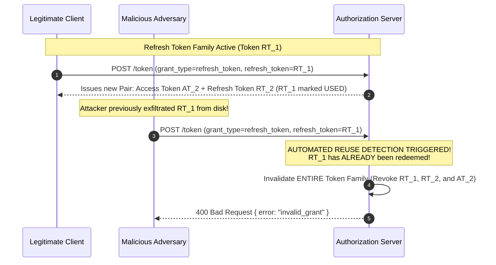

# Module 06 — OAuth 2.1 Core Protocol & The RFC 9700 Security BCP

OAuth 2.0 (RFC 6749, published in 2012) was an exceptionally flexible delegation framework. However, its broad design freedom, optional security features, and support for legacy client types introduced devastating real-world vulnerabilities over the following decade. **OAuth 2.1** (draft-ietf-oauth-v2-1-16) consolidates RFC 6749 with twelve years of critical security specifications—most notably **RFC 7636 (PKCE)**, **RFC 9700 (OAuth 2.0 Security Best Current Practice / BCP 240, Jan 2025)**, **RFC 8252 (OAuth for Native Apps)**, and **RFC 9207 (Authorization Server Issuer Identification)**. This module analyzes the hardened OAuth 2.1 protocol architecture, the elimination of legacy grant types, mandatory PKCE, exact redirect-URI matching, refresh token rotation with reuse detection, and the RFC 9700 attacker model.

---

## 1. The OAuth 2.1 Architectural Taxonomy

OAuth 2.1 defines a protocol for delegated authorization. It separates four distinct architectural roles:
1. **Resource Owner**: An entity capable of granting access to a protected resource (typically the end user).
2. **Resource Server (RS)**: The server hosting the protected resources, capable of accepting and responding to protected resource requests using access tokens.
3. **Client**: An application making protected resource requests on behalf of the Resource Owner and with its authorization.
4. **Authorization Server (AS)**: The server issuing access tokens to the client after successfully authenticating the Resource Owner and obtaining authorization.

### Client Profiles
- **Confidential Clients**: Applications capable of maintaining the confidentiality of their credentials (e.g. backend servers running in secure data centers with private client secrets or mTLS certs).
- **Public Clients**: Applications incapable of maintaining credential secrecy (e.g. Single Page Applications running in browser JavaScript, or mobile apps running on iOS/Android devices). Public clients **cannot possess a secret key**.

---

## 2. What OAuth 2.1 Purges from RFC 6749

OAuth 2.1 is primarily a **reduction and hardening** of RFC 6749. It permanently deprecates and removes two notoriously insecure legacy grant types:

### 1. Removal of the Implicit Grant
In the legacy Implicit Grant (`response_type=token`), the Authorization Server returned the access token directly in the URI fragment (`#access_token=...`) of the browser redirect.
- **The Catastrophic Vulnerability**: URI fragments are logged in browser history, visible to browser extensions, exposed via HTTP `Referer` headers on cross-origin link clicks, and accessible to any untrusted script running on the page. OAuth 2.1 completely forbids returning access tokens in authorization responses.

### 2. Removal of Resource Owner Password Credentials (ROPC)
In ROPC (`grant_type=password`), the client application directly prompted the user for their username and password and forwarded them to the Authorization Server.
- **The Anti-Pattern**: ROPC destroys the entire foundational purpose of OAuth (delegation without sharing passwords). The client learns the user's master credentials, making MFA, WebAuthn passkeys, federated login, and credential scoping impossible. OAuth 2.1 completely deletes ROPC.

---

## 3. The Modern Authorization Code Flow with Mandatory PKCE

In OAuth 2.1, the **Authorization Code Grant with Proof Key for Code Exchange (PKCE, RFC 7636)** is the sole standardized flow for user-facing applications (both public and confidential).

### Mathematical Mechanics of PKCE (RFC 7636)
PKCE protects against authorization code interception attacks (e.g. a malicious app on Android registering a custom URL scheme to steal the code returned in the OS redirect).

1. **`code_verifier`**: The client generates a high-entropy cryptographically random string (43 to 128 characters from unreserved URI characters: `[A-Z]`, `[a-z]`, `[0-9]`, `-`, `.`, `_`, `~`) using a CSPRNG.
2. **`code_challenge`**: The client computes the SHA-256 hash of the `code_verifier` and encodes it in URL-safe base64 without padding:
   $$\text{code\_challenge} = \text{Base64URL}\Big(\text{SHA-256}(\text{code\_verifier})\Big)$$
3. The client transmits the `code_challenge` and `code_challenge_method=S256` in the initial `/authorize` query. (Note: `code_challenge_method=plain` is strictly forbidden in OAuth 2.1).
4. The Authorization Server stores the `code_challenge` bound to the issued authorization code.
5. When trading the code at `/token`, the client transmits the raw `code_verifier`.
6. The AS hashes the submitted `code_verifier` and verifies equality with the stored challenge. If a malicious application intercepted the authorization code from the redirect URI, it cannot redeem the code because it lacks the secret `code_verifier` stored in the legitimate client's memory.

---

## 4. Redirect-URI Matching & Open Redirector Defenses

In OAuth 2.0, servers frequently allowed loose redirect URI matching (such as path wildcards: `https://app.example.com/*` or subdomain matching `https://*.example.com`).

### The Open Redirector Attack
If the client application possessed an open redirector anywhere on its domain (e.g. `https://app.example.com/redirect?url=http://attacker.com`), an attacker crafted an authorization link:
`https://as.com/authorize?...&redirect_uri=https://app.example.com/redirect?url=http://attacker.com`
The Authorization Server validated that the URI started with `https://app.example.com`, issued the authorization code, and redirected the browser. The open redirector immediately forwarded the query string containing the secret authorization code directly to `attacker.com`!

### OAuth 2.1 Mandates: Exact String Matching
Under OAuth 2.1 and RFC 9700 §4.1:
- The Authorization Server **MUST require clients to register full, exact redirect URIs**.
- The Authorization Server **MUST execute strict, byte-for-byte exact string comparison** between the registered redirect URI and the `redirect_uri` parameter in the request.
- Path wildcards, partial string matching, and subdomain matching are **strictly prohibited**.
- *Single Exception*: Native applications utilizing loopback IP redirection (`http://127.0.0.1:<port>/cb`) may allocate an arbitrary ephemeral port at runtime, but the scheme, host, and path must match exactly.

---

## 5. Refresh Token Hardening: Rotation & Family Revocation

Refresh tokens are long-lived credentials used to fetch new access tokens without prompting the user. If an attacker steals a bearer refresh token, they gain persistent unauthorized access.

OAuth 2.1 mandates that public clients must use either:
1. **Sender-Constrained Refresh Tokens** (bound to a cryptographic key via DPoP or mTLS), or
2. **Refresh Token Rotation (RTR)** with automated reuse detection.

### Mechanics of Refresh Token Rotation (RFC 9700 §4.14)
1. Every time a refresh token is presented at `/token`, the Authorization Server **invalidates the submitted refresh token** and issues a **brand new refresh token** alongside the access token.
2. The AS maintains an internal **Token Family Tree** tracking the lineage of all refresh tokens derived from an initial login.
3. If an invalid, already-used refresh token is ever submitted, the Authorization Server recognizes that a token theft has occurred (either the legitimate client or the attacker is attempting to reuse an invalidated credential).
4. **Automated Family Revocation**: The AS **immediately revokes the entire token family**, invalidating all outstanding access and refresh tokens across all sessions, terminating the attacker's access and forcing the legitimate user to re-authenticate.

---

## 6. The RFC 9700 Attacker Model & Advanced Defenses

**RFC 9700 (BCP 240, January 2025)** establishes the formal security architecture and threat catalog for OAuth 2.0 implementations.

### 1. Authorization Server Mix-Up Attacks & The `iss` Parameter (RFC 9207)
In applications that support multiple Authorization Servers (e.g. "Log in with Google" and "Log in with Malicious-IdP"):
- An attacker compromises an Authorization Server (`as-evil.com`) and induces a client to start an authorization flow targeting `as-evil.com`.
- The attacker intercepts the client request and swaps the authorization endpoint to point to the legitimate server (`as-honest.com`).
- The client receives an authorization code from `as-honest.com` but mistakenly sends the code to `as-evil.com`'s token endpoint, handing the valid authorization code to the attacker!

**Defense (RFC 9207)**:
The Authorization Server must return an explicit **`iss` (Issuer)** parameter in the authorization response redirect:
`https://client.com/callback?code=123&state=xyz&iss=https%3A%2F%2Fas-honest.com`
The client validates that the returning `iss` matches the exact Authorization Server to which it initiated the request.

### 2. State vs PKCE vs Nonce: Disambiguating Defensive Roles
Developers frequently confuse the operational roles of `state`, `code_challenge`, and `nonce`:

| Parameter | Primary Threat Target | Mathematical Function | Protocol Context |
| :--- | :--- | :--- | :--- |
| **`state`** | **Cross-Site Request Forgery (CSRF)** | Opaque random token bound to the user's browser session cookie; verified upon callback arrival. | OAuth 2.0 / 2.1 `/authorize` |
| **`code_challenge` (PKCE)** | **Authorization Code Interception** | One-way SHA-256 cryptographic commitment of `code_verifier`; validated at `/token`. | OAuth 2.1 `/authorize` & `/token` |
| **`nonce`** | **Token Replay Attacks** | Cryptographic value embedded inside the issued ID Token payload (`nonce` claim). | OpenID Connect (OIDC) |

---

## 7. Then vs Now: RFC 6749 vs OAuth 2.1

| Protocol Feature | RFC 6749 (Then, 2012) | OAuth 2.1 / RFC 9700 (Now, 2026) |
| :--- | :--- | :--- |
| **Implicit Grant** | Standard for browser Single Page Applications. | **Completely Removed & Forbidden**; tokens never sent in fragments. |
| **Password Grant (ROPC)** | Standard for mobile and direct login forms. | **Completely Removed & Forbidden**; credentials never shared. |
| **PKCE (RFC 7636)** | Optional extension for native applications. | **Strictly Mandatory** for all clients (public and confidential). |
| **PKCE Methods** | Allowed `code_challenge_method=plain`. | **`plain` Forbidden**; strictly requires `code_challenge_method=S256`. |
| **Redirect URI Matching** | Substrings, path prefixes, and wildcards permitted. | **Exact Byte-for-Byte String Matching** mandatory. |
| **Refresh Tokens** | Static, reusable tokens permitted indefinitely. | **Mandatory Rotation (RTR)** with automated family revocation or sender-constraining. |
| **AS Mix-Up Defense** | Unspecified; vulnerable in multi-IdP setups. | **Mandatory `iss` Parameter** in authorization response (RFC 9207). |

---

## 8. Interview Drill: OAuth 2.1 Engineering

1. A security engineer reviews a confidential backend microservice that uses the Authorization Code flow with a secret `client_secret`. The developer asks: "Since we are a confidential client with a server-side secret, can we skip PKCE?" How do you respond?

Under OAuth 2.1 and RFC 9700, the answer is an emphatic **NO**. PKCE is strictly mandatory for *all* clients, including confidential clients.
While confidential clients authenticate to the token endpoint using `client_secret` (or mTLS), that authentication only proves the identity of the client calling `/token`. It does *not* prove that the client redeeming the code was the exact entity that *initiated* the authorization request at `/authorize`. 
PKCE cryptographically binds the authorization request to the token redemption request via the one-way `code_verifier` $\leftrightarrow$ `code_challenge` commitment. Omitting PKCE leaves confidential clients vulnerable to authorization code injection and cross-site code injection attacks.

2. Explain the step-by-step mechanics of an Authorization Server Mix-Up attack and how RFC 9207 prevents it.

In a multi-IdP client (e.g. supporting Google and a rogue AS `evil.com`):
1. The user attempts to log in with `evil.com`.
2. An on-path network attacker intercepts the client's request and rewrites client state so the client issues an authorization request to `google.com` instead, but keeps an internal reference indicating it is talking to `evil.com`.
3. The user authenticates at Google and Google issues a valid authorization code, redirecting back to the client's callback.
4. The client looks up its local state, sees `evil.com`, and sends Google's authorization code to `https://evil.com/token`!
5. `evil.com` takes Google's authorization code, redeems it directly at Google, and compromises the user's account.
RFC 9207 mitigates this by requiring the authorization response from Google to explicitly include `iss=https://google.com`. The client compares `iss` against its expected IdP (`evil.com`), detects the mismatch, and aborts before leaking the code.

3. Why did OAuth 2.1 completely eliminate the Implicit Grant type?

The Implicit Grant (`response_type=token`) returned access tokens directly in the URI hash fragment (`#access_token=...`) of the HTTP 302 redirect. 
URI fragments are fundamentally insecure transport vectors:
1. They are permanently stored in the browser's local browsing history.
2. They leak across network perimeters via HTTP `Referer` headers if the user clicks external links on the redirect landing page.
3. They are accessible to any malicious script executing on the origin.
4. They provide zero sender-constraining or client authentication.
OAuth 2.1 replaces the Implicit Grant with the Authorization Code grant + PKCE, ensuring tokens are exchanged exclusively via encrypted, direct back-channel HTTP `POST` requests.

4. What happens when an attacker redeems an already-used refresh token under Refresh Token Rotation (RTR)?

Under RFC 9700 §4.14, the Authorization Server tracks token family lineage. When a legitimate client redeems Refresh Token 1 (RT1), the AS invalidates RT1 and issues RT2. 
If an attacker subsequently presents RT1 (which they previously exfiltrated), the AS detects that an already-invalidated token is being presented—a direct signal that credential theft has occurred. 
Rather than simply returning a single error, the AS triggers **Automated Family Revocation**: it immediately invalidates RT1, RT2, and all active access tokens derived from that family. Both the attacker and the legitimate user are locked out, neutralizing the attacker's access and alerting the legitimate user to re-authenticate.

5. Why does OAuth 2.1 forbid using `code_challenge_method=plain` in PKCE?

When `code_challenge_method=plain` is used, `code_challenge = code_verifier`. 
The `code_challenge` is transmitted in the query string of the initial `/authorize` GET request, which traverses browser history, access logs, and HTTP proxies. 
If an attacker intercepts or reads the `/authorize` URL, they obtain the plaintext `code_verifier` immediately, completely defeating the purpose of PKCE. 
OAuth 2.1 mandates `code_challenge_method=S256`, which requires sending a one-way cryptographic SHA-256 hash. The plaintext `code_verifier` is never exposed in the front-channel URL.

