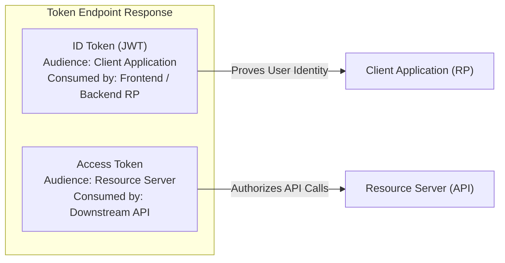
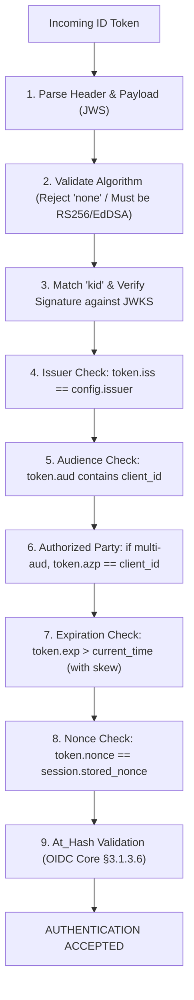
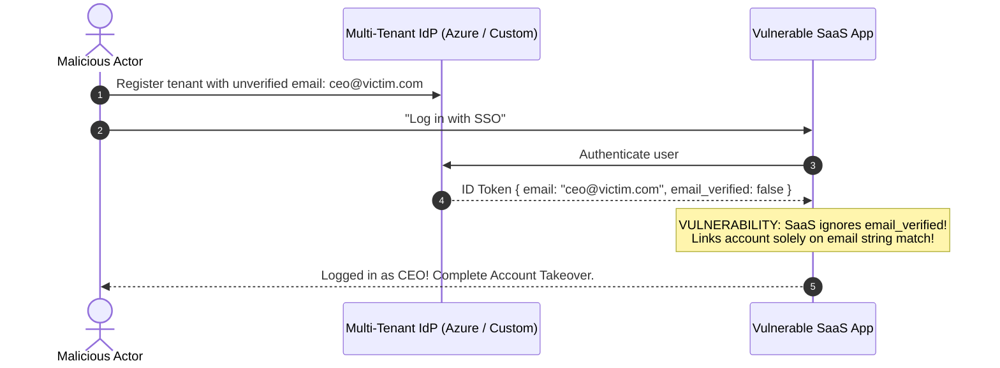
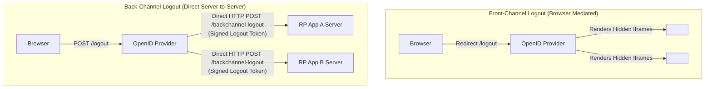
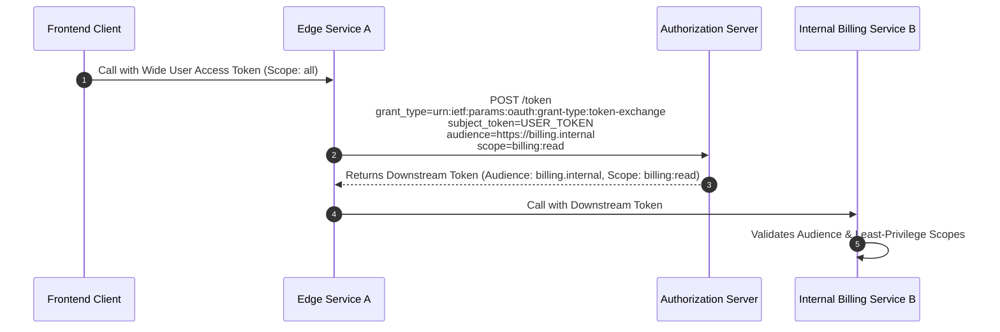

# Module 07 — OpenID Connect (OIDC), Identity Federation & Token Exchange

OAuth 2.0 is an authorization protocol, not an authentication protocol: an access token authorizes an application to call an API, but tells the application nothing about *who* the user is, *how* they authenticated, or *when* they signed in. **OpenID Connect Core 1.0 (OIDC)** builds a standardized identity layer directly atop OAuth 2.0, introducing cryptographically signed **ID Tokens**, dynamic OpenID Provider Discovery, JSON Web Key Sets (JWKS), and standardized UserInfo endpoints. This module explores OIDC architecture, mathematical ID token validation invariants, federated account linking vulnerabilities (the "nOAuth" class of attacks), front-channel vs back-channel session logout, SAML 2.0 comparison, and OAuth Token Exchange (RFC 8693) for cross-service delegation.

---

## 1. OIDC vs OAuth 2.0: Identity vs Authorization

A chronic vulnerability in software engineering is attempting to use OAuth 2.0 access tokens as proof of user authentication.

| Dimension | OAuth 2.0 Access Token | OpenID Connect (OIDC) ID Token |
| :--- | :--- | :--- |
| **Intended Audience** | **Resource Server (RS / API Gateway)** | **Client Application (Relying Party / RP)** |
| **Primary Semantic** | "Bearer has permission to execute actions $X, Y, Z$." | "User $U$ authenticated at time $T$ via method $M$." |
| **Data Format** | Opaque string or structured JWT; internal to RS. | **Mandatory Signed JWT** (RFC 7519); client must parse and verify. |
| **Inspection Policy** | The client should treat it as an opaque credential. | The client **MUST** validate all claims (`iss`, `aud`, `exp`, `nonce`). |



---

## 2. OpenID Provider Discovery & JWKS Architecture

To prevent hardcoding cryptographic keys and endpoint URLs, OIDC standardizes dynamic metadata discovery:

### 1. OpenID Discovery (`/.well-known/openid-configuration`)
The Relying Party (RP) fetches the provider's configuration document from the well-known path:
`GET https://auth.example.com/.well-known/openid-configuration`
The returned JSON payload declares:
- `issuer`: The canonical provider identifier string (e.g. `https://auth.example.com`).
- `authorization_endpoint`, `token_endpoint`, `userinfo_endpoint`.
- `jwks_uri`: The endpoint hosting the provider's public verification keys.
- `response_types_supported`, `id_token_signing_alg_values_supported`.

### 2. JSON Web Key Set (JWKS, RFC 7517)
The `jwks_uri` exposes an array of cryptographic public keys used to sign ID tokens:
```json
{
  "keys": [
    {
      "kty": "RSA",
      "use": "sig",
      "alg": "RS256",
      "kid": "key-2026-prod-01",
      "n": "u1W5...",
      "e": "AQAB"
    }
  ]
}
```
- **`kid` (Key ID)**: Uniquely identifies which key in the array was used to sign a specific token.
- **Dynamic Caching Rule**: Clients must cache the JWKS in memory. If a token arrives with an unknown `kid`, the client performs a rate-limited cache refresh to accommodate zero-downtime key rotation.

---

## 3. ID Token Validation Invariants (OIDC Core §3.1.3.7)

An ID Token is a signed JSON Web Token (JWS). A Relying Party **MUST** execute these mathematical and structural checks before accepting the token as authentic:



### The `at_hash` (Access Token Hash) Verification Invariant
To prevent an attacker from swapping or injecting an access token alongside a legitimate ID token, OIDC binds the access token to the ID token via the `at_hash` claim:
1. Hash the raw access token using the algorithm matching the ID token's signing algorithm (e.g. SHA-256 for RS256).
2. Take the **left-most half** of the hash digest (the first 16 bytes for a 32-byte SHA-256 hash).
3. Base64URL-encode those 16 bytes:
   $$\text{at\_hash} = \text{Base64URL}\Big(\text{LeftmostHalf}(\text{SHA-256}(\text{access\_token}))\Big)$$
4. The client computes this hash and confirms that it matches the `at_hash` claim in the ID token.

---

## 4. Federated Identity & The "nOAuth" Account Takeover Class

Enterprise applications frequently support "Log in with Microsoft / Google / GitHub". When linking a federated identity to an internal user database record, an insidious architectural vulnerability exists: **Unverified Email Trust**.

### The "nOAuth" Attack Vector (CVE-2023-38421)
In multi-tenant cloud identity providers (such as Microsoft Entra / Azure AD):
1. A user creates an account on an external Azure tenant using an email they do not own (e.g. `victim@company.com`). In some configurations, the IdP allows the user to log in before verifying possession of the email address.
2. The user navigates to a vulnerable third-party SaaS application and clicks "Log in with Microsoft".
3. The SaaS application receives the ID token, reads `email: "victim@company.com"`, and searches its database:
   `SELECT * FROM users WHERE email = 'victim@company.com';`
4. Finding a match, the application **automatically links the incoming federated identity** to the pre-existing user account, granting the attacker instant, complete administrative takeover of the victim's account!



### Mandatory Defensive Rules for Federated Account Linking
1. **Never trust `email` without verifying `email_verified: true`**: If `email_verified` is missing or `false`, the email claim must be completely ignored for identity matching.
2. **Anchor Identity to `(iss, sub)`**: The immutable identifier of a user is the tuple of the Issuer URL and the Subject string:
   $$\text{Identity} = (\text{iss}, \text{sub})$$
   Email addresses can change, expire, or be reassigned; `sub` is permanently unique.
3. **Explicit User-Mediated Linking**: When an existing user logs in via a new federated provider for the first time, require them to authenticate with their existing local credentials *before* linking the federated `sub` to their account.

---

## 5. Session Logout: Front-Channel vs Back-Channel Logout

Terminating a distributed session across multiple independent microservices and Relying Parties is one of the hardest problems in identity architecture.



### Front-Channel Logout (OIDC Front-Channel Logout 1.0)
- The user logs out at the OpenID Provider (OP). The OP's logout page renders hidden `<iframe>` elements pointing to the registered logout URLs of every application the user visited.
- **Critical Failure Modes**: Modern browsers block third-party cookies by default (Storage Access API). The iframes cannot access the application's session cookies, rendering the logout ineffective. If the user closes the browser tab before all iframes load, remaining sessions stay open.

### Back-Channel Logout (OIDC Back-Channel Logout 1.0)
- The OP communicates directly with each Relying Party's backend server via an asynchronous HTTP `POST` request.
- The OP delivers a signed **Logout Token** (a JWT containing `sub` and `sid` session IDs, with a special claim `"events": { "http://schemas.openid.net/event/backchannel-logout": {} }`).
- The Relying Party validates the Logout Token's cryptographic signature, destroys the corresponding server-side session in Redis, and rejects future requests.
- **Architectural Advantage**: Highly reliable; completely unaffected by browser cookie blocking, network dropouts on the client, or closed tabs.

---

## 6. SAML 2.0 vs OpenID Connect Architectural Comparison

| Architectural Feature | Security Assertion Markup Language (SAML 2.0) | OpenID Connect (OIDC Core 1.0) |
| :--- | :--- | :--- |
| **Origin & Era** | OASIS Standard (2005); enterprise intranet focus. | OpenID Foundation (2014); mobile & cloud API native. |
| **Data Encoding** | Verbose XML with XMLDSig digital signatures. | Compact JSON with JSON Web Signatures (JWS/JWE). |
| **Parser Security** | **High Attack Surface**: XML External Entity (XXE), XML Signature Wrapping (XSW), canonicalization attacks. | Compact, memory-safe JSON parsing; strict algorithm allowlists. |
| **Client Support** | Browser redirects only; relies on POST-binding form submission. Incompatible with native mobile apps or Single Page Apps. | Native support for SPAs, mobile native apps (via ASWebAuthenticationSession), and backend microservices. |
| **API Authorization** | Lacks native API authorization primitives. | Seamless integration with OAuth 2.0 access and refresh tokens. |

---

## 7. OAuth Token Exchange (RFC 8693) for Delegation

In complex microservice topologies, Service A frequently needs to invoke Service B on behalf of an end user, without passing the user's raw access token directly (which violates least privilege and exposes wide scopes to intermediate services).

**RFC 8693 (OAuth 2.0 Token Exchange)** standardizes a protocol where a client presents an existing subject token to the Authorization Server and receives a **new, tightly-scoped, downstream access token**:



- **Impersonation**: The new token represents only the subject (the intermediate service is invisible).
- **Delegation**: The new token contains both the `sub` (original user) and an `act` (actor) claim:
  ```json
  {
    "sub": "user_42",
    "act": {
      "sub": "service_a_backend"
    },
    "aud": "https://billing.internal"
  }
  ```
This provides non-repudiation and complete auditability: Service B knows that User 42 authorized the action, but that the call was explicitly executed by Service A.

---

## 8. Then vs Now: Evolution of Identity Federation

| Identity Dimension | Historical Paradigm (Then) | Modern Production Architecture (Now) |
| :--- | :--- | :--- |
| **SSO Standard** | Heavyweight SAML 2.0 with XMLDSig. | **OpenID Connect Core 1.0 (OIDC)** over OAuth 2.0. |
| **Token Verification**| Hardcoded X.509 cert files deployed on disk. | **Dynamic JWKS (`/.well-known/jwks.json`)** with automatic key rotation. |
| **Account Linking** | Matching raw `email` strings blindly. | **Verifying `email_verified: true`** and anchoring on `(iss, sub)`. |
| **Logout Architecture**| Fragile Front-Channel hidden iframes. | **Direct Back-Channel Logout Tokens (JWT)** server-to-server. |
| **Downstream Auth** | Forwarding raw user credentials between services. | **OAuth Token Exchange (RFC 8693)** with audience scoping. |

---

## 9. Interview Drill: OIDC & Identity Federation

<details>
<summary>1. A developer builds a Single Page Application and validates the user's identity by fetching the user's profile from `/userinfo` using the OAuth access token. Why is this technically NOT an OIDC authentication proof?</summary>

An OAuth access token is an authorization credential minted for the Resource Server; it does not contain cryptographic assertions designed for the client application. 
Relying solely on `/userinfo` creates an identity injection vulnerability: an attacker who captures an access token minted for a *different application* (under the same identity provider) can pass that token to the vulnerable SPA. The SPA calls `/userinfo`, receives the victim's profile, and logs the attacker in as the victim. 
OIDC authentication requires the client to receive and cryptographically validate an **ID Token** (JWT). The ID Token explicitly includes the client's unique identifier in its **`aud` (Audience)** claim, proving that the authentication assertion was minted specifically and exclusively for that client application.
</details>

<details>
<summary>2. Explain how the "nOAuth" vulnerability in multi-tenant identity providers leads to account takeover, and how developers prevent it.</summary>

In "nOAuth", an attacker registers an unverified email address (e.g. `victim@company.com`) on a multi-tenant cloud IdP where they control a tenant. 
The attacker initiates SSO login to a vulnerable SaaS application. 
The SaaS application receives the ID token, reads `email: "victim@company.com"`, and automatically links the federated login to the existing corporate user account based on the email string match, without checking the `email_verified` claim. 
To prevent this:
1. Applications must **strictly check `email_verified: true`** before executing any automatic account linking.
2. Identity must be keyed to the immutable unique tuple `(iss, sub)`, never mutable user attributes like email.
3. Multi-tenant SaaS apps must validate that the `iss` claim matches the authorized enterprise tenant, rather than trusting unverified public tenants.
</details>

<details>
<summary>3. Why is Back-Channel Logout vastly more reliable than Front-Channel Logout in modern web browsers?</summary>

Front-Channel Logout relies on the user's browser rendering hidden `<iframe>` tags pointing to each application's logout URL. 
Modern browsers (Safari ITP, Firefox Enhanced Tracking Protection, Chrome) strictly partition or block third-party cookies inside embedded iframes by default. As a result, the logout iframes execute without session cookies, failing to clear the user's active session. Furthermore, if the user closes their laptop or terminates the browser before the iframes finish loading, remaining sessions stay active. 
Back-Channel Logout executes direct server-to-server HTTP POST requests between the IdP and the application backends using cryptographically signed Logout Tokens, guaranteeing immediate and complete session termination completely independent of browser state.
</details>

<details>
<summary>4. What is the mathematical calculation for the `at_hash` claim in an OIDC ID token, and what vulnerability does it prevent?</summary>

The `at_hash` provides a cryptographic binding between the ID Token and the Access Token issued alongside it. 
It is calculated by:
1. Hashing the raw access token using the algorithm matching the ID token's signature (e.g. SHA-256 for RS256).
2. Taking the left-most half of the resulting digest (first 16 bytes for SHA-256).
3. Base64URL-encoding those 16 bytes.
If an attacker attempts an **Access Token Injection** attack (intercepting a legitimate authorization flow and substituting a different access token while retaining the original valid ID token), the client computes the `at_hash` of the substituted access token, detects the mismatch against the ID token's signed `at_hash` claim, and aborts the transaction.
</details>

<details>
<summary>5. How does OAuth Token Exchange (RFC 8693) enforce the Principle of Least Privilege in a multi-tier microservice architecture?</summary>

When an end user logs in, they may grant a wide set of permissions (e.g. `profile`, `email`, `billing`, `orders`). 
If the edge service (Order Service) simply forwards the user's wide access token to downstream services (e.g. Inventory Service, Analytics Service), any compromised downstream microservice can use that wide token to execute unauthorized billing mutations. 
Token Exchange allows the Order Service to trade the user's wide token at the Authorization Server for an ephemeral, tightly-scoped downstream token minted exclusively for `aud: https://inventory.internal` with `scope: inventory:read`. The downstream service receives only the minimal permissions necessary to execute its discrete task.
</details>
