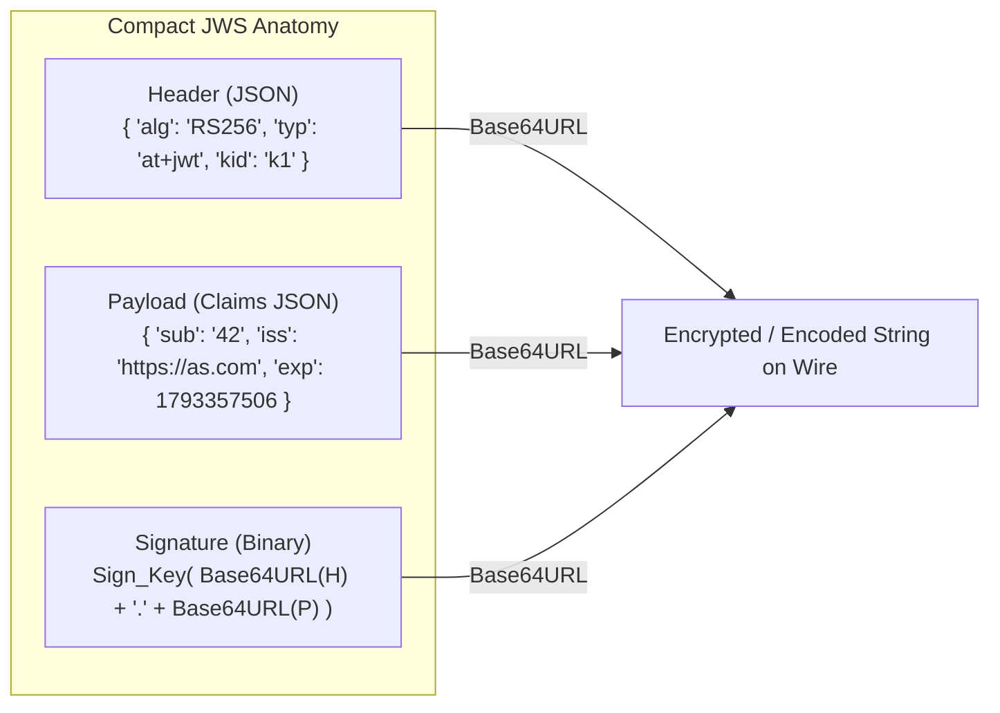
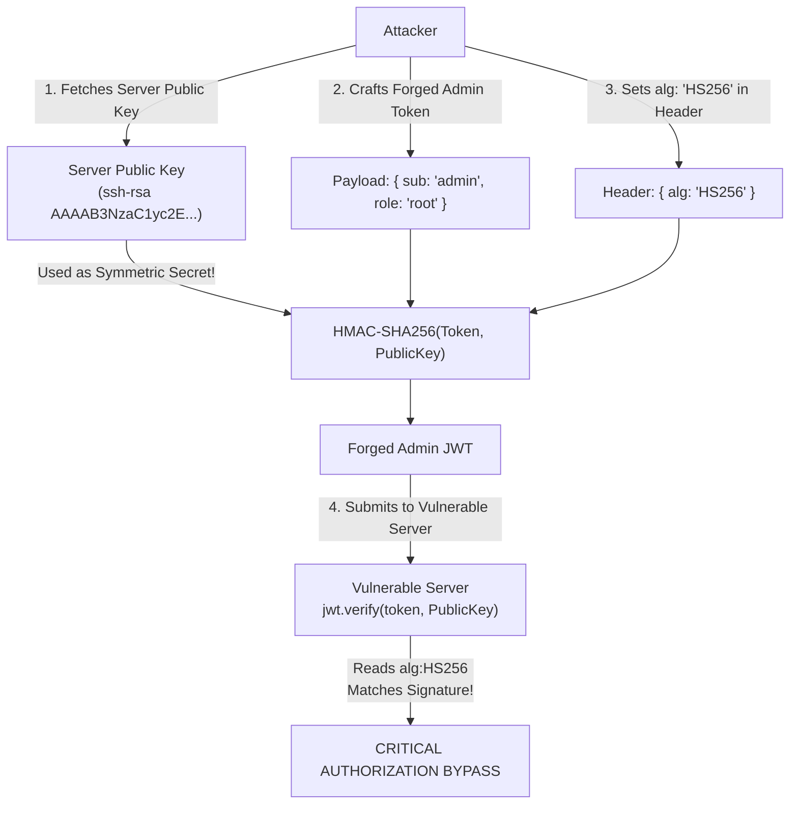
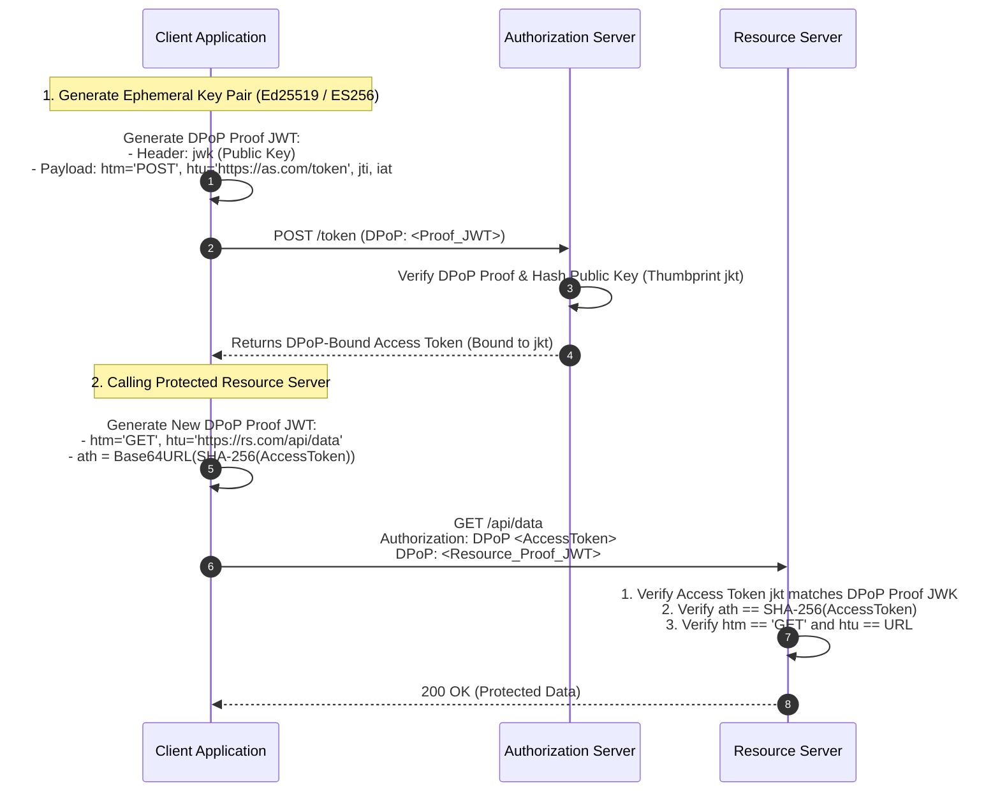

# Module 08 — JOSE Architecture, JWT Vulnerabilities & Sender-Constrained Tokens (DPoP)

JSON Web Tokens (JWT) and the broader Javascript Object Signing and Encryption (JOSE) framework are the standard currency of modern web identity and API authorization. However, because JOSE was designed to accommodate dozens of cryptographic cipher suites, key formats, and serialization models, naive JWT verification libraries have suffered from some of the most critical security vulnerabilities in software history. Furthermore, traditional JWT access tokens are **bearer tokens**: whoever holds the token can spend it, meaning a stolen token grants instant access. This module covers the JOSE architecture, classic JWT exploits (`alg:none`, algorithm confusion, `kid` injection), the RFC 8725 Best Current Practices, and modern **Sender-Constraining** architectures: Demonstrating Proof-of-Possession (DPoP, RFC 9449), mTLS-bound tokens (RFC 8705), and Selective Disclosure JWTs (SD-JWT, RFC 9901).

---

## 1. The JOSE Framework Architecture

The JOSE suite comprises five foundational RFC specifications:
1. **JWS (JSON Web Signature, RFC 7515)**: Cryptographic integrity and non-repudiation using digital signatures or HMACs.
2. **JWE (JSON Web Encryption, RFC 7516)**: Confidentiality using authenticated symmetric encryption with asymmetric key wrapping.
3. **JWK (JSON Web Key, RFC 7517)**: Cryptographic key representation in standardized JSON objects.
4. **JWA (JSON Web Algorithms, RFC 7518)**: Catalog of supported cryptographic algorithms (`RS256`, `ES256`, `EdDSA`, `A256GCM`).
5. **JWT (JSON Web Token, RFC 7519)**: Structured claims representation encoded as a JWS or JWE.

### Compact JWS Serialization Layout
A compact JWS consists of three base64url-encoded components separated by periods (`.`):
$$\text{JWS Compact} = \text{Base64URL}(\text{Header}) \,.\, \text{Base64URL}(\text{Payload}) \,.\, \text{Base64URL}(\text{Signature})$$



---

## 2. Pathological JWT Vulnerabilities & Exploit Mechanics

Because the token header is received in plaintext from the untrusted client, verifying code must never trust the header metadata blindly.

### 1. The `alg: "none"` Authentication Bypass
The JWA specification included an algorithm codepoint `none` for unsigned tokens. Early JWT libraries parsed the token header, checked `header.alg`, and if `alg === "none"`, skipped signature verification entirely!
- **The Exploit**: An attacker takes a legitimate user token, modifies the payload to set `"role": "admin"`, changes the header to `{"alg": "none", "typ": "JWT"}`, strips the signature bytes, and sends `Base64URL(H).Base64URL(P).`. Flawed servers accepted the forged token as valid.

### 2. The Algorithm Confusion Attack (RS256 vs HS256)
A server expects tokens to be signed using asymmetric **RS256** (RSA private key signs, RSA public key verifies).
The server's verification code is written carelessly:
```typescript
// VULNERABLE: Reads algorithm from incoming token header!
jwt.verify(token, serverPublicKey);
```
- **The Exploit**:
  1. The attacker acquires the server's public RSA verification key (which is public by design, hosted on `/.well-known/jwks.json`).
  2. The attacker modifies the token payload to gain administrator privileges.
  3. The attacker changes the header to `{"alg": "HS256"}` (symmetric HMAC).
  4. The attacker signs the forged token using the **public RSA key as the HMAC symmetric secret string**!
  5. When the server calls `jwt.verify(token, serverPublicKey)`, the library reads `alg: "HS256"` from the header. It passes `serverPublicKey` into the HMAC engine, computes the HMAC over the forged payload using the public key as the secret, compares it against the submitted signature, and finds an exact match!



### 3. `kid` (Key ID) Header Injections
The `kid` header tells the server which key to use from its database or filesystem.
- **Directory Traversal**: If the server loads keys using `fs.readFileSync('/etc/keys/' + header.kid)`, an attacker passes `kid: "../../../dev/null"`. If `/dev/null` is an empty file, the HMAC secret is an empty string (`""`), allowing trivial signature forging.
- **SQL Injection**: If the server queries `SELECT key FROM keys WHERE id = '${header.kid}'`, an attacker injects `' UNION SELECT 'my_known_secret' --` to control the verification key.

### 4. `jku` and `x5u` Header SSRF Injections
The `jku` (JWK Set URL) and `x5u` (X.509 URL) headers specify a remote URL where the verification keys reside.
- **The Exploit**: If the library fetches `jku` without pinning to trusted domains, an attacker sets `jku: "https://attacker.com/jwks.json"`, signs the token with their own private key, and hosts the matching public key on their server. The target backend downloads the attacker's key and accepts the token.

---

## 5. RFC 8725 JWT Best Current Practices (rfc8725bis)

To permanently eradicate these vulnerabilities, RFC 8725 establishes strict implementation invariants:

1. **Perform Strict Algorithm Allowlists**: Never determine the verification algorithm from the token's `alg` header. The verifying application must explicitly define a hardcoded whitelist of permitted algorithms:
   ```typescript
   // SECURE: Enforces RS256; immediately rejects HS256 and 'none'
   await jwtVerify(token, jwks, { algorithms: ["RS256"] });
   ```
2. **Explicit Typing (`typ: "at+jwt"`, RFC 9068)**:
   - To prevent an attacker from passing an ID Token where an Access Token is expected (or vice versa), the token header must declare explicit typing:
     `{"alg": "RS256", "typ": "at+jwt"}`
   - The resource server must verify that `header.typ === "at+jwt"`.
3. **Mandatory Audience & Issuer Checking**:
   - The verifying server **MUST** validate that `token.iss` matches the trusted Authorization Server.
   - The verifying server **MUST** validate that `token.aud` explicitly matches the Resource Server's identifier. A token minted for the User Profile service must be rejected if presented to the Billing service.
4. **Pinning JWKS URIs**: The verifying application must fetch public keys **only** from a pre-configured, immutable AS metadata URI; headers like `jku` and `x5u` supplied by clients must be completely ignored.

---

## 4. Opaque Tokens + Introspection (RFC 7662) vs Self-Contained JWTs

| Architectural Property | Self-Contained Signed JWT | Reference / Opaque Token + Introspection |
| :--- | :--- | :--- |
| **Token Format** | Structured, signed JSON (base64 encoded). | High-entropy random 128-bit string (`csprng_...`). |
| **Verification Seam** | Local in-process CPU signature verification. | Network RPC to Authorization Server (`/introspect`). |
| **Database Load** | **Zero**: No state lookup required. | **High**: Database/cache read on every API call. |
| **Revocation Velocity** | **Delayed / Impossible**: Valid until `exp` timestamp. | **Instantaneous**: Deleted from Redis $\implies$ instantly dead. |
| **Network Overhead** | Large header on wire (~800 to 2000 bytes). | Minimal header on wire (~32 to 64 bytes). |

---

## 5. Sender-Constrained Tokens: DPoP (RFC 9449) & mTLS (RFC 8705)

Standard OAuth access tokens are **Bearer Tokens**: if an attacker intercepts a token from logs, network sniffing, or client memory, the attacker can use the token immediately.

**Sender-Constraining** mathematically binds the access token to a specific client, ensuring that possession of the token alone is useless without possession of a private cryptographic key.

### Demonstrating Proof-of-Possession (DPoP, RFC 9449)
DPoP operates entirely at the application layer (Layer 7), requiring no mutual TLS or hardware certificates.



### DPoP Mathematical & Protocol Invariants
1. **The DPoP Proof Header**: On every API request, the client creates an ephemeral, single-use signed JWT containing:
   - `htm`: The HTTP method matching the request (`GET`, `POST`).
   - `htu`: The HTTP target URI without query parameters (`https://api.example.com/v1/orders`).
   - `ath`: **Access Token Hash** ($\text{ath} = \text{Base64URL}(\text{SHA-256}(\text{access\_token})))$, cryptographically binding the proof to that specific token.
   - `jti`: Unique random identifier ensuring the proof cannot be replayed across multiple requests.
2. **Server-Enforced Nonce**: To prevent pre-generation replay attacks, the Resource Server can return `DPoP-Nonce: <nonce>` in an HTTP 401 response; the client must re-sign the proof including the server's nonce.

### mTLS-Bound Access Tokens (RFC 8705)
In enterprise server-to-server architectures with established PKI, tokens can be bound at Layer 4. The Authorization Server hashes the client's mutual-TLS certificate and embeds the SHA-256 thumbprint in the access token:
```json
{
  "sub": "service_a",
  "cnf": {
    "x5t#S256": "yZ3..."
  }
}
```
When the client calls the Resource Server over mTLS, the Resource Server calculates the SHA-256 hash of the client's TLS certificate and confirms it matches `cnf.x5t#S256`.

---

## 6. Selective Disclosure JWTs (SD-JWT, RFC 9901)

In privacy-preserving identity systems (e.g. digital driving licenses, verifiable credentials), an identity provider asserts multiple attributes (Full Name, Date of Birth, Address, Nationality). Revealing the entire token to prove age reveals the user's home address.

**RFC 9901 (SD-JWT)** introduces **Selective Disclosure**:
1. The Issuer hashes individual claims with unique random salts:
   $$\text{Digest}_i = \text{SHA-256}(\text{salt}_i \parallel \text{claim\_name} \parallel \text{claim\_value})$$
2. The signed JWT payload contains only an array of hashes (`_sd: [Digest_1, Digest_2, ...]`), completely concealing the underlying values.
3. The Holder receives the disclosure strings (`Base64URL(salt, name, value)`).
4. When proving age to a verifier, the Holder transmits the signed SD-JWT plus **only the disclosure string for the `age_over_21` claim**.
5. The Verifier hashes the disclosure string, verifies that the resulting hash matches an entry in the signed `_sd` array, and learns only that the user is over 21 without learning their name or address!

---

## 7. Then vs Now: Evolution of Token Architecture

| Token Dimension | Historical Paradigm (Then) | Modern Production Architecture (Now) |
| :--- | :--- | :--- |
| **Token Constraint** | Plain Bearer Tokens (anyone holding token can spend it). | **Sender-Constrained Tokens via DPoP (RFC 9449)** or **mTLS (RFC 8705)**. |
| **Algorithm Selection** | Blindly reading `header.alg` (enabling `alg:none` & RS/HS attacks). | **Strict Verification Whitelists**; ignoring untrusted headers. |
| **Token Typing** | Ambiguous generic `typ: "JWT"`. | **Explicit Typing: `typ: "at+jwt"` (RFC 9068)**. |
| **Privacy Disclosure** | All-or-nothing token sharing leaking personal metadata. | **Selective Disclosure (SD-JWT, RFC 9901)** with salted disclosure hashes. |
| **Request Tampering** | Front-channel authorization parameters sent in cleartext URLs. | **Pushed Authorization Requests (PAR, RFC 9126)** direct to AS. |

---

## 8. Interview Drill: Token Security & DPoP

<details>
<summary>1. Explain the step-by-step mechanics of an RS256 vs HS256 Algorithm Confusion attack against a poorly configured JWT verification routine.</summary>

1. A vulnerable server expects tokens signed via asymmetric RS256 (RSA private key signs, public key verifies), but its verification code reads the algorithm dynamically from the incoming token header.
2. An attacker downloads the server's public RSA key (which is public by design, hosted on `/.well-known/jwks.json`).
3. The attacker crafts a forged JWT payload (e.g. setting `"role": "admin"`).
4. The attacker sets the token header to `{"alg": "HS256"}` (symmetric HMAC).
5. The attacker computes the HMAC-SHA256 signature using the **exact text bytes of the server's public key** as the symmetric secret key.
6. When the attacker submits this token, the server's library reads `alg: "HS256"`. Instead of invoking RSA signature verification, it passes the public key object into HMAC-SHA256 as the symmetric secret. 
7. The computed HMAC matches the attacker's signature perfectly, granting the attacker complete authentication bypass.
*Mitigation*: Verifying applications must strictly hardcode the expected algorithm list: `jwtVerify(token, jwks, { algorithms: ['RS256'] })`.
</details>

<details>
<summary>2. Why are bearer tokens considered high risk, and how does DPoP (RFC 9449) solve the bearer token exfiltration problem?</summary>

Bearer tokens function like cash: whoever possesses the token can present it to an API and successfully execute transactions. If a bearer token is exfiltrated from an application's memory, logged in an HTTP proxy access log, or intercepted via a compromised TLS terminating gateway, an attacker can use it from any IP address anywhere in the world.
DPoP eliminates bearer token vulnerability by **sender-constraining** the token. 
The client generates an asymmetric key pair (e.g. Ed25519) stored in local private memory. When obtaining an access token, the token is cryptographically bound to the client's public key thumbprint (`jkt`). 
On every subsequent API request, the client must generate and sign an ephemeral **DPoP Proof JWT** containing the HTTP method, the exact URL, and the hash of the access token (`ath`). 
Even if an attacker steals the access token, they cannot use it because they lack the client's private key required to generate matching DPoP proofs for their requests.
</details>

<details>
<summary>3. What is the purpose of the `ath` (Access Token Hash) claim inside a DPoP Proof JWT?</summary>

Without the `ath` claim, a DPoP proof would only be bound to the HTTP method and destination URL (`htm` and `htu`), not to the specific access token. 
If an attacker intercepts a legitimate DPoP proof and a lower-privileged access token, they could attempt to pair the legitimate DPoP proof with a stolen, higher-privileged access token. 
The `ath` claim is calculated as `Base64URL(SHA-256(access_token))`. The Resource Server confirms that the hash of the presented access token matches the `ath` claim in the signed DPoP proof. This creates an unbreakable, two-way cryptographic binding: the proof is valid only for that specific access token, and the token is valid only with that specific proof.
</details>

<details>
<summary>4. What is the `typ: "at+jwt"` header specified in RFC 9068, and what vulnerability does it mitigate?</summary>

RFC 9068 specifies the explicit media type `at+jwt` for JWT access tokens. 
Without explicit typing, both ID Tokens and Access Tokens share the generic header `{"alg": "RS256", "typ": "JWT"}`. 
In a **Token Confusion Attack**, an attacker takes a legitimate user's ID Token (which was minted for the frontend client application) and transmits it to a backend microservice API as an access token. If the microservice only verifies the cryptographic signature against the common IdP JWKS, it might accept the ID token as an authorization credential and execute actions. 
By mandating `typ: "at+jwt"`, the Resource Server verifies that the token was explicitly minted by the Authorization Server as an Access Token, immediately rejecting ID tokens.
</details>

<details>
<summary>5. How does Selective Disclosure JWT (SD-JWT, RFC 9901) preserve privacy when presenting verifiable credentials?</summary>

In standard JWTs, all claims are stored in plaintext in the signed payload. Sharing the token exposes all personal attributes to the verifier.
In SD-JWT, the Issuer hashes each attribute individually with a unique cryptographically random salt and includes only the array of salted hashes (`_sd: [...]`) in the signed token payload. 
The user (Holder) receives the disclosure strings for all attributes. 
When proving an assertion to a third party (e.g. proving they are over 21 to buy alcohol), the user presents the signed SD-JWT accompanied **only** by the disclosure string for the age claim. 
The verifier hashes the disclosed age attribute with its salt, confirms the hash matches one of the digests in the signed `_sd` array, and verifies the Issuer's digital signature. The verifier confirms the age assertion with mathematical certainty while learning zero information about the user's name, address, or license number.
</details>
