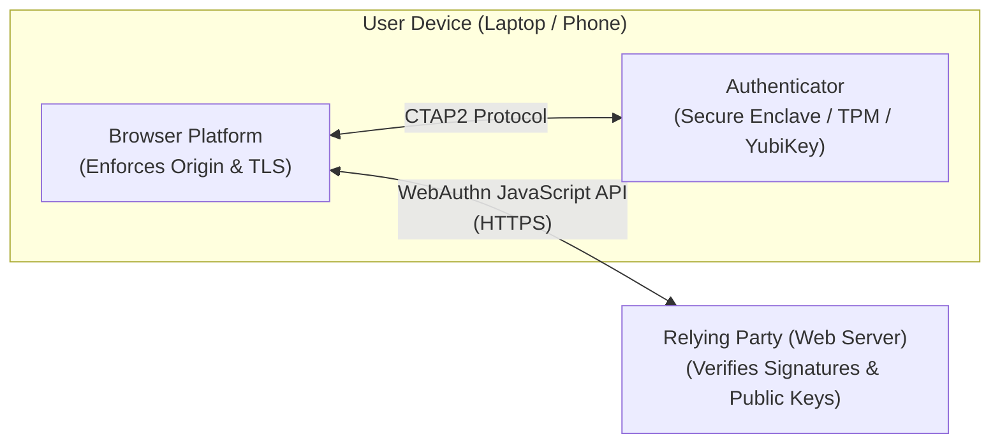
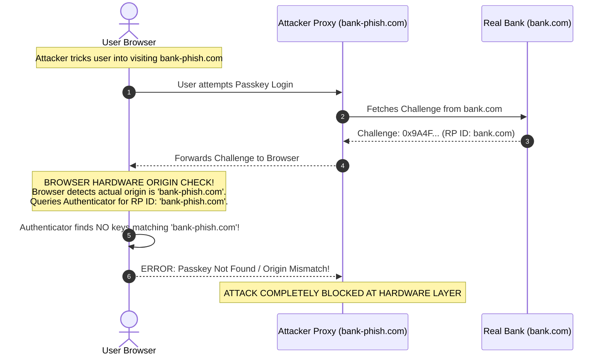
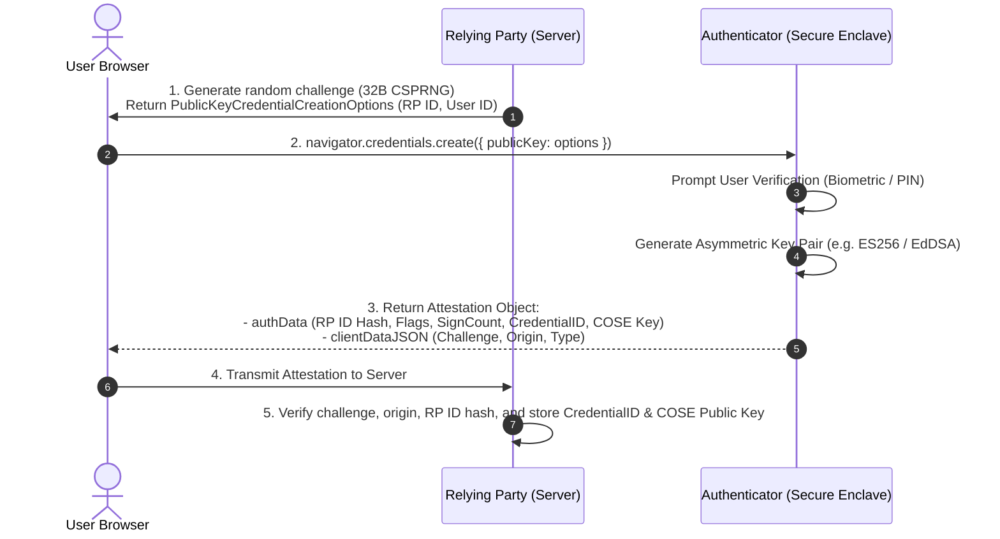

# Module 09 — Passkeys, WebAuthn Level 3 & Multi-Factor Authentication (MFA)

Shared secrets (passwords, SMS codes, and standard TOTP tokens) are fundamentally vulnerable to real-time proxy phishing attacks. In a Man-in-the-Middle phishing attack, an attacker proxies user input to a legitimate website, capturing session cookies and MFA codes instantaneously. The **FIDO2 / W3C WebAuthn** standard eradicates this vulnerability by replacing shared secrets with hardware-backed, asymmetric public-key cryptography bound mathematically to the browser's cryptographic origin. With the adoption of **WebAuthn Level 3 (W3C Recommendation, August 2026)** and multi-device synced **Passkeys**, credentials roam seamlessly across user devices with zero shared passwords. This module analyzes WebAuthn mechanics, registration and authentication ceremonies, the mathematical foundation of phishing resistance, authenticator flags (UP, UV, BE, BS), sign counters, WebAuthn Level 3 capabilities (Related Origins, Conditional UI, PRF), and classic MFA vulnerabilities (Push Fatigue).

---

## 1. WebAuthn & FIDO2 Architecture

The FIDO2 architecture splits authentication into two protocol boundaries:
1. **CTAP2 (Client-to-Authenticator Protocol)**: Communicates between the host platform (browser/OS) and the physical or platform authenticator (TouchID, FaceID, Windows Hello, YubiKey) over USB, NFC, Bluetooth, or internal bus.
2. **WebAuthn (W3C Recommendation)**: A JavaScript API (`navigator.credentials.create()` and `navigator.credentials.get()`) allowing web applications (Relying Parties / RP) to interface with the platform authenticator securely.



---

## 2. Why Passkeys Are Fundamentally Phishing-Resistant

In a classic reverse-proxy phishing attack (using tools like Evilginx):
1. An attacker lures a victim to `https://login.bank-phish.com`.
2. The attacker's proxy forwards the user's keystrokes to `https://login.bank.com` and displays the real login page.
3. If the user enters a password and a TOTP SMS/authenticator code, the proxy captures both, submits them to the real bank, captures the session cookie, and logs in.



### The Cryptographic Proof of Phishing Resistance
1. When the browser calls `navigator.credentials.get()`, the browser engine automatically measures the **actual, cryptographic origin** from the TLS connection (`https://bank-phish.com`) and hashes it into `clientDataJSON`.
2. The authenticator looks up its private key store indexed by **RP ID** (Relying Party Identifier, which must be an exact match or registrable suffix of the current origin, e.g. `bank.com`).
3. If the user is on `bank-phish.com`, the browser refuses to permit an RP ID of `bank.com`. The authenticator will not release or sign with the `bank.com` private key.
4. Even if an attacker modified the client script, the signed assertion includes a SHA-256 hash of `clientDataJSON`. When the real bank server receives the signature, it hashes `https://bank.com` and discovers the signature was calculated over `https://bank-phish.com`, immediately rejecting the transaction.

---

## 3. WebAuthn Ceremonies: Registration & Authentication

### 1. The Registration Ceremony (`create()`)
The Relying Party provisions a new public-private key pair on the user's authenticator:



### 2. The Authentication Ceremony (`get()`)
The user proves possession of the private key without transmitting it:
1. **Server Challenge**: The RP generates a cryptographically random 32-byte challenge:
   `challenge = crypto.randomBytes(32)`
2. **Authenticator Signing**: The user verifies biometric presence (TouchID/FaceID). The authenticator assembles:
   $$\text{authenticatorData} = \text{SHA-256}(\text{RP ID}) \parallel \text{Flags (1 byte)} \parallel \text{SignCount (4 bytes)}$$
   The authenticator computes the signature over:
   $$\text{Signature} = \text{Sign}_{K_{\text{priv}}}\Big(\text{authenticatorData} \parallel \text{SHA-256}(\text{clientDataJSON})\Big)$$
3. **Server Verification**: The server verifies the signature using the stored public key, confirms `clientDataJSON.challenge` matches the issued challenge, confirms `clientDataJSON.origin` matches the application origin, and checks that the RP ID hash matches its domain.

---

## 4. Authenticator Flags & The Sign Counter Dilemma

The `authenticatorData` binary payload includes a 1-byte **Flags bitfield** asserting hardware execution properties:

```
Bit 0: UP (User Presence)        --> Mandatory 1 (User touched/activated authenticator)
Bit 2: UV (User Verified)        --> 1 if Biometric (FaceID/Fingerprint) or PIN succeeded
Bit 3: BE (Backup Eligibility)   --> 1 if credential CAN be synced to cloud keychain
Bit 4: BS (Backup State)         --> 1 if credential IS CURRENTLY synced in cloud keychain
Bit 6: AT (Attestation Data)     --> 1 if credentialPublicKey is appended (Registration only)
Bit 7: ED (Extension Data)       --> 1 if authenticator extensions (PRF, largeBlob) included
```

### Sign Counters: Hardware Tokens vs Synced Passkeys
In the original FIDO2 specification, the authenticator maintained an internal 32-bit monotonic counter incremented on every authentication:
$$\text{SignCount}_{t+1} > \text{SignCount}_t$$
If a physical YubiKey was cloned by an attacker, the legitimate user and the attacker would produce counter values out of sequence, allowing the server to detect the clone.

**The Synced Passkey Reality**:
With modern multi-device passkeys (Apple iCloud Keychain, Google Password Manager, 1Password), a single passkey private key is synchronized across a user's MacBook, iPhone, and iPad. If the user signs in on their iPhone ($\text{Count} = 5$), the iPad authenticator has no local network connection to update its counter. 
Consequently, **cloud-synced passkeys intentionally report `SignCount = 0` permanently** (or monotonic behavior is not guaranteed). Servers identify synced passkeys via the `BE = 1` and `BS = 1` flags and must disable strict monotonic clone-detection checks when `SignCount` remains 0.

---

## 5. WebAuthn Level 3 Innovations (August 2026)

The **W3C WebAuthn Level 3 Recommendation** standardizes critical enterprise and user-experience capabilities:

### 1. Conditional UI (Autofill Passkeys)
Eliminates separate "Sign in with Passkey" buttons. When an input field specifies `autocomplete="username webauthn"`, the browser automatically displays available passkeys in the standard browser autofill dropdown. The user selects their account, touches the biometric sensor, and signs in instantly with zero typing.

### 2. Related Origins (`/.well-known/webauthn`)
Historically, a passkey registered on `company.com` could not be used on `company.co.uk` or `brand.com`. WebAuthn Level 3 introduces **Related Origin Requests**:
A domain publishes an authoritative JSON file at `https://example.com/.well-known/webauthn`:
```json
{
  "origins": [
    "https://example.co.uk",
    "https://example.de",
    "https://brand.com"
  ]
}
```
The browser validates mutual trust between the origins, allowing seamless single passkey usage across multiple top-level enterprise brands.

### 3. PRF (Pseudo-Random Function) Extension
Enables end-to-end client-side encryption. The authenticator derives a deterministic 256-bit symmetric encryption key using an internal HMAC secret evaluated over a server-provided salt:
$$\text{SymmetricKey} = \text{HMAC-SHA256}(\text{PasskeySecret}, \text{Salt})$$
This allows zero-knowledge password managers, cryptocurrency wallets, and encrypted health records to decrypt client-side data using their biometric passkey without exposing the master key to the server.

---

## 6. Multi-Factor Authentication: TOTP & Push Notification Fatigue

While WebAuthn represents the gold standard, legacy architectures frequently rely on Time-Based One-Time Passwords (TOTP) or mobile Push Notifications.

### Time-Based One-Time Passwords (TOTP, RFC 6238)
TOTP generates an 8-character or 6-character numerical code based on a shared secret key $K$ and the current Unix time:
1. Divide current Unix time by the time step window (standard 30 seconds):
   $$T = \lfloor \text{CurrentTime} / 30 \rfloor$$
2. Compute the HMAC-SHA1 (or HMAC-SHA256) of counter $T$:
   $$\text{Digest} = \text{HMAC-SHA1}(K, T)$$
3. **Dynamic Truncation**: Extract a 4-byte integer from the digest based on the low 4 bits of the final byte, and take modulo $10^6$:
   $$\text{Code} = \text{Truncate}(\text{Digest}) \pmod{10^6}$$

### MFA Fatigue & Push Notification Spamming
In Push-based MFA (e.g. Duo, Okta Verify), an attacker who steals a user's password scripts a bot to trigger hundreds of push notification login requests to the victim's smartphone at 3:00 AM (MFA Fatigue / MFA Spamming). Overwhelmed or confused, the user taps "Approve" to silence their phone, granting the attacker entry.
- **Mitigation: Number Matching**: The login screen displays a two-digit random number (e.g. `42`). The user must manually type `42` into their mobile authenticator app. An automated attacker cannot communicate the number, defeating push fatigue.

---

## 7. Then vs Now: Evolution of Authentication Architecture

| Authentication Dimension | Historical Paradigm (Then) | Modern Production Architecture (Now) |
| :--- | :--- | :--- |
| **Primary Credential** | Passwords stored in salted/peppered database tables. | **Passkeys (FIDO2 / WebAuthn)**; zero shared secrets. |
| **Phishing Posture** | Phishable via reverse-proxy MITM tools (Evilginx). | **Cryptographically Phishing-Resistant** via hardware origin binding. |
| **Credential Portability**| Hardware security keys (YubiKeys) tied to single ports. | **Synced Passkeys (Apple/Google Keychains)** with `BE`/`BS` flags. |
| **MFA Standards** | SMS codes (SIM-swapping risk) and basic TOTP. | **WebAuthn Level 3** or **Push with Number Matching**. |
| **Multi-Domain Login** | Complex cross-domain redirects and iframe cookies. | **WebAuthn Level 3 Related Origins** (`/.well-known/webauthn`). |

---

## 8. Interview Drill: WebAuthn & Multi-Factor Security

<details>
<summary>1. An attacker establishes a reverse proxy phishing site at `https://login-secure-bank.com` that mirrors the real banking site `https://bank.com`. Explain the exact cryptographic reason why WebAuthn passkey authentication will fail when the victim visits the phishing site.</summary>

When the victim attempts to log in on `https://login-secure-bank.com`, the browser's native WebAuthn implementation executes:
1. The browser engine determines the actual cryptographic TLS origin of the active tab, which is `https://login-secure-bank.com`.
2. The browser automatically constructs the `clientDataJSON` structure with `"origin": "https://login-secure-bank.com"`.
3. The browser queries the device's authenticator (e.g. TouchID/Keychain) for credentials registered to the Relying Party ID. 
   - If the phishing server requests `rpId: "bank.com"`, the browser immediately halts and throws a security exception because the browser refuses to permit an application to assert an RP ID that is not an exact match or registrable suffix of the current origin.
   - If the phishing server requests `rpId: "login-secure-bank.com"`, the authenticator looks up its local key database and finds zero credentials registered for that domain, returning a "No credentials found" error.
Even if an attacker attempts to forward a raw challenge from the real bank, the authenticator's signature covers `SHA-256(clientDataJSON)`. When the real bank server receives the assertion, it verifies that the origin inside `clientDataJSON` is `https://bank.com`. The hash of `https://login-secure-bank.com` will cause signature verification to fail immediately.
</details>

<details>
<summary>2. Why do cloud-synchronized passkeys (such as those in Apple iCloud Keychain or Google Password Manager) typically report a Sign Counter of 0, and how must a server handle this?</summary>

In the original FIDO2 standard designed for single-device hardware tokens (like YubiKeys), the authenticator maintained a strictly monotonic hardware counter incremented on every signature. If a counter ever decreased or repeated, the server assumed the physical token had been cloned.
With multi-device synced passkeys, the private key is replicated across multiple independent devices (e.g. an iPhone and a MacBook) that may be offline and unable to synchronize a shared counter in real time. 
To prevent legitimate logins on one device from triggering false-positive clone alarms on another device, cloud-synced authenticators explicitly set `SignCount = 0` on all signatures. 
Servers must inspect the `BE` (Backup Eligibility) and `BS` (Backup State) flags in `authenticatorData`: if the credential is a synced passkey (`BS = 1`) or reports `SignCount = 0`, the server must bypass strict monotonic counter comparison.
</details>

<details>
<summary>3. What is the difference between User Presence (UP) and User Verification (UV) in WebAuthn authenticator flags?</summary>

- **User Presence (UP)**: The authenticator verifies that a human physically interacted with the device (e.g. simply touching a gold capacitive contact on a YubiKey). It does *not* verify the human's identity—anyone touching the key satisfies UP.
- **User Verification (UV)**: The authenticator locally verifies the *specific authorized user's identity* via a biometric sensor (TouchID, FaceID) or device PIN/password. 
In high-security authorization flows (e.g. financial transactions or sudo access), the Relying Party specifies `userVerification: "required"` in its options. The server confirms that Bit 2 (`UV`) is asserted (`1`) in `authenticatorData`. If the user only tapped a key without biometric/PIN verification, the server rejects the assertion.
</details>

<details>
<summary>4. Explain how the WebAuthn Level 3 PRF (Pseudo-Random Function) extension enables client-side zero-knowledge encryption.</summary>

The PRF extension allows a web application to use the user's hardware passkey to derive symmetric encryption keys. 
The application provides a cryptographically random salt to `navigator.credentials.get()`. The authenticator uses its internal hardware HMAC engine to compute a 256-bit symmetric key derived from a secret seed bound to that passkey and the salt. 
The web application uses this symmetric key to encrypt or decrypt sensitive data locally in the browser (e.g. an end-to-end encrypted notes vault) using AES-256-GCM. 
The server never sees the plaintext data or the symmetric key, and the key cannot be exported or derived without the user physically authenticating via their biometric passkey.
</details>

<details>
<summary>5. How does MFA Number Matching defeat Push Notification Fatigue attacks?</summary>

In an MFA Fatigue attack, an attacker spams a user with dozens of push notifications ("Approve Login? [Yes] [No]"), hoping the user will accidentally or impatiently tap "Yes" to silence their phone. 
In Number Matching, the login web page displays an unpredictable two-digit number (e.g. `74`). The push notification on the user's phone does not offer a simple "Yes/No" button; instead, it presents an input field requiring the user to look at the login screen and manually type `74` into the phone. 
Because the automated attacker cannot communicate the dynamic number to the user, the user cannot blindly approve the request, neutralizing push fatigue attacks.
</details>
