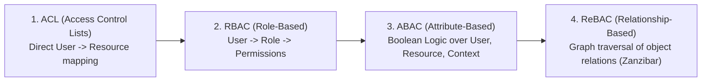
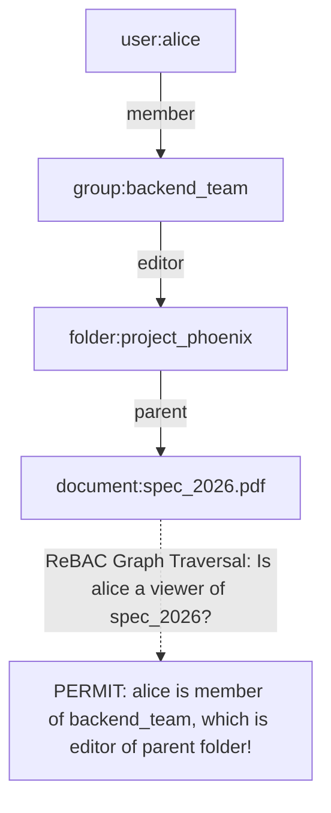
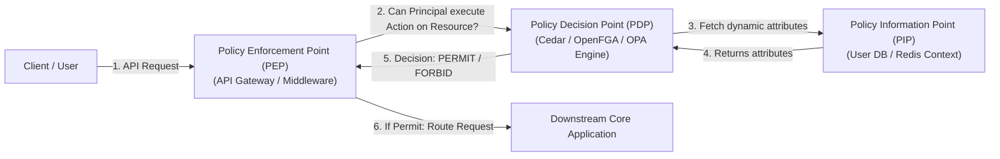

# Module 10 — Authorization Models: RBAC, ABAC, ReBAC (Zanzibar) & Cedar

Authentication establishes *who* a principal is; **Authorization** determines *what* that principal is permitted to do. In modern distributed systems, access control has evolved from primitive Access Control Lists (ACLs) to Role-Based Access Control (RBAC), Attribute-Based Access Control (ABAC), and graph-based Relationship-Based Access Control (ReBAC). Simultaneously, policy engines have decoupled authorization logic from application code using declarative policy languages like AWS Cedar and OpenFGA (inspired by Google Zanzibar). This module analyzes the mathematical and operational differences between authorization paradigms, the architecture of Google Zanzibar, the "New-Enemy Problem", Cedar's forbid-overrides-permit evaluation model, and the systematic prevention of Broken Object-Level Authorization (BOLA / IDOR, OWASP API1:2023).

---

## 1. Evolution of Access Control Models



### 1. Access Control Lists (ACL)
- **Concept**: A simple mapping bound directly to a resource listing authorized users: `document_12: [user_alice: read, user_bob: write]`.
- **Failure Mode**: Administrative nightmare. When an organization scales to 10,000 users and millions of documents, updating permissions requires mutating millions of individual ACL records.

### 2. Role-Based Access Control (RBAC, NIST SP 800-145)
- **Concept**: Decouples users from permissions through **Roles**:
  $$\text{User} \xrightarrow{\text{assigned to}} \text{Role} \xrightarrow{\text{grants}} \text{Permissions}$$
- **Failure Mode (Role Explosion)**: Real-world business rules depend on context (e.g. "A doctor can read medical records *only if* they are the assigned physician *and* the patient is currently in their ward *and* it is working hours"). Expressing this in RBAC requires inventing thousands of hyper-specific roles (`Doctor_Ward4_ShiftDay_Assigned`), resulting in unmaintainable role explosion.

### 3. Attribute-Based Access Control (ABAC)
- **Concept**: Evaluates dynamic boolean policies based on attributes of the **Subject**, **Resource**, **Action**, and **Environment**:
  $$\text{Permit if: } \text{subject.role} == \text{'doctor'} \land \text{resource.ward} == \text{subject.ward} \land \text{context.time} \in \text{shift}$$
- **Standard**: Historically implemented in XACML (XML-based, notoriously verbose). Today implemented in modern declarative policy engines like Open Policy Agent (OPA / Rego) and AWS Cedar.

### 4. Relationship-Based Access Control (ReBAC)
- **Concept**: Authorizations are expressed as paths and relationships in a directed graph:
  "Alice can edit Document $D$ because Alice is a member of Team $T$, Team $T$ owns Project $P$, and Project $P$ contains Document $D$."
- **Standard**: Pioneered by Google's global Zanzibar system and standardized in OpenFGA.

---

## 2. Google Zanzibar Architecture & The New-Enemy Problem

In 2019, Google published its seminal paper *Zanzibar: Google's Consistent, Global Authorization System* (USENIX ATC 2019), detailing the global authorization engine powering Google Drive, YouTube, Google Cloud, and Maps.

### Object-Relation-User Tuples
In Zanzibar, all authorization state is stored as elementary relational tuples:
$$\langle \text{object} \rangle \# \langle \text{relation} \rangle @ \langle \text{user} \rangle$$

Examples:
- `document:doc_1#owner@user:alice`
- `document:doc_1#viewer@group:engineering#member`
- `folder:folder_A#parent@document:doc_1`

### Userset Rewrites
To avoid copying permissions across millions of nested objects, Zanzibar evaluates permissions using **Userset Rewrites**:
1. **Direct Relation**: Check if `user:alice` has a direct tuple on the object.
2. **Computed Userset**: A relation implies another relation (e.g. an `owner` is automatically an `editor`, and an `editor` is automatically a `viewer`):
   $$\text{viewer} = \text{self} \cup \text{editor} \cup \text{owner}$$
3. **Tuple-to-Userset (Namespace Inheritance)**: A relation is inherited from a parent object:
   $$\text{document:doc_1\#viewer} = \text{folder:folder_A\#viewer}$$



### The New-Enemy Problem & Consistency Tokens (Zookies)
In a globally distributed authorization system, database replication introduces race conditions known as the **New-Enemy Problem**:
1. Alice shares a private document with Bob.
2. Alice discovers Bob is untrustworthy and removes Bob from the document ACL (Write operation $W_1$).
3. Immediately after, Alice posts highly sensitive trade secrets to the document (Write operation $W_2$).
4. If the authorization database replica in Bob's geographic region has processed $W_2$ but has replication lag for $W_1$, Bob requests the document and the lagged replica checks the ACL: Bob is still listed as a viewer! Bob reads Alice's sensitive secrets.

**The Zanzibar Solution: Zookies (Consistency Tokens)**:
Zanzibar generates an opaque consistency token called a **Zookie** containing the exact commit timestamp (LSN) of the latest authorization mutation:
- When Alice removes Bob at timestamp $t_1$, the system returns a Zookie with $t \ge t_1$.
- When Alice updates the document, the application passes that Zookie.
- When any client attempts to read the document, the evaluation engine enforces an ordering constraint: **the authorization check must be evaluated against a replica snapshot whose commit timestamp is strictly greater than or equal to the Zookie timestamp ($t_{\text{snapshot}} \ge t_{\text{zookie}}$)**. 
- If the local replica is behind, it must stall and wait for replication to catch up before evaluating permissions, making the New-Enemy Problem mathematically impossible.

---

## 3. OpenFGA: Open-Source Fine-Grained Authorization

**OpenFGA** (hosted by the Cloud Native Computing Foundation) provides an open-source, production implementation of the Zanzibar model.

### An OpenFGA Authorization Model
```yaml
model
  schema 1.1

type user

type group
  relations
    define member: [user]

type folder
  relations
    define owner: [user]
    define viewer: [user, group#member] or owner

type document
  relations
    define parent: [folder]
    define owner: [user]
    define editor: [user] or owner
    define viewer: [user, group#member] or editor or viewer from parent
```

When an application checks access, it executes a single API call:
```typescript
const { allowed } = await fgaClient.check({
  user: "user:alice",
  relation: "viewer",
  object: "document:spec_2026"
});
```
OpenFGA traverses the relationship graph in memory and returns boolean authorization in sub-milliseconds.

---

## 4. The Cedar Policy Language (AWS / Linux Foundation)

**Cedar** is an open-source, expressive, fast, and formally verifiable declarative policy language designed for fine-grained authorization.

### Core Architectural Features of Cedar
1. **Forbid-Overrides-Permit**: If *any* active policy evaluates to `forbid`, access is immediately denied, regardless of how many `permit` policies match.
2. **Default Deny**: If no policy explicitly evaluates to `permit`, access is denied.
3. **Formal Verification (SMT Solvers)**: Cedar policies can be formally verified using Automated Reasoning (Z3 Theorem Prover). Engineers can prove mathematically that a policy set guarantees properties such as: "An intern can never access production databases under any combination of attributes."

```cedar
// Policy 1: Standard RBAC permit rule
permit (
    principal in Role::"Engineer",
    action in [Action::"Read", Action::"Write"],
    resource in Folder::"EngineeringDocs"
);

// Policy 2: ABAC dynamic condition
permit (
    principal,
    action == Action::"ApprovePayment",
    resource
)
when {
    principal.department == resource.department &&
    resource.amount < 50000
};

// Policy 3: Strict security guardrail (Forbid overrides permit!)
forbid (
    principal,
    action,
    resource
)
when {
    context.isSuspiciousIP == true ||
    resource.isConfidential == true && !principal.hasSecurityClearance
};
```

---

## 5. Architectural Placement: PEP, PDP & PIP

Enterprise authorization architectures follow the standardized XACML component model:



- **Policy Enforcement Point (PEP)**: The gatekeeper intercepting incoming requests (e.g. an Express.js middleware, Envoy proxy, or API Gateway). It enforces decisions: if the decision is `deny`, the PEP immediately returns HTTP 403.
- **Policy Decision Point (PDP)**: The stateless, isolated engine evaluating Cedar or OpenFGA policies against the submitted context.
- **Policy Information Point (PIP)**: The data source supplying external attributes (user roles, account balances, IP geolocation) required by the PDP to make a decision.

---

## 6. Broken Object-Level Authorization (BOLA / IDOR)

**Broken Object-Level Authorization (BOLA)**—historically termed Insecure Direct Object References (IDOR)—remains the **#1 vulnerability in modern APIs (OWASP API1:2023)** and a core component of OWASP Top 10:2025 Category A01.

### The Anatomy of a BOLA Failure
A developer implements an API endpoint to retrieve an invoice:
`GET /api/v1/invoices/10492`

The backend code is written naively:
```typescript
// VULNERABLE: Only checks if the user is authenticated, NOT object ownership!
app.get("/api/v1/invoices/:id", authenticateUser, async (req, res) => {
  const invoice = await db.invoices.findById(req.params.id);
  if (!invoice) return res.status(404).send("Not found");
  
  // CRITICAL BUG: Serves invoice 10492 to ANY logged-in user!
  return res.json(invoice);
});
```
- **The Exploit**: User A logs in legitimately, receives a valid JWT, and changes the URL parameter from `10492` to `10493`. The server verifies that User A's token is valid and happily returns User B's private invoice!

### Mitigating BOLA Architecturally
1. **Combine Data Filtering with Tenant Ownership**:
   ```typescript
   // SECURE: Enforces tenant/user ownership in the database query!
   const invoice = await db.invoices.findOne({
     where: {
       id: req.params.id,
       tenantId: req.user.tenantId // BOLA mathematically impossible!
     }
   });
   if (!invoice) return res.status(404).send("Not found");
   ```
2. **Row-Level Security (PostgreSQL RLS)**: Enforcing security at the database engine level so that even if application code forgets a `WHERE` clause, the database driver restricts returned rows to the current authenticated tenant context.
3. **Delegating to ReBAC/OpenFGA**:
   Before querying the object, the PEP executes:
   `await fga.check({ user: req.user.id, relation: "viewer", object: `invoice:${req.params.id}` })`

---

## 7. Then vs Now: Evolution of Authorization Architecture

| Authorization Dimension | Historical Paradigm (Then) | Modern Production Architecture (Now) |
| :--- | :--- | :--- |
| **Logic Placement** | Tangled `if (user.role == 'admin')` checks inside business logic. | **Decoupled Policy Engines (PDP)** using Cedar or OpenFGA. |
| **Model** | Coarse-grained RBAC resulting in role explosion. | **Fine-Grained ReBAC (Zanzibar)** and **Dynamic ABAC**. |
| **Distributed Consistency**| Stale replica reads creating "New-Enemy" security leaks. | **Zookies / Consistency Tokens** guaranteeing causal read order. |
| **Policy Verification** | Manual ad-hoc manual testing of edge cases. | **Formal Mathematical Verification (SMT Solvers)** proving policies. |
| **BOLA Prevention** | Relying on code reviews to remember ownership checks. | **Database Row-Level Security (RLS)** & mandatory PEP enforcement. |

---

## 8. Interview Drill: Authorization Systems & Zanzibar

<details>
<summary>1. Explain the "New-Enemy Problem" in distributed authorization systems, and describe how Google Zanzibar solves it using Zookies.</summary>

The New-Enemy Problem is a race condition arising from replication lag in globally distributed databases. 
Consider: Alice removes Bob's access to a private document at timestamp $t_1$. Shortly after, Alice adds highly sensitive corporate trade secrets to the document at timestamp $t_2$. 
If an authorization database replica in another region receives the document update ($t_2$) before replication completes the ACL revocation ($t_1$), Bob queries the document. The lagged replica evaluates Bob against the old ACL snapshot, sees Bob as an authorized viewer, and serves Alice's sensitive data to Bob (her "new enemy"). 
Zanzibar solves this using **Zookies**: cryptographic consistency tokens containing the commit timestamp of the latest authorization mutation ($t \ge t_1$). 
When Alice updates the document, the application receives a Zookie and passes it to subsequent readers. When Bob attempts to read, Zanzibar mandates that the evaluation must execute against an authorization snapshot whose timestamp is at least as recent as the Zookie ($t_{\text{snapshot}} \ge t_{\text{zookie}}$). If the local replica has not yet replicated $t_1$, it must pause and wait, preventing Bob from seeing the document.
</details>

<details>
<summary>2. Why does AWS Cedar implement a "Forbid-Overrides-Permit" evaluation model, and how does this support organizational security guardrails?</summary>

In Cedar, if any matching policy evaluates to `forbid`, access is denied unconditionally, even if twenty independent `permit` policies explicitly authorize the action. 
This architecture enables central security teams to establish immutable **Security Guardrails** that cannot be overridden by application teams:
For example, central security can deploy a single global policy:
`forbid (principal, action, resource) when { context.mfaVerified == false };`
Regardless of what permissive policies individual microservice developers write (`permit(principal, action, resource);`), the forbid rule strictly overrides them, guaranteeing that unauthenticated MFA requests are rejected across the entire enterprise.
</details>

<details>
<summary>3. Differentiate between a Policy Enforcement Point (PEP) and a Policy Decision Point (PDP).</summary>

- **PEP (Policy Enforcement Point)**: The infrastructural boundary or middleware that intercepts the incoming user request. It does *not* contain authorization logic; its job is gathering contextual parameters (user ID, requested resource, HTTP method), querying the PDP, and strictly enforcing the binary outcome (routing the request if permitted, returning HTTP 403 if denied).
- **PDP (Policy Decision Point)**: The centralized, isolated decision engine (such as OpenFGA, Cedar, or OPA). It takes inputs from the PEP, consults external attributes (PIP) and stored policies, evaluates the rules in memory, and returns a deterministic `permit` or `forbid` answer back to the PEP.
</details>

<details>
<summary>4. What is the fundamental root cause of Broken Object-Level Authorization (BOLA / IDOR), and why do standard authentication middleware checks fail to detect it?</summary>

The root cause of BOLA is confusing **Authentication** with **Object-Level Authorization**. 
Standard authentication middleware verifies that the incoming request has a valid, cryptographically intact session cookie or JWT signed by the trusted IdP. Once verified, the middleware attaches `req.user` and calls `next()`. 
However, BOLA occurs *after* authentication: the application code reads an object identifier from the URL (e.g. `GET /api/documents/:id`) and queries the database using `SELECT * FROM documents WHERE id = :id`. 
The code fails to verify whether the authenticated user (`req.user.id`) actually *owns* or has *permission* to view that specific record. The request is fully authenticated, but completely unauthorized at the object level.
</details>

<details>
<summary>5. How does Relationship-Based Access Control (ReBAC) eliminate the "Role Explosion" problem common in classic RBAC?</summary>

In classic RBAC, permissions are statically bound to flat role names. To represent contextual enterprise sharing (e.g. "Editors of a folder can edit all files in that folder and its subfolders"), RBAC requires provisioning distinct roles for every folder and project combination, leading to thousands of unmanageable roles. 
ReBAC expresses access dynamically as paths in a directed graph using **Object-Relation-User tuples** and **Userset Rewrites**. Instead of assigning roles, the system stores relationships (`document#parent@folder`, `user#member@team`). The authorization engine traverses the graph dynamically at evaluation time, allowing complex inheritance and sharing models to scale across billions of objects with zero role proliferation.
</details>
