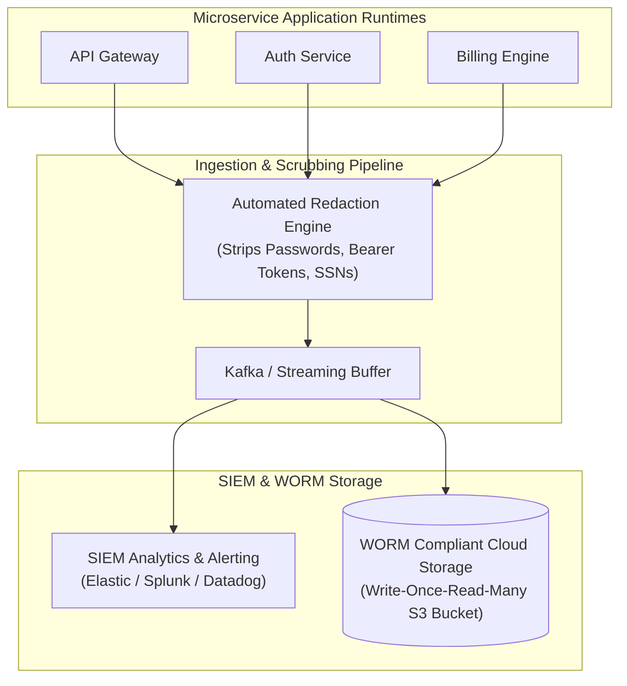
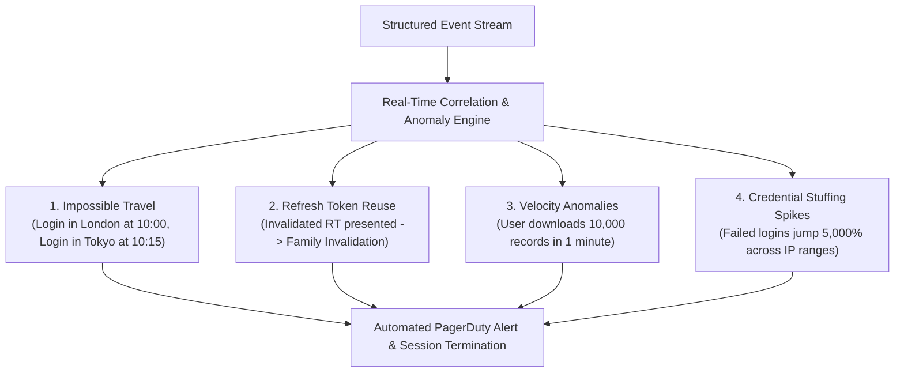
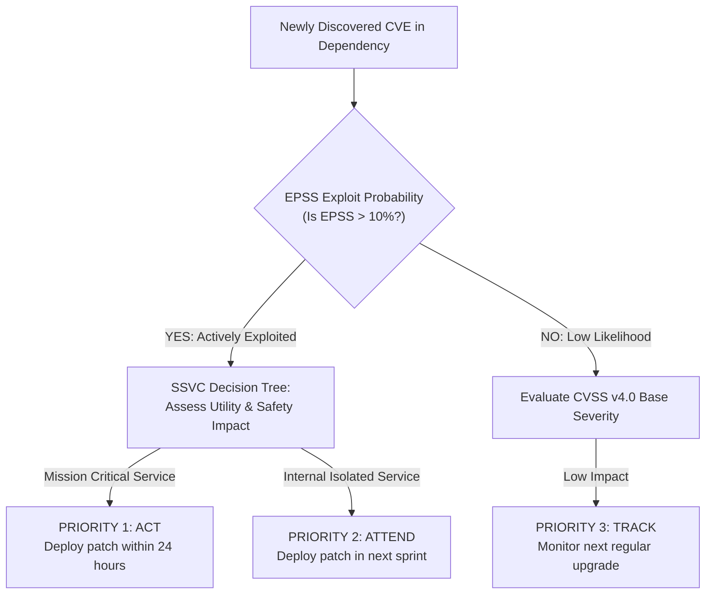
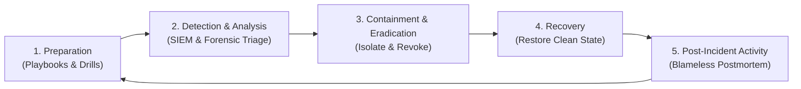

# Module 13 — Security Operations, Detection & Incident Response (OWASP A09:2025)

Engineering secure software is incomplete without robust operational observability: if an application is compromised, how quickly can security teams detect the breach, isolate affected components, and eradicate the threat? The **OWASP Top 10:2025 Category A09 (Security Logging & Alerting Failures)** highlights that the average time to identify and contain a data breach exceeds 200 days when systems lack structured audit logging and automated anomaly detection. This module establishes the operational engineering foundation: tamper-evident structured audit logging, automated PII/credential redaction, anomaly detection signals (impossible travel, refresh token reuse alerts), vulnerability scoring with CVSS v4.0, EPSS, and SSVC, the NIST SP 800-61r2 incident response lifecycle, and emergency rotation drills.

---

## 1. Security Logging & Auditing Architecture (OWASP A09:2025)

Application logs serve two distinct operational purposes:
- **Diagnostic / Debug Logs**: High-volume, short-lived logs utilized by software developers to troubleshoot operational errors and latency bottlenecks.
- **Security Audit Logs**: Immutable, structured, legally defensible, long-lived records documenting security-relevant events for compliance, forensic analysis, and intrusion detection.



### What to Log (Security Events)
1. **Authentication Events**: Successful logins, failed login attempts (with failure reason, e.g. invalid password vs locked user), password resets, MFA enrollment.
2. **Authorization Failures**: Any HTTP 403 Forbidden response or rejected ReBAC/ABAC check, including the attempted resource ID and missing permission.
3. **Privilege Changes**: Role assignments, team membership additions, API key generation or revocation.
4. **Data Exfiltration Signals**: Bulk data export requests, mass API downloads exceeding baseline velocity.

### What MUST NEVER Be Logged (Data Scrubbing Mandate)
Logging sensitive secrets violates privacy regulations (GDPR, HIPAA, PCI-DSS) and turns the centralized log store into an attacker's primary target. Application logging libraries must implement automated redaction interceptors:
- **Never log**: Passwords, plaintext credentials, authorization header tokens (`Bearer ...`), session cookies, symmetric encryption keys, credit card numbers (PANs), or unmasked Personally Identifiable Information (PII).

---

## 2. Structured Audit Event Format

Security logs must be serialized as structured JSON objects adhering to standardized schemas (such as Elastic Common Schema / ECS or Cloud Auditing Data Federation / CADF):

```json
{
  "@timestamp": "2026-10-30T21:30:00.123Z",
  "event": {
    "action": "user.login",
    "category": "authentication",
    "outcome": "failure",
    "reason": "invalid_credentials"
  },
  "user": {
    "id": "usr_94821",
    "name": "alice@example.com"
  },
  "source": {
    "ip": "198.51.100.42",
    "geo": { "country_iso_code": "US", "city_name": "New York" }
  },
  "http": {
    "request": {
      "method": "POST",
      "id": "req_847192"
    }
  },
  "user_agent": {
    "original": "Mozilla/5.0..."
  }
}
```

---

## 3. Real-Time Anomaly Detection Signals

Modern Security Information and Event Management (SIEM) systems ingest structured events and execute automated correlation rules:



### 1. Impossible Travel Detection
The SIEM calculates the physical geographical distance between two consecutive authentication events for the identical user ID:
$$\text{Velocity} = \frac{\text{Distance}(\text{Location}_1, \text{Location}_2)}{\text{Timestamp}_2 - \text{Timestamp}_1}$$
If the required travel velocity exceeds commercial aircraft limits (e.g. $> 900\text{ km/h}$), the event is flagged as Impossible Travel. The system immediately revokes active sessions and prompts for biometric WebAuthn verification.

### 2. Refresh Token Reuse Alarms
Under RFC 9700 Refresh Token Rotation, any presentation of an already-used refresh token indicates stolen credentials. The authorization server immediately fires a critical security incident alert and invalidates the entire token family.

---

## 4. Vulnerability Triage: CVSS v4.0, EPSS & SSVC

When a vulnerability scanner (Snyk, Trivy, Dependabot) alerts on a CVE, how does an engineering organization prioritize remediation without experiencing alert fatigue?



### 1. CVSS v4.0 (Common Vulnerability Scoring System)
Published in late 2023, CVSS v4.0 calculates theoretical severity (0.0 to 10.0) across four metric groups: Base (Attack Vector, Complexity, Privileges, User Interaction, Scope), Threat (Exploit Maturity), Environmental, and Supplemental.
- *Limitation*: CVSS measures *potential severity*, not *real-world exploitation probability*. A CVSS 9.8 vulnerability in an unexposed CLI tool may pose near-zero real-world risk.

### 2. EPSS (Exploit Prediction Scoring System, FIRST)
A data-driven machine learning model trained on real-world honeypots, intrusion detection systems, and dark-web exploit chatter. It outputs an empirical probability ($0.0 \le P \le 1.0$) that a vulnerability will be weaponized in the wild within the next 30 days.
- Prioritizing vulnerabilities with **high EPSS ($> 0.10$) and high CVSS ($> 7.0$)** remediates 90% of real-world attacks while eliminating 80% of unnecessary patch toil.

### 3. SSVC (Stakeholder-Specific Vulnerability Categorization)
Developed by Carnegie Mellon SEI and CISA, SSVC replaces arbitrary 1–10 scores with a decision-tree model producing actionable operational directives:
- **Track**: Low threat; upgrade during standard release cycles.
- **Track*: Standard patch cycle.
- **Attend**: Elevated risk; deploy patch ahead of schedule.
- **Act**: Immediate threat; execute emergency out-of-band hotfix within 24 hours.

---

## 5. Incident Response Lifecycle (NIST SP 800-61r2)

When an active breach occurs, engineers must execute a standardized incident response framework:



1. **Preparation**: Maintaining automated runbooks, isolated emergency communication channels (Signal/out-of-band Slack), and pre-approved emergency deployment permissions.
2. **Detection & Analysis**: Triaging alerts, scoping the blast radius, identifying compromised accounts, and isolating forensic memory dumps.
3. **Containment**: Short-term containment (isolating infected Kubernetes pods, invalidating compromised session tokens, disabling compromised API keys) followed by long-term containment.
4. **Eradication & Recovery**: Removing malicious artifacts, rebuilding containers from verified clean source commits, rotating master database credentials, and restoring from immutable backups.
5. **Post-Incident Activity**: Conducting a blameless postmortem, documenting root cause, calculating Time-to-Detect (TTD) and Time-to-Remediate (TTR), and updating defensive policies.

---

## 6. Emergency Rotation Drills: Keys, Secrets & Certificates

An organization that has never executed an emergency credential rotation drill will inevitably cause a massive self-inflicted production outage during a real security crisis.

### The Emergency Rotation Drill Checklist
1. **Master Database Password Rotation**:
   - Verify that all application instances use dynamic secrets or connection pools that support dual-credential overlap (validating both old and new passwords during the transition window).
2. **Root Signing Key Rotation (JWKS)**:
   - Introduce new signing key into the JWKS array alongside the old key.
   - Wait for cache TTL expiration so all downstream services have downloaded the new public key.
   - Switch token minting to the new key.
   - Deprecate and delete the old key after token maximum validity expires.
3. **TLS Certificate Emergency Cutover**:
   - Trigger ACME force-renewal to prove automated pipeline can issue and deploy new certificates in sub-minute timeframes without human intervention.

---

## 7. Then vs Now: Evolution of Security Operations

| Operations Dimension | Historical Paradigm (Then) | Modern Production Architecture (Now) |
| :--- | :--- | :--- |
| **Log Format** | Unstructured text dumped to `/var/log` on local disk. | **Structured JSON (ECS)** streamed to immutable WORM SIEM storage. |
| **Log Privacy** | Passwords and tokens accidentally leaked in stack traces. | **Automated Redaction Pipelines** stripping sensitive data at source. |
| **Vulnerability Triage**| Blindly patching all CVSS $\ge 7.0$ alerts; engineer burnout. | **EPSS Exploit Prediction** + **SSVC Decision Trees**. |
| **Intrusion Detection** | Reviewing historical logs months after breach disclosure. | **Real-Time Automated Anomaly Detection** (Impossible Travel, RTR). |
| **Secret Rotation** | Hardcoded passwords rotated once a year with downtime. | **Zero-Downtime Key Rotation Drills** with automated dual-key support. |

---

## 8. Interview Drill: SecOps & Incident Response

<details>
<summary>1. A junior developer includes `logger.info("User Login Request: ", req.body)` in the authentication controller. What critical security compliance violation does this create, and how must it be resolved?</summary>

This creates a severe **Sensitive Data in Logs Violation (OWASP A09:2025)** and violates GDPR, HIPAA, and PCI-DSS compliance. 
`req.body` contains the user's plaintext password in cleartext. Once logged, the user's master password is permanently stored in application log files, transmitted across third-party log aggregation pipelines (Datadog, Splunk), and exposed to every developer and support engineer with log access. 
*Resolution*:
1. Application logging frameworks must never log raw request bodies on authentication routes.
2. The logging pipeline must implement **Automated Sensitive Field Redaction** (using regex or AST parsers to replace keys named `password`, `token`, `secret`, `authorization`, `creditCard` with `[REDACTED]`).
3. Rotate all passwords that were leaked into historical log stores and purge affected log indexes.
</details>

<details>
<summary>2. Explain the fundamental difference between CVSS v4.0 and EPSS, and why using both together is superior to using CVSS alone.</summary>

- **CVSS v4.0** measures **theoretical severity** based on intrinsic software characteristics (e.g. Can it be exploited over the network? Does it require privileges? What is the impact on confidentiality, integrity, and availability?). It answers: *"How bad would it be if exploited?"*
- **EPSS (Exploit Prediction Scoring System)** measures **empirical probability** based on real-world threat intelligence. It answers: *"What is the statistical likelihood that an attacker will actively exploit this in the wild within 30 days?"*
*The Synergy*: Tens of thousands of CVEs have CVSS scores $> 7.0$, but fewer than 5% of all CVEs are ever weaponized in real-world attacks. Relying on CVSS alone causes severe engineering burnout. Prioritizing vulnerabilities that have both high CVSS *and* high EPSS ($P > 0.10$) allows teams to remediate 90% of real-world threats with minimal wasted effort.
</details>

<details>
<summary>3. Describe how an automated SIEM rule detects an "Impossible Travel" anomaly and what automated remediation should occur.</summary>

The SIEM ingests authentication events containing the user's authenticated ID, source IP address, geolocation (latitude and longitude), and timestamp. 
When an authentication occurs, the SIEM queries the user's previous authentication event:
$$\text{Speed} = \frac{\text{GreatCircleDistance}(\text{Coord}_1, \text{Coord}_2)}{\text{Timestamp}_2 - \text{Timestamp}_1}$$
If the required travel velocity exceeds realistic physical limits (e.g. $> 900\text{ km/h}$, such as logging in from London and then 15 minutes later from Singapore), the rule triggers. 
*Automated Remediation*: The system invalidates all existing session cookies and refresh tokens for that user ID, locks the account temporarily, and sends an out-of-band notification to the user requiring a phishing-resistant WebAuthn biometric verification to unlock the session.
</details>

<details>
<summary>4. Why must an authorization server maintain zero-downtime dual-key support during an asymmetric JWKS key rotation drill?</summary>

In asymmetric token systems, the Authorization Server signs tokens with a private key, and downstream microservices verify signatures using the public key fetched from the JWKS endpoint. 
If the AS abruptly rotates its key and begins signing tokens with a new private key *before* downstream microservices have updated their cached JWKS, every single downstream API call will fail signature verification with an "Unknown Key ID" error, inducing a complete production outage. 
*Zero-Downtime Dual-Key Procedure*:
1. The AS adds the new public key to the JWKS array alongside the old public key (both keys are now published).
2. The AS waits until all downstream microservices have refreshed their JWKS cache (or waits for cache TTL to elapse).
3. The AS switches token signing to the new private key. Downstream services accept it because the new public key is already in cache.
4. The AS keeps the old public key in the JWKS until all existing tokens signed with the old key have expired.
5. The old key is safely purged.
</details>

<details>
<summary>5. What is the role of WORM (Write Once, Read Many) storage in enterprise security audit logging?</summary>

In an advanced persistent threat (APT) compromise, an attacker who gains root access to an infrastructure server immediately attempts to cover their tracks by editing, truncating, or deleting application log files (`rm -rf /var/log/*`, modifying audit trails). 
WORM storage (such as AWS S3 Object Lock in Compliance Mode) enforces immutable storage policies at the physical hardware layer: once a log record is written, **no user—not even the AWS root account or a compromised administrator—can delete, overwrite, or alter the file** until the retention period (e.g. 7 years) expires. This guarantees forensic tamper evidence and legal admissibility.
</details>
