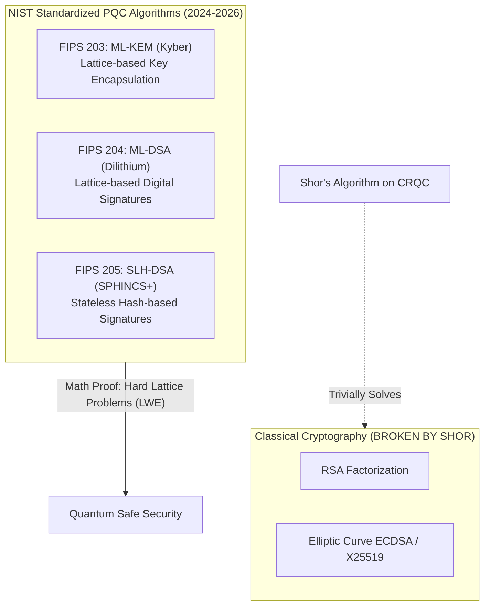
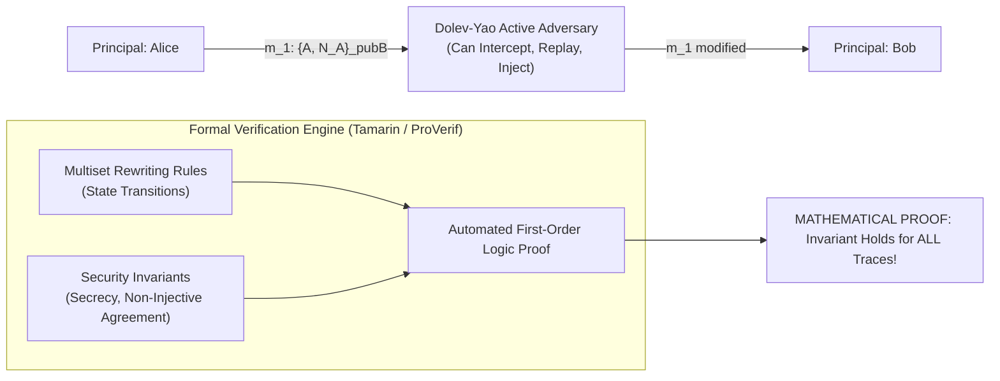
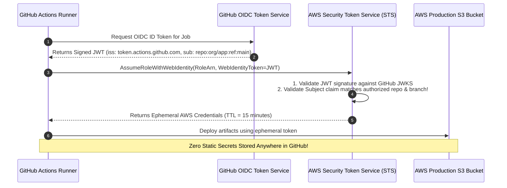
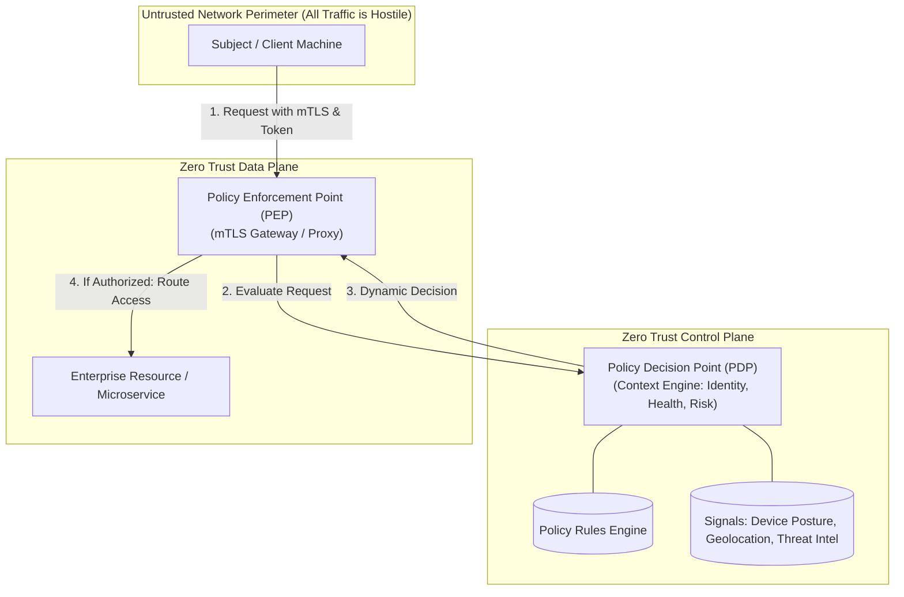
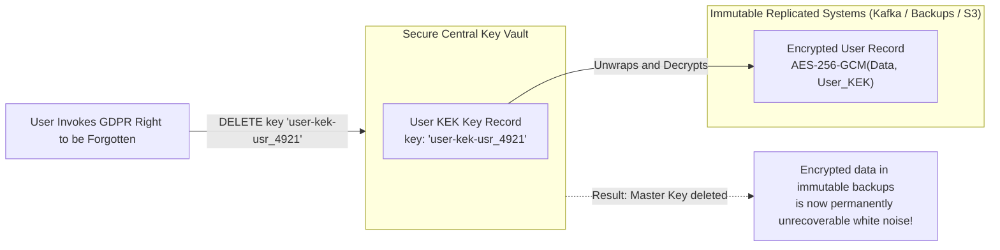
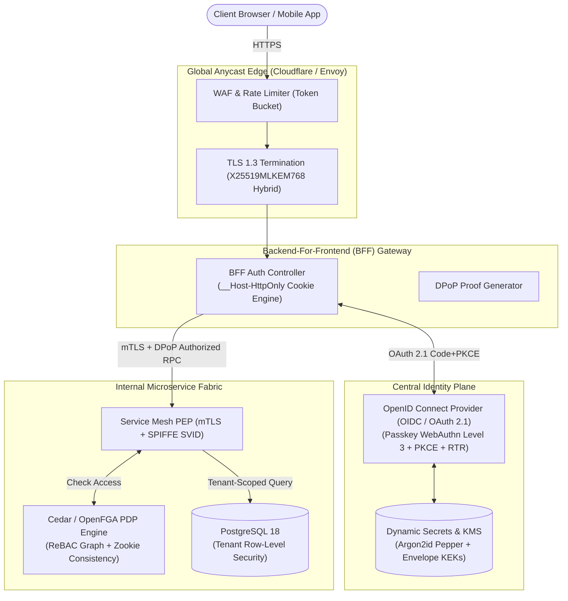

# Module 14 — Expert Security Architecture & Capstone System Design

Senior and Principal Security Architects operate beyond routine vulnerability patching: they design resilient cryptographic trust topologies, architect global identity fabrics, model post-quantum algorithmic migration, formally verify security protocols, and engineer zero-trust distributed perimeters. This capstone module examines the frontier of security systems engineering: the Post-Quantum Cryptography (PQC) migration under the "Harvest Now, Decrypt Later" threat model, automated formal protocol verification with Tamarin and ProVerif, Workload Identity Federation (eliminating static cloud credentials), NIST SP 800-207 Zero Trust Architecture, cryptographic data erasure (Crypto-Shredding), and an end-to-end architectural capstone designing a global, multi-tenant authentication and authorization infrastructure.

---

## 1. Post-Quantum Cryptography (PQC) Transition

Shor's Algorithm running on a cryptographically relevant quantum computer (CRQC) will solve discrete logarithms and integer factorization in polynomial time ($\mathcal{O}(n^3)$), completely breaking all existing public-key cryptography: RSA, Diffie-Hellman, ECDSA, and Ed25519.

### The "Harvest Now, Decrypt Later" (HNDL) Threat
Adversaries and nation-states are currently recording petabytes of encrypted TLS traffic traversing global internet backbones. While they cannot decrypt this traffic today, they will store the recorded ciphertexts until a CRQC is constructed, at which point all historically recorded communications (financial ledgers, medical records, diplomatic cables) will be decrypted. Systems handling long-lived sensitive data must deploy post-quantum key exchange **today**.

### Hybrid Key Exchange (X25519MLKEM768, RFC 10024)
During the multi-year transition to post-quantum algorithms, standards bodies mandate **Hybrid Key Exchange**:
$$\text{SharedSecret} = \text{HKDF-Extract}\big(0, \text{SharedSecret}_{\text{X25519}} \parallel \text{SharedSecret}_{\text{ML-KEM-768}}\big)$$
- Combines the battle-tested classical X25519 algorithm with the post-quantum ML-KEM-768 algorithm.
- Even if a catastrophic mathematical flaw is discovered in ML-KEM lattice theory, the connection retains the full classical security of X25519. Conversely, if a quantum computer arrives, the connection is protected by ML-KEM.

---

## 2. Formal Protocol Verification: Tamarin & ProVerif

How can an architect prove with mathematical certainty that a new authentication or key-exchange protocol is free of subtle race conditions, replay flaws, or man-in-the-middle attacks? Humans routinely overlook combinatorial edge cases.

### The Dolev-Yao Threat Model
Formal verification analyzes cryptographic protocols under the **Dolev-Yao Model**:
- The network is controlled entirely by an active adversary.
- The attacker can intercept, drop, modify, replay, and inject arbitrary messages.
- Cryptographic primitives (hashing, encryption) are treated as perfect mathematical "black boxes" (the attacker cannot invert a hash without the key).

### ProVerif & Tamarin Prover
- **ProVerif**: Uses the applied pi-calculus to model concurrent protocol interactions. Automatically proves **Reachability Secrecy** (the attacker can never learn secret $S$) and **Correspondence Assertions** (if Bob finishes the handshake with Alice, Alice must have initiated it).
- **Tamarin Prover**: Uses multiset rewriting rules over graph-based execution traces. It supports complex stateful protocol loops, Diffie-Hellman algebraic properties, and hardware state isolation, and was used to formally verify the TLS 1.3 (RFC 8446) and 5G authentication protocols.

---

## 3. Workload Identity Federation: Eliminating Static Cloud Credentials

A primary cause of major cloud security breaches is committing static cloud provider credentials (`AWS_ACCESS_KEY_ID` and `AWS_SECRET_ACCESS_KEY`) to Git repositories, or baking them into CI/CD pipeline environment variables.

### The OIDC Workload Federation Pattern
**Workload Identity Federation** completely eliminates static cloud API keys by establishing trust between the Cloud IAM system and the CI/CD execution platform (e.g. GitHub Actions, GitLab CI, Kubernetes):

1. The build runner requests an ephemeral OIDC token from GitHub's internal identity service.
2. The returned JWT contains trusted claims:
   - `iss`: `https://token.actions.github.com`
   - `sub`: `repo:my-org/my-app:ref:refs/heads/main`
   - `aud`: `sts.amazonaws.com`
3. The runner passes the JWT to AWS STS (`AssumeRoleWithWebIdentity`).
4. AWS STS downloads GitHub's public keys via JWKS, validates the signature, and confirms that the `sub` claim matches the IAM Role trust policy.
5. AWS issues temporary, short-lived AWS credentials (valid for 15 minutes). **No human ever creates or stores a static AWS secret.**

---

## 4. Zero Trust Architecture (NIST SP 800-207)

The core tenet of **Zero Trust** is simple: **"Never Trust, Always Verify."** Network locality is completely discarded as an indicator of trust: an API call originating from an internal corporate subnet is treated with the exact same skepticism as an API call originating from a public Wi-Fi hotspot in an airport.

### The Seven Tenets of NIST SP 800-207
1. All data sources and computing services are considered resources.
2. All communication is secured regardless of network location.
3. Access to individual enterprise resources is granted on a per-session basis.
4. Access to resources is determined by dynamic policy (including client identity, device posture, and behavioral anomalies).
5. The enterprise monitors and measures the integrity and security posture of all owned and associated assets.
6. All resource authentication and authorization are dynamic and strictly enforced before access is allowed.
7. The enterprise collects as much information as possible about asset state and network infrastructure to improve security posture.

---

## 5. Privacy Engineering & Cryptographic Erasure (Crypto-Shredding)

Article 17 of the European Union General Data Protection Regulation (GDPR) mandates the **"Right to be Forgotten" (Right to Erasure)**: an enterprise must permanently delete all personal data relating to a user upon request.

### The Distributed Storage Deletion Dilemma
In modern cloud architectures, personal data is written to immutable, append-only systems:
- Kafka event streams replicated across multiple brokers.
- Compressed multi-tier LSM SSTables in Cassandra or RocksDB.
- Write-Once-Read-Many (WORM) compliant S3 backup archives.
Deleting a single customer's rows from an immutable 50 TB tape or S3 snapshot is mathematically and operationally impossible without destroying backup integrity.

### The Solution: Cryptographic Erasure (Crypto-Shredding)
Crypto-Shredding achieves instantaneous, compliant data destruction across all immutable systems using envelope encryption:

1. Each individual user account is assigned a unique symmetric **Key Encryption Key (User-KEK)** stored in a centralized, secure Key Management Service.
2. All personal data relating to that user stored across Kafka, databases, and backup snapshots is encrypted using that User-KEK.
3. When the user requests account erasure under GDPR Article 17, the application executes a single operational step: **it securely deletes the User-KEK from the KMS**.
4. The ciphertext residing across all historical backups and Kafka logs becomes mathematically equivalent to random noise ($\mathcal{O}(2^{256})$ work factor), achieving legally verified, instantaneous deletion across petabytes of immutable storage.

---

## 6. Staff Capstone: Designing a Global Multi-Tenant Auth Architecture

### The Integrated Architectural Invariants
1. **Edge Tier**: Terminate incoming traffic using Post-Quantum Hybrid TLS 1.3 (`X25519MLKEM768`), mitigating "Harvest Now, Decrypt Later" wire attacks.
2. **Client Authentication**: Browser SPAs interact exclusively via the **Backend-For-Frontend (BFF)** pattern (RFC 10017) using `__Host-HttpOnly`, `SameSite=Strict`, `Secure` cookies, eliminating XSS token exfiltration.
3. **Identity Core**: User authentication is executed via **WebAuthn Level 3 Passkeys** (phishing-resistant, hardware origin-bound), with Argon2id ($m=19\text{ MiB}, t=2, p=1$) and KMS Pepper as fallback.
4. **Token Minting**: OAuth 2.1 with mandatory PKCE (S256) and Refresh Token Rotation (RTR) with automated family revocation. All access tokens are **Sender-Constrained via DPoP (RFC 9449)**.
5. **Workload Identity**: Internal service-to-service communication is secured via **mTLS with SPIFFE/SPIRE SVIDs**, decoupling identity from dynamic container IPs.
6. **Fine-Grained Authorization**: Authorization is decoupled from application code using **OpenFGA / Cedar** (ReBAC graph traversal), using **Zookies** to eliminate the New-Enemy race condition, enforced at the data layer via **PostgreSQL Row-Level Security**.
7. **Privacy & Erasure**: Personal data is protected via **Crypto-Shredding** with per-user KEKs in KMS.

---

## 7. Interview Drill: Principal Security Systems Architect

1. A financial institution asks: "Since quantum computers capable of breaking RSA/ECC don't exist yet, why should our engineering team invest in Post-Quantum Cryptography migration today?" How do you answer?

The immediate threat is **"Harvest Now, Decrypt Later" (HNDL)**. Adversaries and intelligence agencies are intercepting and storing massive volumes of encrypted TLS wire traffic today. 
If financial transactions, personal identity records, or trade secrets must remain confidential for 10 to 30 years, that confidentiality is already compromised if protected solely by classical RSA or ECC. 
When a cryptographically relevant quantum computer is eventually built, historical recorded traffic will be decrypted retrospectively. 
Deploying hybrid post-quantum key exchange (such as `X25519MLKEM768`, RFC 10024) today ensures that traffic recorded on the wire today cannot be decrypted by future quantum machines.

2. Explain how Cryptographic Erasure (Crypto-Shredding) achieves legally compliant GDPR Article 17 deletion on immutable, append-only storage systems.

Immutable storage systems (such as WORM S3 buckets, Kafka distributed logs, and historical tape backups) cannot physically delete individual database records without destroying the cryptographic hash chain or file integrity of the backup. 
In Crypto-Shredding, all personal data for User $U$ is encrypted using a unique, dedicated symmetric User Key (KEK) managed in an external KMS. 
When the user exercises their Right to Erasure, the KMS permanently destroys that specific User Key. 
Without the key, the ciphertext residing in the immutable backups is mathematically irreversible ($\mathcal{O}(2^{256})$ work factor), rendering the personal data permanently unrecoverable and satisfying GDPR compliance without mutating the immutable storage media.

3. Why is Workload Identity Federation (OIDC) fundamentally superior to storing static IAM access keys in CI/CD build environments?

Static IAM keys (`AWS_ACCESS_KEY_ID` / `AWS_SECRET_ACCESS_KEY`) are permanent credentials. They frequently leak via developer dotfiles, accidental git commits, build log outputs, or compromised runner machines, granting attackers persistent unauthorized cloud access until a human manually rotates them. 
Workload Identity Federation uses ephemeral OpenID Connect (OIDC) tokens. The CI/CD runner requests a short-lived signed JWT from the CI platform asserting the repository and branch. The cloud provider validates the JWT against the CI platform's public JWKS and issues short-lived temporary credentials (valid for 15 minutes). No static keys are ever created, stored, or managed by humans, completely eliminating credential leak vectors.

4. What are the core assumptions of the Dolev-Yao threat model used in formal protocol verification?

The Dolev-Yao model assumes that the communication network is entirely controlled by an active adversary:
1. The attacker can intercept, eavesdrop on, modify, replay, drop, or inject any message traversing the network.
2. The attacker can initiate concurrent sessions with any legitimate participant.
3. Cryptography is modeled as a perfect black box: the attacker can only decrypt a ciphertext if they possess the exact decryption key; they cannot break mathematical primitives via cryptanalysis or statistical brute force.
Formal verification tools (ProVerif, Tamarin) use this model to prove mathematically that no sequence of interleaving or replayed messages can violate secrecy or authentication invariants.

5. Describe the end-to-end token and session lifecycle in the Backend-For-Frontend (BFF) architecture and explain why it provides the highest assurance against XSS.

In the BFF pattern (RFC 10017):
1. The user authenticates via OIDC / OAuth 2.1. The authorization code exchange is executed directly by the server-side BFF gateway.
2. The BFF stores the raw OAuth Access Token and Refresh Token in encrypted server-side session memory.
3. The BFF issues an encrypted, `HttpOnly`, `SameSite=Strict`, `Secure`, `__Host-` session cookie to the browser SPA.
4. When the SPA calls an API, the browser automatically transmits the session cookie to the BFF.
5. The BFF decrypts the session, retrieves the OAuth access token, attaches it as a DPoP-bound or Bearer token, and proxies the request to downstream microservices.
*XSS Defense*: If an attacker executes arbitrary JavaScript inside the SPA via XSS, the attacker cannot read `HttpOnly` cookies and has no access to the underlying OAuth tokens. The attacker cannot steal credentials for persistent access outside the victim's immediate browser session.

