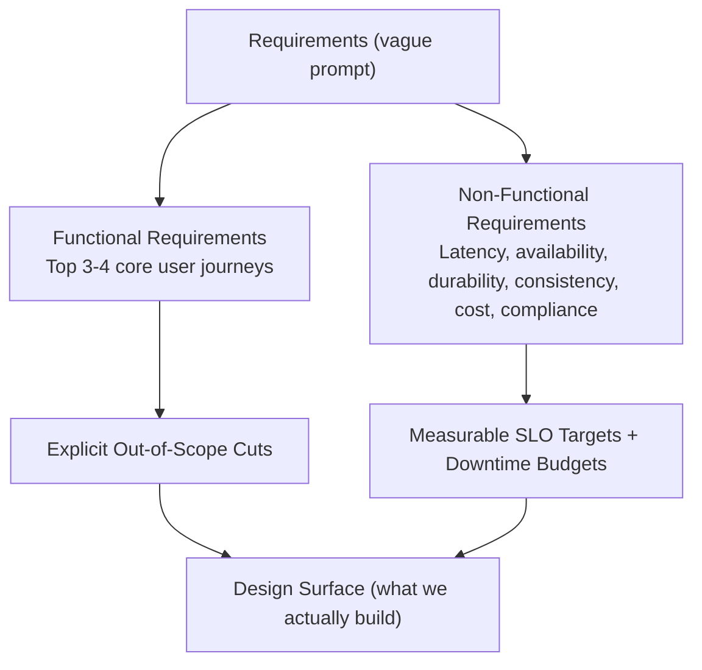
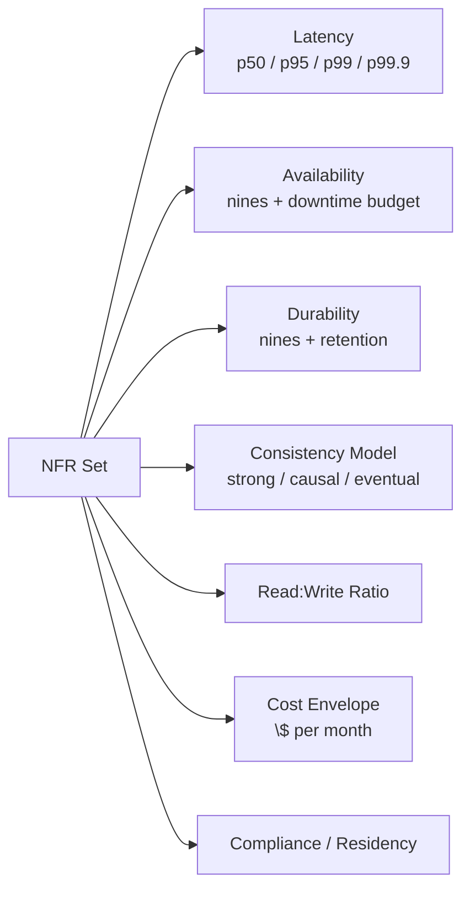
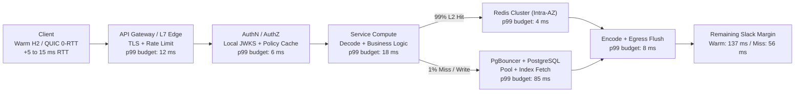
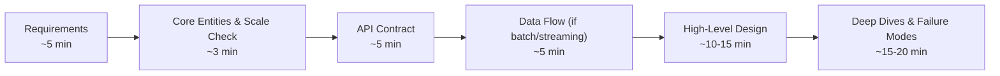
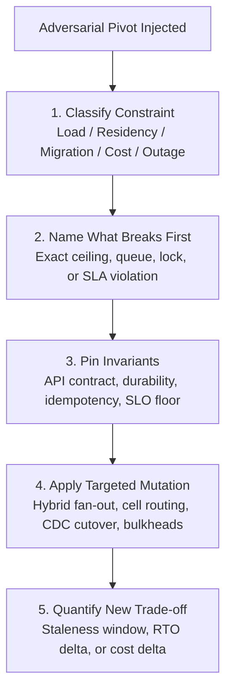
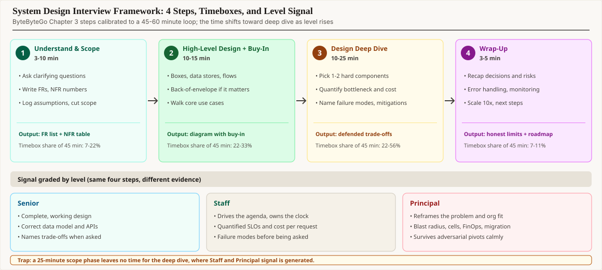
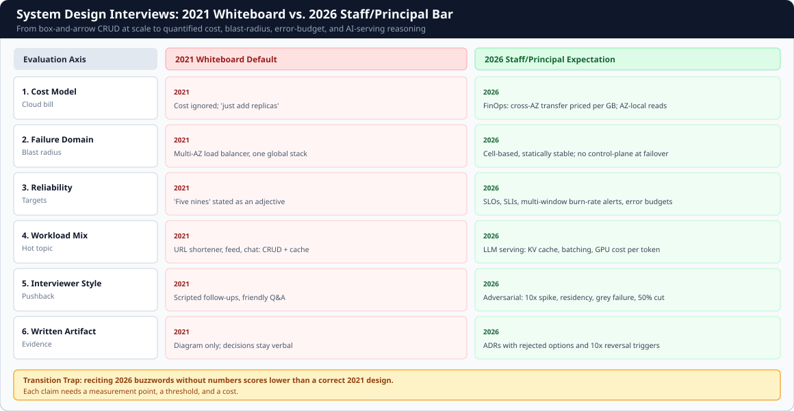

# Module 01 — Framing, Requirements, and Delivery Execution

A system design interview or a production design review is not a drawing exercise; it is a contract negotiation followed by an architectural proof. The output that matters is not a box-and-arrow diagram but a defensible set of decisions, each tied to a measurable requirement, an explicit assumption, and a rejected alternative. This module teaches how to decompose requirements into functional and non-functional contracts, how to apply the DDIA 2e reliability/scalability/maintainability framework, how to time-box a 45–60 minute delivery, and how to calibrate the depth of your reasoning to the level being evaluated. It also covers the practitioner patterns that separate a design that ships from a design that dazzles: Architecture Decision Records with rejection rationales, the discipline of skipping estimation when it cannot change the architecture, and the reflex of preferring one well-tuned PostgreSQL instance over a seven-service mesh.

---

## 1. Requirements as an Engineering Contract

Requirements are the only thing that makes an architecture correct or incorrect. A beautiful design that serves the wrong load profile is a failure; a boring design that serves the actual load profile is a success. The first ten minutes of any design session must therefore convert a vague prompt ("design Twitter", "design a payment system") into a written, numbered, measurable contract. Everything downstream is derived from that contract.



### 1.1 Functional Requirements (FRs)

Functional requirements describe what the system must do, expressed as user-visible journeys rather than feature lists. The discipline is to pick the **top three to four core user journeys** and to write everything else down as an explicit out-of-scope cut. A design that tries to cover every feature of a product in sixty minutes covers none of them well.

A well-formed functional requirement has four properties:

1. **Actor-centric**: "A logged-in user posts a tweet with optional media" rather than "the system supports tweeting".
2. **Bounded**: it names the inputs, the outputs, and the success criterion. "Post succeeds when the tweet is durably stored and visible to followers within the freshness SLO."
3. **Prioritised**: the top journey is the one the interviewer or stakeholder will grade on; the others are supporting context.
4. **Cuttable**: every FR that is not in the top three or four must be explicitly listed as out of scope with a one-line reason, so that it cannot silently re-enter the design later.

Typical core journeys for a social feed product: (1) authenticated user publishes a post, (2) follower reads their personalised feed, (3) user searches posts by keyword, (4) user receives a notification when mentioned. Everything else (direct messages, analytics dashboards, ad targeting, account deletion flows) is out of scope unless it changes a load parameter or a consistency requirement.

The out-of-scope list is not a throwaway; it is a load-bearing artifact. It tells the reviewer which traffic you are not sizing, which data you are not storing, and which consistency guarantees you are not providing. A design that omits it invites scope creep during deep dives.

### 1.2 Non-Functional Requirements (NFRs)

Non-functional requirements are where senior and staff engineers earn their grades. They must be expressed as numbers, not adjectives. "Fast" is not a requirement; "p99 read latency under 200 ms for the feed endpoint at peak QPS" is. The full NFR set covers latency distributions, availability, durability, consistency, read:write ratio, cost envelope, and compliance/data residency.



**Latency distributions.** Always specify at least p50, p95, p99, and p99.9. The tail percentiles are the ones that bite in production: a service with p50 of 10 ms and p99.9 of 4 s is a service that occasionally ruins a user's day and drives retry storms. State the measurement point (edge, load balancer, application, database) and the traffic mix (cached vs uncached, authenticated vs anonymous). A single "latency < 100 ms" target hides more than it reveals.

**Availability nines and exact downtime budgets.** Map nines to concrete downtime so that the budget is legible to stakeholders. The table below is the reference (monthly figures use a 30.44-day average calendar month, whereas 30-day SLO burn-rate math uses 720 hours); memorise the right-hand column because every SLA conversation eventually asks for it.

| Availability         | Downtime per year  | Downtime per month (30.44 d) | Downtime per week |
| -------------------- | ------------------ | ---------------------------- | ----------------- |
| 99% (two nines)      | 3 days 15 h 36 min | 7 h 18 min                   | 1 h 41 min        |
| 99.9% (three nines)  | 8 h 45 min 57 s    | 43 min 49 s                  | 10 min 4 s        |
| 99.99% (four nines)  | 52 min 36 s        | 4 min 23 s                   | 1 min 0 s         |
| 99.999% (five nines) | 5 min 15 s         | 26 s                         | 6 s               |
| 99.9999% (six nines) | 32 s               | 2.6 s                        | 0.6 s             |

Availability is not a property of a single component; it is the product of the availability of every component on the critical path, including DNS, TLS termination, the load balancer, the application tier, the database, and the cache. A system with five 99.9% components in series has 99.5% availability. State the target per endpoint, not per system, and state whether it is measured as request success rate or as time-based uptime.

**Durability nines.** Durability is the probability that a committed write is not lost, independent of availability. Object storage targets 99.999999999% (eleven nines) durability; a relational database with synchronous replication to one follower and regular backups targets roughly 99.9999% (six nines) to 99.99999% (seven nines). Durability must be paired with a retention policy and a recovery time objective, otherwise it is a marketing number.

**Consistency model choice.** Pick one model per data class and write it down: strong (linearizable), causal (read-your-writes plus monotonic reads within a session), or eventual (convergent within a stated bound). The choice drives the replication topology, the transaction scope, and the user-visible staleness budget. Cross-link to [Distributed Systems](../../distributed-systems/README.md) for the formal consistency hierarchy; here you only state the decision and its cost. A common, defensible split: strong consistency for balances and inventory, causal for user profiles and feeds, eventual for view counts and analytics.

**Read:write ratio.** State it as a number (e.g. 100:1, 10:1, 1:1) and, where it matters, per endpoint. The ratio decides whether you scale reads (replicas, caches) or writes (sharding, batching, queues), and it feeds directly into the QPS derivation in Module 02.

**Cost envelope.** A number with a currency and a period: "\$50k/month at launch, \$500k/month at steady state". Cost is a first-class NFR because it constrains replication factor, region count, and managed-service choice. The single biggest cost trap in modern systems is cross-region or internet egress at \$0.05–\$0.09/GB, which routinely dwarfs compute bills; see Module 02 §3.

**Compliance and data residency.** Which regulations apply (GDPR, SOC 2, HIPAA, PCI-DSS, FedRAMP), where data may physically reside, retention and deletion obligations, encryption requirements (at rest, in transit, and increasingly in use), and audit-log immutability. Residency is not a deployment detail; it is an architectural constraint that can forbid multi-region active-active or force a specific provider region.

### 1.3 Concrete Quantitative NFR Budgeting: Decomposing a 200 ms p99 SLA

An end-to-end **200 ms p99 SLA** is meaningless until decomposed hop by hop, because two statistical traps break naive latency addition. First, tail percentiles do not sum linearly: the p99 of a serial pipeline is the 99th percentile of the **convolution** of each hop's latency distribution, plus queueing delay under Little's Law ($L = \lambda W$) when utilization climbs past 60%. Second, if a service fans out in parallel to $k$ backend shards or downstream services, any single slow subcall stalls the whole response, amplifying tail probability according to $P(\text{tail}) = 1 - (1 - p_{\text{hop}})^k$. With $k = 10$ parallel subcalls each running at a 1% tail ($p_{\text{hop}} = 0.01$), $1 - 0.99^{10} = 9.56\%$ of parent requests hit the tail—turning a per-hop p99 into a system-wide p90.

Before assigning milliseconds, pin the **measurement boundary**. Over public mobile networks, a cold DNS lookup plus TCP handshake and TLS 1.3 negotiation requires 2–3 round trips (60–140 ms) before the first HTTP payload byte leaves the client. A hard 200 ms p99 contract therefore either measures server-side ingress-to-first-byte at the regional edge POP, or requires persistent HTTP/2 / HTTP/3 (QUIC 0-RTT) connection reuse terminated at an Anycast CDN edge.



The table below shows a concrete budget for an edge-terminated `GET /v1/feed` request with a **200 ms p99 SLA** under both the warm cache-hit path and the PostgreSQL cache-miss path:

| Hop | Warm Cache Hit (p50 / p99) | Cache Miss via PG (p50 / p99) | Primary Tail Risk & Engineering Mitigation |
| --- | --- | --- | --- |
| Edge DNS + TCP/TLS (warm HTTP/2 or QUIC) | 8 ms / 22 ms | 8 ms / 22 ms | Cold handshakes add 80–120 ms; terminate TLS at Anycast POPs and enforce keep-alive + session tickets |
| API Gateway / L7 Ingress (WAF + rate limit) | 3 ms / 12 ms | 3 ms / 12 ms | Synchronous remote Redis rate-limit check adds a cross-AZ RTT; use local token-bucket sync every 100 ms |
| AuthN / AuthZ (JWT + policy check) | 1 ms / 6 ms | 1 ms / 6 ms | Remote OAuth introspection explodes p99 under load; verify EdDSA/ECDSA locally via cached JWKS |
| Service compute + decode + GC headroom | 4 ms / 18 ms | 6 ms / 24 ms | Stop-the-world GC pauses or large JSON trees blow p99; pre-allocate buffers, bound payload size, use Protobuf internally |
| Cache / DB hop (Redis L2 vs PgBouncer + PG) | 1 ms / 4 ms (Redis) | 12 ms / 85 ms (PG replica) | Connection pool exhaustion or unindexed seq scans push PG > 500 ms; bound pool queue wait at 20 ms and statement timeout at 65 ms |
| Response encode + compression + socket flush | 2 ms / 8 ms | 2 ms / 8 ms | High-level Brotli compression stalls CPU; cap dynamic JSON compression at gzip/zstd level 3–4 |
| **Unallocated slack (convolution & retry margin)** | **130 ms remaining** | **43 ms remaining** | Absorbs packet retransmits, jitter, and a single bounded hedged retry without breaching 200 ms |
| **Observed path total (with slack excluded)** | **19 ms p50 / ~55 ms p99** | **32 ms p50 / ~138 ms p99** | Cache hit ratio must stay >= 99% (after single-flight coalescing) so misses stay inside the 1% tail |

Notice the **cache-hit-rate constraint** revealed by this budget. If the cache miss path takes 240 ms at p50 and your hit rate drops to 95%, then 5% of all requests exceed 240 ms—meaning your overall p99 is guaranteed to breach 200 ms no matter how fast the 95% cache hits are. Keeping p99 under 200 ms requires both keeping the cache hit ratio above 99% (using single-flight request coalescing for hot keys) and bounding the cold DB path under ~140 ms p99 via PgBouncer transaction pooling and strict statement timeouts.

**Parallel fan-out budget correction:** When a single service endpoint scatters across $k$ parallel subcalls (for example, hydrating user profile, social graph, post bodies, and ranker scores in parallel), the overall step succeeds within budget $T$ only if **every** mandatory branch finishes within $T$. To hold the combined fan-out step at p99 ($p_{\text{combined}} = 0.01$), each independent branch must meet a stricter per-branch tail probability:

$$
p_{\text{branch}} = 1 - (1 - 0.01)^{1/k}
$$

For $k = 4$ mandatory parallel branches, $p_{\text{branch}} \approx 0.0025$, meaning every downstream dependency must hold **p99.75 <= budget** rather than p99 <= budget. Where a downstream tail cannot meet p99.75 natively, use **hedged requests** (fire a duplicate read to a second replica if the first has not responded by its local p95 latency, capping hedge traffic at ~5% via a token bucket) or mark non-critical enrichments as **soft-deadline optional** that degrade to empty/default fields at `t = 45 ms`. Cross-link capacity sizing to [Module 02](./02-back-of-the-envelope-estimation.md), edge termination to [Module 03](./03-networking-edge-and-cdn-composition.md), and stampede defense to [Module 05](./05-caching-strategies-and-invalidation.md).

---

## 2. The DDIA 2e Trade-off Framework

DDIA 2e chapters 1 and 2 frame every architectural decision as a trade-off across three axes: reliability, scalability, and maintainability. Use them as the vocabulary of your design, not as a checklist to recite.

### 2.1 Reliability: Faults vs Failures, Blast-Radius Containment

A **fault** is a component deviating from its specification: a disk dies, a process crashes, a network link drops packets, a clock skews. A **failure** is the system as a whole stopping or violating its contract. Reliability engineering is the practice of ensuring that faults do not become failures.

The key moves:

- **Fault isolation (blast-radius containment).** Partition the system so that a fault in one part cannot cascade. Bulkheads between thread pools, separate connection pools per downstream, cell-based architecture (sharding users into independent failure domains), and circuit breakers all exist to contain blast radius. State which fault domains you have drawn and what the maximum blast radius of each is.
- **Redundancy with diversity.** Redundant components fail together if they share a fault domain (same rack, same AZ, same kernel version). True redundancy spans AZs, regions, and ideally providers for the most critical paths.
- **Graceful degradation.** Define the degraded behaviour explicitly: "if the recommendation service is down, serve a cached popular list" is a reliability decision, not a fallback hack. Degradation must be designed, tested, and documented.
- **Detection and recovery.** Faults that are not detected become failures. Health checks, SLO burn-rate alerts, and automated failover convert a fault into a brief degradation rather than an outage.

Cross-link to [Distributed Systems](../../distributed-systems/README.md) for the formal failure-detector and consensus theory; here you only state which detector class you are assuming and its cost.

### 2.2 Scalability: Load Parameters, Throughput vs Tail Latency

Scalability is not "handling more traffic"; it is the ability to handle increased load while maintaining acceptable performance, where load is described by **load parameters** specific to the system: requests per second, read:write ratio, number of simultaneously active users, fan-out degree, dataset size. A design is scalable if doubling a load parameter can be absorbed by a predictable, sub-linear increase in resources.

Two curves matter:

- **Throughput vs resources**: does adding a node add proportional throughput, or does coordination overhead dominate? Sharded, stateless tiers scale linearly; a single-writer database does not.
- **Tail latency vs load**: as utilisation approaches 100%, queueing delay explodes (Little's Law). A system that is "fast" at 30% utilisation and "frozen" at 80% is not scalable; it is merely underloaded. Always state the target operating utilisation (typically 50–60% at peak) and the latency you expect there.

The load parameters must be numbers from Module 02, not placeholders. "High traffic" is not a load parameter; "10 000 QPS peak, 100:1 read:write, 50 GB dataset, fan-out of 200 per post" is.

### 2.3 Maintainability: Operability, Simplicity, Evolvability

Maintainability splits into three sub-properties that pull in different directions:

- **Operability**: how easy it is for a team to keep the system running. Good operability means good observability (metrics, logs, traces with bounded cardinality), runbooks, automated deployments, and graceful handling of routine operations (rotating a certificate, adding a node, failing over). A system that only its author can operate is not maintainable.
- **Simplicity**: the absence of accidental complexity. Every component, protocol, and data store must earn its place by solving a problem that cannot be solved more simply. Simplicity is the antidote to resume-driven development.
- **Evolvability**: how easy it is to change the system in the future. Evolvability comes from clean module boundaries, versioned APIs, schema evolution (Avro/Protobuf), and the discipline of not coupling components to each other's internals. Cross-link to [Data Systems](../../data-systems/README.md) for encoding and schema evolution.

These three often conflict: the most operable system (managed service, auto-scaling) may be the least evolvable (vendor lock-in); the simplest system (single database) may be the least operable at scale. State which you are prioritising and why.

---

## 3. The Structured 45–60 Minute Delivery Framework

The delivery framework is a time-boxed protocol. It is not a script; it is a budget. Spending twenty minutes on requirements leaves no time for deep dives; spending five minutes on deep dives leaves the interviewer unable to grade your depth. The Hello Interview delivery framework, refined against Alex Xu's approach, gives the following budget:



| Phase | Budget | Output | Common failure |
| --- | --- | --- | --- |
| Requirements | ~5 min | Numbered FR list (top 3-4) + NFR table with numbers + out-of-scope cuts | Skipping NFRs or leaving them as adjectives |
| Core Entities & Scale Check | ~3 min | 3-5 entities with key fields + one-page estimate (QPS, storage, bandwidth) | Inventing entities not tied to journeys; estimating numbers that cannot change the design |
| API Contract | ~5 min | 3-6 endpoints with method, path, request/response, idempotency, pagination | Designing 20 endpoints; omitting idempotency and pagination |
| Data Flow (conditional) | ~5 min | Sequence of how data moves for batch or streaming workloads | Drawing it for every system even when it is a simple CRUD read |
| High-Level Design | ~10-15 min | Boxes, data stores, caches, queues, with data flow arrows and a chosen consistency model | Drawing components without stating why each exists |
| Deep Dives & Failure Modes | ~15-20 min | 1-2 deep dives (sharding, hot keys, consistency, failure modes) with quantified trade-offs | Listing features instead of analysing failure modes |

**Phase-by-phase guidance:**

- **Requirements (~5 min).** State the top three or four journeys, state the NFR numbers you have been given or are assuming, and state the out-of-scope cuts. Ask at most two clarifying questions; if you need more, state your assumption and move on. Do not wait for permission to proceed.
- **Core Entities & Scale Check (~3 min).** Name the three to five entities that matter (User, Post, Follow, FeedItem) with their key fields and approximate size. Then do the one-page estimate: QPS, storage, bandwidth, cache size. If the estimate does not change a decision (e.g. "we need a cache" or "we need to shard"), say so explicitly and stop estimating. See the "skip estimation" discipline in §5.
- **API Contract (~5 min).** Default to REST unless there is a reason to do otherwise. State the 3-6 endpoints that the core journeys need, with method, path, key request/response fields, idempotency key where writes are involved, and pagination style (cursor, not offset, for large collections). Cross-link to [Networking](../../networking/README.md) for protocol details.
- **Data Flow (conditional, ~5 min).** Only draw this when the system has batch or streaming data movement (ingest pipeline, ETL, event sourcing). For a CRUD service, skip it and say you are skipping it.
- **High-Level Design (~10-15 min).** Draw the boxes and arrows, naming each component and the data store behind it. For each box, state one sentence on why it exists. State the consistency model per data class. Do not draw a component you cannot justify with a requirement.
- **Deep Dives & Failure Modes (~15-20 min).** Pick one or two areas where the design is genuinely hard (hot partition, consistency under failover, cache invalidation, payment idempotency) and go deep: quantify the trade-off, name the failure mode, state the mitigation and its cost. This phase is where staff-level signal is generated.

---

## 4. Level Calibration: What Differentiates Solid vs Staff/Principal

The same design prompt is graded differently at different levels. The difference is not the number of components drawn; it is the kind of reasoning demonstrated. The matrix below is the rubric interviewers actually use, stated as behaviours rather than labels.

| Dimension | Solid implementation | Staff/Principal systems leadership |
| --- | --- | --- |
| Ambiguity | Waits for the interviewer to specify NFRs before proceeding | Drives ambiguity without waiting: states assumptions, proposes defaults, asks at most two targeted questions |
| Hidden bottlenecks | Addresses the obvious ones when prompted (cache, DB index) | Surfaces hidden non-functional bottlenecks proactively: hot keys, clock skew, fan-out tail latency, retry amplification, metastable overload |
| Trade-offs | Names pros and cons qualitatively | Quantifies trade-offs with numbers: "sharding by user_id gives 10x fewer cross-shard queries at the cost of 3x storage for the celebrity shard" |
| Pushback | Accepts a challenge and adjusts the diagram | Handles pushback and requirement pivots cleanly: states what changes, what does not, and the migration path; refuses to silently rewrite |
| Failure modes | Lists "the DB could go down" | Enumerates specific failure modes with detection, blast radius, and recovery: "if the cache stampedes, p99 rises 40x; mitigation is single-flight with a 50 ms timeout" |
| Scope | Tries to design everything | Makes explicit cuts and defends them with load or consistency reasoning |
| Estimation | Computes every number | Computes only the numbers that change a decision, and says so |

The calibration is not about knowing more facts; it is about where you spend your attention. A staff-level candidate spends less time on the happy path and more on the edges: the celebrity shard, the clock that moves backwards, the retry that turns a blip into an outage.

---

## 5. Niche Practitioner Patterns

### 5.1 Architecture Decision Records with Rejection Rationales

Every non-trivial decision in a design should be captured as a short ADR: context, decision, consequences, and **rejected alternatives with reasons**. The rejection rationale is the part that is usually skipped and is the part that matters most in review. A decision without rejected alternatives is a decision that was not evaluated.

A minimal ADR:

```
# ADR-007: Use cursor pagination for the feed endpoint

Context: Feed endpoint must serve p99 < 200 ms at 5 000 QPS peak with unbounded scroll depth.
Decision: Keyset (cursor) pagination on (created_at, post_id).
Consequences: Stable under inserts; O(log n) seek; no total count without a separate query.
Rejected:
- Offset pagination: O(offset) scan, unstable under inserts, p99 degrades past 10^5 rows.
- Seek by post_id alone: ties on created_at break ordering; cursor must be composite.
```

The rejected list is what prevents the next engineer from re-litigating the same decision six months later. It also forces you to actually consider the alternatives rather than defaulting to the first option that comes to mind.

#### Worked ADR Template with Rejected Alternatives and 10x Reversal Triggers

For core architectural boundaries, a Staff/Principal ADR adds two operational clauses: **Reversal Triggers** (explicit quantitative thresholds at which 10x growth invalidates the choice) and a **Pre-Wired Escape Hatch** (the low-cost seam left in place today so reversal does not require a rewrite). Use the following template and worked example:

```markdown
# ADR-012: Single-Region Modular Monolith + Tuned PostgreSQL + Redis over Microservice Mesh

- **Status:** Accepted (2026-04-10) · Owner: Core Platform
- **Context & Load Profile:** Launch peak 5,000 QPS (100:1 read:write -> 50 write TPS), 50 GB active dataset, p99 read < 200 ms, 99.95% availability, 14 backend engineers, $18k/month infra budget.
- **Decision:** Deploy a stateless Go/TypeScript modular monolith (strict internal module packages) backed by one tuned PostgreSQL 17 primary (NVMe, 64 vCPU, 256 GiB RAM) + 1 synchronous-local/async-cross-AZ read replica + PgBouncer + a 3-node Redis cluster.
- **Consequences:**
  - (+) Zero inter-service RPC hops on the write path; ACID transactions across orders, users, and ledger without distributed sagas; single CI/CD pipeline.
  - (-) Single primary write ceiling (~8,000–12,000 simple write TPS); all modules share process memory and deploy blast radius if module boundaries leak.
  - Cost: ~$4.8k/month compute + DB + cache (73% under budget envelope).
- **Rejected Alternatives:**
  1. _7-Service Microservice Mesh + Kafka:_ Adds 3–5 internal network hops (+15–40 ms p99), composite availability penalty (0.9995^7 = 99.65%), distributed tracing/mesh tax (+$6k/month), and schema-coordination drag with zero load justification at 50 write TPS.
  2. _Multi-Region Active-Active (CockroachDB / Spanner):_ Adds 40–90 ms cross-region consensus RTT to every strong write and 3x–4x storage/egress spend when 95% of launch traffic sits in North America.
- **Reversal Triggers (Revisit at 10x Scale):**
  - _Write ceiling:_ Sustained write TPS > 6,000 or primary CPU > 65% after index/batching tuning -> extract the highest-write table (`events` or `ledger`) onto a dedicated primary or hash-partition into 16 logical shards.
  - _Working set growth:_ Hot index + table working set > 150 GiB (60% of primary RAM) or total DB > 2 TB -> partition cold rows > 90 days to object storage (Parquet) or shard by `tenant_id`.
  - _Organizational contention:_ Engineering org > 35–40 engineers or merge-queue wait > 45 min -> extract one bounded context behind a versioned HTTP/gRPC interface.
  - _Geographic latency:_ > 20% of DAU outside home region experiencing p99 > 250 ms -> deploy regional read replicas or split into regional data cells.
- **Pre-Wired Escape Hatch:** Every domain package communicates only via typed internal interfaces (`OrdersPort`, `BillingPort`) with zero cross-schema SQL joins, and all external side effects emit via a transactional `outbox` table so any module can be extracted to a standalone service in one sprint without changing callers.
```

Three operational habits make ADRs durable in production:

- **Wire reversal triggers to real dashboards:** Every numeric trigger in an ADR (`write_tps > 6000`, `working_set_ram_pct > 60%`, `merge_queue_wait > 45m`) should map to an existing SLI chart or weekly capacity review alert so teams discover threshold crossings months before an outage forces an emergency split.
- **Test the escape hatch continuously:** A modular monolith boundary rots if developers bypass `OrdersPort` with a cross-module SQL join; enforce package import boundaries in CI and schema isolation via database roles or linter rules.
- **Supersede, never silently edit:** When a 10x trigger fires, write a new ADR (`ADR-041` superseding `ADR-012`) documenting the measured metric that crossed the line, preserving the historical rationale for future engineers.

### 5.2 Skip Estimation Unless It Changes the Architecture

Estimation is a tool, not a ritual. The discipline is: **do the estimate, and if it does not change a decision, stop and say so.** Computing QPS when the answer is "we need a cache either way" adds no value and consumes phase budget that belongs to deep dives.

Estimation changes a decision when it crosses a threshold: when QPS exceeds what a single node can serve (forcing sharding), when storage exceeds what fits on one volume (forcing partitioning), when egress cost exceeds the compute bill (forcing a CDN or regional design), or when tail latency under load forces a queue. If none of these thresholds are crossed, state "the numbers are small enough that a single well-tuned instance suffices; estimation complete" and move on.

This is the single most common time-management failure in interviews: candidates spend eight minutes on arithmetic that does not affect the design, then rush the failure-mode analysis that would have earned the grade.

### 5.3 Avoiding Resume-Driven Over-Engineering

The most valuable architectural skill is knowing when not to build. A single well-tuned PostgreSQL instance with a read replica and a Redis cache will serve the vast majority of products to tens of millions of users. A seven-service microservice mesh with Kafka, a service mesh, a separate search cluster, and a distributed cache is justified only when a specific requirement (independent scaling, team autonomy, polyglot runtimes, regulatory isolation) demands it.

Apply this test before adding a component: "Which requirement does this component satisfy that the simpler option does not?" If the answer is "none yet, but we might need it later", do not add it. Complexity is a liability that compounds: every component adds failure modes, operational burden, and a latency hop. The default is the simplest architecture that meets the stated NFRs, and complexity is added only with a requirement attached.

Concrete comparison: a product with 5 000 QPS, 100:1 read:write, and 50 GB of data does not need sharding, does not need Kafka, and does not need a microservice mesh. It needs PostgreSQL with a read replica, Redis for the hot read path, and a CDN for static assets. The mesh becomes justified around independent team scaling or regulatory isolation, not around traffic.

Cross-link to [Data Systems](../../data-systems/README.md) for storage-engine internals and to [PostgreSQL](../../../technologies/postgres/README.md) for operational guidance; here the point is the decision, not the mechanism.

### 5.4 Quantitative Crossover: Single Well-Tuned PostgreSQL vs 7-Service Microservice Mesh

Engineers frequently misjudge where a single tuned PostgreSQL primary stops scaling and where a seven-service microservice mesh actually earns its operational tax. On modern 2026 NVMe hardware (64–128 vCPU, 256–512 GiB RAM, PCIe Gen5 NVMe delivering 500k+ IOPS), a modular monolith paired with PgBouncer, one or two read replicas, and Redis handles substantially more load than folklore suggests. Conversely, splitting into seven synchronous services too early imposes a measurable **composite availability penalty**: if each service achieves 99.95% availability, a synchronous request traversing all seven drops to $0.9995^7 \approx 99.65\%$ availability (2 hours 33 minutes of downtime per month), failing a 99.9% contract before any code bug occurs.

| Dimension | Single Well-Tuned PostgreSQL + Redis (Sweet Spot) | Crossover / Split Trigger Zone | 7-Service Mesh + Kafka (When Splitting Pays Off vs Hurts) |
| --- | --- | --- | --- |
| Read QPS (API edge) | `<= 25,000 QPS` (95%+ served by Redis/CDN; 2–3k QPS hitting primary + 1–2 read replicas) | `25,000–80,000 QPS` with rising cache miss pressure or asymmetric endpoint spikes (e.g. search vs checkout) | **Pays off** > 80k QPS when read-heavy or CPU-bound endpoints (search, ML ranking) scale independently; **hurts** < 25k QPS via extra serialization and sidecar hops |
| Write TPS (committed transactions) | `<= 5,000 write TPS` sustained (`<= 12,000` short bursts with batching and `synchronous_commit = off` for non-financial logs) | `5,000–12,000 write TPS`, WAL flush saturation, or lock contention on hot counters/balances | **Pays off** > 12k write TPS when write streams partition by bounded domain onto independent primaries or append-only logs; **hurts** < 5k TPS by turning local ACID transactions into distributed sagas |
| Dataset size & active working set | `<= 1.5 TB` total DB and `<= 200 GiB` hot indexes fitting in RAM (`shared_buffers` + OS page cache) | `1.5–4 TB` total DB, VACUUM freeze lag, or working set > 70% of primary RAM causing NVMe thrashing | **Pays off** > 4 TB or when distinct domains need distinct engines (columnar analytics, vector index, blob store); **hurts** < 1.5 TB by fracturing joinable data across 7 stores |
| Engineering team size & deploy coupling | `2–25 engineers` (1–4 squads shipping via one trunk and one migration pipeline) | `25–45 engineers` where CI queues > 30 min, schema lock contention rises, or blast radius blocks deploys | **Pays off** > 45–60 engineers needing independent release trains and strict team ownership; **hurts** < 25 engineers via 7 CI pipelines, contract versioning, and cross-team triage |
| Composite availability ($\prod A_i$) | `99.95%–99.99%` with Multi-AZ standby (only 2 stateful dependencies on the critical path: PG + Redis) | Adding >= 3 synchronous internal RPCs where any single downstream brownout exhausts caller thread pools | **Pays off** only when services communicate asynchronously via durable queues or isolate strict failure domains (e.g. billing vs notifications); **hurts** synchronous chains ($0.9995^7 = 99.65\%$) |
| Network & latency budget overhead | `~1–4 ms` intra-process module call + 1 DB/cache hop; easy to hold p99 < 100 ms | `> 2–3` sequential internal RPCs or heavy cross-AZ traffic consuming > 30 ms of a 200 ms p99 budget | **Pays off** when edge-to-service fan-out is parallelised and cached; **hurts** when serial RPC + mTLS sidecar + JSON/Protobuf hops eat 40–80 ms p99 |
| Failure domain & blast radius | Shared process memory and shared primary CPU: one runaway query or OOM can degrade all endpoints | One noisy tenant or heavy batch job degrades latency for latency-sensitive checkout or auth flows | **Pays off** when regulatory scope (PCI-DSS card vault) or noisy workloads (video transcode, exports) must never share failure domains; **hurts** when cascading retries link all 7 services into one shared failure domain |
| Monthly infra + egress + telemetry cost | `\$2k–\$12k/month` (single primary + replica, Redis, minimal cross-AZ chatter, unified metrics) | Cross-AZ replication/RPC traffic exceeds 20% of bill or APM trace/span cardinality explodes | **Pays off** at > \$80k/month where independent autoscaling of heavy workers saves compute; **hurts** < \$15k/month where service-mesh control planes, Kafka brokers, and distributed tracing double the bill |
| Schema & transaction coupling | Strong ACID foreign keys and single-commit multi-table invariants; zero distributed deadlocks | Cross-domain joins prevent splitting hot tables or trigger conflicting lock ordering during migrations | **Pays off** when domain boundaries are stable and eventual consistency via outbox/CDC is acceptable; **hurts** early-stage products whose entity boundaries change every quarter |

The operational rule is **asymmetric extraction, not big-bang splitting**: when a modular monolith crosses a trigger in the middle column, extract the **one** bounded domain causing the bottleneck (for example, moving high-volume audit logs or search indexing behind an outbox + worker) while keeping the remaining core in PostgreSQL. Jumping directly from one database to seven services trades one manageable scaling bottleneck for six new distributed-systems failure modes.

---

## 6. Explicit Assumption Logging

Every number in a design that was not given by the prompt must be recorded as an assumption with a source or a rationale. Assumptions are not weaknesses; unrecorded assumptions are. A design review that surfaces a wrong assumption early is a successful review.

Format: `A-NN: <assumption> — <basis>`. Example: "A-03: peak QPS is 5x average — derived from a diurnal traffic pattern with a single daily peak; see Module 02 §1." When an assumption is challenged, the response is not to defend it emotionally but to state what changes if it is wrong and whether the architecture still holds. If the architecture only holds under an assumption you cannot justify, that is a design flaw, not an assumption.

Keep the assumption log visible throughout the session. It is the single best artifact for converting a "design review" into a "design audit", and auditors will ask for it first.

---

## 7. Adversarial Pushback Playbook

Staff and Principal panels routinely inject late-stage requirement pivots after your high-level design looks settled. The worst response is to silently erase the whiteboard or bolt on ad-hoc boxes; the winning response follows a four-step protocol: classify the constraint, state what breaks first with numbers, separate what stays invariant from what mutates, and declare the new trade-off or migration cost explicitly.



### 7.1 Pivot 1: "Traffic Spikes 10x Overnight (or a 50M-Follower Celebrity Joins)"

- **What breaks first:** Database connection pools saturate (`max_connections` exhausted by queueing under Little's Law), hot keys in Redis shard onto a single CPU core (`> 100k` ops/s on one slot), and synchronous write fan-out turns one celebrity post into 50M write amplification ops, starving normal timelines.
- **What stays invariant:** Write durability contract for published posts, client-facing API contract and pagination cursors, and the base sharding key for standard accounts.
- **Targeted architectural mutation:** Switch from pure push fan-out to **hybrid push-pull** (threshold: accounts above 10,000 followers write once to a celebrity post table and merge at read time); add **in-process L1 request coalescing (single-flight)** with a 2–5 s TTL on hot celebrity payloads so 100k concurrent reads collapse into 1 Redis fetch; enable **load shedding** on low-priority endpoints (analytics, recommendations) and scale read replicas horizontally. See [Module 06](./06-scaling-reads-writes-and-partitioning.md) and [Module 08](./08-rate-limiting-load-shedding-and-resilience.md).
- **Quantified trade-off:** Celebrity post visibility relaxes from `< 1 s` push freshness to `5–15 s` cached pull staleness, and non-critical endpoints shed up to 30% of traffic during burst absorption so core read/write p99 stays under 200 ms.

### 7.2 Pivot 2: "Legal Requires Strict Multi-Region Data Residency (EU PII Never Leaves Frankfurt)"

- **What breaks first:** Global active-active database replication of user profiles, shared global Redis caches holding PII, and centralized cross-region log/telemetry pipelines shipping raw request headers or user IDs to a US analytics cluster.
- **What stays invariant:** Stateless compute binaries, global replication of non-PII public catalogs and static assets, and stateless JWT verification using distributed public JWKS keys.
- **Targeted architectural mutation:** Partition the system into **regional data cells** (`eu-central-1`, `us-east-1`) keyed by an immutable `home_region` attribute resolved at edge routing (Anycast edge reads an opaque region-prefixed token or unauthenticated region lookup table containing zero PII). Pin EU PostgreSQL primaries, synchronous standbys, Redis clusters, backups, and KMS encryption keys inside Frankfurt; strip or HMAC-pseudonymise PII before emitting cross-region aggregate telemetry.
- **Quantified trade-off:** Baseline infra cost rises ~1.6x–2.0x due to duplicated regional control planes and isolated DR footprints, and cross-region social lookups (a US user viewing an EU public profile) incur one explicit `80–120 ms` cross-Atlantic read hop or require an explicit public-projection cache opt-in.

### 7.3 Pivot 3: "Migrate This 4 TB Hot Table to a Sharded Store with Zero Downtime and Zero Lost Writes"

- **What breaks first:** Blocking `ALTER TABLE` or offline `pg_dump` locks (stalling writes for hours), split-brain mutations if both stores accept writes without a single source of truth, and silent data drift from type coercion or skipped edge cases.
- **What stays invariant:** External REST/gRPC contracts, client idempotency keys, and the rule that **exactly one store is authoritative for writes at any millisecond**.
- **Targeted architectural mutation:** Execute a four-stage **Expand-Contract + CDC** migration: (1) Provision target shards and backfill historical rows from a consistent snapshot while streaming live WAL deltas via Debezium/logical replication; (2) Enable **dual-write in the app** (or outbox) only for shadow verification alongside a continuous row-hash reconciliation worker until diff rate hits zero for 48 hours; (3) Ramp **dark reads** (compare responses asynchronously) -> gradual read cutover `1% -> 10% -> 100%`; (4) Perform **fenced write cutover** using a monotonically increasing epoch/lease token (`< 500 ms` brief write pause or drained queue), keeping reverse-CDC streaming back to the legacy primary for 72 hours as a hot rollback safety net.
- **Quantified trade-off:** Peak migration incurs ~2x write IOPS and ~2x storage spend for 2–4 weeks plus continuous reconciliation compute, trading temporary operational spend for zero lost writes and a sub-minute reversible cutover.

### 7.4 Pivot 4: "Finance Cuts Infrastructure Spend by 50% in 60 Days Without Breaking Core Correctness"

- **What breaks first:** Over-provisioned multi-region active-active standby clusters running at 15% CPU, cross-AZ chatty service-to-service traffic (`\$0.01–\$0.02/GB` each way), uncompressed hot NVMe storage holding cold multi-year logs, and 100% debug tracing retention.
- **What stays invariant:** Synchronous durability for financial/order writes, core endpoint error-rate SLOs, and regulatory audit/backup retention.
- **Targeted architectural mutation:** Cut spend in Pareto order: (1) Enforce **topology-aware routing** (keep app-to-replica and app-to-Redis traffic intra-AZ unless an AZ fails, cutting cross-AZ egress by 60–80%); (2) **Tier cold rows** older than 30–90 days from managed NVMe PostgreSQL into compressed Parquet on object storage; (3) Move predictable baseline compute onto 1-year Savings Plans + ARM instances and shift stateless async workers onto spot capacity with checkpointed queues; (4) Switch observability to **tail-based sampling** (keep 100% of 5xx errors and > 200 ms slow traces, sample fast 2xx traces at 1–5%).
- **Quantified trade-off:** Cross-region DR RTO moves from `< 1 min` hot active-active failover to `15–30 min` pilot-light/warm-standby promotion, and historical cold-data queries drop from `< 100 ms` to `2–10 s` via object-store query, achieving a 45–55% monthly bill reduction with zero correctness loss.

### 7.5 Pivot 5: "Your Redis Cluster or Payment Dependency Enters Grey Failure (5 s Hangs Instead of Fast 500s)"

- **What breaks first:** Default 30 s client timeouts trap worker threads/goroutines waiting on hung sockets; under Little's Law ($L = \lambda W$), a 100x jump in $W$ fills every worker slot in seconds, while eager client retries multiply $\lambda$ by 3–5x into a **metastable overload collapse**.
- **What stays invariant:** Healthy endpoints sharing the process remain responsive via pool isolation, and financial/idempotent write endpoints never double-charge or corrupt ledger state.
- **Targeted architectural mutation:** Enforce **per-hop deadlines** (`<= 150 ms` on cache, `<= 800 ms` on downstream payment RPC) propagated via request context; wrap each downstream in an isolated **bulkhead connection pool** so hung payment calls cannot starve auth or feed pools; trip **circuit breakers** on both slow-call rate (`> 25%` calls over deadline) and 5xx rate, capped by a **retry budget** (`<= 10%` of baseline traffic, jittered exponential backoff only on idempotent calls). Define explicit per-path degradation: read paths fall back to local L1 stale-while-revalidate caches with token-bucket admission control protecting PostgreSQL from stampedes; payment paths **fail closed** immediately with `503 Service Unavailable` and `Retry-After` rather than queueing indefinitely. See [Module 08](./08-rate-limiting-load-shedding-and-resilience.md) and [Module 11](./11-reliability-slos-observability-and-dr.md).
- **Quantified trade-off:** Read endpoints trade `30–120 s` bounded staleness and slightly lower hit quality for survival; write/checkout endpoints sacrifice temporary availability (`503`) to prevent cascading retry amplification and protect core DB stability.

| Pivot Scenario | First Component to Break | Primary Structural Mutation | Key Quantified Trade-off |
| --- | --- | --- | --- |
| 10x spike / celebrity fan-out | DB pool + hot Redis shard + push write fan-out | Hybrid push-pull + L1 single-flight + load shedding | Celebrity feed staleness 1 s -> 5–15 s; shed <= 30% low-priority load |
| Strict EU residency / GDPR | Global DB replication + shared PII cache/logs | Regional data cells + edge `home_region` routing + local KMS | +1.6x–2.0x infra baseline; 80–120 ms hop for cross-region public reads |
| Zero-downtime 4 TB migration | Blocking DDL locks + split-brain writes | Snapshot + CDC + shadow reconciliation + fenced cutover | ~2x temporary write IOPS/storage for < 500 ms fenced cutover |
| 50% cost cut in 60 days | Cross-AZ egress + idle active-active + cold NVMe | Intra-AZ routing + Parquet tiering + tail-based trace sampling | Secondary region RTO `< 1 min` -> `15–30 min`; cold reads `2–10 s` |
| Downstream / Redis grey failure | Worker pools ($L = \lambda W$) + retry amplification | Tight deadlines + bulkheads + slow-call circuit breaker + L1 fallback | Bounded read staleness (`30–120 s`) or fast `503` fail-closed on writes |

### 7.6 Four Anti-Patterns Under Adversarial Pushback

- **Silent whiteboard erasure:** Deleting components without acknowledging what stays invariant signals that the original design had no explicit contract. Always state which guarantees remain untouched before mutating a path.
- **Magic-box addition:** Answering "traffic spiked 10x" with "we add Kafka" without naming which synchronous bottleneck Kafka removes, what new consumer lag SLA it introduces, or how idempotency handles redelivery.
- **Unbounded cost cuts:** Slashing spend by turning off synchronous replication or shrinking backup retention silently breaks durability NFRs; a Staff/Principal engineer explicitly flags which SLO or RTO degrades and asks the stakeholder to sign off on the new contract.
- **Retry storms disguised as resilience:** Adding automatic 3x client retries to every layer during a downstream brownout multiplies total load by $3^d$ across $d$ hops; always pair timeouts with a capped retry budget and circuit breaking.

---

## 8. Then vs Now

| Dimension | Earlier practice | Current practice | Why it changed |
| --- | --- | --- | --- |
| Requirements framing | Feature lists plus vague adjectives ("fast", "scalable") | Measurable SLO contracts (p50/p95/p99/p99.9, request-success availability, explicit cost and residency bounds) | Tail latency and error budgets drive architecture more than averages |
| Latency budgeting | Summing average per-service timings or guessing a flat 100 ms | Hop-by-hop p99 decomposition with edge TLS reuse, cache-hit-rate floors, and fan-out quantile correction ($1 - (1 - p)^k$) | Parallel fan-out and cache-miss tails dominate user-perceived p99 |
| Service topology default | Microservices-first with Kafka and service mesh for every new product | Modular monolith + tuned PostgreSQL primary + Redis until a concrete load or team boundary forces splitting | Operational blast radius, network hops, and egress bills punish premature distribution |
| Estimation ritual | Arithmetic theater computing every byte regardless of impact | Threshold-driven estimation: compute only numbers that change a structural decision, then stop | Time budget belongs in failure modes and deep dives |
| Reliability metric | Server uptime percentage (node ping) | Request-success SLIs, composite dependency availability ($\prod A_i$), and multi-window burn-rate error budgets | A host can report "up" while serving 500s or exhausting downstream pools |
| Decision tracking | Verbal consensus or diagrams without alternatives | Short ADRs recording context, decision, consequences, rejected alternatives, and 10x reversal triggers | Prevents re-litigating settled choices when load or staff changes |
| Live table / engine cutover | Maintenance windows with blocking dumps and manual switchover | Expand-Contract + CDC backfill + shadow reconciliation + fenced epoch cutover with warm reverse-CDC rollback | Zero-downtime SLAs leave no room for multi-hour maintenance locks |

---

## 9. Primary Literature & Source Matrix

Every claim in this module traces to one of the sources below. The "Used for" column states which section depends on the source, so a reader can check the claim at its origin. Versions and dates were taken from the publisher pages listed here; treat the Hello Interview timings as a community convention, not a specification.

| Source | Type | Used for | Sections |
| --- | --- | --- | --- |
| Alex Xu, _System Design Interview: An Insider's Guide_ (ByteByteGo), Chapter 3 "A Framework for System Design Interviews" | Book | The four steps: understand and scope, high-level design with buy-in, deep dive, wrap-up | §3, §10 |
| Martin Kleppmann and Chris Riccomini, _Designing Data-Intensive Applications_, 2nd ed. (O'Reilly, 2026) | Book | Reliability, scalability, maintainability vocabulary; faults versus failures; load parameters | §2 |
| Hello Interview, system design delivery framework | Community guide | Requirements, entities, API, data flow, high-level design, deep dives sequence and timings | §3, §10 |
| Google, _Site Reliability Engineering Workbook_, Chapter 5 "Alerting on SLOs" | Book (public) | Multi-window, multi-burn-rate alerting and error-budget policy | §1.2, §11 |
| AWS Builders' Library, "Static stability using Availability Zones" | Engineering article | Static stability: no control-plane dependency during failover | §11 |
| AWS Well-Architected Framework, Reliability Pillar, and the whitepaper "Reducing the Scope of Impact with Cell-Based Architecture" | Whitepaper | Cells as a blast-radius boundary with a thin routing layer | §11 |
| FinOps Foundation, FinOps Framework | Framework | Unit economics and cost-per-request accountability for engineers | §11 |
| Kwon et al., "Efficient Memory Management for Large Language Model Serving with PagedAttention" (SOSP 2023) | Paper | KV cache as the dominant GPU memory consumer in LLM serving; paged allocation | §11 |
| Nygard, _Release It!_, 2nd ed. | Book | Grey failure, timeouts, bulkheads, circuit breakers used in the adversarial pivots | §7 |

> [!NOTE]
> The source matrix names publishers and chapters, not page numbers. Re-verify edition and chapter titles against the publisher page before quoting them in an exam answer.

---

## 10. ByteByteGo 4-Step Dos/Don'ts & Timebox Calibration

ByteByteGo's framework predates the Staff/Principal bar described in §4. It remains the best minimal skeleton, but its published timeboxes assume a 45-minute loop and a Senior grading rubric. The delta below keeps the four steps and recalibrates the clock and the evidence.



| Step | ByteByteGo timebox (45 min) | Do | Don't | Staff/Principal recalibration |
| --- | --- | --- | --- | --- |
| 1. Understand the problem and establish design scope | 3-10 min | Ask about users, scale, platforms, existing constraints; write assumptions where the interviewer can see them | Start drawing before the first question; ask ten questions and wait for each answer | Cap at 5 min. State NFRs as numbers (percentile, window, threshold) and offer defaults instead of asking |
| 2. Propose high-level design and get buy-in | 10-15 min | Draw boxes, name stores, walk two or three use cases, ask "does this match what you expect?" | Detail a component before the interviewer agrees on the overall shape; estimate numbers that cannot change the design | Attach one requirement to each box and state the consistency model per data class |
| 3. Design deep dive | 10-25 min | Let the interviewer steer, or pick the two hardest components yourself; quantify the bottleneck | Spend the time re-describing the boxes; treat the deep dive as a feature list | Treat it as the graded phase: 20 min or more, with failure modes, cost, and a rollback story |
| 4. Wrap-up | 3-5 min | Name bottlenecks you did not fix, error handling, monitoring, the 10x scale path | End with "that's it"; claim there are no weaknesses | Close with SLIs you would page on and the first ADR you would revisit at 10x load |

**Timebox arithmetic.** With a 45-minute loop and 5 minutes for greeting and questions at the end, 40 minutes remain. ByteByteGo's ranges sum to between $3+10+10+3 = 26$ and $10+15+25+5 = 55$ minutes, so they cannot all sit at their upper bound. The practical rule is that steps 1, 2, and 4 consume at most 5, 12, and 3 minutes, which leaves 20 minutes for step 3.

**Exam delta.** There is no vendor certification for the interview itself. The recognised format is the senior or staff system-design round, so the matrix in [exams/README.md](../exams/README.md) should be read with this recalibration in mind.

---

## 11. Then vs. Now (2021 vs. 2026): How the Interview Bar Moved



| Axis | 2021 default | 2026 Staff/Principal expectation | Verify against |
| --- | --- | --- | --- |
| Cost | Replica count chosen for latency only | Cross-AZ data transfer priced per GB and designed out with AZ-local reads and replication batching; cost per request stated | FinOps Foundation framework; provider pricing page |
| Failure domain | Multi-AZ behind one load balancer and one global control plane | Cells with a thin router; statically stable data plane that needs no control-plane call to survive an AZ loss | AWS Builders' Library; cell-based architecture whitepaper |
| Reliability | "Five nines" as an adjective | SLIs, SLOs, error budgets, and multi-window burn-rate alerts with a stated page threshold | SRE Workbook, Chapter 5 |
| Workload | URL shortener, feed, chat | LLM serving: KV cache sizing, continuous batching, GPU cost per token, prefix caching | PagedAttention paper (SOSP 2023) |
| Interviewer | Scripted follow-ups | Adversarial interrogation: 10x spike, data residency, grey failure, 50% budget cut (see §7) | Module 01 §7 |
| Artifact | Diagram | Diagram plus ADR with rejected alternatives and reversal triggers | Module 01 §5.1 |

**Burn-rate worked example.** For a 99.9% availability SLO over 30 days the error budget is $1 - 0.999 = 0.001$ of requests. A burn rate of $14.4$ consumes $2\%$ of the monthly budget in one hour, because $14.4 \times 1\,\text{h} / 720\,\text{h} = 0.02$. This is the fast-burn page threshold used in the SRE Workbook example (verified against the Workbook, Chapter 5).

**KV cache sizing sketch.** Per token, the KV cache stores a key and a value vector for every layer, so its size is $2 \times L \times H_{kv} \times d_h \times b$ bytes, where $L$ is the layer count, $H_{kv}$ the number of key-value heads, $d_h$ the head dimension, and $b$ the bytes per element. State the model's numbers aloud, multiply by context length and concurrent sequences, and compare with GPU memory before choosing a batch size.

**Pitfalls when moving from 2021 habits to 2026 expectations:**

- **Buzzword stacking.** Saying "cells, SLO burn rates, and KV cache" without a number, a measurement point, or a trade-off scores below a correct, quantified 2021-style design.
- **Static stability claimed, control plane used.** If failover requires calling an autoscaler, a DNS API, or a configuration service, the design is not statically stable. Pre-provision the capacity that survives the loss of one AZ.
- **Cost as an afterthought.** Cross-AZ replication cost scales with write volume times replica count in other AZs. Quote it before the interviewer asks.
- **Burn-rate alerts on a single window.** A single short window pages on blips; a single long window pages late. Pair them, as the SRE Workbook does.
- **LLM serving treated as stateless HTTP.** KV cache is per-sequence state; routing, eviction, and prefix reuse are stateful decisions, and sticky routing interacts with cell boundaries.
- **Over-correcting.** Do not replace a simple design with cells and multi-region just because the 2026 bar mentions them. Use the rejection-rationale discipline of §5.3 and justify each addition with a requirement.

---

## Interview Drill

**Q1. A stakeholder says "the system must be fast and highly available." What is wrong with this requirement and how do you fix it?**

<details><summary>Model Answer</summary>

It is not a requirement; it is an adjective. "Fast" has no measurement point, percentile, traffic mix, or threshold; "highly available" has no nines, no downtime budget, and no definition of whether availability is request-success or time-based. Fix it by converting to numbers: "p99 read latency under 200 ms at peak QPS measured at the application, excluding cache hits under 5 ms; availability of 99.99% measured as successful requests over rolling 30 days." Then ask which of the two the stakeholder would trade for cost, because they usually conflict. If they will not choose, state the default you are assuming and record it as an assumption.
</details>

**Q2. You have 60 minutes and the prompt is "design a URL shortener." Walk through your phase budget.**

<details><summary>Model Answer</summary>

Requirements 5 min: top journeys (create short link, redirect, analytics), NFRs (redirect p99 under 50 ms, 99.99% availability, 7-year retention), out-of-scope (custom domains, link editing, abuse detection beyond basic). Core entities and scale 3 min: Link, Click; ~100 QPS create, 10 000 QPS redirect, ~2 TB over 7 years. API 5 min: `POST /links`, `GET /{code}` (302), `GET /links/{code}/stats`. Skip data flow (no batch/streaming in the core path). HLD 10-15 min: stateless app tier, PostgreSQL for links, Redis for hot redirect cache, CDN for redirect responses, Snowflake/counter ID generator. Deep dives 15-20 min: redirect cache invalidation, hot-link celebrity problem, ID generation clock rollback, analytics pipeline as a separate async path. State explicitly that analytics is out of the synchronous path.
</details>

**Q3. During a deep dive the interviewer says "what if the read:write ratio were 1:1 instead of 100:1?" How do you respond?**

<details><summary>Model Answer</summary>

State what changes and what does not. With 1:1, the read-replica and cache-heavy design is no longer justified: write throughput now dominates, so sharding by write key and batching writes matter more than read caching. The redirect cache still helps for the hottest links but its hit rate falls. The consistency model may need to tighten because writes are frequent and read-your-writes becomes harder under eventual consistency. What does not change: the ID generation, the API contract, and the availability target. Then state whether the architecture still holds or whether you would restructure, and what the migration would cost. This is the staff-level move: pivoting cleanly without redrawing everything.
</details>

**Q4. A teammate proposes a 7-service microservice mesh with Kafka, a service mesh, and a separate search cluster for a product with 5 000 QPS and 50 GB of data. How do you challenge it?**

<details><summary>Model Answer</summary>

Apply the resume-driven over-engineering test: for each component, ask which stated requirement it satisfies that the simpler option does not. At 5 000 QPS and 50 GB, PostgreSQL with a read replica, Redis for the hot read path, and a CDN for static assets satisfy the NFRs. Kafka adds durability and fan-out that are not required; the service mesh adds latency and operational burden with no requirement attached; the search cluster is justified only if full-text search is a core journey. Propose starting simple with explicit scale thresholds at which each addition becomes justified (e.g. "add Kafka when we need fan-out to more than 3 consumers or durable replay"), and record the decision as an ADR with the rejected alternatives and their trigger conditions.
</details>

**Q5. Why is "availability of 99.99%" a weaker statement than "error rate under 0.01% over rolling 30 days"?**

<details><summary>Model Answer</summary>

Time-based availability (uptime) can be satisfied by a system that is up but serving errors, or by a system that is down for a single long window that happens to be outside the measurement period. Request-success availability counts every failed request regardless of when it happens, which is what users actually experience. A system with 99.99% uptime but a 1% error rate during peak is, from the user's perspective, far below 99.99% available. Prefer request-success SLIs for user-facing endpoints and reserve time-based availability for infrastructure components that do not serve user requests directly. State the measurement window and whether it is rolling or calendar.
</details>

**Q6. What is the difference between a fault and a failure, and why does the distinction matter for blast-radius design?**

<details><summary>Model Answer</summary>

A fault is a component deviating from spec (disk dies, process crashes, link drops); a failure is the system violating its contract. The distinction matters because reliability work targets the conversion of faults into failures, not the elimination of faults (which is impossible). Blast-radius design assumes faults will happen and asks "what is the maximum damage one fault can do?" If a single node crash can take down the whole system, the blast radius is the whole system regardless of how reliable each node is. Containment (bulkheads, cell-based architecture, circuit breakers) reduces blast radius; redundancy without diversity (same rack, same version) does not, because common-mode faults still take everything down.
</details>

**Q7. How do you decide whether to do a back-of-the-envelope estimate at all during a design session?**

<details><summary>Model Answer</summary>

Ask whether any number in the estimate could change a decision: a threshold crossing that forces sharding, caching, a queue, a CDN, or a different consistency model. If yes, estimate that number and stop. If no number could change a decision (the system is small enough that a single instance suffices either way), state "estimation complete: no threshold crossed" and spend the budget on deep dives. Never estimate for its own sake; estimation is a decision tool, not a deliverable. Record the assumption that justified skipping in the assumption log so the reviewer can challenge it.
</details>

**Q8. A design must keep user data in the EU. List three architectural consequences and how they interact.**

<details><summary>Model Answer</summary>

First, the primary datastore and its synchronous replicas must reside in EU regions, which constrains multi-region active-active to EU pairs and rules out a US-primary with EU replica for strong consistency. Second, CDN and cache tiers must either be EU-only or must not cache personal data, which changes the cache hit rate and the latency budget for non-EU users. Third, backups, logs, and analytics pipelines must be EU-resident, which affects cost (fewer regions to leverage spot pricing) and disaster recovery (RPO/RTO must be achievable within EU). These interact: residency plus a low latency target for global users may force an edge tier that stores no personal data, with the personal data served from EU origin at higher latency, which must be reflected in the latency NFR or in the product UX.
</details>
