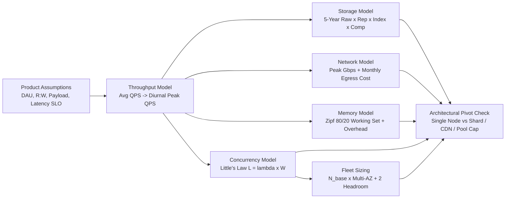
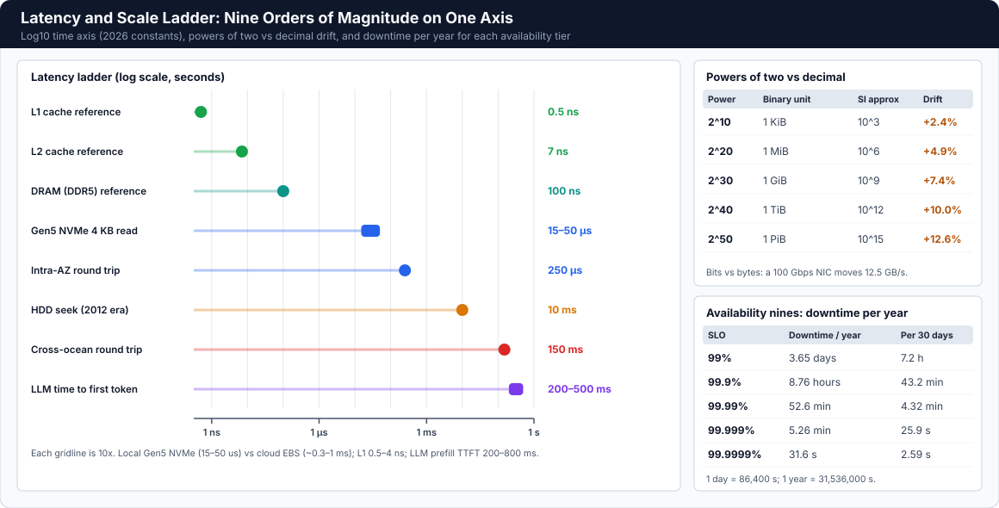
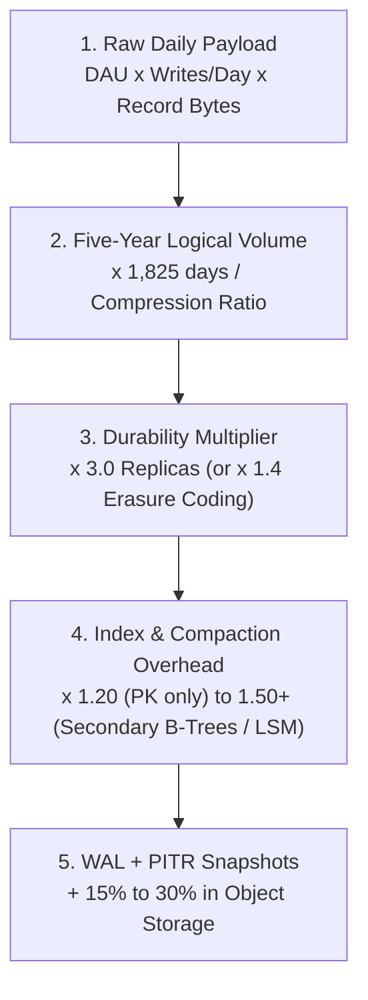
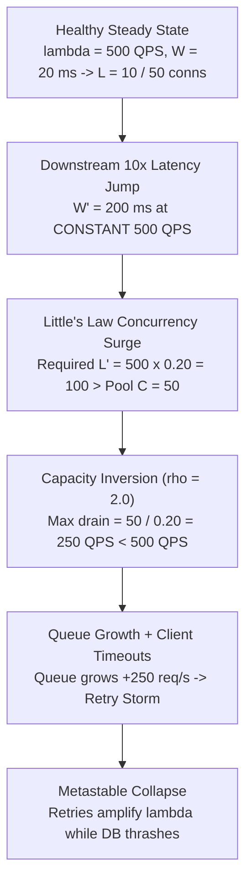
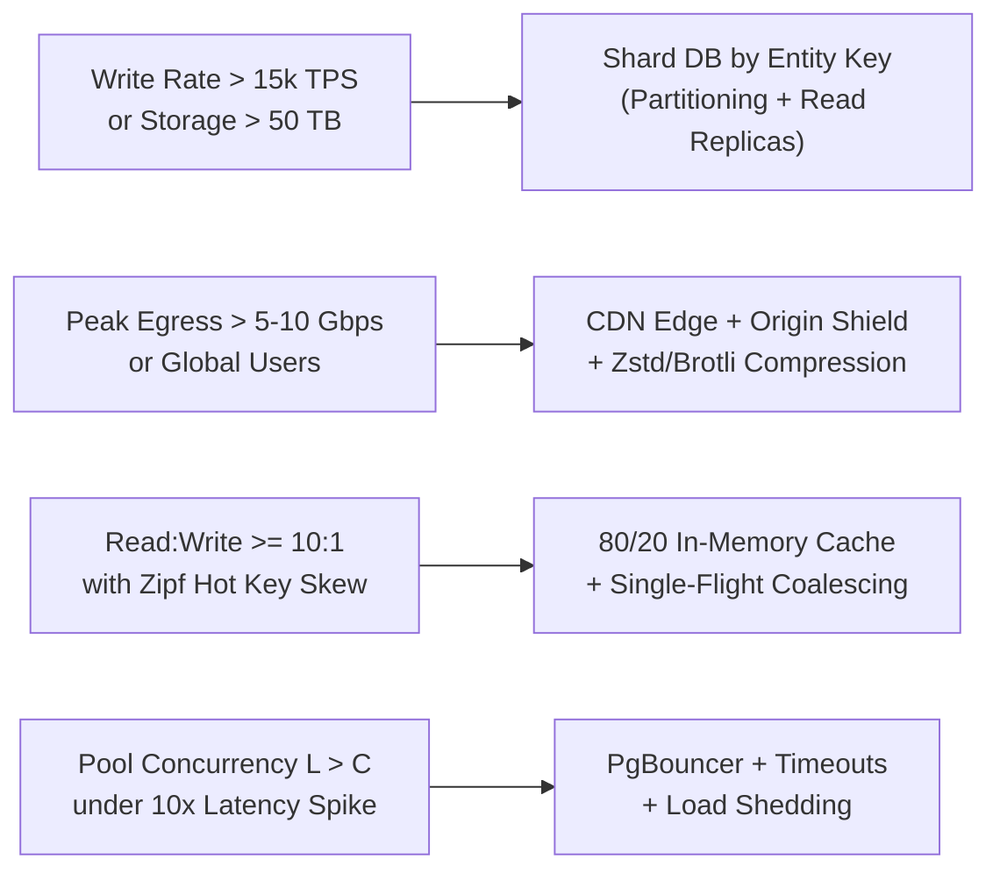
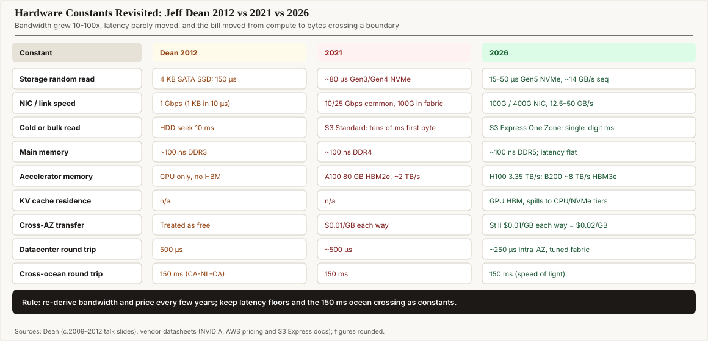

# Module 02 — Back-of-the-Envelope Estimation and Capacity Modeling

Back-of-the-envelope estimation is not arithmetic theater performed to impress a panel; it is a falsification tool for discovering which physical boundary breaks first. When you estimate before drawing boxes, you learn whether a workload fits on one tuned PostgreSQL primary or forces horizontal sharding, whether internet egress dwarfs your compute bill by an order of magnitude, and whether a database latency jitter will saturate every connection pool in the fleet at constant traffic. Every model in this module is paired with deterministic executable proofs in [`../examples/01-capacity-estimation.test.ts`](../examples/01-capacity-estimation.test.ts) and [`../examples/lib/system-design-models.ts`](../examples/lib/system-design-models.ts).

---

## 1. Estimation as Constraint Discovery

Module 01 established the discipline of skipping estimation when it cannot alter the architecture, and running it immediately whenever a load parameter approaches a physical hardware knee. A rough calculation within a factor of two or three is sufficient when your goal is order-of-magnitude classification: does a store hold 300 GB (single NVMe drive), 300 TB (sharded cluster or cloud object store), or 3 EB (erasure-coded multi-region blob fabric)? Precision to four significant digits is wasted when traffic assumptions carry ±50% uncertainty, whereas missing a factor of 8 between bits and bytes or a factor of 10 in peak concurrency invalidates the entire design.



Every architectural pivot traces back to one of seven resource ceilings: CPU cycles per request, memory capacity for the working set, memory bandwidth (especially for GPU inference), storage IOPS and sequential throughput, network interface throughput, cloud egress dollars, or concurrency slots under Little's Law. Cross-link storage engine mechanics to [`architecture/data-systems`](../../data-systems/README.md), queueing and metastable failure theory to [`architecture/distributed-systems`](../../distributed-systems/README.md), wire protocols and CDNs to [`architecture/networking`](../../networking/README.md), cloud pricing models to [`architecture/cloud-foundations`](../../cloud-foundations/README.md), probabilistic sketches to [`algorithms/dsa`](../../../algorithms/dsa/README.md), and histogram telemetry to [`technologies/observability`](../../../technologies/observability/README.md).

### 1.1 Primary Literature and Systems Foundations Matrix

Rigorous capacity estimation is not arithmetic theater; it stands on seminal contributions across queuing theory, processor architecture, empirical systems benchmarking, and large-scale distributed engineering. Rather than treating estimation heuristics as isolated folklore, production system architects map operational constraints to five foundational sources:

| Author / Primary Source | Foundational Principle / Work | Core Formula, Ratio, or Heuristic | Production Value & Architectural Invariant (2026) |
| --- | --- | --- | --- |
| **Jeff Dean (2012)** | _Building Large Distributed Systems: Lessons from Google_ (LADIS / Stanford) | Canonical latency numbers table: L1 cache (`0.5 ns`) to cross-ocean RTT (`150 ms`) | Quantifies physical order-of-magnitude performance cliffs; mandates thought-experiment verification before writing distributed code. |
| **Peter Norvig (2012)** | _Teach Yourself Programming in Ten Years_ & _Approximate Timing on a Typical PC_ | Humanized hardware timescales: 1 CPU cycle = `1 s`, DRAM = `4 min`, SSD = `1.5–5 days`, HDD = `4 months`, WAN = `5 years` | Eliminates the intuition trap of treating memory and disk or local and remote I/O as comparable; establishes extreme mental penalties for I/O stalls. |
| **Brendan Gregg (2020)** | _Systems Performance: Enterprise and the Cloud_ (2nd Ed.) & The USE Method | Utilization, Saturation, and Errors; queueing divergence past 70%–80% utilization | Prevents sizing systems for 100% capacity; identifies non-linear latency knee when resource saturation drives queue wait times to infinity. |
| **John D. C. Little (1961)** | _A Proof for the Queuing Formula: $L = \lambda W$_ (Operations Research 9(3)) | $L = \lambda W$ (concurrency equals arrival rate multiplied by average residence time) | Invariant across all arrival and service distributions; governs thread pools, connection pools, and Little's Law failure modes under latency spikes. |
| **Alex Xu (2020)** | _System Design Interview – An Insider's Guide_ (Vol. 1, Chapter 2) | Powers-of-two scaling, availability nines downtime, and canonical Twitter QPS/storage model | Establishes the standard end-to-end interview estimation workflow, separates structured metadata from media blobs, and exposes unit and representation traps. |

---

## 2. Exact Binary, Decimal, and Time Constants

Capacity errors rarely come from advanced math; they come from mixing base-2 memory units with base-10 network and disk units, or mixing bits with bytes. Storage vendors, network interface cards, and cloud egress bills measure in decimal powers of $10^3$ (and bits per second for links), whereas operating system page caches, JVM/V8 heaps, and GPU VRAM allocate in binary powers of $2^{10}$.

### 2.1 Powers of Two vs Decimal Units

| Power of 2 | Exact Bytes | Binary Unit (IEC) | Decimal Approximation (SI) | Binary vs Decimal Drift |
| --- | --- | --- | --- | --- |
| $2^{10}$ | 1,024 | 1 KiB (Kibibyte) | $10^3$ = 1 KB | +2.4% |
| $2^{20}$ | 1,048,576 | 1 MiB (Mebibyte) | $10^6$ = 1 MB | +4.9% |
| $2^{30}$ | 1,073,741,824 | 1 GiB (Gibibyte) | $10^9$ = 1 GB | +7.4% |
| $2^{40}$ | 1,099,511,627,776 | 1 TiB (Tebibyte) | $10^{12}$ = 1 TB | +10.0% |
| $2^{50}$ | 1,125,899,906,842,624 | 1 PiB (Pebibyte) | $10^{15}$ = 1 PB | +12.6% |

At petabyte scale, treating PB and PiB as interchangeable introduces a 12.6% capacity error before replication or index overhead is applied. An 80 GiB GPU memory ceiling holds 85.9 GB in decimal, while a "100 GB" cloud block volume holds only 93.1 GiB. Use SI decimal units (`10^9 bytes = 1 GB`, `10^9 bits/s = 1 Gbps`) for storage and network bandwidth, and use IEC binary units (`GiB`, `MiB`, `KiB`) when sizing DRAM caches, page tables, and GPU HBM.

### 2.2 Time Constants and Mental Shortcuts

| Interval | Exact Seconds | Mental Approximation | Error of Approximation |
| --- | --- | --- | --- |
| 1 minute | 60 | 60 | 0% |
| 1 hour | 3,600 | $3.6 \times 10^3$ | 0% |
| 1 day (24 hours) | 86,400 | $\approx 10^5$ | Dividing by $10^5$ underestimates QPS by 13.6% |
| 1 month (30 days) | 2,592,000 | $\approx 2.6 \times 10^6$ | +0.3% |
| 1 year (365 days) | 31,536,000 | $\approx 3.15 \times 10^7$ | −0.1% |
| 5 years (1,825 days) | 157,680,000 | $\approx 1.58 \times 10^8$ | +0.2% |

Because `86,400 ≈ 10^5` is easy to divide mentally, a useful conversion identity is that 1 million requests/day (`10^6 / 86,400`) is approximately `11.57 QPS`, 100 million requests/day is `1,157 QPS`, and 1 billion requests/day is `11,574 QPS`. Whenever you divide daily requests by $10^5$ on a whiteboard, multiply the result by 1.16 if you need exact capacity alignment; when converting payload bytes per second to network Gbps, always multiply by 8 bits/byte and divide by $10^9$.

### 2.3 Quick Reference Conversion Identities

| Daily Volume | Average QPS (Exact `/ 86,400`) | 3× Peak QPS   | 1 KB Payload Egress (Peak) |
| ------------ | ------------------------------ | ------------- | -------------------------- |
| 1M req/day   | `11.57 QPS`                    | `34.7 QPS`    | `0.28 Mbps`                |
| 10M req/day  | `115.7 QPS`                    | `347 QPS`     | `2.78 Mbps`                |
| 100M req/day | `1,157 QPS`                    | `3,472 QPS`   | `27.8 Mbps`                |
| 1B req/day   | `11,574 QPS`                   | `34,722 QPS`  | `277.8 Mbps`               |
| 10B req/day  | `115,741 QPS`                  | `347,222 QPS` | `2.78 Gbps`                |

---

## 3. Modern 2026 Latency and Throughput Numbers Every Practitioner Must Know

Classic "latency numbers every programmer should know" tables from the early 2010s assumed spinning magnetic disks with 10 ms random seeks and 1 Gbps datacenter links. Modern 2026 production infrastructure looks fundamentally different: local PCIe Gen4/Gen5 NVMe drives serve random 4 KB reads in tens of microseconds, 100 Gbps datacenter fabrics make intra-AZ RPCs faster than legacy disk accesses, and LLM inference workloads introduce sub-second prefill latency alongside memory-bandwidth-bound token generation.



### 3.1 Hardware, Network, Data-Store, and AI Latency Benchmarks (2026)

| Operation | Typical 2026 Latency | Order of Magnitude | Architectural Implication |
| --- | --- | --- | --- |
| L1 / L2 CPU cache reference | `~1–4 ns` | $10^{-9}\text{ s}$ | Lock-free in-core loops; watch false sharing across 64 B cache lines |
| L3 cache hit / branch mispredict | `~5–20 ns` | $10^{-8}\text{ s}$ | NUMA-local shared structures stay fast; cross-socket snooping hurts |
| Main memory (DDR5 RAM) reference | `~100 ns` | $10^{-7}\text{ s}$ | Pointer-chasing B-trees incur multiple DRAM stalls per level |
| NVMe SSD random 4 KB read (local) | `~20–100 µs` | $10^{-5}\text{ s}$ | Random disk reads are 100×–500× faster than HDDs; cloud EBS adds `~0.3–1 ms` |
| 100 Gbps datacenter RTT (same AZ) | `~50–250 µs` | $10^{-4}\text{ s}$ | Kernel TCP stack dominates; RDMA / DPDK drops below `25 µs` |
| Redis / Valkey in-memory `GET` (same AZ) | `~0.2–0.5 ms` | $10^{-4}\text{ s}$ | Network + serialization dwarfs single-threaded execution (`~5–30 µs`) |
| PostgreSQL single-row PK lookup (same AZ) | `~0.5–2 ms` | $10^{-3}\text{ s}$ | Buffer-pool hit + connection pooler round-trip; cold NVMe read `~1–3 ms` |
| Cross-AZ RTT (same cloud region) | `~1–2 ms` | $10^{-3}\text{ s}$ | Synchronous quorum writes (`Raft` / sync replica) add 1–2 ms per commit |
| Cross-continent RTT (US East ↔ US West) | `~60–70 ms` | $10^{-2}\text{ s}$ | Speed of light in fiber sets hard floor; TLS 1.3 + TCP adds 1–2× RTT |
| Cross-continent RTT (US ↔ EU) | `~75 ms` | $10^{-2}\text{ s}$ | Uncached cross-ocean API calls blow interactive latency budgets |
| Cross-continent RTT (US ↔ APAC) | `~150 ms` | $10^{-1}\text{ s}$ | Demands edge CDN termination, regional read replicas, or local POPs |
| LLM Time-To-First-Token (TTFT, prefill) | `~200–800 ms` | $10^{-1}\text{ s}$ | Compute-bound prompt ingestion; mandates SSE streaming and prefix caching |
| LLM decode throughput per stream | `~30–100 tok/s` | `10–33 ms/tok` | HBM memory-bandwidth bound; requires continuous batching to scale |

The speed-of-light gap is unforgiving: a packet traveling 4,000 km in optical fiber (roughly 200,000 km/s) takes 20 ms one way and 40 ms round-trip even with zero router queuing; real routing paths yield `~75 ms` US–EU and `~150 ms` US–APAC. If an endpoint performs six sequential synchronous RPCs across regions, latency exceeds 450–900 ms before application code runs a single instruction. Similarly, placing a synchronous database replica across regions adds `~75 ms` per committed write, capping serial transaction throughput per key at roughly 13 TPS.

### 3.2 Single-Node and Link Throughput Ceilings (2026)

| Resource / Component | Typical Sustained Ceiling | Limiting Factor |
| --- | --- | --- |
| Stateless HTTP/JSON app worker (per vCPU) | `2,000–10,000 QPS` | JSON/Protobuf parsing, TLS crypto, GC overhead |
| Single Redis / Valkey primary | `100,000–250,000 ops/s` | Single-threaded command loop (higher only with pipelining or multi-shard) |
| Single PostgreSQL primary (OLTP mix) | `5,000–15,000 write TPS`; `20,000–50,000 point-read QPS` | WAL fsync latency, lock contention, buffer-pool concurrency |
| Local NVMe Gen4/Gen5 SSD | `3–14 GB/s` sequential; `200k–1M` 4 KB IOPS | PCIe lanes, queue depth, write amplification |
| Cloud GP3 / Premium SSD volume | `3,000–16,000` provisioned IOPS; `125–1,000 MB/s` | Virtualized network fabric caps before local NVMe physics |
| 100 Gbps NIC (usable TCP payload) | `~11–12 GB/s` (`~90–96 Gbps`) | Header overhead, TCP windowing, kernel socket copy |
| H100 SXM GPU (80 GB HBM3) | `3.35 TB/s` memory bandwidth; `~989 TFLOPS` FP16 dense | HBM3 bandwidth caps decode; Tensor Cores cap prefill |

Knowing these ceilings prevents classic design errors. A system claiming 1 million writes/sec directly into a single PostgreSQL node violates physics by two orders of magnitude, while a system claiming 150,000 read QPS of tiny 500 B keys needs sharding only if a single Redis node's single-threaded CPU or network NIC saturates—not because of RAM size.

---

## 4. Formal Capacity Models and Worked Derivations

Each model below converts product behavior into concrete hardware budgets. Every numerical check aligns with the unit assertions in [`../examples/01-capacity-estimation.test.ts`](../examples/01-capacity-estimation.test.ts), where `estimateCapacity`, `littlesLawConcurrency`, and `estimateLlmKvCacheBytes` execute deterministically:

```text
CapacityEstimationPipeline(input):
    avgReadQps   = (dau * readsPerUserPerDay) / 86_400
    avgWriteQps  = (dau * writesPerUserPerDay) / 86_400
    peakTotalQps = peakMultiplier * (avgReadQps + avgWriteQps)
    fiveYrBytes  = dailyRawWriteBytes * 1_825 * repFactor * (1 + indexOverhead)
    peakEgress   = (peakReadQps * avgReadPayloadBytes * 8) / 1e9   // Gbps
    cacheRam     = dailyUniqueReadBytes * hotFraction * metadataOverhead
    concurrency  = peakTotalQps * avgLatencySeconds                 // Little's Law
    baseServers  = ceil(peakTotalQps / perServerQps)
    fleetServers = ceil(baseServers * azCount / (azCount - 1)) + headroomNodes
```

### 4.1 QPS Modeling: Average vs Diurnal Peak and Flash Events

Average QPS smooths traffic across an entire 24-hour day, hiding the bursts that actually break servers. Model reads and writes separately because their scaling paths diverge (caches and replicas absorb reads; partitioning, WAL throughput, and queues absorb writes):

$$\lambda_{\text{read}} = \frac{\text{DAU} \times R_{\text{day}}}{86{,}400}, \qquad \lambda_{\text{write}} = \frac{\text{DAU} \times W_{\text{day}}}{86{,}400}, \qquad \lambda_{\text{avg}} = \lambda_{\text{read}} + \lambda_{\text{write}}$$

$$\lambda_{\text{peak}} = M_{\text{peak}} \times \lambda_{\text{avg}}$$

Choosing the peak multiplier $M_{\text{peak}}$ depends on timezone dispersion and event synchronization:

- **Global consumer products** ($M_{\text{peak}} \approx 2\text{ to }3$): Traffic across Americas, Europe, and APAC spreads the diurnal curve, keeping daily peaks around 2×–3× the 24-hour mean.
- **Single-region or business-hours SaaS** ($M_{\text{peak}} \approx 4\text{ to }5$): Nearly all users wake, commute, or open dashboards during the same 8-hour window, concentrating load into one third of the day and producing sharper lunch and morning spikes.
- **Flash events and synchronized crons** ($M_{\text{peak}} \ge 10$): Ticket drops, live sports goals, breaking news alerts, or top-of-the-hour batch webhooks compress an entire hour's traffic into seconds. Always state separately whether your sizing targets normal diurnal peak (3×) or flash admission control (10×+ with queuing/shedding).

**Worked Example — URL Shortener** (100M DAU, 10 redirects/day, 1 new link/day, $M_{\text{peak}} = 3$):

$$\lambda_{\text{write}} = \frac{10^8 \times 1}{86{,}400} \approx 1{,}157\text{ QPS}, \qquad \lambda_{\text{read}} = \frac{10^8 \times 10}{86{,}400} \approx 11{,}574\text{ QPS}$$

$$\lambda_{\text{avg}} \approx 12{,}731\text{ QPS}, \qquad \lambda_{\text{peak}} = 3 \times 12{,}731 \approx 38{,}194\text{ QPS}$$

**Worked Example — News Feed** (50M DAU, 20 feed loads/day, 0.5 posts/day, $M_{\text{peak}} = 3$):

$$\lambda_{\text{write}} = \frac{5 \times 10^7 \times 0.5}{86{,}400} \approx 289\text{ QPS}, \qquad \lambda_{\text{read}} = \frac{5 \times 10^7 \times 20}{86{,}400} \approx 11{,}574\text{ QPS}, \qquad \lambda_{\text{peak}} \approx 35{,}590\text{ QPS}$$

**Worked Example — Chat / WhatsApp** (500M DAU, 40 messages sent/day, 40 messages received/day, $M_{\text{peak}} = 3$):

$$\lambda_{\text{write}} = \frac{5 \times 10^8 \times 40}{86{,}400} \approx 231{,}481\text{ QPS}, \qquad \lambda_{\text{read}} \approx 231{,}481\text{ QPS}, \qquad \lambda_{\text{peak}} = 3 \times 462{,}963 \approx 1{,}388{,}889\text{ QPS}$$

The contrast between 38k peak QPS (URL shortener, 10:1 read-heavy) and 1.39M peak QPS (chat, 1:1 read/write symmetric) forces completely different write architectures before a single line of schema is written.

### 4.2 Five-Year Storage Sizing: Payload, Replication, Indexes, and WAL

Raw payload size routinely underestimates actual provisioned disk by 4×–8×. A production capacity formula must account for per-row envelope metadata, compression, replication factor $F_{\text{rep}}$, index overhead $f_{\text{index}}$, and WAL/backup retention $S_{\text{WAL/backup}}$:

$$S_{\text{total}} = \left(D_{\text{raw}} \times 365 \times Y \times \frac{1}{\rho_{\text{comp}}} \times F_{\text{rep}} \times (1 + f_{\text{index}})\right) + S_{\text{WAL/backup}}$$

Each multiplier captures a concrete physical layer inside the storage engine (see [`technologies/postgres`](../../../technologies/postgres/README.md) and [`architecture/data-systems`](../../data-systems/README.md)):

- **Raw daily write volume** ($D_{\text{raw}} = \text{DAU} \times W_{\text{day}} \times P_{\text{write}}$): Include internal tuple metadata inside $P_{\text{write}}$, not just user text. In PostgreSQL, every 8 KB heap page loses 24 bytes to the page header, 4 bytes per item pointer, and 23 bytes per heap tuple header plus 8-byte alignment padding; an update under MVCC temporarily duplicates the row until vacuum reclaims dead tuples. A 100-byte logical record routinely consumes 160–500 bytes on disk once keys, timestamps, and tuple metadata are counted.
- **Compression ratio** ($\rho_{\text{comp}}$): Text, JSON, and logs compress 2×–4× under LZ4 or Zstd ($\rho_{\text{comp}} \approx 2\text{ to }4$), whereas pre-compressed images, H.264/AV1 video chunks, or AES-GCM encrypted blobs yield $\rho_{\text{comp}} \approx 1.0$. When sizing conservatively before schema compression is benchmarked, set $\rho_{\text{comp}} = 1.0$.
- **Replication factor** ($F_{\text{rep}}$): Standard multi-AZ durability uses $F_{\text{rep}} = 3$ (one primary plus two followers, or a 3-way Raft quorum). Erasure-coded object storage (such as Reed-Solomon 8+4 or 10+4) reduces raw disk overhead from 3.0× down to 1.4×–1.5× at multi-petabyte scale.
- **B-tree / LSM index overhead** ($f_{\text{index}} \approx 0.20\text{ to }0.50$): A single primary-key B-tree with `fillfactor = 90` plus page slack adds approximately 20% ($f_{\text{index}} = 0.20$); tables carrying three secondary B-tree indexes or GIN full-text indexes easily reach 50%–100% overhead. LSM engines (RocksDB) add block indexes and roughly 10 bits/key Bloom filters while incurring 1.1× space amplification under leveled compaction (or up to 2× under size-tiered compaction).
- **WAL and snapshot retention** ($S_{\text{WAL/backup}}$): Continuous write-ahead log archiving and point-in-time recovery (PITR) base backups add 15%–30% of logical size, normally offloaded to cheaper object storage rather than primary NVMe volumes.



**Worked Examples** (baseline $F_{\text{rep}} = 3$, $f_{\text{index}} = 0.20$, $\rho_{\text{comp}} = 1.0$ over $Y = 5$ years = 1,825 days, matching `estimateCapacity` before external WAL archive storage):

1. **URL Shortener** (500 B record, 100M writes/day $\implies D_{\text{raw}} = 50\text{ GB/day}$): `50 GB × 1,825 × 3 × 1.2 = 328.5 TB`.
2. **News Feed** (1,024 B post, 25M writes/day $\implies D_{\text{raw}} = 25.6\text{ GB/day}$): `25.6 GB × 1,825 × 3 × 1.2 ≈ 168.2 TB`.
3. **Chat / WhatsApp** (200 B message, 20B writes/day $\implies D_{\text{raw}} = 4\text{ TB/day}$): `4 TB × 1,825 × 3 × 1.2 ≈ 26.28 PB`.
4. **YouTube Video Platform** (500 MB raw upload, 1M uploads/day $\implies D_{\text{raw}} = 500\text{ TB/day}$): `500 TB × 1,825 × 3 × 1.2 = 3.285 EB` (exabytes).

Notice the architectural pivots forced by those numbers: 168–328 TB fits comfortably on a modestly sharded relational or key-value cluster (56–109 TB per replica before 3× replication); 26.3 PB of chat history demands TTL/client-side archival or wide-column partitioning; and 3.285 EB of video immediately forbids 3× block replication in favor of erasure-coded object storage (cutting 3.285 EB toward ~1.3 EB raw) plus multi-bitrate transcoding deduplication.

**IOPS vs Buffer-Pool Hit Rate**: Capacity is not just bytes on disk; it is random IOPS under cache misses:

$$\text{IOPS}_{\text{needed}} = \lambda_{\text{peak-write}} \times A_{\text{write}} + \lambda_{\text{peak-read}} \times (1 - h_{\text{buffer}}) \times A_{\text{read}}$$

Here $A_{\text{write}}$ is write amplification (WAL + dirty-page checkpointing + B-tree page splits, typically 2–5) and $h_{\text{buffer}}$ is the buffer-pool hit ratio. At 50,000 peak read QPS with $A_{\text{read}} = 1$, dropping $h_{\text{buffer}}$ from 99% (500 read IOPS) to 90% (5,000 read IOPS) multiplies required cloud EBS IOPS by 10×—exceeding a baseline GP3 volume's 3,000 IOPS ceiling and stalling queries on disk queues.

### 4.3 Bandwidth and Cloud Egress Cost Traps

Network bandwidth is computed separately for ingress and egress using bits per second:

$$B_{\text{avg}} = \frac{\lambda_{\text{read}} \times P_{\text{read}} \times 8}{10^9}\text{ Gbps}, \qquad B_{\text{peak}} = \frac{\lambda_{\text{peak-read}} \times P_{\text{read}} \times 8}{10^9}\text{ Gbps}$$

In a **News Feed** (50M DAU, 20 loads/day, 50 KB feed payload, 3× peak), average read QPS is 11,574 QPS and peak read QPS is 34,722 QPS. Average egress is `11,574 × 50,000 × 8 / 10^9 ≈ 4.63 Gbps`, and peak egress is `34,722 × 50,000 × 8 / 10^9 ≈ 13.89 Gbps`. For **YouTube** (200M DAU, 5 plays/day at 300 MB per play, 2× peak), average egress explodes to `11,574 × 300,000,000 × 8 / 10^9 ≈ 27.78 Tbps` and peak egress hits `55.56 Tbps`—proving why a 95%+ CDN edge hit rate is mandatory to compress origin egress below 2.8 Tbps.

Here lies the **cloud egress cost trap** that bankrupts naive architectures. Compute instances are billed hourly at predictable rates, whereas cloud internet egress is metered per gigabyte at roughly `$0.05–$0.09/GB`, cross-region transfer at `~$0.02/GB`, and cross-AZ traffic inside the same region at `~$0.01/GB` per side. Consider what happens when a service sustains `100 Gbps` of outbound internet traffic from a hyperscaler VPC:

$$\text{Monthly GB at } 100\text{ Gbps} = \frac{100 \times 10^9\text{ bits/s}}{8\text{ bits/byte}} \times \frac{2{,}592{,}000\text{ s/month}}{10^9\text{ B/GB}} = 12.5\text{ GB/s} \times 2.592 \times 10^6 = 32{,}400{,}000\text{ GB} = 32.4\text{ PB/month}$$

| Sustained Traffic | Monthly Volume (30 Days) | Internet Egress (`$0.05–$0.09/GB`) | Cross-Region (`$0.02/GB`) | Cross-AZ (`$0.01/GB` × 2 sides) |
| --- | --- | --- | --- | --- |
| `10 Gbps` (News Feed scale) | `3.24 PB/month` | `$162k–$292k/month` | `$64.8k/month` | `$64.8k/month` |
| `50 Gbps` (Mid-tier media) | `16.2 PB/month` | `$810k–$1.46M/month` | `$324k/month` | `$324k/month` |
| `100 Gbps` (Single origin link) | `32.4 PB/month` | `$1.62M–$2.92M/month` | `$648k/month` | `$648k/month` |

At `$0.05–$0.09/GB`, pushing `100 Gbps` directly from cloud origin servers costs **\$1.62 million to \$2.92 million per month** in data transfer alone—dwarfing the `$50k–$150k/month` compute bill for the application and database fleet by more than 10×. Even chatty internal microservices pay an invisible **cross-AZ tax**: if an API gateway handles 20,000 QPS and makes 10 internal 50 KB RPCs that cross AZ boundaries (`10 GB/s` total cross-AZ flow = `25.92 PB/month`), bilateral `$0.01/GB` AZ transfer charges add `$518,400/month` unless you enforce AZ-local routing, rack-aware Kafka consumer fetching, and CDN origin shields.

> [!WARNING]
> Cross-AZ data transfer is the most frequently overlooked cloud cost multiplier: at `$0.01/GB` billed on both sides of an Availability Zone boundary, chatty synchronous microservice calls or unpinned Kafka consumers can quietly exceed your entire EC2/Kubernetes compute spend before a single byte leaves for the public internet.

### 4.4 80/20 (Zipf) Cache Working-Set Sizing

Real access distributions follow power-law (Zipf) skew rather than uniform randomness: roughly 20% of daily active keys receive 80% of requests, and for social feeds or viral media the hot set is often 1%–5% of objects. Sizing cache RAM for the entire multi-terabyte database is unnecessary; size for the hot fraction of the _daily unique_ read working set, multiplied by cache engine overhead $O_{\text{meta}}$:

$$M_{\text{cache}} = \left(\text{DAU} \times R_{\text{day}} \times f_{\text{unique}} \times P_{\text{read}}\right) \times f_{\text{hot}} \times O_{\text{meta}}$$

Here $f_{\text{unique}} \in (0, 1]$ collapses repeated reads of the same object within a day (for example, 1B daily URL redirects may touch only 200M distinct short codes, so $f_{\text{unique}} = 0.2$; in a News Feed of 1B timeline loads, only 1% represent unique fresh feed objects, so $f_{\text{unique}} = 0.01$), $f_{\text{hot}} = 0.20$ captures the 80/20 Pareto hot set, and $O_{\text{meta}} \approx 1.3\text{ to }1.5$ accounts for Redis/Valkey key strings, `dictEntry` (24 B) and `redisObject` (16 B) headers, jemalloc slab rounding, and `BGSAVE` copy-on-write fork headroom (see [`technologies/redis`](../../../technologies/redis/README.md); never run an in-memory store above 75% memory if snapshots run).

- **URL Shortener** (`100M × 10 × 0.2 × 500 B = 100 GB` unique daily read data): `M_raw_hot = 100 GB × 0.20 = 20 GB`, and with 1.4× metadata overhead `M_provisioned = 28 GB RAM`—fitting inside a single 64 GiB Redis node plus replica and absorbing 80% of redirect reads at `0.3 ms`.
- **News Feed** (`50M × 20 × 0.01 × 50 KB = 500 GB` unique daily read data): `M_raw_hot = 500 GB × 0.20 = 100 GB` raw (140 GB with 1.4× metadata overhead), requiring a 3-shard Redis cluster.

Watch the small-value trap: if $P_{\text{read}}$ is tiny (50 B), Redis per-key overhead (~80–100 B) exceeds the payload itself ($O_{\text{meta}} > 2.5$), and large read payloads (50 KB) can saturate a Redis node's NIC bandwidth (`10–25 Gbps`) long before RAM fills.

### 4.5 Little's Law ($L = \lambda W$) and Connection-Pool Collapse

John Little's 1961 queueing theorem states that for any stable system in steady state, the long-term average number of items inside the system $L$ equals the average arrival rate $\lambda$ multiplied by the average time $W$ an item spends in the system:

$$L = \lambda W$$

Crucially, Little's Law holds regardless of the arrival distribution (Poisson, bursty, periodic), service time distribution, or scheduling discipline (FIFO, LIFO, priority), provided the system is stable (arrival rate $\lambda$ is strictly less than effective service capacity $\mu_{\text{eff}}$). For our URL Shortener at peak ($\lambda_{\text{peak}} = 38{,}194\text{ QPS}$, average service time $W = 0.01\text{ s}$), required concurrency across the fleet is `L = 38,194 × 0.01 ≈ 382` simultaneous in-flight requests; for the News Feed ($\lambda_{\text{peak}} = 35{,}590\text{ QPS}$, $W = 0.05\text{ s}$), required concurrency climbs to `L ≈ 1,780` in-flight requests.

Little's Law also proves **why constant-QPS latency spikes trigger catastrophic connection-pool exhaustion**. Suppose an application fleet handles a steady $\lambda = 500\text{ QPS}$ against a fixed database connection pool of size $C = 50$ connections (matching the negative test in `01-capacity-estimation.test.ts`):

- **Healthy state** ($W = 20\text{ ms} = 0.02\text{ s}$): `L = 500 × 0.02 = 10` active connections (20% pool utilization). Maximum sustainable throughput is $\mu_{\text{eff}} = C / W = 50 / 0.02 = 2{,}500\text{ QPS}$, giving utilization $\rho = \lambda / \mu_{\text{eff}} = 0.20$.
- **Degraded state** (10× DB latency spike, $W' = 200\text{ ms} = 0.20\text{ s}$): Traffic has _not_ increased ($\lambda = 500\text{ QPS}$ remains constant), yet Little's Law demands `L' = 500 × 0.20 = 100` concurrent connections—2× the pool cap $C = 50$.
- **Instability and collapse** ($\rho > 1$): Effective capacity drops to $\mu'_{\text{eff}} = C / W' = 50 / 0.20 = 250\text{ QPS}$. Because arrivals (500 QPS) now exceed service capacity (250 QPS), utilization hits $\rho = 2.0 > 1$. Steady-state Little's Law breaks down: waiting requests accumulate in application memory at `500 − 250 = 250 req/s`, request latency climbs linearly past client timeouts, upstream callers retry (amplifying $\lambda$ to 1,000–1,500 QPS), and the database spends its remaining CPU context-switching and aborting stale queries—a classic **metastable failure** (see [`architecture/distributed-systems`](../../distributed-systems/README.md)).

Even before $\rho$ reaches 1.0, an M/M/1 queue exhibits a nonlinear latency knee governed by $W_{\text{total}} = \frac{1}{\mu(1 - \rho)}$: at $\rho = 0.50$, queueing doubles response time (2× service time); at $\rho = 0.80$, response time jumps 5×; and at $\rho = 0.95$, response time jumps 20×. That mathematical knee is why production pools and CPUs are never sized to run at 90% steady utilization.



> [!IMPORTANT]
> Little's Law ($L = \lambda W$) is an identity for _stable_ queues ($\lambda < \mu_{\text{eff}}$). Once a latency jump pushes $\rho = \lambda / \mu_{\text{eff}} > 1$, the system is non-stationary: concurrency grows without bound until queues, timeouts, and retries trigger collapse.

Mitigation flows directly from the equation: cap pool wait queues strictly (`acquireTimeout`), shed excess load early with HTTP `503` (preferring LIFO or priority admission under overload), enforce `statement_timeout` on the database so slow queries cannot pin connections, apply retry budgets, and place a transaction-mode connection multiplexer (such as PgBouncer) in front of PostgreSQL so idle worker threads do not hold backend OS processes.

### 4.6 Server Fleet Sizing and N+2 Multi-AZ Headroom

Sizing servers from peak QPS divided by single-server throughput gives only the bare-minimum active floor $N_{\text{base}}$:

$$N_{\text{base}} = \left\lceil \frac{\lambda_{\text{peak}}}{\text{QPS}_{\text{server}}} \right\rceil$$

Deploying exactly $N_{\text{base}}$ instances across $A$ Availability Zones guarantees an outage during a single AZ blackout or rolling deployment. If 8 servers are spread `(3, 3, 2)` across 3 AZs and one 3-node AZ goes offline, surviving capacity drops to 5 servers (62.5% of required capacity), immediately pushing CPU above 100%, inflating $W$, and tripping the Little's Law collapse shown above. Production capacity therefore enforces multi-AZ N+2 survivability, keeping normal peak utilization at or below $\frac{A-1}{A} \approx 67\%$ (and closer to 50%–60% after headroom):

$$N_{\text{provisioned}} = \left\lceil N_{\text{base}} \times \frac{A}{A - 1} \right\rceil + H$$

Here $A = 3$ AZs scales capacity by 1.5× so any single AZ loss leaves at least $N_{\text{base}}$ healthy servers, and $H = 2$ absorbs one instance draining during a rolling deploy plus one concurrent node hardware or OOM failure. For our **URL Shortener** ($\lambda_{\text{peak}} = 38{,}194\text{ QPS}$, $\text{QPS}_{\text{server}} = 5{,}000\text{ QPS}$):

$$N_{\text{base}} = \left\lceil \frac{38{,}194}{5{,}000} \right\rceil = 8\text{ servers}, \qquad N_{\text{provisioned}} = \left\lceil 8 \times \frac{3}{2} \right\rceil + 2 = 12 + 2 = 14\text{ servers}$$

With 14 instances balanced `(5, 5, 4)` across 3 AZs, losing an entire 5-node AZ plus 1 rolling-deploy node still leaves 8 servers—matching $N_{\text{base}}$ cleanly with zero degradation and keeping normal peak utilization at `8 / 14 ≈ 57%`. Applying the same rule to the **News Feed** ($\lambda_{\text{peak}} = 35{,}590\text{ QPS}$, $\text{QPS}_{\text{server}} = 2{,}000\text{ QPS}$) gives $N_{\text{base}} = 18$ and `N_provisioned = ceil(18 × 1.5) + 2 = 29` servers.

### 4.7 Modern 2026 Estimation: LLM KV-Cache VRAM Math and Decode Bottlenecks

Generative AI endpoints invert classical web sizing: stateless CPU cores are rarely the bottleneck; **GPU High-Bandwidth Memory (HBM) capacity and memory bandwidth** are. Autoregressive Transformer inference operates in two asymmetric phases:

1. **Prefill (Prompt Processing)**: Computes attention across all input tokens in parallel; **compute-bound** (FLOPS-limited), determining Time-To-First-Token (`~200–800 ms`).
2. **Decode (Token Generation)**: Generates one output token per forward pass; **memory-bandwidth-bound**, because the GPU must stream _all_ model weights and the entire active Key-Value (KV) cache from HBM into SRAM for every single generated token.

Every cached token stores one Key tensor and one Value tensor per Transformer layer across all KV attention heads. With Grouped-Query Attention (GQA), $n_{\text{kv}}$ KV heads are shared across multiple query heads, shrinking memory by $n_{\text{q}} / n_{\text{kv}}$ relative to Multi-Head Attention (MHA):

$$\text{VRAM}_{\text{KV}} = 2 \times n_{\text{layers}} \times n_{\text{kv}} \times d_{\text{head}} \times L_{\text{seq}} \times B_{\text{elem}} \times \text{batch}$$

Consider a **Llama-3 70B class model** ($n_{\text{layers}} = 80$, $n_{\text{kv}} = 8$ via GQA, $d_{\text{head}} = 128$, BF16 precision $B_{\text{elem}} = 2\text{ bytes}$):

- **Per token**: `2 × 80 × 8 × 128 × 2 = 327,680 bytes = 320 KiB/token` (with FP8 KV quantization $B_{\text{elem}} = 1$, this halves to `160 KiB/token`).
- **8k context** ($L_{\text{seq}} = 8{,}192$, batch 1): `8,192 × 320 KiB = 2.5 GiB`.
- **128k context** ($L_{\text{seq}} = 131{,}072$, batch 1): `131,072 × 320 KiB = 40 GiB`.
- **8k context, batch 32**: `32 × 2.5 GiB = 80 GiB`.

| Model Class (BF16 unless noted) | Layers × KV Heads × Dim | KV Bytes / Token | 8k Context (Batch 1) | 128k Context (Batch 1) | 8k Context (Batch 32) |
| --- | --- | --- | --- | --- | --- |
| Llama-3 8B (GQA, BF16) | `32 × 8 × 128` | `128 KiB` | `1.0 GiB` | `16.0 GiB` | `32.0 GiB` |
| Llama-3 70B (GQA, BF16) | `80 × 8 × 128` | `320 KiB` | `2.5 GiB` | `40.0 GiB` | `80.0 GiB` |
| Llama-3 70B (GQA, FP8 KV) | `80 × 8 × 128` | `160 KiB` | `1.25 GiB` | `20.0 GiB` | `40.0 GiB` |

Batch 32 at an 8k context in BF16 consumes **80 GiB for KV-cache alone**—completely exhausting an 80 GB NVIDIA H100 GPU _before loading a single byte_ of the 140 GB BF16 model weights! Even with 4× H100 (320 GB total HBM via tensor parallelism, leaving ~160 GB after 140 GB weights and ~20 GB activation workspace), batch size is strictly VRAM-capped at ~60 sequences of 8k length, or only ~3–4 concurrent 128k-context requests. Scaling that to 1,000 simultaneous 8k-context chat users requires `1,000 × 2.5 GiB = 2,500 GiB` of KV-cache VRAM alone—translating to roughly 16 tensor-parallel pods (64 H100 GPUs) in BF16, or 32 H100 GPUs if FP8 KV-cache quantization is enabled.

Meanwhile, HBM bandwidth caps single-stream decode speed: reading 140 GB of weights at `3.35 TB/s` on one H100 yields a physical ceiling of `3,350 / 140 ≈ 24 tok/s` in BF16 (rising toward 48 tok/s in FP8 and 60–100 tok/s when sharded across 4× H100s). Because reading weights once per step can serve $B$ tokens in the same memory transfer, **continuous batching** and **PagedAttention** (eliminating contiguous KV allocation fragmentation) are mandatory to amortize weight reads across concurrent users up to the VRAM ceiling.

### 4.8 Worked End-to-End Trace: Chat vs Video Streaming

Applying the entire pipeline end to end on two opposite extremes from `01-capacity-estimation.test.ts` illustrates how identical formulas expose completely different scaling strategies:

```text
Case A: Global Chat (500M DAU, 40 sent/day, 40 received/day, 200 B msg, 3x peak, W = 20 ms)
  avgWriteQps   = (500,000,000 * 40) / 86,400            = 231,481 QPS
  avgReadQps    = (500,000,000 * 40) / 86,400            = 231,481 QPS
  peakTotalQps  = 3 * (231,481 + 231,481)                = 1,388,889 QPS
  dailyRawWrite = 20,000,000,000 * 200 B                 = 4 TB/day
  fiveYrStorage = 4 TB * 1,825 * 3 (rep) * 1.2 (idx)     = 26,280 TB ≈ 26.28 PB
  concurrency L = 1,388,889 * 0.020 s                    = 27,778 active reqs (plus persistent sockets)
  baseServers   = ceil(1,388,889 / 10,000)               = 139 stateless/gateway servers
  fleetServers  = ceil(139 * 3 / 2) + 2                  = 211 servers across 3 AZs

Case B: Video Streaming (200M DAU, 5 plays/day @ 300 MB, 0.005 uploads/day @ 500 MB, 2x peak)
  avgPlayQps    = (200,000,000 * 5) / 86,400             = 11,574 QPS
  peakPlayQps   = 2 * 11,574                             = 23,148 QPS
  dailyUploads  = 200,000,000 * 0.005 * 500 MB           = 500 TB/day raw
  fiveYrStorage = 500 TB * 1,825 * 3 (rep) * 1.2 (idx)   = 3,285,000 TB = 3.285 EB (naive 3x)
  avgEgress     = (11,574 * 300,000,000 * 8) / 1e9       = 27,778 Gbps ≈ 27.78 Tbps
  peakEgress    = 2 * 27.78 Tbps                         = 55.56 Tbps (must offload >95% to edge CDN)
```

In Case A (Chat), peak egress of payload text is modest (`~1.1 Gbps` at peak read QPS), whereas `1.39M peak QPS` and `26.28 PB` of 5-year storage dictate wide-column partitioning by conversation ID and persistent WebSocket connection gateways. In Case B (Video), 23k play requests per second sounds small compared to Chat, yet `55.56 Tbps` of peak egress and `3.285 EB` of raw multi-replica storage force a global ISP-peered CDN plus erasure-coded object storage—confirming that **payload size × QPS**, not QPS alone, decides network topology.

### 4.9 Verified ByteByteGo Canonical Worked Estimate: Twitter (QPS, Storage, and Schema Typo Audit)

Alex Xu's _System Design Interview_ (Volume 1, Chapter 2) presents a canonical capacity estimation interview walkthrough based on a simplified Twitter-scale platform. While the worked model establishes clear estimation discipline, senior engineering rigor requires re-verifying every algebraic step, evaluating rounding shortcuts against physical hardware boundaries, and auditing critical schema sizing oversights that would otherwise produce multi-terabyte storage overruns in production.

#### 4.9.1 Baseline Assumptions and Traffic Sizing

The canonical interview prompt establishes six foundational parameters:

1. **Monthly Active Users (MAU)**: $300\text{ million}$ ($300\text{M}$).
2. **Daily Active User (DAU) ratio**: $50\%$ of MAU active each day $\implies 300\text{M} \times 0.50 = 150\text{ million DAU}$.
3. **Write activity**: An average of $2\text{ tweets}$ posted per active user per day.
4. **Media content distribution**: $10\%$ of tweets include media attachments (photos or short video clips); $90\%$ are pure text.
5. **Media file payload**: $1\text{ MB}$ ($10^6\text{ bytes}$) average compressed binary size per media attachment.
6. **Data retention horizon**: $5\text{ years}$ ($1{,}825\text{ days}$).

#### 4.9.2 Throughput Derivation: Average vs. Peak QPS

The aggregate daily tweet generation volume equals:

$$
D_{\text{tweets}} = \text{DAU} \times W_{\text{user}} = 150\text{M} \times 2 = 300\text{ million tweets/day} = 3 \times 10^8\text{ tweets/day}
$$

Converting daily arrivals into sustained average write query throughput across $86{,}400\text{ seconds}$ yields:

$$
\lambda_{\text{write-avg}} = \frac{300{,}000{,}000\text{ tweets}}{86{,}400\text{ s}} = 3{,}472.22\dots \approx 3{,}472\text{ write QPS}
$$

In Chapter 2, Alex Xu applies standard interview rounding to approximate this value as $\approx 3{,}500\text{ QPS}$ (a +0.8% rounding). By contrast, applying the standard mental shortcut of dividing by $10^5\text{ s/day}$ yields $300\text{M} / 10^5 = 3{,}000\text{ QPS}$—underestimating throughput by 13.6% and risking under-provisioned connection pools.

Assuming a standard diurnal peak multiplier of $M_{\text{peak}} = 2$ for global consumer traffic:

$$
\lambda_{\text{write-peak}} = M_{\text{peak}} \times \lambda_{\text{write-avg}} = 2 \times 3{,}472.22 = 6{,}944.44\dots \approx 7{,}000\text{ peak write QPS}
$$

Using ByteByteGo's rounded base yields $2 \times 3{,}500 = 7{,}000\text{ peak write QPS}$. At $7{,}000\text{ write TPS}$, write volume approaches a single PostgreSQL node's comfortable synchronous commit headroom (`<= 10,000` write TPS; `~15,000` ceiling with WAL fsync), leaving thin burst margin and warranting message-queue buffering (e.g., Kafka) or database sharding by user ID.

#### 4.9.3 Storage Sizing: Media Blobs vs. 5-Year Cumulative Volume

The daily volume of media-bearing tweets equals $10\%$ of total daily tweets:

$$
D_{\text{media-tweets}} = 300\text{M tweets/day} \times 0.10 = 30\text{ million media tweets/day}
$$

At $1\text{ MB}$ ($10^6\text{ bytes}$) per media object, daily raw media ingress is:

$$
S_{\text{media-daily}} = 30\text{M} \times 1\text{ MB} = 30\text{ TB/day} = 30 \times 10^{12}\text{ bytes/day}
$$

Projecting cumulative uncompressed media storage across a 5-year retention window ($Y = 5\text{ years} = 1{,}825\text{ days}$):

$$
S_{\text{media-5yr}} = 30\text{ TB/day} \times 1{,}825\text{ days} = 54{,}750\text{ TB} = 54.75\text{ PB}
$$

Chapter 2 rounds this figure to $\approx 55\text{ PB}$. If an engineer uses a simplified calendar of $360\text{ days/year}$ ($1{,}800\text{ days}$), the estimate yields $54\text{ PB}$; using the exact leap-year astronomical baseline ($365.25\text{ days/year} \implies 1{,}826.25\text{ days}$) yields $54.7875\text{ PB}$.

#### 4.9.4 Schema Audit: The 64-Byte `tweet_id` Typo and Space Amplification

In Section 2 of Chapter 2, the source material specifies the following per-tweet storage breakdown:

```text
tweet_id: 64 bytes
text:     140 bytes
media:    1 MB
```

> [!WARNING]
> **The 64-Byte `tweet_id` Typo**: Specifying `tweet_id: 64 bytes` is an $8\times$ unit confusion typo. A distributed 64-bit integer identifier (such as a 64-bit Twitter Snowflake ID composed of a 41-bit millisecond epoch timestamp, 10-bit worker/datacenter ID, and 12-bit sequence counter, or a standard SQL `BIGINT`) occupies exactly **64 bits = 8 bytes**, NOT 64 bytes ($512\text{ bits}$).

Treating a 64-bit integer ID as 64 bytes introduces massive space amplification across a 5-year dataset:

1. Over 5 years, the platform stores $300\text{M tweets/day} \times 1{,}825\text{ days} = 547.5\text{ billion tweets}$.
2. At the erroneous `64 bytes` per record, the primary key column alone requires: $$547.5 \times 10^9 \times 64\text{ bytes} = 35.04\text{ TB}$$
3. At the correct `8 bytes` (`BIGINT` / `int64`) per record, the primary key column requires: $$547.5 \times 10^9 \times 8\text{ bytes} = 4.38\text{ TB}$$
4. The raw difference is $35.04\text{ TB} - 4.38\text{ TB} = 30.66\text{ TB}$ of wasted disk space in the primary key column alone.
5. In production, this overhead compounds across indexes and replicas: the primary key B-tree index doubles the waste (+$30.66\text{ TB}$), 3× multi-AZ database replication triples it ($\times 3$), and secondary index lookup tables (such as `user_timeline` mapping `user_id -> tweet_id`) repeat the identifier. Storing a 64-byte ASCII/hex string instead of an 8-byte binary integer squanders over $100\text{ TB}$ of expensive provisioned NVMe block storage.

#### 4.9.5 Architectural Bifurcation: Structured Metadata vs. Media Blobs

Comparing the storage volume of structured text records versus media attachments reveals why modern social platforms separate their storage engines:

| Layer / Component | Daily Raw Volume | 5-Year Cumulative Raw Volume | Storage Engine Architecture | Durability & Access Pattern |
| --- | --- | --- | --- | --- |
| **Media Blobs** (Images / Videos) | `30 TB/day` | `54.75 PB` (`~55 PB`) | Distributed Object Store (S3 / GCS) with Reed-Solomon Erasure Coding ($8+4$ or $16+4$) | Immutable write-once; 95%+ egress absorbed by global CDN edge caches; tiered to cold archival after 90 days. |
| **Structured Metadata** (8 B ID, 140 B text, ~52 B metadata $\approx 200\text{ B}$) | `60 GB/day` | `109.5 TB` (or `140.2 TB` with 64 B ID typo) | Sharded Relational / Wide-Column DB (PostgreSQL shards, ScyllaDB, or CockroachDB) | Low-latency point lookups (`< 2 ms`), transactional secondary indexes, 3× multi-AZ synchronous replication. |

At `54.75 PB`, media storage is **500× larger** than structured metadata ($54{,}750\text{ TB} / 109.5\text{ TB} = 500$). Putting media files directly into database tables (BLOBs) would cause massive buffer-pool pollution, choke database backups, and inflate storage costs by orders of magnitude. Instead, clients upload media directly to object storage via pre-signed S3 URLs, storing only the resulting 8-byte media ID and URI in the transactional database.

---

## 5. Canonical Reference Profiles & Fermi Sanity-Checking

Comparing worked estimates side by side reveals how each archetype hits a completely different physical wall:

| System Profile | Avg / Peak QPS | 5-Yr Storage (3× Rep, 1.2× Idx) | Peak Egress Bandwidth | Primary Bottleneck & Architectural Pivot |
| --- | --- | --- | --- | --- |
| **URL Shortener** (100M DAU) | `12.7k` / `38.2k QPS` | `328.5 TB` | `0.14 Gbps` | Read latency; `28 GB` Redis 80/20 cache + 14 multi-AZ app servers |
| **News Feed** (50M DAU) | `11.9k` / `35.6k QPS` | `168.2 TB` | `13.89 Gbps` | Feed fan-out + `$75k–$135k/mo` uncached egress; precomputed timelines + compression + CDN |
| **Chat / WhatsApp** (500M DAU) | `463k` / `1.39M QPS` | `26.28 PB` | `~0.11–1.1 Gbps` (payload) | Stateful WebSocket connections (`L` millions) + `26 PB` retention; partition by chat ID + TTL/client archive |
| **YouTube** (200M DAU) | `11.6k` / `23.1k play QPS` | `3.285 EB` (naive 3×) | `55.56 Tbps` | Bandwidth & blob volume; global ISP-peered CDN + erasure-coded object store (`1.4×`, not `3×`) |
| **LLM Serving** (Llama-70B class) | `50–200 req/s` per pod | Weights `140 GB` (BF16) | Streaming SSE (`~1 KB/s` per stream) | GPU HBM bandwidth (`3.35 TB/s`) + KV-cache (`320 KiB/tok`); TP=4 + FP8 + PagedAttention |



### 5.1 Five-Step Fermi Sanity-Check Protocol

Before accepting any number you wrote on a whiteboard or design doc, run this 30-second audit:

1. **Dimensional cancellation**: Check units explicitly—`(users) × (req/user·day) / (s/day) = req/s`; `(req/s) × (bytes/req) × 8 bits/byte / 10^9 = Gbps`. Most interview arithmetic bugs come from dropping the factor of 8 or confusing 86,400 s/day with 3,600 s/hr.
2. **Order-of-magnitude stability**: Ask whether doubling or halving the assumption changes the design. Moving from 328 TB to 500 TB changes shard count, not topology; jumping from 328 TB to 30 PB forces a different storage class.
3. **Hardware ceiling collision**: Compare your number against Section 3.2. If a single primary database receives more than 15k write TPS or a single Redis shard receives more than 150k ops/s, you _must_ design sharding or batching in your HLD.
4. **Dollar smell test**: Multiply monthly egress GB by `$0.05–$0.09`, DRAM GB by `~$5–$10/month`, and H100 GPUs by `~$2,000–$3,000/month`. If your design requires `50 PB/month` of uncached cloud internet egress, it costs `$2.5M–$4.5M/month`—flag it immediately and propose CDN edge caching or peering.
5. **Little's Law cross-check**: Verify that $L = \lambda_{\text{peak}} \times W$ fits comfortably inside your thread pools, Epoll descriptors, and database connection pools _with a 5× latency-degradation margin_.

### 5.2 Common Estimation Anti-Patterns

| Anti-Pattern | Failure Mechanism | Correction |
| --- | --- | --- |
| Using average QPS for fleet sizing | Traffic collapses during daily peaks (`3×–5×`) or flash events (`10×+`) | Always size compute, pools, and NICs for $\lambda_{\text{peak}}$, never $\lambda_{\text{avg}}$ |
| Treating bits and bytes as interchangeable | Under-provisions or over-provisions network links by `8×` | Convert payloads with `× 8 bits/byte` explicitly before dividing by $10^9$ |
| Ignoring replication and index multipliers | Underestimates disk footprint by `3.6×–5×` and runs out of NVMe early | Apply $F_{\text{rep}} \times (1 + f_{\text{index}})$ plus WAL/backup retention |
| Ignoring cloud egress & cross-AZ fees | Origin and chatty RPC egress exceed compute bills by `10×` | Price monthly GB transferred (`$0.05–$0.09/GB` internet, `$0.01/GB` per AZ hop) |
| Sizing DB pools for healthy latency only | Constant-QPS `10×` DB jitter overflows pools and causes metastable collapse | Apply Little's Law at degraded $W'$ with strict timeouts, shedding, and PgBouncer |

### 5.3 Sensitivity Bands and Production Re-Evaluation Triggers

Single-point napkin estimates breed false confidence because user behavior, payload growth, and feature launches shift load parameters over months. Present critical sizing outputs as a **three-point sensitivity band** (`baseline`, `3× viral burst`, `10× flash event`) and define explicit production telemetry thresholds that trigger re-architecting before capacity runs dry:

- **Buffer-pool miss surge** ($h_{\text{buffer}} < 0.95$): When active working-set size outgrows database RAM, read IOPS climbs by an order of magnitude; trigger read-replica offload, Redis caching, or index pruning before EBS IOPS throttles.
- **Connection pool saturation** ($\bar{L} > 0.6 C$ during peak): When average active DB connections exceed 60% of pool capacity at healthy $W$, any 2× latency blip pushes $\rho \to 1$; trigger query optimization, PgBouncer pooling, or sharding.
- **Egress-to-compute ratio** (> 3:1): When monthly data transfer exceeds 3× compute spend, audit cross-AZ RPC fan-out, enable Zstd compression, and shift cacheable responses onto CDN edge POPs.
- **LLM KV-cache preemption rate** (> 1%): When continuous-batching schedulers begin evicting or recomputing in-flight KV blocks due to HBM pressure, enable FP8 KV quantization, shorten max context windows, or scale tensor-parallel pods horizontally.

---

## 6. Then vs Now



| Estimation Dimension | Earlier Practice (~2010–2015) | Current Practice (2026) | Why Practice Shifted |
| --- | --- | --- | --- |
| Disk random I/O | `10 ms` HDD seek forced almost every hot read into RAM | `20–100 µs` local NVMe SSD (`0.3–1 ms` cloud block) handles high random IOPS | NVMe PCIe Gen4/Gen5 eliminated mechanical seeks; disk IOPS rarely kills reads before network or locks do |
| Network & egress | Datacenter bandwidth treated as practically free | Cross-AZ (`$0.01/GB`) and internet egress (`$0.05–$0.09/GB`) dominate TCO | Multi-AZ microservice chatter and video/feed payloads turn egress into the #1 cloud bill line item |
| Cache working set | Uniform key assumptions + fixed `80/20` RAM rule | Zipf skew + metadata overhead (`1.3–1.5×`) + single-threaded Redis CPU ceiling | Tiny values suffer `>2×` metadata bloat and hot shards hit CPU saturation long before RAM fills |
| Concurrency sizing | Arbitrary `maxThreads = 200` / `poolSize = 100` guesses | Explicit Little's Law ($L = \lambda W$) + bounded queues + transaction poolers | Constant-QPS latency spikes multiply $L$ linearly and trigger metastable retry collapse |
| Compute bottleneck | CPU cycles & stateless REST server count | GPU HBM bandwidth (`TB/s`) and KV-cache VRAM (`bytes/token`) for LLM serving | Autoregressive token decode is memory-bandwidth and VRAM-capacity bound, not CPU bound |

### 6.1 Evolution of System Constants and Operational Norms (2012 vs. 2021 vs. 2026)

Tracing the quantitative parameters of system design from Jeff Dean's early Google slides (circa 2009–2012) through Alex Xu's first edition (circa 2020–2021) to modern 2026 production reveals an essential asymmetry: network and bus bandwidths exploded by one to two orders of magnitude, solid-state storage eliminated mechanical rotational latency, but the speed of light in fiber and DRAM cell access times remained virtually unchanged, while the cloud operational bill shifted from CPU compute to cross-boundary data transfer.

| Parameter / Subsystem | Jeff Dean Era (~2012) | ByteByteGo Era (~2021) | Modern Standard (2026) | Fundamental Architectural Shift |
| --- | --- | --- | --- | --- |
| **Storage Random Read** | `150 µs` (SATA SSD) vs `10 ms` (HDD seek) | `~80 µs` (Gen3/Gen4 NVMe SSD) | `15–50 µs` (PCIe Gen5 NVMe, `14 GB/s` seq) | Mechanical disk seeks eliminated from OLTP; NVMe random IOPS exceeds network packet limits. |
| **Datacenter NIC / Link** | `1 Gbps` (`1 KB` in `10 µs`) | `10 Gbps` / `25 Gbps` host NIC | `100 Gbps` / `400 Gbps` SmartNIC / DPDK | Network ceases to bottleneck server throughput; kernel TCP overhead forces kernel-bypass / io_uring. |
| **Bulk / Cold Storage Read** | `10 ms` (HDD seek + sequential transfer) | `tens of ms` TTFB (S3 Standard / GCS) | `1–5 ms` TTFB (S3 Express One Zone / high-perf bucket) | Object storage transitions from cold archive to primary warm tier supporting microsecond analytics. |
| **Main Memory (DRAM)** | `~100 ns` (DDR3) | `~100 ns` (DDR4) | `~100 ns` (DDR5) | Memory bus throughput grew (DDR3-1600 ~12 GB/s to DDR5-6400 ~51 GB/s), but CAS latency stayed flat at ~100 ns. |
| **Compute & Accelerator Memory** | CPU-only architecture; L1/L2/L3 cache hierarchies | GPU compute emerging (NVIDIA A100: 80 GB HBM2e, `~2 TB/s`) | GPU HBM3e ubiquity (NVIDIA H100: `3.35 TB/s`; B200: `~8 TB/s`); KV-cache VRAM sizing | Compute bottlenecks inverted: token generation is memory-bandwidth and VRAM capacity bound, not ALU/CPU bound. |
| **Cross-AZ Data Transfer** | Treated as free / unmetered LAN traffic | Cloud cross-AZ (`$0.01/GB` each way) | Cross-AZ (`$0.01/GB` bilateral = `$0.02/GB`), internet egress (`$0.05–$0.09/GB`) | Cross-AZ and internet egress dominate total cost of ownership (TCO), mandating AZ-local routing and CDN shields. |
| **Datacenter RTT (same AZ)** | `~500 µs` (Gigabit Ethernet switches) | `~500 µs` (Standard cloud VPC) | `~150–250 µs` (Tuned 100G RoCEv2 / VPC fabric) | Intra-AZ RPCs approach local disk speeds, making intra-AZ service meshes practical without latency penalties. |
| **Cross-Ocean Round Trip** | `150 ms` (CA ↔ NL ↔ CA fiber) | `150 ms` (Speed of light in silica glass) | `150 ms` (Hard physics limit: $200{,}000\text{ km/s}$ in fiber) | Unalterable constant: cross-ocean latency forces edge CDN termination and regional database replication. |

---

## Interview Drill

**Q1. A media platform streams 50 Gbps of sustained traffic directly from cloud VMs to internet users. Compute the monthly internet egress volume and dollar cost at standard cloud pricing (`$0.05–$0.09/GB`), and explain why engineers say egress dwarfs compute.**

<details><summary>Model Answer</summary>

Convert bits to bytes and multiply by 2,592,000 seconds/month (30 days): `50 Gbps / 8 = 6.25 GB/s`. Over a month, `6.25 × 2,592,000 = 16,200,000 GB = 16.2 PB/month`. At `$0.05–$0.09/GB`, internet egress alone costs **\$810,000 to \$1,458,000 per month**. Meanwhile, serving 50 Gbps of static or cached media chunks takes roughly 10–20 origin/proxy VMs costing under `$15,000/month`. Egress exceeds compute by 50×–100×, forcing CDN offloading, ISP peering, and aggressive compression before touching server CPU optimization.
</details>

**Q2. A payment API runs at a constant 600 QPS with a fixed PostgreSQL connection pool of 60 connections and healthy DB latency of 25 ms. A missing index triggers a 10× latency jump to 250 ms. Using Little's Law, show mathematically what happens at constant QPS and list three defenses.**

<details><summary>Model Answer</summary>

In steady state, `L = λ × W = 600 × 0.025 = 15` active connections (25% utilization of the 60-connection pool), and max capacity is $\mu_{\text{eff}} = 60 / 0.025 = 2{,}400\text{ QPS}$. When DB latency jumps 10× to $W' = 0.25\text{ s}$ at constant $\lambda = 600\text{ QPS}$, required concurrency jumps 10× to `L' = 600 × 0.25 = 150` connections, exceeding $C = 60$. Effective drain capacity collapses to $\mu'_{\text{eff}} = 60 / 0.25 = 240\text{ QPS}$, giving $\rho = 600 / 240 = 2.5 > 1$. Little's Law no longer holds in steady state because the queue grows unboundedly at `600 − 240 = 360 req/s`, firing timeouts and retries that amplify load into metastable failure. Defenses: (1) strict pool wait timeouts plus fast `503` load shedding, (2) statement timeouts (`statement_timeout`) on the DB so slow queries do not hold connections indefinitely, and (3) retry budgets with circuit breakers to block retry amplification.
</details>

**Q3. Estimate 5-year storage for an audit log service ingesting 200M events/day, where each event has a 400 B JSON payload. Include PostgreSQL/row metadata overhead, 3× replication, 35% B-tree/GIN index overhead, 2.5× Zstd compression on archived blocks (or 1.0× uncompressed hot rows), and 20% WAL/backup headroom.**

<details><summary>Model Answer</summary>

Including ~100 B of tuple header/UUID/timestamp metadata, each hot row takes ~500 B raw. Daily raw volume: `200,000,000 × 500 B = 100 GB/day`. Over 5 years (1,825 days): `182.5 TB` logical uncompressed data. If stored uncompressed in hot OLTP PostgreSQL with 3× replication and 35% index overhead: `182.5 TB × 3 × 1.35 = 739.1 TB`, plus 20% WAL/backup retention (~+148 TB) ≈ 887 TB total. If archived into 2.5× Zstd-compressed columnar/object blocks after 30 days (retaining only 3 TB hot), 5-year cold storage drops to `(182.5 / 2.5) × 3 × 1.15 ≈ 252 TB` (or ~110 TB on erasure-coded object storage)—an architectural pivot from 887 TB of expensive NVMe to tiered Parquet/object storage.
</details>

**Q4. Your service requires at least 12 app servers (`N_base = 12`) to handle peak QPS, where each server handles 4,000 QPS. Size the fleet across 3 Availability Zones with N+2 headroom, and verify what utilization looks like during normal peak vs a full AZ outage plus one simultaneous node crash.**

<details><summary>Model Answer</summary>

Using $N_{\text{provisioned}} = \lceil N_{\text{base}} \times \frac{A}{A - 1} \rceil + H$ with $A = 3$ and $H = 2$: `ceil(12 × 1.5) + 2 = 18 + 2 = 20` servers, placed `(7, 7, 6)` across the 3 AZs. At normal peak ($\lambda_{\text{peak}} \approx 48{,}000\text{ QPS}$), average utilization per server is `12 / 20 = 60%`. If a 7-node AZ fails completely and 1 additional node in a surviving AZ crashes for a rolling deploy or OOM, `20 − 7 − 1 = 12` servers remain—matching $N_{\text{base}} = 12$ at 100% rated capacity without dropping requests or spiraling into Little's Law overload.
</details>

**Q5. You are deploying a 70B-parameter LLM (`80` layers, `8` GQA KV heads, `head_dim = 128`) in BF16 (`2 bytes`) on a node with 4× 80 GB H100 GPUs (320 GB total VRAM) using tensor parallelism (`TP=4`). Weights occupy 140 GB total and framework/activation overhead reserves 20 GB. What is the maximum batch size for 32k-token (`32,768`) contexts, and how fast can one stream decode if HBM bandwidth across 4 GPUs is `4 × 3.35 = 13.4 TB/s`?**

<details><summary>Model Answer</summary>

Available KV-cache VRAM across the 4 GPUs is `320 − 140 − 20 = 160 GB` (converting 320 GB decimal to ~298 GiB conservatively yields ~138 GiB usable KV-cache). Per-token KV-cache size is `2 × 80 × 8 × 128 × 2 = 327,680 B = 320 KiB/token`. One `32,768`-token sequence takes `32,768 × 320 KiB = 10 GiB`. Dividing 138–160 GiB by 10 GiB/request caps maximum concurrent batch size at **13–16 sequences**—any more triggers preemption or OOM. For decode latency, streaming 140 GB of weights at `13.4 TB/s` (at ~75% effective HBM efficiency ~10 TB/s plus all-reduce sync) yields ~70–95 tok/s for small batches, dropping as KV-cache reads grow with context length.
</details>

**Q6. A system processes 50,000 read QPS for 1 billion daily distinct 100-byte records. Using 80/20 sizing with Redis overhead, how much RAM does the hot working set need—and what non-memory ceiling fails first?**

<details><summary>Model Answer</summary>

Check the unique working set carefully: 1B distinct 100 B records is 100 GB total data; 20% hot set is 20 GB of raw payloads (200M keys). However, Redis adds ~80–100 B per key for `dictEntry`, `robj`, and key string (`O_meta ~ 2.0×` for tiny 100 B values), yielding ~40 GB RAM (or ~55 GB with 75% `maxmemory` fork headroom). With 50,000 QPS, an 80% hit rate absorbs 40,000 ops/s in Redis and passes 10,000 ops/s to the DB. A single Redis node handles 40k ops/s (`~100k–250k` ceiling) and `40,000 × 100 B × 8 = 32 Mbps`, so neither CPU nor NIC saturates—until you add large multi-key `MGET`s or hit a single hot celebrity key. If reads were 50 KB instead of 100 B, bandwidth would jump 500× to 16 Gbps and saturate a 10 Gbps NIC before RAM filled!
</details>

**Q7. Spot the flaws in this candidate estimate: "We have 50M DAU making 10 requests/day of 10 KB each. Dividing 500M by 3,600 gives 139,000 QPS. Multiplying 139,000 by 10 KB gives 1.39 Gbps, so one 10 Gbps NIC handles it easily."**

<details><summary>Model Answer</summary>

Three compounding errors: (1) **Seconds per day error**: dividing by 3,600 (seconds/hour) instead of 86,400 (seconds/day) inflates average QPS by 24×; true average QPS is `500,000,000 / 86,400 ≈ 5,787 QPS`. (2) **Missing peak multiplier**: diurnal traffic needs a 2×–5× multiplier, giving ~17,360 QPS at 3× peak. (3) **Bits-vs-bytes error (8×)**: multiplying QPS by bytes gives GB/s, not Gbps! True peak bandwidth is `17,360 × 10,000 × 8 / 10^9 ≈ 1.39 Gbps` (coincidentally matching the candidate's numeric digit only because dividing by 24 and multiplying by 3× peak and 8× bits happened to cancel `24 / (3 × 8) = 1`, a fluke that fails for any other peak multiplier).
</details>

**Q8. An interviewer asks you to design a B2B internal feature-flag service for 5,000 enterprise employees (each polling once every 60 seconds, 2 KB JSON payload). Should you spend 8 minutes doing 5-year storage and multi-region sharding math? Explain what calculation you actually run in 30 seconds and what architecture it proves.**

<details><summary>Model Answer</summary>

Do **not** waste 8 minutes sizing sharded clusters or petabyte storage. Run one 30-second Fermi check: `5,000 users / 60 s ≈ 83 QPS` (under 500 QPS even with a 5× reconnect storm), bandwidth is `83 × 2 KB × 8 ≈ 1.3 Mbps`, and 10,000 feature flags take ~20 MB total! That single 30-second check proves the workload fits inside one small PostgreSQL primary (with read replica for HA), an in-memory cache or CDN edge JSON file, and 2–3 stateless instances across AZs—freeing the remaining 40 minutes for real complexity such as deterministic hash rollouts, SSE/polling invalidation latency, and blast-radius rollback safety.
</details>
