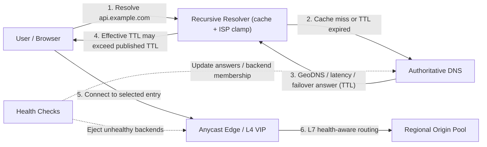
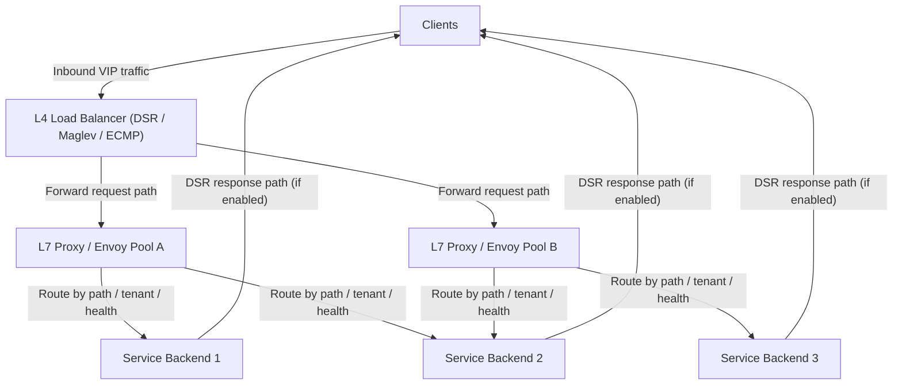
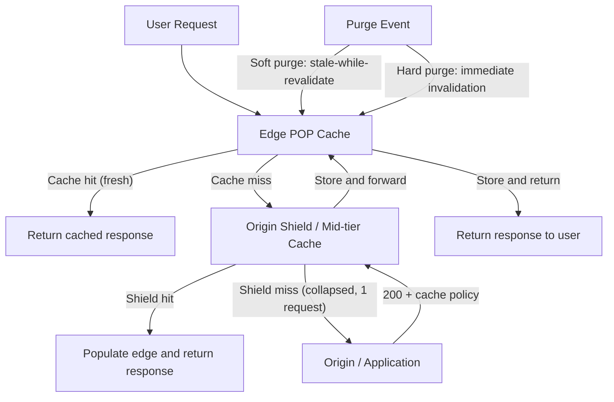

# Module 03 — Networking, Edge Architecture, and CDN Composition

System design at the edge is the art of composing DNS, anycast routing, load balancers, TLS termination, connection pools, real-time transports, CDNs, and API gateways into a latency-aware, failure-tolerant path from client to origin. This module treats those components as black boxes with operational knobs and failure envelopes; protocol mechanics on the wire belong to [Networking](../../networking/README.md), cryptographic handshake details to [Security & Identity](../../security-identity/README.md), and Cloudflare-specific primitives to [Cloudflare](../../../technologies/cloudflare/README.md). The focus here is composition: which control point owns which decision, what state each hop keeps, how cache and connection reuse change tail latency and blast radius, and which misconfigurations turn a performance optimization into a cross-tenant data leak.

---

## 1. Composing DNS at Scale

DNS is the first routing control plane in most user-facing systems. It decides which edge, region, or load balancer a client discovers before any application packet is exchanged, so its latency and correctness properties shape failover speed, traffic steering accuracy, and origin protection.

### 1.1 TTL Trade-offs: Fast Failover vs Resolver Load and ISP Clamping

The authoritative TTL is only an upper bound on how long resolvers may cache an answer. Recursive resolvers, ISP policies, enterprise caches, operating systems, browsers, and client libraries may cache for less or, in practice, for more than the published TTL.

| Choice | Benefits | Costs and risks | Typical use |
| --- | --- | --- | --- |
| Short TTL (for example 30s) | Fast failover, quicker regional evacuation, rapid mitigation of bad deployments or poisoned endpoints | High resolver query load on authoritative DNS, greater dependency on DNS provider capacity, more steering jitter, increased exposure to lookup latency | Active-active regional failover, canary cutovers, incident response records |
| Medium TTL (for example 60s–300s) | Balanced failover speed and query volume, reasonable cache hit rate at public resolvers | Failover still not instantaneous, some clients remain pinned to stale answers | General API and web front doors |
| Long TTL (for example 300s–3600s+) | Low query load, stable routing, better resilience to transient DNS control-plane issues | Slow failover, prolonged partial outage during regional loss, delayed rollback of bad steering changes | Stable anycast VIPs, static assets, records behind highly available edge fleets |

**ISP TTL clamping:** many resolvers ignore very low TTLs or floor them to reduce upstream load. A published 30s TTL may behave like 60s, 120s, or longer for parts of the user population. Design failover assuming a distribution of effective TTLs, not the configured value. For critical systems, combine DNS steering with transport-level health checks, connection draining, and anycast so that stale DNS answers still reach a healthy edge.

**Operational pattern:** keep DNS answers stable (longer TTL) when they point to an anycast edge or globally distributed L7 fleet, and use shorter TTLs only when DNS is the actual failover primitive between distinct origins or regions. Do not rely on DNS alone for sub-minute recovery unless you have measured resolver behavior for your user base.

### 1.2 GeoDNS vs Latency-Based Routing vs Anycast BGP Edge Entry

| Mechanism | Decision input | Strengths | Failure modes and limits |
| --- | --- | --- | --- |
| GeoDNS | Resolver or client IP mapped to geography/policy | Data residency control, regulatory steering, simple regional affinity, predictable commercial routing | Resolver location may not match user location, coarse granularity, poor handling of mobile/carrier NAT, slow adaptation to congestion |
| Latency-based DNS routing | Measured or modeled latency from resolver regions to endpoints | Better performance than pure geography, can prefer healthy low-latency regions | Measurements are approximate, resolver vantage point differs from user, DNS cache delays reaction, oscillation risk if thresholds are tight |
| Anycast BGP edge entry | Same IP prefix announced from many POPs; BGP selects path | Single stable IP, fast global reachability, natural DDoS absorption, local ingress without DNS churn, failover by route withdrawal | BGP convergence and policy routing are outside app control, TCP flows can shift during route changes, debugging requires network telemetry, not a substitute for origin health checks |

**Composition guidance:** a common production stack uses Anycast for the public edge IP, GeoDNS or latency policy only where region pinning is required (data sovereignty, stateful regional shards, disaster recovery drills), and L7 health-aware balancing behind the edge. Anycast solves "reach the nearest healthy edge"; it does not solve "which origin shard owns this user" or "is the downstream database writable".

**Anycast and state:** because route changes can move a new connection to a different POP, anycast entry points must be stateless or backed by shared/session-aware state. Long-lived TCP connections (WebSockets, gRPC streams) benefit from stable POP affinity and graceful drain during maintenance, but operators must still expect occasional reconnects.

### 1.3 DNS Steering, Health, and Client Pinning

DNS steering is only as reliable as its health signals and cache behavior. Health-checked authoritative answers can remove unhealthy endpoints, but probe vantage points may disagree with real user experience and false positives can withdraw healthy capacity. Weighted records support canary traffic shifts, but weights interact poorly with long or clamped TTLs. Active-passive failover is operationally simple yet leaves the secondary cold and still waits for cache expiry; active-active multi-region improves utilization but requires data replication and conflict-aware writes (cross-link [Distributed Systems](../../distributed-systems/README.md)).

Resolvers may cache `NXDOMAIN`/`NODATA` responses and serve stale records when authoritative servers are unreachable, so control-plane incidents can persist beyond TTLs in both directions. Even after DNS changes, long-lived connection pools, HTTP keep-alive, mobile apps with cached endpoints, and service meshes may continue using old IPs. Failover plans must include connection draining, server-side rejection with retry hints, and explicit client reconnect/backoff behavior.

---

## 2. L4 vs L7 Load Balancing Composition

Load balancers distribute traffic, enforce health, and shape failure domains. The right layer depends on whether routing needs packet/connection metadata or application semantics.

### 2.1 L4 Composition: DSR and Maglev Consistent Hashing

**L4 load balancers** make decisions using IP addresses, ports, and protocol state without terminating most application protocols. They offer high throughput, low latency, and simpler failure surfaces, but limited request-aware routing.

**Direct Server Return (DSR):** the load balancer forwards inbound packets to a selected backend, while response packets flow directly from the backend to the client, bypassing the load balancer on the return path. This removes the LB from the egress bandwidth path, which is valuable for response-heavy workloads (video chunks, large downloads, image delivery).

- **Requirements:** backends must accept traffic for the VIP (loopback or equivalent), and network/LB must preserve or rewrite addressing consistently (L2 DSR, IP tunneling, or encapsulation variants).
- **Benefits:** higher egress efficiency, reduced LB bandwidth cost, lower LB CPU pressure on large responses.
- **Trade-offs:** harder observability because the response path bypasses the LB, more complex health checking and connection tracking, TLS termination and L7 policies usually move elsewhere, and asymmetric routing complicates debugging.

**Maglev consistent hashing at L4:** Google's Maglev design uses consistent hashing to map 5-tuples (or selected flow keys) to backends so that backend pool changes minimally remap existing flows. This is crucial for stateful connection affinity, connection tracking tables, and minimizing packet spray during scaling events.

- **Why not naive modulo hashing:** `hash(flow) % N` remaps almost all flows when `N` changes, breaking connection tracking and causing widespread resets.
- **Maglev property:** each LB instance can compute the same lookup table deterministically, enabling ECMP-distributed L4 fleets without shared per-flow coordination.
- **Operational caveat:** consistent hashing preserves mapping stability, not load perfection; hot flows or skewed keys still require capacity headroom and health-aware removal.

**ECMP and distributed L4 fleets:** routers can distribute packets for the same VIP across multiple L4 balancer instances using equal-cost multi-path routing. Each balancer instance must make a consistent backend selection for the same flow; Maglev-style hashing enables this without centralized per-flow state.

### 2.2 L7 Composition: Envoy/NGINX Routing

**L7 load balancers and proxies** (Envoy, NGINX, HAProxy in HTTP mode, managed API gateways) terminate or inspect application protocols. They can route by host, path, headers, cookies, method, gRPC service, or tenant identity; perform retries, timeouts, circuit breaking, request normalization, and observability tagging; and enforce policy before traffic reaches application servers.

| Dimension | L4 | L7 |
| --- | --- | --- |
| Routing key | IP/port/tuple | URL, headers, cookies, JWT claims (after validation), gRPC metadata |
| State | Connection/flow tables | Connections, HTTP streams, route trees, retry budgets, TLS sessions |
| CPU cost | Low per packet/flow | Higher per request/stream due to parsing and policy |
| Failure isolation | Coarse, fast | Fine-grained but proxy bugs/config can have wide blast radius |
| Best fit | Raw TCP/UDP, TLS passthrough, extreme throughput, DSR | HTTP APIs, gRPC, canaries, tenant routing, auth/rate-limit offload |

**L7 controls that change behavior:** retries and hedging can mask transient failures but amplify load if not bounded by retry budgets and per-try timeouts; outlier ejection temporarily removes high-error or high-latency backends; circuit breaking limits concurrent requests/connections/retries to protect upstreams; request normalization enforces policy consistency but must preserve semantics required by signatures, caching, and idempotency.

**Composition rule:** use L4 for stable ingress, transport fanout, and connection distribution; use L7 where request semantics matter. Many production systems stack them: Anycast/L4 -> L7 edge proxy -> service mesh or internal L7 -> application.

### 2.3 Load-Balancing Algorithms: Why Naive Choices Fail

Algorithm choice is a composition decision coupled to workload heterogeneity, health signal freshness, and whether balancers coordinate.

| Algorithm | How it works | Where it breaks |
| --- | --- | --- |
| Round Robin | Rotate requests across backends in order | Assumes near-equal request cost and backend capacity; expensive requests saturate one backend while others idle, inflating tail latency |
| Least Connections | Send new work to backend with fewest active connections | In distributed LB fleets each LB sees a stale local view; many LBs can simultaneously pick the same backend, creating herd spikes and queue collapse; long-lived idle connections misrepresent true load |
| Power of Two Random Choices (P2C) | Sample two random healthy backends and pick the less loaded of the two | Needs a meaningful load signal (connections, queue depth, EWMA latency), but avoids global coordination and is robust to stale partial views |
| Consistent hashing | Map key/flow to backend with minimal remap on membership change | Protects affinity/state locality, not fairness under hot keys; requires health-aware fallback |

**Why naive Round Robin fails under heterogeneous request cost:** if request A takes 5 ms and request B takes 500 ms, a round-robin distributor equalizes request counts, not service time. Backends that receive expensive requests accumulate queueing delay while cheap-request backends remain underutilized. This is especially visible in mixed read/write APIs, search queries with variable cardinality, and LLM inference endpoints with variable prompt/output lengths.

**Why Least Connections creates herd spikes in distributed LBs with stale views:** when 50 edge proxies each observe backend X as having the lowest connection count at time $t$, all 50 can route the next burst to X before health/load metrics propagate at $t + \Delta$. The backend's queue spikes abruptly, latency rises, health checks may flap, and traffic then herds to the next temporarily "least" backend. The failure is not the metric itself but the combination of stale global state, synchronized decisions, and delayed feedback.

**Why P2C achieves exponential queue-length reduction with zero global coordination:** Mitzenmacher's power-of-two-choices result shows that sampling two random bins instead of one reduces the maximum load from $O\!\left(\frac{\log n}{\log \log n}\right)$ to $O(\log \log n)$ with high probability in the standard balls-and-bins model. In load balancing terms, each decision needs only two local comparisons, not a globally consistent view of all backend queues. This gives strong tail-load reduction, good behavior under partial information, and simple horizontal scaling of the balancers themselves. P2C is not magic: it still depends on meaningful load signals, circuit breaking, and outlier ejection for truly pathological backends.

> [!NOTE]
> Least Request in Envoy is closely related to P2C in practice (choice-of-two/choice-of-N behavior with active request weighting), while plain least-connections policies in distributed fleets remain vulnerable to stale-view herd effects unless carefully damped.

_Step-by-step mechanics:_ (1) At L7, Power of Two Random Choices (P2C) probes two random backends per request and routes to the smaller queue depth, collapsing max queue length from $O(\log n / \log \log n)$ to $O(\log \log n)$ without global coordination. (2) At L4, Maglev builds a deterministic permutation lookup table shared across ECMP load balancers; when a backend drains, only its slots reassign while active flows on healthy backends remain pinned with zero connection resets.

### 2.4 Forward vs. Reverse Proxy Taxonomy and Eliminating Load Balancer SPOFs

The word "proxy" names two opposite trust relationships. A **forward proxy** acts for the client: the client is configured (explicitly, through PAC/WPAD, or transparently by network interception) to send outbound traffic through it, and origin servers see the proxy instead of the client. A **reverse proxy** acts for the server: clients believe they are talking to the origin, and the proxy hides, protects, and distributes traffic across the real backends. Load balancers, API gateways, WAFs, and CDNs are all reverse proxies with different policy sets. Wire-level mechanics (`X-Forwarded-For`, the RFC 7239 `Forwarded` header, and HAProxy's PROXY protocol for L4 client-IP preservation) are owned by [Networking Module 13](../../networking/modules/13-load-balancing-cdn-nat.md#4-layer-7-reverse-proxying--client-ip-preservation).

| Dimension | Forward proxy | Reverse proxy |
| --- | --- | --- |
| Acts on behalf of | Clients (egress) | Servers (ingress) |
| Who configures it | Client device, enterprise network, or ISP | Service operator |
| Hides | Client identity and IP from origins | Origin topology, backend IPs, and server software from clients |
| Typical functions | Egress allow-listing and DLP, corporate caching, content filtering, audit logging, geo-unblocking, scraping fleets | TLS termination/offload, compression, L7 load balancing, WAF and bot rules, response caching (a CDN is a geo-distributed reverse proxy), rate limiting, request routing |
| Can terminate the server's TLS certificate | Only by MITM with an enterprise-installed root CA (TLS inspection) | Yes, it holds the origin's certificate and private key |
| Example products | Squid, Zscaler/secure web gateways, browser-configured HTTP `CONNECT` proxies | NGINX, Envoy, HAProxy, AWS ALB, Cloudflare, Fastly |

Forward proxies are often graded by how much they reveal. This is an informal industry classification, not a standard, and is defined by the headers the proxy adds:

- **Transparent proxy:** forwards the client's real IP (for example in `X-Forwarded-For`) and announces itself (for example with `Via`). Used for corporate caching and filtering, where anonymity is not the goal. "Transparent" also means "intercepting without client configuration", so clarify which meaning is in play.
- **Anonymous proxy:** announces itself as a proxy but withholds the client IP.
- **Distorting proxy:** announces itself and injects a false client IP.
- **High-anonymity (elite) proxy:** neither reveals the client IP nor identifies itself as a proxy; origins see what looks like an ordinary client.

**Design consequence:** client-IP headers are only as trustworthy as the hops that wrote them. Trust `X-Forwarded-For` entries only from proxies you operate (a configured trusted-hop count), never the left-most value, because every entry left of your own edge is client-controlled.

#### IP Hash behind NAT and CGNAT: Why It Hot-Spots

IP-hash affinity (`hash(client_ip) % N`, NGINX `ip_hash`) assumes one IP ≈ one user. That assumption fails wherever many users share one public address: corporate egress NAT, university networks, mobile carriers, and carrier-grade NAT (CGNAT, using the RFC 6598 shared address space `100.64.0.0/10` internally). A single CGNAT public IPv4 can front thousands of subscribers, so IP hashing pins all of them to one backend: that backend runs hot while the rest idle, and when it dies the whole population loses its sessions at once. Modulo hashing also remaps nearly every client when `N` changes. RFC 6598 itself lists geolocation and per-address limits among the things CGN breaks; the same failure hits IP-keyed rate limiting, which then throttles an entire carrier's customers. In the other direction, IPv6 privacy addresses and mobile handovers change a single user's IP mid-session, breaking affinity.

Fix it at two levels:

1. **Remove the need for affinity.** Externalize session state (Redis/Valkey, a database, or signed stateless tokens) so any backend can serve any request; see [Module 15 §2.3](15-scale-from-zero-to-millions.md#23-stage-45-caching-cdn-edge-offload-and-stateless-web-tier).
2. **When affinity is still useful** (cache locality, long-lived streams), hash a stable identity key (session cookie, user ID, tenant ID, API key) with consistent hashing (ring with virtual nodes, Maglev, or rendezvous hashing) so membership changes move only about `1/N` of keys, and add bounded-load caps so one heavy key cannot overload its owner (see §2.1). Rate limits key on identity, not IP (cross-link [Module 08](08-rate-limiting-load-shedding-and-resilience.md)).

#### Load Balancer SPOF Mitigation Stack

A single load balancer in front of a redundant fleet just moves the single point of failure. Production designs remove it in layers, each covering a different failure:

| Layer | Mechanism | Failure covered | Residual risk |
| --- | --- | --- | --- |
| Redundant LB pair | **Active-passive:** two nodes share a virtual IP via VRRP (RFC 9568, VRRPv3; Keepalived), and the standby claims the VIP within seconds of missed advertisements. **Active-active:** several LB nodes announce the same VIP over BGP, and upstream routers spread flows with ECMP | Single LB host or NIC failure | Split brain if VRRP advertisements are lost but both nodes are alive; ECMP rehashing moves flows when a member leaves, unless backends use consistent hashing (Maglev) |
| Health checks on the LB tier itself | External probes and BGP route withdrawal or VRRP priority drop when the LB's own data path fails, not only when the host is down | "Gray" LB failures: process alive, forwarding broken | Probes from one vantage point disagree with real users |
| Self-healing replacement | Autoscaling groups or managed LBs (AWS ALB/NLB, GCP LB) replace failed nodes and scale capacity automatically; config is versioned and rolled out progressively | Capacity loss and node exhaustion | A bad config pushed everywhere at once takes out every replica, so stage rollouts by cell or zone |
| Multi-zone / multi-region entry | LB nodes in every availability zone; anycast or DNS failover between regions | Zone or region outage | DNS failover is bounded by effective TTLs, not published ones (see [§1.1](#11-ttl-trade-offs-fast-failover-vs-resolver-load-and-isp-clamping)), so anycast is the faster primitive |

**Composition rule:** treat the LB tier as a fleet, not an appliance: N+1 (or N+2) capacity per zone, health-checked from outside, replaced automatically, and fronted by anycast or a VIP so that no single box, zone, or DNS answer is load-bearing. The LB's dependencies (certificate store, config/control plane, service discovery) need the same treatment, and the data plane should keep forwarding on its last known good configuration when the control plane is unavailable (static stability).

---

## 3. TLS Termination and Upstream Connection Pooling

TLS termination and connection reuse are latency optimizations that also define security boundaries and failure propagation paths.

### 3.1 TLS Termination Placement

**Edge termination:** the client TLS session ends at the CDN, anycast edge, or L7 load balancer. This enables HTTP routing, WAF inspection, header normalization, caching, and request authentication offload. The hop from edge to origin must then be protected by a separate TLS/mTLS connection or private network controls.

**Passthrough / end-to-end TLS:** the balancer forwards encrypted bytes without terminating application TLS. This preserves end-to-end certificate identity to the backend and reduces edge access to plaintext, but limits L7 routing and caching unless SNI/metadata is sufficient.

**Re-encryption:** terminate at edge for policy and routing, then establish a fresh upstream TLS connection to origin. This is the common internet-facing composition: user trust anchors at the edge certificate, service-to-service trust anchors at internal PKI or provider-managed origin certificates.

**mTLS composition note:** edge-to-client authentication and edge-to-origin/service authentication are separate trust domains. An edge may validate client certificates or tokens, then forward identity via trusted headers or mTLS to upstreams only within a verified boundary (cross-link [Security & Identity](../../security-identity/README.md) for PKI and identity semantics).

### 3.2 Upstream Connection Pooling and Keep-Alive Exhaustion

Creating a new TCP + TLS connection per request wastes handshakes, CPU, and tail latency budget. Proxies and gateways therefore maintain upstream connection pools keyed by destination, protocol, SNI, and sometimes tenant or route.

**Keep-alive exhaustion** occurs when upstream connections are scarce relative to concurrent requests:

- **Max connections too low:** requests queue in the proxy, increasing tail latency even when backends have spare CPU.
- **Max requests per connection too high:** a bad backend or slow stream can monopolize reusable connections.
- **Idle timeout mismatch:** if the origin closes idle connections sooner than the proxy expects, the proxy may attempt to reuse a dead connection and pay reset/retry latency.
- **Server/proxy keep-alive limits:** kernels, Envoy/NGINX settings, and cloud load balancers impose caps on idle connections, concurrent streams, and header sizes.

| Pooling symptom | Likely cause | Typical mitigation |
| --- | --- | --- |
| Rising proxy queue time with healthy backend CPU | Pool max connections too small or circuit breaker too tight | Increase pool/concurrency limits carefully, add autoscaling, verify backend saturation |
| Sporadic upstream `502`/reset on reuse | Idle timeout mismatch or middlebox closing idle flows | Align keep-alive/idle timers, enable keep-alive probes, reduce idle lifetime |
| One backend hot while others idle | Single multiplexed upstream flow or affinity imbalance | Increase upstream connection count, use request-aware balancing, inspect hash keys |
| High handshake CPU at edge or origin | Excessive connection churn, short timeouts, no session reuse | Reuse connections, tune keep-alive, enable session resumption where appropriate |

### 3.3 HTTP/2 Single-TCP-Connection Head-of-Line and Load-Balancing Stickiness Trap

HTTP/2 multiplexes many streams over one TCP connection, reducing connection overhead and improving parallelism. In proxy-to-upstream pools, this creates two important composition traps:

1. **TCP head-of-line (HOL) coupling:** packet loss on the single TCP connection stalls all multiplexed HTTP/2 streams on that connection until retransmission recovery, even if streams are independent. HTTP/3 over QUIC removes TCP-level HOL coupling (protocol details in [Networking](../../networking/README.md)), but HTTP/2 deployments must still account for lossy paths and pool sizing.
2. **Load-balancing stickiness trap:** if a proxy opens only one persistent HTTP/2 connection to an upstream service and multiplexes all requests over it, L4/L7 balancing decisions at the upstream front door may effectively bind traffic to one backend endpoint behind that connection. Even with multiple backends, a coarse pool can reduce effective fanout and create hot spots.

**Mitigations:** maintain multiple upstream connections per backend/cluster (bounded), use request-aware L7 balancing behind the proxy, monitor per-connection concurrency and stream reset rates, and prefer protocols/deployments that expose enough balancing granularity for bursty heterogeneous workloads.

### 3.4 Connection Draining and Graceful Shutdown Composition

TLS termination, pooling, and balancing only work well when backends can leave service without dropping in-flight work abruptly. Graceful shutdown is a composed sequence across control planes and data planes.

| Phase | Action | Purpose | Common pitfall |
| --- | --- | --- | --- |
| Stop admission | Remove backend from DNS/LB health, stop new connections/requests | Prevents new work from landing on draining instance | Health change propagates slowly while clients/LBs still send traffic |
| Drain in-flight requests | Allow existing requests/streams to complete within a deadline | Preserves correctness and reduces user-visible errors | Deadline too short for long polls, uploads, or streaming responses |
| Close idle keep-alives | Stop reusing pooled idle connections and close them cleanly | Avoids proxy reuse of soon-to-close sockets | Idle timeout mismatch causes resets during deploys |
| Force termination | Cancel remaining work after grace period and emit clear termination signals | Bounds deploy latency and frees capacity | Forcing too early turns deploys into error spikes |

For long-lived protocols (WebSockets, SSE, gRPC streams), draining usually means refusing new upgrades/streams, signaling clients to reconnect with jitter, and allowing bounded time for state handoff or clean disconnect. Connection draining must be coordinated with load balancer deregistration delays and autoscaling events to avoid oscillation.

---

## 4. Real-Time Client-Server Transport Composition

Real-time delivery is a spectrum from simple polling to fully bidirectional stateful channels. The correct choice depends on directionality, latency tolerance, message frequency, browser/proxy compatibility, and the cost of maintaining connection state.

| Transport | Direction | Connection model | Best fit | Key operational constraints |
| --- | --- | --- | --- | --- |
| Short Polling | Client pull | Repeated HTTP requests | Low-frequency updates, simple compatibility, cacheable snapshots | Wasted requests, high latency between polls, amplified load at scale |
| Long Polling | Server reply delayed until event/timeout | Held HTTP request, then reconnect | Legacy real-time fallback, moderate event rates | Reconnect churn, timeout tuning, head-of-line behind intermediaries, harder backpressure |
| Server-Sent Events (SSE) | Server -> client stream | Long-lived HTTP response (`text/event-stream`) | LLM token streaming, notifications, unidirectional feeds, progress updates | Unidirectional, per-connection state, proxy buffering/timeouts, client reconnect logic |
| WebSockets | Bidirectional | Upgraded persistent connection | Chat, collaborative editing, multiplayer signaling/control, low-latency bidirectional apps | Stateful L7 routing, memory per connection, reconnect storms, operational complexity |
| WebRTC | Peer-to-peer/media or data channels | Signaling + ICE/STUN/TURN + DTLS/SRTP/SCTP | Audio/video, low-latency media, peer data where NAT traversal is feasible | Signaling infrastructure, TURN cost, NAT/firewall variability, observability complexity |

### 4.1 Server-Sent Events (SSE)

SSE is ideal for unidirectional event streams where the server pushes tokens or updates and the client only acknowledges progress implicitly by reconnecting with the last seen identifier.

- **LLM token streaming and unidirectional feeds:** SSE maps naturally to incremental token emission, progress events, and append-only timelines.
- **HTTP/2 multiplexing:** multiple SSE streams can share an HTTP/2 connection at the protocol level, reducing connection overhead compared to one-TCP-per-stream patterns, but intermediaries and application servers still manage stream lifetimes and buffering carefully.
- **Automatic reconnect with `Last-Event-ID`:** browsers can reconnect after network interruption and send the last received event ID, allowing servers to resume or replay from a durable cursor when event history is retained.

**Design requirements:** disable proxy buffering where needed, emit heartbeats/comments to keep intermediaries from timing out idle streams, make event IDs monotonic within the stream scope, and define replay retention/idempotency semantics for reconnects.

### 4.2 WebSockets

WebSockets provide bidirectional, stateful, low-framing-overhead communication after an HTTP upgrade. They shift complexity from request overhead to connection lifecycle management.

- **Stateful connections:** each active client consumes file descriptors, TLS state, buffers, application session state, and heartbeat timers on a specific server.
- **L7 sticky routing:** once upgraded, a connection is pinned to the selected backend unless you implement a reconnect/redirect protocol. Load balancers and gateways must support upgrade handling, idle timeouts, and draining.
- **Memory budget:** a practical planning range is roughly 20–50 GB per 1,000,000 concurrent connections for connection/runtime overhead alone, before application payload buffers, per-user domain state, encryption overhead, or language runtime fragmentation. Treat this as a capacity-planning envelope to validate with load tests, not a universal constant.
- **Thundering-herd reconnect storms:** deploys, regional failovers, POP drains, or transient network incidents can cause massive simultaneous reconnects. Clients must use exponential backoff with full jitter, connection caps, and staggered resume; servers must enforce admission control and graceful drain.

**Scaling composition:** horizontally scaled WebSocket systems typically separate connection termination from business fanout. Gateways hold sockets and subscribe to a pub/sub or stream backbone keyed by user/channel/shard. Presence, typing indicators, and delivery acknowledgments add write amplification and state coordination; draining a node requires stopping new connections and forcing clients to reconnect with jitter.

### 4.3 WebRTC and Transport Selection

WebRTC is chosen for real-time media and peer data paths where latency and bandwidth efficiency matter more than simplicity. Even when media flows peer-to-peer, the system still composes centralized services: signaling channels, authentication/authorization, STUN for address discovery, and TURN relays when direct connectivity fails. TURN capacity and egress cost can dominate at scale.

Prefer **SSE** when the server-to-client stream is the primary path, events are replayable or cursor-based, and HTTP semantics/tooling are valuable. Prefer **WebSockets** when the client must send frequent low-latency messages upstream on the same session, when interaction is truly bidirectional, or when binary/subprotocol framing is required. For media, prefer **WebRTC**; for occasional updates, prefer polling or SSE before paying WebSocket state costs.

---

## 5. CDN Composition and Production Failure Modes

A CDN is a distributed cache, request router, TLS terminator, and failure shield. Correct composition depends on cache topology, key design, purge semantics, and strict separation of public and private responses.

### 5.1 Pull vs Push CDN and Multi-Tier Caching with Origin Shield

| Model | How content reaches edge | Strengths | Weaknesses | Best fit |
| --- | --- | --- | --- | --- |
| Pull CDN | Edge fetches from origin on cache miss, then caches by policy | Simple origin workflow, automatic propagation, good for long-tail content | First-request latency miss, origin shield needed for miss storms, stale until TTL/purge | Static assets, images, downloads, cacheable API responses |
| Push CDN | Origin/upload pipeline preloads content to edge or storage nodes | Predictable hit rate for known objects, controlled rollout before traffic | Operational complexity, storage churn, purge/versioning discipline required | Large launches, game patches, signed media packages, known-hot catalogs |

Without shielding, a globally popular object's cache miss can fan out from hundreds of POPs directly to origin. **Origin Shield** inserts a designated mid-tier cache (regional or parent POP) between edge POPs and origin: edge miss -> shield request; shield hit -> populate edge; shield miss -> single (or tightly bounded) request to origin, then populate shield and edge. This collapses 200 edge POP misses into 1 origin request (plus bounded coalescing behavior), reducing origin bandwidth, CPU, and database pressure during cold starts, deploys, and purges.

Origin Shield does not eliminate correctness problems: if the cache key is wrong or a response is incorrectly cacheable, the shield will faithfully amplify the wrong object. Request collapsing/coalescing and short negative caching can further protect origin, but must be scoped to cacheable responses.

### 5.2 Cache-Key Normalization

The cache key defines object identity. It must include every request dimension that changes the representation while excluding dimensions that would fragment cache efficiency without changing bytes.

**Good normalization examples:** scheme/host/path, relevant query parameters in canonical order, content negotiation dimensions that truly change bytes (for example normalized `Accept-Encoding`), and explicit cache variants for language or device class when responses differ.

**Dangerous fragmentation:**

- **`Vary: Accept-Encoding`** is usually correct and necessary when origins serve brotli/gzip/identity variants; it creates a small, bounded set of representations.
- **Catastrophic `Vary: User-Agent`** explodes cardinality across browser versions, bots, and minor device differences, destroying hit ratio and multiplying origin load.
- **Catastrophic `Vary: Cookie`** or cookie-influenced keys for anonymous traffic fragment cache entries per user/session, effectively disabling shared caching and potentially increasing cost and latency.

**Normalization checklist:** strip marketing/tracking query params, canonicalize parameter ordering, avoid forwarding irrelevant headers to origin, bound variant dimensions, use `s-maxage` for shared-cache TTL control where appropriate, and validate that authenticated or personalized routes bypass shared cache unless explicitly segmented by a safe key.

### 5.3 Soft Purge (`stale-while-revalidate`) vs Hard Purge

| Purge strategy | Behavior | Advantages | Risks | Use when |
| --- | --- | --- | --- | --- |
| Soft purge / `stale-while-revalidate` | Mark cached object stale but allow edge to serve stale content briefly while asynchronously revalidating | Shields origin from purge spikes, preserves availability and latency during refresh, smooths deploy rollouts | Users may see stale data for the revalidation window, not acceptable for security-sensitive or strongly consistent content | Static assets, versioned content, tolerably stale feeds, high-traffic pages |
| Hard purge | Immediately invalidate cached object; next request must fetch fresh content | Fast correctness propagation, removes compromised or sensitive objects promptly | Can trigger origin stampede, raises latency on miss, expensive at global scale | Credential leaks, legal takedowns, urgent security fixes, incorrect personalized caching incidents |

**Production pattern:** version immutable assets (`app.abc123.js`) to avoid purges, use short TTL plus revalidation for mutable-but-tolerant content, and reserve hard purge for correctness or security emergencies with origin shielding and request coalescing enabled.

### 5.4 Catastrophic Failure Mode: Cross-User Private Page Leak

**Failure scenario:** a CDN serves User A's authenticated or personalized response to User B. This is a severe confidentiality breach that can expose profile data, session-bound content, CSRF tokens, order history, or private documents.

**How it happens:**

- The origin omits `Cache-Control: private, no-store` (or equivalent) on an authenticated/personalized response.
- A shared cache treats the response as publicly cacheable due to default heuristics, route rules, or overridden TTLs.
- `Set-Cookie` is present but edge rules strip, ignore, or fail to treat it as a cache-bypass signal; some caches also key incorrectly when cookies vary.
- Cache key omits authorization context while edge rewrites make different users hit the same object.
- Debug or edge-worker code stores a response object globally and reuses it across requests.

**Mitigation checklist:**

- **Origin headers:** set `Cache-Control: private, no-store` (and `Pragma: no-cache` / `Expires: 0` only as legacy supplements where needed) for user-specific HTML/API responses; use `Cache-Control: public, max-age=..., s-maxage=...` only for truly shared content.
- **Cookie and auth handling:** bypass shared cache on authenticated requests by default; never strip `Set-Cookie` as a "fix" for caching; explicitly configure CDN behavior for requests containing `Authorization` or session cookies.
- **Cache key discipline:** do not include raw cookies in shared keys; if tenant-specific caching is required, use explicit surrogate keys or signed segmented variants, not user cookies.
- **Route separation:** isolate authenticated app routes from static asset routes; use distinct hostnames/paths for public cacheable resources when practical.
- **Defense in depth:** mark responses with `Vary` only on safe dimensions, disable caching in edge workers for personalized branches, and add automated tests that fetch the same URL with two different credentials and assert no cross-user body leakage.
- **Incident response:** on suspicion of leakage, perform hard purge, disable caching for affected routes, rotate exposed tokens/sessions if necessary, and audit CDN logs for cache HITs on authenticated endpoints.

**Testing strategy:** include differential tests in CI or staging that request the same cacheable-looking path as User A and User B and assert different identities never receive the same personalized payload or `Set-Cookie` context. Also test anonymous-vs-authenticated transitions, because login/logout boundaries are common leakage points.

---

## 6. API Gateway Composition

An API gateway is an L7 control point at the service boundary. It composes cross-cutting concerns so downstream services can focus on domain logic, but it becomes an availability and correctness bottleneck when overloaded with business behavior.

### 6.1 Core Gateway Responsibilities

| Capability | Value | Composition caveat |
| --- | --- | --- |
| AuthN/AuthZ offload | Validate JWT/OAuth tokens, mTLS identity, API keys, scopes, and tenant claims before forwarding | Keep authorization decisions consistent with service-level policy; do not trust edge claims blindly inside zero-trust or multi-hop environments |
| Rate limiting | Protect backends from abusive or bursty clients using per-key/IP/tenant quotas | Choose scope carefully (global, regional, per-instance) to avoid under-enforcement or false throttling; pair with load shedding |
| Request/response transformation | Header normalization, protocol translation, path rewrites, payload shape adaptation | Transformations must be versioned and observable; avoid lossy rewrites that break idempotency or signatures |
| Observability and policy enforcement | Central metrics, tracing headers, WAF integration, schema validation, CORS | Parsing and deep inspection add latency and CPU; sample or tier policies by route criticality |
| Traffic shaping and release control | Canary routing, header-based routing, shadow traffic, request mirroring | Shadow/mirror traffic must not trigger irreversible side effects; ensure idempotency and environment isolation |

**Rate limiting composition:** global limits require shared state and add latency/failure dependencies; local/per-node limits are fast but can under-enforce behind large L7 fleets. A common composition is layered limits: inexpensive edge/local shedding plus stricter tenant-aware quotas closer to domain services.

### 6.2 BFF vs Unified Gateway Anti-Patterns

**Backend for Frontend (BFF):** a client-specific backend (web, mobile, partner, internal tool) that composes downstream calls, shapes responses for UI needs, and owns client-facing interaction patterns. BFFs are appropriate when different clients need different aggregation, latency budgets, or release cadences.

**Unified gateway:** a shared ingress/gateway layer for cross-cutting concerns and coarse routing. It should remain thin, policy-driven, and operationally predictable.

**Avoid the "business logic inside gateway plugins" anti-pattern:**

- **Coupling:** domain rules embedded in Lua/JS/WASM/plugins or route scripts create hidden dependencies and make deployments risky.
- **Testability:** gateway policy engines are often harder to unit/integration test than application services, leading to unreviewed behavior changes.
- **Blast radius:** a plugin bug or bad config can break many APIs simultaneously.
- **Data ownership leakage:** gateways start querying databases, orchestrating workflows, or enforcing domain invariants they do not own.
- **Performance opacity:** per-request plugin chains increase tail latency and complicate capacity planning.

**Guideline:** gateways may authenticate, authorize coarse access, rate limit, route, and transform transport-level concerns; BFFs or domain services should own business workflows, data consistency, and domain-specific validation. When a gateway rule needs domain state or multi-step transactions, move it behind a service boundary.

---

## 7. End-to-End Composition Checklist

- **DNS:** measure effective TTL behavior, prefer stable anycast entry points, combine health-checked steering with transport-level recovery, and treat DNS failover as one layer in a multi-layer recovery plan.
- **Balancing:** choose L4/L7 by semantics, use DSR and Maglev/consistent hashing where flow stability or egress efficiency matters, prefer P2C or similarly robust algorithms for heterogeneous loads, and monitor stale-view herd effects in distributed balancers.
- **Connections:** size upstream pools, align keep-alives, account for HTTP/2 multiplexing stickiness and TCP HOL coupling, plan HTTP/3 fallback behavior, and budget reconnect storms.
- **Caching:** normalize keys conservatively, protect origin with Origin Shield and request coalescing, version immutable assets, and treat authenticated responses as non-cacheable by default.
- **Real-time:** select SSE vs WebSockets vs WebRTC by directionality and state cost, configure heartbeats/timeouts, implement jittered reconnects, and plan graceful drains.
- **Gateways:** keep cross-cutting concerns centralized and business logic out of plugins; version BFF contracts per client need and propagate verified identity context safely.

A resilient edge is not the sum of individually "fast" components. It is a composed system whose caches do not amplify wrongness, whose balancers do not synchronize overload, and whose control planes fail more gracefully than the origins they protect.

---

## 8. HTTP/3, Observability, and Operational Runbooks

### 8.1 HTTP/3 and QUIC at the Edge

HTTP/3 over QUIC can improve tail latency on lossy or mobile networks by avoiding TCP-level head-of-line blocking and by combining transport and cryptographic handshakes more efficiently (protocol internals are owned by [Networking](../../networking/README.md)). From a composition perspective, the edge must decide where QUIC terminates, whether origin connections use HTTP/3 or HTTP/2, and how fallback to HTTP/2/1.1 behaves when UDP is blocked or degraded.

| Composition choice | Benefit | Trade-off |
| --- | --- | --- |
| QUIC terminated at CDN/edge, HTTP/2 to origin | Faster client experience on impaired networks, mature origin/tooling compatibility | Requires translation/proxying at edge; origin does not see client QUIC characteristics directly |
| End-to-end HTTP/3 where supported | Consistent transport semantics across hops | Higher operational complexity, uneven intermediary support, harder debugging and policy enforcement |
| Aggressive fallback to HTTP/2/1.1 | Broad compatibility and predictable behavior | Loses QUIC benefits on constrained paths; fallback logic must be tested under packet loss and firewall policies |

Connection migration in QUIC can help mobile clients survive network changes, but stateful edge services and load balancers must still handle path validation, token rotation, and capacity accounting correctly. Capacity plans should include both QUIC and TCP paths during rollout periods.

### 8.2 Edge Observability Signals

Effective edge operations require correlated signals across DNS, routing, TLS, caching, and application layers.

- **DNS and routing:** authoritative query rate, NXDOMAIN/SERVFAIL rates, effective TTL observations, steering decision distribution, anycast POP ingress balance, and route withdrawal/convergence events.
- **Load balancing and connections:** per-backend request rate and error rate, active connections, queue depth, retry budgets consumed, outlier ejections, pool overflow counts, upstream connect failures, and TLS handshake latency.
- **Caching:** hit/miss/stale/revalidated rates by route and cache tier, origin shield collapse ratio, purge propagation latency, cache-key cardinality, and anomalies such as cache HITs on authenticated endpoints.
- **Real-time transports:** concurrent connection count, handshake/upgrade failures, reconnect rate, heartbeat timeout rate, message fanout lag, and memory per connection under representative workloads.
- **Gateways:** auth failure reasons, rate-limit decisions by key dimension, transformation/plugin latency, and per-route saturation indicators.

### 8.3 Incident Runbooks and Safe Defaults

- **DNS failover drill:** lower TTLs ahead of planned events where appropriate, verify health checks remove only unhealthy targets, monitor resolver spread during cutover, and keep a rollback path that does not depend on the failing control plane.
- **Cache correctness incident:** default to hard purge and temporary cache bypass for affected routes, preserve forensic CDN logs, rotate exposed credentials/tokens if leakage is possible, and fix origin cache headers before re-enabling caching.
- **Reconnect storm response:** enable admission control at edge/gateway tiers, increase jitter windows in client guidance, shed noncritical streams, and drain origins/backplanes gradually to avoid cascading overload.
- **Gateway safety:** enforce plugin execution budgets, isolate high-risk transformations, version and canary policy changes, and keep an emergency path to disable nonessential plugins while preserving core routing and authentication.

These operational controls close the loop between design intent and production behavior: edge composition is only correct when telemetry, defaults, and runbooks make failure modes visible and recoverable.

---

## Interview Drill

**Q1.** You publish a 30-second DNS TTL for emergency regional failover, but traffic keeps hitting the failed region for several minutes. What are the most likely causes, and how would you design for this in practice?

Model Answer

The published authoritative TTL is not a guaranteed client-side cache duration. Recursive resolvers and ISPs may clamp low TTLs, operating systems and applications may cache results independently, and some clients may pin connections established before failover. Negative caching and stale-answer serving during upstream DNS issues can also delay convergence. In practice, measure effective TTLs from representative resolver populations, avoid relying on DNS alone for sub-minute recovery, front origins with anycast or a highly available edge VIP so stale DNS still reaches a healthy ingress, drain connections gracefully, and combine DNS steering with health-aware L7 routing and regional evacuation runbooks.

**Q2.** Why can Least Connections perform worse than P2C in a fleet of distributed L7 load balancers, even when each balancer has accurate local connection counts?

Model Answer

Each balancer observes only a local, time-delayed view of backend load. During a burst, many balancers can independently select the same backend that appears least loaded at that instant, creating a herd spike that overwhelms it before metrics propagate. Long-lived connections also make connection count a noisy proxy for actual CPU or queueing cost. P2C samples two random healthy backends and picks the better one using a local signal, which avoids global coordination and dramatically reduces maximum queue imbalance ($O(\log \log n)$ in the standard model), making it more stable under stale or partial information.

**Q3.** Your Envoy fleet multiplexes most upstream traffic over a single persistent HTTP/2 connection per upstream cluster. What two distinct production problems can this create?

Model Answer

First, TCP head-of-line blocking couples all multiplexed streams on that connection: a single packet loss event stalls every stream until retransmission recovery, inflating tail latency across unrelated requests. Second, it creates a load-balancing stickiness trap because the upstream side sees one long-lived flow/endpoints selection for many requests, reducing effective fanout and potentially hot-spotting one backend. Mitigations include maintaining multiple bounded upstream connections, using request-aware balancing, monitoring per-connection concurrency and resets, and considering HTTP/3/QUIC where appropriate.

**Q4.** When would you choose SSE over WebSockets for a large-scale LLM product, and what operational details must be correct for reliable streaming?

Model Answer

Choose SSE when communication is primarily server-to-client token streaming or event delivery, clients do not need frequent low-latency upstream messages on the same channel, and HTTP infrastructure compatibility/replay semantics are valuable. SSE works well with unidirectional feeds, can multiplex over HTTP/2, and supports automatic reconnect with `Last-Event-ID`. Operationally, disable intermediary buffering, send heartbeats to prevent idle timeouts, make event IDs monotonic and replayable within a retention window, define idempotent resume behavior, and protect reconnect paths from thundering-herd storms with jittered backoff and admission control.

**Q5.** A CDN-backed application starts serving User B the account page of User A. List the most plausible root causes and a concrete mitigation checklist.

Model Answer

Likely causes include missing `Cache-Control: private, no-store` on personalized responses, shared-cache heuristics treating authenticated responses as cacheable, edge rules stripping or mishandling `Set-Cookie`, cache keys that ignore authorization context, unsafe `Vary: Cookie` or similar fragmentation/misconfiguration, or application/worker code reusing response objects across requests. Mitigations: emit strict no-store/private headers for user-specific routes, bypass shared cache on authenticated traffic by default, never strip `Set-Cookie` to force caching, separate public and private routes, validate with two-credential differential tests, hard-purge affected objects immediately, disable caching on impacted paths, and audit CDN logs plus rotate exposed session artifacts if needed.

**Q6.** Explain how Origin Shield changes failure behavior during a cold cache event, and what it does not protect you from.

Model Answer

Origin Shield adds a mid-tier cache so many edge POP misses collapse into a shield request; only a shield miss reaches origin, dramatically reducing origin fan-in during cold starts, deploys, or popular-object misses (for example collapsing 200 edge POP misses into 1 origin request). This improves origin stability and cost. It does not protect against incorrect cacheability or bad keys: if a response is wrongly public or fragmented by `Vary: User-Agent`/`Cookie`, the shield will cache and amplify that mistake. It also does not replace correctness controls like versioned assets, safe TTLs, and purge discipline.

**Q7.** Your API gateway team wants to implement order-pricing rules and inventory reservation workflows inside gateway plugins to "reduce service hops." Why is this dangerous, and where should those concerns live?

Model Answer

Pricing and reservation logic are domain concerns that require strong correctness guarantees, transactional state awareness, versioned testing, and clear ownership. Embedding them in gateway plugins couples policy infrastructure to business rules, increases blast radius (one bad plugin/config breaks many APIs), obscures observability and rollback, and makes correctness harder to validate under retries, partial failures, and schema evolution. The gateway should handle cross-cutting concerns such as authN/authZ offload, coarse routing, rate limiting, and request transformation; pricing and reservations belong in domain services or a BFF/orchestration layer that owns the workflow and data consistency.

**Q8.** Design a real-time notification system that must support one million concurrently connected browsers with mostly server-to-client updates and occasional reconnects after deploys. Which transport and edge composition choices reduce risk?

Model Answer

Prefer SSE if updates are predominantly unidirectional, because it fits cursor-based event streams, HTTP tooling, and `Last-Event-ID` resume semantics with lower protocol complexity than bidirectional WebSockets. Use L7 proxies/gateways that support long-lived streams, buffering control, and graceful drain; budget connection memory explicitly (roughly 20–50 GB per million connections for connection/runtime overhead plus application state) and shard connections by tenant/region. Add heartbeats below intermediary idle timeouts, store replayable event IDs for a bounded window, and require clients to reconnect with exponential backoff and full jitter. During deploys, drain nodes gradually and enforce admission/rate limits on reconnect endpoints to prevent thundering-herd collapse.

**Q9.** Your web tier sits behind a single NGINX instance using `ip_hash` for session stickiness. After a mobile-carrier marketing campaign, one backend is pinned at 100% CPU while the others idle, and last month an NGINX host reboot caused a full outage. Diagnose both problems and propose the target architecture.

Model Answer

The hot spot is IP-hash affinity colliding with carrier-grade NAT: the carrier puts thousands of subscribers behind a few public IPv4 addresses (RFC 6598 shared space internally), so `hash(client_ip)` maps all of them to one backend. Corporate NAT does the same on a smaller scale, and modulo hashing remaps almost every client whenever the pool size changes. Fix it by externalizing session state (Redis/Valkey or signed tokens) so backends are stateless and can use P2C or least-request balancing. Where affinity still helps, hash a stable identity key (session cookie, user ID) with consistent hashing and bounded load. The outage happened because the single NGINX host was a SPOF. Replace it with a redundant LB tier: an active-passive VRRP pair or active-active BGP/ECMP nodes in every zone, external health checks that withdraw a sick node's route, automated replacement, staged config rollouts, and anycast or DNS failover between regions. Because resolvers clamp TTLs, DNS failover is a slow last resort, not the primary recovery mechanism.

