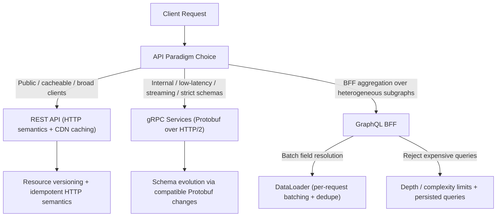
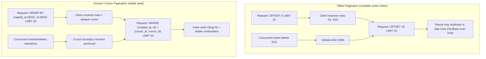
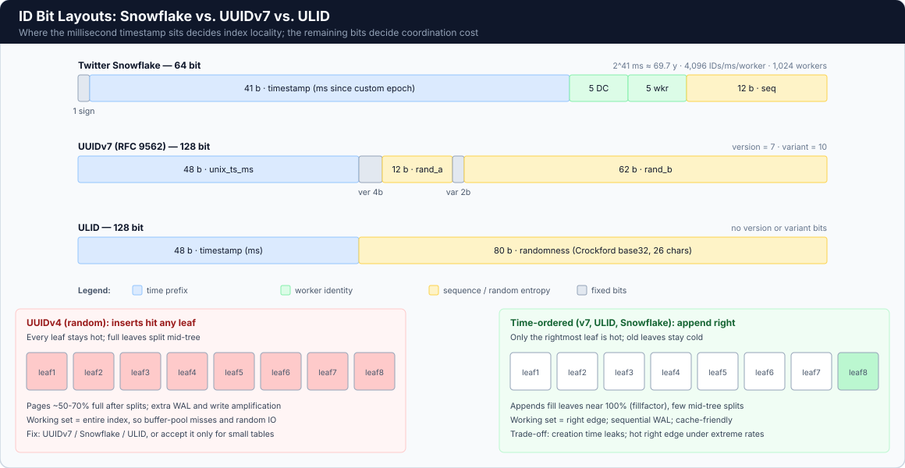
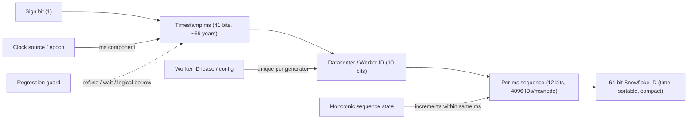
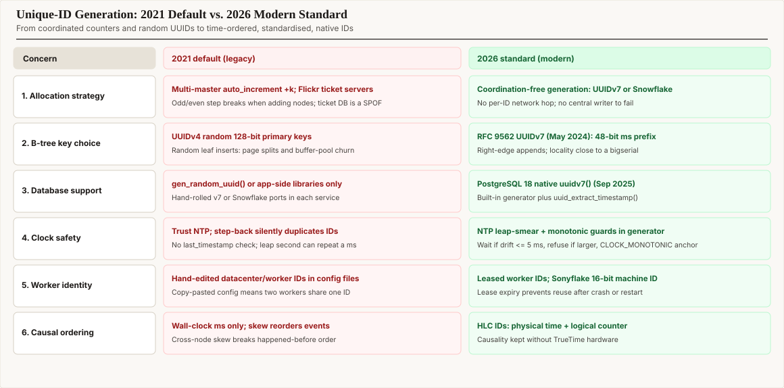

# Module 04 — API Design, Data Modeling, and Distributed ID Generation

APIs, data models, pagination semantics, idempotency contracts, storage choices, and identifier generation are composition decisions that determine correctness under retries, latency under growth, and operability under partial failure. This module focuses on boundary design and access-pattern-driven trade-offs rather than re-teaching protocol or storage internals: transport and wire-level protocol details belong to [Networking](../../networking/README.md), storage engine and replication internals to [Data Systems](../../data-systems/README.md), probabilistic and indexing data-structure theory to [DSA](../../../algorithms/dsa/README.md), and identity/authentication primitives to [Security & Identity](../../security-identity/README.md). The goal is to choose contracts and representations that remain stable under concurrent writes, client retries, schema evolution, and horizontal scale.

---

## 1. API Paradigm Decision Matrix

Choosing REST, gRPC, or GraphQL is less about fashion than about caching behavior, client diversity, schema governance, streaming needs, and failure isolation at service boundaries.

| Dimension | REST (HTTP + JSON/resource semantics) | gRPC (HTTP/2 + Protobuf contracts) | GraphQL (schema + query language, often over HTTP) |
| --- | --- | --- | --- |
| Primary fit | Public/external APIs, cacheable resources, browser and partner ecosystems | Internal service-to-service calls, low-latency RPC, streaming, strongly typed contracts | Backend-for-frontend aggregation over heterogeneous subgraphs and client-specific views |
| Contract style | Resource-oriented endpoints, HTTP methods/status codes, evolving JSON conventions | Explicit Protobuf service/method schemas, generated clients/stubs | Typed schema with client-selected fields, queries/mutations/subscriptions |
| Caching | Strong alignment with HTTP caching, CDNs, ETags, conditional requests | Limited generic intermediary caching; usually application-level | Harder at HTTP layer because POST bodies and query variability reduce cache reuse |
| Streaming | Possible via SSE/WebSockets/HTTP streaming but not native to basic REST shape | Native unary, server-streaming, client-streaming, bidirectional streaming (Protobuf binary framing over HTTP/2) | Subscriptions possible, but operationally complex and often not the simplest streaming primitive |
| Schema evolution | Additive JSON evolution and explicit versioning policies | Protobuf compatibility rules (field numbers, additive evolution) enable disciplined change | Schema evolution flexible, but resolver and client query behavior must be governed carefully |
| Operational risks | Over/under-fetching, endpoint sprawl, inconsistent pagination/error conventions | Tight coupling to code generation/tooling, browser/debug friction, load-balancing nuances with long-lived streams | N+1 resolver storms, expensive nested queries, query-depth/complexity DoS, authorization complexity per field |
| Typical boundary | Edge/public/mobile/partner APIs | East-west/internal microservice mesh and latency-sensitive pipelines | BFF or product aggregation layer in front of multiple domain services |

**Decision guidance:** prefer REST for cacheable external resources and broad interoperability; prefer gRPC for internal APIs where strict schemas, efficient binary framing, and streaming matter (cross-link [Data Systems](../../data-systems/README.md) for serialization and schema-evolution internals); prefer GraphQL when a BFF must compose heterogeneous subgraphs and tailor responses to diverse clients. Do not expose GraphQL directly as a generic replacement for every internal boundary, and do not let a single paradigm erase domain ownership.

### 1.1 REST, gRPC, and GraphQL Composition Considerations

**REST:** leverages HTTP semantics (safe/idempotent methods, status codes, ETags, conditional requests) and composes naturally with CDNs and gateways. Clear error contracts and pagination/idempotency conventions are essential for safe retries.

**gRPC:** excels at internal service-to-service communication with strict Protobuf schemas, generated stubs, efficient binary encoding, and native streaming modes. Deadlines/cancellation must propagate across calls, and compatibility discipline (stable field numbers, additive changes) is required during rollouts.

**GraphQL:** centralizes client-driven selection in a BFF layer, which reduces over/under-fetching across heterogeneous subgraphs but shifts complexity into resolver execution, caching, and authorization.

### 1.2 GraphQL Hazards: N+1 DataLoader and Query-Depth DoS

- **N+1 resolver problem:** a query returning $N$ parent objects that resolves a child field per object can trigger $1 + N$ downstream calls if each resolver fetches independently; nested lists multiply this fan-out.
- **DataLoader mitigation:** batch and cache per-request loads by key so resolvers collapse many field fetches into bounded batch calls (for example `getUsersByIds([ ... ])`). Batching must be scoped per request to avoid cross-user cache leakage and stale visibility.
- **Query-depth and complexity DoS:** deeply nested or highly fan-out queries can consume excessive CPU, memory, and downstream I/O even when syntactically valid. Mitigate with maximum depth limits, query cost/complexity scoring, persisted queries/allow-lists for public endpoints, timeouts, pagination on connections, and resolver-level concurrency limits.
- **Field-level authorization:** enforce authorization in resolvers and data access layers, not only at top-level entry points.



### 1.3 API Error Contracts and Retry Semantics

A stable API contract defines not only success shapes but also how clients should interpret failures, timeouts, and partial outcomes.

| Situation | Recommended API behavior | Client expectation | Design note |
| --- | --- | --- | --- |
| Validation error | `400` or `422` with machine-readable field errors | Do not retry without changing input | Distinguish malformed syntax from semantic validation where useful |
| Resource conflict / idempotency payload mismatch | `409` or `422` with conflict code | Resolve conflict or use a new idempotency key for new intent | Same key + different payload must never mutate state |
| Request accepted asynchronously | `202 Accepted` with operation/status resource | Poll or subscribe for completion using stable operation ID | Pair with idempotent submission semantics |
| Transient overload/dependency failure | `429` or `503` with retry guidance when safe | Retry with backoff and jitter if operation is safe or idempotent | Never imply retry safety for unknown non-idempotent mutations |
| Timeout / unknown outcome | Explicitly documented behavior; avoid ambiguous success claims | Retry with same idempotency key for mutating operations | Server must support dedupe/replay for the retry window |

---

## 2. Pagination Failure Modes and Proofs

Pagination is a correctness contract under mutation, not just a UX convenience. The wrong strategy can silently duplicate or skip records, create latency cliffs, and make background jobs or client sync loops untrustworthy. The behaviors below align with the executable proofs in `../examples/04-ids-pagination-and-geo.test.ts`.

### 2.1 Negative Case: Offset Pagination (`OFFSET 1000000 LIMIT 20`)

Offset pagination (for example `page=50001&page_size=20` or `OFFSET 1000000 LIMIT 20`) is attractive because it supports arbitrary page jumps, but it fails operationally and semantically at scale.

**Latency cliff ($O(\text{offset})$):** to return rows after an offset, the database must walk the ordered result stream (or index scan path) and discard the first 1,000,000 rows before producing the requested page. Even with indexes, deep offsets force substantial scan and sorting/filtering work, so latency grows with offset rather than remaining near constant.

**Silent duplication or skipping under concurrent writes:** if rows are inserted or deleted earlier in the sort order between page requests, the absolute positions shift. A client that already read page N may see an item again on page N+1 (duplicate) or miss an item entirely (skip) because the result set moved underneath the offset window.

**Additional pitfalls:** `ORDER BY created_at DESC` without a unique tie-breaker can reorder equal-timestamp rows between queries; changing filters or sort parameters mid-pagination invalidates positional assumptions; and total-count UIs often require expensive aggregates.

| Workload | Offset pagination outcome | Cursor pagination outcome |
| --- | --- | --- |
| Deep browse (`OFFSET 1000000`) | High scan/discard cost and tail latency spikes | Near-constant page fetch cost with aligned index |
| Live feed with concurrent inserts/deletes | Duplicates/skips as rows shift positions | Stable continuation from last key boundary |
| Batch export/sync job | Fragile resumes and inconsistent retries | Deterministic resume from persisted cursor |
| Random page jump UX | Supported directly (but costly) | Not native; requires different access strategy |



### 2.2 Keyset / Cursor Pagination

Keyset pagination continues from the last seen sort key instead of a numeric position. A canonical query shape is:

```sql
SELECT *
FROM events
WHERE (created_at, id) < ($cursor_ts, $cursor_id)
ORDER BY created_at DESC, id DESC
LIMIT 20;
```

**Core properties:**

- **$O(\log N)$ index seek behavior:** with an index aligned to the sort predicate (for example `(created_at DESC, id DESC)` or equivalent traversal), the database seeks to the cursor boundary and reads the next page without discarding millions of prior rows.
- **Stability under concurrent mutations:** inserts/deletes before or after the cursor boundary do not renumber previously returned items. The client continues relative to a logical key, not a shifting offset.
- **Composite tie-breaker key:** `created_at` alone is insufficient when timestamps collide. A deterministic total order requires a unique tie-breaker (commonly `id`) so the cursor boundary is unambiguous.
- **Opaque base64 cursors:** encode `(created_at, id)` (and optionally sort/version metadata) as an opaque cursor string to prevent clients from coupling to internal field names while preserving server-side validation.
- **Trade-off:** keyset pagination does not support efficient arbitrary jumps like "go to page 47"; it is optimized for forward/backward traversal and stream-like consumption.

**Implementation notes:** keep sort order, predicate direction, and index definition consistent; reject malformed or cross-endpoint cursors; include cursor versioning if sort fields may evolve; and encode direction/boundary explicitly for bidirectional pagination.

### 2.3 Cursor Design, Filtering, and Snapshot Consistency

Cursor correctness depends on the full ordering contract, not just the presence of a cursor token. Any filter or sort field that affects result order must be reflected in the cursor boundary or in a stable snapshot definition. When clients paginate filtered results (for example `status=active`), the cursor must represent position within that filtered, ordered set; changing filters invalidates the cursor. For strict "as-of" export consistency, paginate over a transaction snapshot, change-data-capture stream, or materialized export window rather than assuming a mutable live table can provide repeatable global views.

---

## 3. Idempotency Keys and Safe Retries

Retries are inevitable in distributed systems because clients cannot always distinguish timeout, packet loss, and post-commit acknowledgment failure. Idempotency keys turn unsafe retries into at-most-once effects at the application boundary.

### 3.1 Idempotency Contract

For a mutating operation (typically `POST`, sometimes `PATCH` with non-idempotent semantics), the client sends a unique `Idempotency-Key`. The server stores and evaluates a record keyed by that token, scoped appropriately (for example per endpoint + principal + tenant).

**Recommended stored fields:** `(idempotency_key, request_payload_hash, status, response_body)` and operational metadata such as `created_at`, `updated_at`, `expires_at`, and optionally `resource_id` or error details.

**Execution rules:**

- **Same key, same payload hash:** if the original request completed successfully, return the stored response (same status/body semantics as policy allows). This prevents duplicate charges, duplicate orders, or duplicate job creation.
- **Same key, different payload hash:** return `409` or `422` (choose one consistently) to signal payload mismatch and prevent accidental key reuse with different intent.
- **Same key, in-progress request:** represent an `In-Progress` lock/state so concurrent retries do not execute the mutation twice. Depending on system behavior, return a conflict/retryable response, block briefly, or poll until completion.
- **Unknown outcome handling:** clients should retry with the same key after network timeouts; servers must make the lookup-and-mutation path atomic.

### 3.2 Same ACID Transaction as the Mutation

The idempotency record and the business mutation must be committed in the **same ACID transaction** whenever they share a transactional datastore. Writing "business row committed" and "idempotency row not committed" (or vice versa) reintroduces duplicate side effects under crash/retry windows.

| Phase | Server action | Failure-safe outcome |
| --- | --- | --- |
| Receive request | Validate key scope and compute `request_payload_hash` | Reject malformed keys early |
| Begin transaction | Read/insert idempotency row with `status = In-Progress` and lock state | Concurrent duplicates serialize or detect in-progress work |
| Execute mutation | Apply domain write using request data | No external side effect before commit unless separately guarded |
| Commit transaction | Persist mutation + idempotency record (`status = Succeeded`, `response_body`) atomically | Retry returns stored result |
| On mismatch | Detect different hash for same key | Return `409`/`422` without mutating state |
| Retention | Expire rows after TTL window | Bounds storage while covering client retry horizon |

**TTL retention window:** choose retention based on maximum realistic retry duration, client behavior, and asynchronous processing delays (hours to days are common; the exact value is domain-specific). Too short risks duplicate effects after late retries; too long increases storage and index pressure.

**Response replay semantics:** decide whether retries return the exact original response body/status or a normalized representation, and document it. Exact replay is usually safest for client automation.

### 3.3 External Side Effects and Asynchronous Workflows

**Non-transactional side effects:** if the mutation triggers emails, webhooks, payment gateway calls, or cross-service workflows, database-only atomicity is insufficient. Use the transactional outbox pattern for asynchronous publication, provider idempotency tokens for third-party calls, and compensatable workflows for multi-step business processes (cross-link [Distributed Systems](../../distributed-systems/README.md) for delivery semantics and saga correctness).

When a synchronous API enqueues work and returns `202 Accepted`, idempotency must cover both request acceptance and downstream processing. Persist the idempotency key with the enqueue/command record in the same transaction, make workers idempotent under at-least-once delivery, and model `Pending`, `In-Progress`, `Succeeded`, and `Failed` states explicitly.

### 3.4 API Versioning and Evolution

Versioning strategy should preserve client compatibility while enabling safe evolution:

- **URI versioning (`/v1/...`)**: explicit and easy to route/deprecate, but can duplicate surface area and cache keys.
- **Header/content negotiation versioning**: cleaner URLs and flexible negotiation, but less visible in logs/caches and easier to misconfigure.
- **Additive-only evolution (preferred where possible)**: add optional fields/endpoints/enum values without breaking existing consumers; for Protobuf/JSON contracts, follow compatibility rules and avoid reusing field numbers or changing semantics incompatibly.

**Practical rule:** combine additive evolution for most changes with explicit major-version boundaries for breaking semantic changes. Deprecation windows, telemetry on version usage, contract tests, and migration guides are as important as the transport mechanism. For gRPC/Protobuf specifically, reserve removed field numbers/names where appropriate and never repurpose them with incompatible types or meanings.

---

## 4. Access-Pattern-Driven Storage Selection Decision Matrix

Storage selection should start from read/write patterns, consistency needs, query shapes, latency targets, and operational constraints, not from brand preference. Cross-link [Data Systems](../../data-systems/README.md) for engine internals (LSM vs B-tree, replication, transactions, indexing structures).

| Access pattern / need | Preferred storage class | Typical technologies | Why it fits | Common anti-pattern |
| --- | --- | --- | --- | --- |
| Strongly consistent transactions, joins, constraints, complex ad hoc queries | Relational (OLTP) | PostgreSQL, MySQL | ACID transactions, secondary indexes, mature query planner, referential integrity | Using relational DB as a blob store or high-cardinality event sink without modeling |
| Flexible document aggregates, nested JSON, product catalogs, evolving schemas | Document | MongoDB, Azure Cosmos DB (document APIs) | Aggregate-oriented reads/writes, schema flexibility, locality of related fields | Modeling highly relational many-to-many data as duplicated documents without consistency plan |
| Massive write throughput, wide sparse rows, time-ordered partitioned access at scale | Wide-column | Cassandra, Bigtable | Partition-key-based horizontal scaling, predictable key-based reads/writes, high availability patterns | Expecting ad hoc joins or flexible secondary queries without denormalization |
| Low-latency key lookups, counters, ephemeral/session state, caching | Key-value | DynamoDB, Redis | Simple primary-key access, predictable latency, high throughput, TTL/cache primitives | Using KV store for relational queries or multi-entity transactional workflows |
| Full-text search, relevance ranking, aggregations over indexed documents | Search index | Elasticsearch, OpenSearch | Inverted indexes, analyzers, scoring, faceted search, near-real-time indexing | Treating search index as system of record without durability/reconciliation strategy |
| Append-heavy metrics/events with time-window queries and retention policies | Time-series | Prometheus TSDB, TimescaleDB, InfluxDB-class systems | Time-partitioned storage, compression, rollups/downsampling, windowed queries | Using general-purpose OLTP for high-cardinality unbounded metrics without retention design |
| Large immutable objects, media, backups, exports, data lake files | Object/blob storage | S3, Cloudflare R2, GCS | Cheap durable object storage, multipart uploads, lifecycle policies, CDN integration | Storing large blobs in relational rows or using blob store for low-latency transactional metadata |

### 4.1 Data Modeling and Ownership Composition

**System-of-record discipline:** every business fact should have one authoritative store and owner. Derived stores (search indexes, caches, materialized views, analytics sinks) improve read patterns but must tolerate lag, replay, and rebuild. Without a reconciliation story, polyglot persistence becomes polyglot inconsistency.

**Model for access patterns, not entities alone:** relational normalization optimizes write consistency and general querying, while document and wide-column models often optimize specific read/write paths by co-locating data. Choose based on dominant operations (point reads, range scans, aggregations, joins, writes per second), consistency requirements, and indexability. When access patterns conflict, duplicate intentionally with explicit propagation guarantees rather than forcing one store to satisfy every query badly.

### 4.2 Polyglot Persistence Composition Patterns

| Pattern | Example composition | Consistency model | Operational requirement |
| --- | --- | --- | --- |
| System of record + cache | PostgreSQL + Redis | Strong in primary, eventual/stale possible in cache | Cache invalidation/update strategy, TTLs, stampede protection |
| System of record + search index | PostgreSQL/MySQL + Elasticsearch/OpenSearch | Eventual indexing lag | Outbox/CDC pipeline, reindex/rebuild path, idempotent indexing |
| Transactional core + object storage | Relational DB metadata + S3/R2/GCS blobs | Strong metadata, durable object workflow semantics | Multipart upload lifecycle, orphan cleanup, signed URL expiry |
| Event log + projections | Append-only log/queue + read models | Eventual consistency across projections | Replayable events, schema evolution, consumer dedupe |

**Selection heuristics:** start from the write path and correctness boundary, then add specialized read stores for latency and query flexibility. Every added store increases failure modes, backup/recovery scope, and consistency surfaces.

---

## 5. Distributed ID Generation Deep Dive



Identifier design affects write amplification, index locality, sharding, debuggability, and security. A globally unique ID is not enough; monotonicity, entropy, size, and failure behavior under clock anomalies matter.

| Scheme | Size / structure | Strengths | Failure modes / trade-offs |
| --- | --- | --- | --- |
| Auto-increment DB sequence | Monotonic integer per table/sequence | Compact, sortable, simple indexes, human-friendly | Single-writer or coordination bottleneck, cross-region scaling friction, leaks business volume/order rate |
| UUIDv4 | 128-bit random | Easy decentralized generation, no coordination, low collision probability | Randomness causes catastrophic B-tree page splits and buffer-pool thrashing for insert-heavy indexed keys |
| UUIDv7 (RFC 9562) | 128-bit: 48-bit Unix ms timestamp + version/variant + random | Time-ordered, B-tree friendly, decentralized generation, better locality than UUIDv4 | Millisecond granularity only; clock skew/rollback considerations; larger than 64-bit ints |
| ULID | 128-bit: timestamp + randomness (Crockford base32 encoding common) | Lexicographically sortable string form, time-ordered generation, decentralized | Ecosystem-specific encoding/variants, clock handling still required, string size overhead in some systems |
| Twitter Snowflake | 64-bit: 1 sign bit + 41-bit ms timestamp (~69 years) + 10-bit datacenter/worker ID + 12-bit sequence = 4,096 IDs/ms/node | Compact, k-sortable by time, high throughput per node, embeddable shard/worker metadata | Requires worker ID coordination/leases and robust clock-regression defenses; timestamp epoch exhaustion planning |

### 5.1 Why UUIDv4 Hurts B-Tree Indexes

UUIDv4 values are uniformly random, so inserts land at arbitrary positions in an ordered B-tree keyspace. Instead of appending near the right edge (good page locality), inserts touch random leaf pages, increasing page splits, write amplification, cache misses, and buffer-pool churn. At scale this manifests as lower insert throughput, higher IO latency, and worse index/cache efficiency than time-ordered identifiers.

### 5.2 UUIDv7 and ULID

**UUIDv7** (RFC 9562) encodes a 48-bit Unix timestamp in milliseconds in the most significant bits, followed by version/variant bits and random bits. This yields rough chronological ordering, which preserves B-tree locality while retaining decentralized uniqueness. It is a strong default for many distributed systems that need sortable opaque identifiers without a central sequence.

**ULID** provides similar time-ordered behavior with a compact textual encoding often used in APIs and logs. Like UUIDv7, it reduces random-insert fragmentation relative to UUIDv4, but implementations must still define behavior when clocks move backwards within the same millisecond window.

**Security and privacy note:** time-prefixed IDs can leak approximate creation time and ordering. Treat IDs as identifiers, not secrets, and do not rely on unpredictability for authorization.

### 5.3 Twitter Snowflake Layout

Snowflake-style IDs pack ordering and generation metadata into 64 bits:

- 1 sign bit (kept 0 for signed integer compatibility)
- 41-bit millisecond timestamp (custom epoch), giving roughly 69 years of range
- 10-bit datacenter/worker ID (deployment-specific partitioning)
- 12-bit per-millisecond sequence counter, allowing 4,096 IDs per millisecond per node

This structure makes IDs time-sortable and compact while supporting high per-node throughput without a global database round trip on every insert. Correctness depends on unique worker ID assignment and monotonic time behavior. Worker IDs should be assigned via coordination or leases where possible; if a node needs more than 4,096 IDs in the same millisecond, it must wait for the next millisecond or apply a defined overflow policy.



### 5.4 Niche Production Trap: NTP Clock Moving Backwards

Snowflake generators derive the high-order ordering component from wall-clock time. If NTP steps the clock backwards (or the host clock regresses), a generator can observe a timestamp less than or equal to previously issued timestamps and, without safeguards, emit duplicate IDs. Because duplicates may be rare and timing-dependent, they can silently corrupt uniqueness assumptions, indexes, dedupe logic, and downstream event processing.

**Engineering defenses:**

- **Refuse/fail fast on large backward jump:** if `now < last_timestamp` by more than a configured threshold, stop issuing IDs and surface an operational alert rather than risking duplicates.
- **Spin-wait on small drift (for example <= 5 ms):** if the regression is tiny, pause until the clock catches up to `last_timestamp`, preserving monotonic issuance with bounded latency impact.
- **Borrow from a monotonic logical clock:** continue issuing IDs by holding the last logical timestamp/sequence progression (within bounds) so emitted IDs remain monotonic even if wall time regresses briefly.
- **Anchor to `CLOCK_MONOTONIC` plus worker-ID lease rotation:** use a monotonic source for elapsed time since process start/epoch anchor and pair generator identity with lease/epoch rotation so restarts or uncertain clock states cannot reuse unsafe ID ranges.

**Operational guidance:** monitor clock offset, NTP step events, generator refusals, and sequence wait rates; assign worker IDs via leases (not static manual files) where possible; fuzz/test backward-jump behavior explicitly; and define startup behavior when persisted `last_timestamp` state is unavailable. The same monotonicity concerns apply to UUIDv7/ULID implementations that derive ordering from wall-clock timestamps, even when uniqueness entropy is high.

| Defense | Protects against | Latency/availability impact | Best use |
| --- | --- | --- | --- |
| Refuse/fail fast on large backward jump | Duplicate emission during major clock regression | Request failures or generator unavailability until clock recovers | Correctness-critical systems with strong alerting and fallback paths |
| Spin-wait on small drift (<= 5 ms) | Minor backward steps or jitter near millisecond boundary | Small bounded latency spikes under rare clock events | High-throughput generators where brief pauses are acceptable |
| Monotonic logical clock borrow | Short regressions without stopping issuance | Preserves availability but requires careful state bounds | Systems prioritizing continuity with strict monotonic guarantees |
| `CLOCK_MONOTONIC` anchor + worker-ID lease rotation | Process-local wall-clock anomalies and unsafe restart reuse | Operational complexity for lease management and epoch handling | Multi-node fleets needing robust long-term uniqueness guarantees |

### 5.5 Migration and Interoperability of ID Schemes

Migrating identifier schemes in a live system is a data-model and API compatibility exercise. Introduce the new ID alongside the old ID, backfill mappings, and update references incrementally so systems can resolve both forms during transition. Expose stable external identifiers or versioned representations, avoid breaking clients by changing ID format in-place without a deprecation path, and load-test generation under burst traffic, clock skew, restarts, and worker lease churn.

### 5.6 Primary Literature & Specification Matrix

| Source / Specification | Year | Core Mechanism | Why It Matters in Distributed ID Architecture |
| --- | :-: | --- | --- |
| Twitter Engineering (Berg et al.) — _Announcing Snowflake_ | 2010 | 64-bit k-sortable ID: 1 sign bit + 41-bit ms timestamp + 10-bit worker ID + 12-bit sequence | Proven template for coordination-free, high-throughput (4M+ IDs/s/node) 64-bit numerical primary keys |
| Kellan Elliott-McCrea (Flickr) — _Ticket Servers: Distributed Unique Primary Keys on the Cheap_ | 2010 | Centralized MySQL ticket pairs using `REPLACE INTO` + dual-master odd/even `auto_increment` steps | Historic 64-bit solution; proves why database-mediated sequence generation creates network bottlenecks and operational fragility |
| RFC 9562 (Kyzer, Peabody, Davis) — _Universally Unique IDentifiers (UUIDs)_ | 2024 | Standardizes time-ordered UUIDv7 (48-bit Unix ms + 12-bit sub-ms/rand_a + 62-bit rand_b) and UUIDv6/v8 (obsoletes RFC 4122) | Eliminates proprietary ID formats; provides standardized 128-bit time-ordered keys that preserve B-tree index locality |
| Alizain Feerasta — _ULID: Universally Unique Lexicographically Sortable Identifier_ | 2016 | 128-bit sortable identifier: 48-bit Unix ms timestamp + 80-bit entropy, serialized as 26 Crockford Base32 characters | Bridge format between binary IDs and human-readable API slugs; monotonic sequence increments within the same ms |
| Sony (Hashizume et al.) — _Sonyflake: A Distributed Unique ID Generator in Go_ | 2014 (default epoch) | 64-bit ID: 1 sign bit + 39-bit 10ms timestamp (~174 years) + 8-bit sequence (256/10ms) + 16-bit machine ID (65,536 nodes) | Rebalances bit allocations to eliminate external worker coordination by binding machine IDs to lower IPv4/container bits |
| PostgreSQL Global Development Group — [PostgreSQL 18 Core `uuidv7()`](https://www.postgresql.org/docs/18/functions-uuid.html) | 2025 | Native in-core RFC 9562 `uuidv7()` and `uuidv7(interval)` plus timestamp/version extraction helpers | Eliminates third-party C/Rust extensions (`pg_uuidv7`); establishes UUIDv7 as the modern default primary key for relational databases |

### 5.7 ByteByteGo Four-Option Architecture Comparison & Capacity Delta

ByteByteGo Chapter 7 explores four fundamental architectural approaches for generating unique identifiers across distributed nodes: Multi-Master Replication with auto-increment steps, Universally Unique Identifiers (UUIDv4), Centralized Ticket Servers, and Twitter Snowflake. Below is the quantitative and architectural evaluation of these options against the design constraints: 64-bit numerical IDs, chronological sortability, zero single point of failure (SPOF), and throughput exceeding 10,000 IDs per second.

| Architectural Option | ID Size & Format | Sortability & Monotonicity | Cross-Node Coordination | Throughput Ceiling | Failure Modes & Production Vulnerabilities |
| --- | --- | --- | --- | --- | --- |
| **Multi-Master `auto_increment` (`+k`)** | 64-bit integer | Locally monotonic per node; **not globally chronological** across nodes | Pre-configured step `k` and offsets ($1, 2, \dots, k$) across database nodes | Bounded by database write IOPS (~5k–10k ops/sec per node) | Scale-out rigidity (adding node $k+1$ requires altering sequence step and offset on all active nodes); out-of-order arrival over network breaks global causal timelines |
| **Random UUID (UUIDv4)** | 128-bit hex string / raw 16 bytes | **Non-sortable**; uniformly random across $2^{122}$ keyspace | None (coordination-free, client-side or worker-local generation) | Near infinite ($> 100\text{M IDs/sec}$, CPU-bounded crypto RNG) | Exceeds 64-bit integer constraint; triggers catastrophic B-tree leaf page splits, write amplification, and buffer-pool thrashing in high-write indexes |
| **Flickr Ticket Server** | 64-bit integer | Monotonically increasing per ticket server instance | Centralized MySQL pairs (`auto_increment_increment=2`, `auto_increment_offset=1,2`) | Constrained by network RTT and single-instance write locks (~3k–8k IDs/sec per instance) | Critical Single Point of Failure (SPOF); network partition isolates generation; high latency penalty (synchronous database network round-trip per batch or ID) |
| **Twitter Snowflake** | 64-bit integer | **Globally k-sortable** by time (millisecond precision) | Worker ID coordination only at startup/lease renewal (etcd, Consul, ZooKeeper) | **4,096 IDs/ms/worker** ($> 4.19\text{M IDs/s/worker}$; $4.19\text{B IDs/s}$ across 1,024 workers) | Susceptible to NTP clock rollback and leap-second steps emitting duplicate IDs; requires worker lease governance and custom epoch expiration planning |

#### Quantitative Capacity Verification and Bit Allocation Mechanics

The 64-bit Snowflake allocation splits bits into four distinct components to satisfy the >10,000 IDs/sec threshold while maintaining time sortability:

1. **Sign bit (1 bit):** Set to 0 to guarantee that the generated 64-bit integer remains positive in signed arithmetic environments (such as Java's signed `long` and PostgreSQL's `bigint`).
2. **Timestamp (41 bits):** Milliseconds elapsed since a custom system epoch. With 41 bits, the total representable millisecond range is: $$2^{41} - 1 = 2{,}199{,}023{,}255{,}551\text{ ms}$$ Converting milliseconds to calendar years (accounting for leap years with an average year length of $365.2425\text{ days}$): $$\frac{2{,}199{,}023{,}255{,}551\text{ ms}}{1{,}000\text{ ms/s} \times 86{,}400\text{ s/day} \times 365.2425\text{ days/year}} \approx 69.68\text{ years}$$ For Twitter's original epoch ($t_0 = 1288834974657\text{ ms}$, corresponding to November 4, 2010, 01:42:54 UTC), the 41-bit timestamp will not exhaust until mid-2080.
3. **Datacenter ID (5 bits) & Worker ID (5 bits):** Provides $2^5 = 32$ datacenters and $2^5 = 32$ workers per datacenter, supporting a total fleet of: $$32 \times 32 = 1{,}024\text{ distinct generation nodes}$$
4. **Sequence Number (12 bits):** Supports $2^{12} = 4{,}096$ distinct IDs per millisecond per individual worker node. The sequence starts at 0 each millisecond and increments monotonically. If more than 4,096 IDs are requested within the same millisecond on a single worker, the generator spin-waits until the next millisecond.

The maximum generation throughput for a single worker is: $$\text{Single Worker Throughput} = 4{,}096\text{ IDs/ms} \times 1{,}000\text{ ms/s} = 4{,}096{,}000\text{ IDs/sec}$$ Across the full fleet of 1,024 coordinated workers, the cluster-wide theoretical throughput reaches: $$\text{Cluster Throughput} = 1{,}024\text{ workers} \times 4{,}096{,}000\text{ IDs/sec} = 4{,}194{,}304{,}000\text{ IDs/sec} \approx 4.19\text{ billion IDs/sec}$$ This capacity exceeds ByteByteGo's baseline SLA requirement of 10,000 IDs/sec by more than five orders of magnitude ($> 400{,}000\times$).

#### Section Length Tuning: Twitter Snowflake vs. Sonyflake

Bit allocation in 64-bit generators represents a deliberate engineering trade-off between longevity, cluster sizing, and burst sequence density:

- **Twitter Snowflake (41 ms timestamp, 10-bit worker, 12-bit sequence):** Optimizes for ultra-high burst throughput per node ($4{,}096\text{ IDs/ms}$) and moderate lifespan (~69.7 years), but requires a central coordination mechanism (such as ZooKeeper or etcd leases) to allocate and enforce unique 10-bit worker IDs across large dynamic container fleets.
- **Sonyflake (39 bits of 10ms units, 16-bit machine ID, 8-bit sequence):** Extends system longevity to $2^{39} \times 10\text{ ms} \approx 174.2\text{ years}$. By expanding machine ID to 16 bits ($2^{16} = 65{,}536\text{ nodes}$), Sonyflake allows worker nodes to derive their machine ID directly from the lower 16 bits of their private IPv4 address (e.g., `10.x.Y.Z` $\rightarrow (Y \ll 8) \mid Z$), completely eliminating the need for ZooKeeper/etcd coordination during boot. The trade-off is lower peak sequence throughput: $2^8 = 256\text{ IDs}$ per 10 ms ($25{,}600\text{ IDs/sec}$ per worker), which is still more than 2.5 times ByteByteGo's target per node.

---

## 6. Composition Checklist

- **API boundary:** choose REST, gRPC, or GraphQL by caching, client diversity, schema governance, and streaming needs; enforce DataLoader batching and query-depth/complexity limits for GraphQL.
- **Pagination:** avoid deep offset pagination for mutable datasets; use keyset/cursor pagination with composite tie-breakers and opaque cursors for stable traversal.
- **Retries:** require idempotency keys for unsafe mutations, store `(idempotency_key, request_payload_hash, status, response_body)` in the same ACID transaction as the mutation, and handle `In-Progress` and payload-mismatch (`409`/`422`) cases explicitly.
- **Evolution:** prefer additive contract evolution and pair it with explicit major-version boundaries, deprecation telemetry, and compatibility tests.
- **Storage:** select stores by access pattern and define source-of-truth plus propagation/reconciliation paths across polyglot systems.
- **IDs:** prefer time-ordered identifiers (UUIDv7/ULID/Snowflake) for indexed write-heavy paths, and defend Snowflake-style generators against NTP backward jumps with refusal, bounded spin-wait, monotonic logical progression, or monotonic-anchor/lease strategies.

Designing these contracts carefully prevents the most expensive class of distributed-system bugs: ones that look successful in isolated requests but corrupt data, duplicate effects, or degrade catastrophically at scale.

---

## 7. Implementation Patterns and Verification Notes

### 7.1 Pagination Implementation Checklist

- Define a deterministic sort order with a unique composite tie-breaker and document it in the API contract.
- Build indexes that match the sort and seek predicate so cursor traversal achieves index-seek behavior rather than deep scans.
- Encode cursors opaquely (for example base64 of a versioned payload) and validate cursor version, endpoint compatibility, and sort mode on every request.
- Return `next_cursor` and continuation metadata (`has_more`, optional `prev_cursor`) instead of relying on total counts or page numbers for high-scale feeds.
- Test concurrent insert/delete scenarios, equal-timestamp collisions, and malformed/cross-context cursors; these cases are covered conceptually by the executable proofs in `../examples/04-ids-pagination-and-geo.test.ts`.

### 7.2 Idempotency and API Contract Verification

- Enforce uniqueness on `(scope, idempotency_key)` (or equivalent) so concurrent retries cannot create duplicate in-progress records.
- Hash the canonicalized request payload and compare hashes on replay to detect key reuse with different intent.
- Store terminal responses atomically with the business mutation and define replay behavior for status codes, headers, and body fields.
- Cover timeout-after-commit, duplicate retry bursts, payload mismatch, and asynchronous `202 Accepted` workflows in integration tests.
- Propagate idempotency or dedupe keys across outbox consumers and third-party provider calls where external side effects exist.

### 7.3 Storage and ID Selection Review

| Design question | Why it matters | Evidence to collect before committing |
| --- | --- | --- |
| What is the system of record for each entity? | Prevents split-brain ownership across polyglot stores | Write-path diagrams, ownership matrix, reconciliation plan |
| Which queries dominate latency and cost? | Avoids optimizing for rare admin paths over critical user paths | Query traces, cardinality estimates, index/selectivity analysis |
| Can derived stores lag or be rebuilt safely? | Determines tolerance for eventual consistency and replay | RPO/RTO targets, backfill duration, consumer idempotency tests |
| What ID properties are required (sortable, compact, opaque, decentralized)? | Impacts index locality, sharding, and API ergonomics | Insert benchmarks, page-split metrics, key size and encoding costs |
| How will clock regression and worker identity be handled? | Prevents duplicate IDs and operational outages | Fault-injection tests for NTP steps, lease churn, restart behavior |

### 7.4 Consistency, Freshness, and API Contract Trade-offs

| Decision area | Stronger correctness choice | Higher availability/latency choice | Composition guidance |
| --- | --- | --- | --- |
| Pagination | Keyset/cursor with deterministic ordering and snapshot-aware exports | Offset pagination for small static admin views | Default to cursor pagination for mutable, high-volume collections |
| Mutations under retry | Idempotency key + atomic persistence + replayed response | Best-effort retries without dedupe | Require idempotency for all non-idempotent client-facing mutations |
| Storage reads | Read from system of record for critical decisions | Read from cache/search/materialized views for speed | Declare freshness SLOs and fallback behavior per endpoint |
| Cross-store propagation | Outbox/CDC with idempotent consumers and reconciliation | Dual writes without transactional boundary | Never rely on best-effort dual writes for correctness-critical flows |
| ID generation | Monotonic-safe Snowflake/UUIDv7 with regression defenses | Unprotected wall-clock-based generation | Treat clock safety as part of correctness, not an ops afterthought |

### 7.5 Migration and Rollout Strategy

API, schema, pagination, and ID changes should be rolled out as compatibility-preserving migrations whenever possible. Dual-read/dual-write periods, shadow validation, backfills with checkpoints, and explicit deprecation telemetry reduce the risk of silent correctness regressions. Treat every contract change as a distributed systems change: clients, gateways, workers, caches, and analytics consumers may all observe different versions simultaneously during rollout.

**Practical rollout steps:**

- **Introduce compatibility surfaces first:** add new fields/endpoints/cursors/ID columns before removing or changing old behavior.
- **Validate in shadow mode:** compare old and new pagination results, idempotency replay behavior, and generated ID distributions under production-like traffic.
- **Backfill with observability:** track progress, error rates, and reconciliation mismatches; make backfills restartable from checkpoints.
- **Gate cutover:** switch read/write paths gradually using feature flags or versioned routes, with rollback criteria defined in advance.
- **Retire safely:** remove legacy paths only after telemetry confirms low/no usage and downstream consumers have migrated.

### 7.6 Failure-Mode Test Matrix

| Area | Test scenario | Expected outcome |
| --- | --- | --- |
| Offset pagination | Insert/delete rows before previously read pages | Detect duplicate/skip behavior; justify migration to keyset pagination |
| Cursor pagination | Concurrent writes, equal timestamps, malformed cursor, cross-endpoint cursor reuse | Stable ordering with tie-breaker, deterministic errors, no data corruption |
| Idempotency | Timeout after commit, duplicate retries, payload mismatch, in-progress collision | Replay same result, return `409`/`422` on mismatch, prevent double execution |
| Async workflows | Duplicate queue delivery, worker restart mid-processing | Idempotent consumer effects and consistent final state |
| ID generation | NTP backward jump, sequence exhaustion burst, worker lease churn/restart | No duplicate IDs; bounded latency or explicit fail-fast behavior as designed |

These verification practices turn design principles into enforceable guarantees and make regressions visible before they become production incidents.

### 7.7 Observability and SLOs for API Correctness

Correctness-critical APIs need observability signals that distinguish performance degradation from semantic failure. Latency dashboards alone will not reveal duplicate mutations, pagination drift, or silent ID collisions.

- **Pagination signals:** track deep-page request rates, cursor decode/validation failures, average scanned rows per page, and mismatch alerts from periodic export consistency checks.
- **Idempotency signals:** monitor idempotency key hit/miss ratios, replay counts, payload-mismatch (`409`/`422`) rates, in-progress contention, and duplicate-suppression outcomes by endpoint.
- **Storage and propagation signals:** measure replication/indexing lag, outbox backlog age, consumer retry/DLQ rates, and reconciliation drift between system-of-record and derived stores.
- **ID generation signals:** alert on clock regression refusals, sequence wait frequency, worker-lease renewal failures, timestamp monotonicity violations, and duplicate-key constraint errors.
- **Contract and versioning signals:** break down traffic, errors, and latency by API version/client, and alert on deprecated-version usage that threatens planned retirement timelines.

Define SLOs not only for availability and latency but also for correctness proxies where feasible (for example successful idempotent replay rate, pagination continuity check pass rate, and outbox-to-consumer propagation delay bounds).

### 7.8 Change Management for Contract Evolution

- **Compatibility gates:** require schema compatibility checks, contract tests, and migration dry runs in CI before deploying API, pagination, or ID-format changes.
- **Progressive rollout:** use canaries, versioned routes, or feature flags to expose new behavior incrementally and compare correctness metrics against the baseline.
- **Consumer communication:** publish deprecation timelines, migration guides, and example request/response diffs so downstream teams can adapt without guesswork.
- **Rollback readiness:** keep rollback paths for both application behavior and data migrations, including cursor/version translators or dual-write bridges during transition windows.

---

## 8. Technology Comparison: Then vs. Now (2021 vs. 2026)



| Architecture Dimension | 2021 Legacy Default | 2026 Modern Standard | Rationale & Migration Pitfalls |
| --- | --- | --- | --- |
| **Allocation Strategy** | Multi-master `auto_increment` (`+k`) or Flickr ticket server database pairs | Coordination-free decentralized generators: RFC 9562 UUIDv7 or Leased Snowflake | Centralized ticket databases and multi-master steps introduce network hops, single points of failure (SPOF), and rigid topology constraints. Decentralized generation executes locally in memory. _Pitfall:_ Transitioning from auto-increment to 128-bit UUIDv7 doubles primary key storage and foreign key column widths unless planned. |
| **Primary Key & B-Tree Locality** | Random UUIDv4 (`gen_random_uuid()`) | RFC 9562 UUIDv7 (48-bit Unix millisecond prefix) | UUIDv4 scatters inserts uniformly across all leaf pages of the B-tree, causing page splits, WAL amplification, and low buffer cache hit ratios. UUIDv7 appends to the right edge of the index. _Pitfall:_ Bulk backfilling existing UUIDv4 tables with UUIDv7 without a clustered index rebuild leaves historical page fragmentation intact. |
| **Relational Database Support** | Application-level ID libraries or third-party C/Rust extensions (`pg_uuidv7`) | Native core PostgreSQL 18 `uuidv7()` and `uuidv7(interval)` with timestamp extraction helpers | PostgreSQL 18 eliminates external extension installation and binary ABI incompatibilities across cloud environments (Aurora, Cloud SQL, Azure Database). _Pitfall:_ Querying `uuidv7()` on PostgreSQL versions $< 18$ fails without polyfill extensions; ensure compatibility layers are maintained during engine upgrades. |
| **Clock Synchronization & Backward Skew** | Passive trust in NTP; backward steps silently duplicate IDs | NTP leap-smearing (AWS/Google/Cloudflare) combined with application-level monotonic clock guards | Unsynchronized virtual machine clocks or abrupt NTP backward steps cause time rollbacks that duplicate previously emitted sequence ranges. Modern daemons use monotonic clock offsets, spin-wait on drift $\le 5\text{ ms}$, and fail fast on large anomalies. _Pitfall:_ Leap-second smear smooths time across 24 hours, but cross-AZ clock drift can still reach 1–10 ms; never rely on timestamp bits alone for distributed causal ordering. |
| **Worker Identity Governance** | Static configuration files with hand-edited datacenter and worker IDs | Ephemeral worker leases via etcd / Consul, or wide-node auto-derivation (Sonyflake 16-bit) | Hardcoded worker IDs cause collision incidents during Kubernetes auto-scaling or rolling deployments when two pods inherit the same static configuration. Leased IDs ensure uniqueness with bounded TTLs. _Pitfall:_ Short lease TTLs during network partitions can cause active workers to self-terminate or drop into read-only mode unexpectedly. |
| **Causal Consistency & Distributed Order** | Reliance on physical wall-clock timestamps | Hybrid Logical Clocks (HLC) combining physical time with Lamport logical counters | Physical clocks across regions drift due to relativity, network latency, and virtualization jitter. HLC provides strict causal ordering ($e_1 \rightarrow e_2 \implies HLC(e_1) < HLC(e_2)$) without specialized TrueTime GPS/atomic clock hardware. _Pitfall:_ HLC timestamps require exchanging clock state on every RPC header, slightly increasing transport payload overhead. |

### Pitfalls of Mixing 2021 and 2026 ID Paradigms

1. **In-Place Primary Key Alteration Lockout:** Converting a multi-million-row production table from 64-bit `bigint` (or 36-character UUIDv4 text) to native binary `uuid` (UUIDv7) via `ALTER TABLE tbl ALTER COLUMN id TYPE uuid` acquires an `ACCESS EXCLUSIVE` lock on PostgreSQL, rewriting the entire table and all foreign-key indexes. In 2026 production systems, execute this via a zero-downtime migration pipeline: (1) add a nullable `new_id uuid` column with **no default** (a metadata-only instant operation, whereas a volatile `DEFAULT uuidv7()` forces a full table rewrite under `ACCESS EXCLUSIVE` lock); (2) deploy application-level dual-write (or a single DB sync trigger, never both) and backfill existing rows in bounded chunked transactions; (3) run `ALTER TABLE tbl ALTER COLUMN new_id SET DEFAULT uuidv7()`, validate a `NOT VALID` `CHECK (new_id IS NOT NULL)` constraint concurrently, and promote to `NOT NULL`; and (4) validate index parity and switch reads via a view or feature flag before dropping the legacy column.
2. **Clock Rollback under Virtualized Container Restarts:** When container orchestrators pause, suspend, or migrate worker pods across physical hypervisors, VM clocks frequently jump backward or freeze relative to the hardware clock. A Snowflake generator that does not verify `now >= last_timestamp` against `CLOCK_MONOTONIC_RAW` will emit duplicate IDs upon resumption. Always enforce a persistent or monotonic fence that refuses ID emission if elapsed time is non-positive.
3. **Leap-Second Step vs. Leap-Smear Discrepancy:** Mixing servers running traditional NTP (which injects a 1-second step at the end of the leap month) with servers running smeared NTP (which stretches seconds by $1/86400$ over 24 hours) causes a persistent $1{,}000\text{ ms}$ offset between generation fleets. All nodes in an ID generation topology must synchronize against identical leap-smear NTP pools.

---

## Interview Drill

**Q1.** When would you choose gRPC over REST for an internal platform, and what trade-offs would you explicitly accept?

<details><summary>Model Answer</summary>

Choose gRPC for internal service-to-service APIs when you need strict Protobuf contracts, efficient binary framing, code generation, and native streaming (unary and bidirectional) with low latency. It fits east-west traffic, typed interface governance, and high-throughput RPC meshes. Trade-offs include weaker generic HTTP caching/intermediary support, more tooling and gateway complexity for browser/public access, stricter schema evolution discipline, and operational nuances around long-lived HTTP/2 streams and load balancing. For public or cache-heavy resource APIs, REST usually remains the better boundary.
</details>

**Q2.** Prove to an interviewer why `OFFSET 1000000 LIMIT 20` is both slow and incorrect under concurrent writes, and explain the cursor alternative.

<details><summary>Model Answer</summary>

Offset pagination is slow because the database must scan and discard the first 1,000,000 rows to return the next 20, so work grows with the offset ($O(\text{offset})$ behavior relative to the skipped prefix) instead of staying near constant. It is incorrect under concurrent inserts/deletes before earlier rows because row positions shift between requests, causing silent duplicates or skipped items on subsequent pages. Keyset/cursor pagination uses a predicate like `WHERE (created_at, id) < ($cursor_ts, $cursor_id)` with `ORDER BY created_at DESC, id DESC LIMIT 20`, enabling an index seek ($O(\log N)$ lookup to the boundary plus page reads), stable continuation under mutations, and a deterministic composite tie-breaker; the trade-off is no efficient arbitrary jump to page 47.
</details>

**Q3.** A payment API times out after the server commits the charge but before the client receives the response. How should idempotency keys be implemented to make retries safe?

<details><summary>Model Answer</summary>

The client retries with the same `Idempotency-Key`. The server stores `(idempotency_key, request_payload_hash, status, response_body)` and performs lookup/validation in the same ACID transaction as the business mutation. On first execution it records `In-Progress`, applies the charge, then commits `Succeeded` with the response atomically. If a retry arrives after success with the same payload hash, return the stored response; if the same key arrives with a different payload hash, return `409` or `422`; if a duplicate arrives while in progress, return a conflict/retryable signal or wait according to policy. A TTL retention window must cover realistic retry horizons, and any external side effects must also be protected (provider idempotency tokens/outbox patterns).
</details>

**Q4.** Your GraphQL BFF serves a mobile home screen and occasionally saturates downstream services. What are the two most common query-execution failure modes, and how do you mitigate them?

<details><summary>Model Answer</summary>

The first is the N+1 resolver problem, where nested field resolution triggers one downstream call per parent object (or worse), multiplying load; mitigate with per-request DataLoader batching/caching and resolver design that fetches by IDs in bulk. The second is query-depth/complexity denial-of-service, where deeply nested or high-fanout queries are syntactically valid but operationally expensive; mitigate with depth limits, query cost analysis, timeouts, pagination on connections, rate limits, and persisted/allow-listed queries for public clients. Field-level authorization and observability are also required so expensive or unauthorized paths are visible and controlled.
</details>

**Q5.** Why is UUIDv4 a poor primary key choice for a high-write B-tree indexed table, and when would UUIDv7 or Snowflake be better?

<details><summary>Model Answer</summary>

UUIDv4 is effectively random, so inserts scatter across the B-tree keyspace, causing frequent page splits, poor cache locality, write amplification, and buffer-pool thrashing in high-write workloads. UUIDv7 improves this by embedding a 48-bit millisecond timestamp (RFC 9562) ahead of random bits, making IDs time-ordered and B-tree friendly while remaining decentralized. Snowflake IDs are 64-bit and also k-sortable, packing timestamp, worker/datacenter identity, and a per-ms sequence (4,096 IDs/ms/node), which is efficient for storage and indexing when you can operate worker ID assignment and clock-safety mechanisms. Choose based on size, ecosystem, coordination tolerance, and operational control.
</details>

**Q6.** A Snowflake ID generator ran during an NTP backward step and produced duplicate IDs. Explain the root cause and compare at least three defenses.

<details><summary>Model Answer</summary>

Snowflake relies on the timestamp component for monotonic ordering. If wall-clock time moves backwards, the generator can compute the same or earlier millisecond timestamp as previously issued IDs; without safeguards, sequence handling may reuse an ID space and emit duplicates. Defenses: (1) refuse/fail fast on large backward jumps to prioritize correctness and alert operators; (2) spin-wait on small drift (for example <= 5 ms) until time catches up, preserving continuity with bounded latency; (3) borrow from a monotonic logical clock/state so emitted timestamps/sequences remain monotonic despite wall-clock regression. A stronger operational design anchors elapsed time to `CLOCK_MONOTONIC` and rotates worker-ID leases/epochs on restart or uncertainty to avoid unsafe reuse across process lifetimes.
</details>

**Q7.** You are designing a product catalog, checkout, and analytics platform. Which storage systems would you compose, and what is the source-of-truth strategy?

<details><summary>Model Answer</summary>

A common composition is a relational database (PostgreSQL/MySQL) as the checkout/order system of record for transactional integrity; a document store for flexible catalog content if aggregate reads dominate; Redis for low-latency key-value caching/session or ephemeral state; Elasticsearch/OpenSearch for search and faceted discovery; and S3/R2/GCS for media and large assets. The relational checkout store should remain authoritative for payment/order state, with asynchronous propagation (outbox/CDC/events) to search and analytics projections. Each derived store must have rebuild/reconciliation paths, explicit consistency expectations, and idempotent consumers to handle replay and lag.
</details>

**Q8.** A team proposes URI versioning, header versioning, and "just evolve JSON fields" simultaneously without a policy. What versioning strategy would you recommend for a long-lived public API, and why?

<details><summary>Model Answer</summary>

Recommend additive-only evolution as the default (new optional fields/endpoints, backward-compatible behavior) with a clear compatibility policy and contract tests, because it minimizes client breakage and operational overhead. Use explicit major versions (often URI-based for visibility and routing) only for truly breaking semantic changes, with telemetry-driven deprecation windows. Header/content-negotiation versioning can work but is less visible and easier to misconfigure in caches, gateways, and observability tooling. Whichever mechanisms are used, the key is a consistent, documented policy (including Protobuf/JSON evolution rules where applicable), not mixing ad hoc approaches per team or endpoint.
</details>
