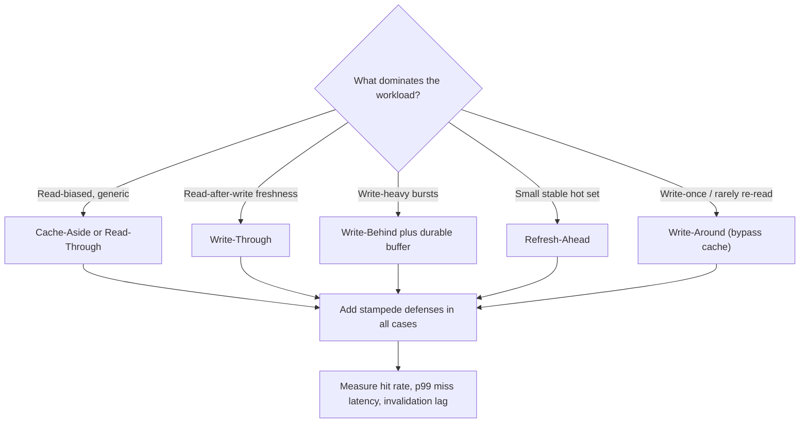
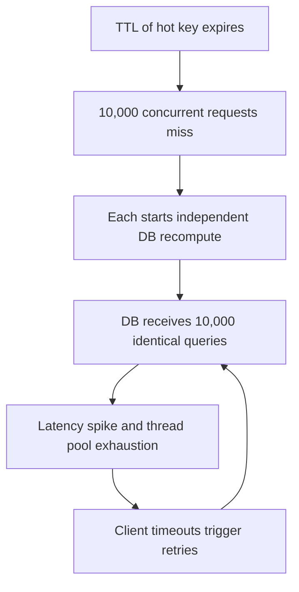
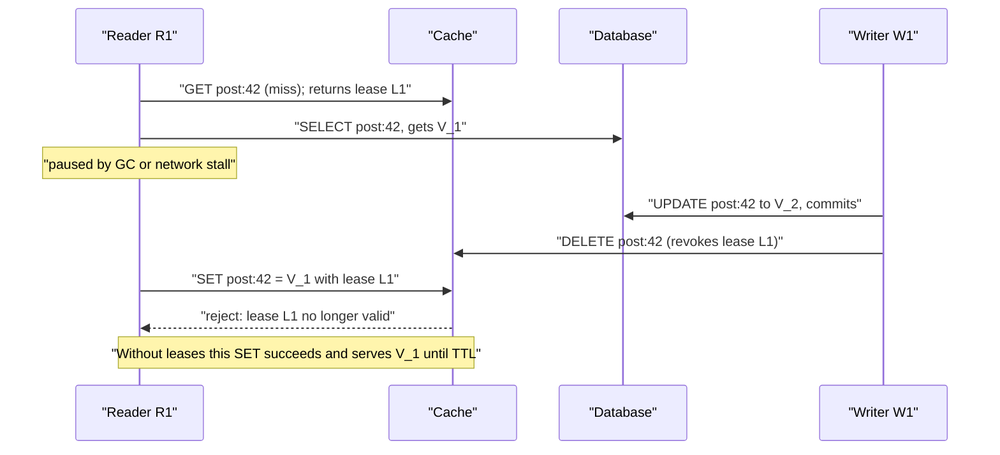
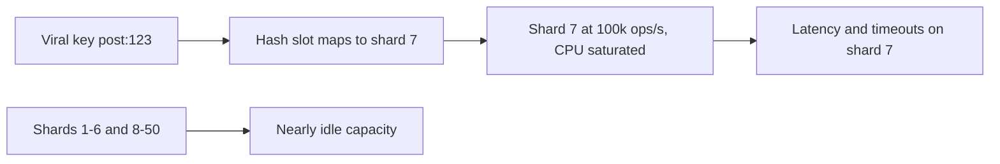
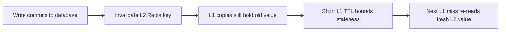

# Module 05 — Caching Strategies, Stampede Defense, and Invalidation

A cache is a deliberately stale, intentionally lossy copy of data placed closer to the consumer than the authoritative store. It trades correctness guarantees for latency and load: every cache hit avoids an expensive call to a database or service, but every cache copy is a new place for data to go wrong. This module treats caching as an engineering discipline rather than a library call: we classify the six topology patterns by read/write ratio, staleness tolerance, and failure blast radius; we analyze why textbook eviction policies fail under real Zipf-plus-scan traffic; we prove out the three production failure modes that turn a cache from a shield into an amplifier; and we close with negative caching and the Redis operational traps. The executable proofs for the hit-rate and single-flight claims live in `../examples/03-caching-and-hashing.test.ts`. Caching _theory_ — consistency models, dual-write hazards, invalidation semantics, and stampede analysis as abstract results — is owned by [`architecture/data-systems`](../../data-systems/README.md); this module contributes the composition, sizing, and failure-mode playbook. Eviction data structures and sketch math are owned by [`algorithms/dsa`](../../../algorithms/dsa/README.md).

---

## 1. Cache Topology Patterns

A topology is an answer to three questions: who populates the cache, who writes through it, and what happens on a miss. The six canonical patterns differ only in those answers, yet their operational profiles are radically different. We use the notation $R$ for the read rate and $W$ for the write rate, and we call the ratio $R:W$ the **access skew** of the workload.

### 1.1 Cache-Aside (Lazy Loading)

In **cache-aside**, the application treats the cache as a bypass structure it manages itself. On a read it checks the cache; on a miss it loads from the database and populates the cache; on a write it updates the database and then invalidates (deletes) the cache entry.

```text
read(key):
    value = cache.get(key)
    if value != MISS: return value
    value = db.select(key)              # authoritative read
    cache.set(key, value, ttl)          # populate on miss
    return value

write(key, new_value):
    db.update(key, new_value)           # source of truth first
    cache.delete(key)                   # invalidate, do not update in place
```

The delete-after-write ordering is deliberate: writing the cache first and the database second can leave the cache holding a value the database never accepted (a failed transaction). Deleting after commit makes the database the commit point. The residual hazard — a reader that loaded an old value and writes it back after the delete — is the stale-write race of §3.2, and it is the single most important reason cache-aside is not "done" when you write the code above.

Cache-aside is the default for general-purpose web applications because it is robust to cache loss: an empty cache degrades to database reads, never to data loss. Its cost is a two-round-trip miss path and a guaranteed cold-start stampede on restart.

### 1.2 Read-Through

In **read-through**, the application talks only to the cache layer, which owns the miss path and calls the backing store on its behalf. The loader logic lives inside the cache provider (or a caching library such as a `LoadingCache`), not in every service that reads.

```text
application: value = cache.get(key)
cache.get(key):
    if present: return value
    value = loader.load(key)            # cache owns this callback
    cache.set(key, value)
    return value
```

The benefit is centralization: one place to implement single-flight, TTL jitter, and metrics. The cost is that the cache library now has a dependency on your data layer, and a bug in the loader is a bug in every reader simultaneously. Read-through is cache-aside with the miss path factored out; it inherits every correctness hazard of §3.

### 1.3 Write-Through

In **write-through**, every write goes to the cache _and_ to the database synchronously, and the write is acknowledged only after both succeed. The cache is now a write path, not merely a read accelerator.

```text
write(key, value):
    cache.set(key, value)               # update cache first (or in txn)
    db.update(key, value)               # synchronous, wait for ACK
    return ACK
```

Write-through gives strong cache freshness: a subsequent read almost never misses or returns stale data. It pays for that with write latency equal to the slower of the two stores, and with **write amplification** — every write touches two systems even when the data is never read again. It suits workloads with high read-to-write ratios where the value is read shortly after being written (session state, configuration, feature flags). Write ordering matters: if the cache is updated and the DB write fails, you must roll the cache back or invalidate it.

### 1.4 Write-Behind (Write-Back)

In **write-behind**, a write lands in the cache and is acknowledged immediately; the cache asynchronously flushes accumulated changes to the database, often batched. This is the highest-throughput and highest-risk pattern.

```text
write(key, value):
    cache.set(key, value, dirty=true)   # ACK to client immediately
    enqueue_flush(key)

background flush loop:
    batch = drain_dirty_queue()         # coalesce repeated writes to same key
    db.batch_update(batch)              # fewer, larger DB writes
```

The throughput win comes from coalescing $k$ writes to the same key into one database update and from amortizing many small writes into sequential batches. The durability risk is existential: the acknowledged data lives only in volatile memory until flushed. A cache-node crash, a partition, or a full flush queue loses acknowledged writes (**RPO greater than zero**). Production write-behind demands a durable buffer (an append-only log or a replicated queue), an explicit flush-lag SLO, and backpressure that stops acknowledging when the buffer approaches capacity — otherwise a database slowdown turns into unbounded silent data loss. Consensus and durability theory for the buffer is owned by [`architecture/distributed-systems`](../../distributed-systems/README.md).

### 1.5 Refresh-Ahead

In **refresh-ahead**, the cache proactively refreshes entries _before_ they expire, using the observed access pattern. A background thread tracks which keys are hot and re-fetches them as their TTL approaches, so a hot key never incurs a synchronous miss.

```text
background refresher:
    for each key in hot_keys:
        if now >= expiry(key) - horizon:
            value = loader.load(key)    # async, off the request path
            cache.refresh(key, value, new_ttl)
```

Refresh-ahead converts predictable tail latency into steady background load. It is excellent for a small, stable hot set (top stories, leaderboards, exchange rates) and dangerous for a large or shifting key space, where it wastes database capacity refreshing values nobody reads. If the refresher falls behind, hot keys still expire and you get the stampede of §3.1 — refresh-ahead reduces probability, it does not eliminate the need for stampede defenses.

### 1.6 Write-Around (No-Write-Allocate)

In **write-around**, writes go directly to the authoritative backing store and bypass the cache entirely; the cache is populated only on a subsequent read miss (paired with cache-aside or read-through). In hardware and storage cache terminology this corresponds to a **no-write-allocate** policy.

```text
write(key, new_value):
    db.write(key, new_value)            # bypass cache allocation
    cache.delete(key)                   # mandatory if updating an existing key

read(key):
    value = cache.get(key)
    if value != MISS: return value
    value = db.select(key)              # load only if actually read
    cache.set(key, value, ttl)
    return value
```

Write-around prevents **write-induced cache pollution**: when an application ingests large payloads, audit logs, historical archives, or write-once user uploads that are rarely read back soon, write-through would evict genuinely hot read keys to store cold writes. The trade-off is a cold cache miss (higher p99 latency) on the first read after a write—and when mutating an existing key rather than inserting an append-only key, failing to invalidate (`cache.delete(key)`) leaves the cache serving the prior value until TTL expiry.

### 1.7 Decision Matrix

| Pattern | Typical access skew | Staleness window | Failure blast radius | Choose when |
| --- | --- | --- | --- | --- |
| Cache-Aside | Any, strongly read-biased | Until first write invalidates or TTL | Cache loss increases DB load, never loses data | General web apps; default choice |
| Read-Through | Read-biased | Same as cache-aside | Loader bug affects all readers at once | You want one centralized miss path |
| Write-Through | Moderate writes, read-after-write common | Near zero | DB write failure can desync cache | Freshness matters, write rate modest |
| Write-Behind (Write-Back) | Write-heavy, bursty | Flush lag (seconds) | Cache crash loses acknowledged writes | Throughput critical, loss tolerable or buffered |
| Refresh-Ahead | Stable hot set, very read-biased | Refresh horizon | Refresh storm wastes DB capacity | Predictable hot keys, strict tail latency |
| Write-Around | Write-once or seldom re-read writes | Cold miss on first read; stale if update skips delete | Cache untouched on write; read path degrades to DB on miss | Large payloads, logs, append-heavy ingestion avoiding pollution |



The diagram forces the important conclusion: **every** topology ends at the same node. Stampede defense and measurement are not optional add-ons to a particular pattern; they are table stakes for all of them.

#### Complete 11-Strategy Caching Reference

Caching designs combine a **read/write topology**, an **eviction policy** (§2), an **expiry/invalidation mechanism** (§3.2), and a **concurrency defense** (§3.1). The table below summarizes all eleven strategies side by side.

| # | Strategy | Category | Core Mechanism | Primary Failure Mode / Trade-off | Where Covered |
| :-: | :-- | :-- | :-- | :-- | :-- |
| 1 | **Cache-Aside** | Read/Write Topology | App reads cache, loads DB on miss, deletes cache after DB write | Stale-write race without lease tokens (§3.2) | [§1.1](#11-cache-aside-lazy-loading) |
| 2 | **Read-Through** | Read/Write Topology | Cache library/proxy owns miss callback to backing store | Loader bug impacts all readers; still needs coalescing | [§1.2](#12-read-through) |
| 3 | **Refresh-Ahead** | Read/Write Topology | Async refresher reloads hot keys before TTL expiry | Wastes DB capacity if hot set shifts unpredictably | [§1.5](#15-refresh-ahead) |
| 4 | **Write-Through** | Read/Write Topology | App writes cache and DB synchronously before ACK | Write amplification + higher write latency | [§1.3](#13-write-through) |
| 5 | **Write-Back (Write-Behind)** | Read/Write Topology | App ACKs cache write immediately; async batch flushes to DB | Volatile buffer crash causes RPO > 0 data loss | [§1.4](#14-write-behind-write-back) |
| 6 | **Write-Around** | Read/Write Topology | Writes go directly to DB bypassing cache; reads fill on miss | First read after write misses; updates still need delete | [§1.6](#16-write-around-no-write-allocate) |
| 7 | **LRU** | Eviction Policy | Evicts least recently touched entry (`O(1)` hash + doubly linked list) | Catastrophic cache pollution on one-hit sequential scans | [§2.1](#21-why-pure-lru-suffers-catastrophic-cache-pollution) |
| 8 | **LFU** | Eviction Policy | Evicts entry with lowest access count | Frequency aging ("stale ghosts") starves rising keys | [§2.2](#22-why-pure-lfu-suffers-frequency-aging-stale-ghosts) |
| 9 | **TTL Expiry** | Expiration Control | Time-to-live bounds max staleness; add random jitter $[\tau, \tau(1+j)]$ | Synchronized fixed TTLs trigger batch expiry stampedes | [§3.1](#31-cache-stampede--thundering-herd) |
| 10 | **Event Invalidation** | Invalidation Mechanism | Debezium/WAL CDC or outbox events evict/update keys on commit | Replication lag, duplicate delivery, and per-key ordering | [§3.2](#32-cache-aside-stale-write-race-condition) |
| 11 | **Request Coalescing** | Stampede Defense | Single-flight deduplicates concurrent misses per key into 1 DB fetch | One slow DB call stalls all waiters; add per-caller timeouts | [§3.1](#31-cache-stampede--thundering-herd) |

### 1.8 Where a Cache Sits on the Consistency Spectrum

A cache is a materialized read replica with no durability and no ordering guarantee, so it cannot, by itself, provide linearizability. The strongest practical guarantee most caches offer is "eventually consistent within the TTL and invalidation lag window". Whether that is acceptable is a product decision, not a library feature: a banking balance cannot tolerate a five-second stale read, while a "trending topics" list can. The formal consistency hierarchy and linearizability checking are owned by [`architecture/distributed-systems`](../../distributed-systems/README.md); the system-design task is to map each data class to an allowed staleness budget and then choose a topology whose worst-case staleness fits that budget.

| Data class | Acceptable staleness | Viable topology | Reason |
| --- | --- | --- | --- |
| Session and feature flags | Near zero | Write-through | Read-after-write is expected immediately |
| Profile and product metadata | Seconds | Cache-aside plus invalidation | Reads dominate, writes are rare |
| Feed and counters | Seconds to minutes | Cache-aside plus buffered writes | Approximate freshness is tolerable |
| Ledger and inventory | Zero | No read cache, or primary-routed reads | Stale reads cause incorrect decisions |

A useful discipline is to express staleness as an SLO — for example, "99.9% of reads reflect a write within 2 seconds" — and to measure the _invalidation lag_ distribution rather than arguing qualitatively about consistency. The same SLO framing applies to read replicas in Module 06 §1.

---

## 2. Eviction Policies in Production

When a cache is full, an admission/eviction policy decides which keys stay. The textbook policies are evaluated on synthetic traces that assume locality; production traffic is a mixture of a Zipf-distributed hot set and bursts of one-hit scans. That mixture breaks the classics. The implementations are owned by [`algorithms/dsa`](../../../algorithms/dsa/README.md); here we study only their failure modes and the modern compromise. The proofs are reproduced in `../examples/03-caching-and-hashing.test.ts`.

### 2.1 Why Pure LRU Suffers Catastrophic Cache Pollution

**LRU** (Least Recently Used) evicts the entry touched longest ago. Its implicit assumption is temporal locality: a recently used item is likely to be used again. A one-hit sequential scan violates that assumption perfectly: a background job streams a million keys, each read once and never again. Every scanned key is "recently used" at the instant it arrives, so LRU admits all of them and evicts the genuine hot set. Hit rate collapses toward zero for the duration of the scan and for a warm-up period afterward — the cache is said to be **polluted**.

Formally, if the hot set is $H$ keys and a scan of $S \gg H$ one-hit keys arrives, a pure LRU cache of capacity $C \approx H$ will, after the scan, contain almost entirely scan keys. The recovery time is proportional to the scan length because the hot keys must be re-admitted through normal misses. This is not a theoretical corner case: nightly ETL jobs, backups, `SELECT *` dumps, log replays, and a single Redis `KEYS *` scan all produce this shape.

### 2.2 Why Pure LFU Suffers Frequency Aging ("Stale Ghosts")

**LFU** (Least Frequently Used) evicts the entry with the lowest access count. It resists one-hit scans because a scanned key has frequency 1 and is evicted immediately. Its failure is the mirror image: **frequency aging**. A key that was wildly popular last week accumulates a huge counter and stays resident forever even though nobody reads it now — a "stale ghost" occupying prime capacity. Meanwhile a genuinely rising new key starts at frequency 1 and is evicted before it can prove itself. Pure LFU therefore cannot adapt to shifting popularity; it is frozen in the past. Aging schemes that periodically halve all counters help but introduce a tuning parameter that is wrong in every changing workload.

### 2.3 W-TinyLFU: Admission Filter plus Segmented LRU

**W-TinyLFU** (Window TinyLFU, Einziger et al.) combines the strengths of both policies with a small, fixed memory budget. It has two conceptual parts.

First, an **admission filter** implemented as a **Count-Min Sketch** with ~4-bit counters estimates the frequency of every key seen recently. A new candidate is admitted only if its estimated frequency exceeds that of the victim the policy would evict. Because the sketch uses logarithmic counters and a periodic "reset by halving" (or a sliding window of two sketches), it tracks frequency with constant memory per entry and naturally ages out stale ghosts. The Count-Min math — width, depth, and the overestimation bound — is owned by [`algorithms/dsa`](../../../algorithms/dsa/README.md).

Second, the cache proper is a **Segmented LRU**: a small **window** segment (about 1% of capacity) holds newly admitted items so they get a second chance, and a **protected** segment holds proven repeated hits. An item promoted out of the window into the protected segment is safe from a single scan; the window absorbs the scan churn. The admission filter compares the candidate against the window victim, so a one-hit scan key (frequency ~1) loses to almost any established key.

The result is a policy that is simultaneously scan-resistant (one-hit keys are rejected at the door) and adaptive (frequency ages, so ghosts are eventually evicted and new hot keys are admitted). Under a Zipf workload with interleaved scans, W-TinyLFU closely approaches the theoretical optimum while using roughly 8–12 bits of metadata per entry.

```text
on_get(key):
    if key in cache: record_frequency(key), return HIT
    return MISS

on_admit(candidate):
    if frequency(candidate) > frequency(victim):
        insert into window segment
    else:
        reject candidate                 # scan traffic dies here
    if window segment full:
        promote survivors to protected, evict LRU of protected
```



_Step-by-step mechanics:_ (1) W-TinyLFU routes arrivals through a 1% Window LRU and compares evicted candidates against Main SLRU victims using a 4-bit Count-Min Sketch with periodic halving, rejecting one-hit ETL scan keys (`f = 1`) at the door while admitting genuine hot keys (`f = 42`). (2) To prevent thundering-herd cache stampedes at hard TTL expiration (see [§3.1](#31-cache-stampede--thundering-herd)), XFetch evaluates `now - delta * beta * ln(rand()) >= expiry` so one reader probabilistically refreshes before `T_exp` while all concurrent readers continue hitting the warm cache.

### 2.4 Policy Selection in Practice

| Policy | Scans | Shifting popularity | Metadata cost | Production verdict |
| --- | --- | --- | --- | --- |
| FIFO | Poor | Poor | None | Only as a baseline |
| LRU | Catastrophic | Good | One timestamp | Default only without scans |
| LFU | Good | Poor (stale ghosts) | Full counter | Avoid in pure form |
| LRU-K / 2Q | Good | Good | Extra queue | Reasonable middle ground |
| W-TinyLFU | Excellent | Excellent | Sketch bits per entry | Preferred for mixed traffic |

---

## 3. Three Major Caching Production Failure Modes and Proofs

A cache does not merely fail to help; under the right conditions it becomes a load amplifier that can take down the very store it was meant to protect. We study the three failure modes that account for most cache-related incidents (stampedes, stale-write races, and hot-key saturation, alongside scan-induced eviction thrashing). Stampede mitigations (single-flight coalescing and XFetch), the cache-aside stale-write race vs. Memcache leases, and W-TinyLFU scan resistance each have a deterministic reproduction in `../examples/03-caching-and-hashing.test.ts` using explicit interleavings and seeded PRNGs, so the behavior is proved rather than asserted.

### 3.1 Cache Stampede / Thundering Herd

**Failure statement.** A popular key expires at time $T$. At the same instant, 10,000 concurrent requests miss the cache and each independently starts the expensive recomputation (a 200 ms database query). The database receives 10,000 queries for one logical value, latency explodes, threads pile up, and the resulting timeouts trigger retries that sustain the overload — a metastable failure whose theory is owned by [`architecture/distributed-systems`](../../distributed-systems/README.md). The cache, intended as a shield, delivered a synchronized denial of service.



There are four complementary mitigations, and production systems usually layer several.

**Mitigation 1 — TTL Jitter.** Instead of a fixed TTL $\tau$, assign each entry a randomized TTL drawn from $[\tau, \tau(1+j)]$ with jitter factor $j$ (commonly 0.1–0.2). Expirations spread over a window, so instead of 10,000 simultaneous misses you get a trickle. Jitter is nearly free but only reduces the _probability_ of a herd; it does not bound the damage when the trickle still overlaps, and it must be applied to refresh cycles and cron schedules too.

**Mitigation 2 — Single-Flight / Request Coalescing.** On a miss, a request acquires a per-key in-flight promise (or lock). The first requester performs the database call; every concurrent requester for the same key awaits the same promise. When the result arrives, all 1,000 waiters receive it and only one database call was made. The proof collapses 1,000 concurrent misses to exactly 1 DB call.

```text
in_flight: Map<Key, Promise<Value>>

load(key):
    if in_flight.has(key): return in_flight.get(key)
    promise = recompute_from_db(key)         # exactly one
    in_flight.set(key, promise)
    finally: promise.finally(() => in_flight.delete(key))
    return promise
```

The subtlety is the **deletion timing**: the in-flight entry must be removed after the cache has been populated and the promise resolved, otherwise a burst arriving after recomputation but before `SET` will await a stale promise. In a multi-process deployment, single-flight must be per-process; a distributed lock (owned by [`architecture/distributed-systems`](../../distributed-systems/README.md)) is far heavier and reintroduces the herd at lock expiry, so local coalescing is preferred and combined with jitter.

**Mitigation 3 — Probabilistic Early Expiration (XFetch).** Rather than waiting for hard expiry, each reader independently decides to refresh early with a probability that grows as the TTL approaches. XFetch (Vattani, Chierichetti, and Lowenstein, 2015) computes an effective time with a random offset:

```text
if now - delta * beta * Math.log(rand()) >= expiry:
    recompute(key)                          # rand() in (0, 1]
```

Here $\delta$ is the known recomputation time and $\beta$ is a tuning constant (the paper analyzes $\beta = 1$). Because $\ln(U) \le 0$ for $U \in (0,1]$, the term $-\delta\beta\ln U$ is non-negative, so the condition becomes true _before_ the nominal expiry with probability $e^{-(T_{\text{exp}}-t)/(\delta\beta)}$ at time $t$. Since each reader draws a fresh random number, exactly one reader typically crosses the threshold first and refreshes; the others keep reading the still-valid value. Compared with TTL jitter, XFetch removes the synchronized cliff entirely and needs no coordination — it is a beautiful example of randomization as a load-shedding primitive.

**Mitigation 4 — Stale-While-Revalidate.** Serve the stale value immediately to the request that finds it expired, and trigger one asynchronous refresh in the background. Readers never wait for recomputation, so tail latency stays flat, and only one refresh runs. The cost is a bounded staleness window equal to the refresh duration. This is the strategy encoded in HTTP caching's `stale-while-revalidate` directive (RFC 9111, owned by [`architecture/networking`](../../networking/README.md)) and is ideal when slightly stale data is acceptable but latency spikes are not.

### 3.2 Cache-Aside Stale-Write Race Condition

**Failure statement.** Consider two actors and a cache-aside reader. The timeline is:



Step by step: R1 misses the cache and reads the old value $V_1$ from the database. It is then paused by a GC pause or network stall. While paused, writer W1 commits $V_2$ to the database and deletes the cache key (correct delete-after-write behavior). R1 wakes up and writes $V_1$ into the cache. The cache now holds a value that no longer exists in the database, and it will keep serving that stale value until the TTL expires. The window can be seconds long — an eternity at scale — and there is no database inconsistency to detect, because the database is correct. Only the cache is wrong.

Naive fixes are inadequate. Updating the cache instead of deleting it on write does not help: R1 still writes the old value last. Shortening the TTL reduces the window but increases database load. What is needed is a way to distinguish a legitimate fill from a stale fill.

**Solution — Facebook Memcache Leases.** The mechanism deployed in Facebook's Memcache architecture (NSDI 2013, "Scaling Memcache at Facebook") attaches a **64-bit lease token** to each miss. When a client misses, the cache returns a fresh token alongside the miss. A client may only `SET` a value if it presents the token that is still current for that key. When any writer invalidates the key, the token is revoked (the token is tied to the key's version). R1's late `SET` arrives with the old token $L_1$, which no longer matches, and is rejected. The stale write cannot enter the cache at all. This is a concrete application of the lease/fencing-token theory owned by [`architecture/distributed-systems`](../../distributed-systems/README.md): a fencing token is a monotonically increasing value that lets the resource reject stale writers. Leases also double as single-flight: only the client holding the lease for a key is allowed to fill it, so the other missers wait or re-read.

**Delete-after-write vs CDC-driven invalidation.** Deleting in the application process (delete-after-write) is simple but fragile: the application must remember to delete on every write path, including admin tools, backfills, and other services. A missed delete produces stale data with no alarm. **CDC-driven invalidation** moves the responsibility into the data stream: Debezium tails the database's change log (MySQL binlog or Postgres WAL), publishes change events to Kafka, and a consumer deletes or updates the corresponding Redis keys. Because every committed change appears in the log, invalidation becomes exhaustive by construction and works across languages and services. The trade-off is new failure modes: replication lag between commit and invalidation, at-least-once delivery producing duplicate deletes (harmless for deletes, dangerous for updates), and ordering hazards when two changes to the same key arrive out of order. CDC mechanics are owned by [`architecture/data-systems`](../../data-systems/README.md); the system-design concern is to make the invalidation consumer idempotent and to monitor end-to-end **invalidation lag** as a first-class SLI.

| Approach | Stale-write protection | Coverage of write paths | Main risk |
| --- | --- | --- | --- |
| Delete-after-write | None against the race | Only paths that call delete | Missed deletes, stale $V_1$ fills |
| Delete-after-write plus leases | Strong (token revocation) | Only paths that use leases | Token bookkeeping, multi-language support |
| CDC-driven invalidation | Depends on ordering | All committed changes | Replication lag and out-of-order events |

### 3.3 Hot Key / Celebrity Key Saturation

**Failure statement.** A viral post or flash-sale SKU drives 100,000 operations per second to one key. Consistent hashing maps that key to a single Redis shard, and that shard is saturated while 49 other shards sit idle. Adding more shards does nothing because the key's hash never moves. The cache is not the bottleneck — the _mapping_ is.



Four mitigations apply, at increasing cost.

**In-process L1 micro-cache.** A tiny, short-TTL (1–5 s) local cache in each application process absorbs the vast majority of reads before they ever reach Redis. Because the value is replicated in every process, the per-process hit rate for a single hot key is near 100% after the first fill. The 1–5 s TTL bounds staleness and re-fills naturally. This is the cheapest and often sufficient fix; the residual miss rate is one fill per process per TTL interval.

**Key salting / splitting.** Replicate the hot value under $S$ derived keys, for example `post:123#0` through `post:123#15`. Reads pick a salt uniformly at random (for example by `hash(requestId) % S`), spreading operations across $S$ shards. Writes must update all $S$ copies (a scatter), which is acceptable for a rarely written but very frequently read celebrity key. The read path changes from one key to one of $S$ keys, so this must be designed in, not bolted on.

**Read replicas.** Redis read replicas allow reads to fan out across a replica set while writes go to the primary. This multiplies read capacity without changing the key or the client. The cost is eventual consistency between primary and replicas (bounded by replication lag), so it suits values where sub-second staleness is acceptable.

**Request coalescing.** Per-process single-flight (§3.1) collapses concurrent misses on the hot key into one fill. If the key is always cached, coalescing does little; its value appears when the L1 cache and the Redis entry expire simultaneously or during a cold start.

A crucial operational point: a hot key can also be a **write** hot spot (a single counter, a single inventory row). That is a different problem, treated in Module 06 §3 under high-throughput counters.

### 3.4 Multi-Level Cache Coherence

Large services run a two-level hierarchy: a per-process **L1** (heap, microseconds, small, short TTL) and a shared **L2** Redis cluster (network, sub-millisecond, large, longer TTL). L1 defeats the hot-key problem of §3.3; L2 provides the high hit rate and shared capacity. The danger is coherence between the levels: when a writer invalidates L2, every process may still hold a stale L1 copy.



The only robust fix without a broadcast invalidation bus is to bound L1 staleness with a short TTL (1–5 s), so the maximum incoherence window equals that TTL. A fan-out invalidate over a message bus can shorten it but adds a new failure mode: a lost invalidate message leaves a stale L1 entry for the full TTL anyway. This is the same eventual-consistency-with-a-bounded-lag pattern as read replicas (Module 06 §1). Setting the L1 TTL is therefore a direct trade between the hot-key protection you gain and the staleness you tolerate.

### 3.5 Worked Stampede Math

Assume a hot key served at $\lambda = 10{,}000$ requests/s, a recomputation cost of $\delta = 200$ ms, and a fixed TTL with no defense. At expiry, all in-flight requests observe a miss within one network round trip; the database sees a burst of roughly 10,000 queries, each consuming one worker for 200 ms. With a 100-worker pool, the queue depth reaches 100 and the last request waits about 20 seconds — far beyond any timeout — so clients retry and sustain the overload. Single-flight collapses the burst to exactly one recomputation, so the database sees 1 query instead of 10,000, a reduction of four orders of magnitude. TTL jitter with factor $j = 0.2$ spreads the same 10,000 expirations over a 20% window, reducing the instantaneous burst by a factor of roughly five. The combination of jitter and single-flight is what makes the system safe even when the jitter window still permits overlapping misses.

```text
without defense: 10,000 DB calls, ~20 s queue wait, retry storm
jitter only:     ~2,000 DB calls per spike window, still bursty
single-flight:   1 DB call per miss wave, bounded latency
jitter + flight: 1 DB call per wave, waves themselves rare
```

---

## 4. Negative Caching, Penetration Attacks, and Redis Operational Traps

### 4.1 Negative Caching and Bloom Filters

A **cache-penetration attack** requests many keys that do not exist. Every request misses the cache and queries the database, which finds nothing — there is no value to cache, so the attack is never absorbed. **Negative caching** fixes this by caching a sentinel such as `NOT_FOUND` with a short TTL (typically 10–60 s). The sentinel is a real cache entry, so subsequent requests for the absent key are answered without touching the database. The short TTL bounds the window in which a legitimately created key would be incorrectly reported absent.

Negative caching can itself be abused to fill the cache with millions of distinct bogus keys (cache pollution of the LRU kind from §2.1). Pairing it with a **Bloom filter** of all valid keys rejects non-existent keys before the cache is consulted: if the Bloom filter says "definitely not present", return `NOT_FOUND` immediately with no cache or database access. The Bloom filter's false-positive rate means a few bogus keys leak through to the negative cache, which is exactly the bounded residue the short TTL is designed for. The probabilistic math is owned by [`algorithms/dsa`](../../../algorithms/dsa/README.md).

### 4.2 Redis Operational Traps

Redis executes commands on a single thread per node, so any single slow command blocks every other client. This is a realisation issue owned by [`technologies/redis`](../../../technologies/redis/README.md); the system-design consequence is that a careless cache operation can become a fleet-wide latency incident.

- **`KEYS *` is O(N) over the entire keyspace.** It blocks the event loop while scanning every key. Use `SCAN` with a cursor to iterate incrementally, and never issue `KEYS` in a request path or against a production instance.
- **Giant `DEL` of a large collection is O(N) and synchronous.** Deleting a million-element set blocks the server for the duration. Use `UNLINK`, which unlinks the keys immediately and reclaims memory in a background thread, or `SCAN` plus batched deletions.
- **Big-key serialization stalls.** A multi-megabyte value is serialized on write and deserialized on every read; a few such keys dominate CPU and network. Keep values small, compress deliberately, and consider splitting large objects.
- **Long Lua scripts** block the loop for their entire execution. Keep scripts short and bounded; see the atomicity trade-offs in the Redis track.
- **Hot keys** (§3.3) and **large fan-out `MGET`/`MSET`** consume disproportionate CPU and bandwidth on one shard.

The design rule is simple: cache operations that are cheap for ten keys must still be cheap for ten million keys. Amortize with `SCAN`/`UNLINK`, bound value sizes, and treat Redis single-threadedness as a hard constraint on every cache access pattern.

### 4.3 Observability: Cache SLIs

A cache can fail silently — a drop in hit rate looks like extra database load, not like an error — so it needs explicit signals. The metrics below are the minimum dashboard for any production cache. The general metric, histogram, and alerting discipline is owned by [`technologies/observability`](../../../technologies/observability/README.md); the SLO math itself stays in this track's Module 11.

| Signal | Definition | Why it matters |
| --- | --- | --- |
| Hit ratio | Hits divided by total lookups, per cache and per key class | Detects pollution, cold starts, and key churn |
| Miss latency p99 | Time from miss to populated cache, as a histogram | Detects recomputation slowdown and stampede |
| Invalidation lag | Time from DB commit to cache invalidation | Quantifies the staleness SLO |
| Eviction rate | Entries evicted per second, split by policy reason | High eviction with low hit rate means undersized or polluted |
| Coalescing ratio | Misses divided by actual recomputations | Should be near 1 under single-flight; if not, the lock is wrong |
| Redis blocked clients | Clients waiting on the single-threaded event loop | Detects `KEYS`, giant `DEL`, and big-key stalls |

A subtle trap: averaging per-node hit ratios hides a single saturated shard in a hot-key incident, just as averaging per-host p99s is meaningless. Aggregate counters and histograms across the fleet, then divide, and always break out the top keys by request count.

---

## 5. Then vs Now

| Concern | Earlier practice | Current practice |
| --- | --- | --- |
| Stampede | Fixed TTL, hope for the best | TTL jitter plus single-flight plus XFetch or stale-while-revalidate |
| Eviction | Plain LRU in most libraries | W-TinyLFU or TinyLFU admission filters in modern caches |
| Invalidation | Application-managed delete only | CDC-driven invalidation plus leases for the race |
| Hot keys | Add more shards | L1 micro-cache plus key salting; shards cannot help a single key |
| Bulk delete | `DEL` and `KEYS *` | `UNLINK` and `SCAN` |

---

## 6. Production Design Checklist

Before a caching layer ships, the following questions must have explicit answers. Each one maps to a failure mode proved earlier in this module.

- **Staleness budget**: What is the maximum acceptable age of a cached value for each data class, and is it expressed as a measurable SLO?
- **Topology choice**: Who fills the cache, and who invalidates it on every write path, including backfills and admin tools?
- **Miss-path bound**: What is the worst-case database load at expiry, and is single-flight or equivalent coalescing in place?
- **Expiry distribution**: Is TTL jitter applied to values, refreshes, and cron schedules, or can expirations align?
- **Eviction behavior**: What happens to the hit rate when a one-hit scan of ten million keys passes through?
- **Stale-write protection**: Does the fill path use a lease, a version check, or CDC ordering to reject a late stale `SET`?
- **Hot-key plan**: Is there an L1 layer or a key-salting scheme for a single key that exceeds one shard's capacity?
- **Negative caching**: Are absent keys cached with a short TTL, and is a Bloom filter placed in front to stop penetration?
- **Redis safety**: Are `KEYS *` and large synchronous `DEL` calls banned, with `SCAN` and `UNLINK` used instead?
- **Value sizes**: Is there a hard cap on serialized value size, with compression or splitting for outliers?
- **Observability**: Are hit ratio, miss p99, invalidation lag, and coalescing ratio on a dashboard and alertable?
- **Failure posture**: When the cache is entirely unavailable, does the system degrade to database reads rather than fail?

The last item is the defining property of a well-designed cache: it must be a performance optimization whose removal leaves a slower but still correct system, never a hidden dependency whose loss is an outage.

---

## Interview Drill

**Q1. A popular product page's cache TTL expires and the database is hit with 10,000 identical queries. Walk through the four mitigations and explain which you would ship first.**

<details><summary>Model Answer</summary>

Ship per-process single-flight/request coalescing first: it bounds a 10,000-miss burst to one recomputation regardless of luck, and it is local and cheap. Add TTL jitter so expirations do not align in the first place. For tail-latency-sensitive pages, add stale-while-revalidate so no reader ever waits for the refresh. XFetch is the most elegant statistical fix (each reader refreshes early with growing probability using `now - delta * beta * Math.log(rand()) >= expiry`) but requires knowing the recomputation time $\delta$ and careful tuning. In practice I layer jitter plus single-flight plus stale-while-revalidate.
</details>

**Q2. Explain the cache-aside stale-write race with a concrete timeline, and why Facebook's lease tokens solve it.**

<details><summary>Model Answer</summary>

R1 misses, reads $V_1$ from the DB, pauses. W1 commits $V_2$ and deletes the cache key. R1 wakes and writes $V_1$ into the cache, which is now stale until TTL. Leases attach a 64-bit token to each miss; a `SET` is accepted only if its token is still current. W1's invalidation revokes R1's token $L_1$, so R1's late `SET` is rejected. This is the fencing-token pattern: the cache can distinguish a legitimate fill from a stale one and reject the stale writer.
</details>

**Q3. Why does pure LRU collapse under a one-hit scan while pure LFU keeps stale ghosts, and how does W-TinyLFU fix both?**

<details><summary>Model Answer</summary>

LRU admits every scanned key as "recently used", evicting the real hot set; hit rate collapses until warm-up. LFU rejects one-hit scans but accumulates huge counters for formerly hot keys that never age out, and new keys start at frequency 1 and are evicted. W-TinyLFU uses a Count-Min Sketch admission filter so a scan key's frequency ~1 loses to established keys, and ages the counters by periodic halving so ghosts fade. A small window LRU segment gives new items a second chance before promotion to a protected segment, combining scan resistance with adaptability.
</details>

**Q4. One viral key saturates a single Redis shard at 100k ops/s while 49 shards are idle. What do you do, in order?**

<details><summary>Model Answer</summary>

First, add an in-process L1 micro-cache with a 1–5 s TTL in every app process, which absorbs nearly all reads for a single hot key. Second, if the value is read-dominant and rarely written, split the key into $S$ salts (`post:123#0..#15`) and have reads pick a salt, spreading load across shards; writes scatter to all copies. Third, use read replicas to fan reads out. Fourth, coalesce concurrent misses. Adding more shards alone does nothing because the key's hash never moves.
</details>

**Q5. Compare delete-after-write and CDC-driven invalidation. Which failure does each leave behind?**

<details><summary>Model Answer</summary>

Delete-after-write is simple but only covers write paths that remember to delete; missed deletes and the stale-write race leave stale data. CDC (Debezium tailing the WAL/binlog into Kafka) covers every committed change automatically and works across services, but introduces invalidation lag, at-least-once duplicate events, and out-of-order updates to the same key. With leases plus CDC you address the race and coverage; you must still make the consumer idempotent and monitor invalidation lag.
</details>

**Q6. What is XFetch, and why is the random term subtracted rather than added?**

<details><summary>Model Answer</summary>

XFetch is probabilistic early expiration: recompute when `now - delta * beta * Math.log(rand()) >= expiry`. Since `rand()` is in `(0,1]`, its log is non-positive, so subtracting it adds a non-negative random offset to "now", making the condition true before the nominal expiry with probability that grows as expiry approaches. Each reader draws independently, so one reader typically refreshes first while others keep reading the valid value. Adding the term would push the trigger after expiry, which is the wrong direction.
</details>

**Q7. How would negative caching plus a Bloom filter defend against a cache-penetration attack, and what are the residual risks?**

<details><summary>Model Answer</summary>

Cache absent keys as a `NOT_FOUND` sentinel with a short TTL so repeated requests for the same missing key never reach the DB. A Bloom filter of valid keys rejects bogus keys before the cache, stopping cache pollution from millions of distinct misses. Residual risks: Bloom false positives let a few bogus keys through (absorbed by negative caching), a legitimately created key is reported absent until the short TTL expires, and an attacker who floods distinct keys can still stress the Bloom filter and negative cache memory.
</details>

**Q8. A cache layer must never lose acknowledged data, but the team wants write-behind throughput. How do you reconcile this?**

<details><summary>Model Answer</summary>

Plain write-behind acknowledges before the DB write, so a cache crash loses acked writes (RPO greater than zero) — unacceptable here. Reconcile by making the buffer durable: append the write to a replicated log or durable queue before acknowledging, then flush to the DB asynchronously in batches. This keeps the coalescing throughput win while moving the durability guarantee to the log, whose consensus/replication semantics are owned by the distributed-systems and data-systems tracks. Add flush-lag SLOs and backpressure that stops acknowledging as the buffer fills.
</details>
