# Module 06 — Scaling Reads, Scaling Writes, and Partitioning

Vertical scaling eventually runs out: a single database instance has finite CPU, memory, IOPS, and connection slots. The three levers for going beyond it are replicating reads, partitioning data across independent shards, and reshaping the write path so it does not serialize on a single row or synchronous dependency. This module covers **read replicas and read-your-writes routing** under asynchronous replication lag; **sharding and consistent hashing in practice**, including why `hash(key) % N` causes a remapping storm and why virtual nodes are mandatory; and **write scaling** through denormalization, CQRS, batching, buffering, and high-throughput counters. The executable proofs for the hashing and caching-adjacent claims live in `../examples/03-caching-and-hashing.test.ts`. Replication mechanics and sharding internals are owned by [`architecture/data-systems`](../../data-systems/README.md); algorithm proofs for hashing, sketches, and data structures are owned by [`algorithms/dsa`](../../../algorithms/dsa/README.md); consistency models and clock/lease theory are owned by [`architecture/distributed-systems`](../../distributed-systems/README.md); Redis operations such as `INCR` are owned by [`technologies/redis`](../../../technologies/redis/README.md).

---

## 1. Scaling Reads

### 1.1 Read Replicas and Connection Routing

The first scaling move is to add **read replicas**: asynchronous copies of the primary database that serve `SELECT` traffic while all writes continue to go to the primary. Because most web workloads are read-dominated (often 90:1 or higher), offloading reads multiplies effective capacity without changing the schema.

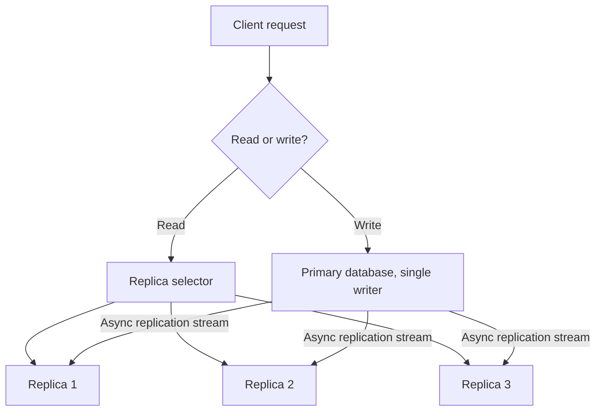

Routing is implemented either in the application (a datasource that picks a connection) or in an intermediary such as a proxy or service mesh. The selector must do more than round-robin: it should be **lag-aware**, excluding replicas whose replication delay exceeds a threshold, and it should respect **session affinity** when the application requires read-your-writes. Connection pooling matters as much as routing: without pooling, each replica's `max_connections` becomes a hard ceiling that is easy to exceed during a traffic spike.

The fundamental complication is that replication is asynchronous. The primary acknowledges a write as soon as it is locally durable; the replicas receive it later. Between those two moments the system is in a window where the primary knows about the write and the replicas do not.

### 1.2 Read-Your-Writes Under Replication Lag

**Read-Your-Writes (RYW)** is the guarantee that a client which performed a write will observe that write (or a later one) on its subsequent reads. With a single primary serving both, RYW is trivial. With asynchronous replicas it is not: a client writes, then reads from a replica that has not yet caught up, and sees the old value. The client perceives this as a bug — "I saved my profile change and it reverted" — even though the system is behaving exactly as configured.

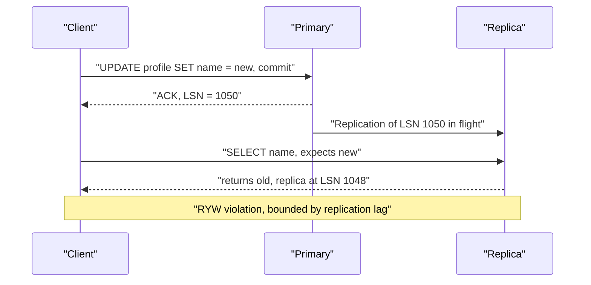

The violation window is the replication lag $\Delta$, typically milliseconds but spikes to seconds during backups, network hiccups, or large transactions. Four mechanisms address it, each with a different cost.

**Mechanism 1 — LSN or GTID watermarks.** Every committed transaction has a log sequence number (Postgres LSN, MySQL GTID). The primary returns the commit LSN to the client alongside the write response. For subsequent reads, the client passes that LSN as a minimum: the router either waits until the chosen replica's applied LSN reaches the watermark (bounded wait, then fall back to primary), or it routes directly to a replica known to be caught up. This gives precise RYW without a time-based heuristic, but it requires threading the watermark through every layer and a replica that can report its applied position.

```text
write_response = { value, commit_lsn }
read(key, min_lsn):
    replica = select_replica_with_applied_lsn_at_least(min_lsn)
    if replica is none:
        wait_until_caught_up(min_lsn, timeout = T)
        if still behind: route_to_primary()
    return replica.read(key)
```

**Mechanism 2 — Primary routing for $T$ seconds.** The simplest and most common fix: after any write, route that user's reads to the primary for a fixed window $T$ (say 5 seconds) chosen to exceed the normal replication lag. A cookie or a server-side flag marks the session as "recently wrote". This is easy to implement and works well in practice, but it is a heuristic: if lag exceeds $T$, RYW still breaks, and every recent writer adds primary load. $T$ must be tuned against the observed lag distribution, especially its tail.

**Mechanism 3 — Sticky sessions.** Pinning a user to a consistent application instance lets the app remember the "recently wrote" flag and the last commit LSN in local memory, avoiding a distributed lookup. Sticky sessions are not themselves a consistency mechanism — they are an enabler for mechanisms 1 and 2 — and they can create load imbalance if one instance accumulates many heavy users.

**Mechanism 4 — Bounding lag and shedding replicas.** The router continuously monitors each replica's lag and removes any replica above a threshold (for example 1 second) from the read pool. This does not guarantee RYW by itself, but it bounds the worst-case staleness of any replica read, which makes the $T$-second primary-routing heuristic reliable. A replica that repeatedly exceeds the threshold is a health signal: it may need repair, more IOPS, or removal from the pool until it catches up.

| Mechanism | Precision | Cost | Failure mode |
| --- | --- | --- | --- |
| LSN or GTID watermark | Exact | Client and router plumbing | Watermark lost between layers |
| Primary routing for $T$ | Heuristic | Extra primary load | Lag exceeds $T$ |
| Sticky sessions | Enabler only | Load imbalance | Instance restart loses state |
| Lag-aware shedding | Bounds staleness | Needs accurate lag telemetry | All replicas shed, primary overload |

In production these are combined: lag-aware shedding bounds the population of replicas, LSN watermarks give precision where the client can carry them, and a $T$-second primary route is the safety net for clients that cannot.

### 1.3 Read Scaling Is Not a Consistency Fix

It is worth stating plainly: replicas improve _throughput_, not _freshness_. A system that needs strict serializability for an operation must route that operation to the primary or through a consensus path; no amount of replica tuning changes that. The formal results on consistency models and linearizability are owned by [`architecture/distributed-systems`](../../distributed-systems/README.md). The system-design takeaway is to classify each endpoint by its consistency requirement and route accordingly, rather than applying a single "read from replica" rule to the whole application.

### 1.4 Connection Pooling and Routing Implementation

Read replicas are only useful if the application can actually reach them. Each application process maintains a **connection pool** to the primary and to each replica; opening a database connection is expensive, so pools reuse connections and bound their count. The sizing follows Little's Law, $L = \lambda W$: with $\lambda = 2{,}000$ queries/s and an average query time $W = 5$ ms, the steady-state concurrency is $L = 10$ connections; provisioning well above that adds contention without adding throughput. The estimation method is developed in Module 02.

```mermaid
flowchart TD
    A["Application process"] --> B["Router with lag and RYW state"]
    B --> C["Primary pool: writes and RYW reads"]
    B --> D["Replica 1 pool"]
    B --> E["Replica 2 pool"]
    B --> F["Replica N pool"]
    C --> G["Database max_connections budget"]
    D --> G
    E --> G
    F --> G
```

Routing can live in the application library, in a database proxy, or in a service mesh. Application-side routing has the most information (it knows the user and the last write LSN) but must be implemented in every language in the stack. A proxy centralizes the logic and can observe lag across all clients, but it cannot know application-level intent such as "this user wrote five seconds ago" unless that information is passed in a hint. A practical split is to let the proxy handle lag-aware load balancing and let the application pass a "route to primary" hint for RYW-sensitive requests.

| Concern                  | Application routing             | Proxy routing             |
| ------------------------ | ------------------------------- | ------------------------- |
| Knowledge of user intent | Full                            | Needs explicit hints      |
| Lag-aware balancing      | Must be built per service       | Centralized               |
| Language coverage        | One implementation per language | One implementation total  |
| Failure blast radius     | Bug affects one service         | Bug affects every service |

Pool exhaustion is a common hidden failure: when replica reads are shed due to lag, all that traffic lands on the primary pool, which may be sized much smaller. Size the primary for the shed case, or cap the rate of replica-to-primary fallback with load shedding so the primary is not overwhelmed by the very mechanism meant to protect consistency.

### 1.5 Sources of Replication Lag

Lag is rarely constant; it is a distribution with a long tail. Understanding the sources lets you distinguish a benign millisecond delay from a dangerous seconds-long stall.

| Source | Typical effect | Mitigation |
| --- | --- | --- |
| Large write transaction | Replica applies a big batch atomically, delaying visibility | Break large transactions into smaller commits |
| Replica IOPS saturation | Apply thread cannot keep up with primary | Provision replica I/O independently |
| Long read queries on replica | Lock contention with the apply worker | Route analytics to a separate replica |
| Network hiccup | Replay pauses then bursts | Monitor and shed replicas past the lag threshold |
| Backups and maintenance | Replica busy or paused | Take backups from a dedicated replica |

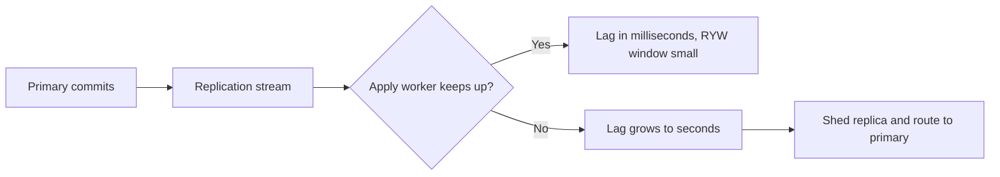

The practical rule is to treat lag as a continuously measured SLI with a tail, not as a constant to be assumed. Alert on the 99th percentile of lag, not the mean, and remember that a replica that has fallen far behind may never catch up without intervention if the primary keeps writing at full rate.

---

## 2. Sharding and Consistent Hashing in Practice

When a single primary cannot hold the dataset or the write rate, the data must be **partitioned (sharded)** across multiple independent databases. The problem is not splitting the data once; it is choosing a mapping that survives growth without a full rebalance, and choosing a shard key that does not concentrate all traffic on one shard.

### 2.1 Why `hash(key) % N` Is a Remapping Storm

The naive mapping is $shard = hash(key) \bmod N$. It distributes keys uniformly for a fixed $N$. But adding one node changes the modulus from $N$ to $N+1$, and for most keys the result changes. Because $\gcd(N, N+1) = 1$, the Chinese Remainder Theorem over $\mathrm{lcm}(N, N+1) = N(N+1)$ shows that $h \bmod N = h \bmod (N+1)$ holds only for the $N$ residues in $\{0, 1, \dots, N-1\}$ out of $N(N+1)$. Thus, when growing from $N$ to $N+1$, the exact fraction of keys that stay on the same shard is $\frac{N}{N(N+1)} = \frac{1}{N+1}$, and the fraction that must move is:

$$1 - \frac{1}{N+1} = \frac{N}{N+1}$$

For $N = 1 \to 2$, $50\%$ of keys move; for $N = 10 \to 11$, $\frac{10}{11} \approx 91\%$ of all keys move; for $N = 100 \to 101$, $\frac{100}{101} \approx 99\%$ move.

The consequence is catastrophic in practice: roughly 91% of your cache entries are now on the wrong shard at $N = 10$, so the hit rate collapses, and 91% of reads fall through to the database at once. This is the **cold-cache DB collapse** — a scaling event that looks like an outage. Moving the data itself is also expensive: nearly the entire dataset must be copied across the network.

### 2.2 Consistent Hashing Moves Only $K/N$ Keys

**Consistent hashing** places both nodes and keys on a circular hash ring of $2^m$ positions. A key maps to the first node encountered clockwise from the key's position. When a node is added, only keys that fall in the arc between its predecessor and itself move — roughly $\frac{K}{N+1}$ keys out of $K$ total keys and $N$ existing nodes (i.e., a fraction $\frac{1}{N+1}$ of the ring for the new node). Existing nodes keep almost all of their keys. The ring algorithms — including jump hash and rendezvous hashing — and their proofs are owned by [`algorithms/dsa`](../../../algorithms/dsa/README.md); we use them here as black boxes with known guarantees.

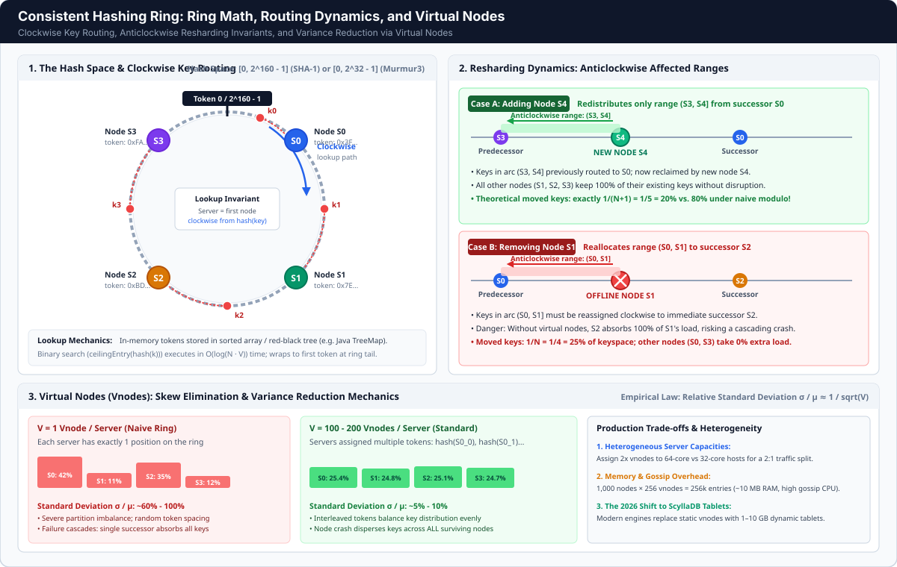

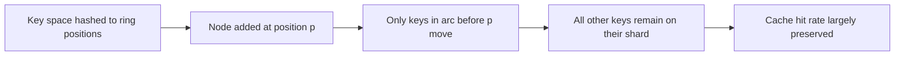

### 2.3 Virtual Nodes Are Mandatory

A ring with one position per node has a serious flaw: node positions are random, so the arcs they own vary wildly in size. With only $N$ points on the ring, the standard deviation of the load per node is large — some nodes own tiny arcs and are nearly idle, others own huge arcs and are overloaded. This is the **skew problem**, and it is worst for small $N$.

The fix is **virtual nodes (vnodes)**: each physical node is represented by many points on the ring (commonly 100–200 per node, or more), each derived from a distinct hash of the node identifier. With $N \cdot V$ points, the arcs become fine-grained and the load distribution tightens: the relative standard deviation of the load per node falls roughly with $\frac{1}{\sqrt{V}}$, so 100–200 vnodes per node collapses skew to a few percent. Vnodes also enable **weighted heterogeneous nodes**: give a larger machine more vnodes, and it automatically owns a proportionally larger share of the keyspace.

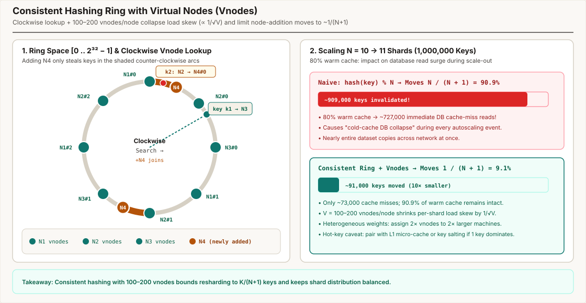

_Step-by-step mechanics:_ (1) Keys hash onto the `[0, 2^32 - 1]` ring and walk clockwise to the first vnode (`N1#k`, `N2#k`, `N3#k`). (2) When node `N4` joins with its own vnodes, only keys falling in the counter-clockwise predecessor arcs (`~1/(N+1) = 9.1%` at `N = 10`) remap to `N4`, avoiding the `N/(N+1) = 90.9%` remapping storm and cold-cache database collapse of naive `hash(key) % N`.

| Configuration | Keys moved on node add | Load skew | Heterogeneous weights |
| --- | --- | --- | --- |
| `hash(key) % N` | About $\frac{N}{N+1}$ | Low for fixed $N$ | Awkward |
| Consistent ring, 1 point per node | About $\frac{K}{N}$ | High, random arcs | Impossible |
| Consistent ring with vnodes | About $\frac{K}{N}$ | Low, tunable by $V$ | Natural via vnode count |

The proofs that bound skew and movement are in the DSA track's consistent-hashing module and reproduced in `../examples/03-caching-and-hashing.test.ts`, which asserts a load standard-deviation bound with and without vnodes.

### 2.4 A Worked Remapping Example

Consider 1,000,000 keys spread over 10 shards with a warm cache holding 80% of them, and suppose each cache miss costs one database read. With `hash(key) % 10`, adding an eleventh shard moves $\frac{10}{11} \approx 91\%$ of keys (`~909,000` keys), so roughly `727,000` cached entries become useless at once and the database absorbs an extra `727,000` reads in a burst. With a consistent ring, the new node takes about $\frac{1}{11}$ of the keyspace, so roughly `91,000` keys move and with an `80%` warm cache only about `73,000` cache entries are invalidated — a tenfold reduction in the cold-start load. The difference is precisely why production shard maps never use a plain modulus.

```text
hash % N:       keys moved = (10/11) x 1,000,000 ~= 909,000
consistent:     keys moved = (1/11) x 1,000,000 ~= 91,000
cache misses:   ~727,000 vs ~73,000 after an 80% warm cache
```

This calculation is deliberately conservative: it ignores the fact that a remapping storm also forces cross-shard data copies, which for a terabyte-scale dataset can saturate the network for hours. The hash choice therefore determines both steady-state distribution and the cost of every future scaling event.

### 2.5 Choosing a Shard Key

The shard key is the single most consequential schema decision in a sharded system, because it is nearly immutable after launch. Use these criteria.

**Cardinality.** The key must have enough distinct values to spread across all shards. A boolean or a small enum produces only a handful of shards no matter how many you provision. User IDs or order IDs typically have ample cardinality.

**Access locality.** Choose a key that keeps related data together so the common query touches one shard. For a multi-tenant application, `tenant_id` is often ideal: nearly all queries are scoped to one tenant, and a tenant's data is co-located. If the dominant query is "fetch all orders for a user", `user_id` is the natural key.

**Avoid monotonic hot shards.** Sharding by a timestamp or an auto-incrementing ID sends all new writes to the shard that currently owns the maximum value — a classic **hot partition**. This is the sharding analogue of the hot-key problem in Module 05 §3.3, but for writes, which cannot be fixed with an L1 cache. Hash the monotonic key, or prefix it with a high-cardinality dimension, to spread new writes.

**Avoid cross-shard joins and transactions.** A query that joins data on two shards requires a distributed join or a scatter-gather, and a transaction spanning shards requires a distributed commit protocol owned by [`architecture/distributed-systems`](../../distributed-systems/README.md). Denormalization (§3.1) is the usual remedy. If your access pattern fundamentally requires joining two entities atomically, they probably belong on the same shard under a shared key.

**Plan for resharding.** Even a good key eventually needs more shards. Consistent hashing with vnodes makes addition cheap, and a directory-based layer can remap individual keys, but a range or hash scheme must be designed for online migration from day one.

### 2.6 Sharding Schemes and Online Migration

| Scheme | How it maps | Strength | Weakness |
| --- | --- | --- | --- |
| Directory-based | Lookup service maps key to shard | Flexible per-key moves | Lookup is a bottleneck and a new dependency |
| Range | Contiguous key ranges per shard | Efficient range scans | Hot spots on monotonic keys, uneven sizes |
| Hash | Hash of key to shard or ring | Uniform distribution | No range queries without a secondary index |

**Online migration** must keep the system available while data moves. The standard **dual-write / shadow-read** protocol is:

```text
phase 1: start writing new key to both old and new shard (dual-write)
phase 2: backfill historical data from old to new shard in the background
phase 3: shadow-read from both shards and compare results (detect divergence)
phase 4: switch reads to the new shard for a fraction of traffic (canary)
phase 5: complete the switch, then stop dual-writing and retire the old shard
```

The invariant is that no write is ever accepted in only one location during the transition, and divergence is measured before traffic shifts. A trickier variant is **splitting** a single overloaded shard into two: the parent continues to serve while the children are backfilled, then a brief handoff switches the mapping. The directory-based scheme makes this a routing change; a pure hash scheme requires the ring to be updated consistently across all clients, which is why the ring configuration should be a shared, versioned artifact rather than hard-coded.

### 2.7 Detecting and Handling Hot Partitions

Even a well-chosen key can develop a hot partition: a celebrity tenant, a viral post, or a flash-sale item concentrates traffic on one shard. The first requirement is **detection** — per-shard request rate, CPU, and lock wait must be on a dashboard, with alerts on the ratio of the hottest shard to the median. Averages hide a single overloaded shard, so always look at the distribution.

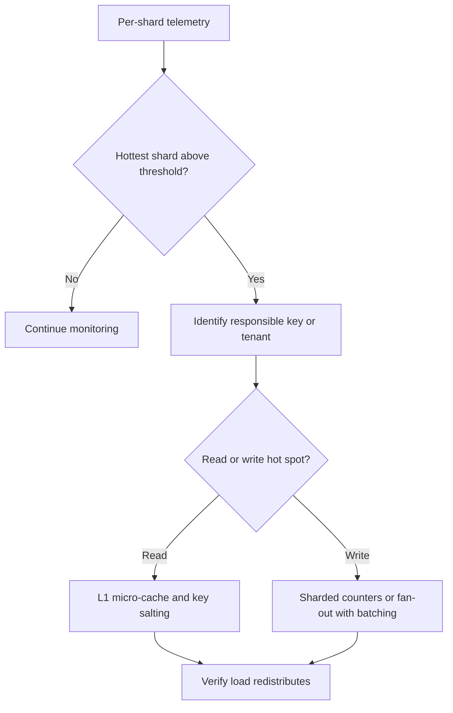

Read hot spots are mitigated exactly as in Module 05 §3.3: an in-process L1 cache and, if needed, key salting. Write hot spots cannot be cached; they need the counter and buffering techniques of §3.5. If a single tenant is responsible, the long-term fix may be to **split that tenant across multiple shards** with a finer-grained key such as `(tenant_id, user_id)`, accepting the loss of single-shard transactions within the tenant.

| Symptom | Likely cause | First response |
| --- | --- | --- |
| One shard high CPU, others idle | Read hot key | L1 cache, then key salting |
| One shard high lock wait | Write hot row | Sharded counter or buffered writes |
| All shards hot, rising together | Global traffic spike | Load shedding and autoscale |
| One shard growing in size only | Uneven key distribution or vnode skew | Rebalance vnodes or split the shard |

### 2.8 Primary Literature and Foundational Consistent Hashing Matrix

The theoretical and architectural foundations of consistent hashing and distributed data partitioning were established across three decades of seminal research in distributed algorithms, web-scale caching, key-value storage, and high-throughput networking. The following matrix links the foundational literature to modern production implementations and their primary system-design trade-offs:

| Paper / Specification | Canonical Problem Solved | Core Algorithmic Mechanism | Production Proving Ground | Key System-Design Trade-off |
| --- | --- | --- | --- | --- |
| **Karger et al. (STOC 1997)**: _Consistent Hashing and Random Trees: Distributed Caching Protocols for Relieving Hot Spots on the World Wide Web_ | Cache thrashing and server overload during web cache membership changes | Circular hash ring mapping keys and buckets into unit interval $[0, 1)$; multiple random points per bucket for load balance; proves at most $O(K/N)$ keys move on node change | Akamai CDN global edge caching; MIT Chord P2P distributed hash table | Minimal movement guarantee vs. $O(\log N)$ tree lookup overhead and non-uniform interval variance |
| **DeCandia et al. (Amazon Dynamo, SOSP 2007)**: _Dynamo: Amazon's Highly Available Key-value Store_ | Scaling stateful shopping carts and checkout sessions across heterogeneous, untrusted commodity hardware | Hash ring with virtual nodes (tokens); preference lists of $N$ successor hosts; sloppy quorums ($R + W > N$) and hinted handoff | Amazon DynamoDB, Apache Cassandra, Basho Riak, ScyllaDB | High write availability under partitions (AP) vs. eventual consistency and vector clock reconciliation |
| **Lamping & Veach (Google, 2014)**: _A Fast, Minimal Memory, Consistent Hash Algorithm (Jump Consistent Hash)_ | High-performance memory cache routing without storing ring tokens or lookup trees | Deterministic pseudo-random jump walk in 5 lines of code; maps 64-bit key to $N$ buckets in $O(\ln N)$ time with $O(1)$ memory | Google internal cache infrastructure; distributed shard routers | Zero memory and exact $\frac{1}{N+1}$ movement vs. requires contiguous bucket indices $0..N-1$ (no arbitrary deletions) |
| **Eisenbud et al. (Google Maglev, NSDI 2016)**: _Maglev: A Fast and Reliable Software Network Load Balancer_ | Line-rate (100 Gbps+) L4 load balancing with connection-affinity preservation across backend changes | Lookup table of prime size $M = 65{,}537$ filled via pseudo-random permutations of backends; $O(1)$ packet dispatch | Google Cloud external load balancing; Envoy proxy `maglev` policy; Meta Katran | Constant-time line-rate packet routing vs. fixed lookup table memory and slight load deviation ($< 1\%$) |
| **Mirrokni, Thorup, Zadimoghaddam (Google Research, ICML 2018)**: _Consistent Hashing with Bounded Loads_ | Cascading hotspot saturation when key access distributions follow steep power-law (Zipf) distributions | Capacity cap $c = \lceil(1 + \epsilon) K/N\rceil$; requests hitting a saturated node advance clockwise to next non-full node | Google Cloud CDN, HAProxy, Envoy proxy `bounded_loads` consistent hashing | Strictly bounded server load ($1+\epsilon$) vs. multi-hop ring traversal under extreme hotspot skew |
| **Alex Xu (ByteByteGo Vol. 1 Ch. 5, 2020)**: _Design Consistent Hashing_ | End-to-end framework for partitioned distributed systems in software architecture interviews | Circular $[0, 2^{160}-1]$ token space, clockwise key traversal, virtual node variance reduction, and anticlockwise affected range analysis | Modern system design interview loops; high-scale distributed architecture blueprints | Educational clarity vs. production complexities (tablet splitting, consensus control planes, and dynamic rebalancing) |

### 2.9 ByteByteGo Chapter 5 Delta: Ring Mathematics, Variance Reduction, and Production Systems

Alex Xu's ByteByteGo Volume 1 Chapter 5 synthesizes the core mechanics of consistent hashing into an accessible interview framework. However, translating textbook consistent hashing into production-grade distributed infrastructure requires addressing deep mathematical, operational, and architectural subtleties.

#### 2.9.1 Hash Space Mechanics and Ring Arithmetic ($0..2^{160}-1$ vs. $0..2^{32}-1$)

Textbook consistent hashing defines the hash ring as a continuous circular space by wrapping the outputs of a cryptographic hash function such as SHA-1 into the integer range $[0, 2^{160}-1]$. Connecting the maximum value $2^{160}-1$ back to the origin $0$ forms a closed cyclic group $\mathbb{Z} / 2^{160} \mathbb{Z}$.

Early systems such as Amazon Dynamo (2007) selected SHA-1 because its 160-bit cryptographic output guarantees uniform bit diffusion, making hash collisions mathematically negligible ($2^{-160}$). In production systems, however, cryptographic hashing incurs prohibitive CPU overhead: computing a SHA-1 or SHA-256 digest requires 500 to 2,000 nanoseconds per invocation. For a high-throughput router, proxy, or cache layer processing 500,000 queries per second per host, cryptographic hashing alone would consume 25% to 100% of a CPU core exclusively on hash calculation.

Modern distributed architectures therefore substitute cryptographic hashes with high-performance, non-cryptographic uniform hash functions such as **MurmurHash3**, **xxHash (xxh3)**, or **FarmHash**, which compute 32-bit or 64-bit digests in 5 to 15 nanoseconds per key (a $50\times$ to $100\times$ throughput speedup):

- **32-Bit Ring Space ($[0, 2^{32}-1]$)**: MurmurHash3-32 maps keys and virtual nodes into 4,294,967,296 discrete positions. For a cluster with $N = 100$ physical nodes and $V = 200$ virtual nodes ($20,000$ total points on the ring), the average distance between adjacent tokens is $\approx 214,748$ positions. The probability of two distinct virtual nodes colliding on the exact same 32-bit integer is approximately $\frac{(N \cdot V)^2}{2 \cdot 2^{32}} \approx \frac{4 \cdot 10^8}{8.59 \cdot 10^9} \approx 4.6\%$. A standard linear probing or open-addressing step resolves token collisions trivially.
- **64-Bit Ring Space ($[0, 2^{64}-1]$)**: Apache Cassandra utilizes `Murmur3Partitioner`, which maps row partition keys into the signed 64-bit integer range $[-2^{63}, 2^{63}-1]$. With $2^{64} \approx 1.84 \times 10^{19}$ discrete token positions, the probability of a token collision across millions of virtual nodes is effectively zero ($< 10^{-11}$).
- **Ring Distance Metric**: For any two token positions $t_a, t_b$ on an $M$-element ring ($M = 2^b$), the clockwise distance traversed from $t_a$ to $t_b$ is computed modulo $M$:

$$
d_{\mathrm{cw}}(t_a, t_b) = (t_b - t_a) \bmod M
$$

When routing a key with hash $h = \mathrm{hash}(key) \bmod M$, the client or proxy searches the ring's sorted token collection for the smallest token $t_i$ such that $t_i \ge h$. If no such token exists ($h$ exceeds the maximum registered server token), the search wraps around to the smallest token on the ring ($t_0$). In memory, this is implemented as a sorted array with binary search ($O(\log(N \cdot V))$ time) or a balanced red-black tree (such as Java's `TreeMap.ceilingEntry()` or C++ `std::map::lower_bound()`).

#### 2.9.2 Virtual Node Variance Reduction and Empirical Standard Deviation ($1/\sqrt{V}$ Law)

The most critical insight in consistent hashing is that a naive ring with only one token per physical server ($V = 1$) fails catastrophically in production due to severe token placement skew. Because $N$ physical server identifiers are hashed independently onto the circle, the arc lengths $I_1, I_2, \dots, I_N$ between adjacent servers follow a broken-stick distribution (a Dirichlet distribution $\mathrm{Dir}(1, \dots, 1)$).

In a broken-stick partition of a circle into $N$ segments, the expected length of the largest interval satisfies:

$$
\mathbb{E}\left[\max_{1 \le i \le N} I_i\right] \approx \frac{1}{N} \sum_{k=1}^N \frac{1}{k} \approx \frac{\ln N + \gamma}{N}
$$

For a 10-node cluster ($N = 10$), the harmonic sum is $\approx 2.93$, meaning the single largest partition is expected to be nearly **three times larger** than the average partition ($\frac{1}{10}$). Under uniform key distribution, the physical server owning that largest arc absorbs $3\times$ the traffic of an average server, creating a severe bottleneck while adjacent nodes remain underutilized. The relative standard deviation $\sigma / \mu$ of server load with $V = 1$ is between $60\%$ and $100\%$.

Virtual nodes (vnodes) solve this problem by assigning each physical server $s_i$ a set of $V$ distinct tokens generated by hashing salted identifiers:

$$
t_{i, j} = \mathrm{hash}(s_i \,\|\, \text{vnode} \,\|\, j) \quad \text{for } j \in \{0, 1, \dots, V-1\}
$$

By interleaving $N \cdot V$ total tokens randomly around the ring, each physical server no longer owns a single continuous arc; instead, it owns $V$ small, disjoint arcs scattered across the circumference. By the Central Limit Theorem, the sum of $V$ independently sampled random arcs converges to an aggregate allocation whose relative standard deviation drops inversely with the square root of $V$:

$$
\frac{\sigma}{\mu} \approx \frac{1}{\sqrt{V}}
$$

Empirical measurements across production benchmarks (confirmed in Alex Xu Ch. 5, Amazon Dynamo benchmarks, and our test suite in `../examples/03-caching-and-hashing.test.ts`) yield the following variance profile:

| Virtual Nodes ($V$) | Relative Standard Deviation ($\sigma / \mu$) | Typical Max/Mean Load Ratio | Memory Footprint ($N = 100$) | Production Verdict |
| --- | --- | --- | --- | --- |
| **$V = 1$** | $60\% - 100\%$ | $2.8\times - 3.5\times$ | 100 entries ($< 1$ KB) | **Unusable**: massive hotspots and unpredictable node crashes |
| **$V = 25$** | $\approx 20\%$ | $1.4\times - 1.6\times$ | 2,500 entries ($\approx 20$ KB) | Marginal: acceptable only for low-scale non-critical caches |
| **$V = 100$** | $\approx 10\%$ | $1.15\times - 1.25\times$ | 10,000 entries ($\approx 80$ KB) | **Production Standard**: balanced distribution for web caches and KV stores |
| **$V = 200$** | $\approx 5\% - 7\%$ | $1.08\times - 1.12\times$ | 20,000 entries ($\approx 160$ KB) | **High Uniformity**: optimal balance for Dynamo/Cassandra replication rings |
| **$V = 500$** | $\approx 3\% - 4\%$ | $1.04\times - 1.06\times$ | 50,000 entries ($\approx 400$ KB) | **Diminishing Returns**: gossip overhead and repair storms outweigh gains |

**Heterogeneous Hardware Weighting**: Beyond variance reduction, virtual nodes provide a clean mechanism to balance clusters composed of non-identical server hardware. In cloud deployments where legacy instances co-exist with upgraded nodes, assigning vnodes in direct proportion to hardware capacity balances traffic naturally. If instance type `m6i.4xlarge` (64 GB RAM, 16 vCPUs) is assigned $V = 200$ tokens, a smaller `m6i.2xlarge` (32 GB RAM, 8 vCPUs) is assigned $V = 100$ tokens. The ring automatically allocates exactly $2/3$ of the keyspace to the larger node and $1/3$ to the smaller node, with zero application code modifications.

#### 2.9.3 Anticlockwise Affected Range Invariant During Topology Transitions

A fundamental invariant of consistent hashing governs which keys must be migrated when the cluster topology changes. In contrast to naive modulo sharding—where adding or removing a node scrambles the placement of nearly all keys across the fleet—consistent hashing confines key redistribution strictly to the **anticlockwise arc preceding the affected node**:

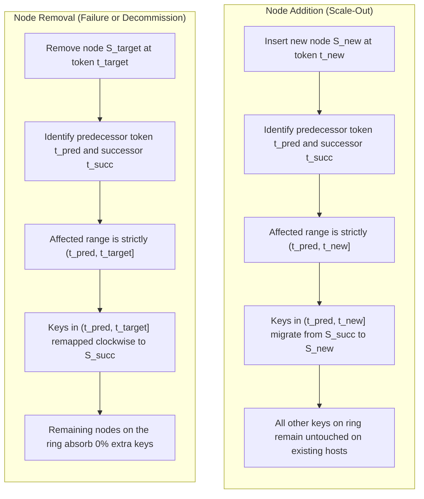

- **Node Addition Invariant**: When node $s_{\mathrm{new}}$ is inserted at token $t_{\mathrm{new}}$, let $t_{\mathrm{pred}}$ be the immediately preceding token on the ring, and $t_{\mathrm{succ}}$ be the immediately succeeding token. Prior to insertion, all keys falling in the half-open interval $(t_{\mathrm{pred}}, t_{\mathrm{succ}}]$ routed clockwise to $s_{\mathrm{succ}}$. Following insertion, keys falling in $(t_{\mathrm{pred}}, t_{\mathrm{new}}]$ route clockwise to the new node $s_{\mathrm{new}}$. The fraction of total keys transferred to $s_{\mathrm{new}}$ is on average:

$$
\mathbb{E}\left[\text{Fraction Moved}\right] = \frac{1}{N + 1}
$$

All keys in $(t_{\mathrm{new}}, t_{\mathrm{succ}}]$ continue to be served by $s_{\mathrm{succ}}$, and every other key on the ring remains on its incumbent server. When scaling from 10 to 11 nodes, exactly $\frac{1}{11} \approx 9.09\%$ of the dataset moves, preserving over $90\%$ of cached state.

- **Node Removal Invariant**: When node $s_{\mathrm{target}}$ at token $t_{\mathrm{target}}$ is decommissioned or crashes, the keys it previously owned—spanning the interval $(t_{\mathrm{pred}}, t_{\mathrm{target}}]$—have no local host. Under the clockwise routing rule, these keys are reassigned to the immediate clockwise successor $s_{\mathrm{succ}}$.
- **The Domino Crash Hazard ($V = 1$)**: In a single-token ring, when $s_{\mathrm{target}}$ crashes, **100% of its workload lands on its single immediate successor** $s_{\mathrm{succ}}$. If the cluster was operating at 70% capacity, $s_{\mathrm{succ}}$ suddenly receives $70\% + 70\% = 140\%$ load, driving its CPU and memory into saturation. When $s_{\mathrm{succ}}$ crashes from overload, both $s_{\mathrm{target}}$'s and $s_{\mathrm{succ}}$'s load cascade onto the next clockwise successor $s_{\mathrm{succ2}}$ (210% load), triggering an immediate, catastrophic **domino crash** that knocks down every node in the cluster sequentially.
- **Cascading Failure Mitigation via Virtual Nodes ($V = 200$)**: When each physical server owns 200 virtual nodes distributed evenly across the ring, a failed physical server's 200 vnodes do not share a single successor. Instead, each of the 200 vnodes has a distinct immediate clockwise successor randomly distributed among all $N - 1$ surviving physical servers. Consequently, the failed node's traffic is dispersed uniformly across the entire surviving fleet: each surviving server absorbs only $\frac{1}{N - 1}$ of the failed node's traffic (an imperceptible $+7.7\%$ load increase on a 10-node cluster at 70% baseline, rising to $75.4\%$). This structural dispersal eliminates the single-successor domino trap entirely.

#### 2.9.4 Real-World Production Implementations Matrix

Consistent hashing forms the architectural backbone of leading large-scale distributed systems. The following table contrasts five canonical real-world implementations:

| System / Organization | Hash Algorithm & Ring Topology | Virtualization Strategy | Replication & Quorum Scheme | Production Failure Mode Mitigated |
| --- | --- | --- | --- | --- |
| **Amazon Dynamo (SOSP 2007)** | MD5 / SHA-1 mapping to 128/160-bit ring; evolved to fixed equal-sized partitions | Initial Dynamo used $\approx 200$ vnodes; later shifted to $Q$ equal-sized token ranges decoupled from nodes | Preference list of $N$ physical successors; sloppy quorum $(R + W > N)$ with hinted handoff | Retail checkout cart loss during flash sales and cross-datacenter fiber cuts |
| **Apache Cassandra** | `Murmur3Partitioner` mapping partition keys to $[-2^{63}, 2^{63}-1]$ | Cassandra 1.2 introduced vnodes (`num_tokens = 256` default); Cassandra 4.0 reduced to 16/4 tokens | Peer-to-peer ring; replicas placed on $R$ distinct racks by walking clockwise; read repair | Hotspot skew on random UUIDs; cluster repair storms when 256 vnodes touched every peer |
| **Discord (Messages & Guilds)** | Cassandra migrated to ScyllaDB (C++ Seastar shared-nothing thread-per-core) | Moved from Cassandra 128 vnodes to ScyllaDB dynamic tablets (1–10 GB per tablet) | Raft-managed topology; asynchronous replication across multi-region clusters | JVM garbage collection pauses ($> 10$ s) and gossip message serialization bottlenecks on 100+ node clusters |
| **Akamai CDN Edge** | Karger consistent hashing mapping URL paths and cache keys to edge server clusters | Multiple hash seeds per caching server; dynamic point insertion based on server load | Cache hierarchy (parent-child ICP/CARP); origin shield failover | Cache stampedes and origin overload during breaking news traffic spikes ($> 90\%$ cache hit retention) |
| **Google Maglev L4 Load Balancer** | Custom 64-bit hash mapping 5-tuple packet flows into lookup table of prime size $M = 65{,}537$ | Backend permutation walks populate lookup slots until table is filled; zero vnode ring pointers | Stateless ECMP routing across Maglev instances; kernel-bypass NIC ring buffers | Connection drop on L4 LB scaling; ensures established TCP flows hit same backend without inter-LB sync |

#### 2.9.5 Cascading Hotspot Mitigation: Mirrokni Bounded Loads and Jump Consistent Hash

Even with 200 virtual nodes per server, standard consistent hashing has an inherent vulnerability: **it balances keyspace volume, not request traffic volume**. If key access frequencies follow a steep power-law (Zipfian) distribution—such as a viral social media post, breaking news story, or celebrity live stream—a single key can receive $100{,}000$ queries per second. Because that single key maps to one point on the ring, all $100{,}000$ QPS land on the single physical server currently owning that token, regardless of how many virtual nodes are provisioned.

To eliminate this vulnerability without resorting to fragile application-level key salting, Mirrokni, Thorup, and Zadimoghaddam (Google Research, 2018) developed **Consistent Hashing with Bounded Loads**:

1. **Capacity Cap Definition**: Let $K$ be the total in-flight requests or active keys in the cluster, and $N$ be the number of physical nodes. The average load per node is $\frac{K}{N}$. An expansion parameter $\epsilon > 0$ (typically $\epsilon = 0.25$ or $0.30$) defines the maximum permissible load factor. Each node $s_i$ is assigned a hard capacity ceiling:

$$
c = \left\lceil (1 + \epsilon) \cdot \frac{K}{N} \right\rceil
$$

2. **Bounded-Load Lookup Protocol**: When a request for key $k$ arrives:
   - Hash $k$ to identify its primary consistent hash target $s = \mathrm{lookup}(k)$.
   - Inspect the current load $\mathrm{load}(s)$.
   - If $\mathrm{load}(s) < c$, assign the request to $s$ and increment $\mathrm{load}(s)$.
   - If $\mathrm{load}(s) \ge c$, server $s$ is saturated. The router **spills over** by advancing clockwise along the ring to the next distinct physical server $s'$. If $s'$ is also saturated, it continues clockwise until an available server is located.
3. **Proven Theoretical Guarantees**: Mirrokni et al. proved that under this protocol, no server can ever exceed $(1 + \epsilon) \cdot \frac{K}{N}$ load. Furthermore, the average lookup distance (number of hops along the ring) is strictly bounded by $O(1 / \epsilon^2)$ with high probability, and key reallocation during node membership changes remains bounded by $O(1 / \epsilon)$ times the theoretical minimum. Bounded-load consistent hashing is natively implemented in Envoy proxy (`consistent_hash` load balancer with `bounded_loads`) and Google Cloud CDN.

**Google Jump Consistent Hash**: For architectures where keys map to a fixed or monotonically growing pool of $N$ numbered cache buckets ($0, 1, \dots, N-1$), Lamping and Veach (2014) introduced **Jump Consistent Hash**. Unlike ring-based consistent hashing, Jump Hash requires zero memory ($O(1)$ RAM), zero stored ring tokens, and executes in $O(\ln N)$ time:

```text
int32_t JumpConsistentHash(uint64_t key, int32_t num_buckets) {
    int64_t b = -1, j = 0;
    while (j < num_buckets) {
        b = j;
        key = key * 2862933555777941757ULL + 1;
        j = (b + 1) * (double(1LL << 31) / double((key >> 33) + 1));
    }
    return b;
}
```

Jump Consistent Hash guarantees that when the bucket count increases from $N$ to $N+1$, exactly $\frac{1}{N+1}$ of the keys jump to bucket $N$, while the remaining $\frac{N}{N+1}$ keys stay in their original buckets. However, practitioners must recognize a key trade-off: **Jump Consistent Hash does not support arbitrary bucket deletions**. Because buckets are addressed strictly by sequential integer index $0..N-1$, removing bucket $i$ requires swapping bucket $N-1$ into slot $i$, which triggers unexpected key migrations. Jump Hash is therefore ideal for stateless memory cache tiers (e.g. Memcached) that scale out monotonically, whereas consistent rings remain necessary for stateful data stores with arbitrary node failures.

---

## 3. Scaling Writes

Reads can be replicated; writes must be coordinated. Scaling writes therefore means reducing the number of synchronous, contended operations per logical write.

### 3.1 Denormalization and Materialized Views

Normalization minimizes write cost and redundancy; read performance at scale often requires the opposite. **Denormalization** stores redundant copies of data so a common read needs no join, and a **materialized view** is a pre-computed, incrementally maintained read projection of a base table.

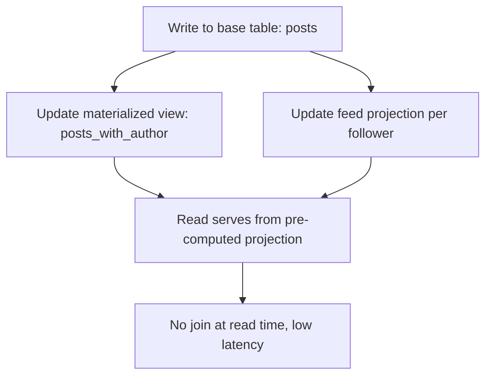

The cost is **write amplification**: one logical write now updates several structures, and each additional projection multiplies write load. This is a conscious trade — you pay more on writes to make reads cheap — but it must be bounded. Every projection needs an owner, an update path, and a reconciliation job to repair drift when an update is missed. If the projection is maintained asynchronously, it is eventually consistent and inherits the lag concerns of §1.

### 3.2 CQRS: When It Is Worth It

**Command Query Responsibility Segregation (CQRS)** takes denormalization to its logical conclusion: the write model and the read model are separate, independently scaled, and may use different databases. Commands mutate a normalized write store; events update one or more read projections optimized for specific queries.

CQRS is genuinely valuable when the read and write models have **different scaling or shape requirements** — for example, complex analytical reads over a simple append-only write log, or multiple read projections with different latency needs. It is needless complexity when the read and write models are basically the same tables: you have added message plumbing, eventual consistency, and reconciliation for no benefit. The honest test is whether a single model would actually be a bottleneck; if not, do not adopt CQRS. The saga and event-sourcing correctness theory behind it is owned by [`architecture/distributed-systems`](../../distributed-systems/README.md).

### 3.3 Write Batching and Group Commit

Databases pay a fixed cost per transaction (WAL flush, fsync, index update). **Batching** groups many logical writes into one transaction, and **group commit** lets a single WAL flush acknowledge many concurrent transactions. Both convert many small random writes into fewer larger sequential ones.

```text
without batching: 1000 writes = 1000 transactions = 1000 fsyncs
with batching:    1000 writes = 10 batches of 100 = 10 fsyncs
```

Batching trades latency for throughput: a request waits for the batch to fill or for a short timeout (often 1–10 ms). It is most effective for write-heavy ingest pipelines where per-event latency is unimportant but aggregate throughput is critical. The batch size and timeout must be bounded — an unbounded batch under low traffic adds latency, and an unbounded queue under overload hides saturation.

### 3.4 Async Write-Behind Buffering

When writes arrive in spikes faster than the database can absorb them, an **async write-behind buffer** (a durable queue such as Kafka) absorbs the spike and lets the database consume at its own pace. This is the write-side analogue of a cache: it decouples producer and consumer timing. The buffer must be durable, otherwise the throughput gain is paid for with lost writes, and it must apply backpressure when full. Delivery semantics and idempotent-consumer theory are owned by [`architecture/distributed-systems`](../../distributed-systems/README.md).

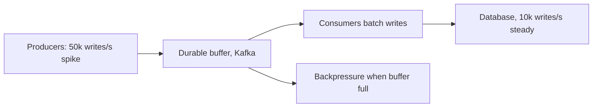

### 3.5 High-Throughput Counters at Scale

Counters — likes, views, shares, inventory counts — are the classic write hot spot. The naive implementation is one row in a table:

```sql
UPDATE posts SET likes = likes + 1 WHERE id = 42;
```

This statement acquires an **exclusive row lock** on the single row for the duration of its transaction. Every increment to the same post must wait for the previous one, so the operations are fully serialized on one lock and one row's worth of WAL. Even on fast hardware this tops out at roughly 500–2,000 writes per second for a single contended row; beyond that, lock wait time and transaction aborts dominate and latency grows without bound. Adding more application servers does nothing — the database row is the bottleneck.

Four techniques break the serialization.

**Technique 1 — Sharded counters.** Replace the single value with $S$ sub-rows, `likes_42_0` through `likes_42_{S-1}`. An increment picks a sub-row (by request hash or at random) and updates it; the total is the sum of the sub-rows, computed on read or by a periodic rollup into a canonical value. With $S = 32$, write throughput rises by roughly $32\times$ because 32 independent rows can be locked concurrently. Reads become an aggregation, which is acceptable because counters are read far less often than written. The periodic rollup also gives a natural place to reset the sub-rows.

```text
increment(post_id):
    slot = random_int(0, S-1)
    UPDATE counter_shard SET value = value + 1
      WHERE post_id = post_id AND slot = slot

read_total(post_id):
    return SELECT SUM(value) FROM counter_shard WHERE post_id = post_id
```

**Technique 2 — Redis `INCR` plus async DB flush.** Redis increments are in-memory and atomic on a single thread, so a single key can absorb on the order of 100,000 operations per second. Accept increments with `INCR`, then flush the accumulated value to the database periodically (for example every second) or on threshold. The Redis operations and persistence trade-offs are owned by [`technologies/redis`](../../../technologies/redis/README.md). The cost is a durability gap: a Redis crash before the flush loses the unflushed increments, so pair it with a durable buffer if the count must survive exactly.

**Technique 3 — Probabilistic sketches.** For _unique_ counts and heavy hitters, exact counters are the wrong tool. **HyperLogLog** estimates cardinality (unique visitors) with about 12 KB per sketch and a ~2% error, regardless of how many millions of elements are added. **Count-Min Sketch** estimates per-item frequencies (heavy hitters) with a bounded overestimation error. Both use sub-linear memory where an exact set would be enormous; their math is owned by [`algorithms/dsa`](../../../algorithms/dsa/README.md).

**Technique 4 — Buffered batch increments.** Accumulate increments in a process-local or queue-based buffer and apply them to the database in batches, combining Technique 1 and §3.3. This reduces the number of lock acquisitions without changing the data model.

| Technique | Exactness | Throughput | Main cost |
| --- | --- | --- | --- |
| Single row update | Exact | 500–2,000/s | Row-lock serialization |
| Sharded counters | Exact | Scales with $S$ | Read-time aggregation |
| Redis plus flush | Exact if flushed, gap before | Very high | Durability gap |
| HyperLogLog / Count-Min | Approximate | Very high | Bounded error, no per-item exact value |

### 3.6 Write-Scaling Decision Order

The techniques should be applied in a deliberate order: first remove unnecessary synchronous work (batching, group commit); then remove contention (sharded counters); then offload to a faster store or buffer (Redis, durable queue); and only then accept approximation (sketches). Adopting a sketch before fixing a contended row lock means paying an accuracy cost for a bottleneck you never addressed.

### 3.7 Worked Counter Sizing

Suppose a popular post receives 20,000 likes per second. A single-row counter saturates near 1,000 writes/s, giving a twentyfold gap. With $S = 32$ sharded sub-rows, the theoretical ceiling becomes roughly 32,000 writes/s, leaving headroom, and each sub-row sees about 625 writes/s — comfortably below the single-row limit. A read that sums 32 sub-rows costs one indexed query returning 32 values, which is negligible at the read rate of a single post.

```text
target write rate:      20,000 likes/s
single row ceiling:    ~1,000 writes/s  -> 20x overload
shards S = 32:         ~625 writes/s per sub-row -> safe
read cost:              one SUM over 32 rows
```

If the count is a unique-visitor metric instead, sharded counters are the wrong abstraction: storing every visitor ID to deduplicate would consume gigabytes. A HyperLogLog sketch gives a ~2% estimate in about 12 KB, and for a leaderboard of the most-liked posts a Count-Min Sketch identifies heavy hitters with bounded error. The choice between exact and approximate is therefore a function of the _question being asked_, not just the write rate. The same arithmetic applies to any single contended resource: measure the per-resource ceiling first, then decide whether to fan out, buffer, or approximate rather than reaching for the most complex option by default.

---

## 4. Then vs Now

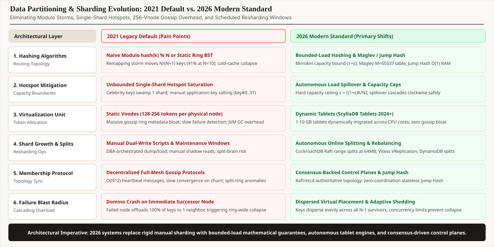

| Concern | Earlier practice (2021) | Modern standard (2026) |
| --- | --- | --- |
| Read routing | All reads to primary, or blind round-robin to replicas | Lag-aware connection routing plus LSN/GTID watermarks and session RYW windows |
| Shard mapping | Naive `hash(key) % N` with scheduled maintenance downtime | Bounded-load consistent hashing ($\epsilon \le 0.3$), Google Maglev tables, and Jump Hash |
| Hot writes | Bigger vertical database instance or manual application key salting (`key#0..31`) | Autonomous bounded-load spillover, distributed sharded counters, and approximate sketches (HLL/CMS) |
| Read models | Monolithic joins at query time | Asynchronous materialized views, CDC pipelines (Debezium), and selective CQRS |
| Ring virtualization | Static 128–256 Vnodes per host (Cassandra token metadata and gossip storms) | Dynamic ScyllaDB Tablets (1–10 GB units) and Raft-managed auto-splitting ranges (CockroachDB) |
| Resharding operations | Manual dual-write scripts, shadow-read verification, and DBA-driven table freezes | Autonomous online range splitting (CockroachDB at 64 MB, Vitess VReplication, DynamoDB auto-splits) |
| Cluster membership | Decentralized full-mesh gossip protocols with $O(N^2)$ background heartbeat overhead | Consensus-backed control planes (etcd/Raft/K8s CRDs) and stateless Jump Consistent Hash |
| Failure blast radius | Unbounded immediate successor saturation triggering cluster-wide domino crashes | Dispersed virtual node / tablet spreading combined with adaptive concurrency load shedding |

### 4.1 Evolution of Distributed Partitioning Architectures (2021 vs. 2026)

The architectural discipline of data partitioning has fundamentally transitioned over the past five years. In 2021, system designers relied on manual, static mechanisms: clusters were provisioned with fixed hash rings or rigid modulo mappings, partition counts were hard-coded at schema inception, and any resharding event required complex application dual-writing scripts, manual data backfilling, and high-stress maintenance windows.

By 2026, modern distributed databases and caching infrastructure have automated partitioning into a continuous, self-healing control loop:

1. **Routing Topologies and Bounded-Load Invariants**: In 2021, consistent hashing was deployed primarily in its basic Karger or Dynamo form: keys mapped to the first clockwise node on a token ring. While this bounded key churn during node addition to $\approx 1/N$, it provided zero protection against load imbalance caused by Zipfian key access distributions. In 2026, high-scale proxies (Envoy, HAProxy) and edge networks (Google Cloud CDN, Cloudflare) standardise on **Bounded-Load Consistent Hashing (Mirrokni et al.)**. By enforcing a strict mathematical ceiling $c = \lceil(1 + \epsilon) K/N\rceil$ on every node, traffic dynamically cascades clockwise to the next available server whenever a hotspot emerges. This delivers the hit-rate benefits of cache locality without the vulnerability of single-shard CPU saturation. For stateless worker pools where nodes scale monotonically, **Google Jump Consistent Hash** provides an $O(1)$-memory, $O(\ln N)$-time alternative that eliminates ring storage entirely.
2. **From Static Vnodes to Dynamic Storage Tablets**: The 2021 standard for distributed NoSQL databases (Apache Cassandra, early ScyllaDB, Riak) was assigning 128 to 256 static virtual nodes (tokens) per physical server. While this achieved uniform key counts, it imposed massive operational overhead on large clusters: a 100-node Cassandra cluster with 256 vnodes tracked 25,600 token boundaries, saturating JVM heaps with token metadata, creating gossip protocol heartbeat storms, and causing repair operations to stream data from every other node in the cluster simultaneously. In 2026, state-of-the-art storage engines have transitioned to **Dynamic Tablets** (exemplified by ScyllaDB Tablets in 2024–2026 and CockroachDB Ranges). Instead of tying data ownership to static hash tokens, the keyspace is partitioned into small, independent tablets (typically 1 to 10 GB each). Each tablet is an autonomous storage unit that is assigned, balanced, and migrated across physical nodes and CPU cores by an active Raft control plane. When a tablet grows beyond its threshold, it splits automatically into two child tablets. Tablets eliminate gossip ring bloat, slash cluster resharding times from days to minutes, and isolate node repair streams to only the surviving replicas of affected tablets.
3. **Autonomous Online Splitting vs. Manual Resharding Windows**: In 2021, relational database sharding (MySQL/PostgreSQL) required manual orchestration layers. Growing from 16 to 32 shards meant writing bespoke dual-write application logic, executing long-running background backfills, running shadow queries to detect divergence, and scheduling off-peak maintenance cutovers. In 2026, managed distributed SQL and sharding engines execute online resharding autonomously. **Vitess VReplication** enables zero-downtime, non-blocking resharding workflows (e.g. splitting keyspace `-80` into `-40` and `40-80`) with continuous replication stream catch-up and atomic routing switchover. **CockroachDB** autonomously splits 64 MB Raft ranges and rebalances them across nodes using multi-raft consensus. **AWS DynamoDB** continuously monitors per-partition read/write IOPS and storage size, automatically splitting partitions when a single partition exceeds 1,000 WCU, 3,000 RCU, or 10 GB of storage.
4. **Cluster Membership and Failure Cascade Protection**: In 2021, decentralized full-mesh gossip protocols were standard for cluster membership. On clusters exceeding 100 nodes, gossip message volume scaled as $O(N^2)$, causing CPU overhead and slow failure detection convergence during network partitions. In 2026, topology management is unified under consensus-backed orchestrators (etcd, Kubernetes Custom Resource Definitions, or Raft metadata controllers). When a node fails, the combination of virtualized tablet dispersal and adaptive concurrency limiters (such as Netflix Gradient2 or TCP Vegas AIMD load shedding) ensures that surviving nodes shed excess load rather than cascading into failure.

### 4.2 Pitfalls of Mixing 2021 and 2026 Partitioning Paradigms

Adopting modern distributed tools without updating underlying architectural assumptions creates subtle, severe production failure modes. Practitioners must guard against the following five pitfalls:

1. **The 256-Vnode Configuration Trap on Modern High-Core Hardware**: Deploying modern versions of Apache Cassandra or ScyllaDB with legacy `num_tokens = 256` configuration on modern cloud instances (e.g., 64-core or 128-core bare metal instances). On a 50-node cluster, 256 tokens per node creates 12,800 token ranges. Every background cluster repair, anti-entropy sync, or SSTable compaction must coordinate across all 12,800 ranges, generating hundreds of thousands of concurrent file descriptors and triggering JVM garbage collection pauses exceeding 15 seconds. **Modern Rule**: Set `num_tokens = 16` or `4` in Cassandra 4.x/5.x, or migrate directly to ScyllaDB Tablets where token configuration is eliminated in favor of auto-managed tablets.
2. **Scatter-Gather Range Query Antipattern over Hash-Partitioned Keyspaces**: Executing range scans (`SELECT * WHERE partition_key BETWEEN 'A' AND 'Z'`) over a cluster partitioned by cryptographic or uniform hashes (Murmur3 or SHA-1). Because uniform hashing destroys spatial and lexical locality by design, a range scan cannot be isolated to a single partition; instead, the query coordinator must broadcast the request to **every single shard in the cluster** (scatter-gather). At 100 shards, the query latency equals the 99th percentile tail latency of all 100 shards combined ($1 - 0.99^{100} \approx 63\%$ probability of hitting a tail latency outlier). **Modern Rule**: When range queries are dominant, use range-based sharding with automated splitting (CockroachDB, TiDB, Spanner) or co-locate related records under a composite partition key with a sorted clustering column.
3. **Assuming Consistent Hashing Solves Hot-Key Access Concurrency**: Believing that increasing the virtual node count ($V = 200$) will protect a cluster against a viral celebrity key. Virtual nodes distribute _distinct keys_ uniformly across servers; they cannot split the traffic of a _single key_. If key `user:celebrity:feed` receives 50,000 read QPS, that single key maps to exactly one point on the ring, routing 100% of those 50,000 requests to one physical node and causing immediate CPU saturation. **Modern Rule**: Protect hot read keys using in-process L1 single-flight caching with short TTLs (2–5 seconds) and client-side key salting; protect hot write keys using distributed sharded counters (§3.5) and Bounded-Load Consistent Hashing.
4. **Using Jump Consistent Hash with Arbitrary Node Decommissions**: Deploying Google Jump Consistent Hash for a stateful database or cache cluster where arbitrary nodes can be removed or fail unexpectedly. Jump Hash assumes bucket indices form a contiguous sequence $0, 1, \dots, N-1$. If node 4 out of 10 fails, the application cannot simply delete index 4; it must renumber node 9 to index 4. This renumbering moves all keys that mapped to bucket 9 into bucket 4, creating an unintentional secondary remapping storm. **Modern Rule**: Restrict Jump Consistent Hash to stateless memory caches or worker pools that scale out monotonically. For clusters requiring arbitrary node removals, use consistent hash rings with virtual nodes or Maglev lookup tables.
5. **Application-Level Dual-Writing Without Monotonic Fencing**: Executing online database migrations by having application services write to both old and new shards concurrently without monotonic version fencing. If a network blip or thread scheduling stall causes an old write to arrive at the new shard _after_ a newer write has already committed, the new shard is silently corrupted with stale data. **Modern Rule**: Always enforce monotonic version fencing (e.g. timestamp or LSN-based conditional writes `WHERE version > existing_version`) and decouple migration backfills through asynchronous Change Data Capture (CDC via Debezium) rather than raw dual-writing from application workers.

---

## 5. Production Design Checklist

- **Consistency classification**: Which endpoints truly require read-your-writes, and how is that requirement expressed at the router?
- **Lag telemetry**: Is replica lag measured continuously, and are lagging replicas shed from the read pool?
- **Watermark plumbing**: Can the commit LSN be carried through to read requests where precision is needed?
- **Shard key durability**: Does the key have enough cardinality, locality, and freedom from monotonic hot spots?
- **Cross-shard avoidance**: Have the common queries been checked for joins and transactions spanning shards?
- **Remapping cost**: What fraction of keys move when a node is added, and does the cache survive it?
- **Vnode count**: Is the ring configured with enough virtual nodes to bound load skew and support heterogeneous nodes?
- **Migration plan**: Is there a tested dual-write and shadow-read procedure for adding or splitting shards?
- **Write amplification**: Has each materialized view been justified by a measured read benefit?
- **Contention audit**: Is any single row or key receiving more writes than one lock can serialize?
- **Buffer durability**: Are write buffers durable and backpressured so throughput cannot silently lose data?
- **Approximation policy**: Where is an approximate count acceptable, and what error bound is documented?
- **Hot-partition alerts**: Is the ratio of hottest to median shard monitored, not just the fleet average?
- **Fallback sizing**: Can the primary absorb replica reads when replicas are shed, or is fallback rate-limited?
- **Connection budgets**: Do pooled connections across all services fit within each database's `max_connections`?
- **Batch bounds**: Are batch size and batch timeout both bounded so low traffic cannot add latency?
- **Projection repair**: Does every materialized view have an owner and a reconciliation job for drift?

---

## Interview Drill

**Q1. Explain why adding a node to a `hash(key) % N` setup causes a cold-cache database collapse, and quantify it for $N = 10$.**

<details><summary>Model Answer</summary>

Changing the modulus from $N$ to $N+1$ changes the bucket of almost every key. The fraction that stay is about $\frac{1}{N+1}$, so the fraction that move is $1 - \frac{1}{N+1} = \frac{N}{N+1}$. For $N = 10 \to 11$ that is $\frac{10}{11} \approx 90.9\%$ of keys (`~909k` of `1M` keys). Those keys' cache entries are now on the wrong shard, so the hit rate collapses and roughly 91% of reads fall through to the database simultaneously — a self-inflicted denial of service during a routine scaling operation. Consistent hashing limits the moved keys to about $\frac{K}{N+1}$ (fraction $\frac{1}{N+1} \approx 9.1\%$), preserving the cache.
</details>

**Q2. Why does a consistent-hashing ring with one point per node produce skewed load, and how do vnodes fix it?**

<details><summary>Model Answer</summary>

Node positions on the ring are random, so the arcs between them vary in size; a node with a large arc owns far more keys than one with a small arc. With only $N$ points the standard deviation of per-node load is large. Adding 100–200 virtual nodes per physical node replaces a few large arcs with many small ones, so the law of large numbers tightens the distribution and the relative standard deviation falls roughly with $\frac{1}{\sqrt{V}}$. Vnodes also let a bigger machine own more vnodes and thus a proportionally larger share.
</details>

**Q3. A user updates their profile, then immediately reloads and sees the old value. Walk through the causes and the full set of RYW mitigations.**

<details><summary>Model Answer</summary>

The write was acknowledged by the primary but the replica serving the read has not applied that LSN yet, so replication lag produces a stale read. Mitigations: carry the commit LSN/GTID as a watermark and route to a replica that has applied it, or wait until one has; route the user's reads to the primary for $T$ seconds after a write using a session flag; use sticky sessions so the app can remember that flag and LSN; and shed replicas whose lag exceeds a threshold so the staleness window is bounded. In practice these are combined.
</details>

**Q4. What makes a good shard key, and why is a monotonic timestamp or auto-incrementing ID a bad choice?**

<details><summary>Model Answer</summary>

A good key has high cardinality, aligns with access locality so common queries touch one shard, avoids cross-shard joins and transactions, and spreads writes evenly. A monotonic key sends every new write to whichever shard currently owns the maximum value, creating a write hot partition that more shards cannot fix. Hash the monotonic value or combine it with a high-cardinality dimension to distribute new writes.
</details>

**Q5. Design an online migration from 10 to 11 shards without downtime.**

<details><summary>Model Answer</summary>

Use consistent hashing with vnodes so only about $\frac{K}{N}$ of keys move in the first place. Start dual-writing affected keys to old and new shards, backfill historical data in the background, shadow-read both and compare, canary a fraction of reads to the new shard, then cut over fully and retire the old placement. If a directory layer exists, the final switch is a routing change; otherwise the ring configuration must be versioned and consistent across all clients.
</details>

**Q6. Why does `UPDATE posts SET likes = likes + 1 WHERE id = 42` die at roughly 500–2,000 writes/s, and how does key salting help?**

<details><summary>Model Answer</summary>

Every increment takes an exclusive row lock on one row, so all writes to that post serialize on the same lock and WAL entry; latency and aborts grow without bound past a few thousand per second. Key salting creates $S$ sub-rows and sends each increment to a randomly chosen one, so up to $S$ rows can be locked concurrently, multiplying write throughput by roughly $S$. Reads sum the sub-rows or use a periodic rollup.
</details>

**Q7. When should you choose CQRS, and when is it needless complexity?**

<details><summary>Model Answer</summary>

Choose it when the read and write models genuinely diverge — for example, a simple append-only write store feeding several differently shaped read projections with different scaling needs. It is needless when reads and writes would use essentially the same tables: you add message plumbing, eventual consistency, and reconciliation without removing a real bottleneck. The test is whether a single model is actually a bottleneck before paying the complexity cost.
</details>

**Q8. For a "unique visitors" metric and a "most-viewed posts" leaderboard, which counting structures would you use and why?**

<details><summary>Model Answer</summary>

Unique visitors needs cardinality estimation, so HyperLogLog gives a ~2% estimate in about 12 KB per sketch regardless of scale, where an exact set would be enormous. The most-viewed leaderboard needs per-item frequencies to find heavy hitters, so a Count-Min Sketch gives frequencies with bounded overestimation; an exact sorted set is used when precise ordering matters and the key space is small. Both sketch math details belong to the DSA track; here they are chosen as building blocks to avoid exact counters at extreme scale.
</details>
