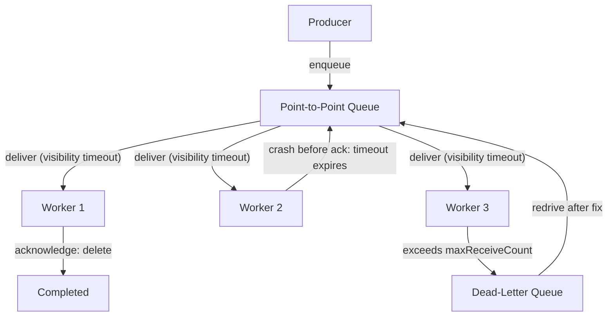
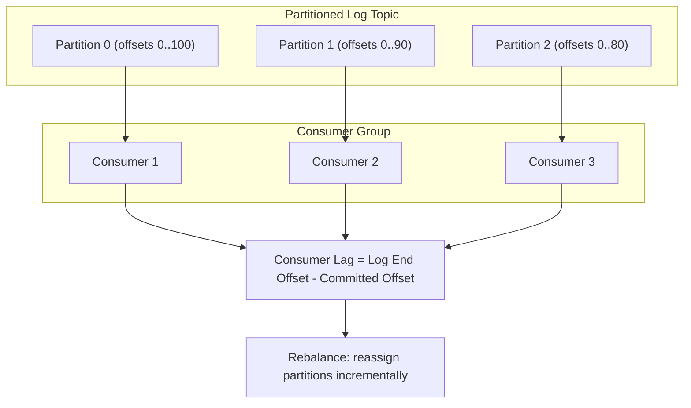
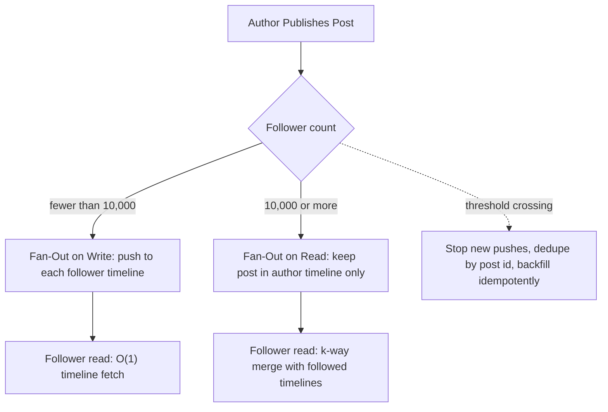
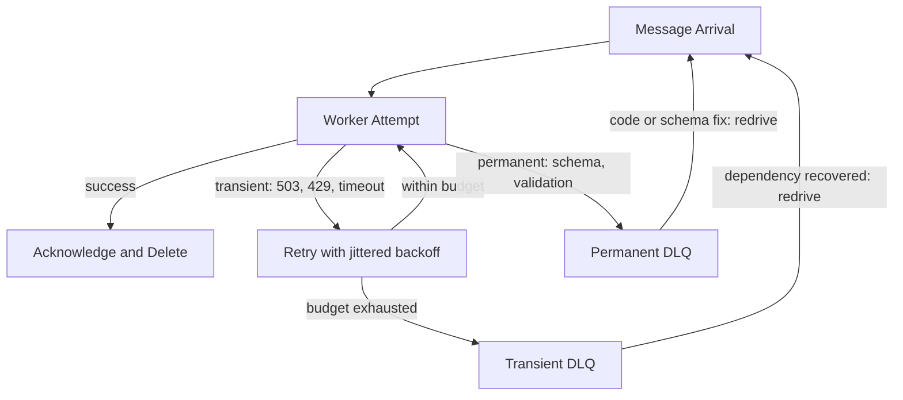
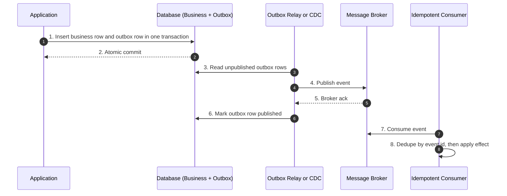
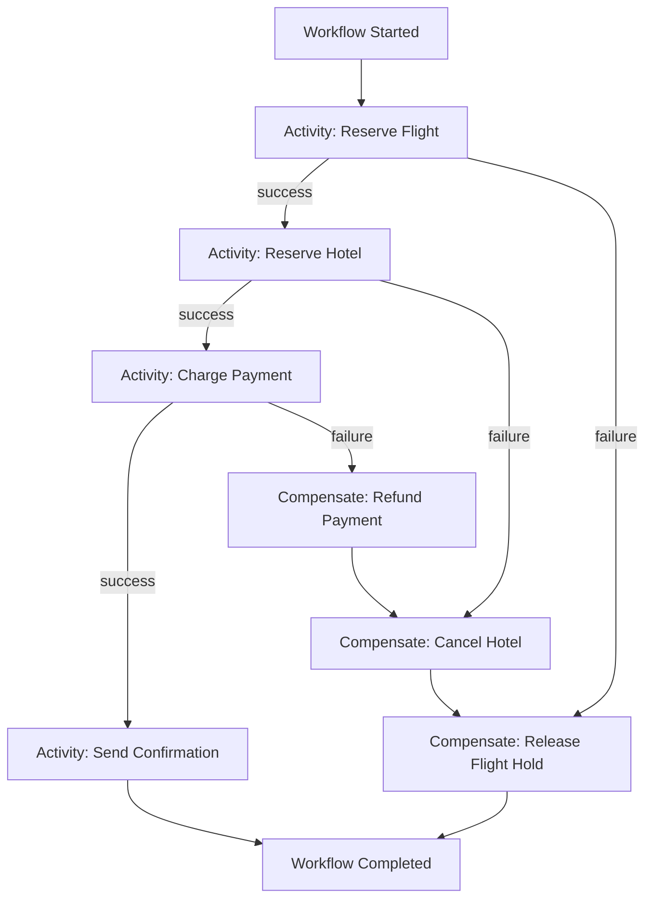
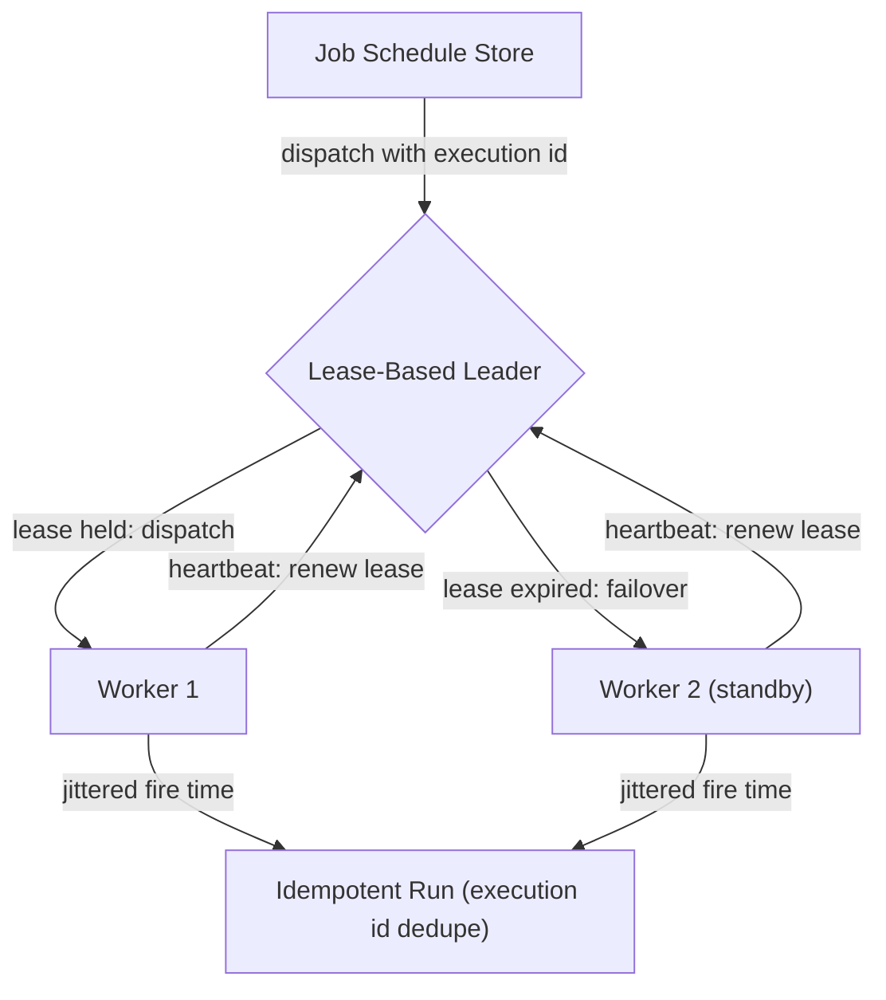

# Module 07 — Asynchrony: Queues, Streams, and Durable Workflows

Synchronous request-response calls couple a caller to a callee in time: both must be available, latencies add along the call chain, and a failure or slowdown in one service propagates immediately to everything upstream. Asynchrony breaks that coupling by inserting a durable intermediate — a queue or a log — so producers can accept work, acknowledge it quickly, and let consumers process it at their own pace. This module treats queues, partitioned logs, fan-out, backpressure, reliable publishing, durable workflows, and job schedulers as composable components, with the quantitative trade-offs that decide which one belongs in a given architecture.

---

## 1. Why Asynchrony: Decoupling in Time

A synchronous call is a temporal contract: the caller blocks, the callee must respond before the caller can continue, and the two lifecycles are entangled. At scale this produces three failure modes. First, **latency amplification**: a user request that calls five services serially pays the sum of all five latencies and all five tail latencies. Second, **failure propagation**: a callee outage immediately becomes a caller outage, and retries from every caller stampede the recovering callee. Third, **throughput coupling**: the caller cannot accept work faster than the slowest callee can drain it, so a burst either overflows or is dropped at the edge.

An asynchronous message channel inverts the contract. The producer writes a message and continues; the consumer reads it when it can. The channel absorbs bursts, isolates failures, and allows the producer and consumer to scale independently. The cost is that the system must now reason about delivery semantics, ordering, replay, duplication, and backpressure — the exact topics of this module.

There are two fundamentally different channel shapes, and choosing between them is the first architectural decision:

| Dimension | Point-to-Point Queue | Partitioned Append-Only Log |
| --- | --- | --- |
| **Canonical systems** | Amazon SQS, RabbitMQ, Azure Service Bus, ActiveMQ | Apache Kafka, Azure Event Hubs, Amazon Kinesis, Apache Pulsar |
| **Consumption model** | Destructive: a message is delivered to one consumer and deleted on acknowledgment. | Non-destructive: the log retains records; each consumer tracks its own offset. |
| **Delivery guarantee** | At-least-once with per-message acknowledgment; ordering is best-effort unless FIFO mode is enabled. | At-least-once by default; strict ordering only within a single partition. |
| **Replay** | Impossible after acknowledgment. | Native: reset an offset and re-read history. |
| **Multiple subscribers** | Competing consumers; broadcasting requires a fan-out exchange or per-subscriber queues. | Free fan-out: independent consumer groups read the same log at independent offsets. |
| **Parallelism ceiling** | Consumers can scale freely, but a single queue's throughput is bounded by its storage node. | Consumer parallelism is capped by the partition count. |
| **Best for** | Task dispatch, work queues, commands, jobs. | Event streams, audit trails, fan-out, stream processing, replay. |

The formal theory of the log abstraction, delivery semantics, and consumer-group correctness is owned by [`architecture/distributed-systems`](../../distributed-systems/README.md); the internals of stream processing, compaction, and event-time semantics are owned by [`architecture/data-systems`](../../data-systems/README.md). This module treats both as black boxes with knobs and focuses on composition: when to use which shape, how to size it, and how to keep it correct under failure.

---

## 2. Point-to-Point Queues: SQS, RabbitMQ, and Azure Service Bus

### 2.1 Competing Consumers and Per-Message Acknowledgment

A point-to-point queue stores messages until a consumer removes them. Multiple workers poll the same queue; the broker delivers each message to exactly one worker and makes it temporarily invisible to the others. The worker processes the message and then sends an explicit acknowledgment; only then is the message deleted. If the worker crashes, times out, or explicitly rejects the message, the broker makes it visible again after a **visibility timeout** and redelivers it.

This design gives three properties that every producer and consumer must internalize:

- **Competing consumers**: adding workers increases drain rate, because each message goes to exactly one worker. This is the queue's natural horizontal scaling mechanism.
- **At-least-once delivery**: a crash between processing and acknowledgment causes redelivery, so consumers must be idempotent. A message can also be duplicated by a redelivery race near the visibility timeout, so idempotency is not optional.
- **Unbounded ordering risk**: with multiple workers, message 2 can finish before message 1. Queues that need ordering expose a FIFO mode, which trades throughput and consumer parallelism for per-message-group ordering.

Amazon SQS standard queues provide nearly unlimited throughput and best-effort ordering; FIFO queues provide exactly-once processing and per-message-group ordering at a lower throughput ceiling. RabbitMQ routes messages through exchanges to queues and bindings, supports manual acknowledgments and consumer prefetch (quality-of-service) limits, and offers quorum queues (Raft-replicated, strongly consistent) alongside classic mirrored queues. Azure Service Bus separates queues (one logical receiver) from topics with subscriptions (fan-out to multiple subscribers), adds sessions for ordered streams, and provides duplicate detection windows.

### 2.2 Dead-Letter Queues and Redrive Policies

A **Dead-Letter Queue (DLQ)** is a second queue that receives messages the main queue cannot process. The broker moves a message to the DLQ when it exceeds a redrive policy — typically `maxReceiveCount`, the number of times the message was delivered without successful acknowledgment. The DLQ exists so that one bad message cannot block the head of the main queue forever.

A production DLQ configuration has five parts:

1. **Trigger**: `maxReceiveCount` on the main queue's redrive policy, plus an explicit dead-letter exchange or binding.
2. **Retention**: the DLQ must retain messages long enough for an operator or reprocessor to act, and must not silently expire them.
3. **Attributes**: the dead-lettered message should carry the failure reason, stack trace, original queue, and receive count in message attributes or headers.
4. **Redrive**: a controlled operation that moves messages from the DLQ back to the source queue, ideally after the underlying fault is fixed and with a rate limit to avoid a second stampede.
5. **Alerting**: DLQ depth and age are first-class SLO signals; a growing DLQ is a user-visible reliability defect, not an internals detail.

### 2.3 Scaling Beyond the Partition Count

A queue and a log fail differently when you scale. In a partitioned log, a consumer group cannot run more active consumers than there are partitions, so the partition count is a hard parallelism ceiling. A queue has no such ceiling: you can add consumers until the queue's own storage or network saturates. But a single queue is still a single logical resource, so its throughput is bounded by the node or cluster that hosts it.

The standard remedy is **queue sharding**: route messages for different aggregate keys to different physical queues, then let a consumer pool subscribe to many queues. RabbitMQ quorum queues, for example, put one queue under one Raft group, so a single hot queue cannot use more than one group's throughput; you scale by creating multiple queues and routing on a key. SQS standard queues already distribute internally and scale horizontally, while FIFO queues require message groups, which bounds parallelism per group. Azure Service Bus partitioned entities split the entity across multiple message brokers. The architectural rule: **queues scale by adding consumers up to the queue's storage limit, then by adding queues; logs scale by adding partitions, and consumers beyond the partition count sit idle.**



---

## 3. Partitioned Append-Only Logs: Kafka, Event Hubs, and Kinesis

### 3.1 Consumer Groups, Offsets, and Replay

A partitioned log stores an ordered, immutable sequence of records per partition. Producers append; consumers read at offsets they control. A **consumer group** is a set of workers that coordinate so that each partition is assigned to at most one worker in the group at a time. This gives horizontal scale with a hard ceiling: a topic with $N$ partitions supports at most $N$ active workers in one group; extra workers are idle hot standbys.

The decisive advantage over a queue is **non-destructive consumption**. Because the log retains records by time or size, any number of independent consumer groups can read the same stream at their own offsets. A new service can be introduced by pointing a fresh group at offset zero and replaying history; a buggy consumer can be fixed and re-run from an earlier offset. Destructive queues cannot do this: once a message is acknowledged, it is gone.

Consumer progress is stored as an offset per partition, committed to an internal topic (Kafka) or a checkpoint store (Event Hubs, Kinesis). **Consumer lag** is the difference between the log end offset and the committed consumer offset. Lag is the primary scaling and health signal for a log pipeline: sustained positive lag means the consumer pool cannot drain the input rate, and the correct response is usually more partitions and more consumers, not bigger instances.

### 3.2 Multi-Subscriber Fan-Out and Strict Per-Partition Ordering

Multiple consumer groups give free fan-out: the billing service, the search indexer, and the analytics pipeline each read the same `orders` topic independently, and one group's slowness does not affect the others. This is the log's killer feature and the reason event-driven architectures prefer logs for state propagation.

Ordering, however, is strictly scoped. A log guarantees a total order **within one partition**, never across the topic. Producers route records by key, and the partition is a deterministic function of the key and the partition count:

$$\text{partition} = \text{hash}(\text{key}) \pmod{N}$$

All events for one `order_id` therefore land in one partition and are processed in append order. The trap is the modulus: increasing $N$ changes the mapping for existing keys, so later updates for a key can land in a different partition while unconsumed earlier updates remain in the old one, permanently breaking per-key causality. Resizing a partitioned topic is therefore a data-migration event, not a routine scaling action.

### 3.3 Consumer Lag and Rebalancing Traps

When a consumer joins or leaves a group, the broker recomputes partition assignments and triggers a **rebalance**. The naive eager protocol revokes every partition from every consumer, stops all processing, elects assignments, and resumes. Under load, this creates a death spiral: a slow consumer exceeds its poll interval, is evicted, triggers a group-wide rebalance, returns to a larger backlog, exceeds the interval again, and the group never stabilizes. Modern protocols (Kafka KIP-848 and earlier cooperative sticky assignors) reassign only the affected partitions incrementally, so unaffected consumers keep processing.

Operational rules that keep a log pipeline healthy:

- Size the topic with the partition count you need for peak consumer parallelism, because raising it later breaks key ordering.
- Keep `max.poll.interval.ms` comfortably above worst-case per-batch processing time, and bound `max.poll.records` so a single batch cannot blow the interval.
- Decouple fetching from processing with an internal worker pool so a slow handler does not stall heartbeats.
- Monitor lag per consumer group, not just broker throughput; a flat lag curve with rising broker CPU is a rebalance storm.
- Treat a poison message as a rebalance trigger: a record that always crashes the handler will repeatedly evict the consumer.

Kafka 4.2's share groups (KIP-932) blur the queue/log boundary by letting multiple consumers pull individual records from the same partition, which removes the partition-count parallelism ceiling for queue-like workloads. Event Hubs and Kinesis keep the partition/shard model, with Kinesis requiring explicit resharding (split or merge) to change parallelism and offering enhanced fan-out for high-consumer-count scenarios.



---

## 4. Fan-Out Patterns for News Feed and Notifications

A social feed is the canonical fan-out problem: when an author posts, the post must reach every follower's timeline. There are two pure strategies and one production hybrid. The choice is a direct trade between write amplification and read latency.

### 4.1 Fan-Out on Write (Push)

In **fan-out on write**, the producer pushes a copy of the post into every follower's precomputed timeline at publish time. If author $A$ has $F$ followers and posts $P$ times per day, the system performs $F \times P$ timeline writes per day, regardless of whether anyone reads them.

The read path is $O(1)$: a follower opens the app and the service fetches their timeline, usually a single sorted-set range query. The write path is catastrophic for celebrities. For an author with $50{,}000{,}000$ followers posting once per day, the system performs $50{,}000{,}000$ timeline writes per day; at ten posts per day it is $500{,}000{,}000$ writes per day, before any read traffic. Those writes also contend with normal user writes, consume replication bandwidth, and can exceed the write throughput of the timeline store. This is the **celebrity problem**: a small number of accounts dominate the write amplification.

### 4.2 Fan-Out on Read (Pull) and k-Way Merge

In **fan-out on read**, the producer writes the post exactly once, to the author's own timeline. When a follower requests their feed, the service fetches the recent posts of every account the follower follows and merges them into one time-ordered result.

The write path is $O(1)$ and has zero amplification. The read path is $O(F)$ where $F$ is the number of followed accounts, plus a merge. For a user following $10{,}000$ accounts, a naive implementation fetches $10{,}000$ timelines on every refresh; even with caching, the merge and pagination costs dominate the read latency budget. The merge itself is a $k$-way merge of sorted lists, implemented with a min-heap of size $k$ (the number of authors), giving $O(N \log k)$ for $N$ output posts; heap mechanics are owned by `algorithms/dsa`.

### 4.3 Hybrid Celebrity Fan-Out

Production systems use a **hybrid**: push for normal accounts, pull for celebrities. The rule is a follower threshold — for example, push to followers when the author has fewer than $10{,}000$ followers, and treat authors at or above the threshold as celebrities whose posts are merged at read time.

The hybrid must handle three hard cases:

1. **Threshold crossings**: an author who crosses the threshold must stop receiving new push writes, but existing follower timelines already contain older pushed posts. The read path must deduplicate by post ID so a post is never shown twice. A background job can backfill recent posts into timelines, but it must be idempotent.
2. **Hysteresis**: promote to celebrity at $10{,}000$ followers and demote below $9{,}000$ followers, so an author hovering at the boundary does not flap between push and pull on every follow/unfollow.
3. **Follower-count consistency**: the threshold decision needs an accurate, low-latency follower count. A sharded or buffered counter (owned by Module 06) is usually the right component; a stale count only costs extra writes or an extra read merge, not correctness.

The result is a system where the long tail of normal users gets $O(1)$ reads, and the tiny celebrity population is handled by a read path that is more expensive but bounded and cacheable.



_Step-by-step mechanics:_ (1) On publish, accounts below the hysteresis threshold (`< 10,000` followers) fan out via `ZADD` pushes into every follower's Redis timeline for $O(1)$ reads, whereas celebrities (`>= 10,000` followers) write once to their own author timeline. (2) On feed read, the timeline service fetches the follower's pushed timeline plus $k$ followed celebrity timelines and performs an $O(N \log k)$ priority-heap merge with `post_id` deduplication.



---

## 5. Backpressure, Bounded Queues, and Poison Messages

### 5.1 Why Unbounded Queues Hide Overload

An unbounded queue is dangerous because it converts an overload into a latency problem rather than a rejection. Little's Law states that the average number of items in a stable system is $L = \lambda W$, where $\lambda$ is the arrival rate and $W$ is the average time an item spends in the system. For the queue itself, $L_q = \lambda W_q$.

In an M/M/1 queue with service rate $\mu$ and utilization $\rho = \lambda / \mu$, the mean waiting time is:

$$W_q = \frac{\rho}{\mu (1 - \rho)}$$

As $\lambda \to \mu$, $\rho \to 1$ and $W_q \to \infty$, while throughput stays pinned at $\mu$. The queue length grows without bound, and every request spends longer in the system. Clients eventually time out at their deadline $T_{to}$; a timed-out client retries, adding $\lambda_{retry} = \lambda \cdot P(W > T_{to}) \cdot r$ to the arrival rate. If $\lambda + \lambda_{retry} > \mu$, the system enters a **death spiral**: latency climbs, more clients time out, more retries arrive, and the queue grows even faster. The unbounded queue hides the overload until user-visible timeouts make it a full outage.

### 5.2 Bounding Queues and Propagating Backpressure

The defense is to bound the queue and make the bound visible. A bounded queue with maximum depth $Q_{max}$ admits new work only while $L_q < Q_{max}$; when full, it rejects immediately with `429` or `503` and a `Retry-After` hint. This converts an unbounded latency blow-up into a bounded, explicit rejection that the caller can handle.

Backpressure must then propagate outward: the edge load balancer or API gateway sheds excess load, the caller retries with jittered backoff (Module 08), and the producer slows down. Reactive Streams, gRPC flow control, TCP windowing, and Kubernetes pod scaling are all mechanisms for propagating a downstream bound back to the producer. The design goal is **static stability**: the system should reject work it cannot serve rather than accept work it cannot finish.

### 5.3 Dead-Letter Queues and Poison-Pill Isolation

A **poison message** (or poison pill) is a message that can never be processed successfully. Left in a queue, it is retried forever, consuming worker capacity and blocking or churning the queue. The fix is to classify failures and isolate the poison.

Failures fall into two classes with opposite remedies:

- **Transient failures** — `503` from a downstream, `429` throttling, connection resets, timeouts, temporary capacity exhaustion. These should be retried with exponential backoff and jitter, within a bounded retry budget, and only for a bounded time.
- **Permanent failures** — schema or deserialization errors, validation failures, authorization denials, unsupported message versions, duplicate keys that violate a constraint. Retrying these is pointless; they should be routed to a DLQ immediately, after at most one or two attempts.

Production systems therefore use **separate DLQs per failure class** (or per message type) rather than one shared DLQ. A schema-error DLQ can be replayed after a schema registry update; a downstream-503 DLQ can be redriven after the dependency recovers; a validation DLQ needs a code or rules fix. Each DLQ gets its own alert on depth and oldest-message age, and the reprocessing path must be idempotent so redriving cannot double-apply an effect.



---

## 6. Reliable Event Publishing: The Dual-Write Race and the Transactional Outbox

### 6.1 The Dual-Write Race

A service that updates a database and publishes an event faces the **dual-write problem**: two separate resources must change, and no single transaction spans them. If the database commit succeeds and the process crashes before the broker publish, the event is lost and downstream state diverges. If the broker publish succeeds and the database transaction rolls back, downstream consumers see an event for state that does not exist.

The root cause is that the database commit and the broker publish are two independent operations with no atomic commit protocol between them. Retrying the publish after a crash is not enough, because the process may never get another chance; and retrying after a rollback creates phantom events.

### 6.2 The Transactional Outbox

The **transactional outbox** pattern makes the database the single source of truth for the intent to publish. In the same database transaction that mutates business state, the service also inserts a row into an `outbox` table containing the event payload, aggregate key, and a `published` flag. The business commit and the outbox insert commit atomically; there is no dual write.

A separate **relay** process reads unpublished outbox rows and publishes them to the broker, then marks them published. Because the relay can crash after publishing but before marking, it can publish the same event twice; the pattern therefore guarantees **at-least-once** delivery and requires idempotent consumers. The outbox table is ordinary database state, so it is backed up, replicated, and transactional like the rest of the business data.

### 6.3 Polling Relay versus CDC with Debezium

The relay can be built in two ways.

A **polling relay** periodically runs `SELECT ... FROM outbox WHERE published = false ORDER BY id LIMIT n`, publishes each row, and updates `published = true`. It is simple, works with any database, and is easy to reason about, but it adds database poll load and a latency equal to the poll interval. It scales by sharding the outbox by aggregate key so multiple relay instances do not contend.

**Change Data Capture (CDC)** tailing the database write-ahead log is the low-latency alternative. Debezium reads the database's replication stream (PostgreSQL logical decoding, MySQL binlog, MongoDB oplog), converts each committed row change into an event, and publishes it. CDC has no poll interval, so end-to-end latency is the replication lag plus broker publish time. The costs are operational: a connector per database, schema-registry integration for evolution, handling DDL changes, and a guarantee that the connector reads committed transactions in order. CDC can also publish changes the application did not intend as events, so the connector must be scoped to the outbox table or to explicitly marked tables.

The choice is latency and operational complexity: polling is the default; CDC is worth its complexity when downstream freshness is a user-visible SLI.

### 6.4 Idempotent Consumers

At-least-once delivery makes the consumer the last line of defense. An **idempotent consumer** applies the same event twice with the same effect as applying it once. Two implementations are standard:

- **Deduplication table**: the consumer stores a unique `event_id` (or `(source, aggregate_key, version)`) in the same transaction that applies the business effect. A duplicate event hits the unique constraint and is acknowledged without re-applying. The table grows with the number of processed events and needs a retention policy.
- **Natural idempotent upserts**: the event carries a version or timestamp, and the consumer applies `upsert ... where version > existing_version`, or appends to an immutable ledger, or unions a set. The business operation itself is idempotent, so no separate dedupe table is needed.

Delivery semantics theory — at-most-once, at-least-once, effectively-once, and the impossibility of exactly-once without idempotency — is owned by [`architecture/distributed-systems`](../../distributed-systems/README.md). The system-design delta is the composition: outbox for reliable generation, at-least-once delivery, and idempotent consumption as the practical "effectively-once" end-to-end guarantee.



---

## 7. Durable Workflow Engines: Temporal

### 7.1 The Problem: Long-Running Multi-Step Processes

Some business processes are not a single request; they are a sequence of steps that spans minutes, hours, or days and must survive process restarts, network failures, and human input. Trip booking reserves a flight, reserves a hotel, charges a card, and sends a confirmation; order fulfillment allocates inventory, charges, ships, and handles returns; KYC onboarding collects documents, runs checks, waits for manual review, and activates the account.

Implementing these with an ad-hoc cron job plus a `state` column is brittle. A crash between two steps leaves the row in an ambiguous state; retries re-run steps that already succeeded; there is no per-step timeout, no durable timer, no versioning of the process definition, and no way to answer "where is this order?" without reading the state column. The failure handling is reimplemented per job and rarely tested.

### 7.2 Event-Sourced Replay and Deterministic Workflow Code

A durable workflow engine such as **Temporal** makes the process definition code the source of truth and persists its progress as an **event history**. The workflow code is deterministic and replayable: it orchestrates steps, but it performs no I/O and reads no wall clock directly. Every external effect is an **activity**, a separate function that runs outside the workflow and may be non-deterministic (HTTP calls, database writes, file generation).

When a workflow worker restarts, the engine replays the event history and re-executes the workflow code deterministically. The code replays the same decisions, and the engine matches each activity result from history rather than re-running the activity. This is why workflow code must be deterministic: no `Math.random()`, no `Date.now()`, no direct network calls, no mutable global state. Those belong in activities or in workflow APIs (`sleep`, `sideEffect`, `getVersion`).

The practical contract:

- **Workflow code**: deterministic orchestration, replayed on every recovery.
- **Activities**: non-deterministic side effects, retried independently with their own retry policy.
- **Event history**: the durable record of every workflow task, activity task, timer, signal, and completion.
- **Task queue**: the channel between the engine and workers; workers poll it, so a worker crash only loses an in-flight task, not the workflow.

### 7.3 Activities, Timers, Signals, and Queries

Temporal exposes four primitives that replace ad-hoc machinery:

- **Timers** are durable: `await workflow.sleep(duration)` writes a timer event into history, so a workflow that waits two days for a manual review survives restarts without a cron job and without a local timer that dies with the process.
- **Signals** are external events delivered into a running workflow: a cancellation request, a document upload, a price change. The workflow blocks on a signal and resumes deterministically.
- **Queries** are synchronous reads of current workflow state, served from the last known state without mutating history.
- **Updates** (in current SDKs) mutate workflow state through a validated handler, giving a request-response feel without sacrificing determinism.

Activities carry their own retry policy (initial interval, backoff, maximum attempts, non-retryable error types) and can **heartbeat** during long runs so the engine can distinguish a slow activity from a dead worker. Cancellation propagates from the workflow to its activities.

### 7.4 Sagas and Compensating Transactions

A multi-step process that spans services is a **saga**: a sequence of local transactions, each with a compensating action that undoes its business effect if a later step fails. Temporal is an orchestration saga engine: the workflow code defines the forward steps and the compensations, and the engine drives them with durable state.

Compensation is not a database rollback. A refund can fail, a cancellation can be rejected, and a notification cannot be unsent. Compensations must therefore be idempotent, must be designed as business operations (not storage tricks), and must themselves be retryable. The formal correctness problem of sagas — atomicity without distributed locks, isolation anomalies, and recovery — is owned by [`architecture/distributed-systems`](../../distributed-systems/README.md); the system-design delta is that a durable engine makes the saga's state machine explicit, replayable, and observable.

```typescript
// Workflow code: deterministic orchestration only.
export async function bookTrip(input: TripInput): Promise<TripResult> {
  const flight = await activities.reserveFlight(input.flight);
  try {
    const hotel = await activities.reserveHotel(input.hotel);
    try {
      const payment = await activities.chargeCard(input.payment);
      await activities.sendConfirmation({ flight, hotel, payment });
      return { status: 'CONFIRMED', flight, hotel, payment };
    } catch (error) {
      await activities.refundCard(payment);
      await activities.cancelHotel(hotel);
      throw error;
    }
  } catch (error) {
    await activities.releaseFlight(flight);
    throw error;
  }
}
```



---

## 8. Distributed Cron and Job Schedulers

### 8.1 Lease-Based Leader Election

A scheduled job must run somewhere, but it must not run everywhere. A distributed scheduler uses **lease-based leader election**: one scheduler instance acquires a lease on the scheduling role and becomes the active dispatcher; the others are standbys. If the leader's lease expires — because it crashed, was partitioned, or paused in a long garbage collection — a standby acquires the lease and takes over.

The lease must be stored in a system that can enforce expiry and fencing, and the leader must renew it with a heartbeat. The correctness details of leases, fencing tokens, and the danger of a paused leader waking up and acting with a stale lease are owned by [`architecture/distributed-systems`](../../distributed-systems/README.md). The system-design rule is: never use "the instance that happens to be running" as the scheduler; always make leadership an explicit, expiring, fenced lease.

### 8.2 Idempotent Execution IDs

Leaders fail over, workers restart, and tasks are retried, so a scheduler must assume every job run can be delivered more than once. Each run gets a deterministic **execution ID** (for example `job_id + scheduled_fire_time`), and the executor deduplicates on it. Combined with an at-least-once dispatch channel, this yields exactly-once execution without a distributed transaction.

### 8.3 Jittering Top-of-the-Hour Schedules

The classic cron mistake is scheduling every job at `0 0 * * *`. At the top of the hour, all jobs fire simultaneously: the scheduler, the database, the network, and the downstream APIs see a synchronized thundering herd, and the herd's retries land on the next boundary. The fix is **jitter**: run the job at its nominal time plus a random offset within a window:

$$t_{run} = t_{scheduled} + U(0, W)$$

A one-hour job with a 10-minute jitter window spreads its load across the hour. Jitter must be deterministic per job and per fire time (so retries and debugging remain reproducible) and must be applied to every periodic trigger, including cache expiry and token refresh. This is the same principle as jittered backoff in Module 08.

### 8.4 Misfire Policies and Worker Heartbeats

If the scheduler was down at the scheduled time, the job has **misfired**. The policy decides what happens: fire immediately once, fire a bounded catch-up burst, or ignore the missed fires and wait for the next schedule. The right choice depends on the job's semantics: a nightly report should catch up; an idempotent metrics rollup can skip; a payment retry must never double-fire, so it uses an execution ID and a state machine rather than a catch-up burst.

Workers must also heartbeat. A worker that holds a task lease renews it while executing; if it stops renewing, the engine reassigns the task after the lease expires. The heartbeat interval and lease duration must be chosen so a transient pause does not cause reassignment (which would double-execute) but a real crash is detected quickly. The canonical distributed job scheduler design — sharded schedule store, dispatcher, worker pool, and job state machine — is worked end to end in Module 13.



---

## 9. Then vs Now

| Era | Queue and Log Practice | Workflow Practice | Scheduler Practice |
| --- | --- | --- | --- |
| **Classical** | RabbitMQ classic mirrored queues; single-queue throughput ceilings; best-effort ordering. | Cron plus a `state` column; manual retry flags; no durable timers. | One crontab host; jobs fire at the top of the hour; no leader election. |
| **Transitional** | SQS standard queues; Kafka eager consumer groups; stop-the-world rebalances. | Database-backed job tables; application-level retries; ad-hoc compensating code. | Multiple schedulers with a coarse lock; synchronized schedules. |
| **Current** | Quorum queues, Kafka KIP-848 cooperative rebalances, share groups; log retention and compaction as first-class. | Temporal/Cadence-style event-sourced workflows; deterministic replay; durable timers, signals, queries. | Lease-based leader election; idempotent execution IDs; jittered schedules; explicit misfire policies. |

The trajectory is consistent: move correctness out of application code and into the platform, make failures explicit and replayable, and replace synchronized implicit triggers with jittered, idempotent, leased execution.

---

## 10. Production Failure Modes and Anti-Patterns

- **Unbounded queue plus blind retries**: latency grows without bound, clients time out, retries add load, and the queue never drains. Bound the queue and shed load.
- **Single DLQ for all failures**: a schema error and a transient 503 look identical, so operators cannot choose the right remedy. Separate DLQs by class.
- **Dual writes without an outbox**: the database commits and the broker publish crashes, silently losing events. Use the transactional outbox or CDC.
- **Non-idempotent consumers**: at-least-once delivery double-applies charges, emails, or inventory decrements. Deduplicate on a stable event ID or use a natural idempotent upsert.
- **Celebrity fan-out on write**: one account with tens of millions of followers dominates the write path. Use the hybrid threshold.
- **Partition count resized after the fact**: key ordering breaks permanently because the hash modulus changed. Size partitions for peak parallelism up front.
- **Slow consumer plus eager rebalancing**: a poison message or a long batch evicts the consumer repeatedly and the group never stabilizes. Bound batch size, isolate poison, use cooperative rebalancing.
- **Non-deterministic workflow code**: replay diverges from history and the workflow corrupts. Keep I/O, clocks, randomness, and globals out of workflow code.
- **Synchronized cron**: every job fires at `00:00:00` and the fleet melts. Jitter every periodic trigger.
- **Ad-hoc saga compensation**: compensations that are not idempotent or not designed as business operations fail during recovery. Treat compensation as a first-class, retryable, idempotent operation.

---

## 11. Proof Map

| Module Claim | Executable Proof in `examples/` |
| --- | --- |
| Unbounded queue latency blow-up ($\rho \to 1$) and Little's Law ($L = \lambda W$) under M/M/1 and M/M/c | `../examples/05-queueing-and-tail-latency.test.ts` |
| Idempotent delivery / deduplication replay (`Idempotency-Key`) and monotonic fencing tokens rejecting stale paused workers | `../examples/06-contention-and-payments.test.ts` |

For LIFO overload goodput, distributed rate limiting, retry-budget circuit breakers, and hedged-request fan-out tail-latency proofs, see [Module 08 §8](08-rate-limiting-load-shedding-and-resilience.md#8-proof-map).

---

## Interview Drill

### Question 1: When does a point-to-point queue beat a partitioned log, and when does the log win?

<details><summary>Model Answer</summary>

Use a queue when the workload is task dispatch: a unit of work must be executed once by one worker, ordering is not required or is confined to a message group, and replay after completion is meaningless. Examples are sending email, resizing images, and charging a card. Use a log when the workload is an event stream: multiple independent consumers must observe the same facts, replay and reprocessing are first-class, ordering is required per aggregate key, and retention is a feature. Examples are order events feeding billing, search, and analytics. The decisive question is whether the message is a command to one worker or a fact that many readers need. A queue's destructive consumption is correct for commands and fatal for facts; a log's non-destructive retention is wasteful for commands and essential for facts.
</details>

### Question 2: A message keeps crashing one consumer and the consumer group never stabilizes. What is happening and how do you fix it?

<details><summary>Model Answer</summary>

This is a poison-pill rebalance loop. The consumer fetches a record that always throws, fails to commit its offset, and either exceeds `max.poll.interval.ms` or re-fetches the same record after restart. The broker evicts the consumer, the group rebalances, the replacement reads the same record, and the cycle repeats; meanwhile lag grows across the group. Fix it in layers: catch deserialization and business exceptions and route the record to a DLQ with error headers, committing the offset to advance; bound `max.poll.records` and keep processing time below the poll interval; decouple fetch from processing so a slow handler does not stall heartbeats; and use a cooperative rebalance protocol so one bad consumer does not stop the whole group. Then alert on DLQ depth and oldest-message age.
</details>

### Question 3: Why is fan-out on write catastrophic for a 50-million-follower account, and how does the hybrid design avoid it?

<details><summary>Model Answer</summary>

Fan-out on write performs one timeline write per follower per post, so an account with $50{,}000{,}000$ followers posting once a day generates $50{,}000{,}000$ writes per day, and ten posts per day generate $500{,}000{,}000$ writes per day, all to serve reads that may never happen. The hybrid design pushes only for accounts below a follower threshold (for example $10{,}000$) and treats larger accounts as celebrities whose posts are merged into the follower's feed at read time. The read path then does a $k$-way merge over the followed accounts, which is more expensive but bounded and cacheable. Threshold crossings must be handled with hysteresis, read-path deduplication by post ID, and an idempotent backfill, so an author moving between push and pull never produces duplicates or gaps.
</details>

### Question 4: Explain the dual-write race and why the transactional outbox plus an idempotent consumer is the practical exactly-once guarantee.

<details><summary>Model Answer</summary>

The dual-write race is the non-atomic pair of a database commit and a broker publish: the commit can succeed and the publish crash (lost event), or the publish can succeed and the commit roll back (phantom event). The outbox removes the second write by inserting the event row in the same database transaction as the business state; a relay then publishes outbox rows and marks them published. Because the relay can crash after publishing and before marking, delivery is at-least-once, so the consumer must deduplicate on a stable event ID or apply a natural idempotent upsert. End to end this is "effectively-once": no event is lost, and no event is applied twice, without requiring a distributed transaction between the database and the broker.
</details>

### Question 5: What makes Temporal workflow code deterministic, and what happens if you violate it?

<details><summary>Model Answer</summary>

Temporal persists an event history and replays it to rebuild workflow state after a worker crash or a version change. The workflow function is re-executed against that history, so it must produce exactly the same decisions every time: no wall-clock reads, no randomness, no direct network or database calls, and no mutable global state. Those effects belong in activities, which the engine matches to their recorded results during replay instead of re-running them. If workflow code is non-deterministic, replay diverges from history: the code might schedule a different activity, resolve a different branch, or corrupt state, and the failure appears only after a restart — the worst possible time. The engine provides durable APIs (`sleep`, `sideEffect`, `getVersion`, signals, queries) precisely so that determinism does not cost functionality.
</details>

### Question 6: Why do top-of-the-hour cron schedules melt a fleet, and what is the minimal fix?

<details><summary>Model Answer</summary>

When every job is scheduled at `00:00:00`, the scheduler, database, network, and downstream APIs receive a synchronized burst exactly on the boundary; the resulting latency causes retries, which land on the same boundary and compound. The minimal fix is jitter: run each job at its nominal time plus a deterministic random offset within a window, $t_{run} = t_{scheduled} + U(0, W)$. The jitter must be reproducible per job and fire time so retries and debugging remain deterministic, and it must be applied to every periodic trigger including cache expiry and token refresh. The deeper fix is to make every job idempotent with a stable execution ID, so a burst or a retry can never double-apply an effect.
</details>

### Question 7: A queue is unbounded and latency is climbing while throughput is flat. Walk through the death spiral and the fix.

<details><summary>Model Answer</summary>

With arrival rate $\lambda$ and service rate $\mu$, utilization is $\rho = \lambda / \mu$ and mean queue wait is $W_q = \rho / (\mu(1-\rho))$. As $\lambda$ approaches $\mu$, $W_q$ tends to infinity while throughput stays at $\mu$. Clients time out at their deadline, and each timeout retries, adding load $\lambda_{retry} = \lambda \cdot P(W > T_{to}) \cdot r$. Once $\lambda + \lambda_{retry} > \mu$, the queue grows faster than it drains and the system enters a metastable overload that persists even after the original traffic spike. The fix is to bound the queue, reject excess work fast with `429`/`503` and `Retry-After`, propagate backpressure to the caller, and make clients retry with jittered backoff and a retry budget. Load shedding and retry budgets are covered in Module 08.
</details>

### Question 8: Kafka consumer lag is growing but broker CPU is low. What do you check first?

<details><summary>Model Answer</summary>

Low broker CPU with growing lag means the bottleneck is on the consumer side, not the broker. Check, in order: whether the consumer group is rebalancing repeatedly (a slow or poison-message consumer exceeding the poll interval); whether processing time per record has increased (a downstream dependency slowing the handler); whether the consumer is committing offsets at all; and whether the partition count is the parallelism ceiling, leaving consumers idle while lag grows. Then check consumer-lag per partition to find a hot key or a skewed partition assignment. The remedies are cooperative rebalancing, bounded fetch batches, poison-message DLQ routing, more partitions for parallelism, and key-based partitioning to remove skew.
</details>
