# Module 08 — Rate Limiting, Load Shedding, and Resilience Engineering

Rate limiting and load shedding are the admission-control layer of a distributed system. Their job is not to make the system faster; it is to decide, explicitly and early, which work will be served and which work will be rejected, so that a burst, a retry storm, or a slow dependency degrades into a bounded rejection instead of an unbounded outage. This module derives the standard rate-limiting algorithms and their failure modes, designs distributed limiting for clusters and for 1M+ RPS tiers, proves the queueing behavior that makes overload dangerous, and composes the resilience patterns — load shedding, hedged requests, retry budgets, circuit breakers, bulkheads, and deadline propagation — that keep a system stable when its dependencies are not.

---

## 1. Rate Limiting as an Admission-Control Contract

A rate limiter is a function that maps a request and a policy to an allow or reject decision. Formally, for a key $k$ (a user, tenant, API key, IP, route, or the global service), the policy defines a steady rate $R$, a burst allowance $B$, and a window $W$. The limiter's contract is an upper bound on admissions: a conformant stream must satisfy the policy under every observation window, not just on average.

The key dimensions determine the failure mode you are defending against:

| Dimension | Example Key | Protects Against |
| --- | --- | --- |
| Per user / account | `user_id` | One abusive or buggy client exhausting the shared backend. |
| Per tenant | `tenant_id` | Noisy-neighbor resource consumption in a multi-tenant service. |
| Per API key / token | `api_key` | Quota enforcement and paid-tier throughput limits. |
| Per IP / network | `client_ip` | Credential stuffing, scraping, and unauthenticated floods. |
| Per route / endpoint | `POST /checkout` | Expensive endpoints that must be protected more tightly than cheap reads. |
| Global / cluster | service-wide | A downstream dependency whose capacity is smaller than the sum of all callers. |
| Per region / cell | `region` | Regional capacity limits and blast-radius containment. |

The response contract matters as much as the decision. A rejection should return `429 Too Many Requests` with `Retry-After`, and an allowance should expose `X-RateLimit-Limit`, `X-RateLimit-Remaining`, and `X-RateLimit-Reset` so clients can throttle themselves before they are rejected. A limiter that silently drops work, or that returns `500` instead of `429`, forces clients into blind retries and turns a controlled rejection into a retry storm.

### 1.1 Primary Literature and Systems Foundations Matrix

Production rate limiting and admission control draw on foundational computer science theory across queueing systems, telecommunications traffic policing, and distributed consensus. The matrix below anchors every concept in its primary literature:

| Specification / Paper | Authors / Organization & Year | Core Contribution & Formal Algorithm | State & Computational Complexity | Production Systems Adoption |
| --- | --- | --- | --- | --- |
| **ATM Forum Traffic Management Specification 4.0 / UNI 3.1** | The ATM Forum (1996) | Generic Cell Rate Algorithm (GCRA); continuous-state leaky bucket formalizing Theoretical Arrival Time (TAT), emission interval $T = 1/R$, and cell delay variation tolerance $\tau = (B-1)T$. | State: 1 timestamp ($\text{TAT}$) per key; Space: $O(1)$; Time: $O(1)$ single-pass evaluation. | Telecommunications ATM switches, modern cloud cache limiters (`redis-cell`, Valkey, Envoy RLS). |
| **Rate Limiting with Redis and GCRA** | Brandur Leach (Stripe / brandur.org, 2017) | Open-source `redis-cell` module; proves GCRA exact equivalence to token bucket in distributed systems without background refill timers or multi-key race conditions. | State: Single 64-bit integer timestamp per key; Space: $O(1)$ (8 bytes); Time: $O(1)$ single atomic Redis command. | Defacto blueprint for low-memory atomic Redis/Valkey rate limiting across modern cloud backends. |
| **How We Built Rate Limiting Capable of Scale** | Cloudflare Engineering (2017) | Sliding Window Counter approximation combining counts from current and previous fixed windows weighted by elapsed fraction: $\hat{c} = c_{\text{prev}} \cdot (1 - e/W) + c_{\text{cur}}$. | State: 2 integer counters + window start timestamp; Space: $O(1)$; Time: $O(1)$ arithmetic. | Cloudflare global edge network policing millions of domains at line rate without per-request log bloat. |
| **uber-go/ratelimit** | Uber Engineering (2016) | High-throughput Leaky Bucket implementation in Go using atomic lazy clock advancement (`time.Sleep` until next emission slot) without active background worker goroutines. | State: Single atomic `int64` timestamp of last granted slot; Space: $O(1)$; Time: $O(1)$ non-blocking atomic CAS. | Microservice egress rate limiting, client-side RPC traffic shaping across Uber fleets. |
| **Scaling Your API with Rate Limiters** | Paul Tarjan et al. (Stripe, 2015) | Four-tier admission architecture: Request Rate Limiter, Concurrent Requests Limiter, Fleet Usage Load Shedder, and Worker Usage Load Shedder. | State: Redis sorted sets and Lua scripts with tier-specific fail-open and fail-closed policies. | Universal blueprint for SaaS billing tiers, DDoS mitigation, and graceful degradation under payment surges. |
| **Site Reliability Engineering & The SRE Workbook (Ch. 21 & 22)** | Betsy Beyer et al. (Google SRE, 2016 / 2018) | Formalization of overload dynamics and client-side adaptive throttling: rejection probability $P_{\text{drop}} = \max\left(0, \frac{\text{requests} - K \cdot \text{accepts}}{\text{requests} + 1}\right)$. | State: Rolling window of requests and accepts per backend cluster; Space: $O(1)$ per cluster; Time: $O(1)$. | gRPC core client library, Envoy upstream cluster circuit breaker, Google internal Stubby RPC. |
| **Metastable Failures in Distributed Systems** | Bronson et al. (OSDI 2022) | Formal characterization of self-sustaining overload states where feedback loops (retry amplification, cache invalidation storms) persist after root trigger clears. | State: Distributed dependency graphs, queue state machines, and retry budget contracts. | AWS Builders' Library, resilient system design, retry budget enforcement, and push-back load shedding. |
| **System Design Interview — An Insider's Guide (Vol. 1, Ch. 4)** | Alex Xu (ByteByteGo, 2020) | Comprehensive design of distributed rate limiter: algorithm taxonomy (5 classic patterns), client vs server vs gateway placement, and Redis cluster caching. | State: In-memory distributed counter cache with multi-DC eventual consistency. | Standard industry interview reference and systems engineering training curriculum. |

### 1.2 Protocol Standards: HTTP 429, Retry-After, and X-RateLimit vs. IETF RateLimit Headers

The HTTP response headers returned by a rate limiter form the contract between the admission-control layer and calling clients. When a request is throttled or admitted, standardized headers enable well-behaved clients to dynamically throttle their dispatch rate before encountering rejections.

#### HTTP Status Codes: 429 vs. 503 Semantics

RFC 6585 Section 4 specifies `HTTP 429 Too Many Requests` as the canonical status code for client rate-limiting violations. A rate limiter must strictly return `429` rather than `HTTP 503 Service Unavailable` or `HTTP 500 Internal Server Error`. The semantic distinction is critical:

- `HTTP 429 Too Many Requests`: Indicates that the specific client (identified by IP, token, or API key) has exceeded their assigned quota within a given time period. RFC 6585 explicitly mandates that the response SHOULD include a `Retry-After` header indicating how long to wait before making a new request. Compliant clients and HTTP SDKs recognize `429` as a rate violation and back off without retrying immediately.
- `HTTP 503 Service Unavailable`: Indicates that the server or upstream cluster is temporarily unable to handle the request due to maintenance or capacity overload. RFC 9110 states that `503` implies a server-side condition that is expected to be transient. When clients receive `503`, many default SDK retry interceptors treat `503` as transient and retryable, immediately scheduling exponential backoff retries (verify per-SDK retry/idempotency configuration). Returning `503` for client-side rate limit violations can therefore trigger an immediate retry storm, transforming a controlled throttling event into a self-inflicted DDoS.

#### The `Retry-After` Header

RFC 9110 Section 10.2.3 defines `Retry-After`, which takes one of two formats:

1. **Delta-seconds**: An integer number of seconds to delay before retrying (e.g., `Retry-After: 30`).
2. **HTTP-date**: An absolute GMT timestamp (e.g., `Retry-After: Fri, 31 Dec 2026 23:59:59 GMT`).

In modern API and microservice architectures, delta-seconds is strongly preferred because it is entirely immune to client-server clock skew. An absolute timestamp evaluated on a client whose local clock lags the server by 30 seconds will cause the client to retry prematurely, triggering repeated rejections.

#### De-Facto Legacy Headers: `X-RateLimit-*`

Prior to formal IETF standardization, industry practice converged around ad-hoc `X-RateLimit-*` headers popularized by Twitter and GitHub:

- `X-RateLimit-Limit`: The maximum number of requests allowed within the current quota window (e.g., `X-RateLimit-Limit: 1000`).
- `X-RateLimit-Remaining`: The number of remaining requests permitted within the current window (e.g., `X-RateLimit-Remaining: 42`).
- `X-RateLimit-Reset`: The Unix epoch timestamp (seconds or milliseconds) at which the current window resets and quota is restored (e.g., `X-RateLimit-Reset: 1774963200`).

While ubiquitous, `X-RateLimit-*` headers suffer from severe interoperability defects: implementations diverge between epoch seconds and epoch milliseconds, header names vary (`X-RateLimit-*` vs. `X-Rate-Limit-*`), and clients have no standard mechanism to discover quota partition boundaries (e.g., whether the limit applies per second, per minute, or per endpoint).

#### IETF `RateLimit-*` Draft Headers and `Retry-After` (RFC 9110 §10.2.3)

While `Retry-After` is standardized in RFC 9110 Section 10.2.3, the IETF HTTPAPI Working Group standardized modern quota signaling in `draft-ietf-httpapi-ratelimit-headers`:

- `RateLimit-Limit`: The quota limit in request units allocated for the current window (e.g., `RateLimit-Limit: 100`).
- `RateLimit-Remaining`: The remaining quota units available in the current window (e.g., `RateLimit-Remaining: 15`).
- `RateLimit-Reset`: The integer number of delta-seconds remaining until the quota window resets (e.g., `RateLimit-Reset: 12`). Standardizing on delta-seconds eliminates client-server clock skew vulnerabilities.
- `RateLimit-Policy`: Quota metadata describing the parameters and partitions of the policy (e.g., `RateLimit-Policy: 100;w=60;burst=20;comment="user quota"`), allowing automated API SDKs to configure local client token buckets matching the server's exact parameters.

### 1.3 Architectural Placement: Client vs. Server vs. API Gateway (ByteByteGo Chapter 4 Analysis)

In ByteByteGo (System Design Interview Vol. 1, Chapter 4), Alex Xu evaluates three architectural locations where rate-limiting logic can reside: client-side, server-side in-application middleware, and an API Gateway / reverse proxy tier. The choice of placement dictates trust boundaries, compute efficiency, and failure containment across distributed microservices.


_Step-by-step placement flow:_ (1) **Client Tier (Untrusted)** runs voluntary SDK pacing that attackers bypass directly. (2) **API Gateway / Edge Tier** terminates TLS, runs centralized rate-limit checks against shared Valkey/Redis state, and rejects excess traffic early with `429` + `Retry-After`. (3) **Application Tier** receives only admitted requests and enforces fine-grained concurrency bulkheads before hitting databases.

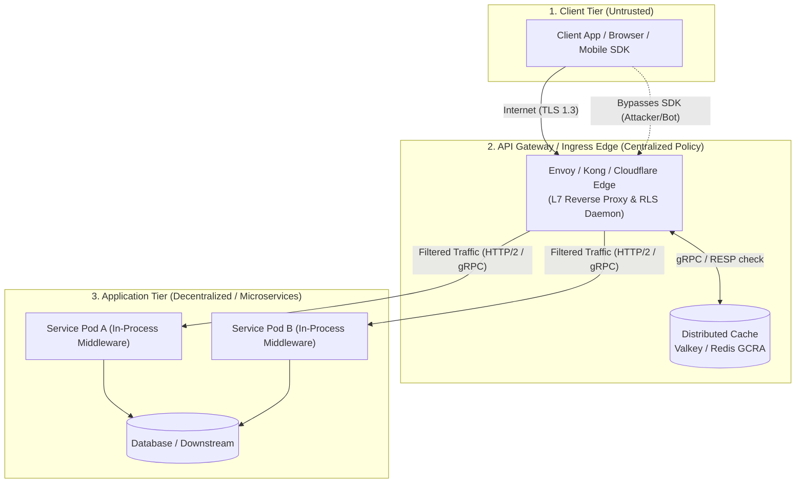

#### Placement Evaluation Matrix

| Architectural Tier | Implementation Mechanism | Trust Boundary | Compute & Overhead Impact | Failure Modes & Limitations | Ideal Use Case |
| --- | --- | --- | --- | --- | --- |
| **Client-Side SDK** | Mobile SDK / Frontend JS interceptor / gRPC client channel interceptor | **Untrusted**. Clients control execution and runtime memory. | Zero server compute; sheds traffic before entering egress network. | Malicious actors easily bypass client code via curl/scripts; clock tampering; cannot coordinate across multiple devices. | Voluntary client pacing; polite API consumption; backoff honoring `Retry-After`. |
| **In-Application Middleware** | Express, Spring Boot, or Django middleware filters inside service containers | **Trusted**. Executes within private application network. | High server CPU overhead: requires full TLS handshake, HTTP payload parsing, and route matching before rejecting. | Duplicates limiter logic across polyglot microservice fleets; uncoordinated local counters behind LBs cause $N \times L$ over-admission. | Complex domain-specific quotas requiring user database lookups (e.g., monthly billing tiers, Stripe worker load shedding). |
| **API Gateway / Ingress Tier** | L7 Reverse Proxy (Envoy, Kong, AWS API Gateway, Cloudflare Edge) | **Trusted**. Centralized perimeter defense at network boundary. | Minimal backend overhead: terminates TLS and rejects early with `429` before downstream app pods consume CPU or threads. | Requires external distributed cache (Redis/Valkey) or gRPC RLS hop; coarse-grained unless JWT tokens are decoded at edge. | Global perimeter defense; IP-based anti-scraping; credential stuffing protection; cross-cutting API token throttling. |

#### Architectural Recommendation: The Layered Perimeter Pattern

Modern distributed architectures reject an "either/or" choice in favor of a **three-tier defense-in-depth model**:

1. **Edge Ingress / WAF Tier**: Cloudflare or AWS CloudFront terminates TLS and executes coarse IP-based and geographical sliding-window rate limiting to block volumetric Layer 7 DDoS and bot scraping at line rate.
2. **API Gateway / Envoy Tier**: The perimeter API Gateway decodes authentication tokens (JWTs) and executes GCRA rate limiting against Redis/Valkey clusters for per-user and per-API-key quota enforcement, returning `429` and `Retry-After` before requests touch downstream microservice pods.
3. **Internal Microservice Tier**: Individual backend services employ local adaptive concurrency limits (Netflix Gradient2) and bulkheads to bound in-flight database connections and protect internal queues from cross-service cascade failures.

---

## 2. Rate Limiting Algorithms and Formal Proofs

The algorithms below are implemented and proven in `../examples/02-rate-limiters.test.ts` using a deterministic `FakeClock`. The negative tests matter as much as the positive ones: a limiter that passes the happy path can still admit a double-rate burst at a window boundary.

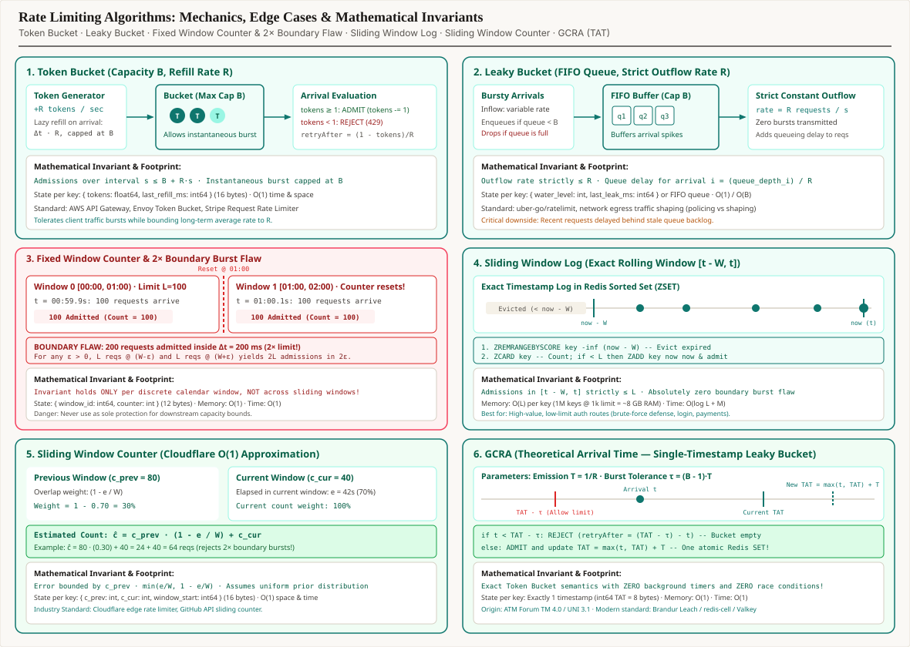

### 2.1 Token Bucket

A token bucket has capacity $B$ and refills at rate $R$. State per key is a real-valued token count and a last-refill timestamp. On arrival, elapsed time is multiplied by $R$ and added to the token count, capped at $B$; if at least one token is present, one token is consumed and the request is admitted, otherwise it is rejected with a `retryAfter` equal to the time needed to grow one token.


_Step-by-step mechanics:_ (1) Tokens refill continuously at rate $R$ up to bucket ceiling $B$. (2) An arriving request consumes `1` token and passes immediately (permitting bursts up to $B$). (3) When the bucket hits `0` tokens, subsequent arrivals are rejected with `429` and `Retry-After` until the next token accrues.

The invariant is: over any interval of length $s$, the number of admissions is at most $B + R s$. The bucket can discharge its full capacity $B$ instantly (a controlled burst), and thereafter admits at exactly rate $R$. This is the right model for a client that may burst but must settle to a steady rate. The `TokenBucketLimiter` in `../examples/02-rate-limiters.test.ts` uses `capacity` and `refillRatePerSec`, starts full, and computes `retryAfterMs` from the missing token fraction.

### 2.2 Leaky Bucket

A leaky bucket (or leaking bucket) is the dual shape: requests enter a bounded FIFO queue of capacity $B$, and the queue drains at a strict constant rate $R$. A request is admitted only if the queue has room; once admitted, it leaves the bucket at rate $R$ regardless of arrival pattern. The output is therefore perfectly smoothed — no burst ever exceeds $B$, and the outflow never exceeds $R$ — at the cost of delaying requests that arrive faster than $R$.


_Step-by-step mechanics:_ (1) Bursty incoming requests enter the bounded FIFO queue of capacity $B$. (2) Any arrival finding the queue full overflows and is immediately rejected with `429`. (3) Admitted requests leak out of the bucket bottom at a strictly uniform rate $R$.

Where a token bucket allows a burst of $B$ and then rate $R$, a leaky bucket never lets the outflow exceed $R$. Use a token bucket when a controlled burst is acceptable (a user refreshing a page); use a leaky bucket when the downstream requires a strictly constant offered load (a third-party API that throttles on instantaneous rate). The `LeakyBucketLimiter` in `../examples/02-rate-limiters.test.ts` models this lazily without background timers by draining the water/queue level proportionally to elapsed clock ticks (`elapsed * drainRatePerMs`), admitting while `level + 1 <= capacity`, and returning `retryAfterMs` for the drain time needed to free one slot.

### 2.3 Fixed Window Counter and the 2× Boundary Burst Flaw

The fixed window counter is the simplest limiter: divide time into windows of length $W$, keep a counter per key per window, admit while `count < L`, and reset the counter when the window identifier changes. It is also the most dangerous.

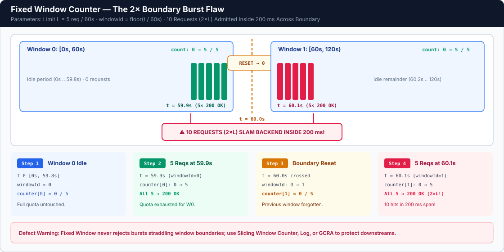

_Step-by-step mechanics:_ (1) Window 0 (`0–60 s`) counts arrivals up to $L$ and resets sharply to `0` at the `60 s` boundary. (2) A burst of $L$ requests at `59.9 s` fills Window 0, and a second burst of $L$ requests at `60.1 s` fills Window 1. (3) The backend receives $2L$ requests inside `200 ms` while both fixed windows report full compliance.

**Negative case.** Let the limit be $L$ per $60\text{ s}$ window. Send $L$ requests at $t = 59.9\text{ s}$ and another $L$ requests at $t = 60.1\text{ s}$. The first batch lands in window $[0, 60)$ and is fully admitted; the second batch lands in window $[60, 120)$ and is also fully admitted. The backend receives $2L$ requests inside $200\text{ ms}$ — double the configured rate — while the limiter reports full compliance in both windows. In general, for any $\varepsilon > 0$, $L$ requests at $W - \varepsilon$ and $L$ requests at $W + \varepsilon$ produce $2L$ admissions in $2\varepsilon$, so the effective instantaneous rate is unbounded as $\varepsilon \to 0$.

The example proves this exactly: at `t = 59,999 ms` the fixed window admits 10 requests; at `t = 60,001 ms` it admits 10 more; the total is 20 within 2 ms, while the sliding-window log, sliding-window counter, and GCRA reject the second batch. The fixed window is acceptable only when the window boundary burst cannot hurt the downstream, or when it is wrapped in a second layer of defense.

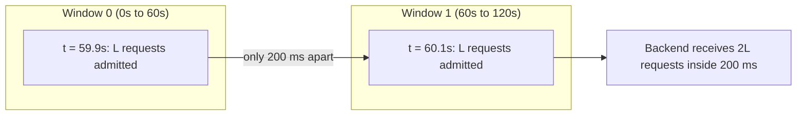

### 2.4 Sliding Window Log

The exact fix is to store the timestamp of every admitted request for a key and, on each arrival, evict timestamps older than $W$ and count the remainder. If the count is below $L$, admit and append the new timestamp. This is exact: it counts precisely the requests in $[t - W, t]$, so it cannot admit a boundary burst.


_Step-by-step mechanics:_ (1) Each arrival slides the `[now - W, now]` window forward and prunes expired timestamps older than `now - W`. (2) Remaining timestamps in the sorted log are counted (`ZCARD`). (3) If count `< L`, the new timestamp is appended and admitted; otherwise the arrival is rejected with `retryAfterMs` equal to the oldest surviving timestamp's remaining lifetime.

The cost is memory and time. The state is $O(L)$ per key — for a limit of 1,000 requests per minute and 1,000,000 active keys, the limiter holds up to one billion timestamps — and each decision is $O(L)$ without a careful data structure. Sliding window logs are right for low-limit, high-value keys (login attempts, password resets, payment initiation) where exactness matters and the key population is small. The `SlidingWindowLogLimiter` in `../examples/02-rate-limiters.test.ts` proves both exact pruning across arbitrary arrival traces and strict rejection of the $2\times$ boundary burst at `t = 60,001 ms`.

### 2.5 Sliding Window Counter

The sliding window counter keeps only two integers per key: the count in the current window and the count in the previous window. At time $t$, with $e$ elapsed in the current window, the estimate is:

$$
\hat{c} = c_{prev} \cdot \left(1 - \frac{e}{W}\right) + c_{cur}
$$


_Step-by-step mechanics:_ (1) Only two integer counters (`prevCount` and `curCount`) are stored per key in $O(1)$ space. (2) At elapsed offset $e$ inside the current window, the sliding overlap fraction `(1 - e/W)` weights `prevCount` and sums it with `curCount`. (3) If the weighted estimate plus `1` exceeds $L$, the arrival is rejected without maintaining per-request logs.

The previous window's count is weighted by the fraction of it that still overlaps the sliding window. This is an approximation: it assumes the previous window's requests were uniformly distributed, so it can over- or under-count near the boundary, but it uses $O(1)$ memory per key and $O(1)$ time per decision. In the example, the limiter rejects the 2× boundary burst that defeats the fixed window, because the weighted previous count keeps the estimate at the limit. The error is bounded by the previous window's count times the smaller of the two weights, so it never exceeds $c_{prev}$; for a well-provisioned limit this is far more accurate than a fixed window and far cheaper than a log.

### 2.6 GCRA: Generic Cell Rate Algorithm

The **Generic Cell Rate Algorithm** (GCRA), borrowed from ATM traffic policing, achieves exact token-bucket semantics with a single timestamp per key and no background refill timer. Define the emission interval $T = 1/R$ and the delay variation tolerance $\tau = (B - 1)T$. State per key is the **Theoretical Arrival Time (TAT)**, the time at which the next conformant cell would depart if the bucket were full.

On arrival at time $t$:

1. If $t < \text{TAT} - \tau$, reject the request; it would arrive before the bucket has drained enough.
2. Otherwise set $\text{TAT} = \max(t, \text{TAT}) + T$ and admit.

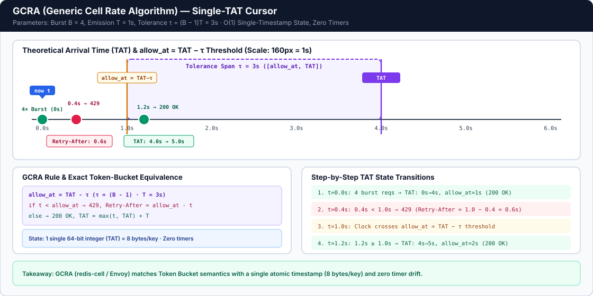

_Step-by-step mechanics:_ (1) Each key stores only one scalar `TAT` timestamp (`8` bytes). (2) On arrival at time $t$, the limiter checks whether $t \ge \text{TAT} - \tau$ (within burst tolerance). (3) Admitted requests advance `TAT = max(t, TAT) + T`, while early arrivals ($t < \text{TAT} - \tau$) fail with exact `Retry-After = (TAT - tau) - t`.

The invariant is exact: at most $B$ requests can be admitted in an instantaneous burst, and thereafter one request per $T$. Because the state is one number, memory is $O(1)$ per key; because time is derived from the arrival timestamp, there are no refill threads, no timer wheels, and no clock-skew drift between a background refill and the request path. The example implements GCRA with integer `BigInt` arithmetic scaled by the limit, so repeated decisions do not accumulate floating-point error, and the property test asserts that no interval ever admits more than `burst + floor(limit * elapsed / period)`.

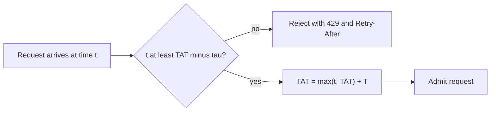

### 2.7 Worked Decisions Across Algorithms

A concrete trace makes the boundary flaw and the fixes tangible. Let $L = 10$, $W = 60\text{ s}$, and consider 20 requests: 10 at $t = 59.9\text{ s}$ and 10 at $t = 60.1\text{ s}$. GCRA uses burst $B = 10$ and emission interval $T = 6\text{ s}$, so its delay variation tolerance is $\tau = (B - 1)T = 54\text{ s}$.

| Arrival | Fixed Window | Sliding Window Counter | GCRA | Backend Effect |
| --- | --- | --- | --- | --- |
| 10 requests at 59.9 s | 10 admitted (window 0) | 10 admitted | 10 admitted (burst) | 10 requests |
| 10 requests at 60.1 s | 10 admitted (window 1) | 0 admitted (weighted estimate at the limit) | 0 admitted (TAT is 119.9 s, allow-at 65.9 s) | fixed window: 20 in 200 ms; others: 10 total |

The fixed window is the only algorithm that doubles the backend load. The sliding window counter rejects because the previous window's count is weighted by the overlap fraction, and GCRA rejects because the Theoretical Arrival Time is still in the future. Both rejections are correct: the sliding window is $200\text{ ms}$ into a new window, but the requests in the previous window are still inside the sliding interval, and GCRA's bucket has not drained.

### 2.8 Choosing an Algorithm

The decision order is: downstream tolerance first, key cardinality second, operational constraints third.

- If the downstream requires a strictly constant outflow, use a **leaky bucket**; if it tolerates a controlled burst, use a **token bucket** or **GCRA**.
- If the key population is small and the limit is low (login, payment initiation), the **sliding window log** is exact and its memory is affordable.
- If the key population is large (per-user API quotas at millions of keys), use **GCRA** for exact semantics or the **sliding window counter** for an $O(1)$ approximation.
- If the downstream is a shared dependency whose capacity is smaller than the sum of callers, put a **global limiter** in front of it, not only per-key limiters.
- Never use a **fixed window** as the sole protection for a capacity-bound downstream; its boundary burst is a correctness defect, not a tuning issue.

### 2.9 Algorithm Comparison

| Algorithm | State per Key | Memory | Burst Behavior | Boundary Flaw | Exactness | Background Timers |
| --- | --- | --- | --- | --- | --- | --- |
| Fixed window counter | window id + count | $O(1)$ | Full limit per window | **Yes: 2× burst across boundary** | Exact per fixed window only | None |
| Sliding window log | last $L$ timestamps | $O(L)$ | Full limit per window | No | Exact over sliding window | None |
| Sliding window counter | two counts | $O(1)$ | Weighted approximation | Mitigates (error $\le c_{\text{prev}} \cdot \min(e/W, 1 - e/W)$) | Approximate | None |
| Token bucket | tokens + timestamp | $O(1)$ | Capacity $B$, then rate $R$ | No | Exact invariant | Lazy refill on arrival |
| Leaky bucket | queue level + timestamp | $O(1)$ | Never exceeds outflow $R$ | No | Exact outflow | Lazy drain on arrival |
| GCRA | one TAT timestamp | $O(1)$ | $B$ burst, then one per $T$ | No | Exact invariant | **None** |

The practical default for a distributed service is GCRA or a sliding window counter: both are $O(1)$ in memory, both reject the boundary burst, and both survive a key population in the millions. Reserve the sliding window log for low-limit, high-value keys where exactness is worth the memory.

---

## 3. Distributed Rate Limiting Architecture

A limiter inside one process is correct only if all traffic for a key passes through that process. Behind a load balancer with $N$ nodes, it is not. Distributed limiting is the problem of enforcing one global policy across many independent decision points.

### 3.1 The Per-Node Trap

Suppose $N$ service instances each run an in-memory limiter with limit $L$, and a round-robin load balancer spreads a client's requests across all $N$ nodes. The client can send up to $N \times L$ requests and be admitted on every one, because each node sees only $L$ of them. The effective cluster limit is $N \times L$, not $L$ — a silent $N\times$ over-admission.

The example proves this with four token-bucket nodes and a round-robin cluster limiter: 41 requests for one key are offered, and exactly 40 are admitted ($4 \times 10$), while the intended limit was 10. Per-node limiting is therefore not a global rate limiter; it is a per-node circuit breaker that protects the local instance from its share of the load. It is useful, but it cannot enforce a tenant quota or a downstream capacity bound.

### 3.2 Centralized Redis with Atomic Lua

The standard fix is a centralized authority that every node consults. Redis is the common choice because its single-threaded command execution makes a check-and-update atomic, and Lua scripts execute atomically inside that event loop.

The race that must be avoided is `GET`-then-`SET`. If two requests both read `remaining = 1`, both decide to admit, and both write `remaining = 0`, the limiter admits two requests for one token. The fix is a Lua script that reads the state, applies the algorithm, and writes the new state in one atomic execution:

```lua
-- GCRA in Redis: KEYS[1] = limiter key, ARGV = { now_ms, period_ms, limit, burst }
local key         = KEYS[1]
local now_ms      = tonumber(ARGV[1])
local period_ms   = tonumber(ARGV[2])
local limit       = tonumber(ARGV[3])
local burst       = tonumber(ARGV[4])
local emission_ms = period_ms / limit
local tau_ms      = (burst - 1) * emission_ms
local tat         = tonumber(redis.call('GET', key) or now_ms)
local allow_at    = tat - tau_ms
if now_ms < allow_at then
  return {0, math.ceil(allow_at - now_ms)}
end
local new_tat = math.max(now_ms, tat) + emission_ms
redis.call('SET', key, tostring(new_tat), 'PX', math.max(1, math.ceil(period_ms + tau_ms))) -- TTL avoids unbounded key growth
return {1, 0}
```

Scripts are loaded once with `SCRIPT LOAD` and invoked with `EVALSHA`, so the script body is not re-sent on every request. Redis guarantees the script runs atomically, so the `GET`-then-`SET` race disappears.

The trade-offs are latency and availability. Every limited request now pays an extra Redis round trip — sub-millisecond in the same availability zone, more across regions — and Redis becomes a hard dependency on the request path. Two failure policies follow:

- **Fail open**: if Redis is unavailable, allow the request. Availability is preserved, but the downstream loses its protection exactly when the system is already stressed.
- **Fail closed**: if Redis is unavailable, reject the request. The downstream is protected, but a Redis outage becomes a full service outage.

The common compromise is fail open with a local fallback limiter and a circuit breaker, so a Redis blip degrades to per-node protection rather than a total outage. Operational hazards remain: a hot key concentrates on one hash slot, a long Lua script blocks the single-threaded event loop for every client, and key memory grows without TTLs. Redis Lua scripting and the five Redis limiter realisations are owned by [`technologies/redis`](../../../technologies/redis/README.md); the system-design delta is the distributed architecture and the fail-open/fail-closed decision. The integration proof lives in `../examples/08-redis-integration.test.ts`.

### 3.2.1 Atomic Lua Defense Against INCR/EXPIRE and Sliding Window Log Races

Two catastrophic race conditions plague distributed rate limiters when operations are naively executed across multiple network round trips:

#### The `INCR` + `EXPIRE` Immortal Key Leak

In naive implementations of fixed window or counter limiters, developers frequently write two separate Redis commands:

```python
# Naive race condition vulnerability
count = redis.incr(key)
if count == 1:
    redis.expire(key, 60)
```

If the application process crashes, is killed by an out-of-memory (OOM) killer, or suffers an abrupt network timeout between `INCR` and `EXPIRE`, the key is created with **no expiration** (`TTL = -1`). The counter increments indefinitely with subsequent requests and never resets. Once it crosses the limit, the user or API key is permanently locked out of the service until an operator manually discovers and flushes the key. The fix is either leak-free TTL setup via `SET key 1 EX 60 NX` followed by `INCR` (TTL is preserved on `INCR`, though two commands are still non-atomic for concurrent counting), or wrapping the entire check-increment-expire sequence inside a single atomic Lua script executed via `EVALSHA`.

#### The Sliding Window Log Sorted Set (ZSET) Race Condition

A sliding window log implemented across separate round trips (`ZREMRANGEBYSCORE` $\to$ `ZCARD` $\to$ `ZADD`) suffers from a classic Time-of-Check to Time-of-Use (TOCTOU) concurrency defect. If two client requests arrive simultaneously when `ZCARD` equals $L - 1$, both round trips observe that capacity remains, both issue `ZADD`, and $L + 1$ requests are admitted. The production solution is a complete atomic Lua script:

```lua
-- Atomic Sliding Window Log in Redis/Valkey (EVALSHA)
-- KEYS[1] = limiter key (e.g., "ratelimit:login:{user_123}")
-- ARGV[1] = current_time_ms (from server monotonic clock or Redis TIME)
-- ARGV[2] = window_ms (e.g., 60000 for 1 minute)
-- ARGV[3] = limit (e.g., 100)

local key          = KEYS[1]
local now_ms       = tonumber(ARGV[1])
local window_ms    = tonumber(ARGV[2])
local limit        = tonumber(ARGV[3])
local clear_before = now_ms - window_ms

-- Step 1: Atomically prune elements older than the rolling window
redis.call('ZREMRANGEBYSCORE', key, '-inf', clear_before)

-- Step 2: Count remaining active timestamps within the rolling window
local current_count = redis.call('ZCARD', key)

if current_count < limit then
  -- Step 3a: Under limit - record arrival timestamp as both member and score
  redis.call('ZADD', key, now_ms, tostring(now_ms) .. ':' .. tostring(redis.call('INCR', key .. ':seq')))
  redis.call('EXPIRE', key, math.ceil(window_ms / 1000) + 1)
  redis.call('EXPIRE', key .. ':seq', math.ceil(window_ms / 1000) + 1)
  return {1, limit - current_count - 1, 0} -- {admitted, remaining, retry_after_sec}
else
  -- Step 3b: Over limit - compute exact seconds until the oldest timestamp expires
  local oldest = redis.call('ZRANGE', key, 0, 0, 'WITHSCORES')
  local retry_after_sec = 0
  if #oldest > 0 then
    local oldest_time = tonumber(string.match(oldest[1], '^(%d+)')) or tonumber(oldest[2])
    retry_after_sec = math.max(0, math.ceil(((oldest_time + window_ms) - now_ms) / 1000))
  end
  return {0, 0, retry_after_sec} -- {admitted, remaining=0, retry_after_sec}
end
```

Executing this logic within a single `EVALSHA` call guarantees that Redis's single-threaded command processor evaluates the pruning, counting, and insertion atomically, eliminating all TOCTOU over-admission.

### 3.3 Local-Quota Batching and Hierarchical Synchronization

At 1M+ RPS, a Redis hop per request is too expensive: even at 0.2 ms per operation, 1M RPS consumes 200 seconds of Redis time per second, requiring a large cluster and adding tail latency to every request. The remedy is **local-quota batching** (hierarchical synchronization).

Each worker holds a local quota bucket and enforces it in memory. Periodically — say every $T = 1\text{ s}$ — the worker asks a central authority for a chunk of $C$ tokens, where $C$ is a fraction of its expected rate times $T$. The worker then admits requests locally until the chunk is exhausted, at which point it either fetches another chunk or rejects. The central authority sees one request per worker per interval instead of one per client request, a reduction by the chunk factor.

The cost is a bounded overshoot. If a worker's chunk is $C$ and there are $N_w$ workers, the cluster can over-admit by at most $N_w \times C$ in the worst case before the next synchronization. The design rule is to size $C$ so that $N_w \times C$ is an acceptable burst, and to set the synchronization interval short enough that the overshoot window is small. A hybrid is common: a centralized GCRA for strict tenant quotas on expensive operations, and local token buckets for high-volume, low-risk reads.

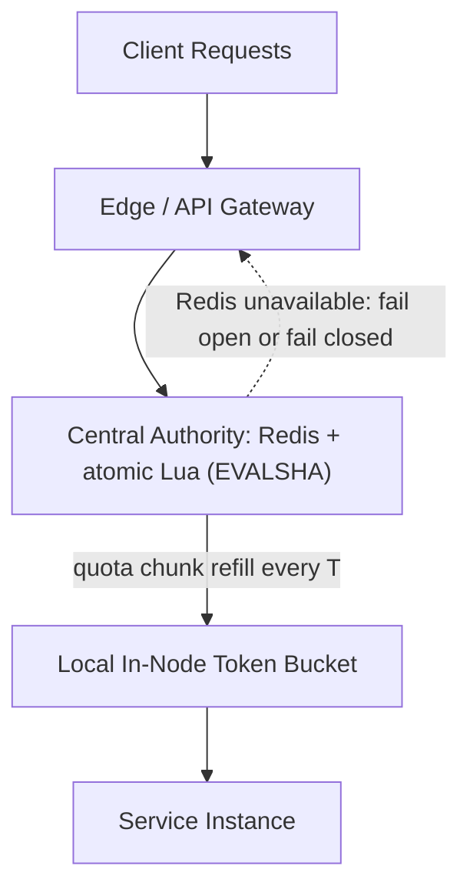

### 3.4 Clock Skew, Out-of-Order Arrivals, and Key Expiry

Distributed limiters are time-dependent, so time itself is a design input. A client-supplied timestamp can be forged or skewed; a server clock can step backwards after an NTP correction; and requests can arrive out of order after a retry or a load-balancer replay.

The rules that keep a limiter correct under bad time:

- Use a **server-side monotonic clock** for the decision, or Redis `TIME` inside the Lua script, so client clocks cannot inflate a quota. Redis `TIME` is atomic with the script but adds a command; a caller-server timestamp is cheaper but trusts the caller's clock.
- If the clock steps backwards, **clamp** the new time to the last observed time rather than allowing a negative elapsed interval. A negative interval would refill a token bucket beyond capacity or push a GCRA TAT into the past, granting a free burst.
- For GCRA, an out-of-order arrival with $t < \text{TAT} - \tau$ is rejected, which is correct; do not try to reorder arrivals, because the limiter's job is to police the stream as observed.
- Set a **key TTL** at least as long as the window. A TTL shorter than the window silently resets the limiter and admits a fresh burst; a TTL much longer than the window grows memory without helping. A common choice for generic window limiters is $2W$ so a key survives one idle window and expires after two, whereas GCRA Lua scripts use $\text{period} + \tau$ because $\text{TAT}$ advances at most $B \cdot T = \tau + T$ ahead of `now`.
- In a Redis Cluster, all keys touched by one Lua script must live in the same hash slot; use hash tags (`{tenant-a}:user-1`) or the script will fail with a cross-slot error.

### 3.5 Observing the Limiter

A limiter that cannot be observed cannot be tuned. The minimum telemetry set is:

- **Admitted and rejected counts** per route and per policy, with `reject_reason` (limit, burst, downstream).
- **Remaining quota** and **`Retry-After` distribution**, so client behavior can be correlated with limiter decisions.
- **Limiter own latency**, including the Redis round trip and Lua errors, as an SLI separate from the business SLI.
- **Key cardinality and memory**, because a per-user limiter with no TTL is a memory leak that will OOM the store during a traffic surge.

Metric labels must stay bounded: do not put `user_id` or raw URL paths into labels (the cardinality trap owned by [the observability track](../../../technologies/observability/README.md)); aggregate by route template, tenant, and region, and put identifiers in logs and traces. Rejections are a controlled outcome, not an error: alert on a rising rejection rate (a client or an abuse campaign) and on limiter unavailability (a protection gap), but do not page on a single `429`.

### 3.6 Multi-Data-Center Synchronization and Edge Topologies

Deploying rate limiters across multi-region and multi-cloud architectures introduces physical speed-of-light constraints and partition vulnerabilities that make a single global state authority impractical.

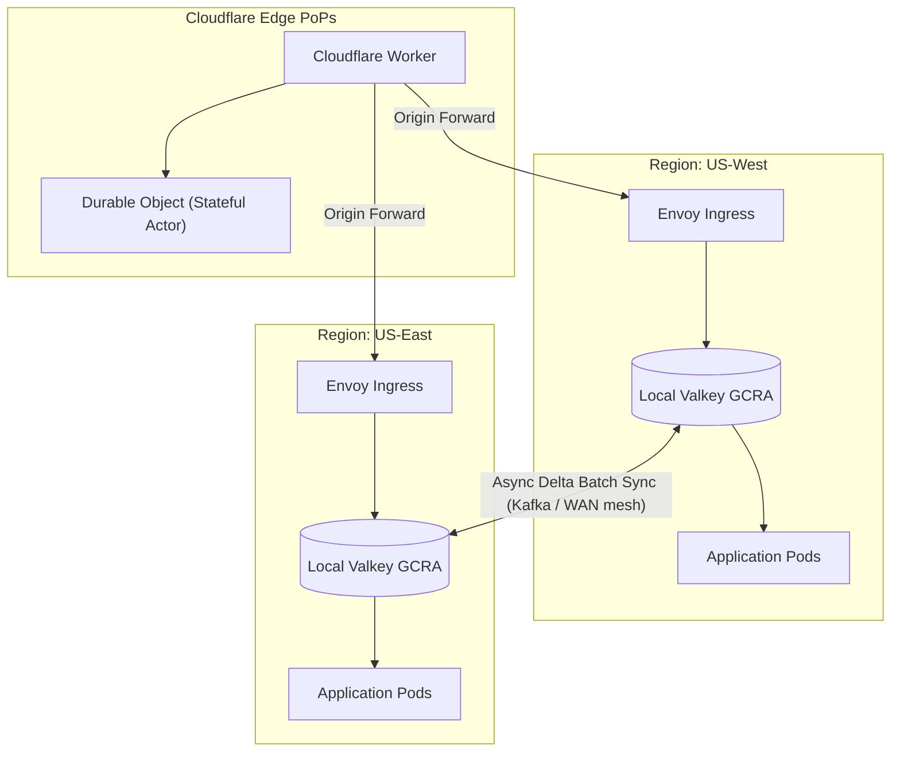

#### Multi-DC Architectural Topologies

1. **Centralized WAN Redis Cluster (Anti-Pattern)**:
   - Hosting a single Redis cluster in one primary region (e.g., `us-east-1`) and having edge proxies in Europe and Asia execute synchronous Lua checks adds $70\text{ ms} - 180\text{ ms}$ of latency to every single incoming request.
   - If the cross-region WAN link degrades or the primary region fails, the global edge must either fail closed (shutting down all international operations) or fail open (exposing backend databases to unthrottled surges).
2. **Static Regional Quota Partitioning**:
   - The global quota $L$ is statically partitioned across $M$ regional data centers based on historical traffic weight: $L_r = w_r \cdot L$ (e.g., US-East receives 50%, US-West 30%, EU-Central 20%).
   - **Failure Mode**: Rigidity under traffic skews. During regional DNS failovers or night-time diurnal shifts, users in one region are aggressively throttled despite ample global capacity lying idle in other regions.
3. **Asynchronous Cross-DC Synchronization with Delta Batching**:
   - Each data center enforces rate limits locally against a regional in-memory Valkey/Redis instance using GCRA.
   - Background worker processes periodically aggregate admitted request deltas ($\Delta c_r$) over a brief interval (e.g., $T_{\text{sync}} = 500\text{ ms}$) and broadcast these deltas across data centers via Kafka or a lightweight peer-to-peer mesh.
   - **Trade-off Analysis**: This design embraces **eventual consistency**. During WAN network partitions or replication lag, total admissions can transiently overshoot the global ceiling by at most $M \cdot \Delta c \cdot T_{\text{sync}}$. Because rate limiting is an admission-control defense rather than an ACID financial ledger, accepting a bounded $3\%\text{--}5\%$ overshoot during transient network anomalies is vastly superior to imposing $150\text{ ms}$ latency penalties or risking global downtime.
4. **Edge Computing with State Locality (Cloudflare Durable Objects)**:
   - Modern edge compute platforms (Cloudflare Workers, Fastly Compute) employ consistent hashing on client identifiers (`user_id` or `api_key`) to route requests to a single stateful edge actor (e.g., a Cloudflare Durable Object).
   - Rate limiting decisions evaluate in-memory within $< 1\text{ ms}$ directly at the edge Point of Presence (PoP), terminating unauthorized or throttled traffic before packets ever traverse the origin backhaul network.

---

## 4. Load Shedding, Queueing Theory, and Tail Latency Proofs

Rate limiting prevents overload at the edge; load shedding contains it when the overload has already arrived. Both are governed by the same queueing math.

### 4.1 M/M/1 and M/M/c Latency Knee

For an M/M/1 queue with arrival rate $\lambda$ and service rate $\mu$, utilization is $\rho = \lambda / \mu$. The mean queue wait and mean sojourn time are:

$$
W_q = \frac{\rho}{\mu (1 - \rho)} \qquad W = \frac{1}{\mu - \lambda}
$$

The critical property is the denominator $1 - \rho$. At $\rho = 0.5$, $W_q = 1/\mu$ — the wait equals one service time. At $\rho = 0.8$, $W_q = 4/\mu$. At $\rho = 0.95$, $W_q = 19/\mu$. As $\rho \to 1$, $W_q \to \infty$ while throughput remains $\mu$. This is the **latency knee**: a server is not "almost fine" at 95% utilization; it is already paying twenty times its service time in queueing delay, and a small traffic increase pushes it over the cliff.

For $c$ identical servers (M/M/c), $\rho = \lambda / (c\mu)$ and the mean wait is:

$$
W_q = \frac{P_{\text{wait}}}{c\mu - \lambda}
$$

where $P_{\text{wait}}$ is the Erlang C probability that an arrival must queue. The same $1/(c\mu - \lambda)$ blow-up appears. Capacity planning therefore targets a utilization ceiling — often 60–70% for latency-sensitive services — so that a traffic spike or a failing instance does not push the surviving capacity past the knee. Little's Law, $L = \lambda W$, converts the latency target into a concurrency bound: a service with $\lambda = 10{,}000$ requests/s and a $100\text{ ms}$ latency budget may hold at most $L = 1{,}000$ requests in flight; beyond that, either latency or rejection must grow.

### 4.2 LIFO versus FIFO Under Overload

When a queue is saturated and clients have a deadline $T_{to}$, the service discipline decides whether the server does useful work. Under **FIFO**, the head of the queue is the oldest request. In sustained overload, the oldest requests are precisely the ones that have already waited past their deadline; the server spends its capacity serving requests the client has already abandoned. Goodput — the fraction of requests completed within deadline — collapses toward zero even though the server is 100% busy.

Under **LIFO**, the head of the queue is the newest request, which is the most likely to still be within its deadline. The server always works on fresh requests, so goodput stays high even while the queue grows. This is the principle behind **CoDel** (Controlled Delay), which drops packets from the queue when their sojourn time exceeds a target, and behind **adaptive concurrency limits** (Vegas, Gradient, Netflix Concurrency Limits), which estimate the inflight capacity of a dependency and reject anything above it.

The example's `simulateQueueing` proves the contrast: with the same arrival rate, service rate, and deadline, FIFO's `goodputFraction` collapses under sustained overload while LIFO's stays near the server's service capacity. The rule for a latency-sensitive service is: when overloaded, shed or reorder so the server works on requests that can still succeed, and make the rejection explicit rather than serving a queue of expired work.

### 4.3 Priority-Based Load Shedding

Not all requests are equal. Priority-based shedding classifies traffic and drops the low-value work first: batch and analytics jobs before asynchronous notifications, notifications before reads, reads before checkout, and checkout before authentication. The implementation is a small set of priority queues or weighted fair queues, plus an explicit policy for what is dropped at each load level.

The policy must be designed before the incident. If the system sheds arbitrarily, it will shed the requests that are cheap to serve rather than the ones that matter least. A well-designed shed returns `503` with `Retry-After` for the low-priority class and keeps the high-priority path fully available, so a background analytics backlog can grow without taking down checkout.

### 4.4 Fan-Out Tail Latency Amplification

A request that calls $n$ downstream services in parallel inherits the worst of all of them. If each downstream is slow with probability $p$ (for example $p = 0.01$ at the $p_{99}$ tail), the probability that at least one of $n$ independent calls is slow is:

$$
P(\text{slow}) = 1 - (1 - p)^n
$$

For $n = 100$ and $p = 0.01$, $P(\text{slow}) = 1 - 0.99^{100} \approx 0.634$. A service that calls one hundred dependencies, each of which is "99% fast", is slow on roughly 63% of its requests. This is the "tail at scale" amplification: the fan-out multiplier turns per-dependency tail latencies into a dominant user-visible latency.

The mitigation is not to make every dependency faster; it is to stop waiting for the straggler. Two techniques do this:

- **Hedged requests**: issue a backup request to a second backend if the primary has not responded by a delay $D$, typically the $p_{95}$ latency. Take the first response and cancel the loser. The extra load is $P(\text{latency} > D) \le 1 - 0.95 = 5\%$, while the $p_{99}$ collapses toward the hedge delay plus a fast response. Hedges must be idempotent and must be suppressed when the dependency is already overloaded, or they become a retry storm.
- **Tied requests**: send the request to two backends immediately, use the first response, and cancel or deprioritize the second. Tied requests bound the tail more aggressively but cost more extra load than hedged requests.

The example's `simulateFanOut` measures both `slowHitFraction` and `extraRequestFraction`: hedging at the $p_{95}$ delay keeps the extra load at or below 5% while cutting the slow fraction dramatically.

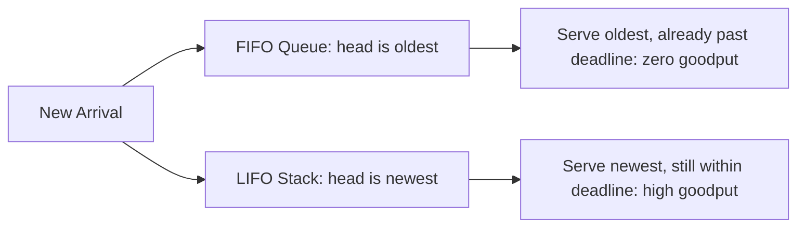

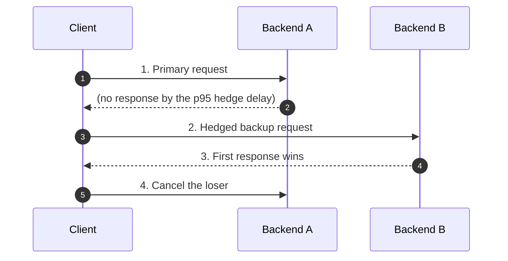

### 4.5 Admission Control and Adaptive Concurrency Limits

Rate limiting and concurrency limiting are complementary: a rate limiter bounds arrivals per key, while a concurrency limit bounds how many requests may be inflight against a dependency at once. Little's Law connects them: with latency $W$, the maximum sustainable throughput at concurrency $L$ is $\lambda_{\max} = L / W$. A dependency that suddenly slows from $50\text{ ms}$ to $500\text{ ms}$ cannot sustain the same concurrency, so either throughput falls or the queue grows; an adaptive concurrency limit detects the slowdown and reduces $L$ before the queue explodes.

#### Google SRE Client-Side Adaptive Throttling

When a backend cluster is overloaded, Google SRE (Site Reliability Engineering, Ch. 21) introduces client-side adaptive throttling. Instead of relying solely on the server to reject requests, each client tracks the rolling history of requests sent ($R_{\text{total}}$) and requests successfully accepted by the backend ($R_{\text{accept}}$). When the acceptance ratio drops below a threshold multiplier $K$, the client probabilistically drops outgoing requests locally:

$$
P_{\text{drop}} = \max\left(0, \frac{\text{requests} - K \cdot \text{accepts}}{\text{requests} + 1}\right)
$$

The standard tuning parameter is $K = 2$ (or $K = 1.5$ for aggressive protection). With $K = 2$, the client permits normal traffic as long as the backend accepts at least 50% of requests. As backend health deteriorates, $P_{\text{drop}}$ increases dynamically, preventing rejected requests from consuming network bandwidth or backend parsing CPU. Adding 1 to the denominator prevents division by zero when starting up.

#### Dynamic Concurrency Algorithms: Netflix Gradient2

Rather than hardcoding static in-flight concurrency caps, Netflix Concurrency Limits dynamically adjusts concurrency using congestion feedback:

- **Vegas-Style**: Compares observed RTT against the minimum baseline latency observed over a long rolling window ($\text{RTT}_{\text{min}}$). When queueing delay appears ($\text{RTT}_{\text{measured}} - \text{RTT}_{\text{min}} > \alpha$), concurrency shrinks.
- **Gradient2**: Evaluates the ratio between uncongested baseline latency and current measured latency:

$$
\text{gradient} = \frac{\text{RTT}_{\text{min}}}{\text{RTT}_{\text{measured}}}
$$

$$
\text{limit}_{t+1} = \text{limit}_t \cdot \text{gradient} + \text{margin}
$$

When downstream queues fill, $\text{RTT}_{\text{measured}}$ increases, driving $\text{gradient} < 1.0$. This pulls the inflight limit down multiplicatively. When latency recovers, the additive margin allows concurrency to probe upward linearly. This classic Additive Increase, Multiplicative Decrease (AIMD) dynamic protects downstream databases without requiring manual tuning during incidents.


_Step-by-step mechanics:_ (1) Google SRE client-side adaptive throttling computes $P_{\text{drop}} = \max(0, (\text{requests} - K \cdot \text{accepts}) / (\text{requests} + 1))$ locally to shed doomed traffic before it hits the network. (2) Netflix Gradient2 scales inflight concurrency multiplicatively via $\text{RTT}_{\min}/\text{RTT}_{\text{measured}}$ and probes linearly via `+ margin`. (3) A `p95` hedged request races replica B after delay $D$ and cancels straggler A (`<= 5%` extra load). (4) Under sustained overload with client deadlines, LIFO pops fresh arrivals to preserve goodput while FIFO wastes CPU on already-expired requests.

### 4.6 Worked Tail-Latency Example

The fan-out formula is easiest to internalize with a table. Let each dependency be slow with probability $p$ and let the caller wait for all $n$ dependencies:

| Fan-out $n$ | Per-dependency slow probability $p$ | $P(\text{slow}) = 1 - (1 - p)^n$ |
| ----------- | ----------------------------------- | -------------------------------- |
| 1           | 0.01                                | 0.010                            |
| 10          | 0.01                                | 0.096                            |
| 50          | 0.01                                | 0.395                            |
| 100         | 0.01                                | 0.634                            |
| 100         | 0.001                               | 0.095                            |

At $n = 100$ and $p = 0.01$, two out of three requests are slow. Improving every dependency from 99% to 99.9% fast cuts the slow fraction from 63.4% to 9.5%, but the structural fix is to stop waiting for the straggler: hedge at the $p_{95}$ delay, tie the two fastest candidates, or reduce the fan-out by caching and by collapsing parallel calls into one aggregated backend.

---

## 5. Retry Storms and Metastable Failures

The theory of retry amplification and metastable failure is owned by [`architecture/distributed-systems`](../../distributed-systems/README.md); this section composes the defenses.

A retry is a reasonable response to a transient failure and a catastrophic response to a sustained one. The danger is multiplication across layers. If three service layers each retry a failed call three times, the worst-case offered load is $3^3 = 27\times$ the original traffic: the top layer's three attempts each trigger three attempts in the middle layer, each of which triggers three in the bottom layer. A brief blip at the bottom becomes a 27-fold load at the bottom, which collapses it, which causes more timeouts, which causes more retries.

This is a **metastable failure** (formalized by Bronson et al., OSDI 2022): a transient trigger pushes the system from a stable, high-throughput operating state into an overloaded attractor state that is sustained by its own internal feedback loops. Even after the original trigger clears (e.g., a database failover completes or an external API recovers), the retry traffic, lock contention, and cache-stampede queries alone exceed total capacity. The system cannot recover without active operator intervention to break the loop.

The defenses, in order of importance:

1. **Exponential backoff with full jitter**. Sleep for $\text{random}(0, \min(\text{cap}, \text{base} \cdot 2^{\text{attempt}}))$ so retries from many clients do not synchronize. Full jitter is better than fixed backoff because it decorrelates the herd.
2. **Retry budgets**. Cap retries as a fraction of active requests — commonly 10% — so a dependency can never turn a small amount of failure into a large amount of traffic. The budget is a global valve, not a per-request permission.
3. **Per-dependency circuit breakers**. When a dependency's error rate crosses a threshold, trip the breaker and fail fast for a cooldown, shedding load so the dependency can recover. The breaker must be per dependency, not global, so one bad dependency cannot take down every call path.
4. **Bulkheads**. Isolate thread pools, connection pools, and queues per dependency so a slow dependency exhausts only its own resources and cannot starve the rest of the service.
5. **End-to-end deadline propagation**. Carry a deadline through the call chain (`grpc-timeout` in gRPC, a deadline header in HTTP) and cancel downstream work when the caller's deadline expires. A retry after the deadline is wasted work; propagating the deadline stops the cascade at the layer where the budget ran out.

The example's `simulateRetryStorm` contrasts `blind-3x-retry` (every failure injects three retries next tick) with `retry-budget-circuit-breaker` (a 10% retry budget plus a breaker that sheds to 50% of capacity when the failure rate exceeds 20%). The blind mode stays overloaded after the spike; the budgeted mode recovers.

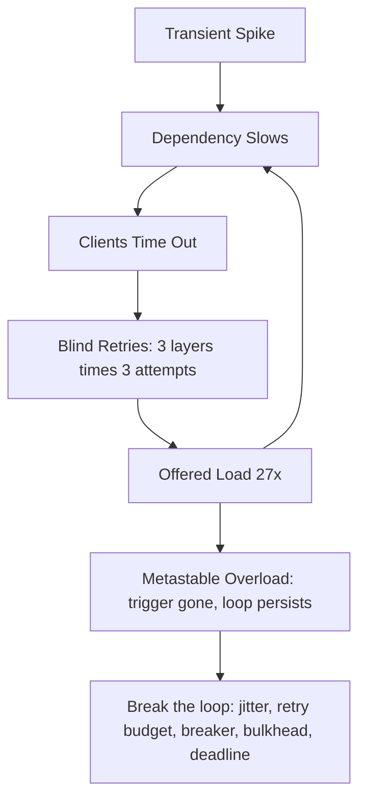

### 5.1 Retry Budget Math

A retry budget turns an unbounded amplification into a bounded one. Let $A$ be the number of active requests and $f$ the number that failed. A budget of $\beta = 0.1A$ allows at most $\min(f, \beta)$ retries, so the total offered load is $A + \min(f, \beta) \le 1.1A$: a failure storm can add at most 10% traffic, never the 27× of blind multi-layer retries. The budget should be enforced per dependency and per client, not only globally, so one tenant cannot consume the whole budget and leave others unprotected.

Full jitter is the companion rule. The sleep before attempt $k$ is:

$$
\text{sleep}_k = \text{random}(0, \min(\text{cap}, \text{base} \cdot 2^k))
$$

The exponential term grows the expected wait; the uniform random term decorrelates the retries of many clients. Without jitter, every client retries at the same backoff boundary and the retries arrive as a periodic herd; with full jitter, the retry stream is spread across the whole backoff interval.

### 5.2 Deadline Propagation in Practice

A retry after the caller's deadline has expired is wasted work that still consumes downstream capacity. Deadline propagation makes the remaining budget explicit: gRPC carries `grpc-timeout` in the request, HTTP services carry a deadline header, and each hop subtracts its own expected latency before calling the next dependency. When the remaining deadline is smaller than the expected downstream latency plus one retry, the caller fails fast instead of retrying.

The practical rules:

- Propagate the deadline, not just a per-hop timeout, so the whole chain shares one budget.
- Cancel in-flight downstream calls when the deadline expires; a cancelled call stops consuming capacity.
- Check the remaining deadline before every retry; never retry a request whose deadline has passed.
- Set the deadline from the user's latency budget, not from the sum of per-hop timeouts, which would multiply tail latency across the chain.

---

## 6. Then vs Now

| Era | Limiting Practice | Overload Practice | Resilience Practice |
| --- | --- | --- | --- |
| **Classical** | Fixed window counters; per-node memory only. | Unbounded queues; accept everything and hope. | Fixed retry counts; no jitter; no budgets. |
| **Transitional** | Sliding window logs for important keys; first centralized Redis limiters. | Bounded queues but FIFO service; no priority classification. | Per-service retries; simple circuit breakers; ad-hoc load shedding. |
| **Current** | GCRA / sliding window counter; centralized Redis Lua with fail-open fallback; hierarchical local quota at 1M+ RPS. | LIFO / CoDel / adaptive concurrency limits; priority tiers; explicit shed with `429` and `Retry-After`. | Full jitter, retry budgets, per-dependency breakers and bulkheads, end-to-end deadline propagation. |

The pattern is the same as in Module 07: make the failure explicit, bound it, and move the policy from implicit hope to an enforceable contract.

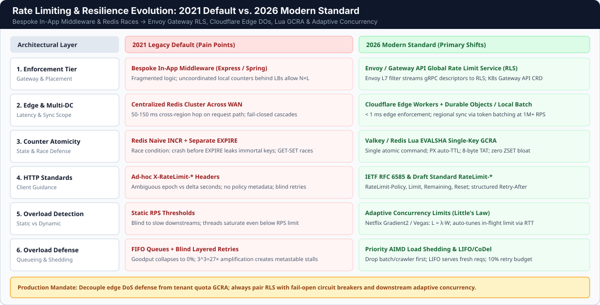

### 6.1 Architectural Evolution of Admission Control and Resilience (2021 vs. 2026)

Between 2021 and 2026, distributed systems experienced a profound shift from bespoke application middleware and brittle distributed counters toward cloud-native gateway rate-limiting services, edge actor computing, and queueing-aware adaptive concurrency control:

| Architectural Dimension | 2021 Legacy Default (Pain Points) | 2026 Modern Standard (Primary Shifts) | Production Impact & Rationale |
| --- | --- | --- | --- |
| **1. Enforcement Tier & Placement** | Bespoke In-App Middleware (Express, Spring Boot, Django filters) per microservice; fragmented logic; uncoordinated per-node local counters behind load balancers allow $N \times L$ over-admission. | Envoy / Gateway API Global Rate Limit Service (RLS); Envoy L7 rate-limit filter streams gRPC descriptors to an out-of-process RLS daemon; declarative Kubernetes Gateway API `RateLimitPolicy` CRDs. | Centralizes quota governance; decouples admission rules from polyglot app code; terminates abusive floods at the perimeter before app pods parse payloads. |
| **2. Edge & Multi-DC Topologies** | Centralized Redis Cluster across WAN; cross-region round trips add $50\text{ ms} - 150\text{ ms}$ latency to every request; fail-closed causes global cascading outages; high cross-AZ egress bills. | Edge Computing with State Locality (Cloudflare Workers + Durable Objects / Fastly Compute); sub-millisecond edge evaluation; hierarchical local-quota batching with asynchronous cross-region delta sync. | Eliminates cross-region WAN hops on critical path; moves defense to edge PoPs closest to users; bounds replication overshoot while guaranteeing regional survivability. |
| **3. Counter Atomicity & State Model** | Redis Naive `INCR` + Separate `EXPIRE` race condition (crashes leave immortal keys with `TTL = -1`); `GET`-then-`SET` lost updates; memory bloat from multi-megabyte Sliding Window Log ZSETs. | Valkey / Redis Lua `EVALSHA` Single-Key GCRA; atomic check-and-update executed in 1 round trip; auto-TTL via `PX`; single 64-bit integer TAT per key ($O(1)$ memory, 8 bytes). | Eliminates TOCTOU concurrency bugs; caps state to 8 bytes per key ($1\text{M}$ active users consume $< 16\text{ MB}$ RAM); eliminates background refill threads. |
| **4. HTTP Protocols & Client Guidance** | Ad-hoc, fragmented `X-RateLimit-*` headers; ambiguous Unix epoch seconds vs milliseconds; no standard policy discovery; clients retry blindly upon receiving `429`. | IETF RFC 6585 & Draft Standard `RateLimit-*` (`RateLimit-Policy`, `RateLimit-Limit`, `RateLimit-Remaining`, `RateLimit-Reset`); structured `Retry-After` in delta-seconds. | Standardizes client SDK backoff; delta-seconds eliminates client-server clock skew failures; `RateLimit-Policy` enables automated client-side token bucket calibration. |
| **5. Overload Detection & Concurrency** | Static Request-Rate Limits (RPS); blind to downstream database latency degradation; slow queries saturate thread and connection pools even under low request rates. | Adaptive Concurrency Limits rooted in Little's Law ($L = \lambda W$); Netflix Gradient2 / Vegas algorithms monitor RTT gradient inflation and dynamically throttle in-flight concurrency. | Automatically sheds load as downstream dependencies slow down, preserving service goodput without manual operational intervention during incidents. |
| **6. Queue Discipline & Load Shedding** | FIFO Queueing with Blind Timeouts; server CPU wasted processing already-abandoned requests; goodput collapses to near zero; layered retries create $3^3 = 27\times$ metastable storms. | Priority AIMD Load Shedding & LIFO/CoDel Service; sheds batch/crawler tiers first; LIFO serves fresh requests within client deadline; 10% retry budgets prevent metastable loops. | Preserves high goodput during massive traffic surges; breaks self-sustaining retry feedback loops; ensures revenue-critical checkout traffic succeeds. |

---

## 7. Production Failure Modes and Anti-Patterns

- **Fixed window at a busy boundary**: the limiter reports compliance while the backend receives double the rate. Use GCRA or a sliding window counter.
- **Per-node limiter presented as a global quota**: $N$ nodes admit $N\times$. Add a centralized or hierarchical authority.
- **`GET`-then-`SET` in Redis**: two concurrent requests both see the last token. Use an atomic Lua script and `EVALSHA`.
- **Fail-closed limiter on the critical path**: a Redis blip becomes a full outage. Fail open with a local fallback, or fail closed only for the highest-value keys.
- **Unbounded queue with FIFO service under overload**: the server works on expired requests and goodput collapses. Bound the queue, shed with priority, and serve LIFO when overloaded.
- **Fan-out without tail control**: $n$ dependencies at $p_{99}$ make the caller slow on $1 - 0.99^n$ of requests. Hedge at $p_{95}$, tie, or reduce fan-out.
- **Blind retries across layers**: $3^3 = 27\times$ amplification locks a recovering cluster in overload. Use full jitter, retry budgets, breakers, and bulkheads.
- **Hedging an already-overloaded dependency**: hedges add load exactly when the dependency can least absorb it. Suppress hedges when the dependency is degraded.
- **Deep health checks on the limiter or queue**: a dependency blip ejects every instance. Keep liveness local and fail readiness open on shared dependencies.
- **Unlimited limiter key cardinality**: per-user keys without TTL grow forever. Set TTLs and cap the key space.

---

## 8. Proof Map

| Module Claim | Executable Proof in `examples/` |
| --- | --- |
| Token bucket (`TokenBucketLimiter`) burst capacity and steady refill; `retryAfter` timing | `../examples/02-rate-limiters.test.ts` |
| Leaky bucket (`LeakyBucketLimiter`) bounded FIFO capacity, constant drain rate, and overflow rejection | `../examples/02-rate-limiters.test.ts` |
| Sliding window log (`SlidingWindowLogLimiter`) exact timestamp pruning and 2× boundary-burst immunity | `../examples/02-rate-limiters.test.ts` |
| Negative test: fixed window admits 2× at the boundary while sliding log, sliding counter, and GCRA reject | `../examples/02-rate-limiters.test.ts` |
| Negative test: $N$ per-node limiters behind round-robin allow $N\times$ the limit | `../examples/02-rate-limiters.test.ts` |
| Property test: GCRA never admits more than `burst + floor(rate * elapsed)` over arbitrary arrivals | `../examples/02-rate-limiters.test.ts` |
| M/M/1 and M/M/c latency knee, Little's Law, FIFO versus LIFO goodput under overload | `../examples/05-queueing-and-tail-latency.test.ts` |
| Fan-out tail amplification ($1 - 0.99^n$) and hedged-request extra load | `../examples/05-queueing-and-tail-latency.test.ts` |
| Retry amplification and metastable overload versus retry budget plus circuit breaker | `../examples/05-queueing-and-tail-latency.test.ts` |
| Redis atomic Lua limiter (`EVALSHA`) and distributed integration behavior | `../examples/08-redis-integration.test.ts` |

---

## 9. Design Checklist

- [ ] State the downstream's burst tolerance and steady-rate requirement before choosing an algorithm.
- [ ] Prove the limiter against a boundary trace, not only a uniform-arrival trace.
- [ ] Decide the key dimensions and whether each is enforced globally, per node, or hierarchically.
- [ ] Decide fail-open versus fail-closed, and make the local fallback explicit.
- [ ] Set key TTLs at or above the window, and cap cardinality.
- [ ] Bound every queue, and choose the service discipline (LIFO or CoDel) for the overload case.
- [ ] Classify requests into priority tiers and define what is shed at each load level.
- [ ] Control fan-out tail latency with hedges or ties, and suppress them when a dependency is degraded.
- [ ] Enforce a retry budget and full jitter, and propagate end-to-end deadlines.
- [ ] Alert on rejection rate, limiter unavailability, queue depth, and DLQ age, not on individual `429`s.

---

## Interview Drill

### Question 1: A fixed-window limiter is configured for 100 requests per minute, yet the backend sees 200 requests in 200 milliseconds. Explain the flaw and give two fixes.

<details><summary>Model Answer</summary>

The fixed window resets its counter on the window boundary, so it enforces the limit per window, not over any sliding interval. An attacker sends 100 requests at 59.9 seconds and 100 more at 60.1 seconds; both batches fall in different windows and are both fully admitted, giving 200 requests in 200 ms. In general, for any $\varepsilon$, $L$ requests at $W - \varepsilon$ and $L$ at $W + \varepsilon$ produce $2L$ admissions in $2\varepsilon$, so the instantaneous rate is unbounded as $\varepsilon$ shrinks. Fix one: a sliding window log, which stores the last $L$ timestamps and is exact but costs $O(L)$ memory per key. Fix two: a sliding window counter or GCRA, both $O(1)$ memory, both rejecting the boundary burst. GCRA is usually the best default because it also has exact token-bucket semantics and no background timers.
</details>

### Question 2: Why do $N$ in-memory limiters behind a round-robin load balancer admit $N\times$ the intended limit, and how do you fix it?

<details><summary>Model Answer</summary>

Each node sees only the share of a client's requests that the load balancer routes to it. With $N$ nodes and a per-node limit $L$, a client can send $L$ requests to each node and be admitted on all of them, for a cluster total of $N \times L$. Per-node limiting is a local circuit breaker, not a global quota. The fix is a shared authority: a centralized Redis limiter with an atomic Lua script so check-and-update is race-free, or a hierarchical design in which workers hold local quota chunks refreshed from a central authority. The centralized design adds a round trip and a hard dependency, so pair it with a fail-open policy and a local fallback; the hierarchical design trades a bounded overshoot ($N_w \times C$) for far lower latency and Redis load at 1M+ RPS.
</details>

### Question 3: Why is `GET`-then-`SET` in Redis unsafe for rate limiting, and what exactly does Lua buy you?

<details><summary>Model Answer</summary>

`GET`-then-`SET` is two round trips with a gap. Two concurrent requests can both read `remaining = 1`, both decide to admit, and both write `remaining = 0`, so one token is sold twice. Lua executes the read, the decision, and the write as a single atomic unit inside Redis's single-threaded event loop, so no other command can interleave. `EVALSHA` loads the script once and invokes it by hash, avoiding re-sending the body. The script must still be short and bounded, because a long Lua script blocks the event loop for every client; and the limiter key must be one key or use hash tags in a cluster, or the script will fail with a cross-slot error.
</details>

### Question 4: Derive the M/M/1 latency knee and explain why 95% utilization is not "almost fine".

<details><summary>Model Answer</summary>

With $\rho = \lambda/\mu$, the mean queue wait is $W_q = \rho / (\mu(1-\rho))$ and the mean sojourn time is $W = 1/(\mu-\lambda)$. The $1/(1-\rho)$ term dominates: at $\rho = 0.5$ the wait is one service time, at $\rho = 0.8$ it is four, at $\rho = 0.95$ it is nineteen, and as $\rho \to 1$ it tends to infinity while throughput stays at $\mu$. So a server at 95% utilization is already paying twenty times its service time in queueing delay, and a 5% traffic increase or one lost instance pushes it over the cliff. Capacity planning therefore targets 60–70% utilization for latency-sensitive services, and Little's Law $L = \lambda W$ converts the latency target into a maximum inflight concurrency.
</details>

### Question 5: Under sustained overload with client deadlines, why does LIFO preserve goodput while FIFO collapses?

<details><summary>Model Answer</summary>

With a client deadline $T_{to}$, a request that has already waited past $T_{to}$ is worthless — the client has timed out and likely retried. FIFO serves the oldest request first, which in sustained overload is exactly the request that has already expired; the server stays 100% busy completing work nobody is waiting for, and goodput falls to zero. LIFO serves the newest request first, which is the most likely to still be within its deadline, so the server's capacity is spent on work that can still succeed. CoDel and adaptive concurrency limits (Vegas, Gradient) implement this principle by dropping or rejecting queued work that has aged past a target. The example's queueing simulator shows the same effect: FIFO's goodput fraction collapses under overload while LIFO's stays near service capacity.
</details>

### Question 6: A service calls 100 downstreams in parallel, each with a 1% probability of exceeding 1 second. What fraction of requests are slow, and how do hedged requests help?

<details><summary>Model Answer</summary>

The probability that at least one of $n$ independent calls is slow is $1 - (1 - p)^n$. With $p = 0.01$ and $n = 100$, that is $1 - 0.99^{100} \approx 0.634$, so about 63% of requests are slow even though every dependency is individually 99% fast. A hedged request sends a backup to a second backend if the primary has not answered by a delay $D$, typically the $p_{95}$ latency, and takes the first response. The extra load is $P(\text{latency} > D) \le 5\%$, while the tail collapses toward the hedge delay plus a fast response. Hedges must be idempotent and must be suppressed when the dependency is already overloaded, or the hedge becomes an amplifier. Tied requests go further — send to two backends at once — but cost more extra load.
</details>

### Question 7: Explain the 27× retry amplification and why the system does not recover when the original trigger clears.

<details><summary>Model Answer</summary>

If three service layers each retry a failed call three times, one user request can generate $3^3 = 27$ bottom-layer calls in the worst case: the top layer's three attempts each trigger three in the middle layer, each of which triggers three at the bottom. A transient blip at the bottom therefore becomes a 27-fold load, which collapses the bottom, which causes more timeouts and more retries. The system is now in a metastable failure: the feedback loop of retries alone exceeds capacity, so removing the original trigger does not restore it — the retry traffic is self-sustaining. The fix is to break the loop: full jitter to decorrelate retries, a retry budget capped at a fraction of active requests (commonly 10%), per-dependency circuit breakers that fail fast, bulkheads that contain the damage, and end-to-end deadline propagation so retries stop when the caller's deadline has passed.
</details>

### Question 8: Your Redis limiter is on the critical path. What are the failure modes, and how do you choose fail-open versus fail-closed?

<details><summary>Model Answer</summary>

The failure modes are Redis latency (a tail on every request), Redis unavailability (the limiter cannot decide), hot keys concentrating on one hash slot, long Lua scripts blocking the single-threaded event loop, and unbounded key growth without TTLs. Fail-closed rejects requests when Redis is down, protecting the downstream but turning a Redis outage into a full service outage. Fail-open admits requests when Redis is down, preserving availability but removing downstream protection exactly when the system is stressed. The usual compromise is fail-open with a local fallback limiter and a circuit breaker: a Redis blip degrades to per-node protection instead of a total outage, while a hard fail-closed policy is reserved for the highest-value keys where over-admission is unacceptable. Either way, the limiter's own health must not be coupled to a deep dependency check, and the choice must be documented as an explicit policy, not discovered during an incident.
</details>
