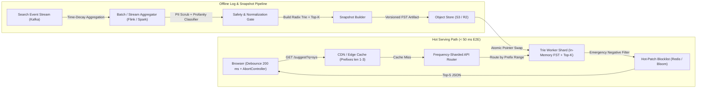
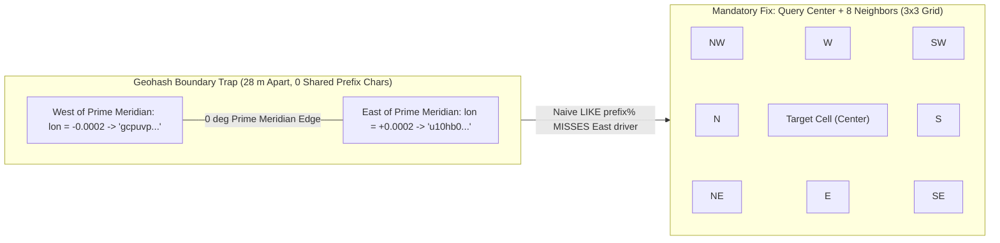
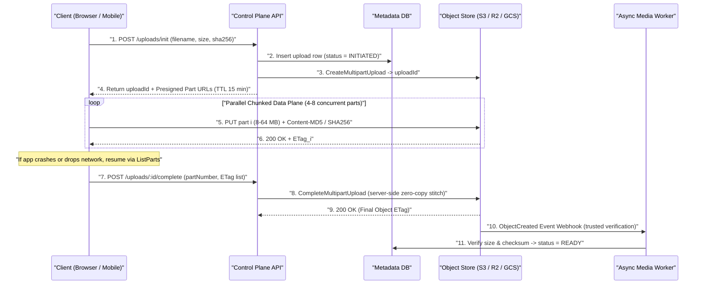

# Module 09 — Search, Geospatial Indexing, and Specialized Components

General-purpose relational databases excel at ACID transactions and B-Tree equality or range lookups, yet they collapse when asked to rank unstructured text, find the ten closest moving drivers on a sphere, compute streaming top-$K$ heavy hitters across millions of events per second, maintain real-time global rankings for 100 million players, or absorb multi-gigabyte binary uploads. Production architectures compose specialized indexing and streaming components alongside primary storage, each trading memory layout, freshness, and exactness for bounded tail latency.

> [!NOTE]
> **Ownership and Cross-Links:** This module treats specialized engines as architectural building blocks and focuses on composition, sizing, and failure modes. Underlying internals live in their owning tracks: inverted indexes, BM25 scoring, and ANN theory in [`architecture/data-systems`](../../data-systems/README.md); Lucene segments, NRT refresh mechanics, and Elasticsearch cluster operations in [`technologies/elasticsearch`](../../../technologies/elasticsearch/README.md); tries, heaps, and Count-Min Sketch proofs in [`algorithms/dsa`](../../../algorithms/dsa/README.md); Redis Sorted Set encodings and Lua atomicity in [`technologies/redis`](../../../technologies/redis/README.md); and replication, partitioning, and delivery semantics in [`architecture/distributed-systems`](../../distributed-systems/README.md). Geospatial boundary behaviors are verified in [`examples/04-ids-pagination-and-geo.test.ts`](../examples/04-ids-pagination-and-geo.test.ts).

---

## 1. Composing Inverted Index and Hybrid Search

Routing full-text queries such as `WHERE body ILIKE '%distributed consensus%'` to an OLTP relational database forces sequential table or index scans at $O(N)$ per query because a B-Tree sorts strings strictly by left-to-right prefix. Even when an OLTP engine offers built-in full-text search (such as PostgreSQL GIN indexes), heavy analytical aggregations, fuzzy matching, and high-dimensional vector kNN queries contend directly with transactional buffer pools and MVCC vacuuming. Production architectures offload retrieval to a dedicated distributed search engine such as Elasticsearch or OpenSearch, synchronized asynchronously via Change Data Capture (CDC) or the transactional outbox pattern.

### 1.1 Black-Box Architectural Knobs and Shard Sizing

When composing Elasticsearch or OpenSearch into a system design (see [`technologies/elasticsearch`](../../../technologies/elasticsearch/README.md) for Lucene segment and cluster internals), four operational knobs govern the latency, throughput, and memory envelope:

| Knob | Default / Typical Range | Architectural Trade-Off | Production Failure Mode When Misconfigured |
| --- | --- | --- | --- |
| Primary Shards (`number_of_shards`) | 10–50 GB per shard; fixed at index creation | Parallelizes writes and splits memory footprint across nodes, versus per-shard scatter-gather overhead and cluster-state metadata growth | **Over-sharding** (e.g., 1,000 tiny 50 MB shards) exhausts JVM heap, file descriptors, and thread queues; **under-sharding** creates un-rebalanceable 500 GB hot shards |
| Replica Shards (`number_of_replicas`) | 1–2+ copies per primary | Linearly scales read QPS and guarantees zero-downtime failover, at the cost of $1 + R$ write amplification and storage multiplication | Setting `0` replicas on user-facing indices causes immediate search outages during rolling restarts or single-node hardware failures |
| NRT Refresh (`index.refresh_interval`) | `1s` (user search) vs `30s`–`60s` (bulk/logs) | Controls **Near-Real-Time (NRT)** visibility lag versus segment creation rate and background merge I/O amplification | Keeping `1s` during massive bulk backfills creates thousands of tiny Lucene segments, saturating disk IOPS in merge storms and stalling searches |
| Custom Routing (`?routing=tenant_id`) | Optional partition key override | Collapses $S$-shard scatter-gather queries into a single-shard lookup, cutting tail latency by removing cross-node fan-out | Routing by a skewed tenant key (e.g., one enterprise tenant with $1000\times$ documents) creates severe disk and CPU hot-spotting |

To size primary shards from first principles before index creation, bound each shard between $10\text{ GB}$ and $50\text{ GB}$ (large enough to amortize per-shard heap/segment metadata, small enough to rebalance across nodes within minutes during node loss):

$$S_{\text{primary}} = \left\lceil \frac{D_{\text{raw}} \times (1 + \gamma_{\text{index}})}{T_{\text{shard}}} \right\rceil, \quad T_{\text{shard}} \in [20\text{ GB}, 50\text{ GB}]$$

where $\gamma_{\text{index}} \approx 0.3\text{–}1.2$ accounts for inverted index postings, `doc_values` columnar caches, and HNSW vector graphs. For a $600\text{ GB}$ raw catalog with $\gamma_{\text{index}} = 0.5$ ($900\text{ GB}$ indexed primary size) targeting $30\text{ GB}$ per shard, provision $S_{\text{primary}} = 30$ primary shards (total cluster disk with `number_of_replicas: 1` is $1.8\text{ TB}$, plus a mandatory $20\text{–}30\%$ disk headroom for Lucene background segment merges and watermarks).

### 1.2 The Index-vs-Query Latency Trade-Off and Hybrid Retrieval

Search architectures sit on a strict Pareto frontier between **indexing cost** (write CPU, memory, and disk amplification) and **query tail latency**:

- **Filter Context vs. Query Context**: Clauses in a `filter` context skip BM25 scoring entirely and compile down to cacheable roaring bitmaps per segment, whereas `query` clauses compute floating-point relevance scores across matching posting lists. Routing structured predicates (`tenant_id`, `in_stock = true`, `price <= 100`) into `filter` context cuts CPU usage and leverages the node query cache.
- **Refresh Interval Tuning**: Every refresh cycle flushes the in-memory indexing buffer into a new immutable Lucene segment and opens a fresh OS-cacheable reader. Extending `index.refresh_interval` from `1s` to `30s` reduces segment creation by up to $30\times$ on write-heavy streams, trading 30 seconds of staleness for substantially lower p99 query latency because fewer segments must be probed per shard.
- **Query-Then-Fetch Two-Phase Fan-Out**: A coordinating node broadcasts the query to all $S$ shards (phase 1), merges top-$K$ document IDs and scores, and fetches full stored `_source` JSON payloads only for the winning $K$ documents (phase 2). Deep pagination (`from: 50000, size: 20`) forces every shard to allocate and sort $50{,}020$ priority-queue entries ($O(S \cdot (\text{from} + \text{size}))$), exploding memory and CPU; production APIs enforce `search_after` cursor pagination paired with a Point-In-Time (PIT) reader snapshot.
- **Hybrid Retrieval with Reciprocal Rank Fusion (RRF)**: Modern search composes lexical BM25 (exact part numbers, acronyms, proper nouns) with dense vector HNSW retrieval (semantic intent, synonyms, cross-lingual queries). Because raw BM25 scores are unbounded while cosine similarities lie in $[-1, 1]$ (or $[0, 1]$ normalized), naive score addition breaks whenever one signal shifts scale. **Reciprocal Rank Fusion** merges ranked lists strictly by ordinal rank without score calibration:

$$\mathrm{RRF}(d) = \sum_{r \in R} \frac{1}{k + \mathrm{rank}_r(d)}, \quad k = 60$$

Here $k = 60$ is a smoothing constant that dampens the dominance of rank-1 outliers while rewarding documents ranked highly across multiple retrievers. To keep HNSW vector indexes inside RAM without blowing up hardware budgets, engines apply scalar (`int8`/`int4`) or binary (`bbq`) quantization during indexing, followed by oversampled full-precision rescoring on only the top candidates at query time:

```json
POST /products/_search
{
  "retriever": {
    "rrf": {
      "retrievers": [
        {
          "standard": {
            "query": {
              "bool": {
                "must": [{ "match": { "title": "noise cancelling headphones" } }],
                "filter": [{ "term": { "in_stock": true } }]
              }
            }
          }
        },
        {
          "knn": {
            "field": "title_embedding",
            "query_vector": [0.012, -0.044, "..."],
            "k": 50,
            "num_candidates": 200,
            "filter": { "term": { "in_stock": true } }
          }
        }
      ],
      "rank_window_size": 100,
      "rank_constant": 60
    }
  },
  "size": 20
}
```

> [!IMPORTANT]
> **Then vs. Now (Search Composition):** Early production stacks (Elasticsearch 5.x–7.x, circa 2016–2021) relied exclusively on BM25 augmented with brittle `function_score` decay scripts or manually maintained two-stage microservice pipelines that queried a lexical cluster and a separate FAISS vector service before merging results in application code. Current architectures (Elasticsearch 8.14+/9.x and OpenSearch 2.19+/3.x) execute lexical and quantized HNSW retrievers inside unified segment-aligned execution trees via native `rrf` retrievers, eliminating cross-service network hops and stale-delete mismatches between separate vector and text stores.

---

## 2. Typeahead and Search Autocomplete

A search autocomplete service predicts top-$K$ query completions (typically $K = 5\text{–}10$) on every keystroke. Its non-functional constraints are asymmetric: extreme read volume ($100{:}1$ to $1000{:}1$ read-to-write ratio), an end-to-end latency budget under $50\text{ ms}$ (leaving $\le 10\text{ ms}$ server-side), and high tolerance for eventual freshness (trending queries can surface within minutes rather than milliseconds).

### 2.1 Prefix Trie with Pre-Computed Top-K per Node

A naive Trie (see [`algorithms/dsa`](../../../algorithms/dsa/README.md) for canonical trie mechanics and complexity proofs) finds the node matching a prefix of length $P$ in $O(P)$ steps, then traverses the entire subtree to collect and sort all descendant queries. For short prefixes like `"a"` or `"s"`, that subtree contains millions of entries, making $O(P + M)$ query-time traversal catastrophic for p99 latency.

Production autocomplete materializes a **pre-computed Top-$K$ list directly inside every prefix node** during offline index construction:

```text
Root
 └── "s"        -> topK: ["shoes", "spotify", "samsung", "soccer", "stock market"]
      └── "sy"  -> topK: ["system design", "symfony", "synonym", "sync", "syrup"]
           └── "sys" -> topK: ["system design", "system update", "sysadmin", "systemd", "sysctl"]
```

- **Query Complexity**: Lookup drops from $O(P + M \log K)$ to strict **$O(P)$**—and because query prefixes are capped (e.g., $P \le 50$ characters), server lookup runs in constant time ($< 1\text{ ms}$ in RAM).
- **Memory Optimization**: Uncompressed pointer-based tries waste significant heap on object headers and sparse 26-way child arrays. Production systems compress single-child chains into **Radix Trees (Patricia Tries)** or **Finite State Transducers (FSTs)**, store string payloads in a deduplicated flat string arena referenced by 32-bit integer IDs, and cache Top-$K$ lists only up to prefix depth $15\text{–}20$ (falling back to bounded DFS only on rare ultra-long prefixes).
- **Capacity Sizing Check**: Suppose $50\text{M}$ daily active users type 4 queries/day averaging 15 characters, with 200M search events/day:
  - _Raw QPS_: $50\text{M} \times 4 \times 15 \approx 3\text{B}$ keystrokes/day ($\approx 35\text{k QPS}$ average, $\approx 105\text{k QPS}$ peak at $3\times$).
  - _Post-Debounce + Edge Cache_: A $200\text{ ms}$ client debounce cuts keystrokes by $\approx 3\times$ ($\to 35\text{k QPS}$ peak), and CDN caching of 1–3 char prefixes absorbs $\approx 80\%$ of remaining traffic, leaving only $\approx 7\text{k QPS}$ hitting origin Trie workers!
  - _RAM Footprint_: For $10\text{M}$ unique normalized query phrases averaging 20 bytes ($\approx 200\text{ MB}$ raw text), storing an average of 5 prefix nodes per phrase ($50\text{M}$ nodes) with $K = 5$ integer IDs (20 bytes) plus radix edge metadata requires roughly $2\text{–}4\text{ GB}$ of RAM—fitting comfortably inside a single node's memory, replicated horizontally for QPS and fault tolerance.

### 2.2 Offline Log Aggregation, Time-Decay Weighting, and Serving Separation

Never mutate a live serving Trie on the hot request path. Concurrent structural updates require fine-grained locking or copy-on-write contention under read load. Instead, decouple the **Hot Serving Path** from the **Offline Aggregation Pipeline**:



1. **Exponential Time-Decay Weighting**: Raw all-time cumulative counts bury breaking news beneath years of evergreen searches. Aggregators assign each query $q$ an exponentially decayed score across discrete time buckets (e.g., hourly or daily): $$w_t(q) = \alpha \cdot c_t(q) + (1 - \alpha) \cdot w_{t-1}(q), \quad 0 < \alpha < 1$$ Setting $\alpha = 0.2$ gives a half-life of roughly $3.1$ periods, allowing sudden surges (e.g., a major product launch) to climb into Top-$K$ within hours while decaying gracefully once interest subsides.
2. **Atomic Snapshot Swap**: Snapshot workers compile the clean weighted dictionary into an immutable binary FST/Trie artifact in object storage (`S3`/`R2`). Serving workers download the new snapshot in the background, mmap or load it into an inactive memory region, and execute an **atomic pointer flip**, achieving zero-lock reads and instant rollback.

### 2.3 Client Debouncing, Edge Caching, Prefix-Frequency Sharding, and Safety

- **Browser Debouncing and Stale-Response Cancellation**: Typing `"system"` fires 6 requests if unthrottled. Clients wait $150\text{–}250\text{ ms}$ after the last keystroke (`debounce`) before dispatching `fetch()`, and attach an `AbortController` to cancel any prior in-flight request so slower earlier responses (`"sy"`) never overwrite newer UI state (`"sys"`).
- **Edge Caching Short Prefixes**: Zipfian query distributions mean prefixes of length $1\text{–}3$ (`"a"`, `"ip"`, `"wea"`) generate over $80\%$ of total autocomplete traffic while having only $26 + 26^2 + 26^3 \approx 18{,}278$ alphabetic combinations. Caching prefixes of length $\le 3$ at the CDN edge (`Cache-Control: public, max-age=3600, stale-while-revalidate=600`) shields origin Trie servers from $80\%+$ of total QPS.
- **Sharding by Prefix Frequency (Never Naive `a–z`!)**: If the Trie exceeds a single machine's RAM (e.g., multi-language global catalogs or personalized enterprise search), **never shard alphabetically by first letter (`a–z`)**. Letter `'s'` or `'c'` carries orders of magnitude more prefixes than `'x'` or `'z'`, creating massive memory and QPS skew. Instead, inspect historical prefix frequency histograms to assign **balanced prefix-range partitions** in a small configuration table managed via ZooKeeper/etcd:

| Shard ID | Balanced Prefix Range | Historical Query Share | Allocation Rationale |
| --- | --- | :-: | --- |
| `shard-01` | `0–9`, `a–ak` | ~12.5% | Numerics are sparse; bundled with early `'a'` prefixes |
| `shard-02` | `al–az` | ~12.4% | Heavy `'a'` prefixes split mid-letter |
| `shard-03` | `b–ca` | ~12.6% | `'c'` is split because `'ca'`, `'ch'`, `'co'` dominate |
| `shard-04` | `cb–cz` | ~12.3% | Remainder of high-frequency `'c'` bucket |
| `shard-05` | `s–sh` | ~12.7% | `'s'` is the densest English prefix letter, split across multiple shards |
| `shard-06` | `si–sz` | ~12.5% | Second half of `'s'` prefixes |
| `shard-07` | `u–z` | ~12.2% | Low-frequency tail letters (`u, v, w, x, y, z`) consolidated onto one shard |

- **PII, Profanity, and Poisoning Filters**: Raw user search logs inevitably contain pasted passwords, emails, Social Security numbers, profanity, and coordinated spam. A mandatory **Safety & Normalization Gate** runs before snapshot compilation: Unicode NFKC normalization, regex/entropy PII stripping, blocklist matching, and ML toxicity scoring. Because snapshot rebuilds take minutes to hours, serving workers also consult a lightweight **hot-patchable negative filter** (a tiny in-memory Bloom/exact blocklist pushed via pub-sub within seconds) to suppress harmful suggestions immediately without waiting for the next Trie build.

---

## 3. Geospatial Indexing and the Geohash Boundary Trap

Proximity services (ride-hailing dispatch, restaurant discovery, nearby friends) must answer two distinct workloads: **read-heavy static Points of Interest (POIs)** (Yelp/Google Places, billions of reads, rare writes) and **write-heavy moving entities** (Uber/Lyft drivers transmitting GPS coordinates every 3–5 seconds, generating $250\text{k–}1\text{M}$ location updates/sec). Evaluating Euclidean or spherical distance against every entity in a database requires an $O(N)$ full scan; spatial indexes collapse 2D coordinates $(\phi, \lambda)$ into 1D keys or hierarchical regions for $O(\log N + k)$ pruning.

### 3.1 Geohash Mechanics and Precision Scaling

**Geohash** (invented by Gustavo Niemeyer in 2008) encodes a $(\text{latitude}, \text{longitude})$ pair into a short alphanumeric string by recursively bisecting the Earth's bounding box and interleaving the resulting decision bits:

- **Bit-Interleaving Rule**: Even-indexed bits ($0, 2, 4, \dots$, 0-based from MSB) encode **longitude** $[-180^\circ, +180^\circ]$; odd-indexed bits ($1, 3, 5, \dots$) encode **latitude** $[-90^\circ, +90^\circ]$. Each bisection emits `1` for the upper half and `0` for the lower half.
- **Worked Bit-Interleaving Trace**: Consider San Francisco at $(\phi = 37.7749^\circ, \lambda = -122.4194^\circ)$ for the first 10 bits (2 base32 chars):
  - Longitude $[-180, 180]$: $-122.4194 < 0 \implies$ bit `0` $[-180, 0]$; $> -90?$ no $\implies$ bit `0` $[-180, -90]$; $> -135?$ yes $\implies$ bit `1` $[-135, -90]$; $> -112.5?$ no $\implies$ bit `0` $[-135, -112.5]$; $> -123.75?$ yes $\implies$ bit `1` $\implies$ Lon bits `00101`.
  - Latitude $[-90, 90]$: $37.7749 \ge 0 \implies$ bit `1` $[0, 90]$; $< 45 \implies$ bit `0` $[0, 45]$; $\ge 22.5 \implies$ bit `1` $[22.5, 45]$; $\ge 33.75 \implies$ bit `1` $[33.75, 45]$; $< 39.375 \implies$ bit `0` $\implies$ Lat bits `10110`.
  - Interleave `(Lon[0], Lat[0], Lon[1], Lat[1], ...)`: `01001` (`9` in Geohash base32) followed by `10110` (`q` in Geohash base32) $\implies$ prefix `"9q..."` (full precision: `"9q8yy..."`).
- **Base32 Encoding**: Every 5 interleaved bits map to one character from the Geohash base32 alphabet (`0123456789bcdefghjkmnpqrstuvwxyz`, omitting `a, i, l, o` to avoid accidental words and visual ambiguity). Thus a length-$L$ Geohash carries $5L$ bits of spatial precision ($\lfloor 5L/2 \rfloor$ latitude bits and $\lceil 5L/2 \rceil$ longitude bits).

| Geohash Length | Total Bits (Lon / Lat) | Cell Width $\times$ Height (Equator) | Spatial Scope & Typical System Mapping |
| :-: | :-: | --- | --- |
| 4 | 20 (10 / 10) | $\approx 39.1\text{ km} \times 19.5\text{ km}$ | Metro region / coarse city aggregation |
| 5 | 25 (13 / 12) | $\approx 4.89\text{ km} \times 4.89\text{ km}$ | Urban district / default $5\text{ km}$ driver search cell |
| 6 | 30 (15 / 15) | $\approx 1.22\text{ km} \times 0.61\text{ km}$ | Neighborhood / walkable $1\text{ km}$ restaurant radius |
| 7 | 35 (18 / 17) | $\approx 153\text{ m} \times 153\text{ m}$ | Street block / local courier staging zone |
| 8 | 40 (20 / 20) | $\approx 38.2\text{ m} \times 19.1\text{ m}$ | Individual building / pickup pin verification |

Because meridians converge toward the poles, physical cell width scales by $\cos(\phi)$ with latitude $\phi$: a length-6 Geohash is $1.22\text{ km}$ wide at the equator ($0^\circ$), $\approx 0.86\text{ km}$ wide at $45^\circ$ (Milan/Minneapolis), and $\approx 0.61\text{ km}$ wide at $60^\circ$ (Helsinki/Oslo).

### 3.2 The Geohash Boundary Failure Mode

> [!WARNING]
> **Critical Failure Mode — Spatial Proximity Does Not Guarantee Prefix Similarity:** Two drivers parked 50 meters apart across a Geohash cell boundary—most dramatically across the Prime Meridian ($0^\circ$ longitude) or the Equator ($0^\circ$ latitude)—can have **completely disjoint Geohash prefixes** (e.g., `(51.5000, -0.0002)` encodes to `gcpuvp...`, while `(51.5000, +0.0002)` just 28 meters east encodes to `u10hb0...`—sharing **zero** prefix characters!). Even away from $0^\circ$, crossing any mid-level bisection line flips high-order bits (e.g., `u09tv` vs. `u09tw` or `9q8yy` vs. `9q8zn`). A naive prefix query `WHERE geohash LIKE 'gcpuv%'` fails catastrophically by returning distant drivers inside the same cell while missing a driver 28 meters away across the boundary.



**Mandatory Mitigation** (proven deterministically in [`examples/04-ids-pagination-and-geo.test.ts`](../examples/04-ids-pagination-and-geo.test.ts)):

1. Pick the Geohash precision $L$ whose cell dimensions are strictly greater than or comparable to the search radius $R$ (e.g., $L = 5$ for $R = 3\text{–}5\text{ km}$, $L = 6$ for $R = 500\text{ m}$).
2. Compute the center cell hash **and all 8 adjacent neighbor hashes** ($3 \times 3 = 9$ prefixes, handling antimeridian $\pm 180^\circ$ wraparound and polar caps).
3. Query all 9 prefix buckets in parallel (for SQL, `WHERE geohash_5 IN ($c, $n, $ne, $e, $se, $s, $sw, $w, $nw)` backed by an index on `geohash_5`; in Redis, `GEOSEARCH key FROMLONLAT lon lat BYRADIUS 5 km ASC COUNT 50`, which internally computes the 9 bounding boxes over a 52-bit Geohash sorted set).
4. **Post-Filter Exact Distance**: Because the $3 \times 3$ bounding grid covers a rectangle larger than radius $R$, filter the merged candidate set in application memory using exact **Haversine** great-circle distance (or equirectangular approximation for tiny distances $< 10\text{ km}$):

$$d = 2r \arcsin\left(\sqrt{\sin^2\left(\frac{\Delta\phi}{2}\right) + \cos(\phi_1)\cos(\phi_2)\sin^2\left(\frac{\Delta\lambda}{2}\right)}\right)$$

where $r \approx 6{,}371\text{ km}$ is Earth's mean radius, $\phi$ is latitude in radians, and $\lambda$ is longitude in radians.

### 3.3 Quadtree, Google S2, and Uber H3

Geohash is simple to store in any B-Tree or KV store, but its rectangular Z-order (Morton) curve suffers from discontinuous jumps and non-uniform cell areas across latitudes. Three advanced spatial indexes address these flaws:

- **Quadtree (Adaptive Density Partitioning)**: Recursively subdivides a 2D bounding box into 4 quadrants (`NW`, `NE`, `SW`, `SE`) whenever a leaf exceeds capacity $M$ (e.g., $M = 100$ businesses). In dense Manhattan, the tree drills down to depth 15 ($100\text{ m}$ blocks); in the Sahara Desert, a single root-adjacent node covers thousands of kilometers.
  - _Trade-off_: Quadtrees live as pointer-rich graphs in server RAM. Rebuilding or rebalancing a Quadtree under 250k moving-driver writes/sec causes severe lock contention or GC pressure; therefore Quadtrees excel for **read-heavy static POIs** (rebuilt asynchronously on a schedule), whereas moving objects favor fixed-grid spatial hashing (Geohash/S2/H3) keyed in Redis or memory.
- **Google S2 (Spherical Cube Projection + Hilbert Curve)**: Projects the Earth onto the 6 faces of an enclosing cube (keeping cell area distortion bounded within a $\approx 1.4\times$ ratio even near the poles, unlike Geohash's severe polar distortion), recursively splits faces into quadtrees, and enumerates leaf cells along a **Hilbert space-filling curve**. Unlike Z-order curves, a Hilbert curve guarantees that consecutive 1D integers almost always share a physical edge, reducing the number of disjoint integer ranges needed to cover an arbitrary polygon (`S2RegionCoverer`). Every S2 cell at any level (0–30) packs cleanly into a single 64-bit unsigned integer (`S2CellId`), making range scans in RocksDB, Spanner, or Bigtable highly sequential.
- **Uber H3 (Hexagonal Hierarchical Spatial Index)**: Projects the sphere onto an icosahedron and tiles it with **hexagons** (plus exactly 12 pentagons at the icosahedron vertices). Why hexagons dominate ride-hailing dispatch, ETA heatmaps, and surge pricing:
  - In a square grid (Geohash/Quadtree/S2), a cell has 4 edge-sharing neighbors at distance $d$ and 4 corner-touching diagonal neighbors at distance $\sqrt{2} d \approx 1.414d$, distorting spatial smoothing, supply-demand gradients, and radius expansion rings.
  - In a **hexagonal grid**, **all 6 neighbors share a full edge and sit at an identical center-to-center distance $d$** (zero diagonal distortion!). Expanding a search ring ($k$-ring) produces smooth, nearly circular approximations.
  - _Mathematical Caveat_: Hexagons cannot subdivide cleanly into 7 smaller hexagons without rotation; H3 uses aperture-7 subdivision, rotating child orientations by $\approx 19.1^\circ$ per resolution level, so parent containment is approximate rather than exact like S2/Quadtree.

| Index Structure | Cell Shape & Projection | Locality Curve | Dynamic Write Cost | Neighbor Distance Uniformity | Ideal Production Fit |
| --- | --- | --- | --- | --- | --- |
| **Geohash** | Rectangles on lat/lon plate carrée | Z-order (Morton) with boundary jumps | $O(1)$ hash recompute; ideal for KV/Redis | Poor (4 edge + 4 diagonal $\sqrt{2}d$, polar skew) | Fast proximity lookup in SQL/Redis when $3 \times 3$ query is paired with Haversine filter |
| **Quadtree** | Adaptive 2D rectangles | Tree pointers (in-memory) | High (structural splits/merges require locking) | Non-uniform (neighbor leaves vary in depth) | Static/slow-changing POIs with extreme urban/rural density skew (Yelp, Maps POIs) |
| **Google S2** | Spherical-cube quads | Hilbert curve (`uint64` CellId) | $O(1)$ CellId compute; range-scan friendly | Moderate (4 edge + 4 diagonal, low polar distortion) | Arbitrary polygon/geofence covering, large-scale disk-backed KV/Spanner spatial indexes |
| **Uber H3** | Hexagons on icosahedron (+12 pentagons) | Hierarchical aperture-7 indexing | $O(1)$ index compute at fixed resolution | **Uniform** (all 6 neighbors equidistant at $d$) | Dynamic surge pricing, supply/demand heatmaps, k-ring dispatch smoothing |

---

## 4. Top-K Heavy Hitters at Scale

Computing the top $K$ most frequent items (trending search terms, viral videos, top DDoS source IPs) over tumbling or sliding windows at $10^6+$ events/sec breaks exact hash-map counting (`Map<itemId, count>`). If a stream touches $10^8$ distinct IDs per hour, an exact map consumes $> 6\text{ GB}$ per worker and forces expensive all-to-all key shuffling across network partitions to merge global totals.

### 4.1 Count-Min Sketch + Bounded Min-Heap

Rather than tracking every unique key exactly, combine a **Count-Min Sketch (CMS)** (see [`algorithms/dsa`](../../../algorithms/dsa/README.md) for the Markov inequality proof and optimal $w, d$ parameter derivations) with a tiny **bounded Min-Heap of size $K$**:

1. **Bounded Fixed Memory**: A Count-Min Sketch allocates a static 2D integer array $C[d][w]$ using $d = \lceil \ln(1/\delta) \rceil$ pairwise-independent hash functions across width $w = \lceil e / \epsilon \rceil$. For error tolerance $\epsilon = 0.001$ (0.1% of total stream count $N$) and failure probability $\delta = 0.01$ (99% confidence), $w = 2719$ and $d = 5$ require only $5 \times 2719 \times 4\text{ bytes} \approx 54\text{ KB}$—small enough to stay pinned in CPU L1/L2 cache with zero heap allocations.
2. **Per-Event Streaming Update**: On arrival of item $x$:
   - Increment $C[i][h_i(x)] \mathrel{+}= 1$ for $i = 0 \dots d - 1$.
   - Estimate $\hat{f}(x) = \min_{0 \le i < d} C[i][h_i(x)]$ (always an upper bound: $\hat{f}(x) \ge f(x)$).
   - If $x$ is already in the $K$-element Min-Heap (tracked via an auxiliary $O(K)$ map), update its score and sift down. Otherwise, if $\hat{f}(x)$ exceeds the heap root's minimum score, pop the root and push $(x, \hat{f}(x))$.
3. **Linear Mergeability Across Partitions**: Because every partition worker uses the exact same $(d, w)$ dimensions and hash seeds, two sketches $C^{(1)}$ and $C^{(2)}$ merge via element-wise matrix addition ($C_{\text{global}}[i][j] = C^{(1)}[i][j] + C^{(2)}[i][j]$). Downstream aggregators merge compact 54 KB sketches from hundreds of edge nodes to reconstruct global Top-$K$ without shipping raw event streams!
4. **Heavy-Hitter Caveat**: CMS only overestimates due to hash collisions. Because heavy hitters by definition hold a large fraction of $N$, their true counts dominate the small additive $\epsilon N$ collision noise, whereas long-tail items are pruned cleanly by the Min-Heap. If exact counts are required for billing or legal audits (e.g., ad-click revenue), keep exact partitioned hash tables keyed by `item_id` or run a hybrid **Lossy Counting / Heavy-Hitter Exact Map** that promotes only items crossing a frequency threshold.

```text
ALGORITHM UPDATE_HEAVY_HITTER(sketch C[d][w], minHeap H, map pos, key x):
  minEst <- +INF
  for i <- 0 to d - 1:
    idx <- hash_i(x) mod w
    C[i][idx] <- C[i][idx] + 1
    if C[i][idx] < minEst: minEst <- C[i][idx]
  if x in pos:
    H.updateKey(pos[x], minEst)
  else if H.size() < K:
    H.push((minEst, x))
  else if minEst > H.peek().count:
    H.pop()
    H.push((minEst, x))
```

### 4.2 Lambda vs. Kappa Architecture and Watermark Reconciliation

| Dimension | Lambda Architecture | Kappa Architecture |
| --- | --- | --- |
| **Topology** | Dual path: fast approximate stream layer (Flink/Spark Streaming) + immutable raw batch layer (Spark/Iceberg) merged in serving store | Single path: durable replayable commit log (Kafka/Pulsar) feeding one stream processor (Flink) with stateful checkpoints |
| **Code & Maintenance** | Must maintain and keep business logic identical across two separate frameworks (e.g., Java Flink + SQL/Spark batch) | Single codebase; historical reprocessing simply resets consumer offsets or spins up a parallel consumer group |
| **Exactness & Backfills** | Batch layer guarantees eventual exactness and repairs stream bugs nightly | Stateful stream processors (Flink RocksDB + tiered Kafka storage) handle multi-day replays directly |
| **When Lambda Still Wins** | Heavy multi-month ML feature joins or complex ad-hoc batch corrections too expensive to keep hot in RocksDB state | Default choice for modern real-time analytics, Top-K aggregation, and ad-click pipelines |

When aggregating time-windowed Top-$K$ over mobile or IoT clients, events frequently arrive out of order (e.g., a phone loses subway connectivity for 90 seconds before flushing buffered clicks). A **Watermark** $W(t)$ is a monotonically advancing timestamp asserting that the stream engine expects no more events with `event_time < W(t)`.

- **Computing the Watermark**: Typically heuristic bounded-out-of-orderness: $W = \max(\text{event-time}) - \Delta_{\text{skew}}$ (e.g., 30 seconds). When $W$ passes a window's end boundary, the engine emits the window's Top-$K$ result.
- **Late-Event Reconciliation**: Setting $\Delta_{\text{skew}}$ too large inflates output latency; setting it too small drops delayed mobile events. Production pipelines define an **allowed lateness** horizon (e.g., 1 hour) where late arrivals trigger **incremental retractions/updates** to the downstream serving store, while events arriving past allowed lateness route to a **side-output dead-letter log** reconciled by an offline batch repair job.

> [!IMPORTANT]
> **Then vs. Now (Streaming Analytics):** Early streaming topologies (2012–2017) defaulted to **Lambda Architecture** (Apache Storm for low-latency uncheckpointed approximations plus nightly Hadoop/Spark batch jobs to overwrite stale numbers) because early stream engines lacked exactly-once state checkpoints and replayable logs. Modern stacks (Kafka/Pulsar + Apache Flink with incremental RocksDB state snapshots and Iceberg sinks) implement **Kappa Architecture**, treating historical backfills as replaying the single unified log with bounded watermarks and allowed-lateness side outputs.

---

## 5. Real-Time Leaderboards

A competitive gaming leaderboard serving 100M+ players must handle high-throughput score updates (`AddScore(userId, delta)`), exact Top-$K$ page reads (`GetTopK(100)`), and relative rank lookups (`GetRank(userId)` plus the 5 players immediately above and below). Running `SELECT user_id, score, RANK() OVER (ORDER BY score DESC)` in an OLTP database triggers an $O(N \log N)$ sort or heavy B-Tree page splits under contention.

### 5.1 Redis Sorted Sets (`ZSET`) and Composite Tie-Breaking

Redis Sorted Sets (see [`technologies/redis`](../../../technologies/redis/README.md) for skiplist + hash-table internals) provide exact $O(\log N)$ point updates and rank lookups:

- `ZADD lb:season1 4200 "player:918"` — $O(\log N)$ upsert.
- `ZINCRBY lb:season1 50 "player:918"` — $O(\log N)$ atomic score increment.
- `ZREVRANK lb:season1 "player:918"` — $O(\log N)$ exact 0-based descending rank (using skiplist span weights!).
- `ZREVRANGE lb:season1 0 99 WITHSCORES` — $O(\log N + K)$ Top-100 fetch.

**The Tie-Breaking Precision Trap**: Suppose Player A reaches `score = 5000` at $t_A = 10{:}00{:}01$ and Player B reaches `score = 5000` at $t_B = 10{:}00{:}05$. Standard `ZREVRANGE` breaks equal-score ties _reverse-lexicographically by member ID_—meaning `"player:999"` unfairly beats `"player:100"` regardless of who achieved the score first!

To rank earlier achievers strictly higher, encode a **composite score** inside the ZSET's 64-bit IEEE-754 `double`. Because an IEEE-754 `double` holds **53 bits of exact integer significand precision** ($\le 9{,}007{,}199{,}254{,}740{,}991 \approx 9 \times 10^{15}$), naive floating-point math such as `score + (1 - timestamp / MAX_TIMESTAMP)` silently **truncates timestamp precision** whenever `score` grows large (e.g., for `score = 10^9`, the ULP gap destroys sub-second differences).

Instead, **bit-pack integer components strictly within 53 bits** (when scores and timestamps are bounded):

$$\text{compositeScore} = (\text{score} \ll B_{\text{ts}}) \mid (\text{MAX-TS} - \text{timestamp})$$

For example, allocating **28 bits** to `score` (up to $2.68 \times 10^8$) and **25 bits** to inverted relative tournament seconds ($\text{MAX\_TS} - t_{\text{rel}}$, covering $3.35 \times 10^7$ seconds $\approx 388$ days at 1-second resolution) uses $28 + 25 = 53$ bits—guaranteeing **zero floating-point rounding loss**, exact deterministic tie-breaking by earlier timestamp, and instant recovery of the raw score via `compositeScore >> 25`. Because `ZINCRBY` would corrupt the packed timestamp bits, apply incremental deltas atomically via a Redis Lua script:

```lua
-- KEYS[1] = leaderboard zset key
-- ARGV[1] = playerId, ARGV[2] = scoreDelta, ARGV[3] = invertedTs (25-bit), ARGV[4] = POW2_25 (33554432)
local pow25 = tonumber(ARGV[4])
local cur = redis.call('ZSCORE', KEYS[1], ARGV[1])
local rawScore = 0
if cur then
  rawScore = math.floor(tonumber(cur) / pow25)
end
local nextScore = rawScore + tonumber(ARGV[2])
local composite = nextScore * pow25 + tonumber(ARGV[3])
redis.call('ZADD', KEYS[1], composite, ARGV[1])
return nextScore
```

### 5.2 Sharding 100M-Player Leaderboards

A single Redis ZSET holding 100M entries consumes $\approx 8\text{–}12\text{ GB}$ of RAM (due to skiplist forward pointers and dict entries), saturates a single Redis event-loop core under write bursts, and triggers multi-second copy-on-write fork stalls during RDB snapshots. Sharding a leaderboard reveals a fundamental trade-off between **write balance** and **rank queries**:

- **Hash Partitioning (`hash(user_id) % S`)**: Distributes memory and write QPS uniformly across $S$ Redis shards, _but_ destroys single-key rank queries. `GetTopK(100)` must scatter-gather 100 records from all $S$ shards and merge-sort them, while `GetRank(user_id)` must fire `ZCOUNT shard_i compositeScore +inf` across **all $S$ shards** to count how many players sit ahead globally!
- **Score-Range Bucketing (Fixed or Logarithmic Ranges)**: Partition the ZSET into disjoint score intervals (e.g., Bucket 0: $[0, 100)$, Bucket 1: $[100, 500)$, ..., Bucket 15: $[100{,}000, \infty)$), plus a tiny auxiliary metadata hash tracking each bucket's `ZCARD` count.
  - **`GetTopK(100)`**: Queries **only the highest non-empty bucket** (and spills to the next bucket down only if the top bucket has $< 100$ players) in $O(\log N_B + K)$—zero scatter-gather!
  - **`GetRank(user_id)`**: Executes `ZREVRANK` on the player's own bucket $b$ and adds the cached `ZCARD` counts of buckets $> b$: $O(\log N_B + B)$ where $B \approx 16$.
  - **Skew Mitigation**: Because player scores follow heavy power-law distributions (e.g., 60M inactive users sit at `score = 0`), **shard Bucket 0 by `hash(user_id) % M`** or omit zero-score players from the leaderboard altogether until they score their first point! When a player's score crosses a bucket boundary, move them atomically between buckets via application routing (or keep each bucket on a dedicated Redis shard with cross-shard move + idempotent retry).

---

## 6. Large Blob Storage and Direct-to-Object Multipart Uploads

Uploading large media (4 GB 4K videos, multi-GB ML checkpoints, database backups) by streaming bytes through backend API servers (`Client -> Load Balancer -> API Pod -> S3/R2`) is a classic architectural anti-pattern:

- **Bandwidth Multiplication**: Every byte crosses the data-center NIC twice (once ingress from the client, once egress to object storage), doubling cloud load-balancer and NAT gateway costs.
- **Connection & Memory Exhaustion**: On a slow 5 Mbps mobile uplink, a 4 GB upload takes **106 minutes**. Holding an open HTTP request, worker thread, or TLS session across an API fleet causes connection-pool starvation; buffering chunks in application RAM or container ephemeral storage causes `OOMKilled` pod crash-loops and rolling-deploy interruptions.

### 6.1 Control Plane vs. Data Plane Separation with Presigned Multipart Uploads

Separate the **Control Plane** (lightweight metadata, auth, and signing on API servers) from the **Data Plane** (heavy byte transport directly between the client and the edge-terminated object store):



1. **Initialization & Presigned URLs**: The client requests an upload session (`filename`, `totalSize`, `mimeType`). After authenticating and enforcing storage quotas, the API creates a DB record (`status = 'INITIATED'`), calls `CreateMultipartUpload` on S3/R2/GCS to obtain an `uploadId`, and generates short-lived **SigV4 Presigned URLs** (5–15 minute TTL) scoped to specific `(bucket, key, uploadId, partNumber)` tuples and signed `Content-Length` / checksum headers (`x-amz-checksum-sha256`).
2. **Parallel Chunking & Integrity**: The client slices the 4 GB file into 8 MB–64 MB parts (S3 supports up to $10{,}000$ parts, minimum 5 MB per non-trailing part) and uploads 4–8 parts concurrently directly to object storage edge POPs. Each `PUT` includes a per-part cryptographic digest so corrupted TCP frames are rejected at the storage edge.
3. **True Resumability**: As each part succeeds, the client persists `(partNumber, ETag)` in IndexedDB or local SQLite. After a network dropout or mobile app kill, the client asks the API (which queries S3 `ListParts`) which parts already landed, requests fresh presigned URLs only for missing parts, and resumes from the exact failure boundary rather than restarting at byte 0. (For single-stream resumability protocols over flaky mobile networks, protocols such as **tus** or S3 Express/GCS resumable sessions standardize `Upload-Offset` probing.)
4. **Server-Side Zero-Copy Assembly & Webhook Verification**: Once all parts finish, the API calls `CompleteMultipartUpload`, passing the ordered `[(partNumber, ETag)]` manifest. The object store stitches metadata pointers internally without copying 4 GB across nodes. **Crucially, never trust the client's `complete` call alone** to mark an asset public: listen to the object store's **Completion Event Notification** (`s3:ObjectCreated:CompleteMultipartUpload` routed via EventBridge/SQS/PubSub) so an async worker verifies actual object size, magic bytes, and malware scan before flipping `status = 'READY'` and enqueueing transcoding.
5. **Lifecycle Garbage Collection**: Aborted uploads leave orphaned parts consuming paid storage indefinitely. Configure an S3/R2 **Bucket Lifecycle Rule** (`AbortIncompleteMultipartUpload` after 1–7 days) to sweep abandoned chunks automatically.

### 6.2 Content-Defined Chunking (CDC) for Sync and Deduplication

Fixed-size chunking (splitting every 4 MB) works well for write-once media uploads, _but_ fails for collaborative sync clients (Dropbox, Google Drive, VM backup engines). Inserting **1 single byte at offset 0** of a 4 GB file shifts every subsequent 4 MB chunk boundary, changing all $1{,}000$ chunk hashes and forcing a full 4 GB re-upload!

File-sync architectures replace fixed offsets with **Content-Defined Chunking (CDC)** using a rolling hash (such as **Rabin Fingerprinting** or **FastCDC**):

- A sliding window (e.g., 48 bytes) computes a cheap rolling hash byte-by-byte; a chunk boundary is declared whenever `(hash & MASK) == 0` (e.g., 13 trailing zero bits yields an expected average chunk size of $2^{13} = 8\text{ KB}$, or 22 bits for $4\text{ MB}$), bounded by `[minChunk, maxChunk]`.
- Because boundaries depend strictly on local byte content rather than global file offset, inserting 1 byte at offset 0 alters **only the first chunk**; every subsequent chunk boundary resynchronizes identically, enabling **content-addressed deduplication** (`SHA-256(chunk)` lookup via `HEAD` or metadata index before uploading) and orders-of-magnitude bandwidth savings!

---

## 7. Interview Drill

### Question 1: How do you decide when to replace PostgreSQL full-text search with Elasticsearch/OpenSearch, and which three knobs do you tune first when tail latency spikes?

<details><summary>Model Answer</summary>

Keep search inside PostgreSQL (GIN `tsvector` + `pg_trgm`) when corpus size fits comfortably in memory/single-node NVMe ($< 10\text{–}50\text{M}$ rows), queries are simple predicate + exact lexical filters without complex faceted aggregations, and strict transactional read-your-writes consistency with OLTP tables is required. Introduce Elasticsearch/OpenSearch when you need horizontal sharding across nodes, multi-field BM25 tuning and fuzzy typo tolerance, high-cardinality faceted aggregations, hybrid BM25 + HNSW vector search with RRF, or workload isolation from OLTP connection pools and vacuum cycles.

When p99 latency spikes in Elasticsearch: (1) check `number_of_shards` and custom `routing` (eliminate over-sharding scatter-gather or split hot shards); (2) move non-scoring predicates out of `query` into `filter` context so Lucene uses cached roaring bitmaps; and (3) lengthen `index.refresh_interval` (e.g., from `1s` to `30s`) on write-heavy indices to reduce segment churn and merge I/O contention.

</details>

### Question 2: Why does an autocomplete service pre-compute Top-K lists at every Trie node, and why is naive alphabetical `a–z` sharding a production anti-pattern?

<details><summary>Model Answer</summary>

Pre-computing Top-$K$ inside every node eliminates $O(M)$ subtree traversal at query time. Without it, typing a 1-character prefix like `"a"` forces the worker to walk millions of descendant leaf nodes and heap-sort them, blowing past the $< 50\text{ ms}$ E2E budget. Materializing Top-$K$ per node makes lookups strictly $O(P)$ where prefix length $P$ is bounded (constant time in RAM), while pushing heavy sorting and time-decay weighting to an offline pipeline that swaps immutable FST/Trie snapshots atomically.

Naive `a–z` sharding creates massive skew because English (and most languages) distributes prefixes non-uniformly (`s`, `c`, `p`, and `t` dominate while `x`, `q`, `z` hold tiny traffic), overloading the `'s'` shard's RAM and CPU while leaving `'x'` idle. Instead, shard using frequency-balanced prefix ranges derived from historical query histograms (e.g., `sa–sh` vs `si–sz` on separate shards, `x–z` merged onto one shard) stored in a lightweight configuration map.

</details>

### Question 3: Explain the Geohash boundary failure mode with a concrete example, and compare Geohash, Quadtree, Google S2, and Uber H3 for a ride-hailing dispatch system.

<details><summary>Model Answer</summary>

Two drivers 28 meters apart on opposite sides of the Prime Meridian (`(51.5000, -0.0002)` vs `(51.5000, +0.0002)`) encode to `gcpuvp...` and `u10hb0...`, sharing **zero** common prefix characters because the first longitudinal bisection flipped from `0` to `1`. A naive prefix query (`LIKE 'gcpuv%'`) misses the closest driver. The mandatory fix is querying the target cell **plus its 8 adjacent neighbor cells** ($3 \times 3$ grid) at the precision matching the search radius, then post-filtering merged candidates with exact Haversine distance.

For ride-hailing dispatch: **Quadtrees** adapt well to Manhattan vs Sahara density for static POIs, but pointer-tree rebalancing melts under 250k moving-driver updates/sec. **Geohash** gives $O(1)$ key updates in Redis/KV stores, yet suffers from Z-order jumps and polar width shrinkage ($\cos(\phi)$). **Google S2** fixes polar skew via spherical cube projection and improves locality via a Hilbert curve (`uint64` CellId), making it ideal for geofences and disk-backed range scans. **Uber H3** uses hexagons where all 6 neighbors are equidistant (eliminating the $\sqrt{2}$ diagonal corner distortion of square grids), making it superior for surge pricing heatmaps, ETA smoothing, and $k$-ring dispatch expansion.

</details>

### Question 4: How do you compute real-time global Top-100 heavy hitters at 2 million events/sec across 50 Kafka partitions without shuffling raw event keys?

<details><summary>Model Answer</summary>

Each partition worker maintains a small fixed-size **Count-Min Sketch** ($d \times w$ integer counters, e.g., $5 \times 2719 \approx 54\text{ KB}$) paired with a local **bounded Min-Heap of size $K$** (or slightly oversampled $2K$ to reduce boundary loss). Every event updates $d$ hashed counters in $O(d)$ cache-local time with zero heap allocations. Because Count-Min Sketches built with identical $(d, w)$ dimensions and hash seeds are **linearly mergeable** by element-wise addition, workers periodically emit their tiny 54 KB sketches (plus local candidate keys) to a global aggregator rather than shuffling millions of raw keys across the network. Pair this with a Kappa pipeline (Kafka + Flink with bounded-out-of-orderness watermarks and allowed-lateness side outputs) so delayed mobile events reconcile cleanly without maintaining separate batch codebases.

</details>

### Question 5: Design a 100-million-player leaderboard with deterministic tie-breaking where earlier score achievers rank higher. What IEEE-754 bug must you avoid?

<details><summary>Model Answer</summary>

Use Redis Sorted Sets (`ZSET`) for $O(\log N)$ updates and `ZREVRANK` lookups, **sharded by score-range buckets** (plus hash-sharding or omission of the massive `score = 0` inactive bucket) while keeping per-bucket `ZCARD` counts in a tiny metadata hash so `GetTopK` hits only the top bucket and `GetRank` adds higher buckets' cardinalities without $S$-way scatter-gather.

Because Redis ZSET scores are 64-bit IEEE-754 doubles (53 bits of exact integer significand), naive fractional tie-breaking like `score + (1 - ts / MAX_TS)` suffers precision loss when `score` is large, causing equal-score players to tie or misorder. Instead, bit-pack integer fields strictly within 53 bits—for example, 28 bits for `score` shifted left plus 25 bits for `(MAX_EPOCH_SEC - ts_sec)`—guaranteeing lossless integer comparison where larger scores win and, on equal scores, smaller timestamps produce larger `(MAX - ts)` bits and rank strictly higher.

</details>

### Question 6: Why must a system never proxy 4 GB video uploads through application API pods, and how do you guarantee upload integrity and true resumability?

<details><summary>Model Answer</summary>

Proxying 4 GB through API servers doubles data-center ingress/egress traffic, ties up scarce HTTP worker sockets for over an hour on slow 5 Mbps mobile links (exhausting connection pools), and risks pod `OOMKilled` crashes or ephemeral disk exhaustion.

Separate control plane and data plane: the API authenticates the request, calls `CreateMultipartUpload`, and returns short-lived **SigV4 Presigned URLs** scoped to individual 8–64 MB parts with signed `Content-Length` and SHA-256/MD5 checksum headers. The client uploads parts in parallel directly to S3/R2 edge endpoints and saves `(partNumber, ETag)` locally. On crash or network drop, the client reconciles uploaded parts via `ListParts` and resumes only missing chunks. After `CompleteMultipartUpload` stitches parts server-side, rely on a trusted **object-store completion webhook** (`ObjectCreated`)—never the client alone—to verify final size/checksum and transition the asset to `READY`, backed by an `AbortIncompleteMultipartUpload` lifecycle policy to garbage-collect abandoned parts.

</details>

### Question 7: Why does fixed-size chunking break bandwidth efficiency in a Dropbox-style sync engine, and how does Content-Defined Chunking (CDC) solve it?

<details><summary>Model Answer</summary>

With fixed-size chunking (splitting at strict 4 MB byte offsets), inserting even 1 byte at the beginning of a 4 GB file shifts every subsequent chunk boundary by 1 byte. Every downstream chunk hash changes, tricking the sync client into thinking all $1{,}000$ chunks are brand new and re-uploading the entire 4 GB file.

**Content-Defined Chunking (CDC)** (via a rolling hash such as Rabin Fingerprinting or FastCDC) scans a sliding byte window and declares chunk boundaries wherever `(rollingHash & mask) == 0`, bounded by `[minChunk, maxChunk]`. Because boundaries depend solely on local byte patterns rather than absolute offsets, inserting bytes at offset 0 modifies only the affected local chunk; the rolling hash resynchronizes at the very next boundary, preserving 99%+ of existing SHA-256 chunk hashes for instant content-addressed deduplication.

</details>

### Question 8: In a streaming Top-K ad-click aggregator, how do watermarks and allowed-lateness policies handle a mobile client that buffers clicks offline for 20 minutes?

<details><summary>Model Answer</summary>

A heuristic watermark like `max(event_time) - 30s` advances past the closed 1-minute tumbling window long before the offline mobile device reconnects 20 minutes later. If the pipeline enforces zero allowed lateness, those delayed clicks are silently dropped, undercounting billable impressions.

To reconcile accuracy against low-latency dashboards: (1) emit an immediate speculative Top-$K$ snapshot when the 30s watermark passes; (2) configure an **allowed lateness** window (e.g., 1 hour) in Flink so events arriving within $[W_{\text{end}}, W_{\text{end}} + 1\text{ hr}]$ update the retained window state and emit **idempotent downstream delta/retraction updates**; and (3) route events arriving past 1 hour to a **dead-letter side output** reconciled asynchronously into the immutable warehouse ledger (or handled via Kappa replay) so financial billing never drops late events while real-time dashboards stay sub-minute fresh.

</details>
