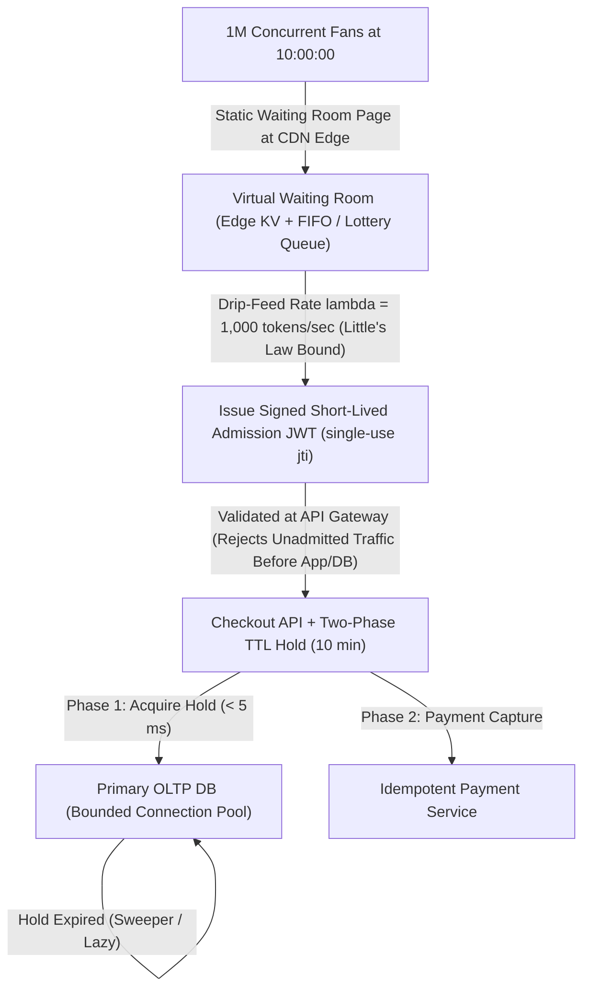
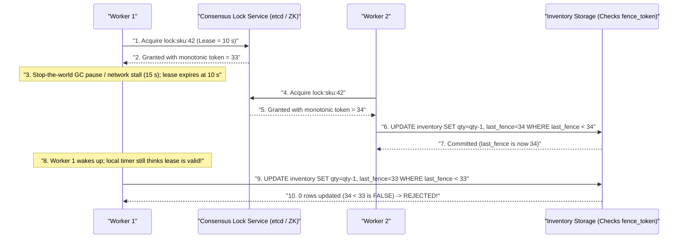
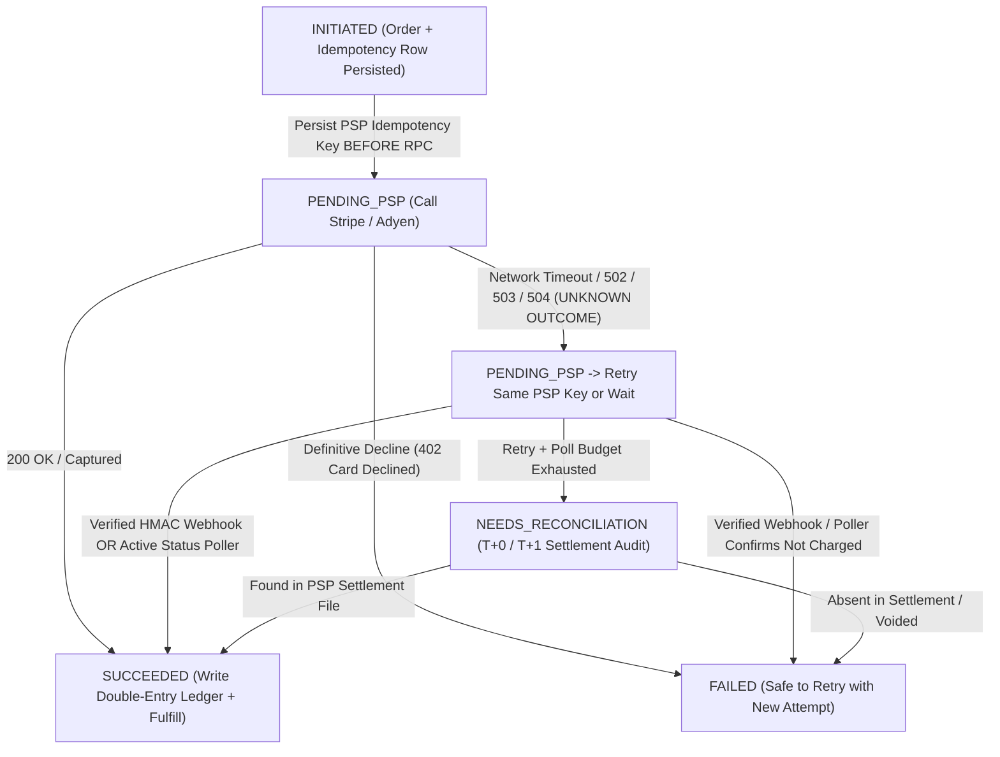

# Module 10 — Contention, Inventory Reservations, and Financial Correctness

Distributed architectures rarely fail during uniform, independent reads; they fracture when thousands of concurrent actors race for the exact same scarce resource or when partial network failures blur whether money actually moved. Under extreme flash-sale contention, naive database locks stall connection pools while naive optimistic retries amplify load into self-inflicted outages. In payment systems, treating a timed-out gateway call as a failure or storing balances as mutable floating-point columns turns routine network hiccups into double-charges and irreconcilable books.

> [!NOTE]
> **Ownership and Cross-Links:** This module focuses on composing contention control, reservation workflows, and payment invariants at the system-design boundary. Foundational theory lives in its owning tracks: isolation levels, MVCC, Write Skew, and Serializable Snapshot Isolation in [`architecture/data-systems`](../../data-systems/README.md); consensus, Redlock critique, distributed locks, fencing tokens, sagas, and delivery semantics in [`architecture/distributed-systems`](../../distributed-systems/README.md); and Redis single-threaded Lua atomicity and `SET NX PX` mechanics in [`technologies/redis`](../../../technologies/redis/README.md). Reservation holds, fencing rejection, idempotency payload-drift enforcement, and zero-sum ledger invariants are verified deterministically in [`examples/06-contention-and-payments.test.ts`](../examples/06-contention-and-payments.test.ts).

---

## 1. High-Contention Booking and Flash Sales

Whether selling 20,000 concert seats (Ticketmaster), allocating hotel room nights across overlapping dates, or dropping 500 limited-edition sneakers to 1,000,000 simultaneous shoppers, the fundamental bottleneck is **hot-row serialization**. Even if a PostgreSQL primary handles $50{,}000$ independent updates per second across $10{,}000$ rows, serializing $10{,}000$ concurrent transactions onto **one** `inventory` row collapses effective throughput to the single-row round-trip lock latency ($1 / W_{\text{txn}}$) and exhausts the database connection pool via queueing (Little's Law: $L = \lambda W$).

### 1.1 Pessimistic Locking (`SELECT ... FOR UPDATE` and `SKIP LOCKED`)

Pessimistic locking acquires an exclusive row-level write lock inside an open transaction before inspecting or mutating availability:

```sql
BEGIN;
SELECT id, status FROM seats WHERE id = $1 FOR UPDATE;
-- Application checks status = 'AVAILABLE', then updates:
UPDATE seats SET status = 'HELD', held_by = $2 WHERE id = $1;
COMMIT;
```

- **Queueing and Lock Contention**: While Transaction 1 holds the exclusive lock on row `$1`, all concurrent sessions wait synchronously on the database lock manager. If Transaction 1 stalls on a downstream RPC or slow client think-time, hundreds of backend worker threads pile up waiting for the same lock, starving unrelated endpoints of DB connections.
- **Deadlock Hazard and All-or-Nothing Multi-Seat Claims**: If Buyer A reserves `[Seat 10, Seat 11]` while Buyer B simultaneously reserves `[Seat 11, Seat 10]`, both transactions hold one lock and block forever on the other until PostgreSQL's deadlock detector kills one (`SQLSTATE 40P01`). **Mandatory invariant**: always sort multi-item lock acquisitions by a canonical total order (`ORDER BY seat_id ASC`) so circular wait graphs cannot form, and verify that all requested seats succeeded before committing:

```sql
BEGIN;
WITH locked AS (
  SELECT id FROM seats
  WHERE id = ANY($1::bigint[]) AND status = 'AVAILABLE'
  ORDER BY id ASC
  FOR UPDATE
),
updated AS (
  UPDATE seats s
  SET status = 'HELD', held_by = $2, hold_expires_at = NOW() + INTERVAL '10 minutes'
  FROM locked
  WHERE s.id = locked.id
  RETURNING s.id
)
SELECT COUNT(*) AS claimed_count FROM updated;
-- Application asserts claimed_count == cardinality($1), else ROLLBACK!
COMMIT;
```

- **Pool Allocation with `FOR UPDATE SKIP LOCKED`**: When buyers request _any_ $k$ indistinguishable units from a pool (e.g., 2 General Admission tickets, 1 available courier, or 10 promo codes) rather than a specific numbered seat, blocking behind an uncommitted transaction is unnecessary. Adding `SKIP LOCKED` instructs the engine to skip any row currently locked by another active transaction and immediately claim the next free row:

```sql
BEGIN;
WITH claimed AS (
  SELECT id FROM tickets
  WHERE event_id = $1 AND tier = 'GA' AND status = 'AVAILABLE'
  ORDER BY id ASC
  LIMIT 2
  FOR UPDATE SKIP LOCKED
)
UPDATE tickets t
SET status = 'HELD', held_by = $2, hold_expires_at = NOW() + INTERVAL '10 minutes'
FROM claimed
WHERE t.id = claimed.id
RETURNING t.id;
COMMIT;
```

- **`SKIP LOCKED` Trade-Off**: Eliminates head-of-line lock blocking across concurrent buyers in a pool, _but_ introduces a subtle **false sold-out edge case**: if 200 tickets remain and 200 active uncommitted transactions happen to lock all 200 rows simultaneously, a 201st buyer receives zero rows (`SOLD OUT` transiently) even though several locks may soon roll back. Production pool allocators mitigate this by keeping short $< 10\text{ ms}$ transactions or issuing bounded retries when pool counters indicate remaining supply.

### 1.2 Optimistic Concurrency Control (OCC) and Retry Storms

Optimistic Concurrency Control avoids holding database locks across reads or user think-time by attaching a monotonic `version` column (or conditional predicate) and checking it atomically at write time:

```sql
-- Optimistic Compare-And-Swap (CAS) seat hold
UPDATE seats
SET status = 'HELD',
    held_by = $2,
    hold_expires_at = NOW() + INTERVAL '10 minutes',
    version = version + 1
WHERE id = $1
  AND status = 'AVAILABLE'
  AND version = $3;
```

Alternatively, for fungible integer stock (flash-sale SKUs), an **atomic conditional decrement** enforces the invariant in a single statement without an explicit read-modify-write round-trip:

```sql
UPDATE sku_inventory
SET available_qty = available_qty - $2
WHERE sku_id = $1
  AND available_qty >= $2
RETURNING available_qty;
```

> [!WARNING]
> **The OCC Retry Storm Failure Mode:** Under low contention (normal e-commerce), OCC achieves high concurrency because conflicts are rare. Under a flash sale where **10,000 concurrent buyers race for 1 hot item**, exactly 1 buyer wins (`rows_affected = 1`) and **9,999 fail** (`rows_affected = 0`). If application workers blindly retry OCC conflicts in a tight loop, $9{,}999$ losers immediately slam the primary database again, generating $O(N^2)$ wasted write attempts, saturating CPU with MVCC dead tuples and index churn, and starving the single winning transaction! Under extreme contention on a single SKU, either **fail fast without retrying**, **shard the hot SKU counter** across $K$ buckets (`sku_42_bucket_0..31`, routing decrements randomly and spilling across buckets only near zero), or serialize demand behind a **Virtual Waiting Room**.

| Concurrency Mechanism | Best Workload Fit | Lock Wait Time | Failure Mode Under 10k Buyers on 1 Item | Required Mitigation |
| --- | --- | --- | --- | --- |
| **`SELECT ... FOR UPDATE`** | Moderate contention on specific numbered items (airline/theater seats) | Blocks behind current holder | Connection-pool exhaustion and lock-wait timeouts | Canonical `ORDER BY id` lock order; short $< 10\text{ ms}$ txns |
| **`FOR UPDATE SKIP LOCKED`** | Fungible pool claims (GA tickets, vouchers, job queues) | Zero wait on locked rows | Transient false "sold out" if all remaining rows are mid-flight | Keep hold transaction short; retry once with jitter if pool count $> 0$ |
| **OCC (`version = version + 1`)** | Low-to-moderate contention; reads separated from writes | Zero DB lock wait during read | **Retry storm** ($9{,}999$ aborts/round, MVCC bloat) | Do not blind-retry hot conflicts; cap retries with exponential backoff + jitter |
| **Conditional Atomic Update** | Fungible SKU inventory (`available_qty >= N`) | Row lock held only for single `UPDATE` | Single-row serialization bottleneck on mega-hot SKUs | Counter sharding (`N` sub-rows per hot SKU) + virtual waiting room |

### 1.3 Two-Phase TTL Reservation Holds and Hotel Overbooking Guards

Never hold a database row lock or open transaction while a human types a 16-digit card number over 3–10 minutes: that immediately exhausts database connection pools and prevents PostgreSQL `VACUUM` from reclaiming dead tuples. Production booking engines split purchasing into a **Two-Phase TTL Reservation Hold**:

1. **Phase 1 — Acquire Short-Lived Hold ($< 5\text{ ms}$ DB Transaction)**: Atomically transition the seat or inventory allocation from `AVAILABLE` to `HELD` with `hold_expires_at = NOW() + INTERVAL '10 minutes'`, returning a signed `reservation_id`. The database transaction commits and releases its connection immediately.
2. **Phase 2 — Payment Capture & Finalization**: After payment clears, execute a conditional state transition confirming the hold **only if the reservation still belongs to this user and has not been reclaimed**:
   ```sql
   UPDATE seats
   SET status = 'BOOKED', booking_id = $3, version = version + 1
   WHERE id = $1
     AND status = 'HELD'
     AND held_by = $2
     AND hold_expires_at > NOW();
   ```
   **Late-Capture Race Guard**: Suppose a buyer initiates payment at `09:59`, the PSP takes 15 seconds to respond, and at `10:00` the background sweeper reclaims the expired hold and Buyer B books the seat. Because Phase 2 checks `status = 'HELD' AND held_by = $2 AND hold_expires_at > NOW()`, Buyer A's confirmation returns `rows_affected = 0`—triggering an **automatic idempotent compensating refund** rather than double-booking the seat!
3. **Reclamation — Sweeper + Lazy Expiry**: A background expiry sweeper runs every few seconds against a **partial index** (`CREATE INDEX idx_expired_holds ON seats (hold_expires_at) WHERE status = 'HELD'`) to return abandoned holds (`hold_expires_at <= NOW()`) back to `AVAILABLE`. Simultaneously, Phase 1 acquisition queries allow **lazy reclamation** (`WHERE id = $1 AND (status = 'AVAILABLE' OR (status = 'HELD' AND hold_expires_at <= NOW()))`) so inventory becomes bookable the exact millisecond a TTL expires without waiting for the next sweeper tick.

| Current State | Transition Event | Atomic Guard Predicate | Next State / Action |
| --- | --- | --- | --- |
| `AVAILABLE` | Buyer starts checkout | `status = 'AVAILABLE' OR (status = 'HELD' AND hold_expires_at <= NOW())` | `HELD` (`held_by = user`, `hold_expires_at = NOW() + 10m`) |
| `HELD` | Payment succeeds on time | `status = 'HELD' AND held_by = user AND hold_expires_at > NOW()` | `BOOKED` (`booking_id` set, `version = version + 1`) |
| `HELD` | Payment succeeds after expiry | `rows_affected = 0` on conditional `UPDATE` | Seat untouched (may belong to another buyer); issue compensating refund |
| `HELD` | Sweeper tick runs | `status = 'HELD' AND hold_expires_at <= NOW()` | `AVAILABLE` (`held_by = NULL`, `hold_expires_at = NULL`) |

**Preventing Hotel Date-Range Overbooking**: Hotel bookings contend on _overlapping intervals_ `[check_in, check_out)` rather than single rows. Two concurrent `READ COMMITTED` transactions checking `SELECT COUNT(*) WHERE check_in < '2026-12-05' AND check_out > '2026-12-01'` suffer **Write Skew** (see [`architecture/data-systems`](../../data-systems/README.md)) and overbook the room! Two deterministic storage-level defenses prevent this regardless of application races:

- **Per-Night Inventory Rows (Recommended at Scale)**: Model each room type per night `(hotel_id, room_type, stay_date)` with `booked_count` and `total_count`, enforcing `CHECK (booked_count <= total_count)`. Checking out a 3-night stay atomically updates those 3 rows in ascending `stay_date` order (`UPDATE ... SET booked_count = booked_count + 1 WHERE stay_date IN (...) AND booked_count < total_count`), verifying `rows_affected = 3`.
- **PostgreSQL Exclusion Constraints (Exact Unit Intervals)**: For unique rooms (`room_id`), enforce overlap mutual exclusion directly inside the GiST index:
  ```sql
  ALTER TABLE room_reservations
  ADD CONSTRAINT no_overlapping_stays
  EXCLUDE USING gist (room_id WITH =, daterange(check_in, check_out, '[)') WITH &&)
  WHERE (status IN ('HELD', 'BOOKED'));
  ```

### 1.4 Virtual Waiting Rooms and Queue-Based Admission Control

When 1,000,000 fans simultaneously click "Buy" at 10:00:00 for a 20,000-seat tour or limited sneaker drop, even rejecting 99% of requests at the database melts the application tier, saturates TLS handshakes, and triggers cascading retries. A **Virtual Waiting Room** decouples arrival bursts from origin checkout capacity:



1. **Edge Queue Absorption & Fairness**: Before drop time, CDN/Edge workers serve a static waiting-room bundle and assign visitors a signed queue ticket—using either a **pre-drop randomized lottery** (shuffling everyone who joined during the 15-minute pre-queue window to neutralize sub-millisecond bot scripts) or a **monotonic FIFO sequence** in Redis for post-drop arrivals. Clients poll a CDN-cached progress endpoint with randomized jitter (`5–15s`).
2. **Capacity-Bounded Drip-Feed**: Using Little's Law ($L = \lambda W$), size the admission rate directly from the primary database's verified checkout ceiling:

| Parameter | Value | Calculation / Rationale |
| --- | --- | --- |
| Target DB Checkout Concurrency ($L$) | $50$ active connections | Keeps 50% of a 100-connection pool free for payments and sweepers |
| Mean Checkout DB + API Hold Time ($W$) | $25\text{ ms}$ ($0.025\text{ s}$) | Measured p95 hold transaction + gateway validation latency |
| Max Theoretical Admission Rate ($\lambda_{\max}$) | $L / W = 2{,}000\text{ users/s}$ | Maximum steady-state rate before queueing knee ($\rho \to 1$) |
| Safe Drip-Feed Rate ($\lambda_{\text{target}}$) | $1{,}400\text{ users/s}$ (70% cap) | Drains 20,000 inventory in ~14 seconds while bounding tail latency |

3. **Gateway Enforcement**: The waiting room signs a short-lived EdDSA/HMAC **admission JWT** containing `(event_id, user_id, jti, exp = now + 5m)`. The API gateway verifies the signature and marks `jti` as single-use in an edge KV/Redis store before forwarding any traffic to checkout pods—dropping unadmitted bots at the network edge without ever touching application workers or database connections.

### 1.5 Distributed Locks and the Fencing Token Proof

Teams frequently attempt to guard flash-sale inventory or single-writer workflows using a Redis distributed lock (`SET lock:sku:42 client_uuid NX PX 10000`) instead of database constraints. As proven in [`architecture/distributed-systems`](../../distributed-systems/README.md) (and implemented in [`technologies/redis`](../../../technologies/redis/README.md)), **a lease-based distributed lock without storage-enforced fencing tokens cannot guarantee mutual exclusion**:



1. **Why `SET NX PX` Fails Alone**: If Worker 1 acquires the lock, hits a 15-second JVM/V8 GC pause or Linux kernel swap stall, and wakes up after the 10-second TTL expired, Worker 2 has _already_ acquired the lock and mutated inventory. Without a fencing check, Worker 1's delayed write silently overwrites Worker 2's state or double-decrements stock! (Even multi-node Redlock relies on physical clock assumptions and emits no monotonic token—see [`architecture/distributed-systems`](../../distributed-systems/README.md) for Kleppmann's formal critique.)
2. **The Fencing Token Proof**: True correctness requires (a) a linearizable consensus service (etcd revision, ZooKeeper zxid, or PostgreSQL sequence) that issues a **strictly monotonically increasing fencing token** on every lock acquisition, **and** (b) the storage engine itself checking `WHERE last_fencing_token < :incoming_token` atomically on every mutation. If the storage layer already enforces atomic conditional updates (`WHERE available_qty >= 1` or `version = version + 1`), an external Redis lock is purely an optimization to reduce contention—never the primary safety guard.

---

## 2. Payment Systems and Financial Integrity

Payment systems must maintain absolute financial accuracy across unreliable networks, mobile app crashes, duplicate webhook deliveries, and third-party Payment Service Provider (PSP) outages (Stripe, Adyen, Braintree). Unlike social media feeds where losing 0.01% of writes is invisible, losing or duplicating a single `$499.00` charge causes legal liability, chargebacks, and broken accounting audits.

### 2.1 Idempotency Keys and Payload Drift Rejection

Networks guarantee at-most-once delivery without retries, or at-least-once delivery with retries—never native exactly-once delivery. Clients _must_ retry timed-out `POST /v1/payments` requests, so the payment API must render retries harmless via **Idempotency Keys**:

1. **Client-Generated Key Scoped per Logical Attempt**: The client generates a UUIDv4/UUIDv7 `Idempotency-Key` header _once when the checkout attempt is created_ and reuses that exact key across every network retry—never generating a fresh UUID inside an HTTP retry interceptor!
2. **Atomic DB Claim & Payload Hashing**: Inside the primary ACID database (never Redis alone, where asynchronous replication failover or LRU eviction can lose keys and trigger silent double-charges), store an `idempotency_records` row keyed by `(merchant_id, idempotency_key)` with a `UNIQUE` constraint:

```sql
CREATE TABLE idempotency_records (
  merchant_id     BIGINT NOT NULL,
  idempotency_key UUID NOT NULL,
  request_hash    CHAR(64) NOT NULL,
  state           TEXT NOT NULL CHECK (state IN ('IN_PROGRESS', 'COMPLETED')),
  response_status INT,
  response_body   JSONB,
  created_at      TIMESTAMPTZ NOT NULL DEFAULT NOW(),
  PRIMARY KEY (merchant_id, idempotency_key)
);
```

On request arrival, execute an atomic claim-or-inspect flow:

```text
FUNCTION HANDLE_PAYMENT(merchantId, key, payload):
  hash <- SHA256(canonicalJson(payload))
  inserted <- SQL("INSERT INTO idempotency_records (merchant_id, idempotency_key, request_hash, state) VALUES ($1, $2, $3, 'IN_PROGRESS') ON CONFLICT DO NOTHING", merchantId, key, hash)
  if not inserted:
    row <- SQL("SELECT request_hash, state, response_status, response_body FROM idempotency_records WHERE merchant_id=$1 AND idempotency_key=$2", merchantId, key)
    if row.request_hash != hash:
      return HTTP 409/422 { error: "IDEMPOTENCY_PAYLOAD_MISMATCH" }
    if row.state == 'IN_PROGRESS':
      return HTTP 409 { error: "PAYMENT_IN_PROGRESS" }  // Retry-After: 2s
    return HTTP(row.response_status, row.response_body)  // Exact replay
  res <- EXECUTE_PAYMENT_STATE_MACHINE(payload)
  SQL("UPDATE idempotency_records SET state='COMPLETED', response_status=$3, response_body=$4 WHERE merchant_id=$1 AND idempotency_key=$2", merchantId, key, res.status, res.body)
  return res
```

- **Payload Drift Enforcement**: If the client reuses an existing `Idempotency-Key` with a different payload (e.g., changing `amount_minor` from `5000` to `10000`, or switching `order_id`), **reject immediately with `409 Conflict` or `422 Unprocessable Entity`**! Silently replaying the `$50.00` receipt for a `$100.00` order—or worse, charging again—violates correctness (verified in [`examples/06-contention-and-payments.test.ts`](../examples/06-contention-and-payments.test.ts)).
- **Retention & Partition Pruning**: API `idempotency_records` do not need to live forever; retain them for 24–72 hours (matching client/SDK retry horizons) via time-range table partitioning (`PARTITION BY RANGE (created_at)`), dropping expired daily partitions in $O(1)$ without triggering expensive PostgreSQL `DELETE` + `VACUUM` overhead. Meanwhile, permanent deduplication across days is guaranteed by the `UNIQUE` constraint on `ledger_transactions(external_ref)` and `payments(order_id, attempt_no)`.

### 2.2 Double-Entry Accounting Ledger

Storing user money solely as a mutable column (`UPDATE wallets SET balance = balance - 5000`) is a severe financial anti-pattern: it leaves zero cryptographic or accounting audit trail explaining _why_ a balance changed, suffers from silent drift if a refund bug skips a row, and cannot atomically trace multi-party funds flow (buyer wallet $\to$ merchant payable + platform commission + tax escrow).

Production financial backends record every value movement in an **immutable, append-only Double-Entry Ledger**:

- **Formal Zero-Sum Invariant**: Every balanced journal transaction $T$ (and consequently the entire global ledger per currency $c$) must strictly satisfy:

$$\sum_{e \in T,\; \mathrm{dir}(e) = \text{DEBIT}} \mathrm{amount}(e) - \sum_{e \in T,\; \mathrm{dir}(e) = \text{CREDIT}} \mathrm{amount}(e) = 0$$

- **Database-Enforced Immutable Schema & Deferred Zero-Sum Trigger**: Corrections never execute `UPDATE` or `DELETE` on `ledger_entries`; mistakes are reversed via a new **compensating reversal transaction** swapping `DEBIT` and `CREDIT`. A PostgreSQL `DEFERRABLE INITIALLY DEFERRED` constraint trigger guarantees that no transaction can ever commit an unbalanced journal:

```sql
CREATE TABLE ledger_transactions (
  txn_id          UUID PRIMARY KEY,
  idempotency_key TEXT NOT NULL UNIQUE,
  external_ref    TEXT NOT NULL,
  created_at      TIMESTAMPTZ NOT NULL DEFAULT NOW()
);

CREATE TABLE ledger_entries (
  entry_id     BIGINT GENERATED ALWAYS AS IDENTITY PRIMARY KEY,
  txn_id       UUID NOT NULL REFERENCES ledger_transactions(txn_id),
  account_id   BIGINT NOT NULL,
  direction    TEXT NOT NULL CHECK (direction IN ('DEBIT', 'CREDIT')),
  amount_minor BIGINT NOT NULL CHECK (amount_minor > 0),
  currency     CHAR(3) NOT NULL
);

CREATE FUNCTION verify_zero_sum_txn() RETURNS TRIGGER AS $$
DECLARE imbalance BIGINT;
BEGIN
  SELECT COALESCE(SUM(CASE WHEN direction = 'DEBIT' THEN amount_minor ELSE -amount_minor END), 0)
    INTO imbalance FROM ledger_entries WHERE txn_id = NEW.txn_id;
  IF imbalance <> 0 THEN
    RAISE EXCEPTION 'Unbalanced ledger transaction %: imbalance=%', NEW.txn_id, imbalance;
  END IF;
  RETURN NULL;
END;
$$ LANGUAGE plpgsql;

CREATE CONSTRAINT TRIGGER trg_zero_sum
  AFTER INSERT ON ledger_entries DEFERRABLE INITIALLY DEFERRED
  FOR EACH ROW EXECUTE FUNCTION verify_zero_sum_txn();
```

For example, when a buyer pays `$100.00` (`10000` cents) with a `$3.00` (`300` cents) platform fee:

| Entry ID | `txn_id` | Account                   | Direction | Amount (Minor Units) | Currency |
| :------: | -------- | ------------------------- | :-------: | -------------------: | :------: |
|   101    | `txn_9a` | `psp_clearing_receivable` |  `DEBIT`  |              `10000` |  `USD`   |
|   102    | `txn_9a` | `merchant_42_payable`     | `CREDIT`  |               `9700` |  `USD`   |
|   103    | `txn_9a` | `platform_fee_revenue`    | `CREDIT`  |                `300` |  `USD`   |

Sum of debits (`10000`) equals sum of credits (`9700 + 300 = 10000`).

- **Integer Minor Units (NEVER IEEE-754 Floats!)**: In IEEE-754 binary64 floating point, `0.1 + 0.2 === 0.30000000000000004`. Accumulated across millions of settlements, binary floating-point representation errors break zero-sum audits and leak pennies. Always represent money as **64-bit signed integers (`BIGINT`)** in the currency's smallest minor unit (`100` for `$1.00 USD`, `100` for `¥100 JPY` since JPY has zero decimals, or micro-units $10^{-6}$ for sub-cent FX/ad-click billing), paired with explicit ISO 4217 currency codes.
- **Largest-Remainder Penny Allocation**: When splitting indivisible integer amounts across weighted recipients (e.g., splitting `1000` cents `$10.00` equally across 3 sub-merchants, where each third is `333.33...` cents), naive truncation yields `333 + 333 + 333 = 999` (losing 1 cent) and breaks the zero-sum trigger! Use **largest-remainder allocation** (Hamilton's method) so exact minor units always sum to the total:

```text
FUNCTION SPLIT_MINOR_UNITS(totalMinor, weights[0..n-1]):
  weightSum <- sum(weights)
  shares <- [floor(totalMinor * w / weightSum) for w in weights]
  remainder <- totalMinor - sum(shares)
  // Sort recipient indices descending by fractional remainder (and deterministic tie-break by id)
  order <- indices sorted by ((totalMinor * weights[i]) mod weightSum) DESC, i ASC
  for k <- 0 to remainder - 1:
    shares[order[k]] <- shares[order[k]] + 1
  return shares  // Guaranteed invariant: sum(shares) == totalMinor
```

For `totalMinor = 1000` and equal weights `[1, 1, 1]`, `SPLIT_MINOR_UNITS` outputs `[334, 333, 333]`, preserving exact zero-sum balance across all ledger entries.

- **Hot Ledger Account Scaling**: In the example above, every checkout across the entire platform credits `platform_fee_revenue`. If you update a single materialized `account_balances` row inside the checkout transaction (`UPDATE account_balances SET balance = balance + 300 WHERE account_id = 'platform_fee_revenue'`), **every transaction across your entire company serializes on that single row lock!** Fix this by inserting append-only `ledger_entries` lock-free for revenue/clearing accounts (applying `SELECT ... FOR UPDATE` overdraft locks only on user wallet accounts that cannot go negative), or by **sharding hot internal accounts** (`platform_fee_revenue_0..63`) and rolling up materialized views asynchronously.

### 2.3 PSP Timeouts Are Unknown Outcomes, Not Failures

> [!CAUTION]
> **The Deadliest Payment Bug:** Your server sends `POST /charges` to Stripe or Adyen, and the TCP socket times out after 10 seconds with `ETIMEDOUT` or `504 Gateway Timeout`. A naive developer catches the error, marks the order `FAILED`, and asks the user to click "Pay Again". Because the PSP may have _already_ captured the card before the response packet dropped, the user's second click generates a brand-new attempt and **double-charges their credit card**!

A timeout from an external PSP is an **unknown outcome**, never a confirmed failure. Model every external payment call as an explicit asynchronous **Payment State Machine**:



Resolving unknown `PENDING_PSP` outcomes safely requires three cooperating mechanisms:

1. **Persist Before Calling + Same PSP Idempotency Key**: Before opening the socket to the PSP, commit `status = 'PENDING_PSP'` and a deterministic `psp_idempotency_key` (e.g., `pay_{payment_id}`) to your database. Any automatic worker retry **must** send that exact `psp_idempotency_key` to the PSP so the PSP itself deduplicates retries.
2. **Async Webhooks + Active Status Polling**: Never block user resolution solely on synchronous HTTP responses. Consume cryptographically verified PSP webhooks (`Stripe-Signature` HMAC verification, idempotent by `event_id`), **and** run a background poller that queries `GET /v1/payment_intents/:id` for any `PENDING_PSP` record older than 30–60 seconds (because webhooks themselves can be delayed or dropped). Guard transitions with monotonic state checks (`WHERE status = 'PENDING_PSP'`) so out-of-order webhooks can never regress a `SUCCEEDED` payment back to `FAILED`.
3. **T+0 / T+1 Three-Way Settlement Reconciliation**: Once per hour (`T+0`) and nightly (`T+1`), ingest the PSP's authoritative clearing/settlement CSV/Parquet file and perform a **three-way match** across `(Internal Ledger, PSP Settlement Report, Bank Statement)`:

| Discrepancy Class | Detection Signal | Automated / Operational Resolution |
| --- | --- | --- |
| **Phantom Local Pending (`NEEDS_RECONCILIATION`)** | Present in PSP Settlement file, `PENDING_PSP` locally | Transition to `SUCCEEDED` + post ledger entries; if seat hold expired, trigger automated refund |
| **Ghost Charge (Unrecorded PSP Capture)** | Present in PSP Settlement & Bank, completely missing locally | Page FinOps / Sev-2 alert; create `UNMATCHED_PSP_CAPTURE` suspense entry + refund or manual attach |
| **Fee / FX Rounding Variance** | Matched `txn_id`, net bank deposit differs by PSP fee or FX spread | Post automated `psp_processing_fee` expense debit against `psp_clearing_receivable` |
| **Dispute / Chargeback Reversal** | PSP settlement emits `chargeback.created` debit | Post reversal entries moving funds from `merchant_payable` (or reserve) to `chargeback_liability` |

### 2.4 Why "Exactly-Once Payments" Is an Architectural Illusion

As established by the Two Generals impossibility proof in [`architecture/distributed-systems`](../../distributed-systems/README.md), no distributed protocol across an unreliable network can guarantee atomic simultaneous state agreement between two independent systems in a single message round-trip. Therefore, **"exactly-once payment execution" does not exist as a network primitive**. Instead, reliable payment platforms manufacture **effectively-once financial effect** by composing four layers:

$$\text{Effectively-Once Payment} = \text{At-Least-Once Execution} + \text{Idempotent State Transitions} + \text{Zero-Sum Double-Entry Ledger} + \text{Automated Reconciliation}$$

> [!IMPORTANT]
> **Then vs. Now (Payment & Ledger Architecture):** Legacy payment integrations (circa 2010–2016) executed synchronous single-RPC `chargeCard()` calls directly inside checkout HTTP handlers, stored balances in mutable `DECIMAL` columns, and treated HTTP 5xx/timeouts as immediate failures—producing chronic race-condition double-charges and manual CSV spreadsheet firefighting. Modern payment architectures (Stripe `PaymentIntent` + Adyen async flows, TigerBeetle / event-sourced double-entry ledgers) persist an explicit `PENDING_PSP` state before network I/O, enforce database-backed idempotency keys with payload-hash checks, compute balances from immutable minor-unit `BIGINT` double-entry postings, and continuously run automated three-way settlement reconciliation.

---

## 3. Production Failure Modes Checklist

- **DB Connection Pool Collapse on Hot Rows**: Holding `FOR UPDATE` locks across downstream RPCs or retrying OCC conflicts in tight loops under a flash sale saturates database connections. Fix: enforce $< 10\text{ ms}$ hold transactions, `SKIP LOCKED` for pools, counter sharding for hot SKUs, and virtual waiting rooms upstream.
- **Phantom Lock Safety Without Fencing**: Using Redis `SET NX PX` without a monotonic fencing token checked by storage (`WHERE last_fence < :token`) causes silent split-brain overwrites during GC or network stalls.
- **Redis-Only Payment Idempotency**: Storing idempotency keys solely in an asynchronously replicated or evicting Redis cluster drops keys during failover, double-charging retried payments. Anchor financial idempotency inside the ACID ledger database.
- **Floating-Point Penny Drift**: Using IEEE-754 floats/doubles for currency math corrupts zero-sum ledger invariants (`0.1 + 0.2 != 0.3`). Always use integer minor units (`BIGINT`) plus deterministic remainder allocation.
- **Treating PSP Timeouts as Failed**: Letting users "try again" with a new attempt key after a Stripe/Adyen timeout guarantees duplicate charges when the timed-out request actually succeeded at the acquirer. Keep state in `PENDING_PSP` and resolve via same-key retry, webhooks, polling, and settlement reconciliation.

---

## 4. Interview Drill

### Question 1: Compare `SELECT ... FOR UPDATE`, `FOR UPDATE SKIP LOCKED`, and Optimistic Concurrency Control (OCC) for Ticketmaster seat selection versus a 500-item limited sneaker drop.

<details><summary>Model Answer</summary>

For **Ticketmaster seat selection**, buyers pick specific numbered seats (`Section 102, Row G, Seat 4`). `SKIP LOCKED` does not apply when the user wants a _specific_ row. Use **OCC** (`UPDATE seats SET status = 'HELD', held_by = $2, version = version + 1 WHERE id = $1 AND status = 'AVAILABLE' AND version = $3`) paired with a **Two-Phase TTL Hold** (10 minutes) so no DB lock is held while the buyer enters payment details. If multiple seats are selected at once with pessimistic locking, strictly sort seat IDs (`ORDER BY id ASC`) to prevent deadlocks.

For a **500-item sneaker drop** where 1,000,000 users race for _indistinguishable_ fungible stock, naive OCC causes a catastrophic retry storm ($999{,}500$ aborts per round hammering the single SKU row). Instead: (1) smooth the arrival spike via an **edge Virtual Waiting Room** drip-feeding admission tokens at database capacity; (2) shard the hot SKU count across $K$ sub-rows (e.g., 32 buckets of ~16 pairs each) or allocate serialized pool rows via **`FOR UPDATE SKIP LOCKED`**; and (3) fail fast rather than blind-retrying conflicts.

</details>

### Question 2: How do you prevent a hotel booking system from double-booking rooms across overlapping date ranges without triggering Write Skew under concurrent traffic?

<details><summary>Model Answer</summary>

Checking availability with `SELECT COUNT(*)` followed by `INSERT` fails under `READ COMMITTED` and `REPEATABLE READ` (Snapshot Isolation) due to **Write Skew**: two concurrent transactions both see zero overlapping rows and both insert colliding reservations.

There are two storage-enforced solutions: (1) **Per-Night Inventory Rows** (ideal for room categories like "50 Standard Kings"): store `(hotel_id, room_type, stay_date, total_count, booked_count)` with `CHECK (booked_count <= total_count)` and atomically `UPDATE` all nights in the stay sorted by `stay_date ASC`, verifying `rows_affected == num_nights`; or (2) **PostgreSQL GiST Exclusion Constraints** (ideal for unique individually identified rooms/listings): `EXCLUDE USING gist (room_id WITH =, daterange(check_in, check_out, '[)') WITH &&) WHERE (status IN ('HELD', 'BOOKED'))`, making it physically impossible for the storage engine to commit overlapping holds or bookings.

</details>

### Question 3: Walk through a complete Redis distributed lock failure timeline under a GC pause, and prove how fencing tokens close the gap.

<details><summary>Model Answer</summary>

Suppose Worker 1 acquires `SET lock:item:1 uuid1 NX PX 10000` (10s TTL), then suffers a 15-second stop-the-world GC pause before writing to PostgreSQL. At $t = 10\text{ s}$, Redis expires the lease. Worker 2 acquires `SET lock:item:1 uuid2 NX PX 10000` and writes to PostgreSQL. At $t = 15\text{ s}$, Worker 1 resumes, still believes it holds the lock, and sends its stale write—silently clobbering Worker 2's mutation.

To close the gap: (1) obtain the lock from a linearizable consensus service (etcd/ZooKeeper) that issues a **strictly monotonically increasing fencing token** (Worker 1 gets `33`, Worker 2 gets `34`); and (2) enforce the token at the **storage engine boundary** (`UPDATE ... SET ..., last_fence = :token WHERE id = :id AND last_fence < :token`). When Worker 2 commits with `34`, `last_fence` advances to `34`. When paused Worker 1 wakes up and submits `33`, the storage predicate `34 < 33` evaluates to false (`0` rows updated), deterministically rejecting the stale split-brain write.

</details>

### Question 4: Why is storing payment idempotency keys solely in Redis unsafe, and how must an API handle payload drift on a retried `Idempotency-Key`?

<details><summary>Model Answer</summary>

Redis uses asynchronous primary-to-replica replication by default and may evict keys under memory pressure. If the primary crashes right after acknowledging an idempotency key write but before replicating it, the promoted replica lacks the key; the client's retry appears "new" and executes a **double charge**. Always persist financial idempotency keys inside the primary ACID database (`UNIQUE(merchant_id, idempotency_key)`) within the same transaction boundary as the payment state transition.

For **payload drift**: store `request_hash = SHA256(canonical_payload)` alongside the key. On retry, if the incoming `request_hash` differs from the stored hash (e.g., same key reused with `$100` instead of `$50`), **never replay the old response and never charge again**—reject immediately with `409 Conflict` or `422 Unprocessable Entity` so client key-reuse bugs fail loudly.

</details>

### Question 5: Your payment service receives an HTTP 504 timeout from Stripe on `POST /v1/charges`. Walk through the exact sequence of steps to ensure the customer is never double-charged and never loses their order.

<details><summary>Model Answer</summary>

Never mark the order `FAILED` on a timeout—treat a timeout as an **unknown outcome**:

1. Before calling Stripe, persist the payment row in `PENDING_PSP` with a durable `psp_idempotency_key` (`pay_{payment_id}`).
2. On `504` / `ETIMEDOUT`, keep the row in `PENDING_PSP` (returning `202 Accepted` or a "payment confirming" UI state rather than letting the user re-submit a fresh checkout attempt).
3. Safely retry with bounded exponential backoff + jitter using the **exact same `psp_idempotency_key`** so Stripe returns the original result if it already processed the charge.
4. Listen for verified HMAC-signed async webhooks (`payment_intent.succeeded` / `failed`) and run a background status poller (`GET /v1/payment_intents/:id`) for any `PENDING_PSP` record stuck beyond 60 seconds, guarding transitions with `WHERE status = 'PENDING_PSP'`.
5. If retry and polling budgets exhaust, move to `NEEDS_RECONCILIATION` and resolve via **T+0 / T+1 settlement file reconciliation**, automatically issuing a compensating refund if a late-confirmed charge arrives after the user's inventory hold already expired.

</details>

### Question 6: Why do financial systems forbid mutable `balance` columns and IEEE-754 floating-point numbers, and how do you avoid row-lock contention on a single platform revenue account?

<details><summary>Model Answer</summary>

Mutable `balance` updates destroy audit history (you cannot prove _which_ orders or refunds produced the current number) and make multi-party splits fragile. An **append-only double-entry ledger** records balanced `DEBIT` and `CREDIT` rows per transaction satisfying the zero-sum invariant ($\sum \text{debits} - \sum \text{credits} = 0$), enforced via deferred database triggers, with mistakes fixed solely through compensating reversal entries.

IEEE-754 floats cannot represent base-10 fractions like `0.1` exactly (`0.1 + 0.2 = 0.30000000000000004`), causing rounding drift across millions of transactions. Always use **64-bit integer minor units (`BIGINT`)** paired with ISO 4217 currency codes and largest-remainder allocation for splits.

To prevent all checkouts across the platform from serializing on a single `platform_fee_revenue` balance row lock, never update a single materialized balance row synchronously on system clearing/revenue accounts: append immutable `ledger_entries` lock-free (or shard the internal revenue account across $N$ sub-accounts like `platform_fee_0..63`) and roll up materialized balance snapshots asynchronously.

</details>

### Question 7: In a Virtual Waiting Room for a 1M-user flash sale, how do you size the admission rate and prevent bots from bypassing the queue directly to `/checkout`?

<details><summary>Model Answer</summary>

Size the admission rate $\lambda$ using **Little's Law** ($L = \lambda W$) anchored on the database's verified checkout capacity: if the DB connection pool safely sustains $L = 50$ concurrent active reservation queries and each Phase-1 hold transaction + API overhead takes $W = 25\text{ ms}$ ($0.025\text{ s}$), the maximum sustainable admission rate is $\lambda = 50 / 0.025 = 2{,}000$ admitted checkouts/sec (typically throttled to a conservative $70\%$ safety margin, $\approx 1{,}400/\text{s}$, to preserve headroom for payments and sweepers).

To prevent queue bypass: when a user's turn arrives, the waiting-room service issues a short-lived **cryptographically signed admission JWT** (EdDSA/HMAC) binding `(event_id, user_id, jti, exp)`. The API gateway validates the signature, expiration, and single-use `jti` claim (tracked in a tiny Redis/edge bloom+set) **before** routing any traffic to checkout pods—dropping unauthorized direct requests at the network edge without ever touching application workers or database connections.

</details>

### Question 8: A buyer's 10-minute seat hold expires while their 3DS payment challenge is in flight, the sweeper returns the seat to Buyer B, and then the PSP webhook confirms Buyer A's charge succeeded. How does your state machine resolve this without double-booking?

<details><summary>Model Answer</summary>

Because Phase 2 finalization runs a conditional update (`UPDATE seats SET status = 'BOOKED', booking_id = $3 WHERE id = $1 AND status = 'HELD' AND held_by = $2 AND hold_expires_at > NOW()`), Buyer A's late webhook finds `rows_affected = 0`—preserving seat exclusivity deterministically at the database layer.

The payment orchestrator still records Buyer A's confirmed `SUCCEEDED` ledger debit (`psp_clearing_receivable` / `user_escrow`), detects the `HOLD_EXPIRED_CONFLICT` result from the inventory service, and immediately emits an idempotent **compensating refund command** (`refund_{payment_id}`) to the PSP plus a compensating reversal journal transaction in the ledger. The buyer receives an explicit apology notification and automated refund without ever creating a phantom double-booked seat.

</details>
