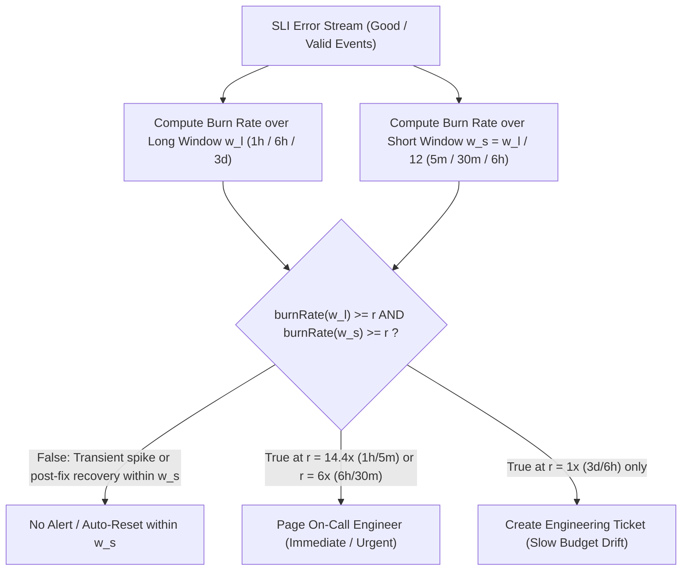
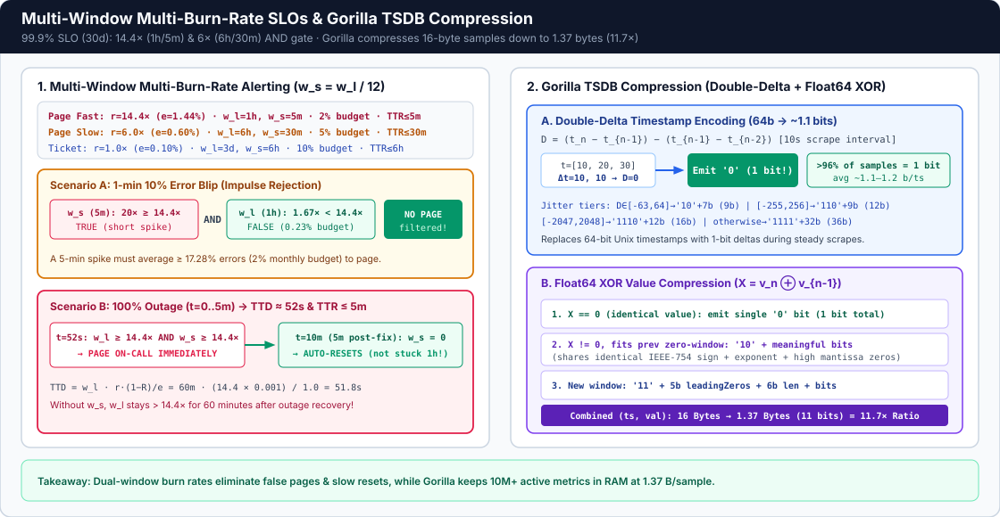
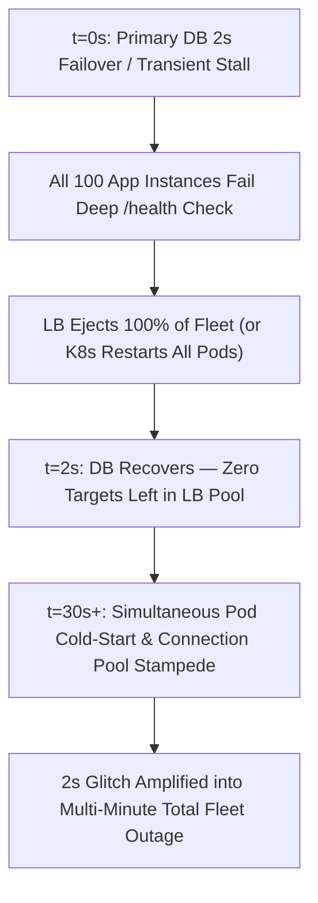
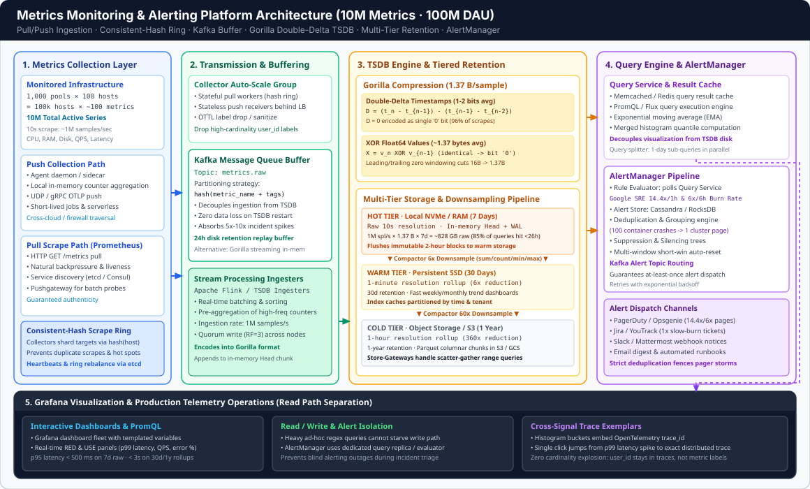
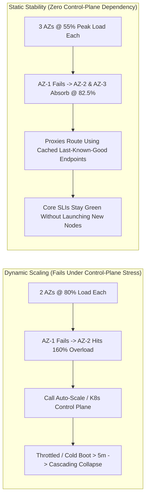
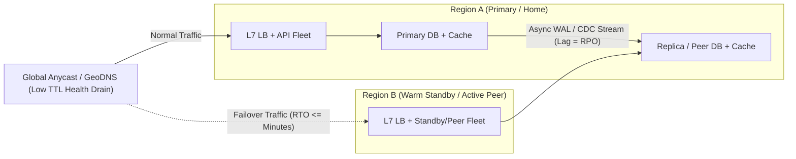
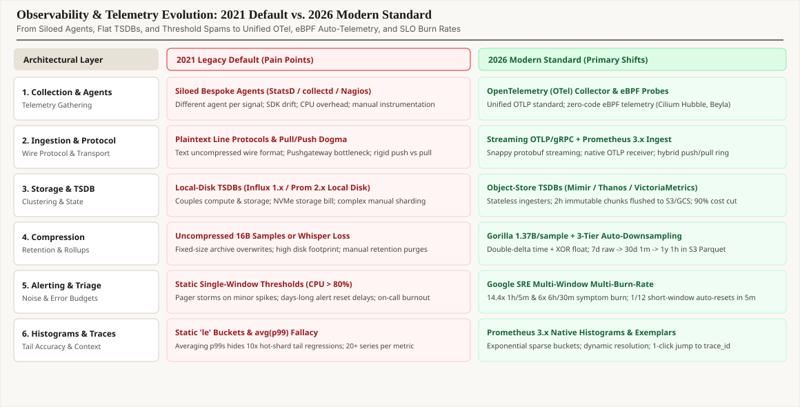

# Module 11 — Reliability, Observability, SLO Math, and Disaster Recovery

Reliability engineering bridges abstract distributed-systems correctness guarantees and day-two production operations. A system whose consensus protocol is linearizable still fails its users if uncalibrated alerts burn out on-call engineers, if averaged tail percentiles mask a hot shard, if high-cardinality metric labels exhaust the time-series database's memory, or if a two-second primary database blip triggers a deep health-check cascade that ejects every healthy application instance behind the load balancer.

This module owns the mathematical and architectural composition of Service Level Objectives (SLOs), Google SRE multi-window multi-burn-rate alerting, system-boundary telemetry traps, health-probe isolation, graceful degradation, static stability, disaster recovery (DR) topology selection, and progressive delivery. For Prometheus, OpenTelemetry, PromQL, and LGTM stack internals, cross-link to [`technologies/observability`](../../../technologies/observability/README.md); for cloud-managed DR tiers and storage classes, cross-link to [`architecture/cloud-foundations`](../../cloud-foundations/README.md); for metastable retry theory and consensus mechanics, cross-link to [`architecture/distributed-systems`](../../distributed-systems/README.md); and for DNS TTL caching and load-balancer routing mechanics, cross-link to [`architecture/networking`](../../networking/README.md).

---

## 1. SLIs, SLOs, SLAs, and Error Budgets

In the formal taxonomy of the Google _Site Reliability Engineering_ book (Ch. 4) and _Site Reliability Workbook_ (Ch. 2 and Ch. 5), reliability targets are decomposed into three distinct artifacts with clear mathematical and organizational boundaries:

1. **Service Level Indicator (SLI)**: A carefully defined quantitative measure of some aspect of the level of service provided—typically request availability, tail latency, throughput, freshness, or durability. Following Google SRE convention, event-based SLIs are expressed as a ratio of **good** events to **valid** events over an evaluation window $T$:

$$
\text{SLI} = \frac{\sum \text{Good Events}}{\sum \text{Valid Events}}
$$

Separating **valid** events from **raw** events is essential. Client-caused errors (such as malformed HTTP `400 Bad Request`, `401 Unauthorized`, or `404 Not Found` from web crawlers) and synthetic health probes must be excluded from the denominator unless the server itself is misclassifying valid payloads. Conversely, client-side timeouts caused by slow server processing and HTTP `5xx` responses remain in the denominator as valid events that fail the good-event predicate (for latency SLIs, good events satisfy both `status < 500` and `duration <= threshold`).

2. **Service Level Objective (SLO)**: A target value or range of values for a service level measured by an SLI over a rolling or calendar window $T$ (commonly 28 or 30 days). Let $R \in (0, 1)$ denote the SLO reliability target (for example, $R = 0.999$ for 99.9% availability).

3. **Error Budget ($B$)**: The permissible unreliability over window $T$, defined as the complement of the SLO:

$$
B = 1 - R
$$

For $N_{\text{valid}}$ valid requests in window $T$, the total error budget in failing events is $N_{\text{err}} = (1 - R) \times N_{\text{valid}}$. If $R = 0.999$ over $10^9$ monthly requests, the system may fail at most $10^6$ requests before violating its objective.

4. **Service Level Agreement (SLA)**: An explicit or implicit external contract specifying financial penalties, service credits, or legal remedies if reliability drops below a threshold $R_{\text{SLA}}$. Engineering teams always set the internal SLO stricter than the external SLA ($R_{\text{SLO}} > R_{\text{SLA}}$, e.g., 99.95% internal SLO backing a 99.9% commercial SLA) so the organization burns internal budget and freezes risky launches well before breaching customer contracts.

### 1.1 Exact Availability-to-Downtime Reference Table

When capacity planning or negotiating SLOs in an architecture review, converting "nines" of availability into wall-clock error budgets exposes why chasing an extra nine demands an order-of-magnitude jump in architectural complexity. The table below uses the standard 365-day year ($8{,}760\text{ h}$) and average calendar month ($365 / 12 \approx 30.4167\text{ d} = 730\text{ h} = 43{,}800\text{ min} = 2{,}628{,}000\text{ s}$), alongside the 30-day rolling SLO window ($720\text{ h} = 43{,}200\text{ min}$) used in burn-rate alerting:

| Availability Target ($R$) | Error Budget ($1 - R$) | Downtime per Avg Month ($730\text{ h}$) | Downtime per 30d Rolling Window ($720\text{ h}$) | Downtime per Year ($8{,}760\text{ h}$) | Typical Operational Posture |
| --- | :-: | :-: | :-: | :-: | --- |
| **99%** ("two nines") | 1% ($10^{-2}$) | **7.3 h/mo** | 7.2 h | 87.6 h | Single-region, manual failover, scheduled maintenance allowed |
| **99.9%** ("three nines") | 0.1% ($10^{-3}$) | **43.8 m/mo** | 43.2 m | 8.76 h | Multi-AZ deployment, automated health checks, rolling deploys |
| **99.95%** ("three and a half") | 0.05% ($5 \times 10^{-4}$) | **21.9 m/mo** | 21.6 m | 4.38 h | Multi-AZ with fast automated DB failover and canary gates |
| **99.99%** ("four nines") | 0.01% ($10^{-4}$) | **4.38 m/mo** | 4.32 m | 52.56 m | Automated zero-downtime deploys, multi-region or active-active read/write |
| **99.999%** ("five nines") | 0.001% ($10^{-5}$) | **26.3 s/mo** | 25.92 s | 5.26 m | Multi-region active-active, automated BGP/Anycast traffic drain, no human-in-the-loop recovery |

> [!IMPORTANT]
> **Five Nines Cannot Rely on Human Paging**: At 99.999% availability, the entire monthly budget is **26.3 seconds**. If an outage requires an on-call engineer to wake up, open a laptop, diagnose, and execute a runbook (typically 10–20 minutes), a single human-mitigated incident consumes over 20× the monthly budget. Achieving 99.99% or 99.999% requires automated detection and self-healing failover within seconds—or graceful degradation that keeps the core SLI healthy while shedding optional work.

### 1.2 Composite Availability of Serial vs Parallel Dependencies

An architectural mistake common in microservice designs is forgetting that **critical-path dependencies multiply reliability downward**. Consider an edge API gateway serving requests by calling $k$ independent synchronous backend services sequentially or in parallel (where all $k$ responses are required to return `200 OK`):

$$
A_{\text{serial}} = \prod_{i=1}^{k} A_i
$$

If an API gateway ($A_{\text{gw}} = 0.9999$) depends synchronously on five downstream services each targeting 99.99% ($0.9999$), the composite theoretical ceiling (even ignoring network partitions and gateway bugs) drops to $0.9999^6 \approx 0.9994$—violating a 99.95% composite SLO. By contrast, two redundant independent replicas in parallel (where either succeeds) combine via complement probability:

$$
A_{\text{parallel}} = 1 - \prod_{i=1}^{m} (1 - A_i)
$$

This yields two structural rules for architecture reviews:

- **The Rule of One Extra Nine**: Every synchronous critical-path dependency should target at least one nine higher reliability than the caller's composite SLO (or the caller must downgrade its own promised SLO).
- **Decouple Non-Critical Dependencies Off the Critical Path**: Move email dispatch, analytics logging, recommendation enrichment, and billing webhooks behind asynchronous durable queues or graceful-degradation fallbacks so their failure does not fail the primary request SLI.

### 1.3 SLI Specification Recipes Across System Archetypes

| System Archetype | Recommended Good / Valid SLI Definition | Denominator Exclusion Rule | Common Specification Trap |
| --- | --- | --- | --- |
| **Request-Response API** | Requests with `status < 500` and `latency <= T_slo` over all valid requests | Exclude `4xx` client input errors, auth failures, and LB health probes | Including `404`/`400` bot scans in availability burns error budget during crawler spikes |
| **Streaming / Queue Consumer** | Messages processed and checkpointed within freshness lag bound $L_{\max}$ over total published messages | Exclude poison messages intentionally dead-lettered after schema validation failure | Measuring consumer CPU instead of end-to-end event-to-checkpoint lag hides stalled partitions |
| **Batch / ETL Pipeline** | Scheduled runs completing valid output partitions before SLA cutoff $T_{\text{cutoff}}$ over scheduled runs | Exclude manually canceled backfill runs | Counting "job exited 0" as good when zero rows were written due to upstream empty partition |
| **Durable Storage Service** | Read/write probes returning uncorrupted checksum-verified bytes over total operations | Exclude unauthenticated or quota-exceeded client requests | Measuring HTTP `200` availability without periodic background bit-rot/checksum durability audits |

### 1.4 Error Budget Governance as a Control Loop

An error budget converts reliability disputes between product engineering and SREs into an objective policy loop. When the 30-day remaining error budget exceeds **50%**, teams ship continuously through automated CI/CD gates. When burn drops remaining budget between **10% and 50%** (or triggers a 6× slow burn), feature deploys shift toward smaller canary increments and mandatory chaos-drill verification. When remaining budget hits **0%**, policy freezes non-emergency feature releases and redirects engineering sprints exclusively to reliability debt—root-cause postmortem items, automated rollback tests, and dependency isolation—until rolling budget recovers above threshold.

### 1.5 Primary Literature & Systems Foundations Matrix

The mathematical and operational foundations of modern observability and reliability engineering are grounded in seminal distributed systems literature, industrial postmortems, and standardized open telemetry specifications:

| Foundation / Primary Source | Landmark Contribution & Core Mechanics | Architectural Invariant | Direct Production Impact |
| --- | --- | --- | --- |
| **Pelkonen et al. (Facebook Gorilla, VLDB 2015)** | "Gorilla: A Fast, Scalable, In-Memory Time Series Database". Inverted in-memory chunk storage; double-delta timestamp compression; XOR 64-bit float compression; empirical demonstration that $\sim 85\%$ of operational queries target data from the preceding 26 hours. | Regular interval metrics exhibit second-order timestamp differences $D = 0$ over $96\%$ of samples; XORing consecutive IEEE-754 floats collapses identical mantissa prefixes into leading/trailing zero masks, achieving $1.37\text{ bytes/sample}$ average. | Formed the foundational storage engine architecture for Prometheus TSDB, Grafana Mimir, VictoriaMetrics, and InfluxDB; slashed production TSDB RAM footprints by an order of magnitude. |
| **Beyer, Jones, Petoff, Murphy (Google SRE Book 2016) & Beyer, Murphy, Rensin, Kawahara, Thorne (Google SRE Workbook 2018 Ch. 5)** | Mathematical formalization of SLIs, SLOs, error budgets, and multi-window multi-burn-rate alerting. Introduced the $\frac{1}{12}$ short-window ratio to balance instantaneous impulse rejection against rapid alert auto-reset. | Alerting rules must evaluate both a long sliding window ($w_l$) and a short sliding window ($w_s = \frac{1}{12} w_l$) against burn-rate threshold $r$, bounding time-to-detect while ensuring post-mitigation reset within $w_s$. | Eliminated pager fatigue caused by transient 30-second spikes and obsolete single-window threshold alerts; established objective error-budget governance between feature velocity and reliability investment. |
| **OpenTelemetry Specification (CNCF Graduated Standard, 2021–2026)** | Vendor-neutral telemetry SDKs, OpenTelemetry Protocol (OTLP over gRPC and HTTP/Protobuf), W3C TraceContext (RFC 8895) distributed context propagation, and unified OpenTelemetry Collector processing pipelines (receivers, processors, exporters, OTTL). | Telemetry collection must decouple client application runtimes from backend storage systems through a vendor-agnostic pipeline supporting in-flight relabeling, sampling, and cardinality dropping. | Replaced fragmented, proprietary agent silos (StatsD, collectd, bespoke APMs) with a single unified telemetry standard; made cross-signal correlation (traces to metrics to logs) universally interoperable. |
| **Volz & Rabenstein (Prometheus TSDB, 2017) & Prometheus 3.x Architecture (2024–2026)** | Two-hour append-only in-memory head chunk buffer backed by an on-disk Write-Ahead Log (WAL); block compaction and inverted label postings index; Prometheus 3.0 Native Histograms (sparse exponential buckets) and native OTLP ingestion. | Linear interpolation quantile evaluation across dynamic exponential buckets ($2^n$ growth factor) without predefined static bucket boundaries; $O(1)$ series overhead for high-dynamic-range histograms. | Solved the tail-latency averaging fallacy without multiplying active time-series cardinality by $10\text{–}20\times$; enabled native gRPC streaming ingestion directly into Prometheus ecosystems. |
| **Alex Xu (ByteByteGo Vol. 2 Ch. 5 / Ch. 20: Metrics Monitoring and Alerting System)** | End-to-end operational metrics platform architecture for 100M DAU ($1{,}000\text{ pools} \times 100\text{ hosts} = 100{,}000\text{ instances}$, $10\text{M active metrics}$, $1\text{M samples/s}$); 6-axis pull vs push trade-off framework; Kafka ingestion buffering; 3-tier retention downsampling (7d raw $\to$ 30d 1m $\to$ 1y 1h); AlertManager deduplication/routing. | Write-heavy telemetry pipelines require asynchronous decoupling between collectors and TSDBs via message buffers; downsampling must aggregate raw statistical moments (`sum`, `count`, `min`, `max`) rather than pre-computing non-associative percentiles. | Provided the industry-standard curriculum and architectural blueprint for designing resilient, large-scale metrics collection, alerting, and visualization platforms. |

---

## 2. Multi-Window Multi-Burn-Rate Alerting Math

Once an SLO is defined, alerting on it naively fails in one of two ways:

1. **Instant Error-Rate Thresholding** (e.g., `page if error_rate_5m > 0.1%`): Any brief 30-second deploy hiccup or transient network jitter exceeds 0.1% over 5 minutes and wakes up the on-call engineer, even though it consumed less than 0.02% of the 30-day error budget.
2. **Simple Long-Window Budget Thresholding** (e.g., `page if budget_consumed_1h >= 2%` or `error_rate_1h > 1.44%`): Once the outage is mitigated after 10 minutes of 100% failure, the 1-hour sliding window continues evaluating to $> 2\%$ consumed for another 50 minutes. Worse, for slow-burn alerts using a 3-day window, an alert remains stuck firing for days after recovery, hiding subsequent incidents.

The Google _SRE Workbook_ (Ch. 5, §5.6 "Multiple Burn Rate Alerts" and §5.7 "Multiwindow, Multi-Burn-Rate Alerts") solves both problems simultaneously using **burn rate** thresholds paired across two nested sliding windows: a **long window** $w_l$ and a **short window** $w_s$.

### 2.1 Burn Rate Equations and Budget Depletion

Define the **burn rate** $r$ as the dimensionless ratio of the observed error rate $e$ to the sustainable error budget rate $(1 - R)$:

$$
r = \frac{e}{1 - R}
$$

- At $r = 1$, the system consumes error budget at the exact steady-state rate that exhausts 100% of the budget at the end of the SLO window $T$ (30 days = 720 hours).
- At $r = k$, the system exhausts 100% of the monthly error budget in time:

$$
T_{\text{exhaust}} = \frac{T}{r}
$$

Over any sliding observation window of duration $w$, sustaining burn rate $r$ consumes the following fraction $\theta(w)$ of the total window-$T$ error budget:

$$
\theta(w) = r \cdot \frac{w}{T}
$$

For a **30-day rolling window** ($T = 720\text{ h} = 43{,}200\text{ min}$) and a **99.9% SLO** ($1 - R = 0.001 = 0.1\%$ error budget), the canonical Google SRE Workbook alerting tiers are:

| Alert Tier | Notification Channel | Burn Rate ($r$) | Error Rate ($e = r \cdot (1 - R)$) | Exhaustion Time ($T / r$) | Long Window ($w_l$) | Short Window ($w_s = w_l / 12$) | Budget Consumed in $w_l$ | Max TTR After Mitigation |
| --- | --- | :-: | :-: | :-: | :-: | :-: | :-: | :-: |
| **Page Fast** | Immediate page | **14.4×** | 1.44% | 50 h | **1 h** | **5 m** | **2%** | $\le 5\text{ m}$ |
| **Page Slow** | Urgent page | **6×** | 0.60% | 120 h (5 d) | **6 h** | **30 m** | **5%** | $\le 30\text{ m}$ |
| **Ticket** | Low-priority ticket | **1×** | 0.10% | 720 h (30 d) | **3 d** ($72\text{ h}$) | **6 h** | **10%** | $\le 6\text{ h}$ |

_(Note: For the Ticket tier, Google SRE Workbook Table 5-7 uses $w_l = 3\text{ d}$ [$72\text{ h}$] and $w_s = 6\text{ h}$, which is a $\frac{1}{12}$ ratio [$72\text{ h} / 12 = 6\text{ h}$]; verify every number: $14.4 \times \frac{1}{720} = 0.02 = 2\%$, $6 \times \frac{6}{720} = 0.05 = 5\%$, and $1 \times \frac{72}{720} = 0.10 = 10\%$.)_

### 2.2 Why the $\frac{1}{12}$ Short-Window Ratio Works

An alert rule fires if and only if **both** the long window and the short window currently meet or exceed the burn-rate threshold $r$:

$$
\text{Alert Fires} \iff \text{burnRate}(w_l) \ge r \;\land\; \text{burnRate}(w_s) \ge r
$$

Let us prove why Google SRE recommends $w_s = \frac{1}{12} w_l$ across all three tiers (e.g., $5\text{ m} / 1\text{ h}$, $30\text{ m} / 6\text{ h}$, $6\text{ h} / 3\text{ d}$):

1. **Cutting Time-to-Reset (TTR) from Hours/Days to Minutes**: Suppose a severe 100% outage ($r = 1000\times$) runs for 5 minutes and is completely fixed at $t = 5\text{ m}$ (error rate returns to $0\%$). Over $w_l = 1\text{ h}$, the 5-minute 100% outage yields an average error rate of $5 / 60 = 8.33\%$ ($r = 83.3\times \ge 14.4\times$), so the long window remains above threshold for an entire hour until the 5-minute spike slides out of $w_l$ (specifically, until $t = 60\text{ m}$!). Because we AND with `burnRate(w_s) >= 14.4`, as soon as the 5-minute short window $w_s$ slides clear of the outage at $t = 10\text{ m}$ (within **5 minutes** of mitigation), `burnRate(w_s)` drops to $0 < 14.4$ and the alert resets cleanly. On the Ticket tier ($w_l = 3\text{ d}$, $w_s = 6\text{ h}$), TTR drops from 72 hours to at most 6 hours.

2. **Filtering Transient Micro-Blips Without Delaying Real Outages**: Why not evaluate $w_s$ alone? Because a 1-minute glitch at 10% error rate yields a 5-minute average of $10\% / 5 = 2\%$ ($r = 20\times \ge 14.4\times$), firing a false page despite consuming only $20 \times \frac{5}{43200} = 0.23\%$ of the monthly budget. Requiring `burnRate(w_l) >= r` imposes an **impulse rejection floor**: a burst completely contained inside $w_s = \frac{1}{12} w_l$ can only trip $w_l$ if its average error rate over $w_s$ reaches at least $12 \times r \cdot (1 - R)$. For the $14.4\times$ tier at 99.9% SLO, a 5-minute spike must average $\ge 12 \times 1.44\% = 17.28\%$ error rate—which immediately burns **2% of the entire monthly budget in 5 minutes**, justifying a genuine page!

3. **Bounded Time-to-Detect (TTD)**: For a sudden total outage ($e = 1.0$, $r = 1000\times$), the time required for the long window $w_l$ to cross threshold $r$ is:

$$
t_{\text{TTD}} = w_l \cdot \frac{r \cdot (1 - R)}{e} = 60\text{ m} \cdot \frac{14.4 \times 0.001}{1.0} = 0.864\text{ m} \approx 52\text{ s}
$$

Meanwhile, $w_s = 5\text{ m}$ crosses in $4.32\text{ s}$. Thus, even with the 1-hour long window gating false positives, a hard outage triggers a page in **under 1 minute** (bounded in practice by the Prometheus scrape interval and rule evaluation interval, typically 15–60s).





_Step-by-step mechanics:_ (1) Requiring both $w_l$ and $w_s = w_l / 12$ to meet burn rate $r$ (`14.4×` over `1h/5m` or `6×` over `6h/30m`) suppresses transient 1-minute glitches while detecting total outages in `~52 s` and auto-resetting within `5 min` of recovery. (2) Inside the metrics TSDB (see [§4.3](#43-high-throughput-buffering-and-gorilla-tsdb-compression-mechanics)), Gorilla double-delta timestamp encoding emits a single `'0'` bit whenever $D = 0$ (`> 96%` of regular scrapes) and pairs with Float64 XOR bit-window compression to shrink 16-byte `(int64, float64)` tuples to `1.37 bytes` (`11.7×`).

### 2.3 Executable Verification Logic (`07-slo-burn-rates-and-health.test.ts`)

The companion verification suite in `../examples/07-slo-burn-rates-and-health.test.ts` proves these invariants deterministically. The core evaluation logic follows this invariant:

```typescript
// Loop / Evaluation Invariant: Both long-window (w_l) and short-window (w_s = w_l / 12)
// burn rates must simultaneously meet or exceed threshold `burnRate` before alerting.
export interface MultiWindowRule {
  name: 'page-fast' | 'page-slow' | 'ticket';
  burnRate: number; // 14.4, 6, or 1
  longWindowMinutes: number; // 60, 360, or 4320
  shortWindowMinutes: number; // 5, 30, or 360 (exactly 1/12 of longWindowMinutes)
}

export function evaluateMultiWindowAlert(
  sloTarget: number,
  longWindowErrorRate: number,
  shortWindowErrorRate: number,
  rule: MultiWindowRule,
): { firing: boolean; longBurn: number; shortBurn: number; budgetFractionInLong: number } {
  const errorBudget = 1 - sloTarget;
  const longBurn = longWindowErrorRate / errorBudget;
  const shortBurn = shortWindowErrorRate / errorBudget;
  const sloWindowMinutes = 30 * 24 * 60; // 43,200 min
  const budgetFractionInLong = (longBurn * rule.longWindowMinutes) / sloWindowMinutes;

  return {
    firing: longBurn >= rule.burnRate && shortBurn >= rule.burnRate,
    longBurn,
    shortBurn,
    budgetFractionInLong,
  };
}
```

---

## 3. Three Major Observability & Health Failure Modes

Even teams with mathematically sound burn-rate rules routinely blind or destroy their own production fleets through three classic instrumentation and health-check errors (all verified as negative tests in `../examples/07-slo-burn-rates-and-health.test.ts`).

### 3.1 Failure Mode 1: Averaging Per-Host p99s Is Mathematically Invalid

Percentiles (p50, p95, p99) are **non-linear, non-additive order statistics**. Taking the arithmetic mean (or even a traffic-weighted mean) of per-instance p99 latencies produces a fabricated number that violates the mathematical definition of a fleet-wide percentile and hides severe tail regressions.

Consider a 10-shard service behind a load balancer where 9 shards are healthy and 1 hot or degraded shard has elevated latency and skewed traffic:

- **Shards 1–9** handle $100\text{ req/s}$ each ($900\text{ req/s}$ combined), with every request completing in $10\text{ ms}$ ($\text{p99} = 10\text{ ms}$).
- **Shard 10** handles a hot partition at $1{,}100\text{ req/s}$ where $5\%$ of requests take $2{,}000\text{ ms}$ and $95\%$ take $10\text{ ms}$ ($\text{p99} = 2{,}000\text{ ms}$).

Watch what happens when an engineer writes `avg(host_p99)` in a dashboard or alert:

- **Arithmetic mean of host p99s**: $\frac{9 \times 10\text{ ms} + 1 \times 2{,}000\text{ ms}}{10} = \mathbf{209\text{ ms}}$.
- **True fleet-wide p99**: Out of $2{,}000\text{ total req/s}$, $55\text{ req/s}$ ($2.75\%$ of the entire fleet!) take $2{,}000\text{ ms}$, so the true fleet-wide p99 is **$\mathbf{2{,}000\text{ ms}}$**—nearly **10× higher** than the averaged metric!
- Even with **perfectly equal traffic** ($100\text{ req/s}$ per shard across 10 shards), if Shard 10 suffers $15\%$ slow requests at $2{,}000\text{ ms}$, fleet-wide slow requests are $1.5\% > 1\%$, making the true fleet p99 **$2{,}000\text{ ms}$** while `mean(host_p99)` still reads **$209\text{ ms}$**.
- Conversely, averaging fails in the **opposite direction** too: if one busy host serves $10{,}000$ fast requests at $10\text{ ms}$ while two lightly loaded canary/drain hosts serve $50$ slow requests each at $1{,}000\text{ ms}$ and $500\text{ ms}$ (as demonstrated in `../examples/07-slo-burn-rates-and-health.test.ts`), `mean(host_p99)` falsely inflates to $\sim 500\text{ ms}$ even though $99.01\%$ of fleet traffic completed in $\le 10\text{ ms}$!

**Remediation**: Never pre-compute and average quantiles across hosts or time intervals. Emit raw latency observations into aligned **cumulative histogram buckets** (or HDR Histograms / Prometheus Native Sparse Histograms), sum the raw bucket counters across the entire fleet first, and evaluate the quantile _last_:

```promql
histogram_quantile(0.99, sum by (le) (rate(http_request_duration_seconds_bucket{service="feed-api"}[5m])))
```

### 3.2 Failure Mode 2: Metrics Label Cardinality Explosion

In time-series databases (Prometheus TSDB, Grafana Mimir, VictoriaMetrics), every unique combination of metric name plus `key=value` label pairs defines a distinct **active time series** with its own inverted index posting list, in-memory head-block chunk buffer, and WAL metadata.

Suppose an engineer instruments an HTTP metric `http_requests_total` across 10 microservices, 50 pods per service, 4 HTTP status classes, and innocently attaches `user_id` (1,000,000 active users) or raw unnormalized URL `path` (`/orders/8817231/receipt`):

$$
|\text{Series}| = 10 \times 50 \times 4 \times 1{,}000{,}000 = 2 \times 10^9 \text{ theoretical series}
$$

Even if only $1\%$ of users hit a subset of endpoints during a single 2-hour TSDB compaction window, the collector and Prometheus head block instantiate **$10^7+$ active time series** simultaneously. At roughly 2–4 KB of head-block RAM and index overhead per active series, $10^7$ series demand **20–40 GB of unpageable heap**, triggering TSDB OOM kills, scrape timeouts, lost alerts, and dead monitoring precisely during traffic spikes (when new users or error paths spawn fresh label tuples).

**Remediation**:

- **Strict Cardinality Budget on Metrics**: Restrict metric labels to low, bounded dimensions (`service`, `env`, `az`, `method`, `route_template` like `/orders/:id`, `status_class` like `2xx`/`5xx`). Enforce drop/relabel guardrails at the OpenTelemetry Collector or Prometheus `metric_relabel_configs` layer (see [`technologies/observability`](../../../technologies/observability/README.md)).
- **Route High-Cardinality Context to Logs, Traces, and Exemplars**: Put `user_id`, `tenant_id`, `request_id`, and exact query parameters into structured JSON logs and OpenTelemetry trace span attributes. Attach a **Prometheus Exemplar** (`trace_id`) onto histogram buckets so engineers can jump directly from a p99 spike to a concrete failing user trace without exploding metric series counts.

### 3.3 Failure Mode 3: Deep Health Check Cascading Fleet Outage

Consider a stateless API fleet of 100 instances behind an L7 load balancer (or Kubernetes `readinessProbe` / `livenessProbe`) sharing a single primary PostgreSQL database and Redis cluster. A developer implements `/health` as a **deep check** that runs `SELECT 1` on Postgres and `PING` on Redis with a 500 ms timeout, returning HTTP `503` if either fails.

Trace the cascading failure when Postgres undergoes a routine **2-second primary failover** or transient network stall:

1. At $t = 0\text{ s}$, Postgres stops accepting queries for 2 seconds.
2. Every active `/health` check across all 100 app instances fails simultaneously.
3. The load balancer marks **100% of app instances unhealthy** and ejects the entire fleet from rotation. If the same deep check is wired to `livenessProbe`, Kubernetes kills and restarts all 100 pods simultaneously.
4. At $t = 2\text{ s}$, Postgres finishes promoting the new primary and is healthy again—**but zero healthy API targets remain**.
5. User traffic hits `503 Service Unavailable` from the empty LB pool for 30–120 seconds while health probes wait for consecutive-success thresholds (`healthy_threshold = 3 × 10s`) or pods endure cold JVM/Node/Python startups and stampede Postgres with 100 simultaneous connection-pool handshakes (a classic **metastable failure**, see [`architecture/distributed-systems`](../../distributed-systems/README.md)).
6. Worse, even if Postgres remained degraded on writes, ejecting all API instances prevented those instances from serving **read-only cached responses, static fallback payloads, or health status pages**.



**Remediation (Three-Part Health Probe Isolation)**:

1. **Separate Liveness from Readiness**:
   - **Liveness (`/healthz/live`)**: Answers _"is this process alive and un-wedged?"_ Checks only local process responsiveness (e.g., event-loop lag within bounds, no internal deadlock). **Never queries external databases, caches, or sibling services.**
   - **Readiness (`/healthz/ready`)**: Answers _"can this instance accept new traffic?"_ Checks local startup completion (config loaded, caches warmed) and graceful shutdown flag (`SIGTERM` sets readiness to `503` immediately while draining in-flight connections).
2. **Fail Open on Shared Dependencies in LB Probes**: If _every_ instance in the pool shares the same primary DB, failing `/healthz/ready` when the DB blips adds zero routing benefit—the LB cannot route around a shared dependency failure by dropping all instances. Only fail local readiness when a failure is **instance-local** (e.g., broken local disk, corrupted TLS cert, isolated local NIC failure, or uninitialized local cache).
3. **Passive Outlier Detection with Bounded Ejection**: Prefer **passive health checking** at the proxy/LB (observing real traffic `5xx` or connection resets) combined with a **panic threshold** and **ejection cap** (e.g., Envoy `max_ejection_percent: 50` and `healthy_panic_threshold: 50%`). If more than 50% of instances fail concurrently, the LB stops ejecting targets and routes across the fleet rather than emptying the pool.

---

## 4. Telemetry Signals and Instrumentation Frameworks: RED vs USE

Choosing _what_ to measure before building dashboards avoids alert noise and blind spots. Two complementary industry methodologies divide service telemetry from infrastructure telemetry:

| Dimension | **RED Method** (Tom Wilkie) | **USE Method** (Brendan Gregg) |
| --- | --- | --- |
| **Target Layer** | Request-driven microservices, APIs, RPC handlers, queues | Hardware & OS resources (CPU, RAM, NIC, disk, thread/connection pools) |
| **Three Signals** | **R**ate (requests/sec), **E**rrors (failed reqs/sec), **D**uration (latency distribution) | **U**tilization (% busy time), **S**aturation (queued work waiting), **E**rrors (hardware/device errors) |
| **Primary Question** | _"Are users experiencing degraded service right now?"_ (Feeds SLIs/SLOs) | _"Which physical or bounded resource is bottlenecking or saturated?"_ (Root-cause diagnostics) |
| **Alerting Role** | **Page** on SLO burn rate derived from Errors and Duration SLIs | **Diagnose** why Duration rose (e.g., CPU CFS throttling, DB pool saturation); avoid paging directly on CPU % |
| **Concrete Examples** | `http_requests_total`, `http_request_duration_seconds_bucket` | CPU run-queue length, NIC `rx_dropped`, Postgres `pg_stat_activity` waiting connections, Node event-loop delay |

Across the three telemetry pillars—**Metrics**, **Logs**, and **Distributed Traces**—metrics power real-time SLO burn-rate evaluation at $O(1)$ query cost; structured logs capture discrete high-cardinality audit and error records; and distributed traces (with W3C `traceparent` propagation and tail-based sampling in the OpenTelemetry Collector) reconstruct cross-service critical paths and fan-out tail latency. See [`technologies/observability`](../../../technologies/observability/README.md) for OpenTelemetry SDKs, collector pipelines, and PromQL mechanics.

### 4.1 End-to-End Metrics Platform Architecture (10M Metrics · 100M DAU)



An operational metrics platform serving a large-scale engineering organization (such as a 100M DAU platform backing 1,000 service pools and 100 machines per pool) must ingest, compress, index, and query millions of numeric telemetry samples every second without destabilizing under incident traffic spikes or exhausting storage budgets.

Consider the baseline scale and capacity requirements derived from ByteByteGo (Alex Xu Vol. 2 Ch. 5 / Ch. 20):

- **Monitored Fleets**: $1{,}000\text{ server pools} \times 100\text{ hosts/pool} = 100{,}000\text{ hosts}$.
- **Active Time Series**: Under ByteByteGo Ch. 20's base host-metric baseline, each host emits $\sim 100$ base counters/gauges (CPU, RAM, disk I/O, network packet rates, thread pool saturation, total HTTP requests—note that adding `~30×` per-route/status histogram-bucket expansion scales this to `3,000` series/host = `300M` active series in [Module 13 §5](13-canonical-designs-realtime-geo-and-streams.md#5-metrics-monitoring-platform)), generating:

$$
N_{\text{metrics}} = 100{,}000\text{ hosts} \times 100\text{ metrics/host} = 10{,}000{,}000\text{ active metrics}
$$

- **Ingestion Write Throughput**: At a standard collection interval of $10\text{ seconds}$, the storage tier sustains an continuous ingestion rate of:

$$
Q_{\text{write}} = \frac{10^7\text{ active metrics}}{10\text{ s}} = 1{,}000{,}000\text{ samples/s}
$$

- **Raw vs. Compressed Storage Footprint**: An uncompressed sample contains an 8-byte Unix timestamp (`int64`) and an 8-byte measurement value (`float64`), consuming $16\text{ bytes/sample}$. At $1\text{M samples/s}$, raw storage accumulates at:

$$
\text{Raw Rate} = 10^6 \times 16\text{ bytes/s} = 16\text{ MB/s} \approx 1.3824\text{ TB/day}
$$

Storing 1 year of uncompressed telemetry would demand $365 \times 1.3824\text{ TB} \approx 504.6\text{ TB}$ of storage—prohibitively expensive if placed on high-IOPS NVMe blocks. By applying Gorilla compression ($1.37\text{ bytes/sample}$ average), daily raw ingestion drops to:

$$
\text{Compressed Rate} = 10^6 \times 1.37\text{ bytes/s} = 1.37\text{ MB/s} \approx 118.368\text{ GB/day}
$$

- **Multi-Tier Retention Policy & Downsampling Schedule (Payload Bytes)**:
  1. **Hot Tier (Raw 10s Resolution, 7-Day Retention)**: Incoming samples are appended to an in-memory head chunk backed by a local NVMe Write-Ahead Log (WAL). Per Facebook's Gorilla research, $\sim 85\%$ of all production queries target data from the previous 26 hours. Keeping 7 days of raw 10s data consumes $7 \times 118.368\text{ GB} \approx 828.58\text{ GB}$, fitting comfortably on local NVMe arrays while serving high-resolution incident debugging.
  2. **Warm Tier (1-Minute Rollup, 30-Day Retention)**: A background compactor continuously downsamples 2-hour immutable blocks by aggregating 6 consecutive 10s samples into 4-field 1-minute statistical summaries (`sum`, `count`, `min`, `max`), yielding $6\times$ fewer timestamps but $6/4 = 1.5\times$ net byte reduction. Retaining 30 days of 4-field 1-minute rollups requires $30 \times (118.368 / 1.5)\text{ GB} \approx 2{,}367.36\text{ GB}$ (`~2.37 TB`) on warm persistent SSDs (or `~591.84 GB` per single rollup field).
  3. **Cold Tier (1-Hour Rollup, 1-Year Retention)**: Compactor workers downsample 1-minute rollups into 4-field 1-hour intervals ($360\times$ fewer points relative to raw, $360 / 4 = 90\times$ net byte reduction across 4 fields), shipping Parquet columnar chunks to commodity object storage (AWS S3, Google Cloud Storage). Retaining 365 days of 4-field 1-hour rollups consumes $365 \times (118.368 / 90)\text{ GB} \approx 480.05\text{ GB}$ (or `~120.01 GB` per single field).
  4. **Total Multi-Tier Storage**: The 1-year multi-tier sample payload across all three tiers totals $828.58\text{ GB} + 2{,}367.36\text{ GB} + 480.05\text{ GB} \approx 3.68\text{ TB}$—a $99.3\%$ storage saving over naive `504.6 TB` uncompressed retention! Note that these figures measure **sample payload bytes only**; production TSDBs also provision RAM/WAL overhead for inverted label postings indexes (as sized in [Module 13 §5.2](13-canonical-designs-realtime-geo-and-streams.md#52-metrics-capacity-estimation)).

### 4.2 Metrics Collection Mechanisms: Pull vs. Push 6-Axis Trade-Off Matrix

Choosing between a pull-based collection model (e.g., Prometheus scraping HTTP endpoints) and a push-based collection model (e.g., CloudWatch, StatsD, or OpenTelemetry OTLP daemon) requires evaluating six structural operational dimensions:

| Evaluation Dimension | Pull Architecture (Prometheus / Scrape) | Push Architecture (CloudWatch / StatsD / OTLP) | Production Trade-Offs & Modern Synthesis |
| --- | --- | --- | --- |
| **1. Easy Debugging & Ad-hoc Verification** | Application instances expose a standard plaintext `/metrics` endpoint. Developers can curl the endpoint directly from their laptop or shell to verify new counters in real time. | Telemetry flows outward to a collector; validating whether a metric is emitting requires querying the central TSDB or running a local mock collector. | **Pull wins for developer ergonomics**; local curl verification eliminates guesswork during service development. |
| **2. Health Checking & Liveness Detection** | The pull collector treats an HTTP connection failure or timeout as an immediate signal that the target is down (`up == 0`). | If the central collector stops receiving pushed metrics, the failure could be a crashed target, network partition, firewall block, or buffer overflow. | **Pull wins for unambiguous instance liveness**; distinguishing host downtime from network packet loss is built into the protocol. |
| **3. Short-Lived Jobs & Ephemeral Tasks** | Batch cron jobs, AWS Lambda executions, and CLI tools frequently finish and terminate before the next pull scrape occurs (`10s`–`60s` interval). | Ephemeral tasks push their final metrics payload directly to the collector as part of their clean shutdown sequence. | **Push wins for serverless & batch**; pull architectures require an intermediate Pushgateway buffer, adding an operational hop. |
| **4. Firewall Traversal & Multi-Cloud Networks** | Pull collectors must establish inbound TCP connections to every target. In multi-VPC, multi-region, or on-prem hybrid setups, this requires extensive reverse proxies, VPN tunnels, or firewall holes. | Targets initiate outbound TCP/UDP/gRPC egress connections to a central load-balanced collector endpoint. | **Push wins for complex networks**; outbound egress through NAT gateways avoids inbound security policy friction. |
| **5. Transport Performance & Backpressure** | Scraping relies on persistent TCP/HTTP connections. The scraper regulates its own rate, ensuring central TSDBs cannot be overwhelmed by client traffic surges. | Agents use UDP or batched gRPC streaming. UDP offers sub-millisecond low-overhead transport but risks silent packet drops under saturation. | **Tied**; pull provides natural backpressure, while modern push (OTLP over gRPC with HTTP/2 flow control) amortizes connection setup. |
| **6. Data Authenticity & Edge Security** | Scrape targets are explicitly declared in service discovery configurations (etcd, Consul, Kubernetes API), preventing rogue agents from injecting fabricated series. | Any client with network route access to the collector can push arbitrary metrics unless strict mTLS or API token authentication is enforced at the collector LB. | **Pull wins for default zero-trust authenticity**; push requires collector authentication guardrails to prevent data pollution. |

**The Modern Architectural Synthesis**: Leading engineering organizations do not treat Pull vs. Push as an ideological dichotomy. Instead, they deploy an **OpenTelemetry Collector DaemonSet / Sidecar** on every node:

- The local OTel Collector pulls `/metrics` endpoints from co-located pods over localhost loopback (retaining easy curl debugging, low latency, and zero firewall traversal).
- For short-lived batch jobs and serverless containers, applications push metrics directly to the local OTel Collector daemon.
- The OTel Collector normalizes labels, drops unauthorized or high-cardinality attributes via OTTL (OpenTelemetry Transformation Language), batches samples, and pushes compressed OTLP/gRPC streams to the central ingestion buffer.
- To prevent duplicate scraping when pull collectors run centrally, collectors coordinate via a **Consistent-Hash Collector Ring** backed by etcd or Consul, where each scraper instance owns an exclusive segment of the service hash space ($\text{hash}(\text{host}) \pmod N$).

### 4.3 High-Throughput Buffering and Gorilla TSDB Compression Mechanics

In an enterprise telemetry pipeline, writing incoming metric streams directly from scrapers into time-series database storage engines creates a fatal coupling: if the TSDB pauses for compaction or undergoes a rolling restart, scrape buffers overflow and drop metrics, blinding on-call engineers precisely when stability is degraded.

```mermaid
flowchart LR
    COL["Collectors (Push / Pull)"] -->|"Batch Protobuf"| LB["Collector Load Balancer"]
    LB --> KAFKA["Kafka Ingestion Buffer (Topic: metrics.raw)"]
    KAFKA -->|"Partition Key: hash(metric_name + tags)"| CONS["Ingesters / Flink Stream Processors"]
    CONS -->|"Head Block + WAL"| TSDB["Gorilla TSDB Engine (Double-Delta + Float XOR)"]
    TSDB -->|"Flush 2h Blocks"| WARM["Warm Tier (SSD Compactor)"]
    WARM -->|"Daily Rollups"| COLD[("S3 Object Store (Parquet)")]
```



#### Kafka Ingestion Buffering

To ensure zero telemetry loss and decouple ingestion from storage, a distributed message bus (Apache Kafka) is inserted between the collection layer and the TSDB:

1. **Decoupled Durability**: Kafka retains incoming telemetry on replicated append-only disk logs for 24–48 hours, allowing the TSDB cluster to be stopped, re-indexed, or upgraded without dropping incoming data.
2. **Deterministic Partitioning by Time Series**: Producers key Kafka messages by `hash(metric_name + sorted_label_pairs)`. This guarantees that every sample for a particular time series lands sequentially in the same Kafka partition, enabling downstream stream processors (such as Apache Flink or TSDB ingester workers) to maintain in-memory state machines and compute windowed aggregations without cross-partition shuffling.
3. **Surge Absorption**: During a major infrastructure incident (e.g., a network partition triggering thousands of service retries), error-metric emission surges by $5\times\text{–}10\times$. Kafka absorbs this burst gracefully, buffering messages while ingesters drain the queue at their provisioned maximum rate.

#### Gorilla Double-Delta Timestamp Encoding

Traditional time-series systems store timestamps as uncompressed 64-bit Unix epochs ($8\text{ bytes}$). However, because metrics are collected at regular intervals (e.g., every $10\text{ seconds}$), consecutive timestamps $t_{n-1}$ and $t_n$ exhibit near-constant first-order differences:

$$
\Delta t_n = t_n - t_{n-1} \approx 10\text{ s}
$$

Facebook's Gorilla paper (Pelkonen et al., VLDB 2015) takes advantage of this by computing the **second-order difference** (the delta-of-delta) $D$:

$$
D = \Delta t_n - \Delta t_{n-1} = (t_n - t_{n-1}) - (t_{n-1} - t_{n-2})
$$

Gorilla encodes $D$ using a variable-length bit prefix:

| Range of Second-Order Delta ($D$) | Header Bit Sequence | Value Bits Emitted | Total Bits Stored | Operational Frequency & Meaning |
| --- | :-: | :-: | :-: | --- |
| $D = 0$ | `'0'` | 0 bits | **1 bit** | **$> 96\%$ of samples** on regular interval scrapes |
| $-63 \le D \le 64$ | `'10'` | 7 bits ($D + 63$) | **9 bits** | Minor clock jitter or scrape timer variance ($\pm 64\text{ ms}$) |
| $-255 \le D \le 256$ | `'110'` | 9 bits ($D + 255$) | **12 bits** | Moderate network transit delay or container scheduling pause |
| $-2047 \le D \le 2048$ | `'1110'` | 12 bits ($D + 2047$) | **16 bits** | Large scrape latency or GC stall ($\pm 2\text{ s}$) |
| Otherwise | `'1111'` | 32 bits ($D$) | **36 bits** | Scrape reconfiguration, agent restart, or irregular leap second |

Under nominal production operations where scrapers run periodically, over $96\%$ of all timestamp entries compress to a **single bit (`0`)**, slashing timestamp overhead from 64 bits to an empirical average of **$\sim 1.1\text{–}1.2\text{ bits per sample}$**!

#### Gorilla XOR Floating-Point Value Compression

Measurement values are 64-bit IEEE-754 floating-point numbers. In operational monitoring, successive values of physical metrics (such as CPU utilization, memory usage, or temperature) change smoothly or remain constant, while counters (such as `http_requests_total`) increase monotonically by small increments. Consequently, the binary representations of $v_{n-1}$ and $v_n$ share identical sign, exponent, and high-order mantissa bits.

Gorilla computes the bitwise XOR difference $X$ between consecutive floating-point values:

$$
X = v_n \oplus v_{n-1}
$$

The compressor evaluates $X$ through two branches:

1. **Zero Difference ($X = 0$)**: If $v_n = v_{n-1}$ (the value did not change), emit a single `'0'` bit.
2. **Non-Zero Difference ($X \ne 0$)**: Emit a `'1'` bit, followed by one of two encoding paths:
   - **Reusing Previous Bit Window (Control bit `'0'`)**: If the number of leading zeros and trailing zeros in $X$ is at least as large as the previous compressed sample's leading and trailing zero windows, emit `'0'` followed by the meaningful bits (spanning the length defined by the previous window).
   - **Establishing New Bit Window (Control bit `'1'`)**: Emit `'1'`, followed by $5\text{ bits}$ storing the leading zero count, $6\text{ bits}$ storing the length of the meaningful bit sequence, and finally the meaningful bits themselves.

Empirical evaluation across billions of production time series at Facebook demonstrated that pairing double-delta timestamps with XOR float64 compression reduces combined `(timestamp, float64)` samples down to an average of **$1.37\text{ bytes (11 bits) per sample}$**, achieving an overall combined compression ratio of **$11.7\times$** compared to uncompressed 16-byte `(int64, float64)` tuples.

### 4.4 Query Languages and Aggregation Expressiveness: PromQL and Flux vs. Relational SQL

General-purpose relational databases (such as PostgreSQL or MySQL) are structurally misaligned with time-series workloads. In relational engines, data is stored in row-oriented pages (`heap tuples`) indexed by B-trees, requiring the database to deserialize entire rows (including unused columns) and execute thousands of random I/O reads across disk blocks when evaluating time-range aggregations. Furthermore, standard ANSI SQL lacks native primitives for sliding time windows, requiring complex nested subqueries and epoch arithmetic.

Consider the task of computing a 10-minute Exponential Moving Average (EMA) of CPU readings across web servers. In SQL, this requires window partitioning, epoch arithmetic, and nested subqueries:

```sql
SELECT id, temp,
       AVG(temp) OVER (PARTITION BY group_nr ORDER BY time_read) AS rolling_avg
FROM (
  SELECT id, temp, time_read, interval_group,
         id - ROW_NUMBER() OVER (PARTITION BY interval_group ORDER BY time_read) AS group_nr
  FROM (
    SELECT id, time_read, temp,
           TIMESTAMP 'epoch' + INTERVAL '900 second' * (EXTRACT(EPOCH FROM time_read)::int / 900) AS interval_group
    FROM readings
  ) t1
) t2
ORDER BY time_read;
```

In contrast, dedicated time-series query languages express the identical operational query in a single declarative pipeline:

```flux
// InfluxDB Flux
from(bucket: "telegraf")
  |> range(start: -1h)
  |> filter(fn: (r) => r._measurement == "cpu" and r._field == "usage_system")
  |> exponentialMovingAverage(size: -10s)
```

Similarly, in Prometheus PromQL, computing moving rates and evaluating 99th percentile latencies across thousands of distributed application instances is achieved natively:

```promql
# Prometheus PromQL: Moving 5-minute counter rate and 99th percentile latency
histogram_quantile(0.99, sum by (le) (rate(http_request_duration_seconds_bucket{service="api"}[5m])))
```

| Operational Dimension | Relational SQL on Row Storage | Dedicated Time-Series TSDB (PromQL / Flux) |
| --- | --- | --- |
| **Storage Layout** | Row-oriented (`Tuple` headers, padding, alignment bytes). | Columnar chunks compressed via Gorilla (timestamps separate from values). |
| **I/O Access Pattern** | Scans entire rows; high page cache pollution. | Columnar vector scans; reads only queried metric arrays, skipping entire blocks via metadata. |
| **Sliding Window Expressiveness** | Complex nested `ROW_NUMBER()`, self-joins, and epoch division. | Native sliding-window operators (`rate()`, `exponentialMovingAverage()`, `increase()`). |
| **Cardinality Indexing** | B-tree index on `(metric_name, timestamp)` suffers massive write amplification. | Inverted postings index mapping label pairs (`method=GET`) to internal chunk IDs. |
| **Quantile Computation** | Requires loading all raw rows into memory to sort and compute `PERCENTILE_CONT`. | Direct aggregation across pre-binned exponential histogram buckets (`histogram_quantile`). |

### 4.5 AlertManager Architecture: Deduplication, Grouping, and Kafka Routing

Building a robust alerting tier requires strict physical and logical separation between **alert rule evaluation** and **dashboard ad-hoc queries**:

1. **Read-Path Isolation**: If business analysts or developers execute unindexed, multi-month PromQL queries (such as `{__name__=~".*"}`) during a major outage, query frontend resources saturate. If alert rule evaluation shares the same query pool, alerts freeze and fail to fire. Production systems deploy a dedicated, isolated **Rule Evaluator** cluster querying dedicated TSDB read replicas.
2. **AlertManager Core Pipeline**:
   - **Ingestion**: Alerting rules evaluate every $15\text{–}60\text{ seconds}$. When an SLI burn-rate condition evaluates to true for the configured `for` duration, an alert instance is dispatched to AlertManager.
   - **State Persistence**: AlertManager maintains state in a clustered key-value store (such as Apache Cassandra or embedded RocksDB), tracking alert lifecycles (`Pending`, `Firing`, `Resolved`) with at-least-once durability.
   - **Deduplication & Grouping**: If an entire Kubernetes node fails, 100 separate microservice pods may fail health checks simultaneously. AlertManager clusters alerts by routing labels (e.g., `group_by: ['cluster', 'alertname', 'namespace']`), coalescing 100 discrete firing events into a single notification digest with a configurable `group_wait` (e.g., $30\text{ seconds}$).
   - **Inhibition & Silencing**: Hierarchy rules suppress downstream warnings when a root dependency fails (e.g., if `ClusterUnreachable` is firing, suppress all `InstanceDown` alerts for nodes within that cluster).
   - **Kafka Notification Routing**: To guarantee that alerts reach on-call engineers even during third-party provider outages, AlertManager publishes notifications to an internal partitioned Kafka topic (`alerts.dispatch`). Dedicated consumer workers consume from Kafka, implementing exponential backoff retries when dispatching to PagerDuty, Opsgenie, webhooks, or corporate chat channels.

---

## 5. Graceful Degradation, Load Shedding, and Static Stability

High-availability architectures assume components will fail and design explicit degradation paths rather than expecting 100% of dependencies to stay healthy simultaneously.

### 5.1 Avoiding Untested Fallback Traps (AWS Builders' Library)

As documented in the AWS Builders' Library (_"Avoiding fallback in distributed systems"_), naive fallback paths are a leading cause of catastrophic outages:

- **The Unexercised Fallback Bug**: A fallback path that executes only during rare emergencies drifts out of sync with schema changes, permission updates, or scaling growth, crashing immediately when invoked in anger.
- **The Load-Amplifying Fallback**: Suppose Service A normally reads from a fast Redis cache and "falls back" to an uncached complex SQL join on miss/timeout. Under normal load, 1% misses work fine; during a Redis stall, 100% of traffic falls back to Postgres simultaneously, crushing Postgres under 100× load.
- **Safer Alternatives**:
  1. **Eliminate the fallback** if the primary path has sufficient multi-AZ/multi-cell redundancy, or **fail fast** with clear error codes and retry budgets.
  2. **Proactive / Continuous Exercise**: If a fallback exists (such as serving a pre-computed static default recommendation list when the ML ranker times out), exercise it continuously via **percentage traffic routing or chaos drills** so its capacity and correctness stay verified every day.
  3. **In-Memory Stale-While-Error**: Keep the last known good response or config cached locally in process memory so degradation consumes **zero** downstream network or database capacity.

### 5.2 Static Stability

**Static stability** (AWS Builders' Library, _"Static stability using Availability Zones"_) is the principle that a system's **data plane must keep operating without needing control-plane mutations during an outage**:

- **Anti-Pattern (Dynamically Scaling During AZ Failure)**: Running 2 AZs at 80% utilization each and relying on Auto Scaling + EC2/Kubernetes control-plane APIs to launch replacement nodes in the surviving AZ when one AZ fails. During a real AZ event, control-plane APIs are often overloaded or rate-limited, and cold-booting capacity takes minutes—during which the surviving AZ collapses at 160% load.
- **Static Stability Pattern**: Pre-provision sufficient headroom across surviving zones so existing running instances absorb failover traffic with **zero control-plane API calls** (e.g., running 3 AZs at $\le 55\%$ peak load each so losing any 1 AZ puts the remaining 2 AZs at $\le 82.5\%$ without autoscaling). Similarly, data-plane proxies (Envoy, NGINX, API gateways) cache last-known-good service discovery snapshots and IAM verification keys locally, failing open on stale control-plane polls rather than clearing routing tables.



### 5.3 Graceful Degradation Tiers

Design explicit degradation levels controlled by feature flags or adaptive load-shedding thresholds:

| Degradation Level | Trigger Condition | Action Taken | Preserved Core SLI |
| --- | --- | --- | --- |
| **Level 0 (Normal)** | Error budget healthy, saturation $< 70\%$ | Full personalization, rich media, synchronous analytics | All SLIs nominal |
| **Level 1 (Feature Shed)** | Downstream ML/ranker latency $> \text{p99}$ budget | Skip ML personalization; serve popularity/chronological feed from local cache | Core feed availability & latency |
| **Level 2 (Read-Only / Async)** | Primary write DB degraded or lock-saturated | Queue non-urgent profile edits/likes to durable log; serve cached reads (`stale-if-error`) | Read availability preserved |
| **Level 3 (Priority Load Shedding)** | Worker queue depth $> \text{bound}$ or CPU $> 90\%$ | Reject low-priority batch/crawler/free-tier traffic with `429`/`503 Retry-After`; process LIFO for interactive requests | Checkout / payment / auth SLIs protected |

---

## 6. Multi-AZ vs Multi-Region Architecture and RPO/RTO Engineering

Choosing redundancy boundaries requires balancing **physical failure-domain independence**, **speed-of-light replication latency**, and **operational complexity** (cross-link [`architecture/cloud-foundations`](../../cloud-foundations/README.md) for cloud service specifics and [`architecture/data-systems`](../../data-systems/README.md) for consensus/replication mechanics).

### 6.1 Multi-AZ vs Multi-Region Trade-Offs

- **Single-Region Multi-AZ**: Availability Zones within one region sit kilometers apart on independent power, cooling, and network fabrics with typically $0.5\text{–}2\text{ ms}$ round-trip latency. This low RTT makes **synchronous replication** (e.g., Raft/Paxos quorums or synchronous standby DB commit) practical for zero data loss (**$\text{RPO} = 0$**) with minor write-latency overhead. However, all AZs in a region share a single cloud control plane, regional IAM/DNS endpoints, and blast radius from bad regional config pushes.
- **Multi-Region**: Regions sit hundreds or thousands of kilometers apart ($20\text{–}150+\text{ ms}$ RTT). Synchronous cross-region writes impose severe latency penalties unless using geo-distributed consensus with local read leases or Spanner-style TrueTime commit-wait. Consequently, most multi-region systems use **asynchronous cross-region replication** ($\text{RPO} > 0$, typically seconds to minutes) or **regional home-sharding** (each user's writes stay home in one region).

### 6.2 Active-Passive vs Active-Active and DR Tiers

| DR Strategy | Recovery Point Objective (RPO) | Recovery Time Objective (RTO) | Replication & Compute Posture | Operational Failure Traps |
| --- | --- | --- | --- | --- |
| **Backup & Restore** | Hours (snapshot interval) | Hours to days | Periodic snapshots shipped to cross-region object store; zero standby compute | Broken restore IAM, cold-restore hydration lag, regional quota exhaustion |
| **Pilot Light** | Seconds to minutes | Tens of minutes | Continuous async DB replica in DR region; stateless compute scaled to 0 or minimal | Unsynced AMI/container images, untested schema/DNS cutover |
| **Warm Standby** | Seconds | Minutes | Scaled-down live compute + warm DB replica handling synthetic or shadow reads | Scale-up lag during sudden traffic flood; drift between primary and DR config |
| **Multi-Region Active-Active** | $\approx 0$ (or bounded async window per home shard) | Seconds (DNS/Anycast health drain) | Both regions serve live reads/writes simultaneously | Split-brain write conflicts, silent LWW data overwrites, cross-region egress cost |



> [!WARNING]
> **DNS Failover Is Never Instant**: Even with a `60s` DNS TTL, stub resolvers on client devices, mobile carriers, and legacy JVMs routinely ignore low TTLs and cache resolved IPs for minutes or hours. True sub-minute multi-region failover relies on **BGP Anycast edge proxies** (Cloudflare, CloudFront, AWS Global Accelerator) terminating client TCP/TLS at the edge and re-routing backend traffic over private backbone links without waiting for client DNS expiration (see [`architecture/networking`](../../networking/README.md)).

### 6.3 GameDays, Backup Verification, and DR Drills

An untested disaster recovery plan is indistinguishable from hope. Production teams enforce two continuous practices:

1. **Automated Restore Verification**: Continuously restore encrypted backups into isolated ephemeral environments and run checksum/row-count integrity queries. This catches missing KMS cross-region key grants, corrupted WAL chains, and unexpected multi-hour IOPS bottlenecks _before_ an outage.
2. **GameDays & Evacuation Drills**: Periodically drain live production traffic away from an entire AZ or region during business hours (when engineers are awake) to verify static stability headroom, cold-cache database behavior, connection-pool warming, and observability blind spots.

---

## 7. Progressive Delivery: Canary, Blue-Green, Shadowing, and Feature Flags

Statistically, the single largest trigger of production incidents is **a planned change** (code deploy, config push, or schema migration). Decoupling **code deployment** from **traffic exposure** minimizes error-budget burn:

1. **Canary Deployments**: Route 1% → 5% → 25% → 100% of live traffic to the new release, comparing canary SLIs against a baseline control group using automated statistical tests (such as Mann-Whitney U) and burn-rate gates. _Crucial detail_: a 1% canary needs sufficient absolute request volume to yield statistically valid error rates; low-QPS services require longer bake windows or synthetic probing.
2. **Blue-Green Deployments**: Provision a complete parallel environment ("Green") alongside the live environment ("Blue"), warm caches/JITs, switch the router atomically, and keep Blue intact for instant rollback. _Database trap_: instant rollback fails if Green ran a destructive schema migration (`DROP COLUMN` or `ALTER TYPE`). Always enforce **expand-and-contract** backward-compatible migrations so both N and N-1 binaries run cleanly against the same schema simultaneously.
3. **Traffic Shadowing (Dark Launches)**: Mirror live production read requests asynchronously to a shadow cluster and compare response diffs without returning shadow responses to users. _Safety invariant_: never mirror unguarded mutating requests (payments, emails, inventory decrements) unless the shadow environment intercepts all side-effect sinks with idempotent no-op stubs.
4. **Feature Flags**: Runtime dynamic toggles decouple binary rollout from feature activation, offering sub-second kill switches when a single subsystem burns error budget. Enforce flag expiration policies and static-stability local flag caches so an outage of the feature-flag SaaS vendor never blocks application startup or defaults critical safety checks open.

### 7.1 Automated Canary Analysis (ACA) and Sample Size Bounds

Automated Canary Analysis compares telemetry distributions from a **canary group** (new version) against a **baseline group** (current version deployed simultaneously on identical traffic, rather than comparing against yesterday's historical window which confounds diurnal traffic shifts). Non-parametric rank tests such as **Mann-Whitney U** evaluate latency distributions without assuming Gaussian normality. A subtle statistical trap arises on low-QPS services: at $10\text{ req/s}$, a $1\%$ canary receives only $0.1\text{ req/s}$ ($60\text{ requests}$ in 10 minutes), making a single transient error look like a $1.6\%$ error rate. Either bake low-traffic canaries for longer intervals, increase initial canary weight to $5\text{–}10\%$ on non-critical tiers, or supplement canary traffic with deterministic synthetic smoke probes before gating promotion.

### 7.2 Expand-and-Contract Schema Migration Sequence

To preserve blue-green and canary rollback safety across stateful databases, break incompatible schema changes into four independently deployable phases:

1. **Expand**: Add nullable new columns, new tables, or dual-index structures without dropping or altering existing columns.
2. **Dual-Write & Backfill**: Deploy application code that writes both old and new representations while still reading from the legacy column; run an idempotent, throttled background backfill for historical rows.
3. **Switch Reads**: Deploy application code reading from the new column (with fallback verification if needed) while continuing dual-writes so rolling back to the previous binary remains safe.
4. **Contract**: Only after the rollback window closes, deploy code removing writes to the old column and run a final DDL migration dropping the legacy schema artifact.

---

## 8. Then vs Now: Evolution of Reliability and Observability



| Practice Area | Legacy Operations (Pre-2016) | Modern Production SRE (2026) | Migration Pitfall |
| --- | --- | --- | --- |
| **Alerting Philosophy** | Paging on static cause metrics (`CPU > 80%`, `disk > 85%`) or single-window error thresholds | Symptom-based SLO error budgets with Google SRE **multi-window multi-burn-rate** (`14.4× 1h/5m`, `6× 6h/30m`) alerts | Running cause alerts alongside SLO alerts keeps pager fatigue high |
| **Tail Latency Tracking** | Computing `avg(p99)` across hosts in graphite/statsd | Aggregating cumulative **Prometheus buckets / Native Histograms** or HDR Histograms (`sum by (le)`) before quantile calculation | Averaging quantiles hides 10× shard tail spikes until users complain |
| **Health Probes** | Deep `/health` hitting Postgres + Redis on every LB poll | Split **liveness** (local process) vs **readiness** (fail open on shared DBs) + passive LB outlier caps | Removing deep DB check without adding passive circuit breakers delays detection of genuinely partitioned nodes |
| **DR Readiness** | Annual weekend tabletop document review; backups rarely restored | Automated continuous backup-restore verification, **static stability** AZ headroom, and live weekday regional traffic drains | Relying on low DNS TTLs without edge Anycast leaves 10–30% of mobile clients pinned to dead regions |
| **Rollouts & Schemas** | Big-bang maintenance windows with coupling between deploy and DB DDL | Progressive canary + **expand-and-contract** backward-compatible migrations + feature-flag kill switches | Rolling back code after a destructive non-additive DDL migration crashes the restored binary |

### 8.1 Modern Observability Paradigm Shift (2021 Legacy vs. 2026 Cloud-Native Telemetry)

Tracing the evolution of distributed systems telemetry from the early cloud-native era (circa 2020–2021) to contemporary 2026 production systems highlights a structural shift away from proprietary agent silos, local-disk TSDBs, and noisy threshold pagers toward unified OpenTelemetry pipelines, object-store-backed time series engines, and mathematically grounded error-budget alerting:

| Architectural Layer | 2021 Legacy Default (Pain Points) | 2026 Modern Standard (Primary Shifts) | Why the Industry Shifted |
| --- | --- | --- | --- |
| **1. Collection & Instrumentation** | Siloed, bespoke host agents (StatsD, collectd, Telegraf, Nagios NRPE, proprietary APM daemons) per telemetry pillar. High CPU overhead and conflicting SDK dependencies. | Unified OpenTelemetry (OTel) Collector + eBPF zero-instrumentation kernel probes (Cilium Hubble, Grafana Beyla). Universal semantic conventions. | Eliminates vendor lock-in, slashes CPU scrape tax, and provides out-of-the-box golden signals without touching application source code. |
| **2. Ingestion & Wire Protocol** | Text-based line protocols (Influx line protocol, Graphite plaintext, Prometheus text format); fragile Pushgateway intermediaries; strict pull vs. push religious divides. | Streaming OTLP/gRPC with Protobuf over HTTP/2; native OTLP ingestion in Prometheus 3.x; edge OTel daemonsets combining local pull scraping with batched push egress. | Drastically cuts network bandwidth and CPU parsing serialization costs while resolving the pull vs push dilemma through local proxy synthesis. |
| **3. TSDB Storage Architecture** | Single-node or tightly coupled local-disk TSDB clusters (InfluxDB 1.x TSM, Prometheus 2.x local disk, Graphite Whisper). High NVMe storage costs and complex manual sharding. | Cloud-native, object-store-backed TSDB engines (Grafana Mimir, VictoriaMetrics, Thanos, InfluxDB 3.0 / Apache Arrow DataFusion). Ingesters are stateless; 2h chunks flushed to S3/GCS. | Cuts persistent storage bills by $85\text{–}90\%$; decouples compute scaling from historical retention; enables effortless multi-AZ horizontal scaling. |
| **4. Compression & Downsampling** | Uncompressed 16-byte raw samples or lossy fixed-size archives (Graphite Whisper file overwrites); manual cron jobs purging old data; no automated multi-tier downsampling. | Gorilla double-delta timestamp (1 bit) + float64 XOR (1.37 B/sample) compression; automated 3-tier lifecycle (7d raw $\to$ 30d 1m $\to$ 1y 1h) flushed to Parquet columnar object storage. | Preserves full statistical fidelity (`sum`, `count`, `min`, `max`) across yearly horizons at an overall $11.7\times$ raw compression ratio. |
| **5. Alerting & On-Call Philosophy** | Static cause-based single-window threshold alerts (`CPU > 80%`, `error_rate_5m > 0.1%`). Pager storms during transient deploy blips; days-long alert reset delays. | Symptom-based Google SRE multi-window multi-burn-rate alerting (`14.4× 1h/5m`, `6× 6h/30m`). 1/12 short-window ratio guarantees sub-5-minute alert auto-reset upon fix. | Protects on-call teams from alarm fatigue; aligns alerting strictly with business-impacting customer pain and permissible error budgets. |
| **6. Histograms & Latency Accuracy** | 10–20 static, pre-configured histogram buckets (`le="0.1"`, `le="0.5"`); arithmetic averaging of per-host p99s hiding catastrophic tail regressions; label cardinality explosions. | Prometheus 3.x Native Histograms with exponential sparse buckets ($2^n$ dynamic resolution); native Exemplars linking metric buckets directly to distributed `trace_id`s. | Delivers high-resolution tail percentiles without pre-allocating static series, solving the percentile-averaging trap at $O(1)$ series overhead. |

---

## 9. Proof Map

| Module Claim | Executable Proof in `examples/` |
| --- | --- |
| 99.9% SLO multi-window burn-rate thresholds (`14.4×` 1h/5m, `6×` 6h/30m, `1×` 3d/6h) and $\frac{1}{12}$ reset behavior | `../examples/07-slo-burn-rates-and-health.test.ts` |
| Mathematical invalidity of `mean(host_p99)` vs merged histogram quantile | `../examples/07-slo-burn-rates-and-health.test.ts` |
| TSDB label cardinality explosion growth model | `../examples/07-slo-burn-rates-and-health.test.ts` |
| Deep health-check cascading fleet ejection vs split liveness/readiness fail-open resilience | `../examples/07-slo-burn-rates-and-health.test.ts` |
| ByteByteGo Ch. 20 capacity sizing: 10M metrics, 1M samples/s, Gorilla 1.37 B/sample 3-tier storage footprint | `../examples/07-slo-burn-rates-and-health.test.ts` |
| Gorilla TSDB double-delta timestamp (1 bit) and float64 XOR (1.37 B/sample) compression mechanics | `../examples/07-slo-burn-rates-and-health.test.ts` |

---

## Interview Drill

### Question 1: Why does Google SRE pair a 1-hour window with a 5-minute window at a 14.4× burn rate rather than alerting on the 1-hour window alone or the 5-minute window alone?

<details><summary>Model Answer</summary>

Alerting on the 5-minute window alone suffers from severe false positives whenever a brief 30–60 second deployment hiccup occurs, even though negligible monthly error budget was burned. Alerting on the 1-hour window alone avoids micro-blip noise, but suffers from a 1-hour Time-to-Reset: after an outage is mitigated, the sliding 1-hour window remains above threshold until the spike exits the window. ANDing `burnRate(1h) >= 14.4 && burnRate(5m) >= 14.4` (a $\frac{1}{12}$ ratio) guarantees that recovery resets the alert within 5 minutes once errors cease, while requiring any isolated 5-minute burst to average at least $12 \times 1.44\% = 17.28\%$ errors (burning 2% of the entire monthly budget in 5 minutes) to fire a page.

</details>

### Question 2: Your fleet of 20 stateless pods reports an average per-pod p99 latency of 45 ms on dashboards, yet customers report multi-second timeouts. How can both be true, and how do you fix the telemetry?

<details><summary>Model Answer</summary>

Percentiles are non-additive order statistics; averaging `host_p99` mathematically corrupts the signal whenever traffic or latency is skewed across pods. If 19 pods serve normal traffic at `10 ms` p99 while 1 pod handling a hot shard or GC stall serves 20% of traffic with `710 ms` p99 (or 10% errors at `2,000 ms`), the unweighted arithmetic mean of pod p99s looks benign, whereas the true fleet-wide p99 is `710 ms` or `2,000 ms`. Fix this by emitting raw observations into aligned cumulative histogram buckets (or Prometheus Native Sparse Histograms), summing counts across all pods per bucket first (`sum by (le) (rate(...))`), and computing `histogram_quantile(0.99, ...)` once on the merged distribution.

</details>

### Question 3: A developer proposes adding `user_id` and `request_path` labels to `http_request_duration_seconds` so the team can debug slow requests for VIP customers directly in Grafana. What fails in production, and what should they do instead?

<details><summary>Model Answer</summary>

Adding unbounded dimensions like `user_id` or unnormalized paths (`/users/12345`) causes a Prometheus TSDB label cardinality explosion, generating $10^7+$ unique active time series. Because each active series allocates inverted-index entries and in-memory head-block chunks, Prometheus and collector buffers OOM-crash precisely during traffic surges. Instead, restrict metric labels to bounded route templates (`/users/:id`), status classes, and regions, and emit `user_id`, `tenant_id`, and raw URLs inside **structured logs**, **OpenTelemetry trace spans**, and **Prometheus Exemplars** (`trace_id` links attached to histogram observations).

</details>

### Question 4: During a 3-second primary PostgreSQL failover, all 80 stateless API instances disappear from the load balancer and the entire product stays down for 4 minutes even after Postgres recovers. Diagnose the root cause and design the fix.

<details><summary>Model Answer</summary>

The `/health` endpoint queried by the load balancer (or Kubernetes readiness/liveness probe) performed a deep check executing `SELECT 1` on PostgreSQL. During the 3-second DB stall, all 80 API instances failed `/health` simultaneously, causing the LB to eject 100% of targets (or K8s to restart all 80 pods). Once Postgres recovered at $t = 3\text{ s}$, zero targets remained in rotation, and simultaneous cold restarts stampeded the new DB primary with connection-pool floods. Fix by: (1) keeping `/healthz/live` strictly local with zero external dependencies, (2) failing open on shared DB outages in `/healthz/ready` (ejecting all pods cannot fix a shared primary DB), and (3) enabling passive LB outlier detection with a bounded `max_ejection_percent` (e.g., 50%) and panic-threshold routing.

</details>

### Question 5: An architect proposes cutting multi-AZ compute costs by running 2 AZs at 85% peak utilization and relying on Kubernetes Cluster Autoscaler / AWS Auto Scaling to launch extra pods in the surviving AZ during an AZ outage. Why does AWS Builders' Library warn against this?

<details><summary>Model Answer</summary>

This design violates **static stability**: it depends on the cloud control plane (autoscaling, EC2/VM provisioning, image pulls) functioning rapidly during a major AZ failure—precisely when control planes experience contention, API throttling, or regional degradation. Meanwhile, the surviving AZ instantly receives 170% load and collapses before new nodes finish booting. Static stability pre-provisions headroom (e.g., 3 AZs at $\le 55\%$ peak utilization each) so surviving instances absorb the entire failed AZ's traffic immediately with zero control-plane calls.

</details>

### Question 6: Why can a "fallback" path that runs only during primary outages make a minor degradation much worse?

<details><summary>Model Answer</summary>

Untested fallback paths drift out of sync with schema, auth, and scale assumptions, frequently throwing bugs under real traffic. Even more dangerously, if the fallback shifts load from a degraded fast store (e.g., Redis timeout) onto a heavier synchronous dependency (e.g., uncached SQL queries) or retries across layers, 100% of traffic piles onto the fallback simultaneously and triggers a cascading collapse. Prefer failing fast, caching last-known-good state locally in memory, or continuously exercising the fallback in production on a small traffic percentage.

</details>

### Question 7: Your payment-checkout service has an external SLA of 99.9% and synchronously calls an Auth service (99.99%), Fraud service (99.95%), and Ledger service (99.99%). Is your SLA achievable, and what is your effective error budget?

<details><summary>Model Answer</summary>

Assuming independent failure modes on the synchronous critical path, composite availability is $0.9999 \times 0.9995 \times 0.9999 \approx 0.9993$ (99.93%), leaving almost zero room for the checkout service's own deploys, bugs, or load-balancer glitches (which would push composite reliability below 99.9%). To safely defend a 99.9% external SLA, you need an internal SLO around 99.95%+—requiring either raising the Fraud dependency to 99.99%, moving non-blocking fraud checks asynchronous, or implementing a bounded fail-safe policy (e.g., rule-based static risk caps for small transactions when the ML fraud scorer times out).

</details>

### Question 8: How do you design a zero-downtime schema migration for a blue-green deployment when instant rollback is required?

<details><summary>Model Answer</summary>

Use the **expand-and-contract** pattern across separate deployable phases rather than coupling destructive DDL to a single code release. First (expand), add new nullable columns or shadow tables while keeping old columns intact; deploy code that dual-writes or handles both schemas cleanly. Only after the new binary is 100% baked beyond the rollback window do you backfill and run a separate cleanup migration (contract) to drop deprecated columns. That way, rolling back from Green to Blue never encounters missing columns or type mismatches.

</details>

### Question 9: In a metrics monitoring platform ingesting 1,000,000 samples per second, why does Facebook Gorilla TSDB use double-delta timestamp encoding and float64 XOR compression, and what compression ratios do they achieve?

<details><summary>Model Answer</summary>

Uncompressed time-series samples store an 8-byte Unix timestamp and an 8-byte IEEE-754 float ($16\text{ bytes/sample}$), requiring $16\text{ MB/s}$ ($1.38\text{ TB/day}$) at $1\text{M samples/s}$. Because scrapers collect metrics on regular intervals (e.g., every 10s), the second-order timestamp difference $D = (t_n - t_{n-1}) - (t_{n-1} - t_{n-2})$ is 0 over $96\%$ of the time. Gorilla encodes $D = 0$ as a single bit `'0'`, reducing timestamp storage to an average of $\sim 1.1\text{ bits}$. For values, consecutive measurements of gauges and counters share identical exponent and high-order mantissa bits; bitwise XORing $v_n \oplus v_{n-1}$ produces mostly leading and trailing zeros. Storing only the variable-length meaningful bits cuts float storage from 64 bits to an empirical average of $1.37\text{ bytes}$ (11 bits), yielding an overall $11.7\times$ storage reduction and enabling months of high-resolution operational telemetry to reside in memory and compact warm storage.

</details>

### Question 10: Contrast legacy Prometheus cumulative histograms (`le` buckets) with Prometheus 3.x Native Histograms. Why do Native Histograms prevent both the p99 averaging fallacy and label cardinality explosion?

<details><summary>Model Answer</summary>

Legacy Prometheus histograms require operators to pre-define static bucket thresholds (e.g., `le="0.05"`, `le="0.1"`, `...`). This creates two severe production failure modes: (1) if engineers pick bucket boundaries poorly, tail percentiles (p99, p99.9) fall into a wide bucket with coarse linear interpolation error, tempting engineers to average per-host p99s (which mathematically corrupts tail latency); (2) each bucket boundary generates a separate active time series in the TSDB, so 20 buckets across 5,000 pods multiplies cardinality by 100,000 series per metric. Prometheus 3.x Native Histograms solve this by storing sparse exponential buckets within a single time series. Buckets scale dynamically ($2^{2^{-n}}$ factor), providing high resolution across wide dynamic ranges with zero predefined boundaries, reducing series cardinality by $10\text{–}20\times$ while providing mathematically exact merged quantile calculation (`histogram_quantile`) across entire fleets.

</details>
