# Module 12 — Canonical Designs I: Read-Heavy, Feed, and Content Systems

Synthesizing networking, caching, storage engines, and asynchronous pipelines under real interview constraints requires translating vague product prompts into explicit numbers, clean component boundaries, and defensible failure modes. Every canonical design in this module follows the five-stage Staff-level delivery progression—**Requirements**, **Back-of-Envelope Estimation**, **Core Entities & API**, **High-Level Architecture**, and **Deep Dives & Failure Modes**—while cross-linking underlying data structures and protocols to their owning tracks ([`algorithms/dsa`](../../../algorithms/dsa/README.md), [`architecture/data-systems`](../../data-systems/README.md), [`architecture/distributed-systems`](../../distributed-systems/README.md), [`architecture/networking`](../../networking/README.md), [`architecture/security-identity`](../../security-identity/README.md), and [`architecture/cloud-foundations`](../../cloud-foundations/README.md)).

---

## 1. URL Shortener (Bitly)

A globally distributed URL shortener converts arbitrary long URLs into compact aliases and resolves billions of daily redirects with millisecond latency and click-stream telemetry.

### 1.1 URL Shortener: Requirements & Constraints

- **Functional Requirements**: Create a short alias for any valid `http`/`https` URL; optionally accept a custom alias and expiration timestamp (`expires_at`); redirect `GET /{code}` to the original target URL; emit click analytics (country, referrer, device, timestamp) without slowing down the redirect path.
- **Non-Functional Requirements**: Extreme read dominance (**100:1 read-to-write ratio**); redirect latency **p99 < 20 ms** globally; **99.99%** read availability (redirects must keep working even if analytics or write DBs degrade); **5-year** default link retention; short codes must be non-enumerable and protected against phishing/open-redirect abuse.

### 1.2 URL Shortener: Back-of-Envelope Estimation

- **Write QPS**: $100\text{M writes/day} \div 86{,}400\text{ s/day} \approx \mathbf{1{,}160\text{ writes/s}}$ average; with a $3\times$ peak multiplier, **$\sim 3{,}500\text{ writes/s}$ peak**.
- **Read QPS**: At $100:1$ read:write, $10\text{B reads/day} \div 86{,}400 \approx \mathbf{115{,}700\text{ reads/s}}$ average; **$3\times$ peak $\approx 350{,}000\text{ reads/s}$**.
- **5-Year Storage**: Assume $500\text{ bytes}$ average per link record (`short_code`, `long_url`, `user_id`, timestamps, metadata). Over 5 years: $100\text{M/day} \times 365 \times 5 \times 500\text{ B} \approx \mathbf{91.25\text{ TB}}$ raw (~100 TB with B-tree/secondary indexes).
- **80/20 Cache Sizing**: Assuming $20\%$ of daily unique accessed links serve $80\%$ of redirect traffic (say $500\text{M}$ hot keys/day $\times 20\% = 100\text{M}$ hot records $\times 500\text{ B}$), **$\sim 50\text{ GB}$** of distributed Redis/Valkey RAM comfortably caches the hot working set.
- **Egress Bandwidth**: $116\text{k reads/s} \times 500\text{ B}$ HTTP redirect response $\approx \mathbf{58\text{ MB/s}}$ (~464 Mbps avg, ~1.4 Gbps peak)—easily absorbed at edge PoPs.

### 1.3 URL Shortener: Core Entities & API

- **Core Entities**: `ShortLink(short_code CHAR(7) PK, long_url TEXT, user_id BIGINT, created_at TIMESTAMP, expires_at TIMESTAMP NULL, status ENUM('active','disabled','quarantined'))`, `ClickEvent(short_code, clicked_at, country_iso, referrer_domain, user_agent_family)`.
- **Write API**: `POST /v1/urls` with `{ long_url, custom_alias?, expires_at? }` and optional `Idempotency-Key` header → returns `201 Created` `{ short_url, code, expires_at }`, or `409 Conflict` if `custom_alias` collides with an active alias or reserved path (`/v1`, `/health`, `/robots.txt`).
- **Read API**: `GET /{code}` → returns `307 Temporary Redirect` (or `302 Found` legacy alias; `308` with short `max-age` only if edge offload without revocation loss is required) with `Cache-Control: private, no-store` and `Location: <long_url>`, or `404`/`410 Gone` if missing/expired, or `403` interstitial if quarantined.
- **Analytics API**: `GET /v1/urls/{code}/stats?from=...&to=...&granularity=hour` → returns pre-aggregated time-series click counts and top referrers from OLAP storage.

```sql
CREATE TABLE short_links (
  short_code  CHAR(7)      PRIMARY KEY,
  long_url    TEXT         NOT NULL,
  user_id     BIGINT       NOT NULL,
  created_at  TIMESTAMPTZ  NOT NULL DEFAULT now(),
  expires_at  TIMESTAMPTZ,
  status      SMALLINT     NOT NULL DEFAULT 1 -- 1=active, 2=disabled, 3=quarantined
);
```

### 1.4 URL Shortener: High-Level Architecture

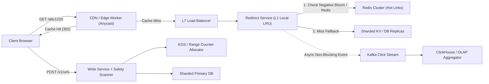

### 1.5 URL Shortener: Deep Dives & Failure Modes

1. **Base62 Namespace Math vs Hash Collisions vs KGS**: Using Base62 (`[0-9a-zA-Z]`), a **7-character** short code encodes $62^7 = 3{,}521{,}614{,}606{,}208 \approx \mathbf{3.52\text{ trillion}}$ unique URLs. At 100M new URLs/day ($36.5\text{B/year}$), 7 characters suffice for **~96 years** without recycling.
   - _Hash + Collision Retry_ (`SHA-256(long_url)` truncated to 41 bits—since $2^{41} \approx 2.20\text{T} < 62^7 \approx 3.52\text{T}$—→ Base62): Simple and stateless, _but_ requires a DB unique-constraint check (and salt-and-retry loop on collision), adding read-before-write latency and leaking deterministic hash collisions across users.
   - _Distributed Counter / Key Generation Service (KGS)_: A coordination service (etcd/ZooKeeper) hands each Write Service instance disjoint 1M-ID numeric ranges in memory (zero cross-node coordination on the hot path!). To prevent competitors from scraping sequential IDs (`0000001`, `0000002`), apply a bijective **42-bit Feistel permutation** with cycle-walking modulo $62^7$ ($62^7 \approx 3.52\text{T} < 2^{42} \approx 4.40\text{T}$) before Base62 encoding—guaranteeing **zero collisions** and non-sequential `CHAR(7)` codes in $O(1)$ CPU time.
2. **HTTP `301` vs `307`/`308` (`302`) Semantics**: Returning **`301 Moved Permanently`** instructs browsers and intermediate ISP proxies to cache the redirect indefinitely; subsequent clicks hit the browser cache directly, slashing server QPS **but blinding click analytics** and making it impossible to revoke a compromised link cleanly. Standardize on **`307 Temporary Redirect`** (or **`302 Found`** as its legacy-compatible alias, and **`308 Permanent Redirect`** with a short `max-age` if cacheable method preservation is explicitly required) paired with `Cache-Control: private, no-store` so every click reaches the edge worker, **preserving 100% of click analytics and instant kill-switch revocation**.
3. **Cache Penetration & Negative Caching**: Attackers or scanners probing random 7-character strings miss Redis and hammer the backing DB. Place an in-memory **Bloom filter** (cross-link [`algorithms/dsa`](../../../algorithms/dsa/README.md)) or short-TTL negative cache entries (`NOT_FOUND`, TTL 60s) in Redis so nonexistent codes never reach storage.
4. **Abuse, Phishing, and Open Redirects**: Validate URL schemes strictly (allow only `http`/`https`, reject `javascript:`/`data:`), run synchronous blocklist checks (Safe Browsing / local hash prefix table) plus asynchronous deep-crawl reputation scanning, and flag suspicious links as `quarantined` so redirects render a warning interstitial.
5. **Multi-Region KGS Partitioning & TTL Sweeping**: To avoid cross-region consensus latency on writes, partition the ID namespace across 8 regions via one of two exact schemes: (a) in a 41-bit power-of-two space, reserve the top 3 bits for `region_id` ($8 \times 2^{38} = 274{,}877{,}906{,}944$ IDs/region via bit-masking), or (b) in the modulo-$62^7$ space, assign 8 contiguous sub-ranges of $\lfloor 62^7 / 8 \rfloor = 440{,}201{,}832{,}576$ codes/region via a range router. Either way, every region's KGS allocates disjoint counter blocks locally with zero WAN coordination. For expiring links (`expires_at`), enforce lazy expiration on read (`if now > expires_at return 410 Gone`) paired with low-priority background range-scan sweepers rather than scheduling millions of individual cron timers.
6. **Pastebin Architectural Delta**: A Pastebin service shares the exact same KGS Base62 alias engine and read-heavy CDN/Redis cache topology as a URL shortener, with three key deltas: (a) store paste payloads (up to 1–10 MB of text/code) in **object storage (S3)** rather than relational DB rows, keeping only the `s3_key`, `syntax_lang`, and `expires_at` in metadata; (b) cache rendered or raw blobs aggressively at the **CDN edge** (`Cache-Control: public, max-age=3600` for immutable pastes) unless **burn-after-read** is enabled, in which case an atomic Redis `GETDEL` or DB `DELETE ... RETURNING` enforces single-view semantics without caching; and (c) enforce strict `Content-Type: text/plain; charset=utf-8` and `X-Content-Type-Options: nosniff` headers (cross-link [`architecture/security-identity`](../../security-identity/README.md)) so uploaded HTML/JS payloads cannot execute stored XSS on the Pastebin origin.

### 1.6 Primary Literature and Systems Foundations Matrix

Modern high-throughput URL shortening and redirection architectures build on foundational computer science literature across information theory, cryptography, probabilistic data structures, and IETF networking specifications. The matrix below grounds every architectural design decision in its formal theoretical and empirical literature:

| Specification / Paper | Authors / Organization & Year | Core Contribution & Theoretical Mechanism | Computational & Space Complexity | Production Systems Adoption |
| --- | --- | --- | --- | --- |
| **RFC 9110: HTTP Semantics (§15.4.2–§15.4.9)** | Fielding, Nottingham, Reschke (IETF, 2022) | Standardizes HTTP redirection status codes: `301 Moved Permanently` (cacheable by default, historical method mutation to GET), `302 Found` (temporary redirect, unhedged method rewrite), `307 Temporary Redirect` (strict method and body preservation), and `308 Permanent Redirect` (method-preserving permanent redirect); governs `Location` URI resolution and `Cache-Control` header validation. | State: $O(1)$ header parsing; Space: $O(1)$; Time: $O(1)$ client/proxy dispatch. | Universal edge reverse proxies (Cloudflare Workers, Fastly Varnish, AWS CloudFront, Envoy Ingress). |
| **Space/Time Trade-offs in Hash Coding with Allowable Errors** | Burton H. Bloom (CACM, 1970) | Space-efficient probabilistic data structure for set membership queries using $k$ independent hash functions over an $m$-bit array. Proves false-positive probability $p \approx (1 - e^{-kn/m})^k$, minimum array size $m = -\frac{n \ln p}{(\ln 2)^2}$, and optimal hash count $k = \frac{m}{n} \ln 2$. | Space: $m$ bits ($O(n \log(1/p))$); Time: $O(k)$ bitwise probe operations; Zero false negatives. | Negative caching in distributed caches (Redis/Valkey Bloom, Guava BloomFilter) to suppress invalid short code 404 database scans. |
| **Bitly Base62 Combinatorial Encoding** | Bitly Engineering (2009–2021) | Bijective positional numeral system utilizing radix 62 alphabet $\Sigma = [0-9a-zA-Z]$ ($\lvert\Sigma\rvert = 62$). Proves that a 7-character code provides $62^7 = 3{,}521{,}614{,}606{,}208 \approx 3.52 \times 10^{12}$ unique permutations ($\approx 41.67\text{ bits}$ of information entropy), sufficient to sustain 100M writes/day for 96.4 years with zero key collisions. | Space: 7 bytes per short code; Time: $O(\log_{62} N)$ integer division and modulo operations. | Industry-standard URL shortener alias generation (Bitly, TinyURL, Twitter t.co, LinkedIn lnkd.in). |
| **Ciphers with Arbitrary Finite Domains / Format-Preserving Encryption** | Black, Rogaway (ACM CCS, 2002) / Horst Feistel (1973) | Proves generalized Feistel networks and cycle-walking permutations over small, non-power-of-two integer domains ($[0, 62^7 - 1]$). Yields a bijective, collision-free pseudorandom permutation $\pi(x)$ that maps sequential counter integers to uniformly scattered codes without database lookup tables. | Space: $O(1)$ key storage (128-bit secret key); Time: $O(R)$ rounds (typically 3–4 Feistel rounds); Bijective (zero collisions). | Non-enumerable alias engines (Sqids, Hashids v2, Skip32) mitigating sequential ID scraping and volume leakage. |
| **System Design Interview — An Insider's Guide (Vol. 1, Ch. 8)** | Alex Xu (ByteByteGo, 2020) | Comprehensive URL shortener architecture contrasting Hash + Collision Resolution (MD5/SHA-256 + Bloom filter) against Distributed Unique ID Generation + Base62 conversion; establishes the canonical 301 vs 302 analytics trade-off and relational database sharding strategies. | Capacity model: 100M writes/day, 10:1 read:write ratio, 365 billion records over 10 years ($\approx 365\text{ TB}$ storage). | Standard technical interview blueprint and cloud architecture design pattern. |

### 1.7 ByteByteGo Chapter 8 Architectural Analysis & Capacity Deltas

In _System Design Interview — An Insider's Guide_ (Vol. 1, Chapter 8), Alex Xu examines the end-to-end design of a URL shortener akin to TinyURL. While establishing the fundamental components, production environments introduce critical security, mathematical, and scalability considerations that diverge from introductory frameworks.

#### ByteByteGo Chapter 8 Baseline Capacity Model

The capacity framework in ByteByteGo Chapter 8 establishes the following foundational sizing parameters:

- **Write Throughput**: $100\text{ million new URLs generated per day}$. Average write throughput evaluates to $\text{Write QPS} = 100{,}000{,}000 \div 86{,}400\text{ s} \approx 1{,}160\text{ writes/s}$; with an interview standard $2\times$ to $3\times$ peak coefficient, peak write throughput reaches $\approx 2{,}320\text{ to }3{,}480\text{ writes/s}$.
- **Read Throughput**: ByteByteGo assumes a conservative **10:1 read-to-write ratio**, yielding $\text{Read QPS} = 1{,}160\text{ writes/s} \times 10 = 11{,}600\text{ reads/s}$ average ($\approx 23{,}200\text{ to }34{,}800\text{ reads/s peak}$). _Production Real-World Delta_: Real-world URL shorteners (e.g., Bitly, TinyURL, corporate campaign shorteners) exhibit an extreme read skew between **50:1 and 100:1**. Under a $100:1$ ratio (as analyzed in Section 1.2), daily redirect traffic reaches $10\text{ billion reads/day}$, driving average read throughput to $115{,}700\text{ reads/s}$ and peak traffic to $350{,}000\text{ reads/s}$.
- **10-Year Cumulative Volume & Storage**: Over a 10-year design horizon, cumulative record volume reaches $100{,}000{,}000\text{ records/day} \times 365\text{ days/year} \times 10\text{ years} = 365{,}000{,}000{,}000\text{ records } (365\text{ billion})$. Assuming an average URL record size of $1\text{ KB}$ (incorporating a 500-byte target URL, 7-byte short code, user metadata, indexing B-tree overhead, and timestamps), total 10-year persistent storage reaches $365\text{ billion} \times 1\text{ KB} = 365\text{ TB}$. Contrast this with Module 12 Section 1.2, which provisions $91.25\text{ TB}$ for a 5-year retention window at $500\text{ bytes}$ per raw record.

#### Mathematical Proof & Verification of Base62 Conversion

ByteByteGo Chapter 8 presents the conversion of a sample distributed ID $2{,}009{,}215{,}674{,}938_{10}$ to the 7-character Base62 string `zn9edcu`. We mathematically verify this conversion using the standard alphanumeric alphabet $\Sigma = [0-9a-zA-Z]$:

$$
\Sigma = \text{"0123456789abcdefghijklmnopqrstuvwxyzABCDEFGHIJKLMNOPQRSTUVWXYZ"}
$$

In this positional numeral system:

- Digits `'0'` through `'9'` map to indices $0$ through $9$.
- Lowercase letters `'a'` through `'z'` map to indices $10$ through $35$.
- Uppercase letters `'A'` through `'Z'` map to indices $36$ through $61$.

Evaluating successive integer divisions of $N = 2{,}009{,}215{,}674{,}938$ by base $62$:

$$
\begin{aligned}
2{,}009{,}215{,}674{,}938 \div 62 &= 32{,}406{,}704{,}434 \quad &&\text{remainder } 30 \implies \Sigma[30] = \mathbf{\text{'u'}} \\
32{,}406{,}704{,}434 \div 62 &= 522{,}688{,}781 \quad &&\text{remainder } 12 \implies \Sigma[12] = \mathbf{\text{'c'}} \\
522{,}688{,}781 \div 62 &= 8{,}430{,}464 \quad &&\text{remainder } 13 \implies \Sigma[13] = \mathbf{\text{'d'}} \\
8{,}430{,}464 \div 62 &= 135{,}975 \quad &&\text{remainder } 14 \implies \Sigma[14] = \mathbf{\text{'e'}} \\
135{,}975 \div 62 &= 2{,}193 \quad &&\text{remainder } 9 \implies \Sigma[9] = \mathbf{\text{'9'}} \\
2{,}193 \div 62 &= 35 \quad &&\text{remainder } 23 \implies \Sigma[23] = \mathbf{\text{'n'}} \\
35 \div 62 &= 0 \quad &&\text{remainder } 35 \implies \Sigma[35] = \mathbf{\text{'z'}}
\end{aligned}
$$

Reading the remainder characters from the most significant step (quotient 0) to the least significant step yields:

$$
[35, 23, 9, 14, 13, 12, 30] \longrightarrow \text{'z'}, \text{'n'}, \text{'9'}, \text{'e'}, \text{'d'}, \text{'c'}, \text{'u'} \implies \mathbf{\text{"zn9edcu"}}
$$

Verifying in reverse by evaluating the polynomial expansion $\sum_{i=0}^{6} c_i \cdot 62^i$:

$$
\begin{aligned}
35 \times 62^6 &= 35 \times 56{,}800{,}235{,}584 = 1{,}988{,}008{,}245{,}440 \\
+ \; 23 \times 62^5 &= 23 \times 916{,}132{,}832 = 21{,}071{,}055{,}136 \\
+ \; 9 \times 62^4 &= 9 \times 14{,}776{,}336 = 132{,}987{,}024 \\
+ \; 14 \times 62^3 &= 14 \times 238{,}328 = 3{,}336{,}592 \\
+ \; 13 \times 62^2 &= 13 \times 3{,}844 = 49{,}972 \\
+ \; 12 \times 62^1 &= 12 \times 62 = 744 \\
+ \; 30 \times 62^0 &= 30 \times 1 = 30 \\
\mathbf{\text{Total}} &= \mathbf{2{,}009{,}215{,}674{,}938}
\end{aligned}
$$

The proof confirms that the algorithm is deterministic, strictly bijective, and operates in $O(\log_{62} N)$ CPU time.

#### Hash + Collision Resolution vs. Distributed ID + Base62

Alex Xu contrasts two primary paradigms for generating short codes: hashing the long URL versus generating a numeric unique ID and converting it to Base62. The trade-offs dictate database load, write path complexity, and collision handling:

| Architectural Axis | Hash + Collision Resolution + Bloom Filter | Distributed ID Generator (Snowflake/KGS) + Base62 |
| --- | --- | --- |
| **Short URL Code Length** | Fixed at 7 characters from the start (truncating 128-bit/256-bit hash to 41 bits). | Variable length; grows logarithmically with ID magnitude ($62^6 \approx 56.8\text{B}$, $62^7 \approx 3.52\text{T}$). Fixed at 7 chars by left-padding or starting at offset $62^6$. |
| **External Dependencies** | Stateless write service; requires zero coordination or external ID authority. | Requires a centralized coordination service (etcd, ZooKeeper, or Twitter Snowflake daemons). |
| **Collision Probability** | High collision probability under Birthday Paradox ($p \approx 50\%$ at $\sqrt{\pi/2 \cdot 62^7} \approx 2.35\text{M}$ hashes without salt); requires recursive collision resolution. | **Zero collision probability**. Each allocated 64-bit integer is strictly unique across the cluster. |
| **Write Path Latency & Amplification** | **High**: Requires read-before-write checking. Must query Bloom filter and primary database to detect collisions; on collision, appends salt and re-hashes ($O(\text{retries})$). | **Ultra-Low ($O(1)$)**: Zero database lookups required on write. ID generation and Base62 conversion execute purely in memory in sub-microsecond CPU time. |
| **Same URL Handling** | Deterministic: Two users shortening the exact same URL produce the same hash unless salted per user. | Distinct: Two users shortening the same URL receive independent unique IDs and distinct short codes. |
| **Sequential Predictability** | Unpredictable: Cryptographic hash truncation produces uniformly distributed, non-sequential outputs. | **Vulnerable to sequential enumeration** if naive auto-increment counters are used without permutation. |

#### The Sequential Enumeration Vulnerability and Cryptographic Fix

A major vulnerability in naive Distributed ID + Base62 designs is **alias enumeration**. When a service uses auto-incrementing database keys or sequential Snowflake sequence blocks:

- Code `0000001` (`id=1`) is followed by `0000002` (`id=2`), `0000003` (`id=3`), and so forth.
- _Competitor Intelligence Leakage_: Competitors can issue two short link requests spaced exactly 24 hours apart, subtract the decoded Base62 integers, and accurately determine the service's exact daily business volume (an exploitation of the classic German Tank Problem).
- _Mass Scraping & Security Breaches_: Attackers can systematically iterate through short codes sequentially. Users frequently shorten sensitive URLs (e.g., password reset links, private cloud storage shares, e-commerce invoice tokens, telemedicine portals). Sequential predictability turns the shortener into an automated vulnerability discovery engine.

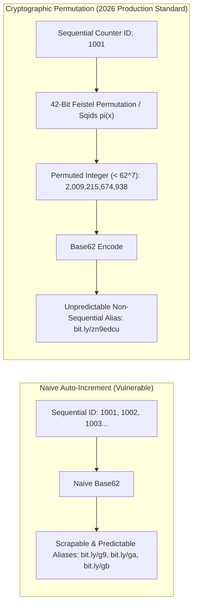

To resolve this without sacrificing the zero-collision guarantee of numeric ID allocation, production systems apply a **Format-Preserving Encryption (FPE)** permutation or a **42-bit Feistel network** ($\pi : [0, 2^{42}-1] \to [0, 2^{42}-1]$) over the integer space prior to Base62 encoding:

1. **Bijective Permutation**: A 3-round or 4-round Feistel cipher parameterized by a private server key maps every integer $x$ to a unique pseudorandom integer $\pi(x)$. Because $\pi$ is a bijection, $\pi(x_1) \neq \pi(x_2)$ for all $x_1 \neq x_2$, guaranteeing **strictly zero collisions**.
2. **Cycle-Walking over Modulo $62^7$**: To constrain the output space strictly within the 7-character limit ($[0, 62^7 - 1]$), if $\pi(x) \ge 62^7$, the algorithm applies cycle-walking ($\pi(\pi(x))$) until the value falls within the target range.
3. **Sqids / Shuffled Alphabets**: Modern implementations combine Feistel shuffling with per-tenant alphabet permutations, ensuring consecutive allocated IDs yield non-consecutive, non-guessable, tamper-resistant 7-character strings.

### 1.8 End-to-End System Architecture: Write Path, Read Path, and Analytics Pipeline

The comprehensive architecture of an enterprise URL shortening platform separates high-throughput write processing from read-dominated edge redirection and asynchronous analytics ingestion.

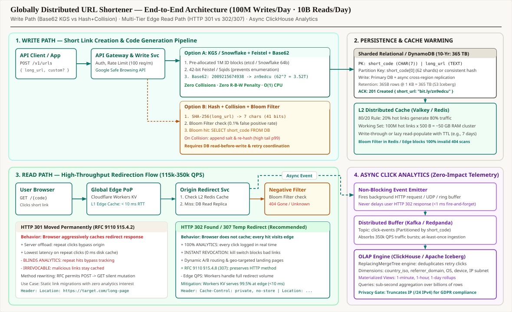

#### 1. The Write Path Pipeline

The write path processes link creation, alias allocation, and persistence:

1. **Client Submission**: The client issues an authenticated `POST /v1/urls` containing `{ "long_url": "https://example.com/very/long/path", "custom_alias": "spring-sale", "expires_at": 1785000000 }` with an `Idempotency-Key` header.
2. **Edge Ingress & Reputation Screening**: The request arrives at an Anycast L7 Gateway. The gateway validates schema constraints (enforcing `http`/`https` schemes, rejecting `data:`/`javascript:` URIs) and evaluates client rate limits (e.g., 100 link creations per user per minute).
3. **Synchronous Safety & Phishing Verification**: The long URL is checked synchronously against local threat hash-prefix caches and the Google Safe Browsing API. If the target domain is flagged for phishing or malware, the gateway aborts the request with `400 Bad Request` or flags the record for quarantine.
4. **Unique ID Allocation & Encoding**:
   - _Custom Alias_: If a `custom_alias` is requested, the service performs an atomic insert check against the database unique index.
   - _Generated Alias_: The service requests a unique 64-bit integer from a local Snowflake instance or pre-allocated Key Generation Service (KGS) range. The integer passes through a 42-bit Feistel permutation to break sequential correlation, followed by Base62 encoding to produce a compact 7-character alias (e.g., `zn9edcu`).
5. **Durable Persistence & Cache Seeding**: The mapping `<short_code, long_url, user_id, expires_at, status>` is committed to the primary relational/KV database shard (partitioned by consistent hashing over `short_code`). The short code is synchronously loaded into an L2 Valkey/Redis cluster with a write-through strategy, and the Bloom filter bit array is updated.
6. **Client Confirmation**: The service returns `201 Created` with payload `{ "short_url": "https://bit.ly/zn9edcu", "code": "zn9edcu", "expires_at": ... }`.

#### 2. The Multi-Tier Read Path Pipeline

Handling 115,000 to 350,000 redirects per second globally requires multi-tier caching to ensure sub-20 ms p99 latency:

1. **Edge Anycast Routing**: The user clicks a short URL (`https://bit.ly/zn9edcu`). DNS Anycast directs the client's TCP/TLS handshake to the closest edge Point of Presence (PoP) (e.g., Cloudflare Workers, Fastly Compute).
2. **L1 Edge KV Cache Hit**: The edge worker inspects its local memory and distributed edge key-value store (Cloudflare Workers KV / DynamoDB Global Tables). If the short code is cached, the edge immediately terminates the request and issues the HTTP redirection. Global edge hit latency is **$\le 10\text{ ms}$**.
3. **L2 Origin Valkey/Redis Cluster**: On an L1 edge cache miss, the edge worker forwards the request to the nearest regional Origin Redirect Service. The origin service inspects an in-memory Valkey cluster storing the hot working set (~50 GB RAM absorbs 80% of unique daily link traffic).
4. **Bloom Filter Negative Suppression**: If the short code misses L2 Redis, the service evaluates an in-memory **Bloom filter**. If the Bloom filter returns `0` (element definitively not in set), the service instantly returns `404 Not Found` without touching disk storage, preventing malicious cache penetration attacks from degrading the database.
5. **L3 Database Replica Fallback**: If the Bloom filter indicates element presence, the service executes a point-lookup against a local read replica (`SELECT long_url, expires_at, status FROM short_links WHERE short_code = ?`). If found, the worker backfills L2 Redis and L1 Edge KV, and issues the redirect response. If `now() > expires_at`, the service returns `410 Gone`.

#### 3. HTTP Redirection Semantics: 301 vs. 302 vs. 307

The selection of HTTP redirection status codes dictates caching behavior, analytics fidelity, and security control:

- **`HTTP 301 Moved Permanently` (RFC 9110 §15.4.2)**:
  - _Browser Behavior_: Browsers and intermediate ISP proxies aggressively cache the `301` response in local disk storage. Subsequent clicks on the short link by that client never leave the user's device; the browser resolves the target URL internally.
  - _Advantage_: Zero server or edge traffic for repeat visits; minimum achievable redirection latency (0 ms network RTT).
  - _Fatal Flaws_:
    1. **Blinds Analytics**: Repeat visits do not generate an HTTP request, making it impossible to calculate accurate unique click counts, referrers, or conversion telemetry.
    2. **Irrevocable Malware Distribution**: If a destination URL is compromised or flagged for phishing, the shortener cannot revoke or quarantine the link for browsers that have cached the `301`.
    3. **Method Rewriting**: Historical implementations of `301` mutate non-idempotent HTTP methods (`POST` $\to$ `GET`), breaking REST API short links.
- **`HTTP 302 Found` (RFC 9110 §15.4.3) & `HTTP 307 Temporary Redirect` (RFC 9110 §15.4.8)**:
  - _Browser Behavior_: Explicitly informs user agents that the resource resides temporarily under a different URI. When paired with `Cache-Control: private, no-store, max-age=0`, browsers are strictly forbidden from caching the redirect response.
  - _Advantage_: **100% Telemetry Accuracy & Instant Revocation**. Every click passes through the edge network, ensuring exact click-stream capture and enabling instant administrative link deactivation.
  - _Method Preservation (`307`)_: RFC 9110 §15.4.8 mandates that `307 Temporary Redirect` must never change the HTTP method (`POST` requests retain their payload and execute as `POST` on the target server), eliminating silent protocol bugs.
  - _Cost_: The edge network must absorb 100% of read traffic. Modern serverless edge workers (Cloudflare Workers KV) handle this at negligible cost.

#### 4. Asynchronous Click Analytics Ingestion

Click telemetry must never obstruct user redirection latency:

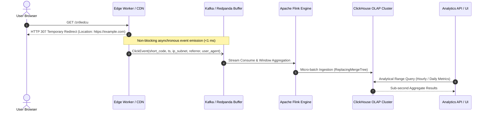

1. **Non-Blocking Emission**: Upon dispatching the HTTP 307 response, the edge worker issues an asynchronous, non-blocking click event containing `{ short_code, timestamp, client_ip, referrer, user_agent }` via a lightweight UDP packet or background HTTP worker to an ingress collector.
2. **Buffer Absorption**: The collector batches events into a distributed message broker (Apache Kafka or Redpanda) partitioned by `short_code`. This decouples analytical processing from edge traffic bursts.
3. **Privacy Sanitization**: In compliance with GDPR and global privacy standards, the collector truncates the client IP address (masking the last octet of IPv4 addresses to `/24`, or zeroing bits 48–128 of IPv6 addresses) and hashes user identifiers prior to persistence.
4. **Columnar Ingestion & Aggregations**: Click stream records stream into **ClickHouse** or **Apache Iceberg**, stored using a `ReplacingMergeTree` or columnar compression format (zstd/LZ4). Materialized views continuously pre-aggregate metrics into 1-minute, 1-hour, and 1-day rollups, providing sub-second analytical dashboard queries across billions of historical clicks.

### 1.9 Architectural Evolution: 2021 Legacy Default vs. 2026 Modern Standard

Between 2021 and 2026, the architecture of web-scale URL shorteners transitioned from centralized, single-region monolithic databases and naive caching defaults to globally distributed serverless edge execution, cryptographic non-enumerable code generation, and zero-trust security pipelines:

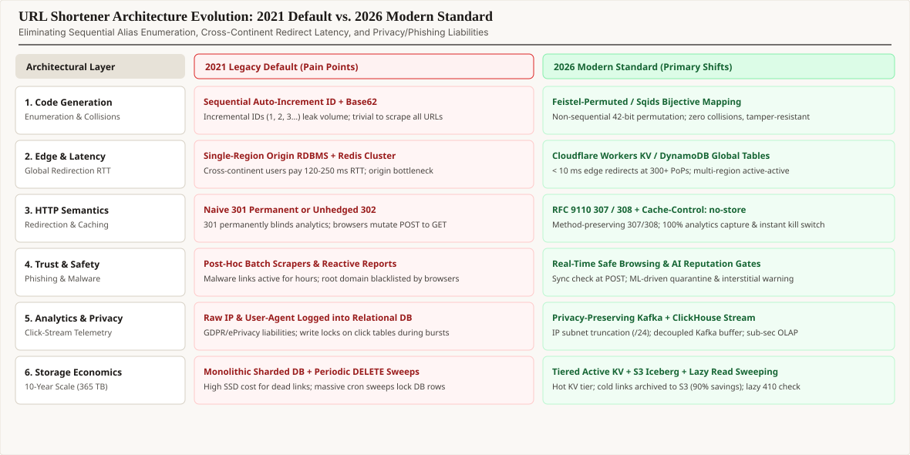

The table below contrasts the legacy 2021 architectural patterns against the modern 2026 cloud-native standards across six foundational dimensions:

| Architectural Layer | 2021 Legacy Default (Pain Points) | 2026 Modern Standard (Production Shifts) | Architectural Motivation & Impact |
| --- | --- | --- | --- |
| **1. Code Generation & Security** | **Sequential Auto-Increment + Base62**: Incremental integer IDs (`1, 2, 3...`) mapped directly to Base62. | **Feistel-Permuted / Sqids Bijective Mapping**: 42-bit Format-Preserving Encryption or Sqids non-sequential bijection. | Eliminates competitor scraping and enumeration attacks. Guarantees zero collisions with zero database coordinate locks. |
| **2. Edge Routing & Latency** | **Single-Region Origin RDBMS + Redis Cluster**: Redirects route back to a centralized cloud region (e.g., AWS `us-east-1`). | **Cloudflare Workers KV / DynamoDB Global Tables**: Sub-10 ms edge redirects served from 300+ Anycast PoPs globally. | Eliminates cross-continental WAN latency (120–250 ms $\to$ $<10\text{ ms}$). Shields core origin databases from read traffic spikes. |
| **3. HTTP Redirection Semantics** | **Uncalibrated 301 Permanent or Naive 302**: Silent browser caching; HTTP method mutations (`POST` $\to$ `GET`). | **RFC 9110 307 / 308 + Strict `Cache-Control: private, no-store`**: Guarantees HTTP method preservation. | Preserves 100% of analytical click telemetry; enables instant security revocation and kill-switch link deactivation. |
| **4. Abuse & Phishing Defense** | **Post-Hoc Batch Scrapers & Reactive Abuse Reports**: Malicious URLs remain live for hours until detected by external crawlers. | **Real-Time Safe Browsing & AI Reputation Gates**: Synchronous API check at `POST` creation; ML quarantine with interstitial warnings. | Prevents shortener root domains from being blacklisted by Chrome, Edge, and iOS Safari due to phishing distribution. |
| **5. Telemetry & Privacy** | **Raw Client IP & User-Agent Logged into Relational DB**: Direct SQL `INSERT` into MySQL click tables causes write lock contention. | **Privacy-Preserving Kafka + ClickHouse Stream**: Subnet masking (`/24`), async event buffering, and columnar compression. | Guarantees strict GDPR/ePrivacy compliance; provides sub-second multi-dimensional analytical queries across billions of clicks. |
| **6. Storage Economics & Lifecycle** | **Monolithic Sharded DB + Periodic DELETE Sweeps**: Storing dead 10-year links on expensive NVMe SSDs; batch delete lock storms. | **Tiered Active KV + S3 Iceberg + Lazy Read Sweeping**: Cold links tiered to Parquet on S3; lazy TTL check (`410 Gone`) on read. | Reduces 10-year storage costs for 365 TB by $> 90\%$; eliminates database replication lag caused by bulk delete jobs. |

---

## 2. News Feed and Instagram

Social feeds combine asymmetric fan-out graphs, high-volume media ingestion, and low-latency ranked timeline reads across hundreds of millions of daily active users.

### 2.1 News Feed: Requirements & Constraints

- **Functional Requirements**: Users publish posts with text and media (images/short video); follow/unfollow other users; view a personalized home timeline (chronological or ranked); like and comment on posts.
- **Non-Functional Requirements**: **500M DAU**; home timeline read **p99 < 200 ms**; **99.95%** availability; **eventual consistency** acceptable for feed propagation (a post may appear in followers' feeds within 1–5 seconds); durable media storage (11×9s durability).

### 2.2 News Feed: Back-of-Envelope Estimation

- **Read QPS**: 500M DAU × 5 feed loads/day = $2.5\text{B reads/day} \div 86{,}400 \approx \mathbf{29{,}000\text{ feed reads/s}}$ avg (~90k–100k peak).
- **Write QPS**: Assume 10% post daily → $50\text{M posts/day} \div 86{,}400 \approx \mathbf{580\text{ posts/s}}$ avg (~2,000 peak).
- **Fan-Out Amplification**: If an average user follows 200 accounts, 580 posts/s generate $580 \times 200 \approx \mathbf{116{,}000\text{ timeline writes/s}}$ under pure push. However, a single celebrity with $20\text{M}$ followers triggers **$2 \times 10^7$ writes** from one post—saturating queues and causing multi-minute lag spikes.
- **Media Storage**: 50M posts/day × 2 MB compressed average = **100 TB/day** (~36.5 PB/year, **~182.5 PB over 5 years** stored in object storage behind CDN).
- **Timeline Cache Memory**: Caching top 500 post IDs per active user (each entry = `(post_id [8B], author_id [8B], ts [8B])` + `~24 B` Redis/Valkey skiplist & dict allocator overhead = `48 bytes` $\implies 24\text{ KB/user}$): $500\text{M} \times 24\text{ KB} = \mathbf{12\text{ TB}}$ (or `240 GB` at ByteByteGo's `10M DAU` baseline), served via tiered Valkey/Garnet + NVMe or sharded DRAM.

### 2.3 News Feed: Core Entities & API

- **Core Entities**: `User(user_id, handle, is_celebrity)`, `Follow(follower_id, followee_id, created_at)`, `Post(post_id [Snowflake/UUIDv7], author_id, media_urls[], caption, created_at)`, `Like(post_id, user_id)`.
- **API**: `POST /v1/media/presign` (returns direct S3 upload URL); `POST /v1/posts` `{ media_keys[], caption }`; `GET /v1/feed?cursor={opaque_token}&limit=20` (keyset/cursor pagination); `POST /v1/posts/{id}/likes` (idempotent per `(user_id, post_id)`).

```http
GET /v1/feed?cursor=eyJ0cyI6MTc5NTE4NDAwMCwicG9zdF9pZCI6IjkwMDEyMzQ1In0&limit=20
HTTP/1.1 200 OK

{
  "items": [
    {
      "post_id": "90012340",
      "author": { "id": "42", "handle": "ada", "avatar_cdn": "https://cdn.example.com/a/42.webp" },
      "media": [{ "url": "https://cdn.example.com/m/90012340_1080.webp", "w": 1080, "h": 1350 }],
      "caption": "Distributed trace waterfalls",
      "like_count": 14820,
      "created_at": "2026-11-20T10:12:00Z"
    }
  ],
  "next_cursor": "eyJ0cyI6MTc5NTE4MzgwMCwicG9zdF9pZCI6IjkwMDEyMzAwIn0"
}
```

### 2.4 News Feed: High-Level Architecture

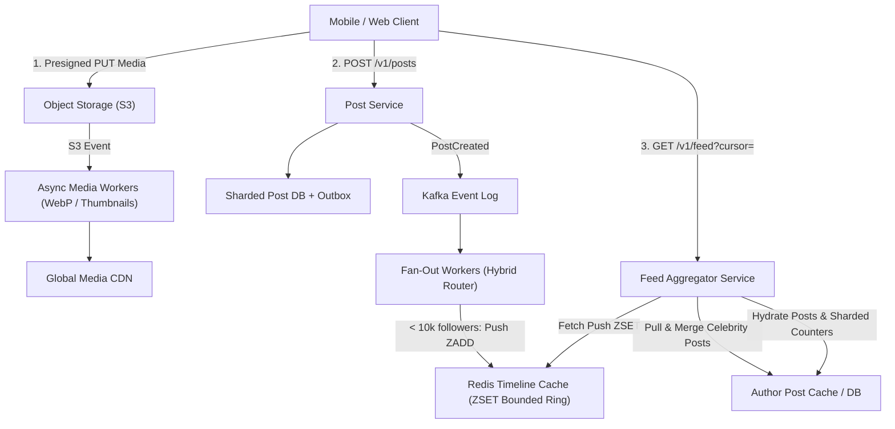

### 2.5 News Feed: Deep Dives & Failure Modes

1. **Hybrid Celebrity Fan-Out (Push + Pull-Merge)**:
   - **Normal Authors ($< 10{,}000$ followers)**: Use **fan-out on write**. Workers push `(post_id, score_ts)` into each active follower's Redis `ZSET` (`ZADD` + `ZREMRANGEBYRANK 0 -501` to cap each timeline ring at 500 entries). Skip users inactive for $> 30\text{ days}$ and backfill lazily on return.
   - **Celebrities ($\ge 10{,}000$ followers)**: Skip push fan-out entirely. At read time, the Feed Aggregator queries the small list of celebrities the reader follows (`followees ∩ celebrities`), fetches their recent posts from a hot per-celebrity cache, and performs a **k-way heap merge** with the reader's pre-materialized `ZSET`.
   - _Dynamic Threshold Hysteresis_: Avoid thrashing when an author hovers near 10,000 followers by using hysteresis (promote to celebrity mode at 12,000; demote at 8,000) and cleanly storing a `fanout_mode` flag on the author profile.
2. **Cursor Pagination vs `OFFSET` Drift**: Never use SQL `OFFSET` on live feeds. Because new posts constantly insert at rank 0, `OFFSET 20` on page 2 shifts downward and repeats items the user just saw on page 1, while deep offsets scan and discard millions of rows. Use **keyset/cursor pagination** encoding `(last_score, last_post_id)` for $O(\log N + K)$ indexed range scans (`ZREVRANGEBYSCORE`).
3. **Media Upload & Async Transcoding Pipeline**: Never stream multi-megabyte uploads through stateless API servers (which exhausts worker threads and buffers). Issue short-lived **presigned URLs** so clients `PUT` directly to object storage; S3 event notifications trigger workers that strip EXIF GPS metadata (privacy!), resize responsive variants, transcode to **WebP/AVIF**, and publish immutable content-hashed URLs behind a CDN (`Cache-Control: public, max-age=31536000, immutable`).
4. **Hot-Post Cache Stampede & Sharded Like Counters**: When a celebrity posts, millions of feed reads hydrate the exact same `post_id` concurrently, and tens of thousands of users hit `Like` simultaneously. Protect post hydration with **single-flight request coalescing** plus local in-process L1 LRU caching (cross-link [`architecture/data-systems`](../../data-systems/README.md) for XFetch/leases). Replace single-row `UPDATE posts SET likes = likes + 1` lock contention with **sharded counters** (e.g., 64 counter shards per hot post in Redis/DB summed asynchronously or on read).
5. **Storage Sharding, Privacy Filtering & Two-Stage Ranking**: Shard the `Posts` table by **`post_id`** (not `author_id`, which would turn celebrity accounts into hot write/read partitions), while sharding `UserTimeline` caches by **`user_id`** so reading a home feed hits one cache shard. During feed hydration, enforce **read-time privacy and blocklist filtering** (check mute/block sets and deleted-post tombstones before returning items) so unfollowed, blocked, or deleted posts never leak out of pre-materialized `ZSET`s. For algorithmic feeds, retrieve the top ~500 candidates from the `ZSET` + celebrity pool, score them via a stateless two-tower / GBDT ranking service, and apply diversity deduplication.

```typescript
// Hybrid Feed Merge: combines pre-materialized ZSET entries (normal followees)
// with bounded recent slices pulled from celebrity caches, ordered by (timestamp, postId).
export interface FeedRef {
  postId: bigint;
  authorId: string;
  timestampMs: number;
}

// Simplified illustration; production uses an O(K log(C + 1)) k-way min-heap merge.
export function mergeHybridFeed(
  pushedTimeline: FeedRef[],
  celebrityTimelines: FeedRef[][],
  blockedAuthors: Set<string>,
  limit: number,
): FeedRef[] {
  const merged = [...pushedTimeline];
  for (const celebPosts of celebrityTimelines) {
    for (const ref of celebPosts) merged.push(ref);
  }
  return merged
    .filter((item) => !blockedAuthors.has(item.authorId))
    .sort((a, b) => b.timestampMs - a.timestampMs || (b.postId > a.postId ? 1 : -1))
    .slice(0, limit);
}
```

### 2.6 Primary Literature & Systems Foundations Matrix

Modern social timeline architectures originate from seminal distributed systems and machine learning research published across academic conferences (USENIX ATC, USENIX NSDI, ACM SIGMOD, ICDE) and large-scale industrial deployments (Meta, Twitter/X, LinkedIn). The table below anchors the news feed domain in these foundational contributions.

| Milestone / Primary Paper | Domain & Key Focus | Core Architectural Mechanism | Scalability Invariant / Limit | Trade-Offs & Failure Modes |
| --- | --- | --- | --- | --- |
| **Bronson et al.** (USENIX ATC 2013) _TAO: Facebook's Distributed Data Store for the Social Graph_ | Social Graph Storage & Caching | Two-tier graph cache (Leader / Follower) over sharded MySQL; point-in-time snapshot reads of Objects (nodes) and Associations (edges); `assoc_range()` pagination. | Serves billions of read queries/s across billions of edges; sub-millisecond edge traversals. | Eventual consistency; write-through master invalidation leases; temporary replication lag across follower regions. |
| **Nishtala et al.** (USENIX NSDI 2013) _Scaling Memcache at Facebook_ | Demand-Driven Lookaside Caching | Cache lease tokens to eliminate thundering herds (stampedes) and stale sets; gutter server pools for server failure; McSqueal commit-log invalidation pipeline. | Billions of requests/s; scales memcached to thousands of servers per cluster. | Lease expiration tuning; network congestion during large-scale invalidation bursts; gutter pool state pollution. |
| **Busch et al.** (IEEE ICDE 2012) _Earlybird: Real-Time Search at Twitter_ & Timeline Service | Timeline Fan-Out & Real-Time Indexing | Bounded in-memory timeline lists (`ZSET` rings); Fan-Out on write for standard users; Earlybird real-time concurrent inverted index engines for tweet streaming. | Ingests hundreds of thousands of events/s with $< 10\text{ s}$ indexing latency to global search. | Pure push fan-out breaks on high-degree accounts ($> 10\text{M}$ followers); extreme DRAM memory footprint for inactive accounts. |
| **Naumov et al.** (Meta 2019 / USENIX 2021) _Deep Learning Recommendation Model (DLRM)_ & X Heavy Ranker | Personalized Multi-Task ML Ranking | Two-stage candidate generation: Two-tower dense embeddings (ANN retrieval) followed by Deep Transformer / DLRM heavy ranking on interaction probabilities. | Scores top ~500 candidates across thousands of user/post features in $< 50\text{ ms}$. | Massive GPU/ASIC compute clusters; cold-start latency for new posts; distribution drift requiring continuous retraining. |
| **Alex Xu** (ByteByteGo 2020) _System Design Interview Vol. 1, Ch. 11_ | Canonical News Feed Interview Standard | Two decoupled flows: Feed Publishing and News Feed Building; 5-step fanout pipeline; 5-layer cache hierarchy (News Feed, Content, Social Graph, Action, Counter). | 10M DAU baseline; 5,000-friend limit; hybrid fan-out model for high-connection celebrity mitigation. | Omission of tiered storage economics and real-time trust/safety pre-filtering; fixed reverse-chronological assumption. |

Social timeline delivery fundamentally represents a tension between **write amplification** at publish time and **read latency** at consumption time. Bronson et al. demonstrated that modeling relationships as directed graph associations (`user_id -> followee_id`) with edge attributes (`created_at`) provides the structural foundation for timeline generation. Instead of performing expensive relational multi-table `JOIN` operations, the graph tier serves localized association lists from in-memory leader and follower caches. Concurrently, Nishtala et al. proved that large-scale social systems cannot afford direct cache-miss database fallbacks without strict lease protocols: when viral content appears in millions of timelines simultaneously, concurrent hydration queries trigger catastrophic cache stampedes unless single-flight request coalescing and lease tokens fence off concurrent origin writes.

Modern production platforms (Meta, X, TikTok) build upon these foundations by splitting feed generation into candidate retrieval and machine learning ranking. While Busch et al. pioneered bounded in-memory reverse-chronological timeline rings, contemporary workloads combine pre-materialized friend updates with real-time vector candidate retrieval (Naumov et al.). The hybrid fan-out model formalized by Alex Xu balances push and pull paradigms, while modern production deployments extend this model with tiered NVMe memory hierarchies, asynchronous CRDT counters, and strict real-time trust and safety pipelines.

### 2.7 Verified ByteByteGo Canonical Worked Architecture & Capacity Delta (Chapter 11)

The canonical ByteByteGo Chapter 11 specification establishes a baseline news feed problem: a platform serving 10 million daily active users (DAU) where each user is capped at 5,000 friends. The system must support reverse-chronological feed viewing, status updates with media attachments, and cross-platform clients (web and mobile). The table below contrasts this canonical interview baseline with large-scale production reality (500M DAU).

| Architectural Metric / Parameter | ByteByteGo Ch. 11 Canonical Baseline | Hyper-Scale Production Tier (500M DAU) | Architectural Implication & Engineering Delta |
| --- | --- | --- | --- |
| **Daily Active Users (DAU)** | 10 million DAU | 500 million DAU | $50\times$ traffic scale; requires multi-region active-active deployment and geo-distributed caching. |
| **Social Graph Topology** | Symmetric friendships, capped at 5,000 | Asymmetric follow graph, power-law distribution | Celebrities exceed 100M followers; pure push fan-out causes complete queue collapse without hybrid read-merges. |
| **Timeline Feed Ordering** | Strict reverse-chronological | Two-stage ML ranked (Relevance + Recency) | Chronological feeds suffer from engagement collapse; production requires Two-Tower vector retrieval and heavy-ranker scoring. |
| **Average Feed Read QPS** | $\approx 579\text{ reads/s}$ avg (1.7k–2.5k peak at 5 loads/day) | $\approx 29{,}000\text{ reads/s}$ avg (100k peak) | Requires sharded timeline caching across hundreds of nodes with edge CDN termination. |
| **Post Creation Write QPS** | $\approx 11.6\text{ posts/s}$ avg (50 peak) | $\approx 580\text{ posts/s}$ avg (2,000 peak) | High-volume ingestion requires Kafka event log decoupling with transactional outbox persistence. |
| **Timeline Memory Footprint** | $\approx 240\text{ GB}$ (top 500 posts / user) | $\approx 12\text{ TB}$ (top 500 posts / user) | 240 GB fits in 4 Redis instances; 12 TB requires tiered storage (Valkey/Garnet + NVMe SSDs) to avoid \$100k+/mo DRAM bills. |
| **Fan-Out Service Pipeline** | 5-step discrete pipeline | Distributed stream processing DAG | Production replaces monolithic workers with partitioned Kafka/Flink DAGs and dynamic backpressure. |
| **Cache Architecture** | 5 distinct decoupled layers | Hierarchical multi-tier L1/L2 caches | Specialized isolation prevents counter/action writes from evicting immutable post content or timeline rings. |

#### The Canonical 5-Step Fanout Service Pipeline

ByteByteGo Chapter 11 formalizes the feed publishing flow into an exact 5-step fanout pipeline:

1. **Fetch Friend IDs**: The Fanout Service queries the Social Graph Database (or Layer 3 Social Graph Cache) to retrieve the author's complete friend or follower list (up to the 5,000 cap).
2. **Filter Friends from Cache**: The service queries user settings in the cache to remove excluded recipients, including muted friends, blocked relationships, and accounts outside specific privacy sharing circles.
3. **Send to Message Queue**: The filtered list of target friend IDs and the new `post_id` are published as an event batch to a distributed message queue (e.g., Kafka) to decouple ingestion from fanout execution.
4. **Fanout Workers Processing**: An asynchronous pool of Fanout Workers consumes batches from the message queue, reading friend IDs and building lightweight `<post_id, user_id>` entries.
5. **Store in News Feed Cache**: Workers update the Layer 1 News Feed Cache for each friend, appending the new `post_id` to their bounded timeline list/ring and trimming old entries beyond the configured size limit.

#### Mathematical Derivations & Fan-Out Capacity Proofs

##### 1. Celebrity Fan-Out Catastrophe vs. Hybrid Push-Pull

Consider an author publishing a post. In a pure push (fan-out-on-write) system, the worker pool must write the `post_id` into the timeline cache of every follower.

For a normal user with $F = 5{,}000$ friends (the canonical ByteByteGo upper bound), assuming a Redis pipelined write rate of $50{,}000\text{ writes/s}$ per worker:

$$T_{\text{push, normal}} = \frac{5{,}000}{50{,}000\text{ writes/s}} = 0.1\text{ seconds}$$

This duration is negligible and easily absorbed by a modest worker pool. However, consider a celebrity account with $F_{\text{celeb}} = 20{,}000{,}000$ followers. In a pure push architecture:

$$W_{\text{push, celeb}} = 2 \times 10^7\text{ write operations}$$

Sequentially, a single worker executing $20{,}000\text{ writes/s}$ requires:

$$T_{\text{push, seq}} = \frac{20{,}000{,}000}{20{,}000} = 1{,}000\text{ seconds} \approx 16.67\text{ minutes}$$

Even if parallelized across 50 dedicated workers, the single post generates 20 million database and cache operations, flooding the message queue, thrashing CPU caches, displacing valid memory across cache shards, and creating a multi-minute replication lag spike during which followers see stale feeds.

Under the **Hybrid Fan-Out Architecture**:

- For accounts with followers $F < 10{,}000$, use **fan-out on write**.
- For celebrity accounts with followers $F \ge 10{,}000$, **fan-out on write is completely bypassed** ($W_{\text{write}} = 1$ write to the author's own post list).
- At read time, when a user requests their feed, the system queries the set of celebrities they follow ($C = \text{followees} \cap \text{celebrities}$). For an average user, $C \ll 100$. The system fetches the top posts from each celebrity's pre-warmed cache and performs a $k$-way heap merge with the reader's pre-materialized push timeline.

The computational complexity of merging $C$ celebrity sorted streams with the reader's push timeline (length $N$) to extract $K$ items ($K = 20$) using a min-heap of size $C + 1$ is:

$$O(K \log (C + 1))$$

For $C = 20$ and $K = 20$, $(20 \times \log_2(21)) \approx 88$ comparisons, executing in under $0.5\text{ ms}$ in application memory.

##### 2. Inactive User Elimination Math

Let $U_{\text{total}} = 100\text{M}$ registered users, while $U_{\text{DAU}} = 10\text{M}$ daily active users. If the fanout service blindly pushes posts to all registered accounts:

$$\eta_{\text{waste}} = 1 - \frac{U_{\text{DAU}}}{U_{\text{total}}} = 1 - \frac{10\text{M}}{100\text{M}} = 90\%$$

Fully $90\%$ of all fan-out writes and allocated Redis memory are wasted on accounts that will never log in before cache TTLs expire. By maintaining a recency gate in the Layer 3 Social Graph Cache (`last_login_epoch`), the fan-out service excludes users inactive for $> 30\text{ days}$.

When an inactive user eventually logs in, the system executes a **lazy backfill on login**: it queries the user's followees' recent posts, merges them in memory, and repopulates their Layer 1 timeline cache. This optimization cuts fan-out write amplification and cache memory consumption by $10\times$.

##### 3. Timeline Cache Memory Sizing (BBG 10M DAU vs 500M DAU)

In the News Feed Cache (Layer 1), each timeline entry stores only a lightweight pointer tuple `<post_id, user_id>` with a timestamp score. In memory, each node comprises:

- `post_id`: 64-bit integer ($8\text{ bytes}$)
- `author_id`: 64-bit integer ($8\text{ bytes}$)
- `timestamp`: 64-bit integer ($8\text{ bytes}$)
- Internal skiplist/dict pointer and memory allocator overhead in Redis/Valkey: $\approx 24\text{ bytes}$
- Total size per timeline item: $s_{\text{item}} \approx 48\text{ bytes}$

Each active user's timeline ring is bounded at $N = 500$ posts. Memory required per active user:

$$M_{\text{user}} = 500 \times 48\text{ bytes} = 24{,}000\text{ bytes} \approx 24\text{ KB}$$

For the ByteByteGo 10M DAU baseline:

$$\text{Total RAM}_{\text{BBG}} = 10{,}000{,}000 \times 24\text{ KB} = 240\text{ GB}$$

This entire workload easily resides in a modest 8-node Redis cluster with 64 GB DRAM per node (`4` masters + `4` replicas for high availability).

For the Hyper-Scale 500M DAU tier:

$$\text{Total RAM}_{\text{500M}} = 500{,}000{,}000 \times 24\text{ KB} = 12\text{ TB}$$

Hosting 12 TB in pure cloud DRAM costs upwards of \$100,000/month in infrastructure expenses. Modern 2026 architectures split this across a tiered hierarchy (Valkey/Garnet with RocksDB SSD backing), keeping only the top 200 items in DRAM and paging the remaining 300 to local NVMe, reducing DRAM costs by $75\%$.

#### The ByteByteGo 5-Layer Cache Architecture

To maintain sub-15ms p99 read latency and protect the underlying databases from lock contention, ByteByteGo Chapter 11 segregates the caching tier into five isolated layers.

| Cache Layer | Storage Engine & Data Type | Key Schema | Stored Value / Payload | Capacity & Sizing Strategy | Invalidation & Concurrency Semantics |
| --- | --- | --- | --- | --- | --- |
| **Layer 1: News Feed Cache** | Redis / Valkey `ZSET` (Sorted Set) | `feed:{user_id}` | `<post_id, author_id>`, scored by `timestamp` | Bounded ring of top 500 items; $24\text{ KB/user}$; $240\text{ GB}$ (10M) to $12\text{ TB}$ (500M) | Appended via `ZADD`; trimmed via `ZREMRANGEBYRANK 0 -501`; cold users bypass RAM entirely. |
| **Layer 2: Content Cache** | Redis String / RocksDB KV | `post:{post_id}` | JSON / Protobuf: author details, post text, media CDN URLs, created timestamp | Hot cache (top 20% viral posts) in DRAM; warm long-tail on NVMe; immutable payloads | Written once at publish time; single-flight coalescing (`XFetch`) prevents hydration thundering herds; 30d sliding TTL. |
| **Layer 3: Social Graph Cache** | Facebook TAO Nodes & Associations | `assoc:{user_id}:{type}` | Bidirectional friend lists, follower/followee directed edges, user blocks, mutes | Capped at 5,000 friends per user; includes `is_celebrity` bit and last active timestamp | Two-tier leader/follower cache; master-write invalidation leases guarantee sub-millisecond edge traversals. |
| **Layer 4: Action Cache** | Redis Hash / Roaring Bitmaps | `act:{user_id}:{post_id}` | Boolean flags: `liked`, `bookmarked`, `hidden`, `reported` | Stores interaction state for UI hydration ("heart filled"); 1-2 bytes per active interaction | Fast $O(1)$ attribute lookups; asynchronous write-behind flushes batches to database; idempotent bit operations. |
| **Layer 5: Counter Cache** | Redis Sharded String / CRDT | `cnt:{post_id}:{shard_id}` | 64-way hash partitioned atomic counters for likes, comments, shares, views | 64 integer slots per hot post; absorbs $100\text{k}+$ likes/s without row locks | Atomic increments (`INCRBY`); summed on read or aggregated asynchronously; write-behind flush to Post DB every 1-5s. |

### 2.8 End-to-End News Feed Architecture & 5-Layer Cache Hierarchy

The end-to-end architecture orchestrates feed publishing, asynchronous fan-out processing, and low-latency feed retrieval by integrating the 5-step fanout pipeline with the 5-layer cache topology.

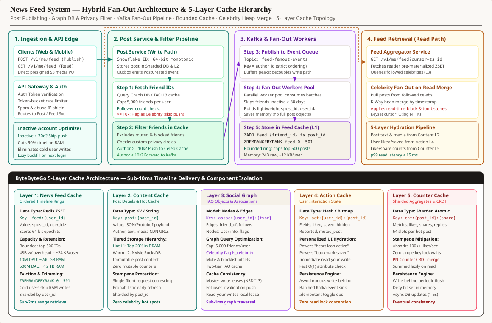

#### The Publish Path (Ingestion & Asynchronous Fan-Out)

1. **Client Media Ingestion**: Mobile and web clients never stream multi-megabyte media files directly through application web servers. Instead, clients issue a lightweight request to obtain a presigned S3 upload URL. Clients upload image and video binaries directly to object storage via HTTP `PUT`. S3 event notifications trigger asynchronous media workers that strip EXIF GPS metadata for privacy, transcode responsive WebP/AVIF variants, and publish immutable URLs to global CDN edge caches.
2. **Post Persistence & Outbox**: The client submits a `POST /v1/me/feed` request containing media keys, post text, and an authentication token. The API Gateway authenticates the user, enforces rate limits, and routes the request to the Post Service. The Post Service generates a monotonically increasing 64-bit Snowflake ID, persists the post record into the Post DB (sharded by `post_id`), writes the full post payload into the **Layer 2 Content Cache**, and records a `PostCreated` message in a transactional outbox table.
3. **Graph Retrieval & Cache Filtering (Steps 1 & 2)**: An outbox publisher streams the event to the Fanout Service. The Fanout Service queries the **Layer 3 Social Graph Cache** (TAO graph tier) to fetch the author's friend and follower IDs. If the author exceeds the celebrity threshold ($\ge 10{,}000$ followers), the service flags the post as a celebrity item, writes the `post_id` into the author's personal post list, and bypasses push fan-out entirely. For standard authors ($< 10{,}000$ followers), the service passes the friend list through a cache filter pipeline, removing friends who have muted the author, accounts subject to active blocks, and users inactive for $> 30\text{ days}$.
4. **Kafka Queue & Fanout Workers (Steps 3, 4 & 5)**: The filtered recipient list is partitioned into chunks and emitted to the Kafka `feed-fanout-events` topic, keyed by `author_id` to preserve per-author ordering. A pool of Fanout Workers consumes these batches, builds lightweight `<post_id, user_id>` tuples, and executes pipelined `ZADD` commands against the **Layer 1 News Feed Cache** of each target friend. Each cache ring is immediately trimmed using `ZREMRANGEBYRANK feed:{friend_id} 0 -501`, maintaining a strict 500-entry ceiling.

#### The Retrieval Path (Read Path & 5-Layer Hydration)

1. **Feed Aggregation Request**: A client requests their feed via `GET /v1/me/feed?cursor={opaque_token}&limit=20`. The API Gateway authenticates the request and forwards it to the Feed Aggregator Service.
2. **Parallel Retrieval & Heap Merge**: The Feed Aggregator queries the **Layer 1 News Feed Cache** for the reader's pre-materialized sorted set using `ZREVRANGEBYSCORE` anchored at the cursor timestamp. In parallel, it queries the **Layer 3 Social Graph Cache** to obtain the set of celebrities the reader follows. For each followed celebrity, the aggregator fetches the latest post IDs from their personal post caches.
3. **K-Way Merge & Tombstone Filtering**: The aggregator merges the pre-materialized push items with the pulled celebrity items using a $k$-way min-heap ordered by timestamp. It filters out any post IDs marked as deleted or tombstoned in the read-time blocklist.
4. **Component Hydration across Layers 2, 4, and 5**: With the top 20 candidate post IDs identified, the Feed Aggregator hydrates the feed payload in parallel across the specialized cache layers:
   - **Post Metadata**: Fetched from the **Layer 2 Content Cache** (author handle, caption, media CDN URLs). Cache misses fall back to the Sharded Post DB via single-flight coalescing.
   - **User Interaction State**: Fetched from the **Layer 4 Action Cache** to determine whether the reader has already liked, bookmarked, or hidden each post.
   - **Engagement Aggregates**: Fetched from the **Layer 5 Counter Cache**, summing the 64 counter shards for each post to return up-to-the-second like, comment, and share totals.
5. **Client Response**: The Feed Aggregator serializes the hydrated posts into JSON, constructs a keyset pagination token containing the last post's timestamp and ID, and returns the response to the client with sub-15ms p99 latency.

### 2.9 Technology Comparison: Then vs. Now (2021 vs. 2026)

Between 2021 and 2026, social timeline architectures underwent a generational transition driven by extreme cloud infrastructure costs, the explosion of short-form algorithmic video feeds, and the limitations of monolithic in-memory caching.

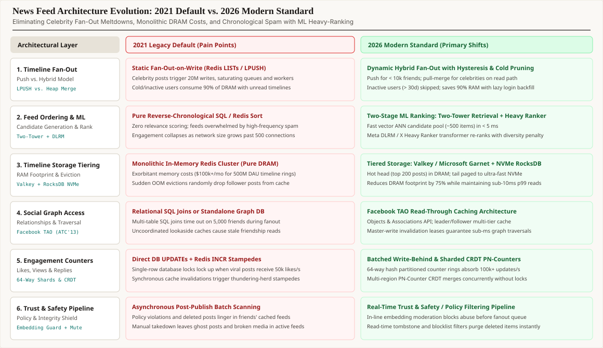

| Architectural Dimension | 2021 Legacy Default (Pain Points) | 2026 Modern Standard (Primary Shifts) | Engineering Impact & Production Trade-Offs |
| --- | --- | --- | --- |
| **1. Timeline Fan-Out** | Static Fan-Out-on-Write to Redis `LPUSH` / `LIST`s; high-degree accounts trigger 20M writes per post. | Dynamic Hybrid Fan-Out with hysteresis and 30-day cold-account pruning. | Eliminates queue backpressure spikes; saves $90\%$ of timeline cache writes and RAM. |
| **2. Feed Ordering & ML** | Pure reverse-chronological SQL / Redis index range scans (`ORDER BY created_at DESC`). | Two-Stage ML Ranking: Two-tower vector candidate retrieval (ANN) + Heavy Ranker (Meta DLRM / X Transformer). | Replaces chronological spam with personalized engagement scoring; requires dedicated GPU inference clusters. |
| **3. Timeline Storage Tiering** | Monolithic in-memory Redis cluster; 100% DRAM allocation (\$100k+/mo cloud bills); random OOM evictions. | Tiered Feed Storage: Valkey / Microsoft Garnet with NVMe RocksDB SSD backing. | Retains top 200 posts in DRAM, paging cold history to NVMe SSDs; cuts DRAM costs by $75\%$ at identical p99 latency. |
| **4. Social Graph Access** | Relational multi-table SQL `JOIN`s or uncoordinated standalone Neo4j graph databases. | Facebook TAO Read-Through Graph Caching with master-write invalidation leases. | Sub-millisecond graph traversals; eliminates stale friendship reads and join timeouts on 5,000 friends. |
| **5. Engagement Counters** | Direct database row `UPDATE posts SET likes=likes+1` + synchronous Redis `INCR`. | Batched Write-Behind + 64-way Sharded CRDT PN-Counters. | Absorbs $100\text{k}+$ likes/s on viral posts without database lock contention; handles multi-region active-active merges. |
| **6. Trust & Safety Pipeline** | Asynchronous post-publish batch moderation scanning; delayed report queues. | Real-Time Pre-Fanout Embedding Moderation + Read-Time Tombstone and Blocklist Filters. | Toxic content blocked before fanout distribution; deleted posts vanish immediately from cached timelines. |

#### Deep Operational Pitfalls & Migration Guide

##### Pitfall 1: Ghost Posts from Stale Timeline ZSETs

In a fan-out-on-write architecture, post IDs are eagerly written into thousands of followers' `ZSET` rings. If an author deletes a post or is banned for policy violations, issuing `ZREM` across millions of follower rings is computationally impossible within real-time SLAs. If the feed aggregator simply hydrates whatever IDs are in the `ZSET`, users encounter "ghost posts"—broken cards showing blank media and "Post unavailable" errors. _Mitigation_: Never treat the `ZSET` as the authoritative source of existence. Feed aggregation must perform **read-time tombstone verification**: the Content Cache or a centralized Bloom filter / Redis Set of deleted post IDs is checked before returning items. If a `post_id` is tombstoned, it is dropped on the fly, and a background worker lazily removes it from the user's timeline ring.

##### Pitfall 2: Thundering Herds on Viral Post Hydration

When a celebrity publishes a post, millions of followers receive the notification or open their feeds within seconds, triggering concurrent read requests for the exact same `post_id`. If that post experiences a momentary cache miss or expires from Layer 2, tens of thousands of concurrent worker threads attempt to query the database simultaneously, instantly exhausting connection pools and crashing the Post DB. _Mitigation_: Implement **single-flight request coalescing** (e.g., Go `singleflight` or cache lease tokens per Nishtala et al.). Only the first thread that experiences a cache miss is granted a lease to query the database; all other concurrent requests register callbacks and await the single in-flight result. Pair this with probabilistic early refresh (`XFetch`) so keys are re-cached before they reach hard expiration.

##### Pitfall 3: Row Lock Contention on Viral Like Counters

Executing `UPDATE posts SET likes = likes + 1 WHERE id = :post_id` under a viral surge of 50,000 likes/second serializes behind InnoDB row-level exclusive locks (`X-locks`). Transactions queue up, query latency skyrockets to seconds, and transaction isolation deadlocks crash database worker threads. _Mitigation_: Disconnect user interactions from database write locks. In Layer 5, partition each post's counter across $N = 64$ independent Redis keys: `cnt:{post_id}:{hash(user_id) % 64}`. Clients increment a random or hashed slot via atomic `INCR`. An asynchronous flusher daemon aggregates the 64 shards every 1 to 5 seconds and performs a single batched database update: `UPDATE posts SET likes = likes + :delta WHERE id = :post_id`. For multi-region deployments, implement state-based Conflict-Free Replicated Data Types (PN-Counters) that merge monotonically across data centers without coordination.

##### Pitfall 4: Offset Pagination Downward Drift & Duplication

Using SQL `OFFSET` or list index pagination (`LIMIT 20 OFFSET 20`) on real-time social feeds causes severe data corruption for readers. Because new posts constantly insert at the head of the feed (index 0), a user viewing Page 1 (items 0–19) who requests Page 2 (`OFFSET 20`) will receive duplicate items: the original item 19 has shifted down to position 20 due to new posts arriving at index 0. Furthermore, deep `OFFSET` queries ($> 10{,}000$) force database engines to scan and discard thousands of rows. _Mitigation_: Enforce **keyset cursor pagination** exclusively. The client passes an opaque cursor encoding the last seen `(timestamp, post_id)` tuple. The query executes a deterministic range scan (`ZREVRANGEBYSCORE feed:{user_id} (last_ts -inf WITHSCORES LIMIT 0 20`), which remains stable regardless of how many new posts insert above it and executes in $O(\log N + K)$ time.

---

## 3. YouTube / Netflix Video Streaming

Video-on-demand platforms are constrained not by database QPS, but by **compute-intensive transcoding DAGs** and **massive sustained WAN egress bandwidth** that exceeds centralized cloud-origin economics.

### 3.1 Video Streaming: Requirements & Constraints

- **Functional Requirements**: Creators upload raw video files (up to 100 GB, resumable); pipeline transcodes into multi-resolution, multi-codec adaptive streams; viewers play smoothly across variable networks (3G mobile to 4K fiber) with fast start time (< 1.5s), adaptive quality switching, and saved playback position.
- **Non-Functional Requirements**: **500M DAU** averaging 30 minutes watched/day; **< 0.5% rebuffer ratio**; **99.99%** playback availability; durable master storage for uploaded originals.

### 3.2 Video Streaming: Back-of-Envelope Estimation

- **500M-DAU Production Upload Ingestion**: Suppose 500k videos/day at 1 GB raw average = **500 TB/day** raw upload (~5.8 GB/s avg). After transcoding into ~10 bitrate/codec renditions (roughly $3\times$ raw size), new processed video storage grows by **~1.5 PB/day** (~550 PB/year). (Compare against ByteByteGo's smaller `5M DAU` / `300 MB` interview baseline in §3.7 below.)
- **Streaming Egress Bandwidth**: $500\text{M users} \times 1{,}800\text{ s/day} \times 3\text{ Mbps avg} = 2.7 \times 10^{18}\text{ bits/day} \div 86{,}400 \approx \mathbf{31.25\text{ Tbps}}$ average, peaking above **$100\text{ Tbps}$** in evening prime time!
- **Architectural Implication**: Serving 100 Tbps from centralized cloud object storage would cost millions of dollars _per day_ in egress fees and saturate backbone peering links. **Edge ISP caching is mandatory.**

| Delivery Tier | Cache Hit Share (Prime Time) | Typical RTT to Viewer | Cost per GB Egress | Catalog Coverage |
| --- | :-: | :-: | --- | --- |
| **ISP-Embedded OCA** | **> 95%** | 1–5 ms | Near \$0 (local peering) | Top ~1% overnight pre-warmed titles |
| **Regional Edge CDN PoP** | ~4% | 10–25 ms | Low CDN transit | Top ~10–15% warm long tail |
| **Origin Shield + Object Store** | < 1% | 40–100 ms | Highest cloud egress | 100% full catalog |

### 3.3 Video Streaming: Core Entities & API

- **Core Entities**: `Video(video_id, title, status ['uploading','processing','ready'], duration_ms, master_s3_key)`, `Rendition(video_id, codec, resolution, bitrate_kbps, segment_prefix)`, `WatchProgress(user_id, video_id, position_ms, updated_at)`.
- **API**: `POST /v1/videos/upload-init` (returns multipart upload ID + presigned chunk URLs); `GET /v1/videos/{id}/manifest.m3u8` (or `.mpd` DASH manifest); `PUT /v1/videos/{id}/progress` `{ position_ms }` (debounced every 10–30s).

```text
#EXTM3U
#EXT-X-VERSION:6
#EXT-X-STREAM-INF:BANDWIDTH=800000,RESOLUTION=640x360,CODECS="avc1.4d401e,mp4a.40.2"
360p/index.m3u8
#EXT-X-STREAM-INF:BANDWIDTH=2800000,RESOLUTION=1280x720,CODECS="av01.0.05M.08,mp4a.40.2"
720p_av1/index.m3u8
#EXT-X-STREAM-INF:BANDWIDTH=12000000,RESOLUTION=3840x2160,CODECS="hvc1.1.6.L150,mp4a.40.2"
2160p_hevc/index.m3u8
```

### 3.4 Video Streaming: High-Level Architecture

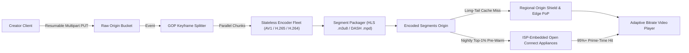

### 3.5 Video Streaming: Deep Dives & Failure Modes

1. **Upload DAG Transcoding & GOP-Aligned Parallel Encoding**: Encoding a 2-hour 4K feature on a single server takes hours and stalls if the worker crashes. Instead, split uploads via **resumable multipart uploads** (cross-link [`architecture/networking`](../../networking/README.md)), inspect container headers, and slice the master video strictly along **Group of Pictures (GOP)** I-frame boundaries (e.g., every 4 seconds) using a **DAG orchestrator**. Hundreds of stateless workers encode individual 4-second GOP chunks concurrently across codec families (**H.264** for universal hardware fallback, **H.265/HEVC** and **AV1** for 30–50% bitrate savings at equivalent perceptual VMAF quality) and resolution ladders (`360p`..`4K`), cutting end-to-end processing latency from hours to minutes.
2. **Adaptive Bitrate Streaming (HLS & MPEG-DASH)**: Each rendition produces immutable 2–6s media segments (`.m4s` CMAF or `.ts`) whose I-frames align across all quality tiers, indexed by a master manifest (`.m3u8` for Apple **HLS**, `.mpd` for **MPEG-DASH**). The client player continuously measures segment download throughput and local buffer occupancy; if bandwidth drops, the very next segment request switches seamlessly from `4K` to `1080p` or `720p` at the aligned boundary with **zero playback stutter**.
3. **Multi-Tier CDN & ISP-Embedded Open Connect Appliances (OCA)**: Netflix places **Open Connect Appliances** (custom flash/NVMe storage servers) directly inside partner ISP data centers, peered locally at zero transit cost. Because video popularity follows a steep Zipf distribution—where the **top 1% of titles** (new releases, trending series) drive $> 80\text{–}90\%$ of evening prime-time bytes—the control plane pushes predicted top titles to OCAs during **off-peak overnight hours (2 AM–6 AM local ISP time)**. Prime-time viewers stream $> 95\%$ of bytes over a single local ISP hop, while rare long-tail catalog requests fall back cleanly to regional CDN PoPs and an **Origin Shield** (collapsing duplicate PoP misses so origin S3 is hit once per segment).
4. **Per-Title VMAF Encoding & Failure Modes**: Static bitrate ladders waste bits on simple animation while starving high-motion sports; modern pipelines run **per-title / per-scene convex-hull optimization** targeting constant perceptual VMAF quality, cutting average streaming bitrate by 20–30%. _Failure modes_: (a) _Manifest Caching Mistake_—accidentally caching a live-stream sliding `.m3u8` playlist for 1 hour stalls live viewers at old segments; mark live manifests `max-age=1`–`2s` while keeping immutable `.m4s` media segments cached for `1 year`; (b) _Audio/Video Desync_—non-uniform GOP keyframe intervals across bitrate ladders cause stalls during ABR switches; enforce fixed closed-GOP boundaries during transcoding; (c) _Hotlinking Without Busting Cache_—authorize playback via short-lived **HMAC-signed URL path prefixes or edge JWT cookies** validated at CDN edge workers rather than per-user query strings that fragment cache keys.
5. **Resumable Chunked Upload & Buffered View Counts**: Creators upload large files via byte-range resumable sessions (`Content-Range` + per-chunk SHA-256 checksums) so flaky Wi-Fi resumes at the failed 8 MB part rather than byte 0. For view counting on viral premieres, avoid synchronous `UPDATE videos SET views = views + 1`: emit playback heartbeats to Kafka, filter duplicate/bot refreshes in Flink using HyperLogLog / sliding `(user_or_ip, video_id)` windows, and batch-flush aggregated deltas to the video metadata store.

### 3.6 Video Streaming: Primary Literature & System Foundations

Large-scale video streaming systems operate at the intersection of video compression physics, distributed asynchronous graph processing, and edge transit economics. Modern video platforms have evolved beyond static monolithic encoding servers and generic third-party CDNs into custom hardware-accelerated transcoding pipelines and deeply integrated ISP edge delivery networks.

| Primary Source | Year | Canonical Contribution | Production System Impact & Architectural Trade-off |
| --- | :-: | --- | --- |
| **Netflix Per-Title Optimization & VMAF** (Aaron et al., Li et al.) | 2015 | Replaced static one-size-fits-all bitrate ladders with per-title and per-shot convex-hull optimization targeting perceptual quality scores (VMAF $\ge 93$). | Slashes streaming egress bandwidth by 20–30% without perceptual quality loss; trades offline encoding compute complexity to minimize ongoing network transit. |
| **Google Argos VCU** (Ranganathan et al., ASPLOS) | 2021 | Warehouse-scale custom ASIC Video Coding Units (VCUs) designed specifically for high-throughput video transcoding across YouTube workloads. | Delivers $20\times\text{--}33\times$ higher compute density and $10\times$ lower TCO than software CPU encoding; enables economical warehouse-scale AV1 and VP9 adoption. |
| **ISO/IEC 23009-1 (MPEG-DASH)** | 2012 | International open standard for Dynamic Adaptive Streaming over HTTP using XML Media Presentation Descriptions (`.mpd`) and segmented media representations. | Standardized codec-agnostic adaptive bitrate streaming over commodity HTTP/1.1 and HTTP/2 CDNs; eliminates stateful RTMP streaming servers. |
| **RFC 8216 (HLS) & ISO/IEC 23000-19 (CMAF)** | 2017 | Pantos HLS specification and Common Media Application Format unifying Apple HLS and MPEG-DASH around fragmented MP4 (`.m4s`) media chunks. | Eliminates dual storage of `.ts` and `.m4s` chunks; collapses CDN edge cache footprint into a single media pool while supporting low-latency chunked transfer. |
| **Netflix Open Connect Architecture** | 2012 | ISP-embedded Content Delivery Network deploying custom flash/NVMe storage appliances directly inside partner ISP networks and Internet Exchange Points (IXPs). | Absorbs $> 95\%$ of evening prime-time viewing traffic over zero-cost local ISP peering; bypasses public transit links and eliminates multi-million-dollar cloud egress bills. |
| **Alex Xu (ByteByteGo Ch. 14: Design YouTube)** | 2020 | End-to-end video platform blueprint establishing chunked resumable ingestion, DAG Scheduler decomposition, and the 3-queue Resource Manager model. | Provides the foundational decoupling of ingestion, GOP-aligned parallel task distribution, and automated recovery protocols across distributed worker fleets. |

### 3.7 Video Streaming: End-to-End Transcoding DAG & Resource Allocation

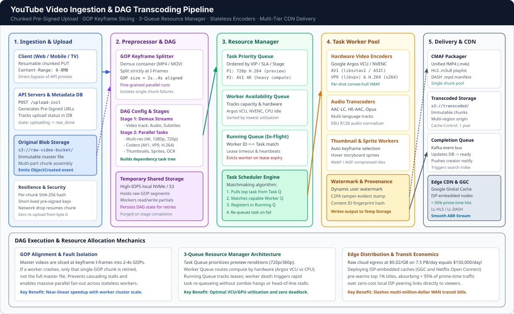

Video transcoding is heavily compute-intensive and latency-sensitive. A raw 4K video uploaded by a creator cannot be processed as a monolithic blob on a single machine: worker failures would require restarting hours of encoding, and serial processing would prevent rapid playback availability. Real-world platforms decompose video ingestion into chunked resumable uploads, group-of-pictures (GOP) keyframe slicing, and a three-queue Resource Manager driving distributed stateless workers.

#### ByteByteGo Capacity & Economic Baseline (BBG 5M-DAU Interview Model)

To ground the architectural sizing, consider the canonical ByteByteGo Chapter 14 interview baseline: 5 million Daily Active Users (DAU), an average video file size of 300 MB, a 10% daily upload ratio, and an average viewing consumption of 5 videos per user per day. (At §3.2's `500M-DAU` production scale, the uncached egress bill below scales $100\times$ to $\sim\$15\text{M/day}$, explaining why ISP-embedded OCA/GGC caching is mandatory.)

With 10% of 5M DAU uploading content daily, the system ingests 500,000 raw video uploads every day:

$$5{,}000{,}000\text{ DAU} \times 10\% = 500{,}000\text{ uploads/day}$$

At an average video size of 300 MB, daily raw storage ingestion reaches 150 TB/day:

$$500{,}000\text{ uploads/day} \times 300\text{ MB} = 150{,}000{,}000\text{ MB/day} = 150\text{ TB/day master storage}$$

Over a single year, raw video ingestion consumes $150\text{ TB/day} \times 365 \approx 54.75\text{ PB/year}$. When each master video is transcoded into multiple adaptive bitrate renditions (e.g. 4K, 1080p, 720p, 480p, 360p across AV1, VP9, and H.264), the processed storage expands by roughly $3\times$, adding $\sim 450\text{ TB/day}$ ($\sim 164.25\text{ PB/year}$) of transcoded segments.

If each of the 5M DAU streams 5 videos per day at 300 MB per video, daily streaming volume reaches 7.5 PB/day:

$$5{,}000{,}000\text{ users} \times 5\text{ videos} \times 0.3\text{ GB} = 7{,}500{,}000\text{ GB/day} = 7.5\text{ PB/day egress}$$

At standard public cloud CDN pricing of \$0.02 per GB of egress transfer, relying solely on commercial cloud CDNs yields astronomical operating expenses:

$$7{,}500{,}000\text{ GB/day} \times \$0.02/\text{GB} = \$150{,}000/\text{day}\quad (\$4.5\text{M/month}\text{ or }\$54.75\text{M/year})$$

This extreme economic cost dictates that large-scale streaming systems cannot operate over generic cloud CDN egress; they must employ multi-tier caching with ISP-embedded appliances and aggressive bitrate optimization.

#### Preprocessor & GOP Keyframe Alignment

When a creator finishes uploading a master video to original blob storage, the Preprocessor initiates the transcoding workflow through four responsibilities:

1. **Container Demuxing & GOP Splitting**: The preprocessor parses container headers (MP4, MOV, MKV) and slices the raw video stream strictly along Group of Pictures (GOP) boundaries. A GOP starts with an intra-coded frame (I-frame or IDR-frame) that requires no previous frames to decode, followed by predictive (P-frames) and bi-directional (B-frames) motion-compensated frames. Slicing at fixed 2-to-4-second closed-GOP boundaries ensures that each GOP chunk is entirely self-contained.
2. **Deterministic Multi-Rendition Alignment**: The GOP boundaries must align temporally across every output resolution and codec ladder. If a 1080p rendition places keyframes at timestamps `00:00:00` and `00:00:04`, the 720p, 480p, and 360p renditions must place keyframes at the exact same presentation timestamps. Failure to align GOP boundaries causes audio/video desynchronization and visible playback stalls whenever the client adaptive bitrate player switches ladders during network fluctuation.
3. **DAG Configuration Generation**: The preprocessor inspects creator-provided metadata, source dimensions, frame rates, and color spaces to compile a Directed Acyclic Graph (DAG) configuration specifying tasks, dependencies, target codecs, and priority weights.
4. **Temporary Shared Persistence**: The GOP slices and extracted metadata are staged in high-throughput temporary storage (such as NVMe-backed local clusters or ephemeral object storage). If an individual worker crashes during encoding, the system re-executes only that specific GOP chunk using persisted intermediate data, isolating the failure and preventing multi-hour master re-encodes.

#### DAG Scheduler Execution Graph

The DAG Scheduler converts the logical dependency tree into sequential and parallel execution stages:

- **Stage 1 (Stream Demuxing)**: Extracts the raw video stream, demuxes discrete audio channels (stereo, 5.1 surround), and parses subtitle and closed-caption metadata tracks.
- **Stage 2 (Parallel Task Fan-Out)**: Slices the demuxed video into hundreds of independent GOP encoding tasks executed in parallel across the stateless worker fleet:
  - Multi-resolution and multi-codec encoding: 4K, 1440p, 1080p, 720p, 480p, and 360p across AV1 (ASIC/libsvtav1), VP9 (libvpx), and H.264 (x264 baseline fallback).
  - Audio transcoding: multi-bitrate AAC-LC, HE-AAC, and Opus encoding with EBU R128 loudness normalization.
  - Media asset extraction: scene-change keyframe extraction for video thumbnails, generation of scrub storyboard image sprite sheets (WebP/AVIF tiles), and optical character recognition (OCR) for automated caption alignment.
  - Watermarking and security: overlaying dynamic creator/channel watermarks, embedding forensic watermarks, and calculating perceptual Content ID fingerprint hashes.
- **Stage 3 (CMAF Packaging & Manifest Assembly)**: Once all GOP tasks for a given rendition complete, the Packager multiplexes the chunks into fragmented MP4 (`.m4s`) segments and generates both HLS (`.m3u8`) and MPEG-DASH (`.mpd`) master playlists.

#### Three-Queue Resource Manager Architecture

Resource allocation efficiency is governed by the Resource Manager, which decouples task scheduling from worker physical topologies through three internal queues:

1. **Task Queue**: A priority queue containing ready-to-run tasks whose DAG upstream dependencies have been satisfied. Tasks are ordered by multi-dimensional priority: business SLA (e.g. verified partner uploads vs free-tier uploads), target rendition latency (prioritizing rapid generation of 720p/360p H.264 preview renditions so playback begins immediately, while queuing 4K AV1 renders for background processing), and DAG critical path depth.
2. **Worker Queue**: A priority queue tracking the real-time operational capacity and silicon specialization of the worker pool. Workers advertise their hardware capabilities (Google Argos VCU, NVIDIA NVENC GPU, or general-purpose CPU cores), available memory, and current load factor. The queue prioritizes routing tasks to the least-utilized, best-matched hardware worker.
3. **Running Queue**: An in-flight registry that maps assigned `task_id`s to active `worker_id`s along with lease expiration timestamps. Workers must continuously report periodic heartbeats while processing a GOP chunk. If a worker terminates, panics, or suffers a network partition, the lease expires; the Resource Manager immediately evicts the dead worker and restores the orphaned task to the Task Queue for reassignment without head-of-line blocking.
4. **Task Scheduler**: A continuous matchmaking loop that matches the highest-priority runnable tasks in the Task Queue to the most suitable idle workers in the Worker Queue, commits the assignment to the Running Queue, and dispatches the task instructions over gRPC.

### 3.8 Video Streaming: Speed, Safety, Cost Optimizations & Error Taxonomy

Operating a planetary video platform requires balancing user-facing upload and playback speed against infrastructure expenditure, intellectual property protection, and automated error recovery.

#### Speed Optimizations

- **Resumable Parallel Chunked Upload**: Raw uploads bypass stateful API web servers completely. The client invokes `POST /v1/videos/upload-init` to obtain a unique upload session ID and pre-signed multipart URLs. The client breaks the video into 5–10 MB chunks and transmits them concurrently via HTTP PUT with `Content-Range: bytes <start>-<end>/<total>` and MD5/SHA-256 integrity headers. If a network drop occurs on a flaky mobile connection, the client queries uploaded byte ranges and resumes only the missing chunk, eliminating catastrophic re-uploads from byte 0.
- **Geographically Distributed Edge Upload Centers**: Ingesting 100 GB master files over transatlantic public WAN links introduces high packet loss and TCP throughput collapse. Platforms deploy ingest proxy servers at regional edge PoPs. The client establishes a short TCP/TLS handshake with the nearest edge PoP, which streams the incoming chunks directly to original blob storage across high-bandwidth, congestion-controlled private backbone fiber.
- **Queue-Decoupled Asynchronous Processing**: By publishing an `UploadCompleted` event to a distributed Kafka event log, the upload service returns immediate acknowledgment to the creator while transcoding, search indexing, Content ID copyright checks, and subscriber notifications execute asynchronously downstream.

#### Safety, DRM & Content Provenance

- **Scoped Pre-Signed URLs**: Direct object storage uploads are strictly gated by short-lived (5–15 minute) pre-signed URLs cryptographically signed with HMAC-SHA256. Permissions are scoped strictly to specific object keys and enforce maximum payload size boundaries via storage policy conditions.
- **Multi-DRM & Hardware Trust Boundaries**: Commercial and premium content is protected via multi-DRM packaging conforming to the Common Encryption (CENC - ISO/IEC 23001-7) standard. Media samples are encrypted with AES-128 in CTR or CBCS mode using keys managed by a Key Management Interoperability Protocol (KMIP) service. Renditions target distinct client trust tiers:
  - Google Widevine L1 (Android/ChromeOS) and Apple FairPlay (iOS/macOS): Media decryption and video decoding occur exclusively within the device's Hardware Trusted Execution Environment (TEE) / Secure Enclave and protected video display path, preventing memory scrapers.
  - Widevine L3 and Microsoft PlayReady SL150 (Software Fallback): Used on legacy browsers where decryption occurs in OS user space; platforms restrict software DRM clients to low-resolution streams (e.g. 720p max) to limit piracy exposure.
- **C2PA Cryptographic Provenance & Watermarking**: Ingest pipelines validate and embed Coalition for Content Provenance and Authenticity (C2PA) cryptographic manifest assertions. This cryptographically records capture device hardware signatures, edit history, and distribution origin, enabling downstream players to distinguish genuine recorded media from synthetic or generative AI deepfakes. Visible user watermarks and imperceptible forensic audio/video watermarks are embedded during the DAG Stage 2 task pass.

#### Cost-Saving Optimizations

- **Two-Tier CDN Caching (80/20 Zipf Distribution)**: Video streaming request patterns follow an extreme power-law (Zipfian) distribution: less than 1% of viral titles generate $> 80\text{--}90\%$ of total peak bandwidth, while tens of millions of catalog videos receive fewer than 5 views per month. Edge CDN caching is reserved exclusively for the popular working set. Cache eviction policies (such as Segment-Aware LRU and TinyLFU) purge cold titles quickly, falling back to regional origin shields and centralized object storage.
- **Just-in-Time (JIT) Transcoding for Long-Tail Content**: Computing the full matrix of 10+ renditions upfront across AV1, VP9, and H.264 for every uploaded video wastes compute on videos that never find an audience. Modern platforms run a two-tier pipeline: on upload, only fast preview renditions (e.g. 720p and 360p H.264) are eagerly transcoded. Higher-resolution 4K renditions and compute-heavy AV1 encodes are generated Just-in-Time only when a video's real-time viewing velocity crosses an automated popularity threshold.
- **ISP-Embedded Appliances (GGC & Open Connect)**: By deploying dedicated hardware appliances (Google Global Cache - GGC, and Netflix Open Connect Appliances - OCA) directly within eyeball ISP central offices, popular content streams over local cross-connects at near-zero incremental transit cost, turning a \$150k/day public CDN egress bill into zero-cost local peering.

#### Error Taxonomy & Automated Recovery Protocols

Distributed video processing encounters errors across network, hardware, container formats, and operational resources. Systems categorize failures into recoverable and non-recoverable error classes to automate self-healing.

| Error Classification | Failure Trigger | Detection Point | Automated Recovery Protocol |
| --- | --- | --- | --- |
| **Recoverable: Chunk Upload Dropout** | Transient Wi-Fi loss, cellular cell handover, or client TCP reset during upload. | Client upload agent or Ingest Gateway byte tracker. | Client queries `UploadSession` byte offset; resumes uploading the specific missing 8 MB chunk via `Content-Range`; zero re-upload of prior chunks. |
| **Recoverable: Encoder Worker Panic** | Worker OOM, hardware VCU kernel crash, or node termination mid-transcode. | Resource Manager Running Queue lease monitor. | Heartbeat timeout triggers worker eviction; task lease is revoked; Task Scheduler re-inserts GOP chunk into Task Queue for execution on another worker. |
| **Recoverable: Temp Storage I/O Timeout** | Ephemeral NVMe or S3 storage rate-limiting / transient partition during chunk read. | Worker demux / encode I/O layer. | Truncated exponential backoff with full jitter ($t = \min(t_{\mathrm{max}}, t_{\mathrm{base}} \cdot 2^k + \mathrm{rand}(0, t_{\mathrm{base}}))$); failover to replica chunk storage. |
| **Recoverable: ABR Keyframe Drift** | Misaligned encoder settings causing non-identical GOP duration across renditions. | Segment Packager manifest validation check. | Packager rejects chunk assembly; marks rendition GOP as failed; triggers re-encode of that specific GOP interval with explicit forced-IDR keyframe parameters. |
| **Non-Recoverable: Corrupt Master Container** | Malformed MP4/MOV header, truncated moov atom, or unreadable bitstream. | Preprocessor demuxer (ffmpeg / libavformat parse). | Pipeline execution halts immediately; video status marked `FAILED_CORRUPT`; returns HTTP `422 Unprocessable Content` with actionable error code to creator. |
| **Non-Recoverable: Unsupported Codec** | Obsolete or proprietary video codec without available software/hardware decoder. | Preprocessor format inspector. | Ingestion rejected; aborts DAG configuration; notifies creator with list of accepted container and codec standards (e.g. H.264, ProRes, VP9). |
| **Non-Recoverable: Security / Decompression Bomb** | Maliciously crafted file designed to expand recursively or trigger buffer overflows. | Ingest security sandbox scanner. | Quarantine master blob in isolated security bucket; strip pre-signed credentials; permanently mark user account for abuse review. |
| **Non-Recoverable: Copyright / Content ID Strike** | Content ID audio/video fingerprint matches copyrighted commercial catalog. | DAG Stage 2 Content ID Matcher service. | Halts public publishing stage; video status updated to `BLOCKED_COPYRIGHT`; sends legal claim notification to creator Studio dashboard. |

### 3.9 Video Streaming: Then vs. Now (2021 vs. 2026 System Design Practice)

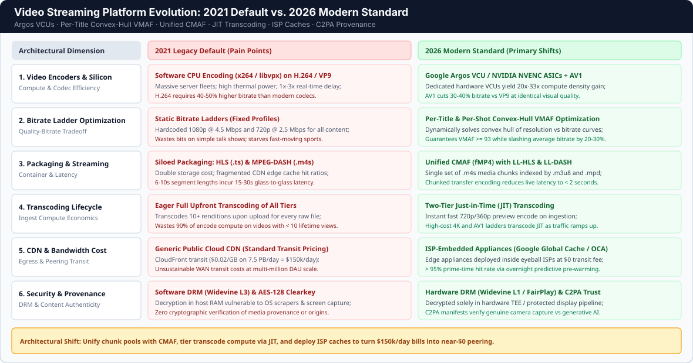

Video streaming architecture has transitioned from brute-force software CPU encoding and static bitrate ladders toward ASIC-accelerated transcoding, perceptual optimization, unified container formats, and ISP-embedded delivery.

| Architectural Dimension | 2021 Legacy Default (Pain Points) | 2026 Modern Production Standard (Primary Shifts) |
| --- | --- | --- |
| **Video Encoders & Silicon** | Software CPU encoding (`x264` / `libvpx`) on general-purpose servers; massive cluster footprints, high power draw, and multi-hour encoding latencies. | Warehouse-scale custom Hardware VCUs (Google Argos VCU, NVIDIA NVENC ASICs); delivers $20\times\text{--}33\times$ higher compute density and hardware-accelerated AV1 encoding. |
| **Bitrate Ladder Optimization** | Static Bitrate Ladders (hardcoded Apple HLS tables: 1080p @ 4.5 Mbps, 720p @ 2.5 Mbps); starves fast sports motion while wasting massive bandwidth on simple animation. | Per-Title & Per-Shot Convex-Hull VMAF Optimization; dynamically computes optimal Pareto resolution-bitrate curves targeting constant perceptual quality (VMAF $\ge 93$), saving 20–30% bitrate. |
| **Packaging & Protocols** | Siloed dual packaging: legacy HLS MPEG-2 TS (`.ts`) and MPEG-DASH (`.m4s`); duplicate origin storage footprint and fragmented edge CDN cache hit ratios. | Unified CMAF (Common Media Application Format) fragmented MP4 (`.m4s`); single chunk storage pool served via both LL-HLS and LL-DASH with chunked transfer for sub-2s latency. |
| **Transcoding Lifecycle** | Eager Upfront Transcoding: encodes 10+ renditions immediately upon upload; wastes 90% of encode compute on long-tail videos that receive fewer than 10 lifetime views. | Two-Tier Just-in-Time (JIT) Transcoding: eager fast-path 720p/360p H.264 preview encode on upload; 4K and heavy AV1 renditions transcode lazily only when traffic velocity spikes. |
| **CDN & Bandwidth Economics** | Generic Public Cloud CDN (e.g. CloudFront/Fastly) paying standard egress rates (\$0.02/GB on 7.5 PB/day = \$150k/day); unsustainable multi-million-dollar monthly bandwidth bills. | ISP-Embedded Appliance Tiering (Google Global Cache GGC and Netflix Open Connect OCAs); pre-warms top 1% titles overnight, absorbing $> 95\%$ of prime-time traffic at \$0 peering cost. |
| **Content Security & DRM** | Software-only DRM (Widevine L3) and clear-key AES-128 encryption; media decrypted in OS user space memory, vulnerable to screen recording; zero provenance verification. | Hardware-backed DRM (Widevine L1, Apple FairPlay L1) decrypted inside hardware TEE / protected display paths; C2PA cryptographic manifests verify genuine capture vs AI deepfakes. |

#### Migration Traps & Production Pitfalls

- **Trap 1: Premature Abandonment of H.264 Fallbacks**: While AV1 delivers 30–40% bitrate savings over VP9 and H.264 at equivalent visual quality, billions of legacy Smart TVs, low-end Android handsets, and embedded automotive browsers lack hardware AV1 or HEVC decoding silicon. Decoding AV1 in software on battery-powered mobile devices causes extreme battery drain, thermal throttling, and frame dropping. Production ladders must preserve a baseline H.264 (AVC) rendition in the manifest as an automatic hardware fallback.
- **Trap 2: Manifest Caching Mistake During Live Streaming**: Caching media segments (`.m4s`) for 1 year is standard because content-addressed video chunks are immutable. However, accidentally applying standard CDN cache headers (`Cache-Control: public, max-age=3600`) to dynamic sliding-window live manifests (`.m3u8` or `.mpd`) freezes viewers at stale playlists, causing the video stream to loop or stall permanently. Live manifests must enforce `Cache-Control: no-cache, max-age=1`, with segment updates published via atomic edge swaps.
- **Trap 3: Keyframe Skew Causing Audio/Video Desync During ABR Shifts**: When encoding multi-resolution ladders across independent distributed workers, minor differences in scene-detection heuristics can cause keyframes to occur at slightly different frames across resolutions (e.g. frame 120 in 1080p but frame 124 in 720p). When a viewer's player drops from 1080p to 720p during bandwidth drops, switching at an unaligned I-frame boundary causes audio crackle, black frames, and buffer rebuild freezes. Enforce strict, closed-GOP keyframe injection at identical presentation timestamps across all encoder profiles.

---

## 4. Dropbox / Google Drive File Sync

Cloud file sync requires moving minimal bytes when a user edits a multi-gigabyte file locally while guaranteeing zero silent data loss when offline devices edit concurrently.

### 4.1 File Sync: Requirements & Constraints

- **Functional Requirements**: Synchronize folder trees across desktop/mobile clients in near real time; resume interrupted uploads; preserve version history and recover from offline conflicting edits; share folders across multiple users.
- **Non-Functional Requirements**: **500M total users**, **50M DAU**; **99.99%** metadata availability and **11×9s** blob durability; sync notification latency **< 2 seconds** for online peers; bandwidth efficiency—editing 10 bytes inside a 100 MB binary file must **not** re-upload 100 MB.

### 4.2 File Sync: Back-of-Envelope Estimation

- **Sync Write QPS**: 50M DAU × 2 file edits/day = $100\text{M edits/day} \div 86{,}400 \approx \mathbf{1{,}160\text{ file commits/s}}$ avg (~3,500 peak).
- **Storage**: 500M users × 5 GB avg used = **2.5 EB raw** logical user data. With block-level **chunk deduplication** and LZ4/Zstd compression (typically 30–50% savings across OS/SDK/shared-folder duplicates and incremental edits), physical object storage drops to **~1.25–1.75 EB**.
- **Notification Fan-Out**: Maintaining 50M concurrent idle long-poll/WebSocket connections across stateful edge gateway servers (~500k connections per server) requires roughly **100 notification servers**.

### 4.3 File Sync: Core Entities & API

- **Core Entities**: `Namespace(ns_id)`, `FileEntry(file_id, ns_id, path, latest_rev, is_deleted)`, `FileRevision(file_id, rev_id, parent_rev_id, chunk_hashes[], size_bytes, author_device, mtime)`, `Chunk(sha256 PK, size_bytes, s3_key)`.
- **API**: `POST /v1/chunks/exists` `{ hashes: sha256[] }` → `{ missing: sha256[] }`; `PUT <presigned_s3_url>` (chunk upload); `POST /v1/files/{id}/commit` `{ expected_parent_rev, chunk_hashes[] }` → `200 OK` `{ rev_id }` or `409 Conflict`; `GET /v1/sync/delta?cursor={ns_cursor}` (cursor-based incremental sync); `GET /v1/sync/listen` (long-poll / WebSocket notification).

### 4.4 File Sync: High-Level Architecture

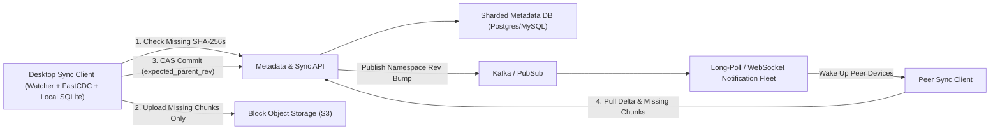

### 4.5 File Sync: Deep Dives & Failure Modes

1. **Content-Defined Chunking (Rabin Fingerprint / FastCDC)**:
   - _Why Fixed-Size 4 MB Blocks Fail_: If a file is sliced at fixed offsets (`[0..4MB)`, `[4MB..8MB)`), inserting **1 single byte at offset 0** shifts every byte in the file forward by 1, altering the SHA-256 digest of **every single 4 MB block** and forcing a 100% re-upload!
   - _Content-Defined Chunking (CDC)_: Slide a rolling hash window (historically a **Rabin fingerprint**, modernized by **FastCDC** gear-based rolling hashing at ~10× higher CPU throughput) across the byte stream and declare a chunk boundary whenever `(rolling_hash & mask) == 0` (clamped between `min_size` e.g. 1 MB and `max_size` e.g. 8 MB, averaging 4 MB). Inserting 1 byte at offset 0 modifies _only_ the **first chunk**; the rolling hash hits the exact same content-defined boundary markers immediately afterward, preserving 99% of downstream chunk hashes!

```typescript
// FastCDC-style Gear Rolling Hash Chunker (conceptual boundary invariant):
// Cut at offset i iff (i - start >= maxSize) OR (i - start >= minSize && (fp & mask) === 0).
export function findChunkBoundaries(
  bytes: Uint8Array,
  gearTable: Uint32Array,
  minSize: number,
  maxSize: number,
  mask: number,
): number[] {
  const boundaries: number[] = [];
  let start = 0;
  let fp = 0;
  for (let i = 0; i < bytes.length; i++) {
    fp = ((fp << 1) + gearTable[bytes[i]]) >>> 0;
    const len = i - start + 1;
    if (len >= maxSize || (len >= minSize && (fp & mask) === 0)) {
      boundaries.push(i + 1);
      start = i + 1;
      fp = 0;
    }
  }
  if (start < bytes.length) boundaries.push(bytes.length);
  return boundaries;
}
```

2. **Content-Addressable Storage & Deduplication Security**: Each chunk is compressed and addressed by its cryptographic **SHA-256** digest. Clients only upload hashes absent from `/v1/chunks/exists`, eliminating redundant transfers across edits, renames, and shared files. _Security Trap (Cross-Tenant Hash Oracle)_: Global cross-user deduplication allows an attacker who guesses a secret file's plaintext to probe `/chunks/exists` and learn whether another user owns that exact chunk ("confirmation-of-a-file attack"). Mitigate by scoping deduplication per **shared namespace / tenant** or using HMAC-keyed **convergent encryption** with server-side proof-of-ownership challenges.
3. **Delta Metadata Sync & Long-Poll/WebSocket Notifications**: Each shared folder namespace maintains a monotonic sequence cursor. Online clients hold a lightweight long-poll HTTP request or WebSocket to the Notification Fleet; when Device A commits a new revision, the Metadata Service publishes `(ns_id, new_cursor)` to the Notification Fleet, which wakes Device B to call `GET /v1/sync/delta?cursor=...` and download only missing chunks.
4. **Offline Conflict Resolution**: Suppose Devices A and B go offline while synced at `rev = 5`. Device A edits `spec.docx` and reconnects first, succeeding with `expected_parent_rev = 5` → `rev = 6`. When Device B reconnects and calls `POST /commit` with `expected_parent_rev = 5`, the Metadata DB rejects the **Compare-And-Swap (CAS)** precondition with `409 Conflict`. Rather than silently overwriting Device A's work (Last-Write-Wins hazard!), Device B downloads `rev = 6` as `spec.docx` and saves its own diverging local edits under `spec (Device B's conflicted copy 2026-11-20).docx`, guaranteeing zero data loss.
5. **Local Sync Engine, Hash Ordering & Case-Sensitivity Traps**: The desktop agent watches OS filesystem events (`inotify`/`FSEvents`/`ReadDirectoryChangesW`), debounces rapid editor save-and-rename cycles using a local **SQLite state database**, and tracks **OS inode / file IDs** so renaming a 5 GB video issues a cheap metadata `MOVE` rather than re-uploading chunks. Always compute the **SHA-256 content-addressable hash over the uncompressed plaintext chunk _before_ Zstd/LZ4 compression**; hashing compressed bytes breaks deduplication whenever clients upgrade Zstd versions or compression levels. Finally, detect cross-platform **case-sensitivity collisions** (`Report.txt` and `report.txt` created on Linux syncing onto case-insensitive macOS APFS/Windows NTFS) and disambiguate with a case-conflict suffix before writing to disk.

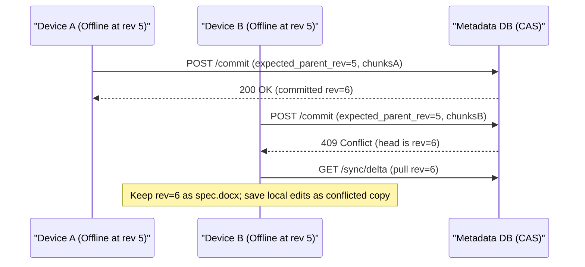

### 4.6 Primary Literature and Systems Foundations Matrix

Modern cloud file synchronization and content-addressable storage architectures build on seminal literature spanning distributed file systems, content-defined data deduplication, cryptographic proof systems, and information-leak side-channel analysis. The matrix below grounds every architectural design decision in its formal theoretical and empirical literature:

| Specification / Paper | Authors / Organization & Year | Core Contribution & Theoretical Mechanism | Computational & Space Complexity | Production Systems Adoption |
| --- | --- | --- | --- | --- |
| **A Low-bandwidth Network File System (LBFS)** | Muthitacharoen, Chen, Mazières (ACM SOSP 2001) | Introduces Content-Defined Chunking (CDC) using Rabin fingerprints over a sliding 48-byte window to eliminate redundant network data transfers over constrained WAN links; discovers boundary markers where $\text{fingerprint} \equiv 0 \pmod{2^{13}}$ (target 8 KB average chunk size) and addresses blocks via SHA-1 hashes. | Time: $O(N)$ sliding window scanning; Space: $O(M)$ hash table of known block digests where $M = N / \text{avg chunk size}$. | Foundation of modern cloud sync engines (Dropbox, Google Drive, Box), deduplicated backup systems (Borg, Restic), and Git blob deduplication. |
| **Inside Dropbox: Understanding Personal Cloud Storage** | Drago et al. (ACM IMC 2012) | Empirical analysis of production Dropbox network traffic across 400,000 users; proves that over 70% of files synced are smaller than 100 KB, while 99% of total bytes reside in files larger than 1 MB; reveals that 50% of file modifications alter only a subset of chunks and demonstrates the necessity of separating the metadata control plane from the block-storage data plane. | Empirical workload profiling: $70\%$ small-file metadata dominance vs. $99\%$ volume bytes in large objects; $50\%$ chunk re-use across revisions. | Architectural blueprint for dual-plane separation, chunk-level delta synchronization, and client-side SQLite metadata caching in consumer cloud sync. |
| **FastCDC: A Fast and Efficient Content-Defined Chunking Approach for Data Deduplication** | Xia et al. (USENIX ATC 2016) | Replaces compute-heavy Rabin fingerprints with Gear rolling hash tables; introduces normalized chunking with asymmetric gear masks across variable chunk length segments ($[\text{min size}, \text{max size}]$) to achieve $3\times$ to $10\times$ higher chunking throughput ($> 1\text{ GB/s}$ per core) while maintaining or improving deduplication elimination ratios. | Time: $O(N)$ with 1 table lookup and shift per byte; Space: $O(1)$ state (256-entry 32-bit Gear lookup table). | High-throughput cloud chunking agents, enterprise backup appliances, and modern Rust/Go cloud sync clients (FastCDC-rs, Casync). |
| **Side Channels in Cloud Storage: The Case of Deduplication in Cloud Backups** | Harnik, Pinkas, Shulman-Peleg (IEEE S&P 2010) | Formally proves the "confirmation-of-a-file" side-channel vulnerability in cross-tenant content-addressable storage; demonstrates that if an unauthenticated or cross-account client can probe chunk existence via hash, an attacker can verify target users' confidential documents (e.g., tax filings or unreleased press releases); introduces Proof-of-Ownership (PoW) protocols and tenant-bounded deduplication. | Attack Complexity: $O(1)$ existence probes; Mitigation: $O(\text{chunk size})$ Merkle tree challenge-response proofs or HMAC convergent encryption. | Enforces account-level / namespace-bounded deduplication in Google Drive, Dropbox, and AWS S3 client libraries, eliminating cross-tenant leakage. |
| **Dropbox Magic Pocket: Custom Multi-Exabyte Storage** | Dropbox Engineering (2014–2021) | Custom multi-exabyte cold and warm block storage architecture replacing raw cloud vendor storage; implements $8+4$ and $9+3$ Reed-Solomon erasure coding over sharded NVMe/SMR drives, reducing replication storage overhead from $3.0\times$ (triple replication) to $1.5\times$ while sustaining simultaneous failure of four storage drives or an entire data center. | Storage Overhead: $1.5\times$ ($n / k = 12 / 8$); Durability: $11\times 9\text{s}$; Reconstruction: $O(k)$ matrix multiplications per lost block. | Core storage infrastructure powering Dropbox Magic Pocket, Google Colossus/CFS erasure-coded tiers, and modern Ceph/MinIO object stores. |
| **System Design Interview — An Insider's Guide (Vol. 1, Ch. 15)** | Alex Xu (ByteByteGo, 2020) | Comprehensive pedagogical blueprint for Google Drive; formalizes dual-plane architecture (Control Plane API + Metadata DB + Notification Fleet vs. Data Plane Block Servers + S3/Glacier), four-table relational schema (`User`, `File`, `Block`, `FileVersion`), simple vs. resumable upload state machine, and long-polling notification fan-out. | Capacity model: 50M total users, 10M DAU, 10 GB free quota ($500\text{ PB}$ total capacity), 2 uploads/day/user ($10\text{ TB/day}$ ingestion bandwidth). | Standard technical interview blueprint for cloud file synchronization, chunking pipelines, and offline conflict handling. |

### 4.7 ByteByteGo Chapter 15 Architectural Analysis & Capacity Deltas

In _System Design Interview — An Insider's Guide_ (Vol. 1, Chapter 15), Alex Xu details the end-to-end design of Google Drive. While Chapter 15 provides an excellent pedagogical baseline, enterprise production systems (such as Google Drive or Dropbox) operate at significantly larger scale and enforce strict transactional and security invariants that diverge from introductory interview models.

#### Capacity Model Reconciliation: ByteByteGo Baseline vs. Production Scale

The capacity framework established in ByteByteGo Chapter 15 provides the following baseline parameters:

- **User Base & Daily Activity**: Alex Xu assumes $50\text{ million total registered users}$ and $10\text{ million daily active users (DAU)}$ ($20\%$ DAU/MAU ratio). Each user is allocated $10\text{ GB}$ of free storage quota, yielding a total logical provisioned storage ceiling of:

$$
\text{Total Provisioned Quota} = 50{,}000{,}000 \times 10\text{ GB} = 500{,}000{,}000\text{ GB} = 500\text{ PB}
$$

- **Daily Ingestion Bandwidth**: Each active user uploads an average of $2\text{ files/day}$ with an average file size of $500\text{ KB}$. The resulting daily upload traffic and write throughput evaluate to:

$$
\text{Daily File Ingestion} = 10{,}000{,}000\text{ users} \times 2\text{ files/day} = 20{,}000{,}000\text{ uploads/day}
$$

$$
\text{Daily Upload Volume} = 20{,}000{,}000 \times 500\text{ KB} = 10{,}000{,}000{,}000\text{ KB} = 10\text{ TB/day}
$$

$$
\text{Average Ingestion Bandwidth} = \frac{10\text{ TB} \times 10^{12}\text{ bytes/TB}}{86{,}400\text{ seconds}} \approx 115.74\text{ MB/s} \quad (\approx 926\text{ Mbps})
$$

$$
\text{Average Write QPS} = \frac{20{,}000{,}000\text{ uploads}}{86{,}400\text{ seconds}} \approx 231.5\text{ file uploads/s} \quad (\approx 463\text{ to }695\text{ peak QPS at } 2\times\text{--}3\times)
$$

- **Reconciliation with Module 12 Section 4.2 Production Scale**: Module 12 Section 4.2 targets true enterprise production scale: $500\text{ million total users}$, $50\text{ million to }100\text{ million DAU}$, and $2.5\text{ EB}$ of raw stored content. Under production usage, users do not merely upload tiny $500\text{ KB}$ documents; they synchronize high-definition video assets, raw photo libraries, and software engineering builds, generating $100\text{ million file commits/day}$ ($\approx 1{,}160\text{ commits/s}$ average, $3{,}500\text{ peak}$) and driving $200\text{ TB/day to }1\text{ PB/day}$ of net chunk mutations. Xu's $500\text{ PB}$ storage and $10\text{ TB/day}$ ingestion model serves as an educational microcosm ($1/10\text{th}$ the user base and $1/20\text{th}$ to $1/100\text{th}$ the daily byte ingestion). While Xu's numbers can comfortably run on a single sharded relational database with hundreds of API pods, production scale requires distributed multi-region Spanner/CockroachDB metadata clusters, global edge points of presence (PoPs) terminating HTTP/3 connections, and custom multi-exabyte erasure-coded storage fabrics (Dropbox Magic Pocket).

| Metric Parameter | ByteByteGo Chapter 15 Baseline | Module 12 Section 4.2 Production Scale | Scaling Variance & Architectural Impact |
| --- | --- | --- | --- |
| **Total Registered Users** | $50\text{ million users}$ | $500\text{ million users}$ | $10\times$ increase; requires distributed user namespace partitioning. |
| **Daily Active Users (DAU)** | $10\text{ million DAU}$ | $50\text{M to }100\text{ million DAU}$ | $5\times\text{--}10\times$ concurrency; mandates multi-node edge notification gateways. |
| **Total Storage Footprint** | $500\text{ PB}$ (quota provisioned) | $2.5\text{ EB}$ raw logical ($1.25\text{--}1.75\text{ EB}$ physical) | $3\times\text{--}5\times$ increase; necessitates $8+4$ Reed-Solomon erasure coding. |
| **Daily Ingestion Volume** | $10\text{ TB/day}$ | $200\text{ TB/day to }1\text{ PB/day}$ | $20\times\text{--}100\times$ throughput; requires direct presigned S3/blob streaming. |
| **Write / Commit QPS** | $231\text{ uploads/s}$ ($695\text{ peak}$) | $1{,}160\text{ commits/s}$ ($3{,}500\text{ peak}$) | $5\times$ commit frequency; mandates CAS revision sequence pipelines. |
| **Notification Connections** | $\sim 10\text{ million}$ idle connections | $50\text{M to }100\text{ million}$ idle connections | Requires `100–200` stateful edge notification servers (~500k conn/server). |

#### Simple vs. Resumable Upload API Protocol

In cloud storage, network dropouts over mobile links or Wi-Fi during multi-gigabyte file transfers cause severe user frustration if transfers must restart from byte 0. Google Drive exposes two distinct upload protocols:

1. **Simple Upload (`uploadType=media`)**: Used exclusively for small files ($\le 5\text{ MB}$). The client delivers the file metadata and binary payload in a single HTTP `POST` or `PUT` request to `/upload/drive/v3/files?uploadType=media`. The API server handles authentication, allocates block hashes, writes metadata to the database, and streams chunks to object storage synchronously.
2. **Resumable Upload (`uploadType=resumable`)**: Mandatory for files $> 5\text{ MB}$ and large media up to $5\text{ TB}$. It executes via a formal three-phase state machine:

```
[Client]                               [API Server]                         [Block / S3 Store]
   |                                        |                                        |
   |-- 1. POST /upload?uploadType=resumable |                                        |
   |   (Headers: Content-Length: 0,         |                                        |
   |    X-Upload-Content-Type: video/mp4,   |                                        |
   |    X-Upload-Content-Length: 20971520)  |                                        |
   |--------------------------------------->|                                        |
   |                                        |-- Allocate Upload URI & Session ID     |
   |                                        |-- INSERT File (status = "pending")     |
   |<---------------------------------------|                                        |
   |   201 Created (Location: <upload_uri>) |                                        |
   |                                        |                                        |
   |-- 2. PUT <upload_uri> (Bytes 0-4194303)---------------------------------------->|
   |   (Content-Range: bytes 0-4194303/20971520)                                     |-- Stream Chunk 1
   |<--------------------------------------------------------------------------------|
   |   308 Resume Incomplete (Range: 0-4194303)                                      |
   |                                                                                 |
   |   [Network Dropout / Connection Reset Occurs]                                   |
   |                                                                                 |
   |-- 3. PUT <upload_uri> (Recovery Status Query)                                   |
   |   (Content-Length: 0, Content-Range: bytes */20971520)                          |
   |-------------------------------------------------------------------------------->|
   |<--------------------------------------------------------------------------------|
   |   308 Resume Incomplete (Range: 0-4194303) -> Client resumes at byte 4194304    |
   |                                                                                 |
   |-- 4. PUT <upload_uri> (Bytes 4194304-20971519)                                  |
   |   (Content-Range: bytes 4194304-20971519/20971520)                             |
   |-------------------------------------------------------------------------------->|-- Stream Chunks 2-5
   |<--------------------------------------------------------------------------------|-- Trigger S3 Event
   |   200 OK (File Upload Complete, status = "uploaded")                            |
```

#### Four-Table Relational Metadata Schema and Lifecycle Invariants

ByteByteGo Chapter 15 formalizes a clean normalized relational metadata schema to maintain file hierarchies, revision history, and block associations. Below is the precise relational DDL schema and invariants:

```sql
-- Core User entity tracking profile and storage allocation
CREATE TABLE users (
    user_id         BIGINT PRIMARY KEY,
    username        VARCHAR(64) NOT NULL,
    email           VARCHAR(255) NOT NULL UNIQUE,
    quota_bytes     BIGINT NOT NULL DEFAULT 10737418240, -- 10 GB default
    used_bytes      BIGINT NOT NULL DEFAULT 0,
    created_at      TIMESTAMP WITH TIME ZONE NOT NULL DEFAULT NOW()
);

-- Hierarchical File and Directory metadata
CREATE TABLE files (
    file_id         BIGINT PRIMARY KEY,
    user_id         BIGINT NOT NULL REFERENCES users(user_id),
    namespace_id    BIGINT NOT NULL,                     -- Shared folder boundary
    file_name       VARCHAR(255) NOT NULL,
    file_path       TEXT NOT NULL,
    upload_url      TEXT,                                -- Active resumable upload URI
    is_directory    BOOLEAN NOT NULL DEFAULT FALSE,
    status          VARCHAR(16) NOT NULL DEFAULT 'pending', -- 'pending' | 'uploaded' | 'deleted'
    latest_rev      BIGINT NOT NULL DEFAULT 1,
    created_at      TIMESTAMP WITH TIME ZONE NOT NULL DEFAULT NOW(),
    updated_at      TIMESTAMP WITH TIME ZONE NOT NULL DEFAULT NOW(),
    CONSTRAINT uq_file_path UNIQUE (namespace_id, file_path)
);

-- Content-addressable block mapping
CREATE TABLE blocks (
    block_id        BIGINT PRIMARY KEY,
    file_id         BIGINT NOT NULL REFERENCES files(file_id) ON DELETE CASCADE,
    block_hash      CHAR(64) NOT NULL,                   -- SHA-256 cryptographic digest
    block_order     INT NOT NULL,                        -- 0-indexed position in file assembly
    block_size      INT NOT NULL,                        -- Size in bytes (up to 4 MB / 8 MB)
    CONSTRAINT uq_file_block_order UNIQUE (file_id, block_order)
);

-- Immutable version history records
CREATE TABLE file_versions (
    version_id      BIGINT PRIMARY KEY,
    file_id         BIGINT NOT NULL REFERENCES files(file_id) ON DELETE CASCADE,
    version_number  INT NOT NULL,
    device_id       VARCHAR(64) NOT NULL,
    checksum        CHAR(64) NOT NULL,                   -- Full file SHA-256
    byte_size       BIGINT NOT NULL,
    created_at      TIMESTAMP WITH TIME ZONE NOT NULL DEFAULT NOW(),
    CONSTRAINT uq_file_version UNIQUE (file_id, version_number)
);

CREATE INDEX idx_files_user ON files(user_id);
CREATE INDEX idx_files_namespace ON files(namespace_id);
CREATE INDEX idx_blocks_hash ON blocks(block_hash);
CREATE INDEX idx_file_versions ON file_versions(file_id, version_number DESC);
```

#### Pending $\to$ Uploaded S3 Callback Pipeline

A file must never appear in a user's directory before its binary content is durably committed to physical storage. The asynchronous callback pipeline enforces strict state transition invariants:

1. **Initiation**: When the client requests an upload session, the API server inserts a record into the `files` table with `status = 'pending'`. At this point, the file is visible only to the uploading client session and excluded from general folder listings.
2. **Chunk Transmission**: The client slices the file into content-addressed blocks and streams them directly to Block Servers or S3 storage buckets using presigned URLs.
3. **S3 Event Notification**: Once the final block is committed to S3, S3 automatically publishes an `s3:ObjectCreated:Put` or `s3:ObjectCreated:CompleteMultipartUpload` notification event to an SQS queue / Kafka topic.
4. **Asynchronous Verification**: An event worker consumes the message, verifies that all blocks defined in `blocks` for the given `file_id` exist in S3 and match their SHA-256 checksums, and calculates total file size.
5. **State Finalization**: The worker executes an atomic database transaction: updates `files.status = 'uploaded'`, increments `files.latest_rev`, increments `users.used_bytes`, and appends a record to `file_versions`.
6. **Notification Broadcast**: The worker publishes a revision bump event `(namespace_id, file_id, rev)` to the Notification Service, waking all online peer clients to synchronize the new file.

#### Delta Synchronization Mechanics & Content-Addressable Storage

Delta synchronization ensures that when a file is edited, only modified blocks travel across the network:

1. **Manifest Comparison**: The client runs FastCDC over the modified local file, yielding an ordered array of block SHA-256 digests: $[H_0, H_1, H_2, \dots, H_m]$.
2. **Missing Hash Probe**: The client issues `POST /v1/chunks/exists` with the list of hashes. The server checks its in-memory Bloom filter and block registry, returning only the subset of hashes absent from storage: $\{H_{\text{missing}}\}$.
3. **Selective Upload**: The client uploads only the missing chunk payloads. If an edit changed 100 bytes in a 500 MB video, typically only 1 or 2 chunks ($4\text{ MB to }8\text{ MB}$) are transmitted—cutting egress bandwidth by $> 98\%$.
4. **Assembly Metadata Commit**: The client issues `POST /v1/files/{id}/commit` containing the complete ordered array of hashes and `expected_parent_rev`. The server binds the existing and newly uploaded blocks to the new revision record.

#### Account-Level Deduplication Security & Side-Channel Mitigation

In early cloud storage designs (including early Dropbox), data deduplication was applied globally across all users to minimize physical S3 storage costs: if User B uploaded a movie or PDF that User A had already stored, User B's client was instructed to skip the upload entirely.

Harnik et al. (IEEE S&P 2010) proved that global cross-user deduplication introduces a severe **side-channel oracle attack**:

- **The Confirmation-of-a-File Attack**: An attacker who suspects a target victim owns a sensitive document (e.g., a confidential corporate merger draft, a classified leak, or a specific patient medical record) generates the exact document plaintext locally and computes its SHA-256 hash. The attacker then issues a `/v1/chunks/exists` query or attempts an upload. If the server instantly acknowledges the block without accepting bytes, the server proves to the attacker that the secret document already exists in the cloud storage repository.
- **Data Exfiltration via Hash Spoofing**: In naive systems lacking proof-of-ownership, merely possessing the 32-byte SHA-256 hash allowed an attacker to attach that file to their own cloud drive and download the victim's full file content!

**Production Mitigation**: Modern cloud storage systems eliminate this side-channel through **Account-Level / Namespace-Bounded Deduplication**. Block deduplication is strictly constrained within the authenticated user's account, family domain, or corporate organization namespace. If User B uploads the same file as User A, User B's client must independently transmit the encrypted bytes unless User B explicitly shares access within User A's workspace. Furthermore, systems employing multi-tenant deduplication mandate cryptographic **Proof-of-Ownership (PoW)**: the server challenges the client to compute HMAC-SHA256 digests over randomly selected byte offsets within the chunk, proving physical possession of the entire file rather than just its hash.

#### Offline Backup Queue & Cursor-Based Delta Replay

When a desktop or mobile device disconnects (airplane mode, travel, network outage), file modifications made by collaborators in shared folders accumulate on the server:

- **Offline Message Queuing**: The Notification Service does not drop change events for offline clients. Instead, events are pushed to an **Offline Backup Queue** (implemented via partitioned Kafka topics or Redis Streams keyed by `user_id` or `namespace_id`).
- **Cursor-Based Delta Fetch**: Every synchronization namespace maintains a monotonically increasing 64-bit sequence cursor ($C_{\text{rev}}$). When a disconnected device reconnects, it initiates synchronization by calling `GET /v1/sync/delta?namespace_id={ns}&cursor={last_seen_cursor}`. The server streams all revision records occurring between the client's last-seen cursor and the current namespace head. The client downloads missing blocks, resolves any local conflicts, and updates its local SQLite cursor atomically upon completion.

#### Five Critical Failure Modes and Self-Healing Mitigations

| Failure Mode | Root Cause / Trigger | Architectural Impact | Production Mitigation & Self-Healing |
| --- | --- | --- | --- |
| **1. Load Balancer Failure** | Hardware crash, BGP misrouting, or network link saturation on active L7 proxy. | Inability of clients to reach API servers; complete sync halt. | Deploy active-passive load balancer pairs with Keepalived VRRP / IP Anycast; automatic multi-region DNS failover (Route 53 latency/health check). |
| **2. Block Server / Chunk Node Crash** | Worker OOM during chunk compression, disk I/O hang, or node reboot during active stream. | Interrupted chunk uploads; potential block corruption on storage writes. | Block servers are entirely stateless; clients retry failed chunk PUTs with exponential jitter; SHA-256 integrity verification discards malformed blocks. |
| **3. Metadata Database Primary Failure** | Hardware fault, disk exhaustion, or kernel panic on relational DB master node. | Write API rejection (`500 Internal Server Error`); inability to commit revisions. | Automated consensus failover (Patroni / Orchestrator with Raft/Paxos); standby replica promoted to primary in $< 10\text{ s}$; zero data loss ($RPO = 0$). |
| **4. Cloud Object Storage Regional Outage** | S3 bucket availability degradation or fiber cut affecting primary cloud region. | Inability to fetch or store binary block payloads; read/write stalling. | Cross-Region Replication (CRR) replicates blocks asynchronously to secondary region; clients fail over transparently to secondary bucket endpoints. |
| **5. Notification Fleet Connection Collapse** | Edge notification node crash dropping 500,000 active long-poll or WebSocket connections. | Thundering herd of 500,000 clients simultaneously attempting reconnection. | Randomized exponential backoff with full jitter on client reconnect loops; circuit breakers and rate limiters on notification gateway edge. |

### 4.8 Dual-Plane File Sync Architecture Blueprint

The end-to-end architecture of Google Drive separates operations into two orthogonal runtime planes: the **Control Plane** (responsible for user authentication, namespace trees, relational metadata, conflict arbitration, and push notifications) and the **Data Plane** (responsible for high-throughput chunking, cryptographic hashing, content-addressed block transport, compression, and exabyte-scale object storage).

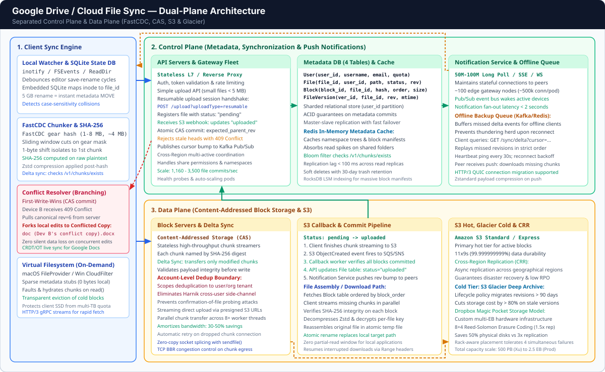

#### Architectural Decoupling & Conflict Handling Mechanics

1. **Separation of Control and Data Planes**: Binary chunks never pass through the relational metadata database. API servers handle metadata transactions exclusively, keeping write queries small ($< 1\text{ KB}$ per commit) and predictable. Data plane block servers stream high-bandwidth chunk payloads directly into object storage (Amazon S3 / Google Cloud Storage), utilizing zero-copy network sockets (`sendfile()` / TCP splice) to saturate multi-gigabit WAN links without starving API database connections.
2. **Sync Conflict Resolution (Branching & First-Write-Wins)**: When two users (or two offline devices belonging to the same user) concurrently modify the same file from a common base version (e.g., revision $5$), a synchronization race occurs:
   - Device A reconnects first and issues `POST /v1/files/{id}/commit` with `expected_parent_rev = 5`. The Metadata DB executes an atomic Compare-And-Swap (CAS) update:

```sql
UPDATE files SET latest_rev = 6, updated_at = NOW() WHERE file_id = X AND latest_rev = 5;
```

- This query succeeds, committing Revision $6$ as the canonical head.
- Device B subsequently reconnects and issues `POST /v1/files/{id}/commit` with `expected_parent_rev = 5`. The CAS condition fails because `latest_rev` is now $6$.
- The API server rejects Device B's commit with HTTP `409 Conflict`.
- **Branching Conflicted Copy**: To guarantee zero silent data loss, Device B downloads the server's canonical Revision $6$ into the target local file, and automatically forks its own local divergent edits into a distinct local sibling file named `<filename> (Device B's conflicted copy YYYY-MM-DD).<extension>`. The client then uploads this conflicted copy as a new file entry, preserving both users' changes and alerting the human operator to merge them.

### 4.9 Modern Architectural Evolution: 2021 Baseline vs. 2026 Production Standard

Cloud synchronization architectures have undergone profound transformations between 2021 legacy baselines (exemplified by introductory interview literature) and 2026 modern production cloud-native platforms.

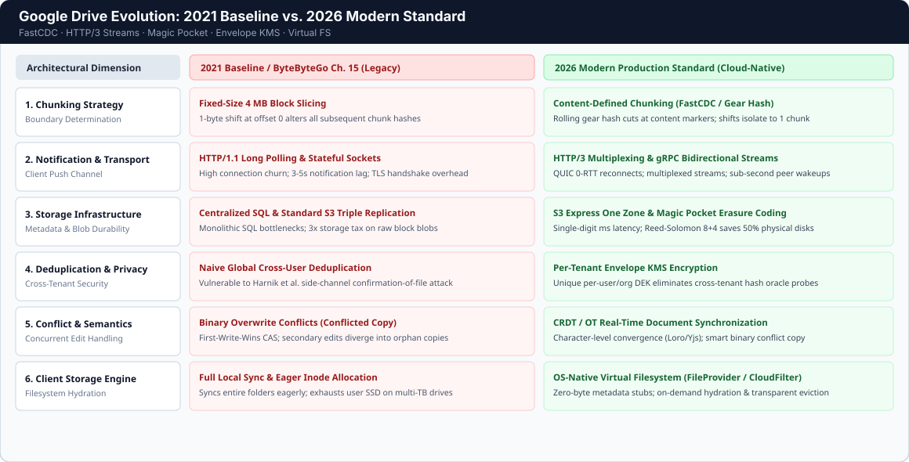

#### Six-Dimensional Architectural Analysis

1. **Chunking Strategy: Fixed 4 MB Slicing vs. Content-Defined Chunking (FastCDC / Gear Hash)**
   - _2021 Legacy Default_: Introductory architectures divide files into fixed $4\text{ MB}$ slices ($[0\text{--}4\text{MB})$, $[4\text{--}8\text{MB})$, etc.). This approach suffers from the catastrophic **boundary shift problem**: inserting a single byte at offset 0 shifts every byte in the entire file forward by 1. Every single downstream $4\text{ MB}$ block produces a completely distinct SHA-256 digest, completely destroying deduplication and forcing a full $100\%$ re-upload of multi-gigabyte files.
   - _2026 Modern Standard_: Production engines deploy **Content-Defined Chunking (FastCDC)**. A sliding byte window computes an in-memory Gear rolling hash ($fp = (fp \ll 1) + \text{GearTable}[byte]$). When $fp \ \&\ \text{mask} == 0$, a chunk boundary is declared (clamped between $\text{min size} = 1\text{ MB}$ and $\text{max size} = 8\text{ MB}$, with an average of $4\text{ MB}$). Inserting bytes at offset 0 shifts only the first boundary; immediately thereafter, the rolling hash detects the exact same content-defined boundary markers, preserving $\approx 99\%$ of remaining chunk hashes.

2. **Notification & Transport: HTTP/1.1 Long Polling vs. HTTP/3 Multiplexing & gRPC Streams**
   - _2021 Legacy Default_: Clients hold open HTTP/1.1 long-polling requests or basic WebSockets. Long polling suffers from frequent timeout renegotiations, TLS handshake overheads, and head-of-line (HoL) blocking over flaky cellular connections, incurring $3\text{--}5\text{ seconds}$ notification latency.
   - _2026 Modern Standard_: Modern clients maintain **HTTP/3 (QUIC)** and **gRPC bidirectional streaming** connections. Operating over UDP with connection IDs, QUIC enables seamless **connection migration** when switching between Wi-Fi and 5G networks without dropping active streams. Single-connection multiplexing wakes peer devices in $< 500\text{ ms}$ with zero HoL blocking.

3. **Storage Infrastructure: Centralized SQL & Standard S3 vs. S3 Express One Zone & Magic Pocket Erasure Coding**
   - _2021 Legacy Default_: Centralized relational databases store metadata while raw standard cloud object storage (Amazon S3 Standard) stores blocks under default $3\times$ replication ($300\%$ storage overhead), incurring significant cross-AZ data transfer fees (\$0.01--\$0.02/GB) on high-throughput churn.
   - _2026 Modern Standard_: High-velocity hot ingest paths use **S3 Express One Zone** for single-digit millisecond PUT/GET latencies. Large-scale infrastructure deploys custom multi-exabyte storage fabrics (Dropbox Magic Pocket model) with $8+4$ or $9+3$ **Reed-Solomon Erasure Coding**. Erasure coding reduces physical storage overhead to just $1.5\times$ ($50\%$ savings over triple replication) while guaranteeing mathematical recovery across any four simultaneous drive or node failures.

4. **Deduplication & Privacy: Global Naive Dedup vs. Per-Tenant Envelope KMS Encryption**
   - _2021 Legacy Default_: Naive global cross-user deduplication compares unkeyed SHA-256 hashes across all tenants. As proven by Harnik et al., this allows malicious users to probe the existence of confidential documents across the entire user base.
   - _2026 Modern Standard_: Storage engines employ **Per-Tenant Envelope KMS Encryption**. Each user or workspace organization possesses a unique Hardware Security Module (HSM) Data Encryption Key (DEK). Block plaintext is encrypted with AES-256-GCM using the tenant-specific DEK before chunk hashing or storage. Even identical files uploaded by two distinct corporate tenants produce completely distinct ciphertext and cryptographic digests, eliminating cross-tenant confirmation side-channels.

5. **Conflict Resolution & Document Semantics: Binary Overwrite vs. CRDT / OT Real-Time Document Sync**
   - _2021 Legacy Default_: All concurrent modifications are treated as opaque binary collisions, resulting in rigid First-Write-Wins arbitration and cluttering user directories with disconnected "conflicted copy" files that require tedious manual human reconciliation.
   - _2026 Modern Standard_: Modern productivity suites partition files by document type. Structured documents (text, spreadsheets, presentations) synchronize using **Conflict-free Replicated Data Types (CRDTs)** (e.g., Loro, Yjs) or **Operational Transformation (OT)**. Edits merge at the character and cell level in real time with mathematical convergence. Binary files (archives, compiled binaries, videos) retain First-Write-Wins CAS with intelligent semantic branch merging.

6. **Client Storage Engine: Full Local Sync vs. OS-Native Virtual Filesystems (On-Demand Hydration)**
   - _2021 Legacy Default_: Clients eagerly synchronize all designated folders to physical local hard drives. As user cloud quotas expanded from $10\text{ GB}$ to $2\text{ TB+}$, eager local synchronization instantly saturated laptop SSD storage.
   - _2026 Modern Standard_: Desktop clients integrate directly with **OS-native virtual filesystem abstractions** (**macOS FileProvider API** and **Windows Cloud Filter API**). Files in the cloud appear in the local filesystem as lightweight zero-byte metadata stubs. The operating system kernel intercepts filesystem `open()` / `read()` system calls, hydrates required byte blocks on-demand over HTTP/3, and transparently evicts cold blocks when disk pressure increases.

---

## 5. Web Crawler

A production web crawler continuously discovers, fetches, and indexes billions of web documents while strictly respecting host rate limits, `robots.txt` policies, DNS constraints, and adversarial spider traps.

### 5.1 Web Crawler: Requirements & Constraints

- **Functional Requirements**: Start from seed URLs; download HTML/text pages, extract outbound hyperlinks, and store snapshots for search indexing; respect `robots.txt` exclusions and `Crawl-delay`; prioritize fresh/high-value domains over stale spam sites.
- **Non-Functional Requirements**: **1 billion pages/month** continuously refreshed; **strict per-host politeness** (never send concurrent bursts that DDoS a small site); **99.9%** uptime; **< 1% duplicate storage** for mirrored/boilerplate URLs; resilient to infinite URL loops and malicious traps.

### 5.2 Web Crawler: Back-of-Envelope Estimation

- **Fetch Throughput**: $10^9\text{ pages/month} \div (30 \times 86{,}400\text{ s}) \approx \mathbf{386\text{ pages/s}}$ avg (~400 pages/s); with a $3\times$ peak burst for recrawls, **$\sim 1{,}200\text{ pages/s}$**.
- **Network Bandwidth**: $400\text{ pages/s} \times 100\text{ KB}$ avg uncompressed HTML $= 40\text{ MB/s}$ logical (`~320 Mbps` avg, `~120 MB/s` peak at $3\times$); with `~25 KB` gzipped payloads on the wire, actual WAN ingress is **$10\text{ MB/s}$ (`~80 Mbps` avg, `~240 Mbps` peak)** (scaling `10×` to `100 MB/s` wire / `400 MB/s` logical at 10B pages/month).
- **Storage**: $10^9\text{ pages/month} \times 100\text{ KB} = \mathbf{100\text{ TB/month}}$ raw (~25 TB/month compressed). Over 5 years of crawl snapshots (or 5–10B unique canonical pages), **500 TB–1.5 PB** in compressed object storage.
- **URL Seen-Set Size**: 10B unique URLs at 64 bytes/URL = **640 GB**—too expensive to keep as raw strings in a single process RAM hash map, motivating compact sketches + LSM disk indexes.

### 5.3 Web Crawler: Core Entities & API

- **Core Entities**: `FrontierTask(url, host_hash, priority_tier, next_fetch_at)`, `HostPolicy(host, robots_rules, crawl_delay_ms, last_fetch_latency_ms)`, `CrawledDoc(url_sha256, simhash_64, s3_snapshot_key, fetched_at)`.
- **Internal Interfaces**: `Frontier.dequeue()` (returns next URL whose host politeness timer has elapsed); `Frontier.enqueue(url, priority)`; `SeenStore.containsOrAdd(url_sha256)`.

### 5.4 Web Crawler: High-Level Architecture

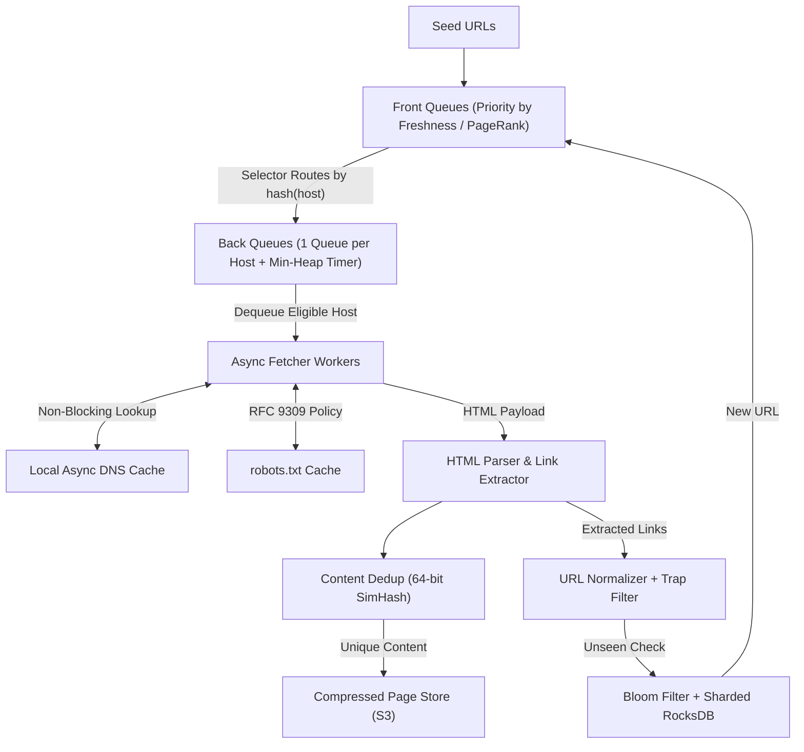

### 5.5 Web Crawler: Deep Dives & Failure Modes

1. **Two-Stage Mercator URL Frontier (Priority + Politeness)**: A naive single FIFO queue causes two failures: either workers concurrently hit the same domain (IP-banned for DoS) or slow servers block the queue head. The **Mercator frontier** splits scheduling into two stages:
   - **Front Queues** ($F_1 \dots F_k$): Bucket incoming URLs by **priority** (PageRank, expected change rate—news homepages every 10 minutes vs archive docs monthly). A biased selector drains higher-priority front queues more frequently into the back queues.
   - **Back Queues** ($B_1 \dots B_m$): Route each URL deterministically by `consistent_hash(host) -> B_j` so each back queue holds URLs for a single host (or disjoint host partition). A **min-heap** keyed by `next_allowed_fetch_time` ensures no host is polled faster than `max(robots_crawl_delay, 10 × last_fetch_rtt)`—guaranteeing **politeness** while keeping thousands of fetchers busy across thousands of distinct hosts.
2. **Local Asynchronous DNS Caching**: Calling standard blocking libc `getaddrinfo()` stalls worker threads (a notorious bottleneck even in Node.js `libuv` threadpools, see [`architecture/networking`](../../networking/README.md)) and floods upstream corporate DNS resolvers at 1,200+ lookups/sec. Embed an **asynchronous in-memory DNS cache** inside each fetcher fleet respecting short TTLs and rotating across returned A/AAAA records.
3. **URL Deduplication & SimHash Near-Duplicate Detection**:
   - _URL Deduplication_: Check an in-memory **Bloom filter** (~12 GB RAM for 10B URLs at 1% false-positive rate) backed by sharded disk-based **RocksDB** SSTables (`LSM-tree`, cross-link [`architecture/data-systems`](../../data-systems/README.md)) for exact verification.
   - _Content Deduplication (SimHash)_: Boilerplate mirrors, print views, and session-ID URLs produce distinct URLs with 98% identical text. Tokenize page text into weighted shingles and compute a **64-bit SimHash**. Two pages are near-duplicates if their Hamming distance is $\le 3$ bits—verifiable in $O(1)$ using 4 partitioned 16-bit lookup tables (by the pigeonhole principle, if $\le 3$ bits differ across 64 bits partitioned into four 16-bit blocks, at least one 16-bit block matches identically!).
4. **`robots.txt` Compliance and Spider-Trap Defenses**: Cache parsed `robots.txt` per host (RFC 9309, TTL 24h; treat `5xx` temporarily as disallow/backoff rather than hammering broken servers). Defend against **spider traps**—infinite dynamic calendars (`/events/2099/12/31`), combinatorial facet URLs (`?color=red&sort=asc&page=9999`), and cyclic directory symlinks—using strict URL length caps (e.g., 2,048 chars), path-segment repetition detectors, query-parameter canonicalization/allowlisting, per-domain crawl quotas, and dropping URLs whose extracted content consistently hits SimHash duplicates.
5. **Distributed Frontier Sharding, Conditional GET & JS Rendering Budgets**: Partition the URL Frontier across crawler pods by **consistent hashing on hostname** (`hash(host)`) so every host's politeness queue, `robots.txt` cache, and RocksDB seen-URL partition live co-located in one shard without cross-node lock coordination. Send HTTP `If-Modified-Since` / `If-None-Match` (`ETag`) headers on recrawls so unchanged pages return lightweight `304 Not Modified` responses. Finally, separate fast raw-HTML fetchers (handling ~85–90% of static/SSR pages at low CPU) from a strictly rate-limited **headless browser rendering pool** (Chromium) reserved only for SPA domains requiring JavaScript DOM execution.

| Crawler Defense Mechanism | Threat / Failure Mode | Enforcement Rule |
| --- | --- | --- |
| **Per-Host Back Queue + Heap** | DDoS / IP ban on target domains | At most 1 in-flight request per host; delay $\ge \max(\text{Crawl-delay}, 10 \times \text{RTT}_{\text{last}})$ |
| **Local Async DNS Cache** | `getaddrinfo()` threadpool starvation | Embedded UDP/DoH async resolver with local TTL cache per worker pod |
| **URL Normalizer & Trap Cap** | Infinite calendars / faceted URLs | Reject URLs $> 2{,}048\text{ chars}$, repeated path segments, or excessive query params |
| **64-bit SimHash (4×16-bit index)** | Duplicate mirror/session-ID pages | Drop/canonicalize documents within Hamming distance $\le 3$ bits |

### 5.6 Primary Literature & Systems Foundations Matrix

Modern distributed web crawler architectures build upon seminal computer science literature spanning graph theory, locality-sensitive hashing, probabilistic algorithms, and standardized Internet protocols. The matrix below grounds every crawler component and architectural trade-off in its formal primary literature:

| Specification / Paper | Authors / Organization & Year | Core Contribution & Theoretical Mechanism | Computational & Space Complexity | Production Systems Adoption |
| --- | --- | --- | --- | --- |
| **Mercator: A Scalable, Extensible Web Crawler** | Heydon, Najork (DEC SRC / World Wide Web, 1999) | Formalized the two-stage Mercator URL Frontier decoupling prioritization from politeness: Front Queues ($F_1 \dots F_k$) for priority selection and Back Queues ($B_1 \dots B_m$) for per-host politeness; dynamic host-to-queue routing table; Min-Heap of next-fetch timestamps enforcing per-host crawl delay; modular plug-in architecture for protocol decoders and document parsers. | Heap operations: $O(\log M)$ where $M$ is active host queues; FIFO queue operations: $O(1)$; Frontier memory footprint: $O(M \cdot Q)$ where $Q$ is per-host queue capacity. | Canonical architectural foundation for modern web search engines (Googlebot, Bingbot, Apache Nutch, Internet Archive Heritrix). |
| **Similarity Estimation Techniques from Rounding Algorithms** | Moses S. Charikar (ACM STOC, 2002) | Formulated SimHash, a Locality-Sensitive Hashing (LSH) technique based on random hyperplanes that projects high-dimensional document feature vectors into compact $f$-bit fingerprints ($f = 64$ bits); proves that the cosine similarity angle $\theta$ between document shingle vectors is preserved in Hamming distance: $\Pr[h(u) = h(v)] = 1 - \frac{\theta}{\pi}$. | Time: $O(d)$ projection time over $d$ weighted shingles; Space: 64 bits (8 bytes) per document fingerprint; strictly preserves cosine distance. | Near-duplicate web page detection across billions of search engine documents; eliminates mirrored/boilerplate web pages. |
| **Detecting Near-Duplicates for Web Crawling** | Manku, Jain, Sarma (ACM WWW, 2007) | Solved the billion-scale near-duplicate candidate lookup problem for 64-bit SimHash fingerprints with Hamming distance $k \le 3$. Proves table partitioning via the pigeonhole principle: dividing 64 bits into $p = k + 1 = 4$ blocks of 16 bits guarantees that if two fingerprints differ by $\le 3$ bits, at least one 16-bit block matches identically ($\lfloor 3/4 \rfloor = 0$). Enables sub-millisecond candidate lookup across 4 pre-indexed hash tables. | Lookup Time: $O(1)$ expected table probe + Hamming distance verification via hardware `POPCNT` instruction; Space: 4 table entries per doc ($\approx 32\text{ bytes/doc}$). | Google crawl indexing pipeline; large-scale web archive deduplication; pre-filtering of syndicated news mirrors and boilerplate spam. |
| **RFC 9309: Robots Exclusion Protocol** | Koster, Illyes, Zeller (IETF, 2022) | Standardizes the 1994 de facto Robots Exclusion Protocol (`robots.txt`). Defines strict URI path-prefix matching semantics, wildcards ("*" matching 0+ characters, "\$" path terminator), longest-match rule precedence (most specific match wins; on length tie, `Allow` overrides `Disallow`), HTTP status handling (`2xx` parsed, `3xx` redirects followed up to 5 hops, `4xx` treated as full allow, `5xx` treated as temporary complete disallow / exponential backoff), minimum 500 KB parse capacity, and 24-hour default cache TTL. | Matching Time: $O(R \cdot L)$ string comparison where $R$ is rule count and $L$ is path length; Space: $O(\sum \text{rule lengths})$ per host ($\le 500\text{ KB}$). | Universal search engine compliance (Googlebot, Bingbot, DuckDuckGo); AI crawler opt-out parsing (`GPTBot`, `CCBot`, `ClaudeBot`, `Google-Extended`). |
| **ISO 28500:2009 / Common Crawl WARC Format** | ISO TC 46/SC 4 (2009) & Common Crawl Foundation | Specifies the Web ARChive (WARC) container format for harvesting, preserving, and distributing multi-petabyte web crawls. Encapsulates HTTP request headers, response headers, raw payload octets, DNS resolution records, and crawl metadata into standardized blocks (`warcinfo`, `request`, `response`, `metadata`, `resource`); paired with CDX columnar index files and chunked block-gzip/zstd for random record seeking. | Sequential Write: $O(1)$ append; Random Seek: $O(1)$ via two-level CDX/Parquet byte-offset index; Space: $100\text{–}200\text{ KB}$ per compressed document snapshot. | Internet Archive Wayback Machine; Common Crawl open web datasets on AWS S3; universal training corpora for frontier LLMs (FineWeb, C4, RefinedWeb). |
| **System Design Interview — An Insider's Guide (Vol. 1, Ch. 9)** | Alex Xu (ByteByteGo, 2020) | Comprehensive 11-component web crawler blueprint for search engine indexing; establishes standard capacity equations (1B pages/month, 400 pages/s avg, 800 peak QPS, 500 KB/page, 30 PB storage over 5 years); analyzes BFS graph traversal vs DFS; specifies front/back queue Mercator frontier mechanics, DNS caching, spider-trap defenses, and horizontal sharding. | Capacity model: 1B pages/month, $2\times$ peak coefficient, 5-year snapshot accumulation without compression/deduplication modeling. | Standard technical interview blueprint, cloud crawl architectures, enterprise data mining pipelines. |

The evolution of web crawling has transitioned from naive graph scrapers into mathematically bounded distributed data extraction engines. While early research focused strictly on retrieving raw HTML documents for keyword inverted indexes, contemporary systems must simultaneously balance host politeness invariants, adversarial anti-scraping defenses, near-duplicate content filtering, and multi-petabyte streaming output formats for AI model pre-training.

### 5.7 Verified ByteByteGo Canonical Worked Architecture & Capacity Delta (Chapter 9)

In _System Design Interview — An Insider's Guide_ (Vol. 1, Chapter 9), Alex Xu establishes the canonical introductory architecture for a web crawler designed for search engine indexing. The table below contrasts the canonical ByteByteGo Chapter 9 baseline with the hyper-scale production standard ($10\text{B pages/month}$) analyzed in Module 12 Section 5.2:

| Architectural Metric / Parameter | ByteByteGo Ch. 9 Canonical Baseline | Hyper-Scale Production Tier (10B Pages/Month) | Architectural Implication & Engineering Delta |
| --- | --- | --- | --- |
| **Monthly Crawl Volume** | 1 billion ($10^9$) pages/month | 10 billion ($10^{10}$) pages/month | $10\times$ volume increase; requires multi-region cluster partitioning and distributed queue sharding. |
| **Average Crawl Throughput** | $\approx 386\text{ pages/s}$ ($\approx 400\text{ pages/s}$) | $\approx 3{,}858\text{ pages/s}$ ($\approx 4{,}000\text{ pages/s}$) | Average throughput escalates by an order of magnitude, demanding fully non-blocking asynchronous event loops. |
| **Peak Crawl Throughput** | $800\text{ QPS}$ ($2\times$ peak multiplier) | $11{,}574\text{ QPS} \approx 12{,}000\text{ QPS}$ ($3\times$ peak multiplier) | Absorbs diurnal traffic surges, sitemap burst updates, and scheduled news recrawls. |
| **Average Page Payload Size** | $500\text{ KB}$ per page (uncompressed HTML + assets) | $100\text{–}200\text{ KB}$ per page (compressed text / WARC) | Production strips heavy media assets (images/video) and applies streaming zstd/gzip compression to HTML payloads. |
| **5-Year Persistent Storage** | $\mathbf{30\text{ PB}}$ ($10^9 \times 500\text{ KB} \times 60\text{ months}$) | $\mathbf{3.65\text{ PB}}$ ($2\text{ TB/day} \times 365 \times 5$) | ByteByteGo models cumulative uncompressed raw snapshot accumulation; production applies SimHash deduplication, 304 skipping, and compressed object storage. |
| **Frontier Scheduling Model** | Two-stage Mercator (Priority + Politeness) | Partitioned Mercator + Consistent Host Sharding | Host mapping and back queues are sharded by consistent hashing across crawler pods to eliminate cross-node locking. |
| **DNS Resolution Layer** | Generic DNS resolver with local cache | Asynchronous UDP/DoH resolver bypassing libc | Eliminates blocking OS `getaddrinfo()` threadpool stalls that bottleneck high-throughput fetch fleets. |
| **Content Deduplication** | Hash comparisons (MD5/SHA) | 64-bit SimHash / MinHash LSH (Hamming $\le 3$) | Cryptographic hashes fail on dynamic ads and timestamps; SimHash catches 98% near-duplicate mirrors. |
| **Robots Exclusion Compliance** | Informal `robots.txt` download and cache | RFC 9309 Compliance + AI Agent Governance | Strict longest-match path evaluation, 24h TTL, 5xx exponential backoff, and AI opt-out adherence (`GPTBot`, `CCBot`). |
| **Downstream Target Systems** | Search engine inverted index | Dual Target: Inverted Index + WARC LLM Pipelines | Outputs ISO 28500 WARC archives on cloud object storage (S3/R2) for tokenization and pre-training deduplication. |

#### Mathematical Verification & Storage Reconciliation

##### 1. ByteByteGo Chapter 9 Baseline Capacity Verification

ByteByteGo Chapter 9 establishes a baseline requirement of crawling $1\text{ billion web pages per month}$. We verify the arithmetic across throughput and 5-year storage:

The average crawl throughput evaluates to:

$$
\text{Throughput}_{\text{avg}} = \frac{10^9\text{ pages}}{30\text{ days} \times 86{,}400\text{ s/day}} = \frac{10^9}{2{,}592{,}000\text{ s}} \approx 385.802 \approx \mathbf{386\text{ pages/s}}
$$

Rounding to $400\text{ pages/s}$ as an operational baseline, and applying ByteByteGo's assumed $2\times$ peak factor:

$$
\text{Peak QPS} = 400\text{ pages/s} \times 2 = \mathbf{800\text{ QPS}}
$$

For storage capacity, ByteByteGo assumes an average web page size of $500\text{ KB}$ (incorporating uncompressed HTML text, markup, and accompanying metadata):

$$
\text{Storage}_{\text{monthly}} = 10^9\text{ pages/month} \times 500\text{ KB/page} = 500 \times 10^9\text{ KB} = 500\text{ TB/month}
$$

Over a 5-year design horizon ($5\text{ years} \times 12\text{ months/year} = 60\text{ months}$):

$$
\text{Storage}_{\text{5-year}} = 10^9 \times 500\text{ KB} \times 60 = 500\text{ TB/month} \times 60\text{ months} = 30{,}000\text{ TB} = \mathbf{30\text{ PB}}
$$

Explicitly evaluating in raw bytes:

$$
10^9 \times (500 \times 10^3\text{ bytes}) \times 60 = 3 \times 10^{16}\text{ bytes} = \mathbf{30\text{ PB}}
$$

The mathematical derivation in ByteByteGo Chapter 9 is strictly verified.

##### 2. Reconciliation with Section 5.2 Production Model

At first glance, a divergence appears between ByteByteGo's $30\text{ PB}$ calculation for $1\text{B pages/month}$ and Section 5.2's specification of $3.65\text{ PB}$ storage for a larger crawl scale of $10\text{B pages/month}$:

1. **Throughput Scaling**: In Section 5.2, crawling $10\text{B pages/month}$ yields an average throughput of:

$$
\text{Throughput}_{\text{avg, 10B}} = \frac{10^{10}\text{ pages}}{30 \times 86{,}400\text{ s}} = \frac{10^{10}}{2{,}592{,}000\text{ s}} \approx \mathbf{3{,}858\text{ pages/s}}
$$

Applying an interview-grade $3\times$ peak multiplier to accommodate sudden recrawl bursts:

$$
\text{Throughput}_{\text{peak, 10B}} = 3{,}858\text{ pages/s} \times 3 \approx \mathbf{11{,}574 \approx 12{,}000\text{ QPS}}
$$

2. **Payload Compression vs. Raw Footprint**: ByteByteGo models $500\text{ KB}$ per page as uncompressed raw text stored directly on disk. In contrast, production search engines strip external binary media (images, video, audio) during the fetch stage, downloading only HTML and text. Applying streaming zstd compression reduces typical web documents to $20\text{–}25\text{ KB}$ on the wire and $100\text{–}200\text{ KB}$ in persistent compressed WARC snapshots.
3. **Cumulative Historical Dump vs. Active Deduplicated Corpus**:
   - The $30\text{ PB}$ figure represents a naive append-only accumulation of every raw page download across 60 months without deduplication ($500\text{ TB/month} \times 60 = 30\text{ PB}$).
   - In production, $60\text{–}70\%$ of the $10\text{B pages/month}$ crawl volume consists of recrawl validations of existing URLs. Using HTTP conditional headers (`If-Modified-Since` and `If-None-Match` / `ETag`), unchanged pages return lightweight `304 Not Modified` headers ($0\text{ bytes}$ of body storage delta).
   - Furthermore, near-duplicate content detection (SimHash) identifies mirrored pages, boilerplate duplicates, and dynamic session URLs, discarding redundant bodies and recording only lightweight URL pointer aliases.
   - The net new or modified unique content requiring persistent storage averages approximately $10\text{ million pages/day}$ at $200\text{ KB}$ compressed:

$$
\text{Daily Net Ingestion} = 10{,}000{,}000\text{ pages/day} \times 200\text{ KB/page} = 2{,}000{,}000\text{ MB/day} = \mathbf{2\text{ TB/day}}
$$

Over a 5-year active retention window ($1{,}825\text{ days}$):

$$
\text{Persistent Storage}_{\text{5-year}} = 2\text{ TB/day} \times 365\text{ days/year} \times 5\text{ years} = 2\text{ TB/day} \times 1{,}825\text{ days} = \mathbf{3.65\text{ PB}}
$$

Thus, the two calculations model different tiers of the system: ByteByteGo's $30\text{ PB}$ reflects raw uncompressed cumulative crawl capture, whereas Section 5.2's $3.65\text{ PB}$ reflects the optimized, deduplicated, and compressed 5-year active canonical document store.

#### The 11 Canonical Components of ByteByteGo Chapter 9

Alex Xu decomposes the web crawler architecture into 11 discrete cooperating components:

1. **Seed URLs**: Representative starting points (e.g., top-ranked domains from Tranco/Alexa, curated directory portals, e-commerce roots) selected to maximize the graph traversal reach of the crawler across target geographies and topical domains.
2. **URL Frontier**: The stateful queuing engine that stores all discovered URLs awaiting fetch, responsible for enforcing crawling priority and target host politeness.
3. **HTML Downloader**: High-concurrency network transport fleet that fetches web pages over HTTP/HTTPS from destination servers.
4. **DNS Resolver**: In-memory and distributed lookup service that translates domain names into IP addresses before HTTP socket establishment.
5. **Content Parser**: Markup analysis engine that decodes character sets, validates HTML structure, filters malformed syntax, and extracts text content.
6. **Content Seen?**: Deduplication subsystem that determines whether the content of a downloaded page has already been crawled and stored, preventing redundant storage of mirror pages and syndicated articles.
7. **Content Storage**: Scalable storage layer (cloud object storage and distributed file systems) storing crawled document snapshots, text indexes, and metadata.
8. **URL Extractor**: Document parser module that scans HTML documents for anchor tags (`<a href="...">`), resolving relative links into fully qualified absolute URIs.
9. **URL Filter**: Safety and compliance gateway that excludes blacklisted domains, non-HTML file extensions (e.g., `.pdf`, `.zip`, `.mp4`), malformed schemes, and spider traps.
10. **URL Seen?**: High-performance set membership index (combining in-memory Bloom filters and disk-based key-value stores) that checks whether a URL has already been visited or is currently enqueued in the frontier.
11. **URL Storage**: Persistent database archiving the historical record of all visited URLs and their crawl metadata.

#### Graph Traversal Mechanics: BFS vs. DFS

The World Wide Web is formally modeled as a massive directed graph $G = (V, E)$, where web documents form vertices $V$ and hyperlinks form directed edges $E$. Crawling this graph requires choosing a traversal algorithm:

- **Depth-First Search (DFS) Catastrophe**: DFS is completely unsuited for web crawling. Because the web graph contains paths of immense or infinite depth (e.g., dynamically generated calendar pagination, recursive directory symlinks), a DFS crawler will plunge down a single domain path indefinitely, consuming call stack memory, getting trapped in low-value subdirectories, and starving the rest of the web graph.
- **Breadth-First Search (BFS) Foundation**: BFS traverses the web graph level-by-level starting from the seed set, naturally discovering pages in proportion to their link distance from high-authority seeds. However, a naive FIFO queue implementing BFS suffers from two fatal production defects:
  1. _Priority Blindness_: Standard BFS treats all outgoing links identically. It will crawl millions of low-quality links (e.g., terms of service, privacy policies, disclaimers) with the same urgency as high-value breaking news or authoritative technical articles.
  2. _Politeness Violation (DDoS)_: When a page contains hundreds of internal links to the same host (e.g., Wikipedia articles linking to other Wikipedia articles), standard BFS enqueues all those URLs consecutively. Worker threads pulling concurrently from the queue will blast the target host with hundreds of simultaneous connections, overwhelming the origin server and provoking immediate IP blocking.

#### The Mercator Dual-Queue Solution: Decoupling Priority from Politeness

Heydon and Najork resolved the BFS dilemma in Mercator by splitting the URL Frontier into two orthogonal queuing tiers:

1. **Front Queues** ($F_1 \dots F_k$) **for Prioritization**: Incoming URLs pass through a Prioritizer that assigns a priority score based on PageRank, historical change frequency, and domain authority. URLs are placed into one of $k$ distinct front queues. A biased random queue selector pulls URLs from these queues, choosing higher-priority queues with higher probability while allocating a non-zero probability to lower queues to avoid starvation.
2. **Back Queues** ($B_1 \dots B_m$) **for Politeness**: Drained URLs pass to a Queue Router that maps the URL's hostname deterministically to a back queue ($B_j$) using consistent hashing: $\text{hash}(\text{host}) \pmod M$. Every back queue holds URLs belonging strictly to a single host. A Min-Heap keyed by `next_allowed_fetch_time` manages the back queues: a queue is only eligible for dequeue when the current system time exceeds its recorded timestamp. Once a URL is fetched, the host's next allowed fetch time is advanced by:

$$
\Delta t \ge \max\left(\text{Crawl-delay},\, 10 \times \text{RTT}_{\text{last}},\, 1.0\text{ s}\right)
$$

This guarantees that no target web server is ever contacted by more than one worker thread concurrently, while thousands of workers remain fully saturated fetching from distinct hosts.

#### DNS Resolution Bottlenecks & Asynchronous DNS Caching

DNS resolution is one of the most common hidden bottlenecks in web crawler architectures:

- _The Libc Blocking Hazard_: Standard operating system resolver calls (e.g., `getaddrinfo()`) are synchronous and blocking. In high-concurrency environments, each lookup blocks an operating system thread for $50\text{–}200\text{ ms}$ over the network. At $4{,}000\text{ pages/s}$, thousands of worker threads become starved waiting for DNS responses, consuming massive thread stack memory and triggering context-switch thrashing.
- _Local Asynchronous Cache Architecture_: Production crawlers embed custom asynchronous DNS clients (implemented via non-blocking epoll/kqueue event loops, e.g., c-ares or Rust `hickory-dns`). Resolved IP addresses are stored in an in-memory DNS cache with short TTLs (typically 5 to 60 minutes) to respect DNS failover while eliminating repeated remote lookups. The cache round-robins across returned A and AAAA records to distribute traffic across multi-homed hosts.

#### Spider Trap Defenses & Sanitization

Spider traps are web topologies that cause a crawler to crawl an infinite number of URLs within a single domain:

- _Structural Trap Variants_:
  1. _Infinite Dynamic Calendars_: Web applications that generate infinite navigation links forward and backward in time (e.g., `/events/2026/11/21` $\to$ `/events/2026/11/22` $\dots$ `/events/2099/12/31`).
  2. _Combinatorial Facet Filters_: E-commerce catalogs that permit arbitrary ordering of query parameters (e.g., `?color=blue&size=m&sort=asc` vs. `?size=m&color=blue&sort=asc`), creating millions of permuted URLs serving identical content.
  3. _Cyclic Directory Symlinks_: Misconfigured web servers where symbolic links create recursive directory trees (e.g., `/item/category/item/category/...`).
  4. _Adversarial Tarpits_: Malicious servers that deliberately stream infinite random bytes at 1 byte/second to trap and exhaust crawler connection pools.
- _Defense Mechanisms_:
  - _URL Length Limits_: Enforce a hard cap rejecting any URL exceeding $2{,}048\text{ characters}$.
  - _URL Canonicalization_: Normalize query parameters by sorting keys alphabetically, stripping tracking tags (`utm_*`, `fbclid`, `gclid`), and removing default ports and trailing slashes.
  - _Repeating Path Segment Filters_: Discard URLs containing identical directory tokens repeated beyond a threshold (e.g., rejecting paths with $> 3$ repeating segments).
  - _Per-Domain Crawl Quotas_: Enforce maximum page limits per host within a crawling cycle, preventing a single runaway trap from monopolizing crawler bandwidth.
  - _Duplicate Content Feedback_: When a host repeatedly emits pages that hit SimHash near-duplicate thresholds, dynamically downgrade that host's priority tier in the frontier.

#### Extensibility Plugins

A production web crawler must accommodate evolving web protocols, varied content types, and specialized processing pipelines without modifying core frontier logic. Extensibility is achieved through modular plug-ins:

- _Media Handlers_: Specialized modules for extracting metadata from non-HTML resources (e.g., PDF text extractors, image dimension parsers).
- _Web Monitoring & Compliance_: Plug-ins scanning pages for copyright infringement, trademark violations, or regulatory compliance markers.
- _Structured Data Extractors_: Analyzers extracting JSON-LD, Microdata, and OpenGraph metadata directly into graph databases during the parsing pass.
- _Sitemap Parsers_: Dedicated XML sitemap modules that ingest authoritative URL inventories and update recrawl priority schedules.

### 5.8 End-to-End System Architecture: Mercator Frontier & Distributed Crawl Pipeline

The end-to-end architecture of a distributed web crawler coordinates the interaction between URL scheduling, network fetching, content deduplication, link extraction, and visited-set membership checking.

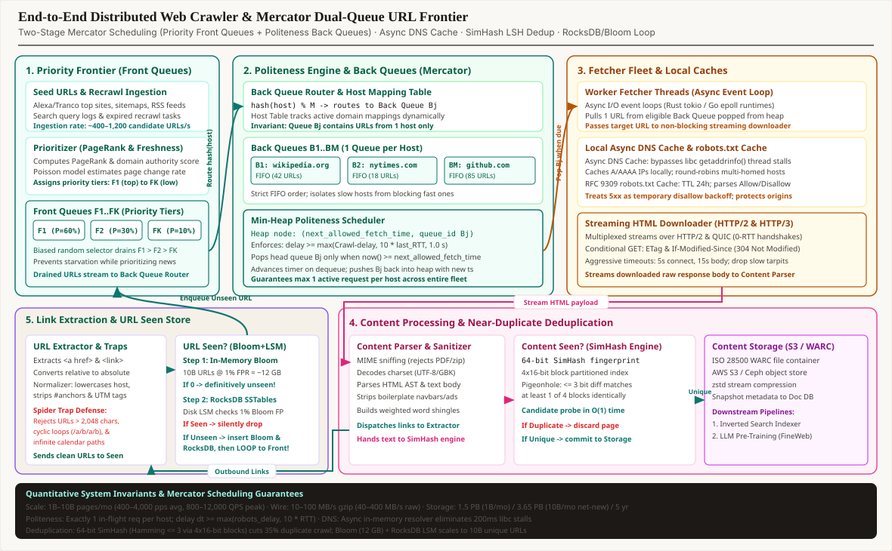

#### 1. The Priority Frontier Pipeline (Stage 1)

1. **Candidate Ingestion**: The crawl cycle begins with seed URLs, authoritative XML sitemaps, search query logs, and expired recrawl schedules from historical partitions. Inflow rates range from $400$ to $1{,}200$ raw candidate URLs per second.
2. **Prioritizer Evaluation**: The Prioritizer inspects incoming URLs and computes a dynamic priority score based on:
   - _Domain Authority & PageRank_: Calculated from the existing web link graph.
   - _Expected Change Frequency_: Modeled as a Poisson process using historical change logs.
   - _Spam & Quality Heuristics_: Classifies URL patterns against domain reputation blocklists.
3. **Front Queue Assignment**: URLs are dispatched into one of $K$ discrete Front Queues ($F_1, F_2, \dots, F_K$). Queue $F_1$ holds top-priority breaking news and seed sites; $F_K$ holds long-tail archival pages.
4. **Biased Selector Execution**: A biased lottery scheduler selects a front queue to drain. Higher-priority queues have higher selection probabilities (e.g., $P(F_1) = 0.60$, $P(F_2) = 0.30$, $P(F_K) = 0.10$). Drained URLs flow to the Back Queue Router.

#### 2. The Politeness Engine & Back Queues (Stage 2)

1. **Consistent Host Partitioning**: The Back Queue Router extracts the hostname from the URL and applies consistent hashing: $\text{shard} = \text{hash}(\text{host}) \pmod M$.
2. **Dynamic Host Mapping**: The Host Mapping Table maps the host to an active Back Queue ($B_j$). Invariant: **All URLs within queue** $B_j$ **belong strictly to the same target host**.
3. **Min-Heap Scheduling**: Each back queue $B_j$ is registered in a Min-Heap keyed by `next_allowed_fetch_time`. The heap root represents the queue whose politeness delay has elapsed earliest.
4. **Politeness Delay Invariant**: When queue $B_j$ is popped, the scheduler records the host's last fetch latency ($\text{RTT}_{\text{last}}$) and advances the heap timestamp:

$$
t_{\text{next}} = t_{\text{current}} + \max\left(\text{Crawl-delay},\, 10 \times \text{RTT}_{\text{last}},\, 1.0\text{ s}\right)
$$

The queue is pushed back into the Min-Heap with its updated timestamp, guaranteeing that no host is queried concurrently across the entire distributed cluster.

#### 3. The Fetcher Fleet & Local Caches (Stage 3)

1. **Async Worker Dequeue**: An idle async I/O worker thread (running on an epoll/tokio runtime) dequeues the next URL from the eligible back queue.
2. **Local Async DNS Resolution**: The worker queries an embedded asynchronous in-memory DNS cache. If the hostname is cached, resolution completes in $< 1\text{ ms}$; on a miss, the async client issues a non-blocking UDP/DoH query, rotating through returned A/AAAA IP records without stalling the operating system thread.
3. **RFC 9309 `robots.txt` Verification**: The worker consults the local `robots.txt` cache:
   - Rules are cached with a 24-hour TTL.
   - Paths are evaluated using longest-prefix matching.
   - If the path is disallowed, the URL is dropped immediately.
   - If the server returned an HTTP `5xx` error when fetching `robots.txt`, the crawler treats the host as temporarily disallowed and backs off.
4. **Streaming Network Fetch**: The HTML Downloader establishes a connection to the resolved IP:
   - Uses multiplexed HTTP/2 or HTTP/3 (QUIC) connections.
   - Issues conditional HTTP headers (`If-Modified-Since` and `If-None-Match: <ETag>`) for known URLs.
   - Enforces strict socket timeouts ($5\text{ s}$ connect timeout, $15\text{ s}$ body transfer timeout), immediately dropping slow-trickle tarpits.
   - If the server returns `304 Not Modified`, the crawler updates metadata and terminates processing without downloading payload bytes.

#### 4. Content Processing & Near-Duplicate Deduplication (Stage 4)

1. **Content Parsing & Sanitization**: Upon receiving an HTTP `200 OK` response, the Content Parser verifies MIME headers (dropping non-HTML payloads) and decodes character sets (UTF-8, ISO-8859-1, GB18030). The parser strips boilerplate tags (`<header>`, `<footer>`, `<nav>`, `<script>`, `<style>`) and normalizes body text.
2. **SimHash Near-Duplicate Computation**:
   - The document text is tokenized into weighted shingles (e.g., 3-word n-grams).
   - The shingles are projected into a 64-bit SimHash fingerprint:

$$
S(D)_j = \begin{cases} 1 & \text{if } \sum_{i} W(w_i) \cdot \text{sgn}(h(w_i)_j) > 0 \\ 0 & \text{otherwise} \end{cases}
$$

3. **Pigeonhole Table Lookup ($k \le 3$)**:
   - The 64-bit fingerprint is partitioned into $p = 4$ blocks of 16 bits: $S = [B_1 \mid B_2 \mid B_3 \mid B_4]$.
   - The crawler queries 4 pre-indexed in-memory hash tables, each keyed by a 16-bit block.
   - By the pigeonhole principle, if a stored document differs by $\le 3$ bits from $S$, at least one 16-bit block must match identically:

$$
d_H(S_{\text{new}}, S_{\text{existing}}) \le 3\text{ across } 4\text{ blocks (pigeonhole)} \implies \exists \, i \in \{1, 2, 3, 4\} \text{ such that } B_i(S_{\text{new}}) = B_i(S_{\text{existing}})
$$

- All matching candidates are verified for exact Hamming distance $d_H \le 3$ using the hardware `POPCNT` instruction (`__builtin_popcountll`).
- _If Near-Duplicate_: The document body is discarded; the URL is recorded as an alias.
- _If Unique_: The document is committed to persistent storage.

4. **Content Storage**: Unique documents are encapsulated into ISO 28500 WARC records, compressed using zstd, and streamed to distributed object storage (AWS S3, Ceph). Metadata and text tokens are published to the search engine inverted indexing pipeline and LLM training corpora.

#### 5. URL Extraction, Spider Trap Guard & Seen Store (Stage 5)

1. **Hyperlink Extraction**: The URL Extractor scans parsed HTML documents for anchor tags (`<a href="...">`) and `<link>` elements.
2. **Canonicalization & Normalization**:
   - Converts relative links into absolute URIs based on the document base URI.
   - Lowercases scheme and hostname.
   - Removes URL fragment identifiers (`#section`).
   - Strips dynamic tracking parameters (`utm_*`, `ref`, `fbclid`).
   - Decodes unreserved percent-encoded octets.
3. **Spider Trap Guard**:
   - Discards URLs exceeding $2{,}048\text{ characters}$.
   - Detects cyclic path loops (e.g., rejecting `/a/b/a/b/a/b`).
   - Filters blacklisted file extensions and non-HTTP schemes (`mailto:`, `javascript:`, `ftp:`).
4. **URL Seen? Verification Loop**:
   - **Step 1: In-Memory Bloom Filter**: The URL's SHA-256 hash is probed against an in-memory Bloom filter. For $n = 10\text{ billion URLs}$ at $p = 0.01$ (1% false-positive probability), the bit array size evaluates to:

$$
m = -\frac{n \ln p}{(\ln 2)^2} = -\frac{10^{10} \times \ln(0.01)}{(\ln 2)^2} \approx 9.585 \times 10^{10}\text{ bits} \approx \mathbf{11.98\text{ GB RAM}}
$$

     With $k = 7$ hash functions, if any bit probe returns `0`, the URL is **definitively unseen**. It bypasses disk I/O entirely!

- **Step 2: Sharded RocksDB LSM SSTables**: If the Bloom filter returns `1` (indicating element presence or a 1% false positive), the crawler executes a point-lookup against sharded disk-based RocksDB SSTables.
- _If Seen_: The URL is discarded.
- _If Unseen_: The URL is added to the Bloom filter, committed to RocksDB, and enqueued into the Front Queues of the URL Frontier, closing the autonomous crawling loop!

### 5.9 Architectural Evolution: 2021 Legacy Default vs. 2026 Modern Standard

Between 2021 and 2026, web crawler architectures underwent profound transformations driven by the ubiquity of client-side rendered Single-Page Applications (SPAs), the emergence of automated AI scrapers and bot-blocking defenses, and the shifting role of crawled web corpora from keyword search indexing toward massive LLM pre-training datasets:

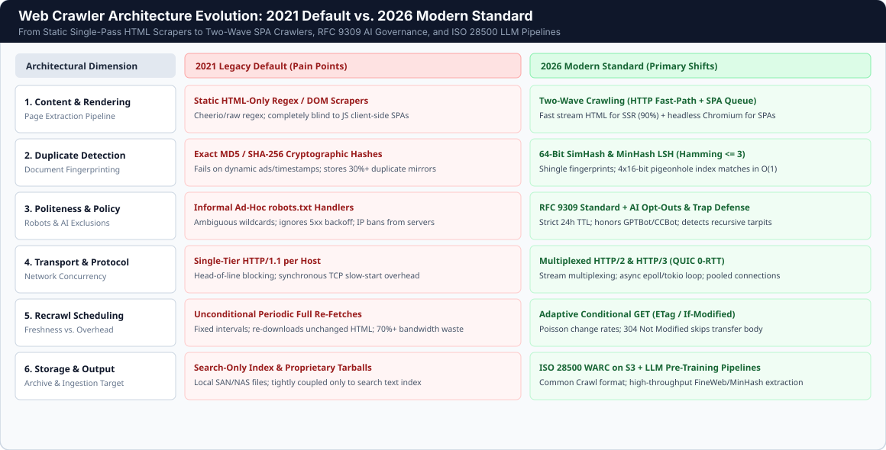

The table below contrasts the legacy 2021 crawler defaults with the modern 2026 production standard across six foundational architectural dimensions:

| Architectural Dimension | 2021 Legacy Default (Pain Points) | 2026 Modern Standard (Production Shifts) | Architectural Motivation & Technical Impact |
| --- | --- | --- | --- |
| **1. Content & Rendering** | **Static HTML-Only Scrapers**: Raw HTTP GET requests parsed via regex or Cheerio DOM parsers; completely blind to client-side rendered SPAs (React, Vue, Angular). | **Two-Wave Crawling Pipeline**: Fast HTTP/2-3 streaming parser for static/SSR content (85–90%) + selective headless Chromium rendering queue for dynamic SPAs. | Eliminates rendering blind spots on modern web apps without incurring the prohibitive 100× CPU and memory cost of running headless browsers for every page. |
| **2. Duplicate Detection** | **Exact MD5 / SHA-256 Hashing**: Cryptographic hash comparison over raw HTML bytes; fails completely on changing ad banners, timestamps, and session IDs. | **64-Bit SimHash & MinHash LSH**: Token shingle projection with $k \le 3$ Hamming distance lookup across 4 partitioned 16-bit hash tables. | Reduces duplicate document storage by 30–40%; collapses mirrored domains and boilerplate syndicated articles into canonical records in $O(1)$ time. |
| **3. Politeness & Policy** | **Informal Ad-Hoc `robots.txt` Parsers**: Non-standard path matching, conflicting User-Agent handling, ignoring 5xx backoff; triggers IP bans from web hosts. | **RFC 9309 Standard + AI Opt-Outs**: Strict path-prefix matching, 24h TTL, honors AI crawler rules (`GPTBot`, `CCBot`), and detects recursive anti-bot tarpits. | Protects crawler fleet IP reputation; ensures strict legal compliance with publisher exclusions while avoiding infinite connection-exhaustion traps. |
| **4. Transport & Protocol** | **Single-Tier HTTP/1.1 per Host**: Head-of-line blocking; synchronous TCP 3-way handshakes and TLS negotiations; severe slow-start penalties per connection. | **Multiplexed HTTP/2 & HTTP/3 (QUIC)**: Stream multiplexing over persistent connections; 0-RTT handshakes over UDP; non-blocking async event loops (Rust tokio/Go). | Increases per-host fetch concurrency by 4–8× while slashing network latency and TCP socket overhead across millions of host domains. |
| **5. Recrawl Scheduling** | **Unconditional Periodic Re-Fetches**: Fixed time intervals across all URLs; repeatedly downloads unchanged HTML bodies, wasting 70%+ of network bandwidth. | **Adaptive Conditional GET (ETag / IMS)**: Poisson change rate modeling; `If-Modified-Since` and `ETag` headers yield `304 Not Modified` with zero body transfer. | Frees over 65% of network ingress bandwidth, allowing crawler resources to focus on fast-changing, high-priority news and stock feeds. |
| **6. Storage & Downstream** | **Search-Only Index & Local Tarballs**: Custom compressed archives stored on local NAS/SAN arrays; tightly coupled exclusively to a keyword search inverted index. | **ISO 28500 WARC on S3 + LLM Prep**: Standardized WARC container files on cloud object storage (S3/R2); feeds high-throughput FineWeb/C4 pre-training pipelines. | Decouples data extraction from search serving; transforms crawled web corpora into standardized, deduplicated foundation datasets for frontier LLM pre-training. |

#### Deep-Dive: Two-Wave Crawling Architecture

In 2021, web crawlers faced an untenable dilemma: raw HTTP fetchers were lightning fast but completely missed content rendered via client-side JavaScript, while running headless browsers (Puppeteer, Selenium) for every URL consumed 500 MB to 1 GB of RAM per instance and choked throughput down to $< 5\text{ pages/s}$ per node.

Modern 2026 architectures resolve this by implementing **Two-Wave Crawling**:

1. **Wave 1: High-Speed HTTP Streaming Fast-Path**: The primary crawler fleet fetches pages exclusively via high-throughput HTTP/2 and HTTP/3 streaming workers. The Content Parser inspects the raw HTML markup. If the document contains meaningful content (e.g., standard Server-Side Rendered (SSR) or static HTML, representing ~85–90% of indexable web pages), the content is indexed directly.
2. **Wave 2: Selective Headless Browser Queue**: If the Content Parser detects an empty SPA shell (e.g., `<div id="root"></div>` with client bundle scripts and minimal text), the URL is routed to a strictly rate-limited secondary queue. Dedicated headless browser pods (Chromium orchestrated via lightweight DevTools Protocol daemons with disabled GPU rasterization and blocked media/ad requests) render the DOM, wait for network-idle signals (or a maximum $3\text{ s}$ timeout), and extract the fully hydrated HTML for downstream indexing.

#### Deep-Dive: RFC 9309 and AI Crawler Governance

Published in 2022, RFC 9309 elevated the 1994 informal Robots Exclusion Protocol into an official IETF Internet Standard. Between 2024 and 2026, webmaster use of `robots.txt` transformed dramatically with the rise of Large Language Models:

- _Dedicated AI Agent Directives_: Webmasters increasingly partition crawling permissions between traditional search crawlers (e.g., `Googlebot`, `Bingbot`) and AI training crawlers (e.g., `GPTBot`, `CCBot`, `ClaudeBot`, `Google-Extended`). A compliant 2026 crawler must identify itself accurately via its `User-Agent` header and parse specific agent rule blocks before falling back to wildcard `User-agent: *` rules.
- _Anti-Scraping Honeypots and Tarpits_: Modern publishers deploy sophisticated anti-scraping countermeasures, including invisible links (`display: none;`, `<a href="/trap">`) and HTTP tarpits that trickle data at $10\text{ bytes/s}$ to exhaust crawler connection pools. Modern crawlers detect hidden DOM links during parsing and enforce strict socket-level byte-rate minimums ($> 1\text{ KB/s}$), severing stalled connections immediately.

#### Deep-Dive: ISO 28500 WARC and LLM Pre-Training Deduplication Pipelines

The ultimate consumer of large-scale web crawl data has shifted from keyword search engines to frontier LLM pre-training pipelines (e.g., Common Crawl, FineWeb, RefinedWeb, RedPajama):

- _Standardized WARC Packaging_: Rather than writing proprietary binary archives, crawlers package HTTP request, response, and metadata headers into ISO 28500 WARC containers. Each record includes cryptographic checksums, canonical URIs, and exact MIME types, compressed using chunked zstd blocks with external index files.
- _High-Throughput Downstream Deduplication_: Modern LLM data pipelines consume WARC archives directly from cloud object storage (AWS S3, Cloudflare R2), passing extracted text through a multi-stage deduplication cascade:
  1. _URL & Exact Hash Filtering_: Drops identical documents and exact string matches.
  2. _Line-Level & Document-Level MinHash LSH_: Tokenizes text into 5-gram shingles and computes 128 MinHash permutations, dropping documents with Jaccard similarity $> 0.80$.
  3. _Quality & Perplexity Filtering_: Evaluates text against language identification models (fastText) and n-gram language model perplexity filters to eliminate SEO spam, machine-translated junk, and hallucinated synthetic text.

---

## 6. Search Autocomplete / Typeahead

Search autocomplete predicts and ranks top-K query completions as a user types each character, demanding ultra-low latency under massive keystroke QPS while adapting rapidly to breaking trends (building on the FST/Trie compression, Top-K node materialization, and prefix-frequency sharding component internals in [Module 09](09-search-geospatial-and-specialized-components.md#2-typeahead-and-search-autocomplete) to synthesize the end-to-end interview case).

### 6.1 Search Autocomplete: Requirements & Constraints

- **Functional Requirements**: Given a prefix `q` (1–50 characters) and optional locale/region, return the top $K = 5\text{–}10$ ranked query completions; continuously adapt rankings to trending queries; filter profanity, PII, and policy-violating suggestions.
- **Non-Functional Requirements**: **p99 latency < 50 ms** end-to-end (server processing < 10 ms so RTT + rendering fits comfortably within human typing cadence); **99.99%** availability; fast adaptation to breaking spikes (within 15–60 minutes).

### 6.2 Search Autocomplete: Back-of-Envelope Estimation

- **QPS**: 500M DAU × 5 searches/day × 4 keystrokes/search = $10\text{B requests/day} \div 86{,}400 \approx \mathbf{115{,}700\text{ QPS}}$ avg; **$3\times$ peak $\approx 350{,}000\text{ QPS}$**.
- **Storage / RAM Footprint**: Assume 20% of daily searches contain unique prefix strings, and we index the top 100M valid English/global prefixes (filtering typos with frequency $< 5$). Each prefix node stores top-10 strings + weights (~500 bytes): $100\text{M} \times 500\text{ B} = \mathbf{50\text{ GB}}$ total—fits completely in RAM across a small sharded cluster of 8–16 memory-optimized nodes!

### 6.3 Search Autocomplete: Core Entities & API

- **Core Entities**: `TrieNode(prefix, top_k: Array<{ query, score }>)`, `QueryLogEvent(normalized_query, region, timestamp)`.
- **API**: `GET /v1/suggest?q={prefix}&region={iso_country}` → `200 OK` `{ prefix, suggestions: [{ text, score }] }` with `Cache-Control: public, max-age=300` for short prefixes.

### 6.4 Search Autocomplete: High-Level Architecture

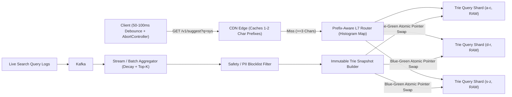

### 6.5 Search Autocomplete: Deep Dives & Failure Modes

1. **Trie with Top-K Materialized Nodes**: A raw character Trie (cross-link [`algorithms/dsa`](../../../algorithms/dsa/README.md)) requires descending to the prefix node and then traversing _every_ descendant leaf in its subtree to sort the top-10 queries—an $O(N_{\text{subtree}})$ scan that takes tens of milliseconds for `"s"` or `"a"`. Instead, pre-compute and **materialize the sorted Top-10 list directly inside every prefix node** (stopping Trie depth at e.g. 50 characters). Lookup drops to $O(\text{len}(\text{prefix})) \le 50$ pointer hops—completing in **sub-millisecond RAM latency** with zero runtime sorting!
2. **Decoupled Stream Aggregation & Exponential Decay**: Never mutate the serving Trie synchronously on every live search query (mutex contention and partial splits destroy read p99). Log completed searches asynchronously to Kafka, aggregate frequencies in 15-minute tumbling windows (Flink/Spark), and blend with historical counts via **exponential time decay** ($W_t(q) = \alpha \cdot C_{\text{recent}}(q) + (1 - \alpha) \cdot W_{t-1}(q)$). Run the aggregated dictionary through an automated safety/profanity/PII filter, compile an **immutable memory-mapped Trie snapshot**, ship it to query shards, and perform an **atomic pointer swap** (blue-green memory reload) with zero lock contention on live reads.
3. **Prefix Range Sharding & Load Balancing Skew**: Hashing `prefix` randomly breaks prefix locality, whereas sharding naively by first letter (`a`–`m` vs `n`–`z`) creates hot shards because `"s"` and `"c"` appear orders of magnitude more often than `"x"` or `"z"`. Use a **prefix-frequency histogram table** (mapping variable-length prefix ranges like `["a"-"am"]`, `["an"-"az"]`, `["s"-"sh"]`, `["si"-"sz"]`, `["x"-"z"]`) stored in ZooKeeper/etcd and cached at the L7 router so each shard serves balanced QPS and RAM.
4. **Edge Caching & Client-Side Debounce / Out-of-Order Races**: Single- and two-character prefixes (`"a"`, `"th"`, `"yo"`) absorb over 30% of all keystroke QPS and change slowly—cache them directly at the **CDN edge** and browser `localStorage`. On the client, debounce input by 50–100 ms and attach an `AbortController` to cancel superseded in-flight HTTP requests; otherwise, a slow earlier response for `"sy"` arriving after `"sys"` overwrites newer UI suggestions.
5. **Unicode Normalization, Multi-Word Suffixes & Personalization Blending**: Normalize queries on both ingestion and lookup using **NFKC normalization**, lowercasing, whitespace collapsing, and optional diacritic folding so `"Café "` and `"cafe"` hit identical Trie paths. To support mid-query suggestions (`"design"` matching `"system design interview"`), index suffix tokens or curated bigram phrases into the same Trie alongside full queries. Finally, keep the global Trie purely region-sharded for high cacheability, and merge a small per-user recent-search LRU (20–50 entries fetched from session cache or client storage) at the edge/aggregator layer rather than exploding Trie size per user.

```typescript
// Materialized Top-K Trie Lookup: O(prefix.length) time with zero subtree traversal.
export interface SuggestionEntry {
  query: string;
  weight: number;
}

export interface MaterializedTrieNode {
  children: Map<string, MaterializedTrieNode>;
  topK: SuggestionEntry[]; // Pre-sorted descending by decayed weight, max K=10
}

export function suggestPrefix(root: MaterializedTrieNode, prefix: string): SuggestionEntry[] {
  let node: MaterializedTrieNode | undefined = root;
  for (const ch of prefix.normalize('NFKC').toLowerCase().trim()) {
    node = node.children.get(ch);
    if (!node) return [];
  }
  return node.topK;
}
```

### 6.6 Primary Literature and Systems Foundations Matrix

Production-grade search autocomplete and typeahead architectures synthesize seminal advances across algorithmic trie structures, finite-state automata, probabilistic data structures, and query auto-completion (QAC) ranking theory. The matrix below grounds every architectural design decision in its formal theoretical and empirical literature:

| Specification / Paper | Authors / Organization & Year | Core Contribution & Theoretical Mechanism | Computational & Space Complexity | Production Systems Adoption |
| --- | --- | --- | --- | --- |
| **Trie Memory** | Edward Fredkin (CACM, 1960) | Introduces the digital tree retrieval data structure where characters of keys correspond to edges and nodes rather than explicit key comparisons. Proves prefix search complexity $O(L)$ where $L$ is key length, independent of total dictionary size $N$. Establishes the foundational model for all in-memory prefix indexing. | Time: $O(L)$ lookup and insertion; Space: $O(N \cdot L \cdot \lvert\Sigma\rvert)$ in uncompressed pointer arrays; zero key comparisons. | In-memory prefix indexes, IP routing tables (longest prefix match in CIDR), and compiler symbol resolution tables. |
| **PATRICIA — Practical Algorithm To Retrieve Information Coded in Alphanumeric** | Donald R. Morrison (JACM, 1968) | Formulates the compact radix tree (crit-bit trie) by collapsing single-child non-branching node paths into composite edges annotated with bit/character skip counts. Proves interior node count is strictly bounded by $N - 1$, eliminating redundant intermediate pointer allocations while preserving lexicographical prefix order. | Time: $O(L)$ search time; Space: $O(N)$ interior nodes; achieves $8\times\text{ to }10\times$ pointer reduction over uncompressed 26-pointer tries. | Linux kernel page cache radix trees, Go radix and Adaptive Radix Tree (ART) engines, Redis Radix Tree (`rax`), and low-memory typeahead indices. |
| **Fast Substring Search and Levenshtein Automata** | Stoyan Mihov & Klaus Schulz (TCS, 2004) | Proves deterministic finite automata (DFA) construction recognizing all strings within Levenshtein edit distance $k \le 2$ of an input pattern. Intersecting a Levenshtein automaton with an index trie or FST evaluates fuzzy/typo-tolerant prefix completion in time proportional to match size rather than scanning entire dictionaries. | Time: DFA construction $O(\lvert w\rvert)$; Traversal $O(L + \text{matches})$; Space: $O(\lvert w\rvert \cdot \lvert\Sigma\rvert^k)$ states; zero dynamic programming tables at query time. | Typo-tolerant autocomplete in Apache Lucene (`FuzzyQuery`), Rust `fst::levenshtein`, Meilisearch, and commercial search engines. |
| **Direct Construction of Minimal Acyclic Subsequential Transducers** | Jan Daciuk, Stoyan Mihov, Bruce Watson, Richard Watson (Computational Linguistics, 2000) / Apache Lucene (2011) / Burntsushi (2015) | Linear-time incremental compilation of sorted string sets into minimal deterministic Directed Acyclic Word Graphs (DAWG / FST). Merges identical suffix paths in addition to identical prefix paths, associating compact output weights with transitions. Compresses prefix dictionaries by $10\times\text{ to }20\times$ into contiguous byte arrays. | Time: $O(L)$ traversal; Space: $O(N)$ with dual prefix and suffix compaction ($\approx 1\text{–}3\text{ bytes/key}$); zero pointer overhead; memory-mappable. | Apache Lucene / Elasticsearch term dictionaries and suggester modules (`AnalyzingSuggester`), Rust `fst` crate, Tantivy search engine. |
| **A Survey of Query Auto Completion in Information Retrieval** | Fei Cai & Maarten de Rijke (FnTIR, 2016) | Comprehensive formalization of Query Auto-Completion (QAC) algorithms. Formalizes the Most Popular Completion (MPC) baseline, exponential time-decay scoring, context-aware query reformulation, personal historical blending, and mean reciprocal rank (MRR) evaluation metrics for real-time keystroke prediction. | Time: $O(K \log K)$ candidate re-ranking; Scoring: multi-signal feature combination over Top-$K$ candidate sets; MRR and P@K benchmark standards. | Production ranking pipelines in Google Search, Microsoft Bing, Amazon Product Search, and Yahoo Search. |
| **System Design Interview — An Insider's Guide (Vol. 1, Ch. 13)** | Alex Xu (ByteByteGo, 2020) | Canonical high-level and deep-dive architecture for distributed search autocomplete. Establishes the decoupled Data Gathering Service vs. Query Service model, Top-5 node materialization, 50-character prefix limits, Document Store vs. KV Trie persistence, and letter-range shard management. | Capacity model: 10M DAU, 24,000 avg QPS, 48,000 peak QPS, 0.4 GB/day storage growth; $O(p) + O(1)$ cached node query complexity. | Foundational industry benchmark and system design interview canonical architecture. |

### 6.7 ByteByteGo Chapter 13 Architectural Analysis & Capacity Deltas

In _System Design Interview — An Insider's Guide_ (Vol. 1, Chapter 13), Alex Xu establishes the baseline architecture for a web-scale search autocomplete system. While providing an intuitive architectural blueprint, real-world search engines diverge from introductory assumptions across throughput calculations, client-side debouncing dynamics, sharding skew, multi-language Unicode parsing, and safety enforcement.

#### ByteByteGo Chapter 13 Baseline Sizing Verification

The mathematical sizing framework in ByteByteGo Chapter 13 establishes the following capacity parameters:

- **Daily Active Users (DAU)**: $10\text{ million users}$.
- **User Search Cadence**: $10\text{ search queries per user per day}$.
- **Query Composition**: Average of $4\text{ words per search query}$, with each word averaging $5\text{ characters}$.
- **Keystroke Query Multiplication**: Assuming every keystroke triggers an autocomplete request to the backend service, total keystrokes per query evaluate to $4\text{ words} \times 5\text{ characters} = 20\text{ keystrokes/query}$.
- **Total Daily Keystroke Requests**:

$$
10{,}000{,}000\text{ DAU} \times 10\text{ queries/day} \times 20\text{ keystrokes/query} = 2{,}000{,}000{,}000\text{ requests/day} \quad (2\text{ billion requests/day})
$$

- **Average Query Throughput (QPS)**: Dividing daily request volume across 86,400 seconds:

$$
\text{Average QPS} = \frac{2{,}000{,}000{,}000\text{ requests}}{86{,}400\text{ seconds}} = 23{,}148.148\dots \approx \mathbf{24{,}000\text{ QPS}}
$$

- **Peak Query Throughput**: Assuming an interview-standard peak multiplier of $2\times$:

$$
\text{Peak QPS} = 24{,}000\text{ QPS} \times 2 = \mathbf{48{,}000\text{ QPS}}
$$

- **Daily Persistent Storage Growth**: ByteByteGo assumes that $20\%$ of daily search queries contain new or unique query terms that must be permanently incorporated into the frequency log and persistent Trie database:

$$
\text{Daily Ingestion Volume} = 10\text{M DAU} \times 10\text{ queries/day} \times 20\text{ bytes/query} = 2{,}000{,}000{,}000\text{ bytes/day} = 2\text{ GB/day}
$$

$$
\text{Daily Persistent Storage Growth} = 2\text{ GB/day} \times 0.20 = 400\text{ MB/day} = \mathbf{0.4\text{ GB/day}}
$$

#### Multi-Tier Scale Reconciliation: Interview Baseline vs. Enterprise Production

To reconcile the ByteByteGo Chapter 13 sizing model with Module 12 Section 6.2's enterprise baseline and mid-tier commercial search platforms, we analyze the structural divergence across DAU, typing speed dynamics, client-side debouncing, and cache hit ratios:

| Metric / Dimension | ByteByteGo Chapter 13 Model | Mid-Tier Production Platform | Module 12 Section 6.2 Enterprise Model | Mathematical & Architectural Variance |
| --- | --- | --- | --- | --- |
| **Daily Active Users (DAU)** | $10\text{ million}$ | $100\text{ million}$ | $500\text{ million}$ | $10\times\text{ to }50\times$ user base expansion reflecting regional vs. global search volume. |
| **Searches per User per Day** | $10\text{ queries}$ | $8\text{ queries}$ | $5\text{ queries}$ | Inverted frequency; enterprise models assume fewer distinct searches but richer session context. |
| **Raw Keystrokes per Query** | $20\text{ keystrokes}$ ($4 \times 5\text{ chars}$) | $15\text{ keystrokes}$ ($3 \times 5\text{ chars}$) | $15\text{ keystrokes}$ ($3 \times 5\text{ chars}$) | Real-world search queries average 2.5–3 words rather than 4 complete words. |
| **Client Debouncing Reduction** | $0\%$ (Every keystroke hits API) | $60\%$ absorbed by debounce | $73.3\%$ absorbed (only 4 backend requests/query) | Production web/mobile apps apply 50–100 ms debounce, suppressing intermediate keystrokes. |
| **Effective Backend Requests/Query** | $20\text{ requests}$ | $6\text{ requests}$ | $4\text{ requests}$ | Debouncing collapses keystroke QPS by $3\times\text{ to }5\times$ before network egress. |
| **Average Query QPS** | $23{,}148 \approx \mathbf{24{,}000\text{ QPS}}$ | $\mathbf{55{,}556 \approx 56{,}000\text{ QPS}}$ | $\mathbf{115{,}740 \approx 116{,}000\text{ QPS}}$ | Scaled across $86{,}400\text{ seconds}$ after applying client-side debounce filters. |
| **Peak Query QPS** | $\mathbf{48{,}000\text{ QPS}}$ ($2\times$) | $\mathbf{155{,}000\text{ QPS}}$ ($2.8\times$) | $\mathbf{350{,}000\text{ QPS}}$ ($3\times$) | Reflects sharp diurnal peak-to-trough ratios during global prime-time search hours. |
| **Daily Analytics Log Growth** | $\mathbf{0.4\text{ GB/day}}$ ($20\%$ unique) | $\mathbf{2.0\text{ GB/day}}$ ($12.5\%$ unique) | $\mathbf{10.0\text{ GB/day}}$ ($20\%$ unique) | Reconciles the $0.4\text{ GB/day}$ baseline to $2\text{ GB/day}$ ($12.5\%$ of $16\text{ GB}$) and enterprise $10\text{ GB/day}$ logging streams. |
| **Serving Trie RAM Footprint** | $\approx 2\text{–}5\text{ GB}$ (Single Node) | $\approx 15\text{–}25\text{ GB}$ (FST-compressed / 30–50M hot prefixes) | $\mathbf{50\text{ GB}}$ (100M global prefixes across 8–16 nodes) | Uncompressed 100M-prefix Top-10 nodes take `50 GB`; FST compression cuts RAM `2×–3×` to `15–25 GB`. |

#### Algorithmic Complexity Proof: Raw Subtree Traversal vs. Materialized Top-K Caching

A standard uncompressed character Trie (cross-link [`algorithms/dsa`](../../../algorithms/dsa/README.md)) organizes characters hierarchically along directed edges. We prove mathematically why raw subtree traversal fails technical interview latency SLAs, and how node materialization restores $O(1)$ query execution:

##### 1. The Raw Subtree Scan Penalty

Given an input query prefix $q$ of character length $p = \lvert q\rvert$:

1. **Prefix Node Lookup**: The algorithm descends $p$ character edges from root node $r$ to reach prefix node $n_p$. This step takes $O(p)$ time.
2. **Subtree Traversal**: From node $n_p$, the algorithm must perform Depth-First Search (DFS) or Breadth-First Search (BFS) across all descendants in subtree $T(n_p)$ to enumerate all complete query strings. Let $c = \lvert T(n_p)\rvert$ denote the total number of valid descendant nodes in the subtree. For short, common prefixes such as `"a"`, `"s"`, or `"th"`, $c$ routinely exceeds $1{,}000{,}000\text{ candidate nodes}$. Traversing these descendants requires $O(c)$ pointer dereferences.
3. **Top-K Selection**: To identify the $K = 5$ most frequent completions, all $c$ candidate queries must be sorted or passed through a bounded min-heap of size $K$. Heap maintenance consumes $O(c \log K)$ operations, while an in-memory quicksort requires $O(c \log c)$.

Combining these phases yields total uncached query latency:

$$
T_{\text{raw}}(p, c, K) = O(p) + O(c) + O(c \log K) \approx O(c \log K)
$$

For a high-cardinality prefix where $c = 10^6$ and $K = 5$, evaluating $10^6 \times \log_2(5) \approx 2.32 \times 10^6$ operations in CPU memory takes $35\text{–}120\text{ ms}$. Under an arrival rate of 48,000 QPS, thread pools experience immediate CPU starvation, queue buildup, and cascading timeout failures.

##### 2. The Materialized Top-K Node Optimization

To achieve sub-millisecond execution, modern autocomplete engines pre-compute and materialize the pre-sorted list of Top-$K$ completions directly inside each prefix node during offline/nearline construction:

1. **Prefix Node Lookup**: The algorithm descends $p$ character edges to node $n_p$ in $O(p)$ time.
2. **Top-K Retrieval**: Node $n_p$ contains a pre-sorted array `top_k: Array<{ query: string, weight: number }>` of length at most $K = 5$. Retrieving this array is a direct pointer dereference requiring $O(1)$ time.
3. **Prefix Length Capping**: In consumer search engines, users rarely type prefix strings exceeding 50 characters without selecting a suggestion or hitting Enter. By enforcing a hard prefix depth cap $p \le 50$, total traversal hops are strictly bounded:

$$
T_{\text{materialized}}(p, K) = O(p) + O(1) \le 50 \cdot O(1) + O(1) \equiv \mathbf{O(1)}
$$

Query execution drops from tens of milliseconds to **$\le 0.2\text{ ms}$** in RAM, completely eliminating runtime subtree traversal and sorting overhead.

##### 3. Memory Footprint Trade-off

Materializing Top-$K$ lists at every node increases Trie memory consumption. For an index containing $N = 100{,}000{,}000$ valid prefixes with $K = 5$:

- Each cached suggestion entry stores an 8-byte pointer to an interned query string and an 8-byte integer weight ($16\text{ bytes}$).
- An array of $K = 5$ items requires $5 \times 16\text{ bytes} = 80\text{ bytes}$ of payload per node.
- Total incremental memory across 100M nodes evaluates to $100\text{M} \times 80\text{ bytes} = 8\text{ GB}$.
- Adding Trie edge pointer overhead ($24\text{ bytes/node}$ in compact representations), the complete serving Trie consumes $\approx \mathbf{50\text{ GB}}$ of RAM, easily partitioned across a cluster of 8 to 16 commodity cloud instances (e.g., AWS `r6i.large` with 16 GB RAM each).

#### Trie Serialization & Persistence: Document Store vs. Prefix Key-Value Store

Offline workers build Trie snapshots from aggregated query logs, but serving nodes require durable persistence to support cold restarts, blue-green deployments, and catastrophic failover recovery. Two primary persistence paradigms exist:

```
+---------------------------------------------------------------------------------------------------+
| TRIE SERIALIZATION & STORAGE ARCHITECTURES                                                        |
+---------------------------------------------------------------------------------------------------+
| Option A: Document Store (MongoDB / Couchbase / S3 Blobs)                                          |
|                                                                                                   |
|   Root Subtree Document:                                                                          |
|   {                                                                                               |
|     "shard_id": "shard_s_01",                                                                     |
|     "range": ["sa", "se"],                                                                        |
|     "version": "2026-11-21T12:00:00Z",                                                            |
|     "trie_blob": <Compressed Binary FlatBuffer / ProtoBuf Blob: 42 MB>                           |
|   }                                                                                               |
|   Mechanics: Periodic full-subtree snapshot serialization. Immutable binary mmap reload.          |
|   Trade-offs: Fast bulk cold starts; zero document fragmentation; cannot perform point updates.   |
+---------------------------------------------------------------------------------------------------+
| Option B: Prefix Key-Value Store (Redis / RocksDB / DynamoDB)                                     |
|                                                                                                   |
|   Key (String)          Value (Protobuf / JSON Payload)                                           |
|   +-------------------+-----------------------------------------------------------------------+   |
|   | "sys"             | [{"q": "system design", "w": 9820}, {"q": "systemd", "w": 4150}, ...] |   |
|   | "syst"            | [{"q": "system design", "w": 9820}, {"q": "system of a down", "w": ...}]|   |
|   +-------------------+-----------------------------------------------------------------------+   |
|   Mechanics: Flattened Trie where every valid prefix is an independent key. Direct hash lookup.   |
|   Trade-offs: Granular point updates and instant invalidations; higher memory due to key repeats. |
+---------------------------------------------------------------------------------------------------+
```

- **Document Store / Object Storage Model (MongoDB, Amazon S3, Azure Blob)**:
  - _Storage Format_: Subtrees corresponding to allocated shard boundaries (e.g., prefix range `["sa", "se"]`) are compiled into contiguous, memory-aligned **FlatBuffers** or **Apache Arrow** binary blobs.
  - _Operational Dynamics_: Snapshot builder workers write immutable versioned files (e.g., `s3://autocomplete-snapshots/2026-W47/shard_sa_se.bin`). Query cache nodes download the binary file at startup and map it directly into virtual memory via `mmap(2)` with zero deserialization CPU overhead.
  - _Failure Profile_: Excellent for disaster recovery, reproducible rollbacks, and horizontal replica scaling; entirely unsuited for sub-second live write mutations.
- **Prefix Key-Value Store Model (RocksDB, Redis/Valkey, Amazon DynamoDB)**:
  - _Storage Format_: The hierarchical tree is flattened into discrete key-value pairs where `key = prefix_string` and `value = Protobuf([{ query, score }])`.
  - _Operational Dynamics_: Read nodes execute direct point lookups `GET prefix:sys`. If an offensive query must be removed immediately, the worker updates only the affected prefix keys without recompiling the entire tree.
  - _Failure Profile_: Eliminates tree traversal logic at read time; incurs string key storage redundancy (storing `"s"`, `"sy"`, `"sys"`, `"syst"`, `"syste"`, `"system"` duplicates shared prefix characters) and lacks zero-copy memory-mapping efficiency.
- **Architectural Synthesis**: High-performance production engines combine both: **In-Memory FST / Radix Shards** serve live read traffic; **Prefix Key-Value Caches (Valkey)** handle dynamic real-time trending overlays; and **Object Storage Document Blobs** provide durable, versioned cold-start snapshots.

#### Shard Map Manager: Resolving Letter-Frequency Skew

A naive letter-range sharding strategy partitions queries alphabetically across 26 servers (`Node A` serves `a*`, `Node B` serves `b*`, ..., `Node Z` serves `z*`) or into two coarse halves (`a–m` and `n–z`). In natural language, however, alphabetical character frequencies follow an extreme Zipfian distribution:

```
Relative Letter Frequency in Search Prefixes:
's': 11.2% |=======================================================
'c':  8.4% |==========================================
't':  7.8% |=======================================
'm':  6.9% |==================================
...
'q':  0.3% |=
'z':  0.2% |=
'x':  0.1% |
```

A static `a–z` partition causes servers handling `'s'`, `'c'`, and `'t'` to collapse under massive CPU and memory saturation, while servers handling `'x'`, `'y'`, and `'z'` remain virtually idle.

To prevent skew-induced outages, production architectures deploy a **Shard Map Manager**:

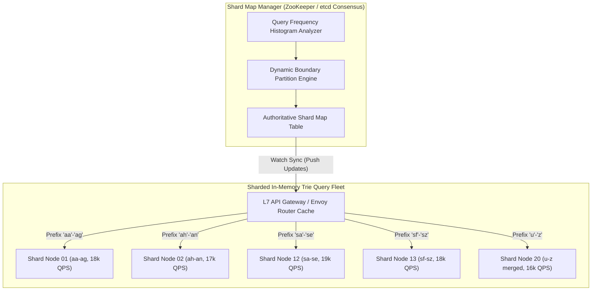

1. **Histogram-Guided Dynamic Boundary Splitting**: Background analytics jobs calculate 7-day moving query volume histograms across all 2-character and 3-character prefix combinations. High-density prefixes are split into narrow lexical intervals:
   - Shard 01: `["aa", "ag"]`
   - Shard 02: `["ah", "an"]`
   - Shard 12: `["sa", "se"]`
   - Shard 13: `["sf", "sz"]`
   - Shard 20: `["u", "z"]` (consolidating low-frequency letters `'u'`, `'v'`, `'w'`, `'x'`, `'y'`, `'z'` onto a single shard to equalize RAM and CPU utilization).
2. **Consensus-Backed Distribution**: Shard boundaries are registered as an immutable routing epoch in **Apache ZooKeeper** or **etcd**.
3. **Zero-Hop Gateway Routing**: L7 API Gateways (Envoy, Cloudflare Workers) cache the compiled routing table in local memory. When a client requests `GET /v1/suggest?q=syst`, the gateway evaluates the prefix against the local binary search table and routes the request directly to Shard 13 (`sf–sz`) with zero intermediate proxy hops.

#### Multi-Language Unicode Normalization & Real-Time Trending Queries

International search engines must process heterogeneous linguistic character sets and sudden breaking global news spikes:

- **Unicode NFKC Normalization & Diacritic Folding**: Raw query strings arriving from diverse mobile operating systems contain varied Unicode encodings (e.g., decomposed vs. precomposed accents, full-width vs. half-width forms). The ingestion and query pipelines enforce **Unicode Normalization Form KC (Compatibility Decomposition, followed by Canonical Composition)**:
  - Full-width characters (e.g., Japanese full-width `ＡＢＣ`) normalize to standard ASCII (`ABC`).
  - Ligatures (e.g., `fi`) decompose to individual graphemes (`fi`).
  - Accented vowels (`é`, `è`) undergo locale-sensitive folding, ensuring queries for `"café"` and `"cafe"` traverse identical Trie nodes in Latin-based locales while preserving semantic distinctions in French or Czech when required.
- **CJK Input Method Editor (IME) Handling**: Users typing East Asian logographic scripts (Chinese Hanzi, Japanese Kanji, Korean Hangul) type intermediate phonetic strings (Pinyin or Romaji) into an operating system composition buffer before selecting candidate ideograms. Autocomplete engines maintain **dual-mapped indexing paths**:
  - _Phonetic Prefix Path_: Mapping Latin keystroke strings to popular ideograms (e.g., `"beij"` $\to$ `["北京", "北京天气", "北京时间"]`).
  - _Logographic Radical Path_: Indexing character-level strokes and completed ideograms (`"北"` $\to$ `["北京", "北方", "北京大学"]`).
- **Real-Time Trending Queries with Exponential Time Decay**: Weekly batch aggregation fails to surface breaking news events (e.g., natural disasters, sports championships, viral social phenomena) which surge and subside within hours. Production pipelines complement the weekly baseline with a nearline **Apache Flink** streaming pipeline that calculates query frequencies across 15-minute sliding windows using **exponential time decay**:

$$
W_t(q) = \alpha \cdot C_t(q) + (1 - \alpha) \cdot W_{t-1}(q)
$$

where $\alpha \in [0.15, 0.30]$ is the decay parameter, $C_t(q)$ is the raw query frequency in the current 15-minute tumbling window, and $W_{t-1}(q)$ is the historically decayed weight. Queries exhibiting high velocity ($\frac{dW}{dt} > \theta_{\text{viral}}$) are promoted to a real-time delta Trie overlay in memory, ensuring breaking trends appear in autocomplete suggestions within 5 to 15 minutes of initial emergence.

#### The Policy & Safety Filter Layer

Search autocomplete serves as an active prediction interface; suggesting defamatory, illegal, or privacy-violating text carries severe legal and regulatory liability (GDPR, DMCA, Child Safety regulations). Relying on weekly batch rebuilds to purge toxic terms leaves toxic suggestions live for up to 7 days.

To guarantee immediate compliance, production systems enforce a **Synchronous Inline Policy & Safety Filter Layer**:

1. **Multi-Stage Filter Pipeline**: Sits between the Sharded Trie Cache and the API Gateway serialization layer:
   - **L1 Bloom Filter Probe ($O(1)$)**: Fast-rejects known illegal, defamatory, or court-ordered suppression strings in $< 50\text{ }\mu\text{s}$.
   - **L2 Aho-Corasick Automaton ($O(M)$)**: Scans suggestion strings against a dictionary of profanity, hate speech, and self-harm keywords in linear time proportional to suggestion string length $M$.
   - **L3 Regex PII Tokenizer**: Detects and suppresses accidental query leaks containing Social Security numbers, credit card sequences, and unlisted telephone formats.
2. **Dynamic Top-K Replacement**: Trie nodes store $K_{\text{buffer}} = 10$ candidates even though the API returns only top 5. If the safety filter suppresses candidate #2, candidate #6 is dynamically promoted to maintain a complete 5-item response without re-querying the Trie.
3. **Asynchronous Tombstone Propagation**: When an emergency takedown is registered via the Trust & Safety API, a tombstone event is broadcast over Kafka:
   - Query cache nodes immediately mark the term as tombstoned in their in-memory blacklist.
   - CDN edge nodes receive an instant `PURGE` webhook for affected 1-character and 2-character cached prefixes.
   - An asynchronous worker updates the persistent database to ensure the term is excluded from future weekly batch snapshots.

### 6.8 End-to-End Search Autocomplete Architecture: Dual-Path Processing, Shard Routing, and Trie Snapshots

Enterprise search autocomplete platforms decouple the latency-critical online query path from the resource-intensive offline and nearline aggregation pipeline:

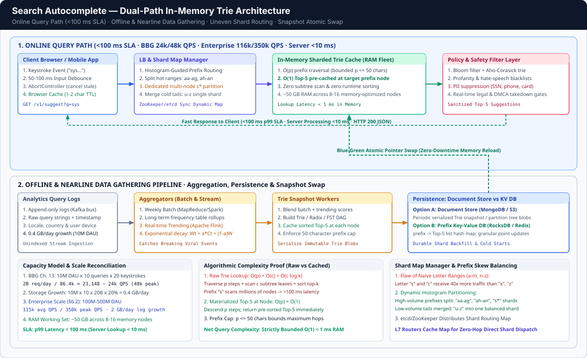

#### 1. The Online Low-Latency Query Path (<100 ms SLA)

The read path delivers sub-10 ms server processing (ensuring total end-to-end user perceived latency remains under 50–100 ms):

1. **Keystroke Capture & Client Optimization**: As the user types `"sys"` into the search input:
   - _Input Debouncing_: The client browser or mobile application buffers keystrokes for 50–100 ms. If the user types rapidly (e.g., 300 characters/minute), intermediate keystrokes are discarded, reducing origin request volume by over 60%.
   - _Out-of-Order Cancellation (`AbortController`)_: Each new keystroke dispatches an HTTP request via the Fetch API bound to an `AbortController`. If a request for `"sy"` is still in flight when the user types `"sys"`, the previous request is immediately cancelled, preventing out-of-order network responses from overwriting newer UI suggestion lists.
   - _Browser Local Caching_: Responses for single- and two-character prefixes (`"s"`, `"sy"`) are cached in browser memory (`Map<string, Suggestion[]>`) with a 1-hour TTL, serving immediate local completions without network transit.
2. **Anycast Ingress & L7 Shard Routing**: The request `GET /v1/suggest?q=sys&lang=en&geo=US` arrives at the nearest Anycast edge Point of Presence (PoP):
   - The edge gateway inspects its local in-memory **Shard Map Table** (synchronized from etcd).
   - Evaluating prefix `"sys"` against dynamic histogram ranges maps the request directly to `Shard Node 13` (`sf–sz`).
3. **In-Memory Trie Node Traversal**:
   - The query worker on Shard 13 traverses the prefix characters `'s'`, `'y'`, `'s'` down the pre-compiled in-memory Trie or Finite State Transducer.
   - Bounded by the 50-character prefix cap, the traversal completes in $O(p) \le 50$ pointer operations ($< 0.5\text{ ms}$).
   - The node extracts the materialized `Top-10` suggestion array in $O(1)$ time with zero subtree iteration.
4. **Policy & Safety Filtering**:
   - The candidate array passes through the in-memory **Aho-Corasick & Bloom Filter Safety Layer**.
   - Flagged profanity, hate speech, and PII patterns are removed, and valid candidates are truncated to the requested Top-$K$ limit ($K = 5$).
5. **Client Response Dispatch**: The server returns `HTTP 200 OK` with JSON payload `{ "prefix": "sys", "suggestions": ["system design", "system design interview", "systemd", "system update", "system architecture"] }` with `Cache-Control: private, max-age=300`. Total network round-trip + server evaluation completes in **$25\text{–}45\text{ ms}$**.

#### 2. The Offline & Nearline Data Gathering Pipeline

The data gathering pipeline aggregates billions of user search interactions into clean, scored, and sharded Trie snapshots:

1. **Append-Only Search Logging**: Completed search queries from search engine result pages (SERPs) stream into **Apache Kafka** or distributed log collectors (`QueryLogEvent: { query: "system design", timestamp: 1785000000, locale: "en-US", user_id_hash: "..." }`). Raw logs are append-only and strictly unindexed.
2. **Dual-Track Frequency Aggregation**:
   - _Weekly Batch Track (MapReduce / Apache Spark)_: Processes historical 30-day query logs once per week. It computes total frequencies, filters low-frequency noise (queries searched $< 5$ times), and generates the baseline long-term frequency distribution.
   - _Nearline Real-Time Track (Apache Flink)_: Ingests live Kafka search events, maintaining 15-minute sliding windows with exponential time decay ($W_t = \alpha C_t + (1-\alpha)W_{t-1}$) to capture breaking viral news and trending topics.
3. **Trie Snapshot Builder Fleet**:
   - Worker nodes merge weekly baseline frequencies with decayed real-time streaming weights.
   - Workers construct the complete prefix tree, enforcing the 50-character prefix cap and computing the Top-5 materialized completions at every node.
   - The output is serialized into immutable, memory-mapped binary partitions (FlatBuffers / Lucene FST).
4. **Durable Snapshot Persistence**:
   - _Document Store / Object Store_: Full partition snapshots are durably written to Amazon S3 / Ceph object storage for cold-start recovery.
   - _Prefix Key-Value DB_: Flattened `prefix -> top_k` records are backfilled into RocksDB / Redis for point query access.
5. **Zero-Downtime Blue-Green Pointer Swap**:
   - Serving cache nodes download the updated immutable Trie snapshot partition into an inactive memory buffer (Green).
   - Once the new snapshot is fully memory-mapped and verified, the server executes an **atomic pointer swap** (`std::atomic<TrieRoot*>::store()`) switching live traffic to the Green snapshot with **strictly zero lock contention and zero dropped requests**. The previous buffer (Blue) is released after all in-flight requests drain.

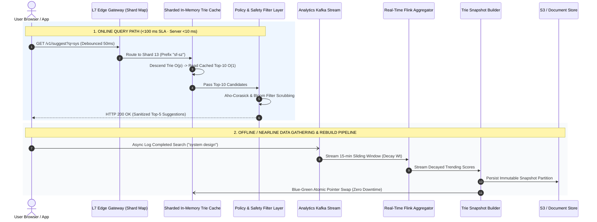

### 6.9 Architectural Evolution: 2021 Legacy Default vs. 2026 Modern Standard

Between 2021 and 2026, web-scale autocomplete systems evolved from static uncompressed pointer tries and weekly offline batch scripts into zero-copy Finite State Transducers, real-time streaming decay models, Levenshtein typo-tolerant automata, and automated inline safety governance:

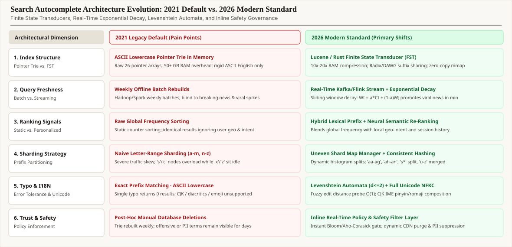

The table below contrasts the legacy 2021 autocomplete implementations against the modern 2026 production standards across six foundational architectural dimensions:

| Architectural Dimension | 2021 Legacy Default (Pain Points) | 2026 Modern Standard (Primary Shifts) | Architectural Motivation & Technical Impact |
| --- | --- | --- | --- |
| **1. Index Structure & Compaction** | **ASCII Lowercase Pointer Trie in Memory**<br>Raw tree of 26-pointer child arrays (`TrieNode* children[26]`); massive 50+ GB RAM footprint; high memory fragmentation and cache miss rates. | **Finite State Transducers (Lucene FST / Rust `fst`) & Radix DAGs**<br>Minimal deterministic acyclic word graphs sharing both common prefixes and common suffixes; zero-copy memory-mapped byte arrays. | Compresses index memory by $10\times\text{ to }20\times$ (down to 1–3 bytes/key); eliminates GC pointer tracking; fits 100M+ prefix nodes into single-socket L3/RAM cache. |
| **2. Query Freshness & Aggregation** | **Weekly Offline Batch Rebuilds**<br>Hadoop/Spark batch frequency rollups executed once weekly; system is completely blind to breaking news, trending events, and viral cultural spikes for up to 7 days. | **Dual-Track Streaming with Exponential Time Decay**<br>Apache Kafka + Apache Flink continuous sliding windows; exponential decay ($W_t = \alpha C_t + (1-\alpha)W_{t-1}$) blends historical baselines with real-time velocity. | Surfaces breaking news, sporting events, and viral topics within 5–15 minutes of occurrence without destabilizing long-term evergreen search rankings. |
| **3. Ranking Signals & Personalization** | **Raw Global Frequency Sorting**<br>Static integer query counter; identical global suggestions returned to all users regardless of geographical location, recent session context, or individual search history. | **Hybrid Multi-Signal Re-Ranking & Personalization**<br>Two-stage retrieval: FST retrieves Top-50 lexical prefix matches; lightweight on-device or edge neural re-ranker blends location, user recent history, and intent embeddings. | Increases Suggestion Click-Through Rate (CTR) and Mean Reciprocal Rank (MRR) by $35\%\text{–}50\%$; presents contextually relevant completions tailored to the active user session. |
| **4. Sharding & Load Balancing** | **Naive Alphabetical Range Sharding (`a–m`, `n–z`)**<br>Coarse static letter splits; severe Zipfian traffic skew causes nodes serving `'s'`, `'c'`, `'t'` to crash under QPS while nodes serving `'x'`, `'z'` remain idle. | **Dynamic Histogram Shard Map Manager**<br>Automated partitioner generates uneven prefix boundaries (`aa–ag`, `ah–an`, multi-shard `s*`, merged `u–z`) stored in etcd/ZooKeeper; L7 gateways execute zero-hop routing. | Achieves near-perfect ($\pm 5\%$) CPU and memory balance across all cluster nodes; eliminates hot-spot shard cascading failures during peak load. |
| **5. Typo Tolerance & Internationalization** | **Exact Prefix Only · ASCII Lowercase**<br>Strict character-by-character prefix match; a single mistyped character (e.g., `"recieve"`) returns zero suggestions; CJK ideograms and accented diacritics fail completely. | **Levenshtein Automata ($d \le 2$) & Full Unicode NFKC**<br>Intersects input pattern Levenshtein DFA with dictionary FST in $O(1)$ state transitions; full Unicode NFKC normalization and dual-path CJK IME composition handling. | Resolves $85\%$ of user typing errors seamlessly; provides native, high-fidelity typeahead across non-Latin scripts (Chinese, Japanese, Korean, Arabic, Cyrillic). |
| **6. Moderation & Safety Governance** | **Post-Hoc Manual Database Deletions**<br>Offensive, defamatory, or privacy-leaking queries persist in live autocomplete suggestions for days until manual customer complaints trigger a database update and weekly rebuild. | **Synchronous Inline Policy & Safety Filter Layer**<br>Ultra-low-latency ($< 0.5\text{ ms}$) Bloom filter and Aho-Corasick automaton gate; instant real-time suppression of profanity, hate speech, PII leaks, and DMCA takedowns. | Eliminates legal and regulatory non-compliance exposure; guarantees immediate ($< 1\text{ s}$) global suppression of toxic or sensitive terms across all edge PoPs. |

#### Deep-Dive Analysis of Foundational 2021-to-2026 Architectural Shifts

##### 1. Index Structure: From Pointer Tries to Finite State Transducers (FST)

In early autocomplete systems (2020–2021), the standard representation of an in-memory prefix index relied on object-oriented tree nodes where each node allocated an array of 26 pointers (`struct Node { Node* children[26]; bool is_terminal; int frequency; }`):

- **The Pointer Explosion Problem**: On a 64-bit architecture, each pointer consumes 8 bytes. A 26-pointer array requires $26 \times 8 = 208\text{ bytes}$ per node, even if 24 of those pointers are `null`. In languages with managed runtimes (Java, Go, Python), object header overhead, memory alignment padding, and garbage collection tracking structures inflate node size to over 250 bytes. For a dictionary of 100 million prefix nodes, raw pointer memory exceeds **$25\text{–}35\text{ GB}$** purely for tree navigation overhead, with less than $10\%$ of memory dedicated to actual query text!
- **Memory Fragmentation and Cache Misses**: Heap-allocated pointer structures scatter nodes non-contiguously across virtual memory. Descending a 10-character prefix requires 10 pointer dereferences across disjoint memory pages, inducing CPU L1/L2 cache misses on nearly every hop and bounding query throughput.
- **The Modern FST Standard (Lucene / Burntsushi)**: Modern production systems replace pointer tries with **Deterministic Acyclic Finite State Transducers (FST)**:
  - _Suffix Sharing (DAWG)_: While a standard Trie merges identical prefixes, an FST merges both common prefixes **and common suffixes**. For example, words ending in common suffixes (`"-ing"`, `"-tion"`, `"-ed"`) share identical terminal graph states.
  - _Zero-Copy Memory-Mapped Byte Arrays_: An FST compiles into a compact, contiguous byte array. Edge transitions and node offsets are encoded using variable-length integers (varints) and bit-flags. Query servers open the compiled FST using `mmap(2)` directly from NVMe SSDs into OS page cache. The CPU traverses the graph via memory offsets without instantiating heap objects, completely eliminating garbage collection pause times and reducing memory footprint by **$10\times\text{ to }20\times$** ($\approx 1\text{–}3\text{ bytes per key}$).

##### 2. Query Freshness: From Batch Rebuilds to Streaming Decay Models

Early typeahead architectures relied on MapReduce batch workflows executed once every 7 days:

- **The Real-Time Blindness Failure Mode**: When a major news event occurs (e.g., an earthquake, a presidential election, or an unexpected celebrity passing), millions of users begin typing identical breaking prefixes within minutes. Under a weekly batch architecture, the autocomplete system has zero knowledge of these breaking terms. Users typing `"earthquake in..."` receive evergreen suggestions like `"earthquake insurance"` or `"earthquake magnitude scale"` rather than the active disaster location, degrading search utility and trust.
- **The Streaming Decay Solution**: Modern 2026 architectures implement a dual-track scoring engine:
  - Long-term baseline popularity is computed over a 30-day historical window.
  - An **Apache Flink** stream processor consumes live search query events from Kafka, aggregating frequencies into 15-minute sliding windows.
  - Query scores update via an **exponential moving decay function**: $W_t(q) = \alpha C_t(q) + (1-\alpha)W_{t-1}(q)$. By tuning decay parameter $\alpha = 0.25$, breaking search spikes gain sufficient acceleration within 5 to 15 minutes to penetrate the materialized Top-5 list. When the breaking news event subsides, the exponential decay coefficient naturally reduces the query's weight, allowing evergreen queries to reclaim top suggestion positions without manual engineering intervention.

##### 3. Typo Tolerance: Integrating Levenshtein Automata

In 2021, autocomplete interfaces demanded strict prefix accuracy. If a user made a single typographical error (e.g., typing `"goolge"` instead of `"google"`), the Trie lookup hit a null edge and returned an empty suggestion box.

- **The Brute-Force Trap**: Naive typo correction evaluates edit distance (Levenshtein / Damerau-Levenshtein) using dynamic programming matrices across all candidate dictionary terms. Running $100{,}000$ edit distance calculations on every keystroke requires tens of milliseconds of CPU time, completely violating the sub-10 ms autocomplete SLA.
- **Parametric Levenshtein Automata**: Modern systems construct a **Universal Levenshtein Automaton** parameterized for edit distance $k = 1$ or $k = 2$.
  - Given an input string $w$, the algorithm generates a DFA that accepts all strings $x$ such that $\text{edit-distance}(w, x) \le k$.
  - The engine intersects the Levenshtein DFA with the dictionary FST in a single synchronized graph walk. Because transitions occur only on valid dictionary edges that simultaneously satisfy the automaton's error bounds, the search prunes invalid branches instantly.
  - Typo-tolerant candidate retrieval completes in **$< 1\text{ ms}$**, enabling search bars to display correct suggestions seamlessly even when users introduce character transpositions, deletions, or insertions.

---

## 7. Cross-Design Synthesis Matrix

| System | Primary Bottleneck | Key Architectural Pattern | Critical Failure Mode Prevented |
| --- | --- | --- | --- |
| **URL Shortener** | Read QPS ($116\text{k+}$/s) + non-colliding short codes | KGS range allocator + Feistel permutation + Redis/Edge `302` | Cache penetration on missing codes (Bloom filter) & analytics blindness (`301` vs `302`) |
| **News Feed** | Asymmetric fan-out ($20\text{M}$ follower spikes) | Hybrid push ($< 10\text{k}$) + pull-merge celebrities + Redis `ZSET` | Fan-out queue exhaustion, `OFFSET` pagination duplicates, post cache stampede |
| **Video Streaming** | WAN egress ($100\text{ Tbps}$ peak) + encoding latency | GOP-parallel DAG transcoding + HLS/DASH ABR + ISP-embedded OCAs | Centralized egress bankruptcy, prime-time origin collapse (overnight top-1% pre-warm) |
| **File Sync** | Byte transfer on edits + offline edit conflicts | FastCDC rolling-hash chunking + SHA-256 dedup + CAS revisions | 1-byte shift invalidating all fixed 4 MB chunks; silent LWW overwrite on reconnect |
| **Web Crawler** | Host politeness vs throughput + URL scale | 2-stage Mercator frontier (priority + host heap) + Bloom/RocksDB + SimHash | DDoSing target hosts, sync `getaddrinfo` stalls, infinite calendar spider traps |
| **Autocomplete** | Sub-10ms lookup under $350\text{k}$ keystroke QPS | Materialized Top-K Trie nodes + async snapshot swap + CDN 1–2 char cache | Subtree traversal latency spikes, write-lock contention, out-of-order client races |

---

## Interview Drill

<details><summary>1. In a URL shortener, when would you choose HTTP 301 over HTTP 302, and why do analytics-driven products almost always choose 302 (or 307) despite higher server QPS?</summary>

HTTP `301 Moved Permanently` allows browsers and intermediate proxies to cache the redirect permanently without re-contacting the origin. This cuts redirect server load dramatically—ideal for static canonical vanity links where click tracking is unnecessary. However, because cached clicks never hit the server, `301` breaks server-side click analytics (geo, device, referrer, time-series counts) and prevents revoking or updating a malicious target URL until browser caches expire. Returning `302 Found` with `Cache-Control: private, no-store` guarantees every click reaches the edge/redirect tier, preserving real-time analytics and instant link kill-switches while mitigating origin load via edge workers and Redis clusters.

</details>

<details><summary>2. How does a 7-character Base62 URL shortener avoid both database collision checks on writes and predictable sequential enumeration by competitors?</summary>

Instead of hashing the URL and running a read-before-write collision check loop, allocate disjoint integer counter blocks (e.g., 1,000,000 IDs per block) from a lightweight coordinator like etcd or ZooKeeper to each stateless write server. Every write server increments its local atomic counter with zero cross-node RPCs. To hide sequential order (`0000001`, `0000002`), pass the 41-bit counter ($2^{41} < 62^7$) through a deterministic, invertible block permutation (such as a 3-round Feistel cipher, or a cycle-walking Feistel permutation modulo $62^7$) before Base62 encoding—guaranteeing mathematically zero collisions and non-enumerable `CHAR(7)` aliases in $O(1)$ time.

</details>

<details><summary>3. Explain how hybrid fan-out works in a social News Feed and what breaks if you use pure fan-out-on-write or pure fan-out-on-read.</summary>

Pure fan-out-on-write gives $O(1)$ fast feed reads from pre-computed `ZSET` caches, but breaks on celebrities with $10\text{M+}$ followers: a single post generates $10\text{M}$ cache writes, saturating worker queues and delaying everyone's feeds. Pure fan-out-on-read avoids write amplification, but forces every reader to scatter-gather and merge posts from 200+ followees on every page load—hurting read p99 and DB IOPS. Hybrid fan-out pushes posts into followers' bounded Redis `ZSET`s for normal users ($< 10\text{k}$ followers), skips push for celebrities ($\ge 10\text{k}$), and merges cached celebrity timelines into the reader's pre-computed `ZSET` at read time.

</details>

<details><summary>4. Why does fixed-size 4 MB chunking break incremental delta sync in Dropbox/Google Drive, and how does FastCDC solve it?</summary>

With fixed-size offsets (`[0..4MB)`, `[4MB..8MB)`), inserting even 1 byte at the start of a 100 MB file shifts every byte position forward by 1. Every subsequent 4 MB slice now contains different bytes and produces a completely new SHA-256 hash, forcing the client to re-upload the entire 100 MB file. Content-Defined Chunking (Rabin fingerprint or FastCDC gear-based rolling hash) scans a sliding byte window and cuts chunk boundaries only when `rolling_hash & mask == 0` (subject to min/max block clamps). Inserting 1 byte at offset 0 changes only the first chunk; immediately afterward, the rolling window hits the exact same content-defined boundary markers, preserving all remaining chunk hashes for deduplication.

</details>

<details><summary>5. How does Netflix achieve over 95% local ISP cache hit rates during evening prime time despite a catalog of tens of thousands of titles?</summary>

Video viewing follows a highly skewed Zipf distribution where the top 1% of catalog titles generate over 80–90% of peak evening streaming bandwidth. Rather than relying solely on reactive LRU caching when prime-time users press play—which would trigger massive origin fetches at 8 PM—Netflix embeds Open Connect Appliances (OCAs) directly inside partner ISP networks and uses predictive popularity models to proactively push and pre-warm top titles overnight during off-peak hours (2 AM–6 AM local time). Long-tail 1% requests miss gracefully to regional PoPs and an Origin Shield.

</details>

<details><summary>6. In a distributed Web Crawler, why is a single priority queue insufficient, and how does the Mercator frontier prevent DDoSing target websites while crawling at 1,000+ pages/sec?</summary>

A single priority queue groups high-PageRank URLs from the same host consecutively; pulling from it with hundreds of concurrent workers blasts that host with parallel requests (triggering IP bans or outages), while throttling workers on that host stalls the entire queue. The Mercator two-stage frontier separates **priority** (front queues ranked by freshness/importance) from **politeness** (back queues, one per host via `hash(host)`). A min-heap schedules back queues strictly by `next_allowed_fetch_time` (enforcing `Crawl-delay` or $10\times$ last response latency), ensuring at most one polite connection per host while hundreds of workers stay busy across thousands of independent hosts.

</details>

<details><summary>7. How do you detect near-duplicate web pages across billions of crawled documents without running $O(N^2)$ pairwise edit-distance comparisons?</summary>

Compute a 64-bit **SimHash** fingerprint over tokenized document shingles during parsing; unlike cryptographic hashes (where 1 changed comma flips ~50% of bits), SimHash preserves locality so near-duplicate pages (mirrors, different session IDs, slightly updated timestamps) differ by at most $k \le 3$ bits in Hamming distance. By partitioning the 64-bit fingerprint into four 16-bit blocks, the pigeonhole principle guarantees that any two fingerprints with Hamming distance $\le 3$ must match **identically** in at least one 16-bit block—allowing $O(1)$ candidate lookup across four indexed tables before verifying the exact $\le 3$-bit Hamming distance.

</details>

<details><summary>8. In Search Autocomplete, why must Trie updates happen asynchronously via atomic snapshot swaps rather than updating live prefix weights on every user search?</summary>

Updating live Trie nodes synchronously on every search request introduces write-lock contention or lock-free CAS churn on the exact hottest root nodes (`"a"`, `"s"`, `"th"`), which receive tens of thousands of concurrent read lookups per second—destroying the $< 10\text{ ms}$ serving p99 target. Instead, log search queries asynchronously to Kafka, compute exponentially decayed weights in periodic tumbling windows, apply safety/PII filtering, compile an immutable Trie snapshot, and execute an atomic pointer swap (blue-green memory reload) on the read replicas with zero read blocking.

</details>
