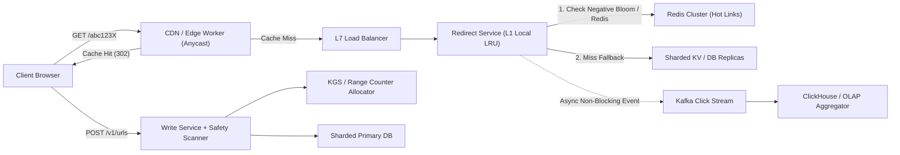
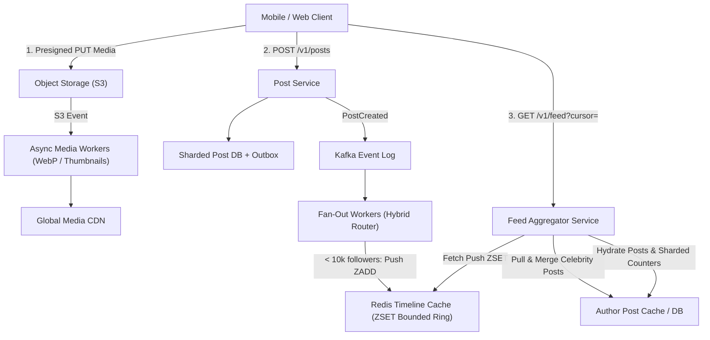
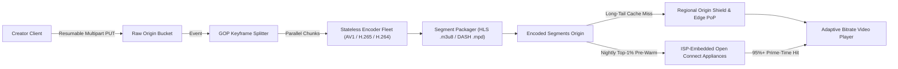
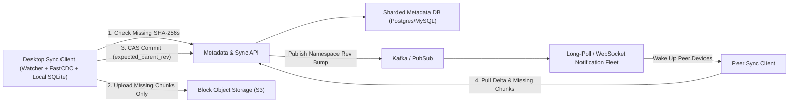
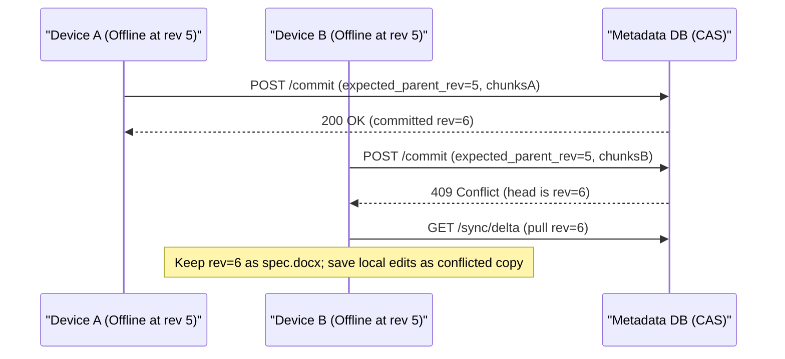
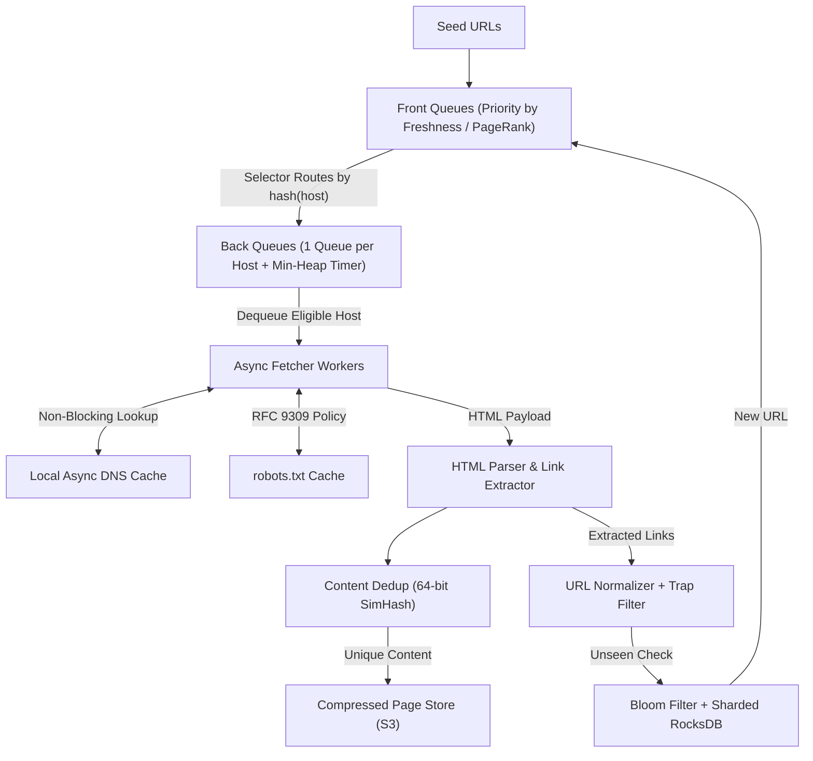
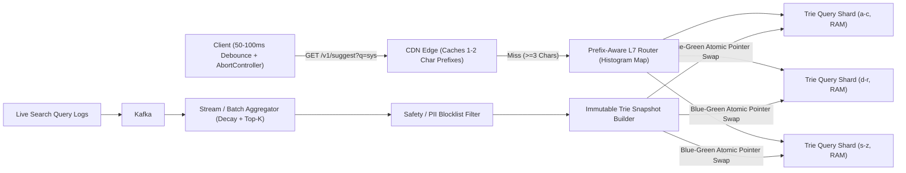

# Module 12 — Canonical Designs I: Read-Heavy, Feed, and Content Systems

Synthesizing networking, caching, storage engines, and asynchronous pipelines under real interview constraints requires translating vague product prompts into explicit numbers, clean component boundaries, and defensible failure modes. Every canonical design in this module follows the five-stage Staff-level delivery progression—**Requirements**, **Back-of-Envelope Estimation**, **Core Entities & API**, **High-Level Architecture**, and **Deep Dives & Failure Modes**—while cross-linking underlying data structures and protocols to their owning tracks ([`algorithms/dsa`](../../../algorithms/dsa/README.md), [`architecture/data-systems`](../../data-systems/README.md), [`architecture/distributed-systems`](../../distributed-systems/README.md), [`architecture/networking`](../../networking/README.md), [`architecture/security-identity`](../../security-identity/README.md), and [`architecture/cloud-foundations`](../../cloud-foundations/README.md)).

---

## 1. URL Shortener (Bitly)

A globally distributed URL shortener converts arbitrary long URLs into compact aliases and resolves billions of daily redirects with millisecond latency and click-stream telemetry.

### 1.1 URL Shortener: Requirements & Constraints

- **Functional Requirements**: Create a short alias for any valid `http`/`https` URL; optionally accept a custom alias and expiration timestamp (`expires_at`); redirect `GET /{code}` to the original target URL; emit click analytics (country, referrer, device, timestamp) without slowing down the redirect path.
- **Non-Functional Requirements**: Extreme read dominance (**100:1 read-to-write ratio**); redirect latency **p99 < 20 ms** globally; **99.99%** read availability (redirects must keep working even if analytics or write DBs degrade); **5-year** default link retention; short codes must be non-enumerable and protected against phishing/open-redirect abuse.

### 1.2 URL Shortener: Back-of-Envelope Estimation

- **Write QPS**: $100\text{M writes/day} \div 86{,}400\text{ s/day} \approx \mathbf{1{,}160\text{ writes/s}}$ average; with a $3\times$ peak multiplier, **$\sim 3{,}500\text{ writes/s}$ peak**.
- **Read QPS**: At $100:1$ read:write, $10\text{B reads/day} \div 86{,}400 \approx \mathbf{115{,}700\text{ reads/s}}$ average; **$3\times$ peak $\approx 350{,}000\text{ reads/s}$**.
- **5-Year Storage**: Assume $500\text{ bytes}$ average per link record (`short_code`, `long_url`, `user_id`, timestamps, metadata). Over 5 years: $100\text{M/day} \times 365 \times 5 \times 500\text{ B} \approx \mathbf{91.25\text{ TB}}$ raw (~100 TB with B-tree/secondary indexes).
- **80/20 Cache Sizing**: Assuming $20\%$ of daily unique accessed links serve $80\%$ of redirect traffic (say $500\text{M}$ hot keys/day $\times 20\% = 100\text{M}$ hot records $\times 500\text{ B}$), **$\sim 50\text{ GB}$** of distributed Redis/Valkey RAM comfortably caches the hot working set.
- **Egress Bandwidth**: $116\text{k reads/s} \times 500\text{ B}$ HTTP redirect response $\approx \mathbf{58\text{ MB/s}}$ (~464 Mbps avg, ~1.4 Gbps peak)—easily absorbed at edge PoPs.

### 1.3 URL Shortener: Core Entities & API

- **Core Entities**: `ShortLink(short_code CHAR(7) PK, long_url TEXT, user_id BIGINT, created_at TIMESTAMP, expires_at TIMESTAMP NULL, status ENUM('active','disabled','quarantined'))`, `ClickEvent(short_code, clicked_at, country_iso, referrer_domain, user_agent_family)`.
- **Write API**: `POST /v1/urls` with `{ long_url, custom_alias?, expires_at? }` and optional `Idempotency-Key` header → returns `201 Created` `{ short_url, code, expires_at }`, or `409 Conflict` if `custom_alias` collides with an active alias or reserved path (`/v1`, `/health`, `/robots.txt`).
- **Read API**: `GET /{code}` → returns `302 Found` (or `301` when analytics disabled) with `Location: <long_url>`, or `404`/`410 Gone` if missing/expired, or `403` interstitial if quarantined.
- **Analytics API**: `GET /v1/urls/{code}/stats?from=...&to=...&granularity=hour` → returns pre-aggregated time-series click counts and top referrers from OLAP storage.

```sql
CREATE TABLE short_links (
  short_code  CHAR(7)      PRIMARY KEY,
  long_url    TEXT         NOT NULL,
  user_id     BIGINT       NOT NULL,
  created_at  TIMESTAMPTZ  NOT NULL DEFAULT now(),
  expires_at  TIMESTAMPTZ,
  status      SMALLINT     NOT NULL DEFAULT 1 -- 1=active, 2=disabled, 3=quarantined
);
```

### 1.4 URL Shortener: High-Level Architecture



### 1.5 URL Shortener: Deep Dives & Failure Modes

1. **Base62 Namespace Math vs Hash Collisions vs KGS**: Using Base62 (`[0-9a-zA-Z]`), a **7-character** short code encodes $62^7 = 3{,}521{,}614{,}606{,}208 \approx \mathbf{3.52\text{ trillion}}$ unique URLs. At 100M new URLs/day ($36.5\text{B/year}$), 7 characters suffice for **~96 years** without recycling.
   - _Hash + Collision Retry_ (`SHA-256(long_url)` truncated to 41 bits—since $2^{41} \approx 2.20\text{T} < 62^7 \approx 3.52\text{T}$—→ Base62): Simple and stateless, _but_ requires a DB unique-constraint check (and salt-and-retry loop on collision), adding read-before-write latency and leaking deterministic hash collisions across users.
   - _Distributed Counter / Key Generation Service (KGS)_: A coordination service (etcd/ZooKeeper) hands each Write Service instance disjoint 1M-ID numeric ranges in memory (zero cross-node coordination on the hot path!). To prevent competitors from scraping sequential IDs (`0000001`, `0000002`), apply a bijective **Feistel permutation** or bit-shuffle over the 41-bit integer space ($2^{41} \approx 2.20\text{T} < 62^7$, or a cycle-walking Feistel permutation modulo $62^7$) before Base62 encoding—guaranteeing **zero collisions** and non-sequential `CHAR(7)` codes in $O(1)$ CPU time.
2. **HTTP `301` vs `302` Semantics**: Returning **`301 Moved Permanently`** instructs browsers and intermediate ISP proxies to cache the redirect indefinitely; subsequent clicks hit the browser cache directly, slashing server QPS **but blinding click analytics** and making it impossible to revoke a compromised link cleanly. Returning **`302 Found`** (or `307`) with `Cache-Control: private, no-store` forces every click to reach the server (or edge worker), **preserving 100% of click analytics and instant kill-switch revocation** at the cost of handling full read QPS at the edge.
3. **Cache Penetration & Negative Caching**: Attackers or scanners probing random 7-character strings miss Redis and hammer the backing DB. Place an in-memory **Bloom filter** (cross-link [`algorithms/dsa`](../../../algorithms/dsa/README.md)) or short-TTL negative cache entries (`NOT_FOUND`, TTL 60s) in Redis so nonexistent codes never reach storage.
4. **Abuse, Phishing, and Open Redirects**: Validate URL schemes strictly (allow only `http`/`https`, reject `javascript:`/`data:`), run synchronous blocklist checks (Safe Browsing / local hash prefix table) plus asynchronous deep-crawl reputation scanning, and flag suspicious links as `quarantined` so redirects render a warning interstitial.
5. **Multi-Region KGS Partitioning & TTL Sweeping**: To avoid cross-region consensus latency on writes, partition the 41-bit integer space by reserving the top 3 bits for `region_id` (e.g., 8 regions × $2^{38} \approx 2.75 \times 10^{11}$ IDs each, or 8 disjoint sub-ranges over $62^7$ via cycle-walking Feistel permutation) so every region's KGS allocates disjoint counter blocks locally with zero WAN coordination. For expiring links (`expires_at`), enforce lazy expiration on read (`if now > expires_at return 410 Gone`) paired with low-priority background range-scan sweepers rather than scheduling millions of individual cron timers.
6. **Pastebin Architectural Delta**: A Pastebin service shares the exact same KGS Base62 alias engine and read-heavy CDN/Redis cache topology as a URL shortener, with three key deltas: (a) store paste payloads (up to 1–10 MB of text/code) in **object storage (S3)** rather than relational DB rows, keeping only the `s3_key`, `syntax_lang`, and `expires_at` in metadata; (b) cache rendered or raw blobs aggressively at the **CDN edge** (`Cache-Control: public, max-age=3600` for immutable pastes) unless **burn-after-read** is enabled, in which case an atomic Redis `GETDEL` or DB `DELETE ... RETURNING` enforces single-view semantics without caching; and (c) enforce strict `Content-Type: text/plain; charset=utf-8` and `X-Content-Type-Options: nosniff` headers (cross-link [`architecture/security-identity`](../../security-identity/README.md)) so uploaded HTML/JS payloads cannot execute stored XSS on the Pastebin origin.

---

## 2. News Feed and Instagram

Social feeds combine asymmetric fan-out graphs, high-volume media ingestion, and low-latency ranked timeline reads across hundreds of millions of daily active users.

### 2.1 News Feed: Requirements & Constraints

- **Functional Requirements**: Users publish posts with text and media (images/short video); follow/unfollow other users; view a personalized home timeline (chronological or ranked); like and comment on posts.
- **Non-Functional Requirements**: **500M DAU**; home timeline read **p99 < 200 ms**; **99.95%** availability; **eventual consistency** acceptable for feed propagation (a post may appear in followers' feeds within 1–5 seconds); durable media storage (11×9s durability).

### 2.2 News Feed: Back-of-Envelope Estimation

- **Read QPS**: 500M DAU × 5 feed loads/day = $2.5\text{B reads/day} \div 86{,}400 \approx \mathbf{29{,}000\text{ feed reads/s}}$ avg (~90k–100k peak).
- **Write QPS**: Assume 10% post daily → $50\text{M posts/day} \div 86{,}400 \approx \mathbf{580\text{ posts/s}}$ avg (~2,000 peak).
- **Fan-Out Amplification**: If an average user follows 200 accounts, 580 posts/s generate $580 \times 200 \approx \mathbf{116{,}000\text{ timeline writes/s}}$ under pure push. However, a single celebrity with $20\text{M}$ followers triggers **$2 \times 10^7$ writes** from one post—saturating queues and causing multi-minute lag spikes.
- **Media Storage**: 50M posts/day × 2 MB compressed average = **100 TB/day** (~36.5 PB/year, **~182.5 PB over 5 years** stored in object storage behind CDN).
- **Timeline Cache Memory**: Caching top 500 post IDs per active user (each entry = `(post_id [8B], author_id [8B], ts [8B])` = 24 bytes → $12\text{ KB/user}$): $500\text{M} \times 12\text{ KB} = \mathbf{6\text{ TB}}$ distributed across a Redis Cluster (sharded by `user_id`).

### 2.3 News Feed: Core Entities & API

- **Core Entities**: `User(user_id, handle, is_celebrity)`, `Follow(follower_id, followee_id, created_at)`, `Post(post_id [Snowflake/UUIDv7], author_id, media_urls[], caption, created_at)`, `Like(post_id, user_id)`.
- **API**: `POST /v1/media/presign` (returns direct S3 upload URL); `POST /v1/posts` `{ media_keys[], caption }`; `GET /v1/feed?cursor={opaque_token}&limit=20` (keyset/cursor pagination); `POST /v1/posts/{id}/likes` (idempotent per `(user_id, post_id)`).

```http
GET /v1/feed?cursor=eyJ0cyI6MTc5NTE4NDAwMCwicG9zdF9pZCI6IjkwMDEyMzQ1In0&limit=20
HTTP/1.1 200 OK

{
  "items": [
    {
      "post_id": "90012340",
      "author": { "id": "42", "handle": "ada", "avatar_cdn": "https://cdn.example.com/a/42.webp" },
      "media": [{ "url": "https://cdn.example.com/m/90012340_1080.webp", "w": 1080, "h": 1350 }],
      "caption": "Distributed trace waterfalls",
      "like_count": 14820,
      "created_at": "2026-11-20T10:12:00Z"
    }
  ],
  "next_cursor": "eyJ0cyI6MTc5NTE4MzgwMCwicG9zdF9pZCI6IjkwMDEyMzAwIn0"
}
```

### 2.4 News Feed: High-Level Architecture



### 2.5 News Feed: Deep Dives & Failure Modes

1. **Hybrid Celebrity Fan-Out (Push + Pull-Merge)**:
   - **Normal Authors ($< 10{,}000$ followers)**: Use **fan-out on write**. Workers push `(post_id, score_ts)` into each active follower's Redis `ZSET` (`ZADD` + `ZREMRANGEBYRANK 0 -501` to cap each timeline ring at 500 entries). Skip users inactive for $> 30\text{ days}$ and backfill lazily on return.
   - **Celebrities ($\ge 10{,}000$ followers)**: Skip push fan-out entirely. At read time, the Feed Aggregator queries the small list of celebrities the reader follows (`followees ∩ celebrities`), fetches their recent posts from a hot per-celebrity cache, and performs a **k-way heap merge** with the reader's pre-materialized `ZSET`.
   - _Dynamic Threshold Hysteresis_: Avoid thrashing when an author hovers near 10,000 followers by using hysteresis (promote to celebrity mode at 12,000; demote at 8,000) and cleanly storing a `fanout_mode` flag on the author profile.
2. **Cursor Pagination vs `OFFSET` Drift**: Never use SQL `OFFSET` on live feeds. Because new posts constantly insert at rank 0, `OFFSET 20` on page 2 shifts downward and repeats items the user just saw on page 1, while deep offsets scan and discard millions of rows. Use **keyset/cursor pagination** encoding `(last_score, last_post_id)` for $O(\log N + K)$ indexed range scans (`ZREVRANGEBYSCORE`).
3. **Media Upload & Async Transcoding Pipeline**: Never stream multi-megabyte uploads through stateless API servers (which exhausts worker threads and buffers). Issue short-lived **presigned URLs** so clients `PUT` directly to object storage; S3 event notifications trigger workers that strip EXIF GPS metadata (privacy!), resize responsive variants, transcode to **WebP/AVIF**, and publish immutable content-hashed URLs behind a CDN (`Cache-Control: public, max-age=31536000, immutable`).
4. **Hot-Post Cache Stampede & Sharded Like Counters**: When a celebrity posts, millions of feed reads hydrate the exact same `post_id` concurrently, and tens of thousands of users hit `Like` simultaneously. Protect post hydration with **single-flight request coalescing** plus local in-process L1 LRU caching (cross-link [`architecture/data-systems`](../../data-systems/README.md) for XFetch/leases). Replace single-row `UPDATE posts SET likes = likes + 1` lock contention with **sharded counters** (e.g., 64 counter shards per hot post in Redis/DB summed asynchronously or on read).
5. **Storage Sharding, Privacy Filtering & Two-Stage Ranking**: Shard the `Posts` table by **`post_id`** (not `author_id`, which would turn celebrity accounts into hot write/read partitions), while sharding `UserTimeline` caches by **`user_id`** so reading a home feed hits one cache shard. During feed hydration, enforce **read-time privacy and blocklist filtering** (check mute/block sets and deleted-post tombstones before returning items) so unfollowed, blocked, or deleted posts never leak out of pre-materialized `ZSET`s. For algorithmic feeds, retrieve the top ~500 candidates from the `ZSET` + celebrity pool, score them via a stateless two-tower / GBDT ranking service, and apply diversity deduplication.

```typescript
// Hybrid Feed Merge: combines pre-materialized ZSET entries (normal followees)
// with bounded recent slices pulled from celebrity caches, ordered by (timestamp, postId).
export interface FeedRef {
  postId: bigint;
  authorId: string;
  timestampMs: number;
}

export function mergeHybridFeed(
  pushedTimeline: FeedRef[],
  celebrityTimelines: FeedRef[][],
  blockedAuthors: Set<string>,
  limit: number,
): FeedRef[] {
  const merged = [...pushedTimeline];
  for (const celebPosts of celebrityTimelines) {
    for (const ref of celebPosts) merged.push(ref);
  }
  return merged
    .filter((item) => !blockedAuthors.has(item.authorId))
    .sort((a, b) => b.timestampMs - a.timestampMs || (b.postId > a.postId ? 1 : -1))
    .slice(0, limit);
}
```

---

## 3. YouTube / Netflix Video Streaming

Video-on-demand platforms are constrained not by database QPS, but by **compute-intensive transcoding DAGs** and **massive sustained WAN egress bandwidth** that exceeds centralized cloud-origin economics.

### 3.1 Video Streaming: Requirements & Constraints

- **Functional Requirements**: Creators upload raw video files (up to 100 GB, resumable); pipeline transcodes into multi-resolution, multi-codec adaptive streams; viewers play smoothly across variable networks (3G mobile to 4K fiber) with fast start time (< 1.5s), adaptive quality switching, and saved playback position.
- **Non-Functional Requirements**: **500M DAU** averaging 30 minutes watched/day; **< 0.5% rebuffer ratio**; **99.99%** playback availability; durable master storage for uploaded originals.

### 3.2 Video Streaming: Back-of-Envelope Estimation

- **Upload Ingestion**: Suppose 500k videos/day at 1 GB raw average = **500 TB/day** raw upload (~5.8 GB/s avg). After transcoding into ~10 bitrate/codec renditions (roughly $3\times$ raw size), new processed video storage grows by **~1.5 PB/day** (~550 PB/year).
- **Streaming Egress Bandwidth**: $500\text{M users} \times 1{,}800\text{ s/day} \times 3\text{ Mbps avg} = 2.7 \times 10^{18}\text{ bits/day} \div 86{,}400 \approx \mathbf{31.25\text{ Tbps}}$ average, peaking above **$100\text{ Tbps}$** in evening prime time!
- **Architectural Implication**: Serving 100 Tbps from centralized cloud object storage would cost millions of dollars _per day_ in egress fees and saturate backbone peering links. **Edge ISP caching is mandatory.**

| Delivery Tier | Cache Hit Share (Prime Time) | Typical RTT to Viewer | Cost per GB Egress | Catalog Coverage |
| --- | :-: | :-: | --- | --- |
| **ISP-Embedded OCA** | **> 95%** | 1–5 ms | Near \$0 (local peering) | Top ~1% overnight pre-warmed titles |
| **Regional Edge CDN PoP** | ~4% | 10–25 ms | Low CDN transit | Top ~10–15% warm long tail |
| **Origin Shield + Object Store** | < 1% | 40–100 ms | Highest cloud egress | 100% full catalog |

### 3.3 Video Streaming: Core Entities & API

- **Core Entities**: `Video(video_id, title, status ['uploading','processing','ready'], duration_ms, master_s3_key)`, `Rendition(video_id, codec, resolution, bitrate_kbps, segment_prefix)`, `WatchProgress(user_id, video_id, position_ms, updated_at)`.
- **API**: `POST /v1/videos/upload-init` (returns multipart upload ID + presigned chunk URLs); `GET /v1/videos/{id}/manifest.m3u8` (or `.mpd` DASH manifest); `PUT /v1/videos/{id}/progress` `{ position_ms }` (debounced every 10–30s).

```text
#EXTM3U
#EXT-X-VERSION:6
#EXT-X-STREAM-INF:BANDWIDTH=800000,RESOLUTION=640x360,CODECS="avc1.4d401e,mp4a.40.2"
360p/index.m3u8
#EXT-X-STREAM-INF:BANDWIDTH=2800000,RESOLUTION=1280x720,CODECS="av01.0.05M.08,mp4a.40.2"
720p_av1/index.m3u8
#EXT-X-STREAM-INF:BANDWIDTH=12000000,RESOLUTION=3840x2160,CODECS="hvc1.1.6.L150,mp4a.40.2"
2160p_hevc/index.m3u8
```

### 3.4 Video Streaming: High-Level Architecture



### 3.5 Video Streaming: Deep Dives & Failure Modes

1. **Upload DAG Transcoding & GOP-Aligned Parallel Encoding**: Encoding a 2-hour 4K feature on a single server takes hours and stalls if the worker crashes. Instead, split uploads via **resumable multipart uploads** (cross-link [`architecture/networking`](../../networking/README.md)), inspect container headers, and slice the master video strictly along **Group of Pictures (GOP)** I-frame boundaries (e.g., every 4 seconds) using a **DAG orchestrator**. Hundreds of stateless workers encode individual 4-second GOP chunks concurrently across codec families (**H.264** for universal hardware fallback, **H.265/HEVC** and **AV1** for 30–50% bitrate savings at equivalent perceptual VMAF quality) and resolution ladders (`360p`..`4K`), cutting end-to-end processing latency from hours to minutes.
2. **Adaptive Bitrate Streaming (HLS & MPEG-DASH)**: Each rendition produces immutable 2–6s media segments (`.m4s` CMAF or `.ts`) whose I-frames align across all quality tiers, indexed by a master manifest (`.m3u8` for Apple **HLS**, `.mpd` for **MPEG-DASH**). The client player continuously measures segment download throughput and local buffer occupancy; if bandwidth drops, the very next segment request switches seamlessly from `4K` to `1080p` or `720p` at the aligned boundary with **zero playback stutter**.
3. **Multi-Tier CDN & ISP-Embedded Open Connect Appliances (OCA)**: Netflix places **Open Connect Appliances** (custom flash/NVMe storage servers) directly inside partner ISP data centers, peered locally at zero transit cost. Because video popularity follows a steep Zipf distribution—where the **top 1% of titles** (new releases, trending series) drive $> 80\text{–}90\%$ of evening prime-time bytes—the control plane pushes predicted top titles to OCAs during **off-peak overnight hours (2 AM–6 AM local ISP time)**. Prime-time viewers stream $> 95\%$ of bytes over a single local ISP hop, while rare long-tail catalog requests fall back cleanly to regional CDN PoPs and an **Origin Shield** (collapsing duplicate PoP misses so origin S3 is hit once per segment).
4. **Per-Title VMAF Encoding & Failure Modes**: Static bitrate ladders waste bits on simple animation while starving high-motion sports; modern pipelines run **per-title / per-scene convex-hull optimization** targeting constant perceptual VMAF quality, cutting average streaming bitrate by 20–30%. _Failure modes_: (a) _Manifest Caching Mistake_—accidentally caching a live-stream sliding `.m3u8` playlist for 1 hour stalls live viewers at old segments; mark live manifests `max-age=1`–`2s` while keeping immutable `.m4s` media segments cached for `1 year`; (b) _Audio/Video Desync_—non-uniform GOP keyframe intervals across bitrate ladders cause stalls during ABR switches; enforce fixed closed-GOP boundaries during transcoding; (c) _Hotlinking Without Busting Cache_—authorize playback via short-lived **HMAC-signed URL path prefixes or edge JWT cookies** validated at CDN edge workers rather than per-user query strings that fragment cache keys.
5. **Resumable Chunked Upload & Buffered View Counts**: Creators upload large files via byte-range resumable sessions (`Content-Range` + per-chunk SHA-256 checksums) so flaky Wi-Fi resumes at the failed 8 MB part rather than byte 0. For view counting on viral premieres, avoid synchronous `UPDATE videos SET views = views + 1`: emit playback heartbeats to Kafka, filter duplicate/bot refreshes in Flink using HyperLogLog / sliding `(user_or_ip, video_id)` windows, and batch-flush aggregated deltas to the video metadata store.

---

## 4. Dropbox / Google Drive File Sync

Cloud file sync requires moving minimal bytes when a user edits a multi-gigabyte file locally while guaranteeing zero silent data loss when offline devices edit concurrently.

### 4.1 File Sync: Requirements & Constraints

- **Functional Requirements**: Synchronize folder trees across desktop/mobile clients in near real time; resume interrupted uploads; preserve version history and recover from offline conflicting edits; share folders across multiple users.
- **Non-Functional Requirements**: **500M total users**, **50M DAU**; **99.99%** metadata availability and **11×9s** blob durability; sync notification latency **< 2 seconds** for online peers; bandwidth efficiency—editing 10 bytes inside a 100 MB binary file must **not** re-upload 100 MB.

### 4.2 File Sync: Back-of-Envelope Estimation

- **Sync Write QPS**: 50M DAU × 2 file edits/day = $100\text{M edits/day} \div 86{,}400 \approx \mathbf{1{,}160\text{ file commits/s}}$ avg (~3,500 peak).
- **Storage**: 500M users × 5 GB avg used = **2.5 EB raw** logical user data. With block-level **chunk deduplication** and LZ4/Zstd compression (typically 30–50% savings across OS/SDK/shared-folder duplicates and incremental edits), physical object storage drops to **~1.25–1.75 EB**.
- **Notification Fan-Out**: Maintaining 50M concurrent idle long-poll/WebSocket connections across stateful edge gateway servers (~500k connections per server) requires roughly **100 notification servers**.

### 4.3 File Sync: Core Entities & API

- **Core Entities**: `Namespace(ns_id)`, `FileEntry(file_id, ns_id, path, latest_rev, is_deleted)`, `FileRevision(file_id, rev_id, parent_rev_id, chunk_hashes[], size_bytes, author_device, mtime)`, `Chunk(sha256 PK, size_bytes, s3_key)`.
- **API**: `POST /v1/chunks/exists` `{ hashes: sha256[] }` → `{ missing: sha256[] }`; `PUT <presigned_s3_url>` (chunk upload); `POST /v1/files/{id}/commit` `{ expected_parent_rev, chunk_hashes[] }` → `200 OK` `{ rev_id }` or `409 Conflict`; `GET /v1/sync/delta?cursor={ns_cursor}` (cursor-based incremental sync); `GET /v1/sync/listen` (long-poll / WebSocket notification).

### 4.4 File Sync: High-Level Architecture



### 4.5 File Sync: Deep Dives & Failure Modes

1. **Content-Defined Chunking (Rabin Fingerprint / FastCDC)**:
   - _Why Fixed-Size 4 MB Blocks Fail_: If a file is sliced at fixed offsets (`[0..4MB)`, `[4MB..8MB)`), inserting **1 single byte at offset 0** shifts every byte in the file forward by 1, altering the SHA-256 digest of **every single 4 MB block** and forcing a 100% re-upload!
   - _Content-Defined Chunking (CDC)_: Slide a rolling hash window (historically a **Rabin fingerprint**, modernized by **FastCDC** gear-based rolling hashing at ~10× higher CPU throughput) across the byte stream and declare a chunk boundary whenever `(rolling_hash & mask) == 0` (clamped between `min_size` e.g. 1 MB and `max_size` e.g. 8 MB, averaging 4 MB). Inserting 1 byte at offset 0 modifies _only_ the **first chunk**; the rolling hash hits the exact same content-defined boundary markers immediately afterward, preserving 99% of downstream chunk hashes!

```typescript
// FastCDC-style Gear Rolling Hash Chunker (conceptual boundary invariant):
// Cut at offset i iff (i - start >= maxSize) OR (i - start >= minSize && (fp & mask) === 0).
export function findChunkBoundaries(
  bytes: Uint8Array,
  gearTable: Uint32Array,
  minSize: number,
  maxSize: number,
  mask: number,
): number[] {
  const boundaries: number[] = [];
  let start = 0;
  let fp = 0;
  for (let i = 0; i < bytes.length; i++) {
    fp = ((fp << 1) + gearTable[bytes[i]]) >>> 0;
    const len = i - start + 1;
    if (len >= maxSize || (len >= minSize && (fp & mask) === 0)) {
      boundaries.push(i + 1);
      start = i + 1;
      fp = 0;
    }
  }
  if (start < bytes.length) boundaries.push(bytes.length);
  return boundaries;
}
```

2. **Content-Addressable Storage & Deduplication Security**: Each chunk is compressed and addressed by its cryptographic **SHA-256** digest. Clients only upload hashes absent from `/v1/chunks/exists`, eliminating redundant transfers across edits, renames, and shared files. _Security Trap (Cross-Tenant Hash Oracle)_: Global cross-user deduplication allows an attacker who guesses a secret file's plaintext to probe `/chunks/exists` and learn whether another user owns that exact chunk ("confirmation-of-a-file attack"). Mitigate by scoping deduplication per **shared namespace / tenant** or using HMAC-keyed **convergent encryption** with server-side proof-of-ownership challenges.
3. **Delta Metadata Sync & Long-Poll/WebSocket Notifications**: Each shared folder namespace maintains a monotonic sequence cursor. Online clients hold a lightweight long-poll HTTP request or WebSocket to the Notification Fleet; when Device A commits a new revision, the Metadata Service publishes `(ns_id, new_cursor)` to the Notification Fleet, which wakes Device B to call `GET /v1/sync/delta?cursor=...` and download only missing chunks.
4. **Offline Conflict Resolution**: Suppose Devices A and B go offline while synced at `rev = 5`. Device A edits `spec.docx` and reconnects first, succeeding with `expected_parent_rev = 5` → `rev = 6`. When Device B reconnects and calls `POST /commit` with `expected_parent_rev = 5`, the Metadata DB rejects the **Compare-And-Swap (CAS)** precondition with `409 Conflict`. Rather than silently overwriting Device A's work (Last-Write-Wins hazard!), Device B downloads `rev = 6` as `spec.docx` and saves its own diverging local edits under `spec (Device B's conflicted copy 2026-11-20).docx`, guaranteeing zero data loss.
5. **Local Sync Engine, Hash Ordering & Case-Sensitivity Traps**: The desktop agent watches OS filesystem events (`inotify`/`FSEvents`/`ReadDirectoryChangesW`), debounces rapid editor save-and-rename cycles using a local **SQLite state database**, and tracks **OS inode / file IDs** so renaming a 5 GB video issues a cheap metadata `MOVE` rather than re-uploading chunks. Always compute the **SHA-256 content-addressable hash over the uncompressed plaintext chunk _before_ Zstd/LZ4 compression**; hashing compressed bytes breaks deduplication whenever clients upgrade Zstd versions or compression levels. Finally, detect cross-platform **case-sensitivity collisions** (`Report.txt` and `report.txt` created on Linux syncing onto case-insensitive macOS APFS/Windows NTFS) and disambiguate with a case-conflict suffix before writing to disk.



---

## 5. Web Crawler

A production web crawler continuously discovers, fetches, and indexes billions of web documents while strictly respecting host rate limits, `robots.txt` policies, DNS constraints, and adversarial spider traps.

### 5.1 Web Crawler: Requirements & Constraints

- **Functional Requirements**: Start from seed URLs; download HTML/text pages, extract outbound hyperlinks, and store snapshots for search indexing; respect `robots.txt` exclusions and `Crawl-delay`; prioritize fresh/high-value domains over stale spam sites.
- **Non-Functional Requirements**: **1 billion pages/month** continuously refreshed; **strict per-host politeness** (never send concurrent bursts that DDoS a small site); **99.9%** uptime; **< 1% duplicate storage** for mirrored/boilerplate URLs; resilient to infinite URL loops and malicious traps.

### 5.2 Web Crawler: Back-of-Envelope Estimation

- **Fetch Throughput**: $10^9\text{ pages/month} \div (30 \times 86{,}400\text{ s}) \approx \mathbf{386\text{ pages/s}}$ avg (~400 pages/s); with a $3\times$ peak burst for recrawls, **$\sim 1{,}200\text{ pages/s}$**.
- **Network Bandwidth**: $400\text{ pages/s} \times 100\text{ KB}$ avg uncompressed HTML (or ~25 KB gzipped on wire) $\approx 40\text{ MB/s}$ (~320 Mbps avg, ~1 Gbps peak).
- **Storage**: $10^9\text{ pages/month} \times 100\text{ KB} = \mathbf{100\text{ TB/month}}$ raw (~25 TB/month compressed). Over 5 years of crawl snapshots (or 5–10B unique canonical pages), **500 TB–1.5 PB** in compressed object storage.
- **URL Seen-Set Size**: 10B unique URLs at 64 bytes/URL = **640 GB**—too expensive to keep as raw strings in a single process RAM hash map, motivating compact sketches + LSM disk indexes.

### 5.3 Web Crawler: Core Entities & API

- **Core Entities**: `FrontierTask(url, host_hash, priority_tier, next_fetch_at)`, `HostPolicy(host, robots_rules, crawl_delay_ms, last_fetch_latency_ms)`, `CrawledDoc(url_sha256, simhash_64, s3_snapshot_key, fetched_at)`.
- **Internal Interfaces**: `Frontier.dequeue()` (returns next URL whose host politeness timer has elapsed); `Frontier.enqueue(url, priority)`; `SeenStore.containsOrAdd(url_sha256)`.

### 5.4 Web Crawler: High-Level Architecture



### 5.5 Web Crawler: Deep Dives & Failure Modes

1. **Two-Stage Mercator URL Frontier (Priority + Politeness)**: A naive single FIFO queue causes two failures: either workers concurrently hit the same domain (IP-banned for DoS) or slow servers block the queue head. The **Mercator frontier** splits scheduling into two stages:
   - **Front Queues ($F_1 \dots F_k$)**: Bucket incoming URLs by **priority** (PageRank, expected change rate—news homepages every 10 minutes vs archive docs monthly). A biased selector drains higher-priority front queues more frequently into the back queues.
   - **Back Queues ($B_1 \dots B_m$)**: Route each URL deterministically by `consistent_hash(host) -> B_j` so each back queue holds URLs for a single host (or disjoint host partition). A **min-heap** keyed by `next_allowed_fetch_time` ensures no host is polled faster than `max(robots_crawl_delay, 10 × last_fetch_rtt)`—guaranteeing **politeness** while keeping thousands of fetchers busy across thousands of distinct hosts.
2. **Local Asynchronous DNS Caching**: Calling standard blocking libc `getaddrinfo()` stalls worker threads (a notorious bottleneck even in Node.js `libuv` threadpools, see [`architecture/networking`](../../networking/README.md)) and floods upstream corporate DNS resolvers at 1,200+ lookups/sec. Embed an **asynchronous in-memory DNS cache** inside each fetcher fleet respecting short TTLs and rotating across returned A/AAAA records.
3. **URL Deduplication & SimHash Near-Duplicate Detection**:
   - _URL Deduplication_: Check an in-memory **Bloom filter** (~12 GB RAM for 10B URLs at 1% false-positive rate) backed by sharded disk-based **RocksDB** SSTables (`LSM-tree`, cross-link [`architecture/data-systems`](../../data-systems/README.md)) for exact verification.
   - _Content Deduplication (SimHash)_: Boilerplate mirrors, print views, and session-ID URLs produce distinct URLs with 98% identical text. Tokenize page text into weighted shingles and compute a **64-bit SimHash**. Two pages are near-duplicates if their Hamming distance is $\le 3$ bits—verifiable in $O(1)$ using 4 partitioned 16-bit lookup tables (by the pigeonhole principle, if $\le 3$ bits differ across 64 bits partitioned into four 16-bit blocks, at least one 16-bit block matches identically!).
4. **`robots.txt` Compliance and Spider-Trap Defenses**: Cache parsed `robots.txt` per host (RFC 9309, TTL 24h; treat `5xx` temporarily as disallow/backoff rather than hammering broken servers). Defend against **spider traps**—infinite dynamic calendars (`/events/2099/12/31`), combinatorial facet URLs (`?color=red&sort=asc&page=9999`), and cyclic directory symlinks—using strict URL length caps (e.g., 2,048 chars), path-segment repetition detectors, query-parameter canonicalization/allowlisting, per-domain crawl quotas, and dropping URLs whose extracted content consistently hits SimHash duplicates.
5. **Distributed Frontier Sharding, Conditional GET & JS Rendering Budgets**: Partition the URL Frontier across crawler pods by **consistent hashing on hostname** (`hash(host)`) so every host's politeness queue, `robots.txt` cache, and RocksDB seen-URL partition live co-located in one shard without cross-node lock coordination. Send HTTP `If-Modified-Since` / `If-None-Match` (`ETag`) headers on recrawls so unchanged pages return lightweight `304 Not Modified` responses. Finally, separate fast raw-HTML fetchers (handling ~85–90% of static/SSR pages at low CPU) from a strictly rate-limited **headless browser rendering pool** (Chromium) reserved only for SPA domains requiring JavaScript DOM execution.

| Crawler Defense Mechanism | Threat / Failure Mode | Enforcement Rule |
| --- | --- | --- |
| **Per-Host Back Queue + Heap** | DDoS / IP ban on target domains | At most 1 in-flight request per host; delay $\ge \max(\text{Crawl-delay}, 10 \times \text{RTT}_{\text{last}})$ |
| **Local Async DNS Cache** | `getaddrinfo()` threadpool starvation | Embedded UDP/DoH async resolver with local TTL cache per worker pod |
| **URL Normalizer & Trap Cap** | Infinite calendars / faceted URLs | Reject URLs $> 2{,}048\text{ chars}$, repeated path segments, or excessive query params |
| **64-bit SimHash (4×16-bit index)** | Duplicate mirror/session-ID pages | Drop/canonicalize documents within Hamming distance $\le 3$ bits |

---

## 6. Search Autocomplete / Typeahead

Search autocomplete predicts and ranks top-K query completions as a user types each character, demanding ultra-low latency under massive keystroke QPS while adapting rapidly to breaking trends (building on the FST/Trie compression, Top-K node materialization, and prefix-frequency sharding component internals in [Module 09](09-search-geospatial-and-specialized-components.md#2-typeahead-and-search-autocomplete) to synthesize the end-to-end interview case).

### 6.1 Search Autocomplete: Requirements & Constraints

- **Functional Requirements**: Given a prefix `q` (1–50 characters) and optional locale/region, return the top $K = 5\text{–}10$ ranked query completions; continuously adapt rankings to trending queries; filter profanity, PII, and policy-violating suggestions.
- **Non-Functional Requirements**: **p99 latency < 50 ms** end-to-end (server processing < 10 ms so RTT + rendering fits comfortably within human typing cadence); **99.99%** availability; fast adaptation to breaking spikes (within 15–60 minutes).

### 6.2 Search Autocomplete: Back-of-Envelope Estimation

- **QPS**: 500M DAU × 5 searches/day × 4 keystrokes/search = $10\text{B requests/day} \div 86{,}400 \approx \mathbf{115{,}700\text{ QPS}}$ avg; **$3\times$ peak $\approx 350{,}000\text{ QPS}$**.
- **Storage / RAM Footprint**: Assume 20% of daily searches contain unique prefix strings, and we index the top 100M valid English/global prefixes (filtering typos with frequency $< 5$). Each prefix node stores top-10 strings + weights (~500 bytes): $100\text{M} \times 500\text{ B} = \mathbf{50\text{ GB}}$ total—fits completely in RAM across a small sharded cluster of 8–16 memory-optimized nodes!

### 6.3 Search Autocomplete: Core Entities & API

- **Core Entities**: `TrieNode(prefix, top_k: Array<{ query, score }>)`, `QueryLogEvent(normalized_query, region, timestamp)`.
- **API**: `GET /v1/suggest?q={prefix}&region={iso_country}` → `200 OK` `{ prefix, suggestions: [{ text, score }] }` with `Cache-Control: public, max-age=300` for short prefixes.

### 6.4 Search Autocomplete: High-Level Architecture



### 6.5 Search Autocomplete: Deep Dives & Failure Modes

1. **Trie with Top-K Materialized Nodes**: A raw character Trie (cross-link [`algorithms/dsa`](../../../algorithms/dsa/README.md)) requires descending to the prefix node and then traversing _every_ descendant leaf in its subtree to sort the top-10 queries—an $O(N_{\text{subtree}})$ scan that takes tens of milliseconds for `"s"` or `"a"`. Instead, pre-compute and **materialize the sorted Top-10 list directly inside every prefix node** (stopping Trie depth at e.g. 50 characters). Lookup drops to $O(\text{len}(\text{prefix})) \le 50$ pointer hops—completing in **sub-millisecond RAM latency** with zero runtime sorting!
2. **Decoupled Stream Aggregation & Exponential Decay**: Never mutate the serving Trie synchronously on every live search query (mutex contention and partial splits destroy read p99). Log completed searches asynchronously to Kafka, aggregate frequencies in 15-minute tumbling windows (Flink/Spark), and blend with historical counts via **exponential time decay** ($W_t(q) = \alpha \cdot C_{\text{recent}}(q) + (1 - \alpha) \cdot W_{t-1}(q)$). Run the aggregated dictionary through an automated safety/profanity/PII filter, compile an **immutable memory-mapped Trie snapshot**, ship it to query shards, and perform an **atomic pointer swap** (blue-green memory reload) with zero lock contention on live reads.
3. **Prefix Range Sharding & Load Balancing Skew**: Hashing `prefix` randomly breaks prefix locality, whereas sharding naively by first letter (`a`–`m` vs `n`–`z`) creates hot shards because `"s"` and `"c"` appear orders of magnitude more often than `"x"` or `"z"`. Use a **prefix-frequency histogram table** (mapping variable-length prefix ranges like `["a"-"am"]`, `["an"-"az"]`, `["s"-"sh"]`, `["si"-"sz"]`, `["x"-"z"]`) stored in ZooKeeper/etcd and cached at the L7 router so each shard serves balanced QPS and RAM.
4. **Edge Caching & Client-Side Debounce / Out-of-Order Races**: Single- and two-character prefixes (`"a"`, `"th"`, `"yo"`) absorb over 30% of all keystroke QPS and change slowly—cache them directly at the **CDN edge** and browser `localStorage`. On the client, debounce input by 50–100 ms and attach an `AbortController` to cancel superseded in-flight HTTP requests; otherwise, a slow earlier response for `"sy"` arriving after `"sys"` overwrites newer UI suggestions.
5. **Unicode Normalization, Multi-Word Suffixes & Personalization Blending**: Normalize queries on both ingestion and lookup using **NFKC normalization**, lowercasing, whitespace collapsing, and optional diacritic folding so `"Café "` and `"cafe"` hit identical Trie paths. To support mid-query suggestions (`"design"` matching `"system design interview"`), index suffix tokens or curated bigram phrases into the same Trie alongside full queries. Finally, keep the global Trie purely region-sharded for high cacheability, and merge a small per-user recent-search LRU (20–50 entries fetched from session cache or client storage) at the edge/aggregator layer rather than exploding Trie size per user.

```typescript
// Materialized Top-K Trie Lookup: O(prefix.length) time with zero subtree traversal.
export interface SuggestionEntry {
  query: string;
  weight: number;
}

export interface MaterializedTrieNode {
  children: Map<string, MaterializedTrieNode>;
  topK: SuggestionEntry[]; // Pre-sorted descending by decayed weight, max K=10
}

export function suggestPrefix(root: MaterializedTrieNode, prefix: string): SuggestionEntry[] {
  let node: MaterializedTrieNode | undefined = root;
  for (const ch of prefix.normalize('NFKC').toLowerCase().trim()) {
    node = node.children.get(ch);
    if (!node) return [];
  }
  return node.topK;
}
```

---

## 7. Cross-Design Synthesis Matrix

| System | Primary Bottleneck | Key Architectural Pattern | Critical Failure Mode Prevented |
| --- | --- | --- | --- |
| **URL Shortener** | Read QPS ($116\text{k+}$/s) + non-colliding short codes | KGS range allocator + Feistel permutation + Redis/Edge `302` | Cache penetration on missing codes (Bloom filter) & analytics blindness (`301` vs `302`) |
| **News Feed** | Asymmetric fan-out ($20\text{M}$ follower spikes) | Hybrid push ($< 10\text{k}$) + pull-merge celebrities + Redis `ZSET` | Fan-out queue exhaustion, `OFFSET` pagination duplicates, post cache stampede |
| **Video Streaming** | WAN egress ($100\text{ Tbps}$ peak) + encoding latency | GOP-parallel DAG transcoding + HLS/DASH ABR + ISP-embedded OCAs | Centralized egress bankruptcy, prime-time origin collapse (overnight top-1% pre-warm) |
| **File Sync** | Byte transfer on edits + offline edit conflicts | FastCDC rolling-hash chunking + SHA-256 dedup + CAS revisions | 1-byte shift invalidating all fixed 4 MB chunks; silent LWW overwrite on reconnect |
| **Web Crawler** | Host politeness vs throughput + URL scale | 2-stage Mercator frontier (priority + host heap) + Bloom/RocksDB + SimHash | DDoSing target hosts, sync `getaddrinfo` stalls, infinite calendar spider traps |
| **Autocomplete** | Sub-10ms lookup under $350\text{k}$ keystroke QPS | Materialized Top-K Trie nodes + async snapshot swap + CDN 1–2 char cache | Subtree traversal latency spikes, write-lock contention, out-of-order client races |

---

## Interview Drill

<details><summary>1. In a URL shortener, when would you choose HTTP 301 over HTTP 302, and why do analytics-driven products almost always choose 302 (or 307) despite higher server QPS?</summary>

HTTP `301 Moved Permanently` allows browsers and intermediate proxies to cache the redirect permanently without re-contacting the origin. This cuts redirect server load dramatically—ideal for static canonical vanity links where click tracking is unnecessary. However, because cached clicks never hit the server, `301` breaks server-side click analytics (geo, device, referrer, time-series counts) and prevents revoking or updating a malicious target URL until browser caches expire. Returning `302 Found` with `Cache-Control: private, no-store` guarantees every click reaches the edge/redirect tier, preserving real-time analytics and instant link kill-switches while mitigating origin load via edge workers and Redis clusters.

</details>

<details><summary>2. How does a 7-character Base62 URL shortener avoid both database collision checks on writes and predictable sequential enumeration by competitors?</summary>

Instead of hashing the URL and running a read-before-write collision check loop, allocate disjoint integer counter blocks (e.g., 1,000,000 IDs per block) from a lightweight coordinator like etcd or ZooKeeper to each stateless write server. Every write server increments its local atomic counter with zero cross-node RPCs. To hide sequential order (`0000001`, `0000002`), pass the 41-bit counter ($2^{41} < 62^7$) through a deterministic, invertible block permutation (such as a 3-round Feistel cipher, or a cycle-walking Feistel permutation modulo $62^7$) before Base62 encoding—guaranteeing mathematically zero collisions and non-enumerable `CHAR(7)` aliases in $O(1)$ time.

</details>

<details><summary>3. Explain how hybrid fan-out works in a social News Feed and what breaks if you use pure fan-out-on-write or pure fan-out-on-read.</summary>

Pure fan-out-on-write gives $O(1)$ fast feed reads from pre-computed `ZSET` caches, but breaks on celebrities with $10\text{M+}$ followers: a single post generates $10\text{M}$ cache writes, saturating worker queues and delaying everyone's feeds. Pure fan-out-on-read avoids write amplification, but forces every reader to scatter-gather and merge posts from 200+ followees on every page load—hurting read p99 and DB IOPS. Hybrid fan-out pushes posts into followers' bounded Redis `ZSET`s for normal users ($< 10\text{k}$ followers), skips push for celebrities ($\ge 10\text{k}$), and merges cached celebrity timelines into the reader's pre-computed `ZSET` at read time.

</details>

<details><summary>4. Why does fixed-size 4 MB chunking break incremental delta sync in Dropbox/Google Drive, and how does FastCDC solve it?</summary>

With fixed-size offsets (`[0..4MB)`, `[4MB..8MB)`), inserting even 1 byte at the start of a 100 MB file shifts every byte position forward by 1. Every subsequent 4 MB slice now contains different bytes and produces a completely new SHA-256 hash, forcing the client to re-upload the entire 100 MB file. Content-Defined Chunking (Rabin fingerprint or FastCDC gear-based rolling hash) scans a sliding byte window and cuts chunk boundaries only when `rolling_hash & mask == 0` (subject to min/max block clamps). Inserting 1 byte at offset 0 changes only the first chunk; immediately afterward, the rolling window hits the exact same content-defined boundary markers, preserving all remaining chunk hashes for deduplication.

</details>

<details><summary>5. How does Netflix achieve over 95% local ISP cache hit rates during evening prime time despite a catalog of tens of thousands of titles?</summary>

Video viewing follows a highly skewed Zipf distribution where the top 1% of catalog titles generate over 80–90% of peak evening streaming bandwidth. Rather than relying solely on reactive LRU caching when prime-time users press play—which would trigger massive origin fetches at 8 PM—Netflix embeds Open Connect Appliances (OCAs) directly inside partner ISP networks and uses predictive popularity models to proactively push and pre-warm top titles overnight during off-peak hours (2 AM–6 AM local time). Long-tail 1% requests miss gracefully to regional PoPs and an Origin Shield.

</details>

<details><summary>6. In a distributed Web Crawler, why is a single priority queue insufficient, and how does the Mercator frontier prevent DDoSing target websites while crawling at 1,000+ pages/sec?</summary>

A single priority queue groups high-PageRank URLs from the same host consecutively; pulling from it with hundreds of concurrent workers blasts that host with parallel requests (triggering IP bans or outages), while throttling workers on that host stalls the entire queue. The Mercator two-stage frontier separates **priority** (front queues ranked by freshness/importance) from **politeness** (back queues, one per host via `hash(host)`). A min-heap schedules back queues strictly by `next_allowed_fetch_time` (enforcing `Crawl-delay` or $10\times$ last response latency), ensuring at most one polite connection per host while hundreds of workers stay busy across thousands of independent hosts.

</details>

<details><summary>7. How do you detect near-duplicate web pages across billions of crawled documents without running $O(N^2)$ pairwise edit-distance comparisons?</summary>

Compute a 64-bit **SimHash** fingerprint over tokenized document shingles during parsing; unlike cryptographic hashes (where 1 changed comma flips ~50% of bits), SimHash preserves locality so near-duplicate pages (mirrors, different session IDs, slightly updated timestamps) differ by at most $k \le 3$ bits in Hamming distance. By partitioning the 64-bit fingerprint into four 16-bit blocks, the pigeonhole principle guarantees that any two fingerprints with Hamming distance $\le 3$ must match **identically** in at least one 16-bit block—allowing $O(1)$ candidate lookup across four indexed tables before verifying the exact $\le 3$-bit Hamming distance.

</details>

<details><summary>8. In Search Autocomplete, why must Trie updates happen asynchronously via atomic snapshot swaps rather than updating live prefix weights on every user search?</summary>

Updating live Trie nodes synchronously on every search request introduces write-lock contention or lock-free CAS churn on the exact hottest root nodes (`"a"`, `"s"`, `"th"`), which receive tens of thousands of concurrent read lookups per second—destroying the $< 10\text{ ms}$ serving p99 target. Instead, log search queries asynchronously to Kafka, compute exponentially decayed weights in periodic tumbling windows, apply safety/PII filtering, compile an immutable Trie snapshot, and execute an atomic pointer swap (blue-green memory reload) on the read replicas with zero read blocking.

</details>
