# Module 13 — Canonical Designs II: Real-Time, Geospatial, and Write-Heavy Systems

Real-time communication, continuous geospatial telemetry, high-throughput stream aggregation, time-series monitoring, and distributed job scheduling share a defining architectural constraint: write velocity and tail latency dominate over simple read caching. Naive relational polling, unpartitioned queues, or wall-clock ordering collapse under millions of concurrent sockets, hundreds of thousands of location updates per second, or out-of-order mobile events. This module works through six canonical write-heavy and real-time designs end to end, from requirements and back-of-the-envelope capacity sizing to wire contracts, component composition, and production failure modes.

Throughout these designs, internal algorithms and foundational distributed primitives are cross-linked to their owning curricula rather than re-derived here: consensus, clocks, fencing tokens, and delivery semantics live in [Distributed Systems](../../distributed-systems/README.md); storage engines, replication, and stream-table duality in [Data Systems](../../data-systems/README.md); transport protocols, WebSockets, and load balancing in [Networking](../../networking/README.md); Redis data structures and Lua atomicity in [Redis](../../../technologies/redis/README.md); telemetry signals, OTLP, Prometheus, and SLO burn rates in [Observability](../../../technologies/observability/README.md); and probabilistic sketches, heaps, and consistent hashing in [Data Structures & Algorithms](../../../algorithms/dsa/README.md).

---

## 1. Real-Time Messaging: Chat & WhatsApp

Instant messaging combines massive persistent connection state (`10^8` concurrent TCP/TLS/WebSocket sessions) with strict per-conversation causal ordering, multi-device synchronization, delivery receipts, and end-to-end encryption. Unlike request-response HTTP workloads where stateless application servers discard connection state after milliseconds, a chat architecture must route messages across stateful edge gateways in sub-second time while surviving mobile network transitions.

### 1.1 Chat Requirements & SLAs

- **Functional requirements**: One-to-one messaging, bifurcated group chats (small-group push `<= 100` members, interactive shared-log groups up to `1,024` members, and `100k+` broadcast channels), per-message delivery receipts (`sent`, `delivered`, `read`), online/last-seen presence indicators, offline mobile push notifications, multi-device inbox synchronization, and optional End-to-End Encryption (E2EE) key exchange.
- **Non-functional requirements**: End-to-end message delivery latency `p99 < 250 ms` intra-region for online recipients; strict monotonic ordering within each conversation; `99.99%` availability for message send/receive; zero message loss once the gateway emits a `sent` acknowledgement; graceful degradation of presence and typing indicators under overload so core message delivery never stalls.
- **Scale assumptions**: `100M` concurrent connected users (`500M` DAU), `50B` messages/day, average payload `200 bytes` text (media blobs offloaded via presigned URLs to object storage), and up to `5` linked devices per user.

### 1.2 Chat Capacity Estimation

Let us derive the infrastructure footprint from the stated traffic assumptions:

- **Message QPS**: `50 * 10^9 / 86,400 ≈ 578,700` messages/sec average. Applying a `3×` diurnal peak multiplier yields `~1.74M` messages/sec at peak. With an average group fan-out factor of `1.5×`, gateway outbound delivery reaches `~2.6M` frames/sec.
- **Gateway fleet sizing (100M concurrent WebSockets)**: A Linux kernel tuned for `fs.nr_open`, `net.ipv4.ip_local_port_range`, and minimal per-socket buffers (`~16–32 KB` kernel + user-space state per idle connection) comfortably holds `500,000` concurrent TLS WebSocket connections per `32-vCPU / 64 GB RAM` node (~16 GB socket/app memory, leaving generous headroom for frame parsing and GC/epoll overhead). Holding `100M` concurrent sockets requires `100M / 500k = 200` active gateway nodes, or `~250` nodes for `N + 20%` AZ failover capacity.
- **Session registry size**: `100M` active `(user_id, device_id) -> gateway_node_id` mappings at `~128 bytes` per entry consume `~12.8 GB` of RAM, fitting comfortably inside a modest sharded Redis Cluster (`3–6` shards with replicas).
- **Storage sizing**: `50B * 200 bytes = 10 TB/day` raw message payloads. With metadata (`message_id`, `seq_id`, `sender_id`, timestamps, index entries) totaling `~350 bytes/message`, daily raw data is `~17.5 TB/day`. Over `5` years with `3×` replication (e.g., ScyllaDB/Cassandra or sharded RocksDB-backed inbox), total storage reaches `17.5 TB * 365 * 5 * 3 ≈ 95.8 PB` before Zstd compression (~40–50% savings on text/metadata).

### 1.3 Chat API & Wire Protocol

Clients maintain a persistent bi-directional WebSocket (or HTTP/3 WebTransport) frame stream using compact binary framing (Protobuf over WebSocket) alongside REST endpoints for media uploads and initial history sync:

```protobuf
// WebSocket Envelope (Client <-> Chat Gateway)
message ClientSendMessage {
  string client_msg_id = 1; // UUIDv7 idempotency key generated by sender
  string conversation_id = 2;
  bytes ciphertext_payload = 3; // E2EE Signal ciphertext or plaintext JSON
  uint64 sender_device_id = 4;
}

message ServerAck {
  string client_msg_id = 1;
  string conversation_id = 2;
  uint64 seq_id = 3; // Server-assigned monotonic per-conversation sequence
  int64 server_ts_ms = 4;
  enum Status { SENT = 0; DELIVERED = 1; READ = 2; }
  Status status = 5;
}
```

- **Inbox catch-up REST endpoint**: `GET /v1/conversations/{conversation_id}/messages?after_seq={last_acked_seq}&limit=100` returns missed frames in ascending `seq_id` order when a device reconnects after offline sleep.
- **Key bundle endpoint**: `GET /v1/keys/{user_id}/bundle` fetches a recipient's Identity Key, Signed Prekey, and one consumed One-Time Prekey for X3DH session establishment.

```sql
-- ScyllaDB / Cassandra conversation log (bucketed to bound partition size < 100 MB)
CREATE TABLE messages_by_conversation (
  conversation_id UUID,
  bucket_ym       INT,     -- e.g. 202611 (keeps wide rows bounded)
  seq_id          BIGINT,  -- server-assigned monotonic sequence per conversation
  message_id      UUID,    -- client UUIDv7 for idempotent dedupe
  sender_id       BIGINT,
  payload         BLOB,    -- opaque E2EE ciphertext
  created_at      TIMESTAMP,
  PRIMARY KEY ((conversation_id, bucket_ym), seq_id)
) WITH CLUSTERING ORDER BY (seq_id DESC);
```

### 1.4 Chat High-Level Design

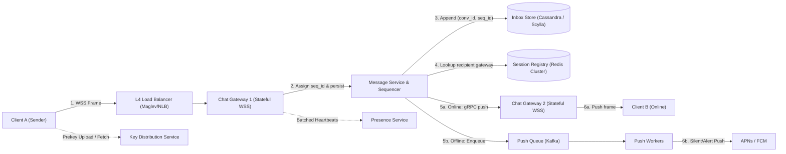

### 1.5 Chat Deep Dives & Failure Modes

- **Stateful Chat Gateways & Connection Draining**: Because WebSockets are long-lived TCP connections, L4 consistent-hashing load balancers route packets to the pinned gateway without inspecting TLS after handshake (see [Networking](../../networking/README.md)). Each gateway registers `(user_id, device_id) -> gateway_id` in Redis with a `90 s` TTL refreshed lazily on inbound client activity. During rolling deploys, gateways stop accepting new connections, send a `GOAWAY` / reconnect frame with randomized `[0, 30s]` jitter to spread reconnection storms across healthy nodes, and drain active sockets.
- **Per-Conversation Monotonic Sequence IDs vs. Wall Clocks**: Wall-clock timestamps (`Date.now()` on clients or even NTP-synced servers) cannot establish total message order: client clocks can lag by hours or jump backward, and two concurrent messages hitting different API servers within a `10 ms` NTP skew window reorder inconsistently across participants' screens. Instead, the Message Service routes `conversation_id` via consistent hashing to a deterministic partition sequencer (or uses a lightweight per-conversation atomic counter in Redis/storage backed by a durable high-water mark, or a Raft shard per partition) that assigns a contiguous monotonic `seq_id = 1, 2, 3, ...` per conversation. Contiguous `seq_id`s simultaneously solve gap detection: if a client holds `seq_id = 41` and receives `43`, it knows immediately that `42` was dropped in transit and pulls `after_seq=41`.
- **Group Chat Fan-Out Cap & Delivery Receipts**: Capping small push groups at `<= 100` members (and interactive shared-log groups at `500–1,024` members) bounds fan-out amplification. For each message, the Message Service writes once to the canonical conversation log `(conversation_id, bucket, seq_id)` (avoiding `1,000×` storage duplication for group histories), and fans out lightweight notification pointers `(conversation_id, seq_id)` to online members' gateways or offline push queues. For delivery receipts (`sent` -> `delivered` -> `read`), state transitions are monotonic (`max(current_state, new_state)`). In groups above `~50` members, displaying per-member `read` avatars creates `O(N^2)` receipt traffic (`1,000` users reading `1` message = `1,000` receipt writes), so groups either batch receipts or aggregate read counts lazily (`read_count`) rather than pushing individual receipt frames to every participant.
- **Offline Push & Inbox Sync**: When the Session Registry shows no active gateway for a recipient's device (or the gateway push times out), the Message Service publishes to a Push Queue consumed by APNs/FCM workers. Note that push payloads under E2EE carry either ciphertext (decrypted locally by an iOS Notification Service Extension) or a wake-up trigger (`content-available: 1`) prompting the app to sync via `after_seq` cursor. Keeping an explicit per-device `ack_seq` watermark prevents duplicate redelivery once the client confirms receipt.
- **Presence Heartbeat Batching & Celebrity Storms**: Naive presence architectures face two distinct amplification loads: (1) frequent idle heartbeat writes (`100M` users pinging every `5 s` = `20M` presence writes/sec) and (2) eager status-change fan-out (`555k`–`5.55M` pub/sub pushes/sec when users toggle online/offline across `400` friends). If a user with `5,000` friends toggles airplane mode on a subway, that triggers a `5,000`-message presence storm repeatedly. Production systems fix both with four defenses: (1) piggyback presence on existing WebSocket traffic and send explicit heartbeats only when idle every `30–60 s` with a `90–120 s` TTL grace period so brief cellular drops do not flap status; (2) **lazy pull**—clients do not receive global presence pushes; instead, opening a chat screen subscribes/fetches status solely for that visible peer; (3) batch contact-list presence queries in `30 s` intervals; and (4) disable live presence broadcasting automatically for accounts exceeding a contact threshold.

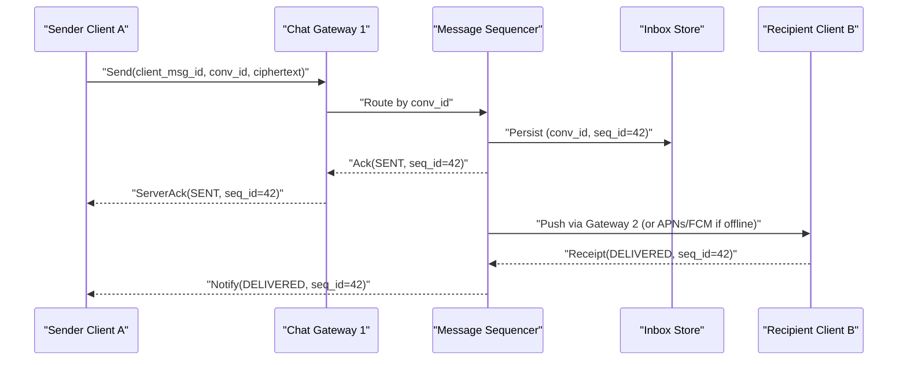

- **E2EE Signal Protocol Key Distribution**: Under the Signal Protocol, each device publishes a long-term Identity Key, a medium-term Signed Prekey, and a pool of One-Time Prekeys to the Key Distribution Service (KDS). When Alice messages Bob for the first time, Alice fetches Bob's bundle from KDS (KDS atomically pops one One-Time Prekey via `LPOP` or SQL `DELETE ... RETURNING` so two senders never reuse the same ephemeral prekey), runs X3DH to derive a shared root key, and advances a Double Ratchet per message for forward secrecy and post-compromise security. For groups up to `1,024` members, Sender Keys amortize encryption to `1` symmetric encryption + `1` server fan-out instead of `N` pairwise ratchets, rotating keys only when a member leaves. The architectural trade-off is stark: because the server holds only opaque ciphertext, server-side full-text message search, spam keyword filtering, and URL preview unfurling cannot execute on the backend and must shift to the client device.

| Messaging Mode | Group Cap | Storage Pattern | Receipt Strategy | Fan-Out & Encryption Trade-Off |
| --- | --- | --- | --- | --- |
| **1:1 Direct Chat** | `2` | Single partition `(conv_id, bucket)` | Immediate `sent`/`delivered`/`read` | Pairwise Double Ratchet; trivial `1×` gateway push |
| **Interactive Group** | `500–1,024` | Shared log + per-member cursor | Batched or read-count aggregate | Sender Keys amortize E2EE; `1` DB write + `N` lightweight pointers |
| **Broadcast Channel** | `100k–10M+` | Append-only channel log + CDN/SSE | Aggregated view counters only | No E2EE Sender Keys, no per-member receipts, pull/chunked edge fan-out |

### 1.6 Primary Literature & Systems Foundations Matrix

Modern real-time communication architectures operate at the intersection of persistent stateful connection multiplexing, causal message ordering, low-latency LSM storage, and cryptographic forward secrecy. Foundational contributions from academic RFC standards and hyper-scale industrial deployments (WhatsApp, Discord, Signal) establish the architectural paradigms governing wire framing, horizontal socket distribution, and zero-trust payload confidentiality. The matrix below anchors the chat domain in these foundational contributions.

| Milestone / Primary Paper | Domain & Key Focus | Core Architectural Mechanism | Scalability Invariant / Limit | Trade-Offs & Failure Modes |
| --- | --- | --- | --- | --- |
| **Fette & Melnikov** (IETF RFC 6455, 2011) _The WebSocket Protocol_ | Full-Duplex Framing & Connection Upgrades | HTTP `Upgrade: websocket` handshake over TCP port 80/443; minimal 2-to-10 byte framing; bidirectional full-duplex streaming without per-request HTTP header overhead. | Maintains $> 10^7$ concurrent sessions across stateful gateway clusters; sub-millisecond wire dispatch. | TCP head-of-line blocking on packet loss; lack of native multiplexed streams; cellular network handovers force full reconnection and TLS re-negotiation. |
| **Barnes et al.** (IETF RFC 9420, 2023) _The Messaging Layer Security (MLS) Protocol_ | Asynchronous Group End-to-End Encryption | TreeKEM ratchet tree representing group membership; amortizes continuous group key agreement to $O(\log N)$ cryptographic operations per message rather than $O(N)$ pairwise exchanges. | Scales cryptographically secure asynchronous group messaging to thousands of concurrent members (design target tens of thousands). | Ratchet tree synchronization requires a central Delivery Service for epoch ordering; concurrent member commits create tree conflicts requiring server-mediated serialisation. |
| **Perrin & Marlinspike** (Signal Foundation, 2016) _The Double Ratchet Algorithm & X3DH Key Agreement_ | Pairwise Asynchronous Cryptographic Messaging | Extended Triple Diffie-Hellman (X3DH) for asynchronous session initiation via one-time prekeys; KDF chain ratchet combined with DH ratchet per message turn for forward secrecy and post-compromise security. | Pairwise direct sessions; offline prekey bundles cached on untrusted key distribution servers. | Sender Keys optimization required for groups to prevent $N$ separate encryptions; server holds only opaque ciphertext, disabling backend message search and server-side spam filtering. |
| **Discord Engineering** (2023) _How Discord Stores Trillions of Messages: ScyllaDB & Tablet-Backed Storage Migration_ | Ultra-High Volume Chat Storage | Migration of trillions of messages from JVM Apache Cassandra to C++ Seastar-based ScyllaDB; dynamic tablets partitioning `(channel_id, bucket, message_id)`; Rust caching data service proxy. | Hundreds of millions of concurrent users, trillions of chat records; sustained sub-15ms p99 read and write latencies. | Wide partitions require deterministic time/sequence bucketing ($< 100\text{ MB}$ per partition); cross-tablet compaction scheduling requires custom disk throttling. |
| **WhatsApp Engineering / Erlang BEAM** (Facebook, 2012–2016) _Scaling ejabberd & Erlang to Millions of Concurrent Connections_ | Stateful Gateway Concurrency & Session Routing | Erlang/OTP lightweight actor processes on the BEAM VM; 1 lightweight process per active TCP socket (~few KB RAM); in-memory `mnesia` and ETS hash tables for transient routing state. | Over 2 million concurrent persistent TCP sessions per individual commodity multi-core server node. | Pure actor messaging lacks OS-level zero-copy optimizations (`io_uring`/`sendfile`); garbage collection pauses across millions of processes require aggressive BEAM heap tuning. |
| **Alex Xu** (ByteByteGo, 2020) _System Design Interview Vol. 1, Ch. 12: Chat System_ | Canonical Dual-Plane Chat Interview Pattern | Architectural decoupling into Stateless API Servers and Stateful WebSocket Chat Gateways; ZooKeeper server discovery; partitioned `((channel_id, bucket), seq_id)` ordering + UUIDv7 `message_id` dedupe; 30s heartbeat presence ring. | 50M DAU baseline; capped groups ($\le 100$ members); multi-device sync via `cur_max_message_id`. | Pairwise Pub/Sub presence fan-out breaks on large contact graphs; omission of modern HTTP/3 WebTransport and MLS group encryption. |

Real-time message routing requires strict operational boundaries between ephemeral wire connections and durable storage state. RFC 6455 established the capability to upgrade standard web ingress ports into persistent full-duplex communication channels, bypassing the polling overhead that crippled early web architectures. Concurrently, WhatsApp proved on the FreeBSD kernel and Erlang BEAM runtime that managing tens of millions of concurrent persistent connections is bounded by socket buffer memory rather than CPU scheduling, establishing the design principle of dedicated stateful connection gateways separated from business logic.

As messaging fleets expanded to billions of conversations, the storage tier encountered severe write-amplification bottlenecks. Discord documented that naive wide-column Cassandra schemas suffer catastrophic JVM garbage collection pauses under heavy message deletion and partition compaction. Their 2023 migration to ScyllaDB tablets demonstrated that hardware-aligned thread-per-core architectures combined with deterministic two-dimensional bucketing `(channel_id, bucket, message_id)` provide bounded $O(1)$ disk reads regardless of total message volume. Simultaneously, privacy standards migrated from transport-only perimeter TLS to end-to-end payload encryption: the Signal Double Ratchet and IETF RFC 9420 (MLS) shifted cryptographic trust entirely to edge devices, converting backend messaging servers into zero-knowledge blind delivery relays.

### 1.7 Verified ByteByteGo Canonical Worked Architecture & Capacity Delta (Chapter 12)

The canonical ByteByteGo Chapter 12 specification establishes a baseline real-time messaging system: a platform supporting 50 million daily active users (DAU) participating in one-on-one chats and small group chats capped at 100 members. The system specifies text messages up to 100,000 characters, permanent message history, online presence tracking, multi-device synchronization, and offline push notifications. The table below contrasts this canonical interview baseline with the hyper-scale production tier (500M DAU / 100M concurrent sockets) defined in §1.2.

| Architectural Metric / Parameter | ByteByteGo Ch. 12 Canonical Baseline | Hyper-Scale Production Tier (500M DAU) | Architectural Implication & Engineering Delta |
| --- | --- | --- | --- |
| **Daily Active Users (DAU)** | 50 million DAU | 500 million DAU | $10\times$ user scale expansion; requires multi-region active-active deployment and geo-distributed caching. |
| **Peak Concurrent Connections** | $\approx 10\text{M}$ concurrent sockets (assumed) | $100\text{M}$ concurrent persistent sockets | Requires a dedicated fleet of $\sim 250$ stateful gateway nodes (500k sockets/node @ 32 vCPU / 64 GB RAM). |
| **Daily Message Volume** | $\approx 5\text{B}$ messages/day (100 msgs/user) | $50\text{B}$ messages/day (100 msgs/user) | $10\times$ write volume; requires partitioned LSM storage engines and distributed message sequencers. |
| **Average Message Write QPS** | $\approx 57{,}870\text{ msgs/s}$ average | $\approx 578{,}700\text{ msgs/s}$ average | Ingestion pipeline must handle sustained sub-second indexing without database row locking. |
| **Peak Message Outbound QPS** | $\approx 175{,}000\text{ msgs/s}$ peak | $\approx 2{,}600{,}000\text{ frames/s}$ peak | Gateway outbound dispatch handles $1.5\times$ group fan-out amplification at peak diurnal surges. |
| **Maximum Group Chat Size** | Capped at 100 members | Capped at $1{,}024$ (interactive) / 100k+ (broadcast) | 100-member cap permits per-recipient sync queues; $1{,}024+$ forces shared channel logs and pull cursors. |
| **Maximum Message Payload** | 100,000 characters ($\approx 100\text{ KB}$ ASCII; up to $\sim 400\text{ KB}$ UTF-8) | 4,000 characters text; media via S3 pre-signed URLs | Large payloads stream directly to object storage; inline text is strictly bounded to prevent gateway buffer bloat. |
| **Transport Wire Protocol** | HTTP/1.1 WebSocket (RFC 6455) | Dual HTTP/3 WebTransport (QUIC) + WebSocket fallback | Modern edge terminates QUIC to eliminate TCP HOL blocking and permit 0-RTT mobile IP handovers. |
| **Session Registry Architecture** | Centralized discovery lookup | Sharded Redis/Valkey Cluster with 90s sliding TTL | Redis cluster holds $100\text{M}$ mappings (`user_id -> gateway_id`) consuming $12.8\text{ GB}$ DRAM. |
| **Presence Tracking Model** | Eager friend-pair Pub/Sub channels | Ephemeral presence cache + lazy viewport pull | Eager pairwise broadcast collapses under large contact graphs; production relies on on-demand viewport queries. |
| **Data Storage Engine** | Generic NoSQL Key-Value Store | ScyllaDB Tablets / TiKV + Local NVMe SSDs | Replaces JVM garbage-collected wide-column stores with C++ thread-per-core bounded LSM tablets. |

#### Communication Protocols: Polling vs. Long Polling vs. WebSockets

Selecting the communication layer between chat clients and backend services dictates server resource consumption, battery longevity, and message delivery latency:

1. **Short Polling**:
   - _Mechanics_: The client opens a recurring HTTP/1.1 connection at a fixed interval (e.g. every 1 to 5 seconds) requesting `GET /v1/conversations/{id}/messages?after={last_seen_id}`.
   - _Overhead_: Each polling request initiates a full TCP three-way handshake, TLS 1.3 key exchange, and HTTP header transmission ($500\text{--}1{,}000\text{ bytes}$ per frame). With 50M DAU polling every 2 seconds, the gateway fleet processes $25{,}000{,}000\text{ HTTP requests/s}$, of which over $99\%$ return empty payloads (`304 Not Modified` or empty JSON arrays).
   - _Defects_: Substantial latency floor ($1\text{--}2\text{ s}$ delay between sender dispatch and recipient receipt); severe battery depletion on mobile devices due to continuous radio interface power transitions (cellular RRC state machine remaining in high-power continuous reception).
2. **Long Polling**:
   - _Mechanics_: The client issues an HTTP `GET` request. If no new messages are pending, the server suspends the request, holding the connection open until a message arrives or a server timeout (e.g. 30 seconds) expires. Once a message is delivered or the timeout triggers, the response closes, and the client immediately opens a new long-poll request.
   - _Overhead_: Significantly reduces empty polling frames, but each received message terminates the HTTP session, forcing a renegotiation.
   - _Defects_: Rapid message sequences produce high connection churn; parallel requests across multiple conversations create out-of-order race conditions on mobile networks; server worker threads remain tied up unless managed by an asynchronous non-blocking event loop.
3. **WebSocket (RFC 6455)**:
   - _Mechanics_: The client establishes a standard HTTP/1.1 connection and transmits an `Upgrade: websocket` header. The server responds with `HTTP/1.1 101 Switching Protocols`. The underlying TCP socket remains permanently open, transitioning from HTTP request-response framing to a bi-directional, full-duplex binary frame protocol.
   - _Advantages_: Frame headers are compact ($2\text{ bytes}$ for unmasked server-to-client frames, $6\text{ bytes}$ for masked client-to-server frames). Both sender and receiver push frames asynchronously with sub-millisecond dispatch and zero HTTP header overhead. Connection state is maintained continuously, minimizing cellular radio transitions and eliminating connection setup latency during active conversations.

#### Stateless vs. Stateful Architecture Split & ZooKeeper Discovery

A production chat infrastructure segregates application components into two isolated operational tiers:

- **Stateless Service Plane**: Handles user sign-up, login authentication, user profiles, group membership management, blocklists, and notification preferences. Because these requests follow classic request-response semantics, they route through standard L7 load balancers to stateless worker pools running in container orchestrators (Kubernetes). These services scale horizontally based on CPU and memory thresholds, as any node can service any incoming HTTP request.
- **Stateful Chat Gateway Plane**: Manages persistent, long-lived WebSocket connections with active client devices. Once a client connects, the gateway holds an active TCP file descriptor in its operating system socket table. Inbound frames from the client and outbound pushes directed to that client must route specifically through that designated gateway node. Gateways maintain minimal business logic: they validate framing, authenticate connection tokens, route messages to downstream storage and sequencer services, and stream outbound frames to locally connected sockets.

Because chat gateways are stateful, clients cannot connect to arbitrary backend servers through naive round-robin load balancers. ByteByteGo Chapter 12 formalizes **ZooKeeper-based Service Discovery** to coordinate server allocation:

1. **Gateway Registration**: Every chat gateway node registers an ephemeral znode under `/chat_servers/{datacenter}/{node_id}` upon startup, recording its public IP, WebSocket port, geographical region, active connection count, and available socket capacity.
2. **Health Monitoring**: Gateways send periodic heartbeats to ZooKeeper. If a gateway experiences a fatal crash or network partition, its ephemeral znode expires automatically, removing it from the allocation pool.
3. **Server Allocation**: When a client authenticates via the Stateless API tier (`POST /v1/auth/login`), the API service queries ZooKeeper. ZooKeeper evaluates candidate gateways using a multi-variable fitness function:

   $$\text{Score}(G) = w_1 \cdot \text{Latency}(C_{\text{geo}}, G_{\text{region}}) + w_2 \cdot \left(1 - \frac{\text{ActiveSockets}(G)}{\text{MaxCapacity}(G)}\right)$$

4. **Connection Handoff**: The API tier returns the chosen gateway endpoint (e.g. `wss://chat-us-east-14.example.com`) to the client. The client initiates its direct TLS WebSocket handshake to that designated gateway.

#### Mathematical Derivations & Sizing Proofs

##### 1. Sequence ID Generation: Global Snowflake vs. Local Channel Sequences

Maintaining strict message order across mobile devices is a critical correctness invariant. Two primary paradigms exist for ID generation:

- **Global 64-bit Snowflake ID**: Comprises 1 sign bit, 41 bits of millisecond timestamp (69 years), 10 bits of datacenter and worker machine ID ($1{,}024$ nodes), and 12 bits of local sequence counter ($4{,}096$ IDs/ms/node).
  - _Advantage_: Generates globally unique, time-sortable IDs across distributed servers with zero network coordination.
  - _Limitation_: Because messages within a single conversation originate from different mobile devices hitting different gateway servers, network jitter and slight clock skews yield non-contiguous sequences. If two messages arrive within the same millisecond window, their relative timestamp ordering does not reflect causal order.
- **Local Channel-Scoped Monotonic Sequence ID**: An integer sequence generated per conversation channel ($c$), where $\text{seq}(m_{k+1}) = \text{seq}(m_k) + 1$.

###### Proof of Local Sequence Superiority for Chat Invariants

In instant messaging, total global ordering across disparate, unrelated conversations is irrelevant: Alice chatting with Bob has zero causal dependency on Charlie chatting with Diana. Causal ordering is strictly required within conversation $C$.

Let conversation $C$ receive messages $m_1, m_2, \dots, m_n$. Under a contiguous local sequence generator:

$$\forall k \in [1, n-1], \quad \text{seq}(m_{k+1}) - \text{seq}(m_k) = 1$$

This contiguous invariant provides deterministic **Gap Detection**:

If a client currently holds $s_{\text{acked}} = 42$ and receives a frame with $\text{seq} = 45$, the client immediately detects that messages $43$ and $44$ were lost in transit:

$$\Delta = \text{seq}_{\text{inbound}} - s_{\text{acked}} = 45 - 42 = 3 > 1$$

The client enqueues a targeted catch-up request: `GET /messages?after_seq=42&before_seq=45`. Conversely, under a sparse global Snowflake generator, $\text{ID}_{k+1} - \text{ID}_k$ varies unpredictably (e.g. $1{,}842{,}109$ vs $1{,}843{,}012$). The client cannot determine whether intermediate IDs were dropped packets or unallocated numbers in other channels, requiring complex vector clocks or sliding sync windows. Furthermore, contiguous integers compress efficiently in LSM and B-Tree indexes, reducing index memory by up to $40\%$.

##### 2. Key-Value Storage Schema & LSM Engine Superiority

Chat systems exhibit an extreme write-heavy access pattern: messages are written once, read immediately by active participants, and accessed with decreasing frequency over time (the long tail of chat history).

Relational databases (RDBMS) backing chat tables fail under high concurrent write volume due to B-Tree index mechanics. Inserting into a B-Tree table indexed by `(conversation_id, created_at)` requires in-place disk page updates. When millions of conversations receive concurrent writes, disk heads thrash across random blocks, inducing severe write amplification and lock contention.

Key-Value and Wide-Column stores (ScyllaDB, Cassandra, RocksDB) implement Log-Structured Merge-trees (LSM):

1. **Append-Only Ingestion**: Inbound writes append sequentially to an in-memory `MemTable` and a sequential write-ahead log (WAL) with zero random disk seeks.
2. **Immutable SSTables**: Once a `MemTable` reaches its threshold ($64\text{--}128\text{ MB}$), it flushes to disk as an immutable Sorted String Table (SSTable).
3. **Primary Key Schema**:
   ```sql
   -- Primary Key Schema for Chat Conversations
   PRIMARY KEY ((channel_id, bucket_ym), seq_id)
   WITH CLUSTERING ORDER BY (seq_id DESC);
   ```
   - For 1-on-1 chats: `channel_id = hash(min(user1, user2), max(user1, user2))`
   - For group chats: `channel_id = group_id`
   - `bucket_ym` (Year-Month integer, e.g. `202611`) partitions long-lived channels into bounded physical SSTable partitions ($< 100\text{ MB}$), preventing wide-partition compaction stalls.

##### 3. Multi-Device Message Synchronization Mechanics

Users routinely operate multiple linked devices (smartphones, tablets, desktop clients). Every device must reflect an identical, synchronized message history without duplicate alerts.

Each device maintains a local persisted per-conversation high-water mark variable (`cur_max_message_id` / `after_seq`).

When a client establishes a connection or wakes from background mode, it queries the sync endpoint per conversation:

$$\text{NewMessages}(\text{conv}) = \{ m \in \text{ConversationLog}[\text{conv}] \mid m.\text{seq-id} > \text{after-seq} \}$$

Synchronization Flow:

1. User A sends message $m_{43}$ to User B.
2. The server persists $m_{43}$ and pushes it to User B's active mobile device.
3. User B's mobile client renders $m_{43}$ and updates its local state: `cur_max_message_id` becomes 43.
4. User B later opens their laptop client, which holds `cur_max_message_id = 40`.
5. The laptop sends a sync request: `GET /v1/sync?after=40`.
6. The server returns messages $m_{41}, m_{42}, m_{43}$. The laptop updates its local database, advances its watermark to $43$, and clears stale unread badges.

##### 4. Online Presence & Heartbeat Fan-Out Explosion Proof

Online presence indicates whether contacts are currently reachable. In ByteByteGo Chapter 12, clients emit periodic heartbeats to Presence Servers:

- Heartbeat interval: $T_{\text{ping}} = 30\text{ seconds}$.
- Presence lease in Redis: $\text{TTL} = 90\text{ seconds}$ ($3 \times T_{\text{ping}}$).
- If the server receives no heartbeat within 90 seconds, the user is marked offline.

###### Mathematical Proof of Presence Broadcast Breakdown

Consider a system with $U = 50\text{M}$ daily active users, where each user has an average of $F = 400$ mutual friends. If presence updates are implemented via eager pairwise Pub/Sub fan-out (where every user status change publishes to $F$ individual friend channels):

When a user connects, disconnects, or toggles state, write amplification is $F$.

Assume during peak morning hours, $10\%$ of active users ($5\text{M}$ users) connect or disconnect within a $3{,}600\text{ second}$ window. The resulting presence fan-out event rate is:

$$\text{Events}_{\text{fanout}} = 5{,}000{,}000 \times 400 = 2{,}000{,}000{,}000\text{ events}$$

$$\text{QPS}_{\text{presence}} = \frac{2 \times 10^9}{3{,}600\text{ s}} \approx 555{,}555\text{ updates/s}$$

Under the hyper-scale tier of $500\text{M}$ DAU (§1.2 scale), this reaches:

$$\text{QPS}_{\text{presence, peak}} = \frac{50{,}000{,}000 \times 400}{3{,}600\text{ s}} \approx 5{,}555{,}555\text{ updates/s}$$

Pushing $5.55\text{M}$ presence events/second across distributed pub/sub channels saturates network interfaces, burns CPU cycles on serialization, and exhausts mobile client radio bandwidth with status updates for friends who are not currently being viewed.

_Production Resolution_:

1. Limit eager friend-pair Pub/Sub channels strictly to small, active friend groups ($F \le 500$).
2. For all other contacts and large channels, enforce **Lazy Viewport Presence**: the client fetches presence status on demand only for the contacts visible on the current active chat screen (`GET /v1/presence?users=u1,u2,u3`), re-fetching lazily when the view scrolls.

### 1.8 End-to-End Chat Architecture & Dual-Plane Service Discovery

The end-to-end chat architecture coordinates persistent WebSocket gateways, stateless authentication and discovery services, distributed session registries, LSM history storage, and offline push notification pipelines.

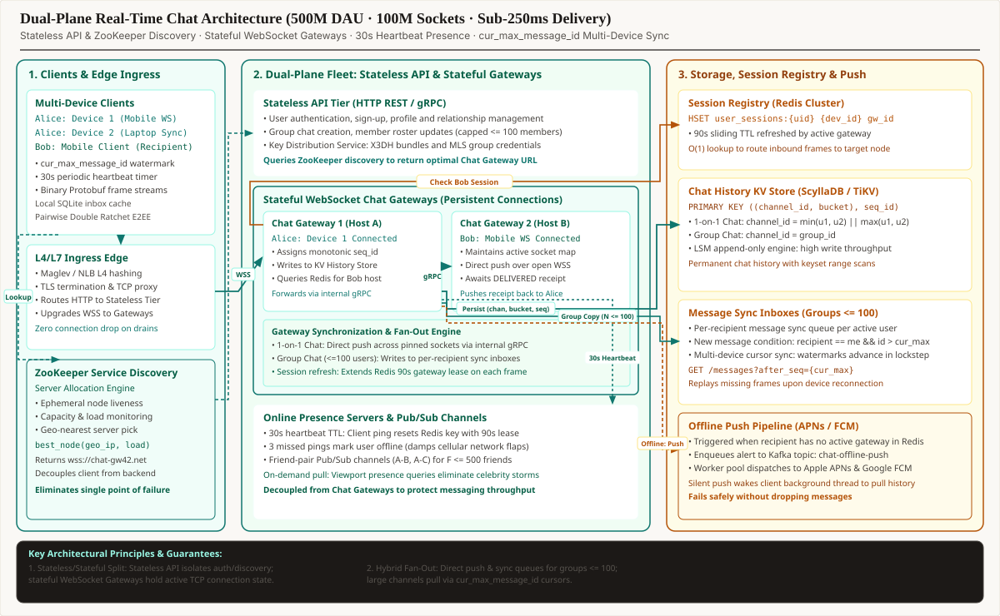

#### 1. Connection Establishment & Service Discovery Flow

1. **Authentication & Discovery Query**: A mobile client initiates an HTTPS request `POST /v1/auth/login` to the Stateless API Tier via L4/L7 ingress load balancers. Upon authenticating the user credentials, the API service queries the Apache ZooKeeper / etcd service discovery cluster.
2. **Server Recommendation**: ZooKeeper monitors active socket counts and hardware metrics across all stateful chat gateways. It identifies healthy gateways in the client's geographic vicinity and returns the optimal endpoint (e.g. `wss://chat-gw07.example.com`).
3. **WebSocket Handshake**: The client initiates a TLS 1.3 handshake to `chat-gw07`, followed by an HTTP `Upgrade: websocket` request containing the session authorization bearer token.
4. **Session Registration**: Gateway 07 accepts the connection, adds the socket file descriptor to its local epoll/kqueue event loop, and executes an atomic write to the distributed Session Registry (Redis Cluster):
   ```text
   HSET user_sessions:alice device_mobile "gw07"
   EXPIRE user_sessions:alice 90
   ```
   The gateway refreshes this 90-second TTL on every subsequent inbound frame or heartbeat.

#### 2. One-on-One Direct Messaging Flow

1. **Inbound Frame**: Alice transmits a binary Protobuf frame containing:
   ```protobuf
   ClientSendMessage {
     client_msg_id: "uuid-v7-884a";
     conversation_id: "conv-alice-bob";
     ciphertext_payload: <bytes>;
     sender_device_id: 1;
   }
   ```
2. **Sequencing & Persistence**: Chat Gateway 07 receives the frame, verifies Alice's session token, and passes the message to the Message Sequencer. The Sequencer allocates the next monotonic sequence number (`seq_id = 42`) for `conv-alice-bob` and commits the record to the Key-Value Store (ScyllaDB / TiKV):
   ```sql
   INSERT INTO messages_by_conversation (conversation_id, bucket_ym, seq_id, message_id, sender_id, payload, created_at)
   VALUES ('conv-alice-bob', 202611, 42, 'uuid-v7-884a', 'alice', <bytes>, toTimestamp(now()));
   ```
3. **Sender Acknowledgement**: Once the write completes across the storage quorum ($RF=3, W=\text{QUORUM}$), Gateway 07 dispatches a lightweight acknowledgement frame to Alice: `ServerAck(client_msg_id="uuid-v7-884a", seq_id=42, status=SENT)`.
4. **Recipient Session Routing**: Gateway 07 queries the Session Registry in Redis for Bob's active session (`HGETALL user_sessions:bob`):
   - **Path A (Bob is Online)**: The registry returns `device_mobile -> "gw19"`. Gateway 07 issues an internal gRPC dispatch to Gateway 19: `ForwardMessage(recipient="bob", payload=<frame>)`. Gateway 19 writes the binary frame directly to Bob's persistent WebSocket. Bob's device receives the frame, advances its local `cur_max_message_id`, and emits a `DELIVERED` receipt back up the pipeline to notify Alice.
   - **Path B (Bob is Offline)**: The registry returns no active gateways. Gateway 07 publishes an alert event to the Kafka `chat-offline-push` topic. A pool of Push Notification Workers consumes the event, formats the push payload, and calls Apple APNs or Google FCM HTTP/2 push endpoints. When Bob's mobile OS receives the push notification, it displays an alert banner or wakes a background sync task to pull missed messages.

#### 3. Group Messaging Flow ($\le 100$ Members) & Sync Inboxes

1. **Group Ingestion**: Alice sends a message to group `G1`. Gateway 07 validates membership against group metadata cached in Redis, allocates a monotonic `seq_id`, and writes the record once to the group's canonical storage log in the KV Store: `((G1, 202611), seq_id)`.
2. **Inbox Fan-Out**: Because group membership is bounded at $\le 100$ users, Gateway 07 copies a lightweight message reference `<G1, seq_id, sender_alice>` to the per-recipient Message Sync Inbox queues of the 99 group members.
3. **Parallel Dispatch**:
   - For members currently online, their assigned chat gateways pull the message reference, hydrate the payload, and push it across their active WebSockets.
   - For members currently offline, the message reference resides safely in their sync inbox queue. Upon reconnecting, the offline devices pull pending frames using their local `cur_max_message_id` cursor.

#### 4. Multi-Device Synchronization & Catch-Up

When Alice opens her secondary device (e.g. desktop client):

1. The desktop client reads its local SQLite database and determines its watermark: `cur_max_message_id = 38`.
2. The client establishes a WebSocket to its assigned gateway and issues a synchronization catch-up query:
   ```text
   GET /v1/sync?conversation_id=conv-alice-bob&after_seq=38&limit=100
   ```
3. The gateway queries the Key-Value Store for all rows where `conversation_id = 'conv-alice-bob'` and `seq_id > 38`.
4. The server returns messages $39, 40, 41, 42$ in ascending monotonic order. The desktop client applies the updates locally, advances its watermark to $42$, and clears read badges across the UI.

#### 5. Online Presence & Heartbeat Processing

1. **Heartbeat Dispatch**: Every 30 seconds, an active mobile client emits a 1-byte ping frame over its existing WebSocket to the Chat Gateway.
2. **Presence Refresh**: The Chat Gateway forwards the ping to the Presence Service, which executes an atomic pipeline command in Redis:
   ```text
   SETEX presence:alice 90 "ONLINE"
   ```
3. **Flap Damping**: If Alice encounters a brief 10-second subway tunnel disconnect, her Redis presence key remains valid due to the 90-second lease window. Only when three consecutive 30-second heartbeat windows elapse without an update does the key expire, preventing rapid online/offline status flapping across friend devices.

### 1.9 Technology Comparison: Then vs. Now (2021 vs. 2026)

Between 2021 and 2026, real-time messaging architectures transitioned from legacy TCP/WebSocket transports, external ZooKeeper clusters, and unpartitioned JVM storage systems to zero-copy QUIC transports, dynamic Envoy service discovery, and thread-per-core LSM storage engines.

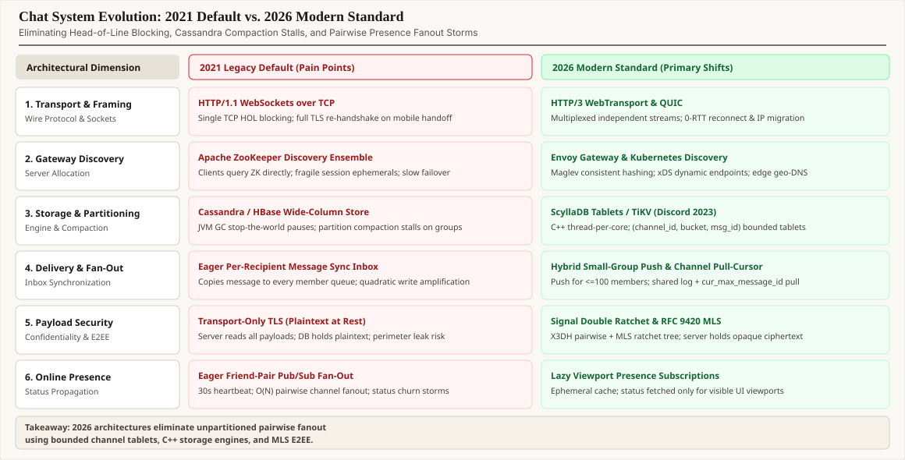

| Architectural Dimension | 2021 Legacy Default (Pain Points) | 2026 Modern Standard (Primary Shifts) | Engineering Impact & Production Trade-Offs |
| --- | --- | --- | --- |
| **1. Transport & Framing** | HTTP/1.1 WebSockets over TCP; head-of-line blocking on packet loss; expensive TLS re-handshakes on cellular drops. | HTTP/3 WebTransport & QUIC; multiplexed independent streams; 0-RTT reconnect and native connection migration. | Eliminates packet loss stall cascades across conversations; seamless handover between Wi-Fi and mobile networks without connection drops. |
| **2. Gateway Discovery** | External Apache ZooKeeper Ensemble; clients query ZooKeeper directly; heavy JVM heartbeat overhead; slow failovers. | Envoy Gateway & Kubernetes Discovery; Maglev consistent hashing; xDS dynamic endpoint discovery; edge geo-DNS. | Eliminates ZooKeeper operational toil; sub-second gateway endpoint propagation; uniform L4/L7 ingress routing. |
| **3. Message Storage** | Apache Cassandra / HBase Wide-Columns; JVM garbage collection pauses; tombstone accumulation stalls compaction on active groups. | ScyllaDB Tablets / TiKV (Discord 2023 migration); C++ Seastar thread-per-core; `(channel_id, bucket, message_id)` bounded tablets. | Sub-15ms p99 write latency; eliminates stop-the-world GC; bounded partitions prevent wide-partition compaction stalls. |
| **4. Delivery & Fan-Out** | Eager per-recipient message sync inbox queues; copies message to every member queue; quadratic write amplification on groups. | Hybrid Small-Group Push & Channel Pull-Cursor; direct push for $\le 100$ members; shared log + `cur_max_message_id` pull for channels. | Saves $> 80\%$ database write volume; prevents message queue starvation during viral group surges. |
| **5. Payload Security** | Transport-Only TLS encryption; server inspects plaintext payloads; database stores raw messages; vulnerable to perimeter breach. | Signal Double Ratchet & RFC 9420 MLS; X3DH pairwise + MLS ratchet tree; server functions as zero-knowledge blind relay. | Guarantees end-to-end privacy, forward secrecy, and post-compromise security; shifts full-text search to client SQLite engines. |
| **6. Online Presence** | Eager friend-pair Pub/Sub fan-out; 30s heartbeat; $O(N)$ pairwise channel broadcasts; celebrity accounts trigger status churn storms. | Lazy Viewport Presence Subscriptions; ephemeral cache; status fetched on demand only for visible UI viewports. | Reduces presence event QPS by $90\%$; shields mobile downlink bandwidth from background status noise. |

#### Deep Operational Pitfalls & Migration Guide

##### Pitfall 1: Cassandra Tombstone Overload & Compaction Stalls on Message Deletions

In wide-column databases (Apache Cassandra), message deletions or expiring TTL records do not immediately erase data from disk. Instead, the engine writes an immutable marker called a **tombstone** to the current `MemTable`. When clients issue range queries to load recent chat history (`SELECT * FROM messages WHERE channel_id = ? AND seq_id > ? LIMIT 50`), the storage engine must scan through thousands of tombstone records across multiple SSTables before assembling 50 live rows. If tombstones exceed `tombstone_failure_threshold` (default 100,000), the node drops the query and throws a `TombstoneOverwhelmingException`. During background compactions, purging tombstones requires comparing all overlapping SSTables, triggering massive JVM heap pressure and multi-second garbage collection pauses.

_Mitigation_: Migrate to C++ thread-per-core storage engines (ScyllaDB) and implement deterministic two-dimensional bucketing: `((channel_id, bucket_ym), seq_id)`. Time-window compaction strategies (TWCS) isolate old tombstones into discrete monthly SSTables that drop cleanly upon expiration without cross-table compaction scans. For message deletions under E2EE, store tombstones in client-side SQLite databases and overwrite the ciphertext payload with zeroed bytes rather than generating storage engine delete markers.

##### Pitfall 2: Reconnection Storms (Thundering Herds) on Edge Gateway Flaps

When a stateful chat gateway hosting 500,000 active WebSocket connections suffers a hardware failure, network partition, or Kubernetes rolling deployment restart, half a million TCP sockets terminate simultaneously. Naive mobile client implementations detect socket closure and immediately issue connection requests to remaining gateway nodes. This instantaneous surge of 500,000 concurrent TLS 1.3 handshakes exhausts CPU cycles on cryptographic math, saturates L4 load balancer connection tables, and triggers cascading failure across healthy gateway instances.

_Mitigation_: Implement two mandatory connection draining defenses:

1. **Server-Side Graceful Draining**: During planned deployments, gateways stop accepting new sessions and send a WebSocket `CloseFrame` (code 1001 Going Away) containing an explicit reconnect delay parameter. Gateways drain active sockets at a controlled rate (e.g. 5,000 connections/sec) rather than terminating all sockets at once.
2. **Client-Side Exponential Backoff with Full Jitter**: Clients must never reconnect immediately upon socket drop. They must execute randomized backoff:

   $$T_{\text{backoff}} = \min(T_{\text{max}}, \; T_{\text{base}} \cdot 2^{\text{attempt}}) \times \text{Uniform}(0.5, 1.5)$$

   Spreading reconnection attempts over a 30-to-60 second window allows the gateway fleet to absorb incoming TLS handshakes smoothly.

##### Pitfall 3: Group Fan-Out Amplification & Memory Queue Starvation

When a user posts a message to a large group chat, pushing that message to hundreds or thousands of members creates an immediate fan-out surge. In systems using eager per-recipient inboxes, a single message sent to a 1,000-member group triggers 1,000 database writes and 1,000 message queue events. If multiple users in several large groups chat concurrently, worker queues back up, memory consumption explodes, and downstream push workers experience severe Out-Of-Memory (OOM) crashes, delaying one-on-one direct messages.

_Mitigation_: Enforce a strict architectural bifurcation based on group size:

- **Small Groups ($\le 100$ members)**: Retain per-recipient sync queues. The fan-out amplification ($100\times$) is bounded and easily absorbed by in-memory queues.
- **Large Groups & Channels ($> 100$ members)**: Completely eliminate per-recipient inboxes. Write the message exactly **once** to the canonical channel log `((channel_id, bucket), seq_id)`. Gateways push a lightweight event notification containing only the sequence pointer `(channel_id, seq_id)` to online participants. The client device compares the pointer against its local cursor and pulls the message body on demand. Offline members perform zero database writes at publish time; they sync missed sequence ranges lazily when they next open the channel.

##### Pitfall 4: Out-of-Order Message Rendering & Split Inboxes from Cellular Handover

Mobile devices frequently switch between Wi-Fi and 4G/5G cellular radios while moving. During handover, the device's IP address changes, causing the existing TCP connection to hang or terminate. If a client transmits Message A over the failing cellular link, switches to Wi-Fi, and transmits Message B over a new connection before the cellular TCP timeout expires, Message B can reach the chat gateway and obtain `seq_id = 42` before Message A's TCP retry delivers it with `seq_id = 43`. If the client renders messages based on arrival order, conversation history displays out of order, confusing users.

_Mitigation_: Decouple client UI rendering from network transport arrival. The client assigns every outgoing message an immutable client-side UUIDv7 idempotency key. The gateway uses a per-conversation atomic partition sequencer that guarantees contiguous `seq_id` assignment based strictly on receipt order at the sequencer. Clients sort messages in UI memory using the server-assigned monotonic `seq_id`. Furthermore, modern deployments using HTTP/3 WebTransport over QUIC rely on QUIC Connection IDs: the client migrates its active connection session across cellular and Wi-Fi networks without dropping the QUIC session or changing cryptographic keys, eliminating socket reconnects during network handovers.

---

## 2. Multi-Channel Notification System

A Multi-Channel Notification System decouples business producers (auth, billing, order tracking, marketing) from heterogeneous, rate-limited, and frequently flaky third-party delivery providers (APNs, FCM, SMS aggregators, email ESPs). Its core challenge is strict priority isolation: a `10M`-recipient promotional blast must never delay a `2FA` one-time passcode beyond `1 second`.

### 2.1 Notification Requirements & SLAs

- **Functional requirements**: Multi-channel dispatch (`iOS APNs`, `Android FCM`, `SMS`, `Email`, `In-App`), priority tiers (`P0` security/OTP, `P1` transactional receipts/alerts, `P2` marketing campaigns), template versioning and i18n rendering, per-user channel preferences and Do-Not-Disturb (DND) quiet hours, automatic deduplication, provider fallback, and delivery/click analytics.
- **Non-functional requirements**: `P0` OTP end-to-end dispatch latency `p99 < 1 s`; `P1` transactional `p95 < 10 s`; `P2` batch throughput `>= 100k` notifications/sec without starving `P0`/`P1`; at-least-once ingestion with downstream deduplication (`notification_id`) to minimize duplicate user alerts; `99.99%` ingestion availability.

### 2.2 Notification Capacity Estimation

- **Daily volume**: `200M` notifications/day (`10M` P0 OTPs, `70M` P1 transactional, `120M` P2 marketing).
- **Peak QPS**: Average QPS is `200M / 86,400 ≈ 2,315` notifications/sec. However, marketing campaigns create sharp scheduled spikes (e.g., `10M` campaign notifications triggered at `09:00` local time, shaped to `50k–100k/sec`), while P0 OTP peaks around login surges (`~5k/sec`).
- **Storage**: Retaining `90 days` of notification audit logs at `~1 KB/record` (`200M * 90 * 1 KB = 18 TB` raw; `~54 TB` replicated, or tiered to object storage after `7 days`).

### 2.3 Notification API & Event Contract

Producers submit notifications via gRPC or Kafka events carrying an explicit `notification_id` for idempotent deduplication and an immutable `(template_id, template_version)` reference:

```json
{
  "notification_id": "01934a8b-7c10-7b22-9f41-88a1c3d2e010",
  "tenant_id": "auth-service",
  "user_id": "usr_982341",
  "priority": "P0_CRITICAL",
  "channels": ["sms", "push"],
  "fallback_policy": "SEQUENTIAL_ON_FAILURE",
  "template": { "id": "login_otp", "version": 4, "locale": "cs-CZ" },
  "params": { "code": "492817", "ttl_minutes": 5 },
  "bypass_dnd": true,
  "expires_at": "2026-11-20T12:05:00Z"
}
```

### 2.4 Notification High-Level Design

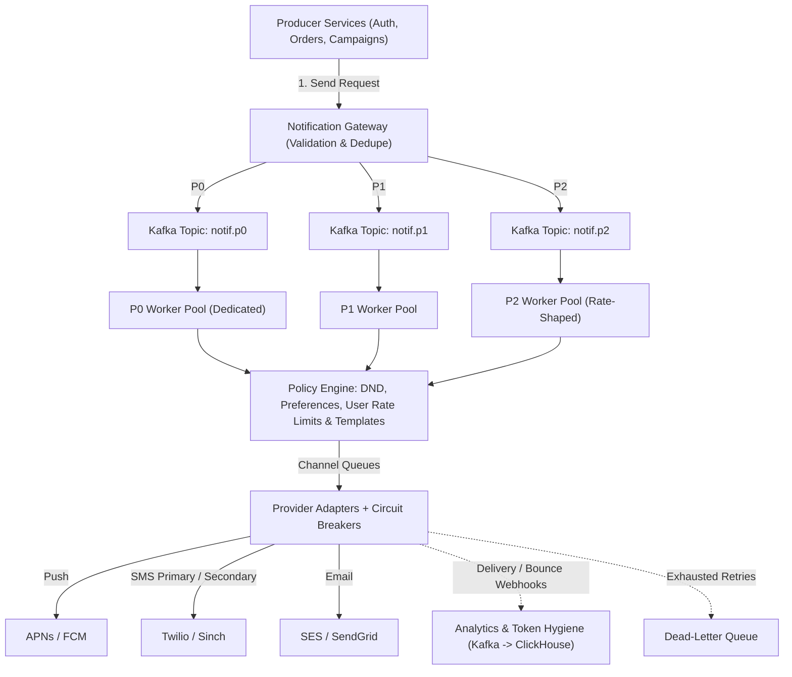

### 2.5 Notification Deep Dives & Failure Modes

- **Priority Queue & Worker Pool Isolation**: Sharing a single Kafka topic or single worker thread pool across OTPs and marketing batches guarantees head-of-line blocking during a marketing blast (`10M` P2 messages sitting ahead of P0). Physical isolation—separate Kafka topics (`notif.p0`, `notif.p1`, `notif.p2`), separate consumer groups, and dedicated autoscaled worker fleets—ensures P0 workers never contend with P2 traffic for CPU, DB connections, or outbound NAT sockets. P2 workers also enforce a token-bucket rate shaper so downstream user-profile and template stores are not overwhelmed when a campaign launches.
- **Provider Adapters, Circuit Breakers & Fallback**: Each external vendor (APNs, FCM, Twilio, Sinch, SES) has distinct rate quotas, payload limits, and failure modes. Wrapping every provider behind a standardized adapter with a per-provider sliding-window circuit breaker (tracking `5xx`, timeouts, and latency) prevents a brownout at Twilio from exhausting worker threads waiting on `30 s` HTTP timeouts. For `P0` alerts, if the primary SMS provider's circuit opens or returns a transient `503`, the adapter fails over immediately to a secondary SMS aggregator (or falls back from Push to SMS if push delivery fails within `15 s`). Conversely, permanent `4xx` errors (`Unregistered` APNs token, `InvalidPhoneNumber`) must **never** retry—they route directly to token hygiene to mark the device token inactive.
- **User Rate Limits & DND Preferences**: Beyond protecting providers, the Policy Engine protects users from notification fatigue via sliding-window per-user caps in Redis (e.g., max `3` marketing pushes/day per user) and DND evaluation using the user's stored IANA timezone (`Europe/Prague`, converting quiet hours like `22:00–08:00` safely across DST transitions). `P0` security alerts set `bypass_dnd: true`, whereas `P1/P2` notifications intercepted by DND are either dropped (marketing) or parked in a delayed schedule bucket to fire at `08:00` local time with jitter.
- **Template Versioning & Deduplication**: Storing rendered strings inside queue messages wastes bandwidth and breaks late localization updates, while mutating a live template in-place can break in-flight schema parameters. Instead, producers reference an immutable `(template_id, version)` compiled and cached in-memory by workers (with JSON Schema / Zod parameter checks at the gateway). Deduplication occurs at two boundaries: (1) ingestion checks `SET notif:dedupe:{notification_id} 1 NX EX 86400` in Redis (backed by a partitioned DB unique index if multi-day dedupe is needed) so producer retries do not double-enqueue; (2) workers drop expired alerts (`now > expires_at`) before calling external providers, preventing stale OTP SMS charges after a backlog recovery.
- **Analytics Tracking & Feedback Loops**: Email opens (tracking pixel), link clicks (redirect wrapper), and APNs/FCM/SMS delivery receipts emit asynchronous events to an analytics topic ingested into ClickHouse/Parquet, keeping read-heavy reporting completely isolated from the hot dispatch path.

> [!WARNING]
> Never reuse a single shared worker pool or unpartitioned retry queue across `P0` OTPs and `P2` marketing campaigns. If an external SMS vendor throttles `P2` traffic with `429 Too Many Requests` and workers sleep on exponential backoff, `P0` login codes stall behind backed-up threads—violating `< 1 s` SLAs even when `P0` vendor quota is healthy.

| Priority Tier | Latency SLO | Queue & Worker Isolation | DND & Rate-Limit Policy | Expiration & Fallback |
| --- | --- | --- | --- | --- |
| **`P0` Critical (OTP / Fraud)** | `p99 < 1 s` | Dedicated Kafka topic + reserved workers | `bypass_dnd = true`; strict anti-abuse cap only | Short TTL (`3–5 min`); immediate SMS failover across providers |
| **`P1` Transactional (Receipts)** | `p95 < 10 s` | Isolated topic + autoscaled pool | Respects opt-out; defers non-urgent alerts across DND | Retry with jittered backoff up to `1 h` then DLQ |
| **`P2` Marketing (Batch)** | Best-effort (`min–hours`) | Token-bucket shaped topic; throttled egress | Enforces daily user caps (`<= 3/day`) & quiet hours | Drop silently on DND or TTL expiry; zero fallback spend |

### 2.6 Primary Literature & Systems Foundations Matrix

Modern multi-channel notification systems decouple internal business triggers from heterogeneous, rate-limited, and unreliable third-party delivery networks (APNs, FCM, SMS aggregators, and commercial email providers). The foundational engineering principles of modern notification infrastructure originate from internet standards (IETF RFCs), operating system push specifications (Apple APNs, Google FCM), and hyper-scale industrial production architectures (Uber, Airbnb). The table below anchors the multi-channel notification domain in these primary contributions.

| Milestone / Primary Source | Domain & Key Focus | Core Architectural Mechanism | Scalability Invariant / Limit | Trade-Offs & Failure Modes |
| --- | --- | --- | --- | --- |
| **RFC 8030 / RFC 8292** (IETF 2016 / 2017) _Generic Event Delivery Using HTTP Push & Voluntary Application Server Identification (VAPID)_ | Web Push Standards & Asymmetric Authorization | Browser user-agents register with browser push services; application servers authenticate via ECDSA P-256 JWT in `Authorization: vapid t=...` header; message payloads encrypted via RFC 8291 (ECDH + HKDF). | Eliminates persistent WebSocket connections for idle web clients; scales to hundreds of millions of dormant browser instances. | Browser push gateway outages; expired subscription endpoints require client re-registration; payload size capped at $4{,}096\text{ bytes}$. |
| **Apple Inc.** (Apple Developer 2015–2026) _Apple Push Notification service (APNs) HTTP/2 Provider API_ | iOS, iPadOS & macOS Native Push Delivery | Multiplexed HTTP/2 streams over persistent TLS connections; provider authentication via ES256 JSON Web Tokens (JWT); synchronous HTTP response codes with structured JSON error bodies (`BadDeviceToken`, `Unregistered`). | Sustains tens of thousands of concurrent push dispatches per TCP connection; sub-second delivery for high-priority alerts. | Unregistered tokens (HTTP 410) continue consuming quota if not pruned; connection resets trigger re-negotiation storms across worker fleets. |
| **Google LLC** (Firebase Documentation 2018–2026) _Firebase Cloud Messaging (FCM) HTTP v1 API_ | Android, iOS & Web Cross-Platform Push | Migration from legacy server keys to short-lived Google Cloud IAM OAuth2 tokens; unified payload schema with platform-specific overrides (`android`, `apns`, `webpush`); automated batch coalescing. | Fine-grained IAM credential scoping; global routing across Google edge networks with automated payload compression. | OAuth2 token refresh latency ($1\text{ hour}$ rotation); quota throttling returns HTTP 429; device token invalidation requires asynchronous device table deactivation. |
| **Uber & Airbnb Engineering** (Uber Eng 2017, Airbnb Tech 2020) _Multi-Channel Push Notification Infrastructure & Routing Engines_ | Enterprise Multi-Channel Orchestration & Reliability | Abstraction of channel selection and user preferences; priority-lane queueing (Kafka / RabbitMQ); sliding-window token buckets for fatigue control; dead-letter queues with jittered backoff. | Delivers billions of monthly notifications across push, SMS, email, and in-app; maintains $< 1\text{ s}$ p99 for security OTPs while shaping marketing bulk. | Head-of-line blocking if priority lanes are combined; provider brownouts exhaust worker connection pools; cache stampedes on user preference lookups. |
| **Alex Xu** (ByteByteGo 2020) _System Design Interview Vol. 1, Ch. 10: Design a Notification System_ | Canonical Multi-Channel Interview Standard | Decoupled notification servers with dedicated channel message queues; contact info gathering schemas (`users` and `device_tokens` tables); idempotency through `event_id` deduplication; notification log DB; analytics tracking funnel. | Baseline scale of 10M mobile push, 1M SMS, 5M emails ($16\text{M/day}$, $\sim 185\text{/s}$ average). | Omission of strict priority queue segregation (OTPs share queues with campaigns); naive deduplication without distributed atomic locking; single-provider failure modes. |

Multi-channel delivery fundamentally balances **dispatch urgency** against **external provider constraints** and **user fatigue**. The IETF Web Push protocol (RFC 8030, RFC 8292) proved that push delivery to web clients requires cryptographic decentralization: rather than maintaining continuous TCP connections between web application servers and millions of client browsers, application servers hand off end-to-end encrypted payloads to vendor push services (Apple, Google, Mozilla) using VAPID keypairs for sender identity verification. Similarly, Apple's transition from legacy binary push protocols to the HTTP/2 Provider API enabled multiplexed streaming over single persistent TCP connections, eliminating the head-of-line connection resets that previously crippled high-throughput push workers.

Industrial multi-channel platforms (Uber, Airbnb) build upon these transport layers by introducing intelligent routing, user preference evaluation, and rate-shaping tiers. While canonical interview literature such as Alex Xu Chapter 10 formalizes the baseline decomposition into ingestion servers, message queues, and worker pools, modern enterprise deployments must enforce strict priority isolation, atomic deduplication windows, dynamic circuit breakers across redundant aggregators, and automated feedback loops to guarantee both sub-second authentication codes and strict regulatory compliance.

### 2.7 Verified ByteByteGo Canonical Worked Architecture & Capacity Delta (Chapter 10)

The canonical ByteByteGo Chapter 10 specification establishes a foundational multi-channel notification problem: an application dispatching soft real-time mobile push notifications, SMS messages, and emails across iOS, Android, and desktop clients, supporting user opt-outs and third-party delivery vendors. The table below contrasts this canonical baseline with large-scale production requirements ($200\text{M}$ notifications/day).

| Architectural Metric / Parameter | ByteByteGo Ch. 10 Canonical Baseline | Enterprise Production Tier (§2.2 Scale) | Architectural Implication & Engineering Delta |
| --- | --- | --- | --- |
| **Daily Notification Volume** | $16\text{M}$ notifications/day ($10\text{M}$ push, $1\text{M}$ SMS, $5\text{M}$ email) | $200\text{M}$ notifications/day ($10\text{M}$ P0 OTP, $70\text{M}$ P1 transactional, $120\text{M}$ P2 marketing) | $12.5\times$ overall volume increase; marketing bulk dominates total traffic ($60\%$). |
| **Average Dispatch QPS** | $\approx 185.2\text{ notifications/s}$ | $\approx 2{,}314.8\text{ notifications/s}$ | Average load easily absorbed by standard workers, but burst shaping becomes mandatory. |
| **Peak Dispatch QPS** | $\approx 370 - 1{,}000\text{ notifications/s}$ | $\approx 50{,}000 - 100{,}000\text{ notifications/s}$ (P2) / $\approx 5{,}000\text{/s}$ (P0) | Marketing bursts create a $100\times$ surge; requires queue partitioning and token-bucket egress shaping. |
| **Queue Architecture** | 1 message queue per delivery channel | Priority-lane queues per channel (`p0`, `p1`, `p2`) | Shared channel queues allow marketing blasts to starve login OTPs; priority lanes guarantee isolation. |
| **Deduplication Strategy** | Event ID check against notification log DB | Atomic Valkey/Redis `SETNX` window + DB unique index | Prevents database row contention and eliminates duplicate SMS charges under network retries. |
| **Provider Redundancy** | Single vendor per channel (Twilio, SendGrid, APNs, FCM) | Multi-vendor dynamic routing with circuit breakers | Automatic failover between primary and secondary SMS/email aggregators prevents dispatch blackout. |
| **User Preference Model** | Binary opt-out flag per channel | Granular matrix: channel $\times$ category + IANA quiet hours | Enforces quiet hours (22:00–08:00) converted across timezones, deferring non-urgent messages. |
| **Worker Ingestion Model** | Direct worker polling from message queues | Decoupled transaction outbox + autoscaled consumer groups | Guarantees at-least-once ingestion without losing events during worker crashes or queue rebalances. |

#### Mathematical Derivations & Capacity Reconciliations

##### 1. Canonical Baseline vs. Enterprise Scale Reconciliation

In ByteByteGo Chapter 10, the daily notification breakdown is defined as:

- Push notifications: $N_{\text{push}} = 10{,}000{,}000\text{ / day}$
- SMS text messages: $N_{\text{sms}} = 1{,}000{,}000\text{ / day}$
- Email notifications: $N_{\text{email}} = 5{,}000{,}000\text{ / day}$

The total daily baseline volume is:

$$N_{\text{daily, BBG}} = 10\text{M} + 1\text{M} + 5\text{M} = 16{,}000{,}000\text{ notifications/day}$$

The average system dispatch throughput is:

$$QPS_{\text{avg, BBG}} = \frac{16{,}000{,}000\text{ notifications}}{86{,}400\text{ seconds}} \approx 185.19\text{ notifications/s}$$

Assuming a typical peak-to-average diurnal multiplier of $k = 2.0$ to $5.0$, peak traffic in the canonical interview problem ranges from:

$$QPS_{\text{peak, BBG}} = 185.19 \times 2.0 \approx 370.4\text{ notifications/s} \quad \text{to} \quad 185.19 \times 5.0 \approx 926.0\text{ notifications/s}$$

In Section 2.2, the enterprise production scale is specified at $N_{\text{daily, enterprise}} = 200{,}000{,}000\text{ notifications/day}$:

- Critical security OTPs (`P0`): $N_{\text{P0}} = 10{,}000{,}000\text{ / day}$
- Transactional receipts and alerts (`P1`): $N_{\text{P1}} = 70{,}000{,}000\text{ / day}$
- Marketing campaigns and digests (`P2`): $N_{\text{P2}} = 120{,}000{,}000\text{ / day}$

The corresponding enterprise average throughput is:

$$QPS_{\text{avg, enterprise}} = \frac{200{,}000{,}000\text{ notifications}}{86{,}400\text{ seconds}} \approx 2{,}314.81\text{ notifications/s}$$

While the average QPS is only $12.5\times$ higher than the ByteByteGo baseline, the critical engineering distinction lies in the **burst profile**. Marketing campaigns are triggered at scheduled calendar marks (for instance, a retail flash sale at 09:00 local time targeting 10 million users simultaneously). If dispatched without rate shaping:

$$QPS_{\text{burst, unshaped}} = \frac{10{,}000{,}000\text{ notifications}}{100\text{ seconds}} = 100{,}000\text{ notifications/s}$$

At $100{,}000\text{ notifications/s}$, downstream third-party vendor rate limits (such as Twilio SMS carrier throughput caps of $100 - 1{,}000\text{ SMS/s}$ or APNs stream quotas) immediately choke the system with HTTP 429 (Too Many Requests). If marketing notifications share a common message queue with P0 login passcodes, a backlog of $10{,}000{,}000$ messages being consumed at a provider-throttled rate of $1{,}000\text{ messages/s}$ creates an unrecoverable queue delay:

$$T_{\text{delay}} = \frac{10{,}000{,}000\text{ messages}}{1{,}000\text{ messages/s}} = 10{,}000\text{ seconds} \approx 2.78\text{ hours}$$

A user attempting to log in would wait hours for their two-factor authentication SMS code, violating the $p99 < 1\text{ s}$ SLA and rendering the application unusable. This mathematical reality proves that priority-lane queue isolation (`notif.p0`, `notif.p1`, `notif.p2`) and dedicated worker fleets are absolute operational necessities at enterprise scale.

##### 2. Storage Capacity & Notification Log Retention Math

Each notification event records an audit entry in the `notification_log` database table to track delivery state and enable legal compliance. A standard audit row layout comprises:

- `event_id`: UUIDv7 or 64-bit Snowflake ID ($16\text{ bytes}$)
- `user_id`: 64-bit integer ($8\text{ bytes}$)
- `channel`: Enum (`push_apns`, `push_fcm`, `sms`, `email`, `webpush`) ($2\text{ bytes}$)
- `priority`: Enum (`P0`, `P1`, `P2`) ($1\text{ byte}$)
- `status`: Enum (`PENDING`, `SENT`, `DELIVERED`, `FAILED`, `DLQ`) ($2\text{ bytes}$)
- `attempt_count`: Small integer ($2\text{ bytes}$)
- `created_at`: Timestamp with timezone ($8\text{ bytes}$)
- `sent_at`: Timestamp with timezone ($8\text{ bytes}$)
- `provider_message_id`: Text string ($32\text{ bytes}$)
- `error_code`: Small string ($16\text{ bytes}$)
- Index overhead (B-Tree indices on `event_id` PK, `user_id`, and `created_at`): $\approx 400\text{ bytes}$
- Total size per audit record: $s_{\text{log}} \approx 500\text{ bytes} - 1\text{ KB}$

For the ByteByteGo 16M/day baseline:

$$\text{Daily Storage}_{\text{BBG}} = 16\text{M} \times 1\text{ KB} = 16\text{ GB/day}$$

$$\text{90-Day Retention}_{\text{BBG}} = 90 \times 16\text{ GB} = 1.44\text{ TB}$$

For the Enterprise 200M/day baseline:

$$\text{Daily Storage}_{\text{enterprise}} = 200\text{M} \times 1\text{ KB} = 200\text{ GB/day}$$

$$\text{90-Day Retention}_{\text{enterprise}} = 90 \times 200\text{ GB} = 18\text{ TB raw}$$

With a $3\times$ replication factor in PostgreSQL or CockroachDB, the hot audit storage reaches $54\text{ TB}$. Modern production systems tier this data: audit records reside in relational OLTP storage for 7 days ($1.4\text{ TB}$ raw) to serve immediate customer support queries, after which cold records are compacted into Apache Parquet format on object storage (S3/GCS) with a 90-day retention lifecycle, reducing storage costs by $85\%$.

#### Contact Info Gathering & Relational Schema Architecture

ByteByteGo Chapter 10 establishes that user contact details and mobile device tokens cannot reside in a single flat table. A single user frequently owns multiple client devices (an iPhone, an Android tablet, and a web browser), and mobile device tokens are ephemeral, regenerating whenever the user reinstalls the application or upgrades their operating system.

```sql
-- Core User Contact Table
CREATE TABLE users (
    user_id          BIGINT PRIMARY KEY,
    email            VARCHAR(255) NOT NULL,
    phone_number     VARCHAR(32) NOT NULL, -- E.164 international format (+420...)
    timezone         VARCHAR(64) NOT NULL DEFAULT 'UTC', -- IANA identifier (e.g., 'Europe/Prague')
    locale           VARCHAR(16) NOT NULL DEFAULT 'en-US',
    created_at       TIMESTAMPTZ NOT NULL DEFAULT NOW(),
    updated_at       TIMESTAMPTZ NOT NULL DEFAULT NOW()
);

-- Device Tokens Table (1:N relationship with users)
CREATE TABLE device_tokens (
    device_token     VARCHAR(512) PRIMARY KEY,
    user_id          BIGINT NOT NULL REFERENCES users(user_id) ON DELETE CASCADE,
    os_type          VARCHAR(16) NOT NULL CHECK (os_type IN ('ios', 'android', 'web_safari', 'web_chrome')),
    app_version      VARCHAR(32) NOT NULL,
    is_active        BOOLEAN NOT NULL DEFAULT TRUE,
    last_seen_at     TIMESTAMPTZ NOT NULL DEFAULT NOW(),
    created_at       TIMESTAMPTZ NOT NULL DEFAULT NOW()
);
CREATE INDEX idx_device_tokens_user_active ON device_tokens(user_id) WHERE is_active = TRUE;

-- Granular Notification Preferences Table
CREATE TABLE notification_settings (
    user_id          BIGINT NOT NULL REFERENCES users(user_id) ON DELETE CASCADE,
    channel          VARCHAR(16) NOT NULL CHECK (channel IN ('push', 'sms', 'email', 'in_app')),
    category         VARCHAR(32) NOT NULL CHECK (category IN ('security_otp', 'orders', 'marketing', 'digests')),
    is_enabled       BOOLEAN NOT NULL DEFAULT TRUE,
    quiet_hours_start TIME, -- e.g., '22:00:00' local user time
    quiet_hours_end   TIME, -- e.g., '08:00:00' local user time
    PRIMARY KEY (user_id, channel, category)
);
```

#### Step-by-Step Architectural Evolution: Removing Single Points of Failure

ByteByteGo Chapter 10 documents the progression from an initial naive design to a resilient distributed architecture:

1. **Initial Monolithic Design (Single Point of Failure)**: A single notification server hosts the API, business logic, template rendering, and direct synchronous HTTP calls to third-party providers (APNs, Twilio, SendGrid). If the server crashes, all notification dispatch halts. Slow third-party responses block worker threads, exhausting socket pools and taking down the entire service.
2. **Horizontal Scaling with Stateless Notification Servers**: Database and caching tiers are separated from the notification servers. Multiple stateless notification servers sit behind an Application Load Balancer. While this removes the single compute point of failure, traffic spikes still cascade directly into third-party providers, causing request rejection and rate-limit blackouts.
3. **Decoupling via Dedicated Message Queues**: Message queues (e.g., Kafka or Amazon SQS) are inserted between the notification servers and delivery workers. Queues buffer traffic surges, preventing database saturation and absorbing external provider rate limits. Crucially, each delivery channel receives its own dedicated message queue: an outage or rate slowdown at Twilio cannot stall mobile push notifications or transactional emails.

#### Core Functional Subsystems

##### 1. Notification Log DB & Distributed Idempotency Deduplication

At-least-once message delivery in distributed queues guarantees that network partitions, worker crashes, or broker rebalances can re-deliver messages. If a worker dispatches an SMS via Twilio but crashes before acknowledging the queue offset, the consumer group assigns the event to a replacement worker, which would send a duplicate SMS, causing duplicate credit card charges and user frustration.

To guarantee at-most-once delivery to external providers, the worker executes an atomic deduplication check against a distributed Valkey/Redis cache before calling the external gateway:

```text
SET notif:dedupe:{event_id} 1 NX EX 86400
```

If the command returns `OK`, the worker holds the exclusive dispatch lease for that `event_id` and proceeds to send the notification. If it returns `NIL`, the message is a duplicate and is discarded immediately. To handle edge cases where the cache is evicted, the `notification_log` table enforces a `UNIQUE(event_id)` database constraint, recording transitions across `PENDING`, `SENT`, `DELIVERED`, and `FAILED` states.

##### 2. Template Versioning & Localization Engine

Notification templates store structured message formats with parameter placeholders (e.g., `"Hello {{name}}, your verification code is {{code}}"`). Modern systems treat templates as immutable, versioned assets `(template_id, version)` registered in a central registry. Notification trigger payloads supply only dynamic variables and a template identifier, preventing large rendered text strings from inflating queue bandwidth. Worker nodes validate incoming parameters against a strict JSON Schema, compile the template in memory, and hydrate localized translations according to the recipient's stored locale.

##### 3. Granular Opt-In / Opt-Out & Timezone-Aware Quiet Hours (DND)

Regulatory frameworks (GDPR in the EU, CAN-SPAM and TCPA in the US) mandate strict user control over communication channels. The Policy Engine evaluates recipient preferences in `notification_settings` before enqueuing or dispatching messages:

- **Exemptions**: `P0` security passcodes and fraud alerts set `bypass_dnd: true` and cannot be opted out of by users.
- **Quiet-Hours Evaluation**: For non-critical notifications (`P1` non-urgent and `P2` marketing), the system extracts the user's stored IANA timezone (`timezone`). It converts the current UTC timestamp to the user's local wall-clock time. If the local time falls within quiet hours (e.g., `22:00` to `08:00`), marketing notifications are dropped, while transactional reminders are routed to a delayed schedule queue set to fire at `08:00` local time with randomized jitter to prevent dispatch stampedes.

##### 4. User Fatigue Rate Limiting

To prevent marketing blasts from overwhelming users and triggering application uninstalls, the Policy Engine enforces sliding-window frequency caps. Using Valkey sorted sets (`ZSET`), the system tracks message dispatch timestamps per user:

```text
ZADD notif:fatigue:{user_id}:marketing {now_epoch} {event_id}
ZREMRANGEBYSCORE notif:fatigue:{user_id}:marketing 0 {now_epoch - 86400}
ZCARD notif:fatigue:{user_id}:marketing
```

If the cardinality exceeds the daily quota (e.g., 3 marketing notifications per 24 hours), the incoming message is dropped silently without invoking external providers.

##### 5. Exponential-Backoff Retry Mechanism & Dead-Letter Queues (DLQ)

When calling third-party providers, workers classify HTTP errors into two strict categories:

- **Transient Errors** (HTTP 429 Too Many Requests, HTTP 500 Internal Server Error, HTTP 503 Service Unavailable, connection timeouts): The worker enqueues the event into a retry topic with exponential backoff and full jitter:

$$t_{\text{backoff}} = \min\left(t_{\text{max}}, \; t_{\text{base}} \times 2^{\text{attempt}}\right) \times \text{random}(0, 1)$$

- **Permanent Errors** (HTTP 400 Bad Request, APNs 410 Unregistered, FCM `registration-token-not-registered`): Retrying permanent errors wastes CPU, exhausts vendor rate quotas, and risks IP blacklisting. Permanent failures bypass the retry queue entirely: the worker records the failure in `notification_log` and routes the event to the token hygiene pipeline or dead-letter queue (DLQ).

##### 6. AppKey / AppSecret API Security

To prevent unauthorized microservices or malicious internal actors from dispatching forged notifications, all trigger APIs require mutual authentication. Client microservices present an `AppKey` (identifying the calling service) and an HMAC SHA-256 signature generated using a shared `AppSecret` over the request body and a timestamp nonce. The Notification Gateway verifies the signature, validates tenant rate limits, and rejects unauthenticated or expired requests.

##### 7. Event Tracking Lifecycle Funnel

The notification lifecycle progresses through an asynchronous delivery funnel:

1. **Pending**: Event validated, deduplicated, and enqueued in Kafka.
2. **Sent**: External provider accepts payload and returns HTTP 200/202 with a vendor message identifier.
3. **Delivered**: Provider emits an asynchronous webhook confirming delivery receipt on the handset.
4. **Opened**: Handset user views the notification. For emails, tracked via a $1 \times 1$ transparent tracking GIF; for mobile push, tracked via client application open telemetry.
5. **Clicked**: Recipient engages with an embedded link. Outbound URLs are rewritten through a tracking redirect proxy that records user interaction metrics before redirecting to the target destination.

Delivery receipts reporting invalid tokens (`APNs 410`, `FCM invalid token`) emit `InvalidTokenEvent` records to a Kafka token hygiene topic. An asynchronous hygiene worker consumes these events and updates `device_tokens` setting `is_active = FALSE`, preventing future wasted dispatches.

### 2.8 Multi-Channel Notification Pipeline & Resilient Delivery Engine

The production notification architecture integrates client ingestion, priority queues, resilient worker execution, third-party provider adapters, and real-time telemetry into a unified event-driven pipeline.

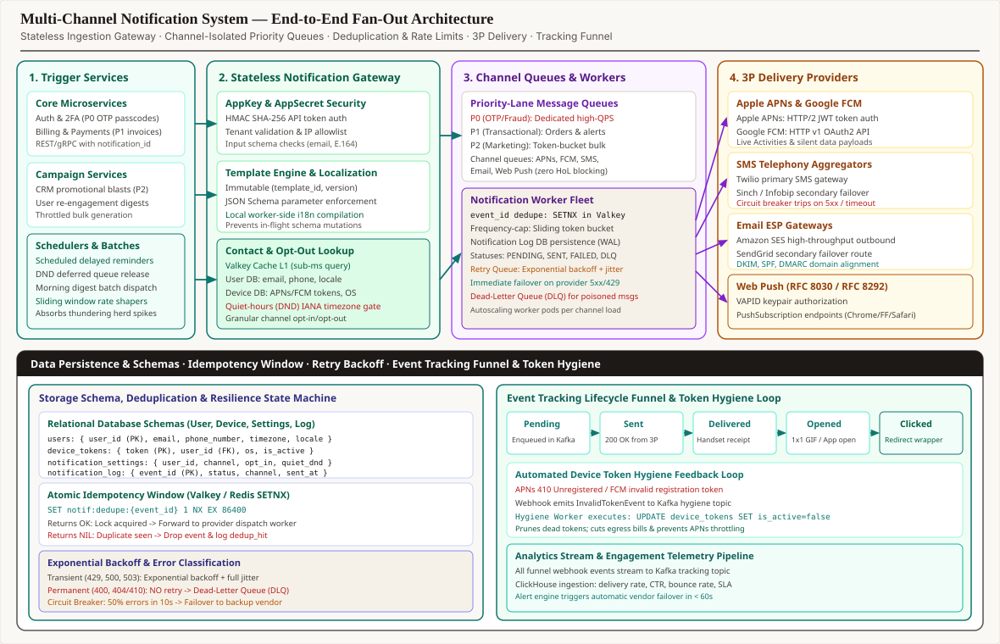

#### The End-to-End Ingestion & Dispatch Flow

1. **Trigger Request Ingestion**: Internal microservices (Auth, Payments, Orders) and scheduled cron services submit notification requests to the stateless Notification Gateway over REST or gRPC. Each request carries an explicit `notification_id` for idempotency, a calling `AppKey`, an HMAC signature, and payload parameters.
2. **Gateway Validation & Contact Lookup**:
   - The Gateway validates the HMAC signature and checks tenant rate limits.
   - It validates parameter schemas against the immutable template definition.
   - It queries the **L1 Valkey Cache** (falling back to the `users`, `device_tokens`, and `notification_settings` database tables) to retrieve the recipient's phone number, email address, active device tokens, and preference configuration.
   - The Policy Engine evaluates user opt-out settings and converts quiet hours against the user's stored IANA timezone. If quiet hours apply to a non-critical notification, it is redirected to a scheduled delayed queue.
3. **Priority Queue Partitioning**: The Gateway routes approved events to channel-isolated Kafka topics based on priority:
   - `notif.p0`: Reserved for critical security OTPs and fraud alerts.
   - `notif.p1`: Transactional alerts, order receipts, and shipping notifications.
   - `notif.p2`: Marketing campaigns, promotional blasts, and digests.
   - Dedicated partitions maintain channel isolation (`push-apns`, `push-fcm`, `sms`, `email`, `webpush`).
4. **Worker Processing & Deduplication**:
   - Dedicated worker fleets consume exclusively from assigned priority topics, ensuring P2 marketing traffic never starves P0 OTP workers.
   - Workers execute an atomic `SET notif:dedupe:{event_id} 1 NX EX 86400` against Valkey. If the key exists, the duplicate event is discarded.
   - The worker persists an initial `PENDING` record in the `notification_log` database.
   - The worker verifies the recipient's sliding-window fatigue cap in Valkey.
5. **Provider Adapter Dispatch & Circuit Breakers**:
   - The worker invokes the appropriate provider adapter. Each adapter encapsulates protocol specifics:
     - **APNs Adapter**: Maintains persistent HTTP/2 connections with ES256 JWT authentication.
     - **FCM Adapter**: Dispatches over HTTP v1 with Google Cloud OAuth2 tokens.
     - **SMS Adapter**: Calls Twilio API with circuit-breaker protection; automatically fails over to Sinch upon consecutive 5xx errors or timeouts.
     - **Email Adapter**: Calls Amazon SES with DKIM/SPF domain verification; falls back to SendGrid if SES limits throttle.
     - **Web Push Adapter**: Dispatches RFC 8030 payloads with RFC 8292 VAPID authorization headers.
6. **Delivery Webhooks & Token Hygiene**:
   - Provider delivery receipts and bounce webhooks enter an asynchronous ingestion gateway.
   - Delivery confirmations update `notification_log` to `DELIVERED`.
   - Permanent bounce receipts (`APNs 410`, `FCM NotRegistered`) emit events to `notif-hygiene`, where workers immediately mark dead device tokens inactive in the database, protecting future vendor quotas and eliminating unnecessary cloud egress costs.
   - All lifecycle events stream to a ClickHouse analytics cluster for real-time delivery rate, click-through rate, and provider latency monitoring.

### 2.9 Technology Comparison: Then vs. Now (2021 vs. 2026)

Between 2021 and 2026, notification system architectures transitioned from monolithic server loops and shared message queues to priority-partitioned streaming pipelines with cryptographic authorization and automated provider failover.

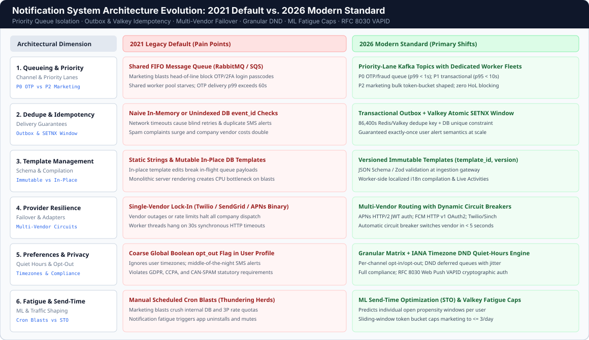

| Architectural Dimension | 2021 Legacy Default (Pain Points) | 2026 Modern Standard (Primary Shifts) | Engineering Impact & Production Trade-Offs |
| --- | --- | --- | --- |
| **1. Queueing & Priority** | Single shared FIFO message queue (RabbitMQ / SQS) across all notification types. | Priority-lane Kafka topics (`p0`, `p1`, `p2`) with dedicated autoscaled worker fleets. | Eliminates head-of-line blocking; guarantees $p99 < 1\text{ s}$ OTP delivery even during $10\text{M}$-message marketing blasts. |
| **2. Dedupe & Idempotency** | Naive in-memory checks or unindexed `SELECT` queries on notification database tables. | Transactional Outbox pattern + Valkey atomic `SETNX` idempotency window ($86{,}400\text{ s}$). | Prevents duplicate push alerts and double SMS carrier charges under network timeout retries. |
| **3. Template Management** | Mutable text strings stored in database rows; in-place edits rendered synchronously on servers. | Versioned immutable templates `(template_id, version)` with JSON Schema validation. | Prevents schema corruption for in-flight queue payloads; shifts localized i18n compilation to workers. |
| **4. Provider Resilience** | Single-vendor lock-in (Twilio, SendGrid); synchronous HTTP calls without circuit breakers. | Multi-vendor dynamic routing with sliding-window circuit breakers (APNs HTTP/2, FCM v1, Twilio/Sinch). | Automatically routes around provider brownouts in $< 5\text{ seconds}$, preventing worker thread starvation. |
| **5. Preferences & Privacy** | Coarse global boolean `opt_out` flag; server ignores recipient timezones. | Granular channel $\times$ category matrix with IANA timezone-aware DND quiet-hours scheduling. | Prevents middle-of-the-night SMS alerts; ensures compliance with GDPR, CCPA, and TCPA regulations. |
| **6. Fatigue & Send-Time** | Manual cron-based scheduled batch blasts; thundering herds crush provider rate limits. | ML send-time optimization (STO) + sliding-window token-bucket fatigue caps per user. | Shapes burst traffic across optimal user engagement windows; caps marketing notifications to $\le 3\text{/day}$. |

#### Deep Operational Pitfalls & Production Failure Modes

##### Pitfall 1: Head-of-Line Blocking during Bulk Promotional Blasts

In an unpartitioned queue architecture, all outgoing messages enter a single shared queue. When a marketing team schedules a promotional campaign targeting 10 million users at 09:00, 10 million messages flood the queue within seconds. If a user simultaneously attempts to log in using two-factor authentication, their P0 OTP message enters the queue behind millions of marketing messages. Because external SMS aggregators enforce strict throughput limits (e.g., 500 SMS/s), draining the queue takes hours. The user's verification code arrives long after the 5-minute authentication window expires. _Mitigation_: Enforce absolute physical queue and worker segregation. Critical OTP messages route exclusively to `notif.p0`, transactional updates to `notif.p1`, and marketing bulk to `notif.p2`. Marketing workers employ token-bucket rate limiters to pace egress traffic without exhausting system resources.

##### Pitfall 2: Zombie Retry Loops on Invalid Device Tokens

When users uninstall an application or revoke notification permissions, APNs and FCM invalidate their device tokens. When a worker dispatches a push notification to an invalid token, APNs returns HTTP 410 (`Unregistered`) and FCM returns HTTP 404 (`registration-token-not-registered`). If the worker treats all non-200 responses as transient network failures and reenqueues the message with exponential backoff, the system enters a "zombie retry loop." Thousands of workers repeatedly dispatch doomed requests against invalid tokens, exhausting outbound NAT gateway connections, consuming vendor rate quotas, and risking provider-level IP blacklisting. _Mitigation_: Strictly bifurcate error handling. Permanent client errors (HTTP 400, 404, 410) must never retry. Instead, they emit an `InvalidTokenEvent` to an asynchronous hygiene queue that immediately marks the token inactive in the `device_tokens` database table.

##### Pitfall 3: Timezone Ignorance & Middle-of-the-Night SMS Wakeups

Executing promotional campaigns using server UTC timestamps without considering recipient geographic locations results in promotional SMS messages arriving at 03:00 local time. Beyond alienating users and causing high uninstall rates, sending automated commercial text messages during local quiet hours (typically 21:00 to 08:00) violates the US Telephone Consumer Protection Act (TCPA) and EU ePrivacy Directive, exposing organizations to statutory fines up to \$1,500 per unauthorized message. _Mitigation_: Store the user's explicit IANA timezone identifier (e.g., `America/New_York`, `Europe/Prague`) rather than a fixed UTC offset, ensuring correct adjustment across daylight saving time (DST) transitions. The Policy Engine checks the recipient's local time before dispatching non-critical notifications. If local time falls within quiet hours, marketing notifications are dropped or placed in a delayed schedule queue set to release at 08:00 local time with randomized jitter.

##### Pitfall 4: In-Place Template Mutations Corrupting In-Flight Payloads

In high-throughput systems, millions of notification events may sit in message queues awaiting worker processing during traffic spikes. If an engineering or marketing team modifies a live template in-place—such as renaming parameter `{{code}}` to `{{otp_code}}` or altering the expected JSON payload schema—workers consuming queued messages that were produced under the old schema encounter missing variable errors. Consumer worker threads throw deserialization exceptions, crash, and enter fatal crash loops, halting queue consumption entirely. _Mitigation_: Enforce immutable, versioned templates `(template_id, version)`. When updating a template, publish a new version (e.g., version 2). Ingestion gateways validate incoming payloads against the specific requested version, and workers dynamically load the corresponding schema. Old template versions are deprecated only after all in-flight queue backlogs have completely drained.

---

## 3. Geospatial Dispatch: Uber, Proximity Service & Nearby Friends

Location-based dispatch systems sustain massive continuous geospatial writes from moving clients while serving low-latency k-nearest-neighbor queries and transactional ride matching. A single naive design choice—updating a relational geospatial index in-place—cripples the database before reaching a fraction of production fleet scale.

### 3.1 Geospatial Requirements & SLAs

- **Functional requirements**: Continuous driver GPS ingestion (`lat`, `lon`, `bearing`, `speed`, `status`), real-time nearby-driver search for rider quote/ETA screens, atomic ride dispatch matching (preventing double-booking a driver), road-network ETA estimation, and (for the Nearby Friends variant) real-time friend proximity updates within a user-configured radius.
- **Non-functional requirements**: Ingestion throughput `>= 250k` location writes/sec (`500k+` at peak); nearby driver search latency `p99 < 50 ms`; dispatch match finality `p99 < 200 ms` with strict exclusivity (zero double-booked drivers); high availability across metro cells (partitioned by city/region so an outage in one city is blast-radius isolated).

### 3.2 Geospatial Capacity Estimation

- **Write QPS**: `1M` active online drivers reporting GPS every `4 s` = `1,000,000 / 4 = 250,000` writes/sec average (`~500k` writes/sec peak). Each update payload (`driver_id` 8B, `lat/lon` 16B, `h3_cell` 8B, `heading/speed/status/ts` 16B ≈ `48–64 bytes` binary) generates `~16 MB/s` raw ingress (`~128 Mbps`), trivial for network bandwidth but punishing for disk-backed B-trees or R-trees.
- **Memory footprint of the live spatial index**: `1M` active drivers * `~200 bytes` per in-memory entry (driver metadata + secondary index pointers) = `~200 MB`! Even `10M` global active drivers fit in `~2 GB` of RAM—meaning the entire live world driver state fits comfortably in memory across a small sharded cluster without touching disk on the hot path.
- **Read QPS (Rider app polling + Dispatch)**: `1M–2M` concurrent active riders polling nearby cars every `5 s` during peak commute ≈ `200k–400k` spatial queries/sec.

### 3.3 Geospatial API & Data Contracts

- **Driver Telemetry Stream (gRPC bi-di stream / UDP-QUIC / HTTPS keep-alive)**: `POST /v1/drivers/location` or persistent stream frame `{ driver_id, lat, lon, h3_res9, heading, speed_mps, client_ts_ms, availability_state }`.
- **Rider Nearby Search**: `GET /v1/riders/nearby-drivers?lat=50.0755&lon=14.4378&product=uberx&radius_m=3000` returns masked driver positions (`lat`, `lon`, `bearing`) and road-adjusted ETAs.
- **Dispatch Match Command**: `POST /v1/dispatch/trips/{trip_id}/offer` atomically attempts to lease a candidate driver for `15 s`.

### 3.4 Geospatial High-Level Design

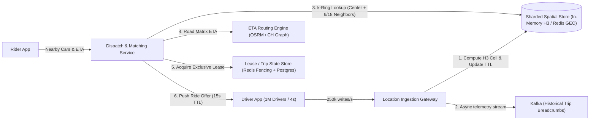

### 3.5 Geospatial Deep Dives & Failure Modes

- **Why Relational Spatial Indexes Melt at 250k Writes/sec**: A PostgreSQL/PostGIS GiST (R-tree) or B-tree geohash index persists every `4 s` coordinate change as a row mutation, generating WAL records, MVCC dead tuples (requiring aggressive `autovacuum`), and random B-tree/R-tree page splits across disk buffer pools. Sustaining `250k` durable transactional updates/sec on disk requires dozens of write-sharded RDBMS instances for data whose previous position becomes garbage `4 seconds` later! Ephemeral driver positions belong in an **in-memory spatial store** partitioned by metro region (`city_id`) with a `15–30 s` TTL (so drivers who lose connectivity vanish automatically without ghost cars), while historical GPS breadcrumbs stream asynchronously via Kafka to cold object storage for safety/billing audits.
- **In-Memory H3 vs. Quadtree vs. Redis GEO**:
  - **Uber H3 (Hexagonal Hierarchical Spatial Index)**: Partitions Earth into nested hexagons (e.g., resolution `7` `~5.16 km²` for city-level sharding/surge buckets, resolution `9` `~0.1 km²` for driver indexing). Hexagons have a decisive geometric advantage over square Geohash/Quadtree grids: every neighbor shares an edge at **uniform center-to-center distance**, eliminating the diagonal corner distortion (`\sqrt{2}` distance ratio) of square cells.
  - **Quadtree**: Adapts resolution dynamically to density (deep trees in Manhattan, shallow trees in rural areas), ideal for static POI databases (Yelp/Proximity Service) where updates are rare, but requires fine-grained locking or copy-on-write rebuilds under `250k` updates/sec unless wrapped in per-partition event loops.
  - **Redis GEO**: Stores points as `52-bit` Geohash integers inside a Sorted Set (`ZSET` using `GEOADD` / `GEOSEARCH` — see [Redis](../../../technologies/redis/README.md)). Works cleanly up to tens of thousands of writes/sec per shard, though Redis `ZSET` lacks per-member TTL (`EX` applies only to the whole key), requiring a periodic sweep or separate TTL tracking to evict stale drivers.
- **8-Neighbor / k-Ring Lookup (The Cell Boundary Trap)**: Querying only the rider's single Geohash or H3 cell fails catastrophically whenever the rider stands near a cell edge—a driver `30 meters` away across the border has a different cell ID and is missed completely. Every spatial lookup must query the target cell plus its adjacent ring: `8` neighbors (`3×3` grid) in Geohash, or `gridDisk(cell, k)` (`1 + 6 = 7` cells for `k=1`, `19` cells for `k=2`) in H3, before filtering candidates by exact Haversine or road-network distance.
- **Dispatch Matching & Double-Booking Prevention**: Two concurrent rider requests near the same intersection can easily select the same top-ranked driver during candidate scoring. Dispatch prevents double-booking using a two-layer state guard: (1) an atomic short-lived **driver offer lease** (`SET driver:lock:{driver_id} {trip_id} NX PX 15000` with a monotonic fencing token) in the region's coordinator, backed by (2) a conditional state transition in the authoritative Trip/Driver store (`UPDATE drivers SET state = 'OFFERED', current_trip_id = :trip_id, version = version + 1 WHERE driver_id = :id AND state = 'AVAILABLE' AND version = :v`). If the driver rejects or `15 s` elapses, the lease expires/releases and dispatch retries the next candidate. Notice how dispatch also locks onto the _rider's_ trip (`trip_id`) so parallel retries never dispatch two drivers to one rider.
- **ETA Routing Graph (Contraction Hierarchies / OSRM)**: Euclidean distance (`straight-line / avg_speed`) produces fatal dispatch errors near rivers, divided highways, or one-way grids where a driver `200 m` away as the crow flies needs `12 minutes` of U-turns to reach the pickup. Real dispatch takes the top `10–20` spatial candidates from H3 and queries an in-memory road-network routing service running **Contraction Hierarchies (CH)** or **Customizable Route Planning (CRP)** (as in OSRM/Valhalla). CH precomputes hierarchical shortcut edges over the static road graph so `shortest-path` queries execute in `< 1 ms`, while CRP separates topology from dynamic edge weights so live traffic telemetry updates speed profiles in seconds without rebuilding the full hierarchy.
- **Nearby Friends Delta**: For Nearby Friends (`10M` concurrent users sharing locations with `~200` friends), location updates run slower (`~30 s` battery-friendly interval = `~333k` updates/sec) and do not need global spatial dispatch locking. Instead, each user's update publishes to a sharded **Pub/Sub channel per user_id** (see [Redis](../../../technologies/redis/README.md)); online friends subscribe only to their friends' channels upon opening the map, filtering distances client-side or at the gateway—avoiding a global spatial index join across `N * F` friend edges.

| Spatial Index | Update Cost (`250k/s`) | Cell-Boundary Behavior | Dynamic Density Adaptation | Best-Fit Workload |
| --- | --- | --- | --- | --- |
| **PostgreSQL GiST (R-tree)** | Collapses (WAL + page splits) | Accurate bounding-box range | Yes (tree splits) | Static/low-write POI catalogs (`< 5k` writes/s) |
| **Geohash Grid** | `O(1)` in-memory hash/prefix | `8` uneven square neighbors ($\sqrt{2}$ corner skew) | Fixed resolution buckets | Simple prefix sharding & coarse spatial caches |
| **Quadtree** | Needs lock/rebuild under heavy writes | Traverses parent/sibling nodes | Excellent (splits dense cities) | Static POI search (Yelp, Google Places) |
| **Uber H3** | `O(1)` integer cell update in RAM | Uniform `6`-neighbor `gridDisk(k)` distance | Hierarchical (`res 0..15`) | High-write ride dispatch, dynamic surge hexagons |
| **Redis GEO (`ZSET`)** | `O(log N)` per shard (`~50k/s` max/shard) | `GEOSEARCH` handles radius natively | Fixed `52-bit` Geohash score | Mid-scale ephemeral proximity (manual member TTL cleanup) |

---

## 4. Ad Click Aggregator & Real-Time Top-K

Online advertising pipelines ingest millions of click/impression events per second to power two conflicting consumers: **real-time campaign pacing and anomaly dashboards** (requiring sub-minute visibility and Top-K heavy hitters) and **financial advertiser billing** (requiring exact, deduplicated, auditable accuracy even when mobile SDKs deliver clicks hours late).

### 4.1 Ad Click Requirements & SLAs

- **Functional requirements**: Real-time ad click aggregation per `ad_id` and `campaign_id` at `1-minute` and `1-hour` tumbling/sliding granularities, real-time `Top-K` (e.g., Top 100) trending ads over sliding windows, click deduplication (bot/retry fraud defense), and exact reconciled billing exports.
- **Non-functional requirements**: Ingestion throughput `1M` clicks/sec average (`3M+` peak during global sports/shopping events); real-time dashboard freshness `< 30 s` lag; zero lost acknowledged clicks (`acks=all`); billing accuracy `100%` against immutable raw click logs.

### 4.2 Ad Click Capacity Estimation

- **Ingress bandwidth**: `1M` clicks/sec * `~400 bytes/event` (`click_id`, `ad_id`, `campaign_id`, `user_id`, `ip_hash`, `event_ts`, `geo`) = `400 MB/s` (`3.2 Gbps` raw, `~1.2 GB/s` at `3M` peak).
- **Daily & 5-year raw log storage**: `400 MB/s * 86,400 ≈ 34.5 TB/day` uncompressed JSON, or `~8–10 TB/day` in columnar Zstd Parquet on S3 (`~15 PB` over `5` years before retention pruning).
- **Deduplication state size**: Retaining `24 hours` of `16-byte` `click_id` hashes for `86.4B` daily events in exact RocksDB state would require `~1.4 TB` of key-value state across the Flink cluster (`~70–100 GB` per `16`-shard TaskManager fleet, well within local NVMe RocksDB state budgets), or far smaller if scoped to a `1-hour` real-time dedupe window with full-day dedupe handled in Parquet compaction.

### 4.3 Ad Click API & Event Schema

Ad servers emit redirects (`302 Found` with a signed click token) and fire asynchronous Avro/Protobuf click events into Kafka partitioned by `ad_id` (or salted `ad_id` for viral campaigns):

```protobuf
message AdClickEvent {
  string click_id = 1;       // Cryptographically signed unique click token from impression
  uint64 ad_id = 2;
  uint64 campaign_id = 3;
  int64 event_time_ms = 4;   // Client/Ad-server event timestamp
  string user_fingerprint = 5;
  string region = 6;
}
```

### 4.4 Ad Click High-Level Design

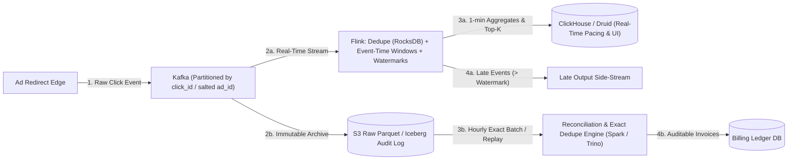

### 4.5 Ad Click Deep Dives & Failure Modes

- **Event-Time Windows & Watermarks for Late Mobile Clicks**: Mobile apps frequently queue click beacons while users enter tunnels or airplane mode, uploading them minutes or hours after `event_time_ms`. Using **Processing Time** (when Kafka/Flink receives the packet) corrupts campaign pacing and breaks hourly comparisons across retries or consumer lag spikes. Instead, Flink assigns windows using `event_time_ms` and advances **Watermarks** (`W(t) = max_seen_event_time - max_out_of_orderness`, e.g., `60 s`) to close `1-minute` tumbling windows (`[12:00, 12:01)`) cleanly while tolerating normal network jitter. For clicks arriving after the watermark (`event_time < W(t)`), Flink configures an `allowedLateness` grace window (e.g., `15 minutes`) that emits incremental window updates (`UPSERT` into ClickHouse `ReplacingMergeTree`) and routes anything beyond `allowedLateness` to a **Side Output** written straight to the raw S3 audit archive—guaranteeing real-time pipelines never hang waiting on arbitrarily delayed devices.
- **Deduplication by `click_id` & Click-Fraud Protection**: Network retries on mobile SDKs and deliberate replay attacks submit the same `click_id` multiple times. Keying the first Flink operator by `click_id` and checking RocksDB keyed state (`seen_click_ids` with TTL, pre-filtered optionally by an in-memory Bloom filter to skip unnecessary disk lookups on novel IDs) drops duplicates before aggregation. Note the partitioning trade-off: keying by `click_id` distributes load evenly without hot-key skew during deduplication, after which events re-shuffle by `ad_id` (or `hash(ad_id) % k` **two-stage salted aggregation**) so a viral Super Bowl ad does not overwhelm a single Flink aggregation subtask.
- **Real-Time Top-K Heavy Hitters**: Computing exact `Top-K` over `10M` distinct `ad_id`s across sliding windows in a single reducer melts memory. Instead, a two-stage pipeline aggregates partial counts per salted shard (or uses a Count-Min Sketch + min-heap of size `K` per partition—see [Data Structures & Algorithms](../../../algorithms/dsa/README.md)) and merges only the local Top-K candidates (`K * P` items) in a global aggregator every `10–30 s`.
- **Lambda vs. Kappa Reconciliation for Exact Billing**:
  - **Lambda Architecture**: Runs the low-latency Flink stream for real-time budget pacing (`stop serving ad when 95% budget spent`) alongside an hourly/daily deterministic batch job over the immutable S3 Parquet raw log (`SELECT ad_id, COUNT(DISTINCT click_id) ...`) that produces exact financial invoices, overwriting provisional streaming aggregates.
  - **Kappa Architecture**: Eliminates the separate batch codebase by retaining Kafka/tiered storage (or Iceberg event logs) as a single replayable source of truth and re-running the exact same Flink job from an earlier offset whenever business logic changes or late data requires restatement.
  - **Staff insight**: Advertising billing systems routinely keep a **Lambda-style audit reconciliation** (even when streaming uses Kappa replay) because finance/auditors demand an independent SQL check against immutable Parquet files to detect silent stream-state corruption or RocksDB checkpoint bugs before charging advertisers millions of dollars.

| Architecture | Source of Truth | Late Data Handling | Code & Ops Complexity | Best Fit in Ad Tech |
| --- | --- | --- | --- | --- |
| **Lambda** | Raw S3 Parquet + Kafka | Watermark + `allowedLateness` for UI; nightly SQL overwrites for billing | High (two codebases: Flink + Spark/Trino) | Financial ad invoicing requiring independent audit reconciliation |
| **Kappa** | Long-retention Kafka / Tiered Iceberg | Watermark + stream state; historical offset replay on bug fixes | Lower (single Flink topology) | Real-time campaign pacing, anomaly detection, ML feature aggregates |

```sql
-- ClickHouse real-time sink handling incremental late-window UPSERTs
CREATE TABLE ad_clicks_1m (
  window_start DateTime,
  ad_id        UInt64,
  campaign_id  UInt64,
  clicks       UInt64,
  updated_at   DateTime64(3)
) ENGINE = ReplacingMergeTree(updated_at)
PARTITION BY toYYYYMMDD(window_start)
ORDER BY (campaign_id, ad_id, window_start);
```

### 4.6 Primary Literature & Systems Foundations Matrix

Real-time ad click event aggregation architectures bridge the gap between low-latency streaming analytics and high-precision financial billing. Computing aggregated ad metrics over millions of events per second requires mathematically grounded primitives for unbounded out-of-order stream processing, asynchronous distributed state snapshots, append-only log replay, and vectorized columnar online analytical processing (OLAP). The matrix below grounds every component, delivery guarantee, and architectural trade-off in foundational computer science literature:

| Specification / Paper | Authors / Organization & Year | Core Contribution & Theoretical Mechanism | Computational & Space Complexity | Production Systems Adoption |
| --- | --- | --- | --- | --- |
| **The Dataflow Model: Balancing Correctness, Latency, and Cost in Massive-Scale Unbounded Data Processing** | Tyler Akidau, Robert Bradshaw, Craig Chambers, Slava Chernyak, et al. (Google / VLDB, 2015) | Formalized the unified stream processing model decomposing unbounded computation into four orthogonal questions: _What_ is computed (transformations), _Where_ in event time (windowing: tumbling, sliding, session), _When_ in processing time (watermarks and triggers), and _How_ results relate (accumulating vs. retracting). Defined event-time watermarks $W(t) = \max(t_{\text{event}}) - \delta$ asserting that no subsequent records with timestamp $t < W(t)$ will arrive. | Watermark propagation: $O(P)$ across $P$ upstream partitions; Window assignment: $O(1)$ per event; State overhead: $O(W \cdot K)$ where $W$ is active windows and $K$ is active keys. | Apache Beam, Apache Flink, Google Cloud Dataflow; universal foundation of modern stream processing engines. |
| **Apache Flink: Stream and Batch Processing in a Single Engine / State Management in Apache Flink** | Paris Carbone, Asterios Katsifodamos, Stephan Ewen, Volker Markl, et al. (VLDB, 2015 / Bulletin of the IEEE TCS, 2015; VLDB, 2017) | Implemented Asynchronous Barrier Snapshotting (ABS) based on Chandy-Lamport distributed snapshots for directed acyclic graphs. Checkpoint barriers injected into input streams traverse operators without blocking stream execution; keyed state backed by embedded RocksDB/ForSt is asynchronously flushed to cloud object storage. Guarantees end-to-end exactly-once state consistency with sub-second recovery. | Barrier alignment latency: $O(\Delta t)$ where $\Delta t$ is channel skew; Checkpoint snapshot size: $O(K)$ where $K$ is active keyed state footprint; State lookup: $O(1)$ in-memory block cache, $O(\log N)$ SSTable probe. | Apache Flink, Netflix real-time analytics, Uber AthenaX, Alibaba Blink, Stripe streaming transaction ledger. |
| **Questioning the Lambda Architecture (The Kappa Architecture)** | Jay Kreps (LinkedIn / O'Reilly Media, 2014) | Formulated the Kappa Architecture, demonstrating that dual-path Lambda architectures (e.g., Storm streaming alongside MapReduce batch) suffer from business logic drift across duplicate codebases, double operational overhead, and reconciliation fragility. Proved that an append-only distributed commit log (Kafka) with long retention serves as the single source of truth, enabling batch recalculation by replaying identical stream processing jobs over historical offsets. | Recalculation throughput: bounded by raw Kafka read bandwidth and worker parallelism $P$; Codebase footprint: $O(1)$ unified stream topology replacing dual systems. | Modern ad tech platforms, LinkedIn tracking infrastructure, Uber streaming pipelines, Pinterest ad analytics. |
| **Distributed Snapshots: Determining Global States of Distributed Systems** | K. Mani Chandy, Leslie Lamport (ACM Transactions on Computer Systems, 1985) | Established the seminal distributed snapshot algorithm recording a consistent global state across asynchronous distributed processes communicating via FIFO channels without requiring a synchronized global clock or pausing system execution. Marker messages partition messages into those sent before and after the snapshot, forming the formal theoretical foundation of stream checkpointing and distributed rollback recovery. | Message complexity: $O(E)$ where $E$ is directed channel count; Snapshot completion time: $O(D)$ where $D$ is the network communication diameter. | Theoretical foundation of Apache Flink ABS checkpointing, distributed transactional stores (Google Spanner, CockroachDB), high-performance computing fault recovery. |
| **ClickHouse: Lightning-Fast Analytical Processing Engine** | Alexey Milovidov et al. (Yandex / ClickHouse Inc., VLDB 2024 / ACM SIGMOD) | Architected a column-oriented DBMS optimized for real-time streaming ingestion and sub-second multi-dimensional analytical aggregations. Implements vectorized SIMD execution, sparse primary key indices (1 mark per 8,192 rows), LZ4/Zstd block compression, and specialized storage engines: `SummingMergeTree` for background metric summation and `ReplacingMergeTree` for idempotent deduplication based on version timestamps, resolving out-of-order stream upserts without distributed locks. | Sparse index probe: $O(\log N)$; Vectorized aggregation throughput: $> 1\text{–}2\text{ GB/s}$ per core; Storage compression ratio: $3\times\text{–}5\times$ over row-oriented relational tables. | Real-time advertising attribution (ByteDance, Cloudflare, Spotify), high-throughput metrics and event tracking platforms. |
| **System Design Interview — An Insider's Guide: Volume 2 (Chapter 6 / Chapter 21)** | Alex Xu, Sahn Lam (ByteByteGo, 2022) | Established the canonical system design interview reference architecture for ad click event aggregation at 1B clicks/day. Formulated the Map-Aggregate-Reduce stream processing DAG, Star Schema dimension modeling via integer `filter_id` keys, local Top-N min-heap pruning, dual raw vs. aggregated storage trade-offs, distributed two-phase commit delivery, hot-key global-local salting, and end-of-day batch reconciliation. | Ingestion capacity: $10^9\text{ clicks/day} \approx 11{,}574\text{ QPS}$ avg ($50{,}000\text{–}58{,}000\text{ QPS}$ peak); Raw storage: $100\text{ GB/day}$ ($3\text{ TB/month}$); In-memory aggregation state: $O(M \cdot N)$ keys. | Canonical technical interview standard, enterprise ad reporting systems, real-time campaign pacing engines. |

### 4.7 Verified ByteByteGo Canonical Worked Architecture & Capacity Delta (Chapter 21)

In _System Design Interview — An Insider's Guide: Volume 2_ (Chapter 6 / Chapter 21), Alex Xu and Sahn Lam establish the canonical worked architecture for an ad click event aggregation platform designed to process 1 billion clicks per day. The table below contrasts the canonical ByteByteGo Chapter 21 baseline against the hyper-scale programmatic ad exchange tier analyzed in Section 4.2:

| Architectural Metric / Parameter | ByteByteGo Ch. 21 Canonical Baseline | Hyper-Scale Programmatic Tier (§4.2) | Mathematical Reconciliation & Engineering Delta |
| --- | --- | --- | --- |
| **Daily Ingestion Volume** | 1 billion ($10^9$) clicks/day | 86.4 billion ($8.64 \times 10^{10}$) clicks/day | Section 4.2 models a global real-time bidding DSP/exchange tier processing $86.4\times$ the volume of ByteByteGo's single-publisher platform. |
| **Average Ingestion QPS** | $\mathbf{11{,}574\text{ QPS}}$ ($\approx 10{,}000\text{ QPS}$ rounded) | $\mathbf{1{,}000{,}000\text{ QPS}}$ ($1\text{M QPS}$) | Exact arithmetic: $10^9 / 86{,}400\text{ s} = 11{,}574.07\text{ QPS}$. Section 4.2 handles global multi-tenant exchange traffic across dozens of global data centers. |
| **Peak Ingestion QPS** | $\mathbf{50{,}000\text{–}57{,}870\text{ QPS}}$ ($5\times$ peak) | $\mathbf{3{,}000{,}000\text{ QPS}}$ ($3\times$ peak) | ByteByteGo assumes a $5\times$ diurnal peak factor ($5 \times 10{,}000 = 50{,}000\text{ QPS}$, or $5 \times 11{,}574 = 57{,}870\text{ QPS}$); §4.2 models high baseline traffic with $3\times$ peak bursts. |
| **Event Payload Size** | $0.1\text{ KB}$ ($100\text{ bytes}$) compact schema | $400\text{ bytes}$ rich attribution schema | ByteByteGo uses compact identifiers (`ad_id`, `click_timestamp`, `user_id`, `ip`, `country`); §4.2 includes cryptographically signed impression tokens, geo-lat-long, and device fingerprints. |
| **Daily Ingress Data Volume** | $\mathbf{100\text{ GB/day}}$ ($10^9 \times 100\text{ B}$) | $\mathbf{34.56\text{ TB/day}}$ ($86.4\text{B} \times 400\text{ B}$) | ByteByteGo's compact volume fits on standard streaming clusters; §4.2 requires distributed Kafka clusters partitioning hundreds of gigabytes per hour. |
| **Monthly Storage Footprint** | $\mathbf{3\text{ TB/month}}$ ($36\text{ TB/year}$) | $\mathbf{\sim 1.04\text{ PB raw/month}}$ ($\to \sim 250\text{ TB/mo}$ Zstd Parquet) | ByteByteGo calculates $100\text{ GB} \times 30 = 3{,}000\text{ GB} = 3\text{ TB/month}$; §4.2 compresses $1.04\text{ PB}$ raw JSON into $\sim 250\text{ TB}$ Parquet files on S3. |
| **Active Ad Catalog Size** | $2\text{ million active ads}$ ($2 \times 10^6$) | $10\text{–}50\text{ million active ads}$ | ByteByteGo models active direct ads; §4.2 models global programmatic ad catalogs across millions of enterprise advertisers. |
| **Annual Growth Rate** | $+30\%\text{ YoY}$ compound growth | $+20\%\text{–}30\%\text{ YoY}$ compound growth | Compounding over 5 years ($1.30^5 \approx 3.7129$): ByteByteGo reaches $3.71\text{B clicks/day}$ ($42{,}974\text{ avg QPS}$, $215\text{k peak QPS}$) and $7.43\text{M ads}$. |
| **Stream Processing Framework** | Generic Map-Aggregate-Reduce DAG | Apache Flink 2.0 with RocksDB / ForSt | ByteByteGo presents conceptual Map, Aggregate, and Reduce nodes; production deploys Flink TaskManagers with Chandy-Lamport state snapshotting. |
| **Aggregation Storage Tier** | Apache Cassandra (Raw & Aggregated) | ClickHouse / Pinot OLAP + S3 Iceberg | ByteByteGo uses Cassandra wide-column tables; modern standard deploys ClickHouse `ReplacingMergeTree` for sub-50 ms OLAP queries and Iceberg for raw logs. |
| **Query Latency SLA** | Sub-minute dashboard visibility | P99 $< 50\text{ ms}$ pacing, $< 30\text{ s}$ dashboard lag | Both tiers support real-time pacing queries while isolating financial billing into deterministic batch reconciliation pipelines. |

#### Mathematical Verification & Growth Compounding

ByteByteGo Chapter 21 establishes baseline parameters of $1\text{ billion daily clicks}$ across $2\text{ million active ads}$, with a single event occupying $0.1\text{ KB}$ ($100\text{ bytes}$). We verify the exact throughput and storage equations:

$$
\text{Throughput}_{\text{avg}} = \frac{10^9\text{ clicks}}{86{,}400\text{ s}} = 11{,}574.074 \approx \mathbf{11{,}574\text{ QPS}}
$$

Applying ByteByteGo's assumed $5\times$ peak coefficient to the unrounded baseline yields:

$$
\text{Throughput}_{\text{peak}} = 11{,}574.074 \times 5 \approx \mathbf{57{,}870\text{ QPS}} \quad (\text{or } 50{,}000\text{ QPS based on the } 10\text{k rounded baseline})
$$

Daily raw storage accumulates linearly at $100\text{ bytes}$ per record:

$$
\text{Storage}_{\text{daily}} = 10^9 \times 100\text{ bytes} = 10^{11}\text{ bytes} = 100\text{ GB/day}
$$

$$
\text{Storage}_{\text{monthly}} = 100\text{ GB/day} \times 30\text{ days} = 3{,}000\text{ GB} = \mathbf{3\text{ TB/month}}
$$

Over a 5-year operational horizon ($60\text{ months}$), raw storage accumulates to $3\text{ TB/month} \times 60\text{ months} = 180\text{ TB}$ uncompressed, or $\sim 45\text{ TB}$ when compressed with Zstd columnar Parquet ($4\times$ compression factor). Compounding at $+30\%$ year-over-year growth across $t = 5$ years:

$$
\text{Volume}_{\text{Year 5}} = 10^9 \times (1 + 0.30)^5 = 10^9 \times 3.71293 = \mathbf{3{,}712{,}930{,}000\text{ clicks/day}} \quad (\approx 42{,}974\text{ avg QPS}, \approx 214{,}870\text{ peak QPS})
$$

$$
\text{Active Ads}_{\text{Year 5}} = 2 \times 10^6 \times (1.30)^5 = 2 \times 10^6 \times 3.71293 = \mathbf{7{,}425{,}860\text{ active ads}} \quad (\approx 7.43\text{M ads})
$$

#### Query API Design & Schema Contracts

The aggregation platform exposes two primary REST/gRPC query endpoints to serve real-time advertiser dashboards, anomaly monitors, and campaign budget pacing engines:

1. **Aggregate Click Count Query**: Returns the aggregated number of clicks for a specified `ad_id` within a time range $[t_{\text{from}}, t_{\text{to}}]$, filtered by pre-aggregated dimensional criteria:

```http
GET /v1/ads/{ad_id}/aggregated_count?from=2026-11-21T12:00:00Z&to=2026-11-21T12:15:00Z&filter_id=0012 HTTP/1.1
Host: api.adplatform.net
```

```json
{
  "ad_id": "ad001",
  "from": "2026-11-21T12:00:00Z",
  "to": "2026-11-21T12:15:00Z",
  "filter_id": "0012",
  "clicks": 1420
}
```

2. **Top-N Popular Ads Query**: Returns the top $N$ most clicked ad identifiers over a configurable sliding window of $M$ minutes:

```http
GET /v1/ads/popular_ads?count=100&window=5&filter_id=0000 HTTP/1.1
Host: api.adplatform.net
```

```json
{
  "window_minutes": 5,
  "last_updated": "2026-11-21T12:15:00Z",
  "filter_id": "0000",
  "popular_ads": [
    { "ad_id": "ad8941", "clicks": 84210 },
    { "ad_id": "ad1023", "clicks": 62100 },
    { "ad_id": "ad5502", "clicks": 59840 }
  ]
}
```

#### Raw vs. Aggregated Dual Storage & Star Schema Dimensionality

A fundamental trade-off in ad event systems is balancing raw event preservation with low-latency query serving. Storing only raw events enables retrospective re-filtering and ad-hoc slicing but requires scanning terabytes of records on every dashboard reload. Storing only aggregated counts eliminates query latency but destroys fine-grained dimensional attribution and prevents bug backfilling.

To achieve both requirements, the system maintains dual storage tiers:

- **Raw Event Storage (Cold Path)**: Retains raw immutable click events in Parquet format on cloud object storage (Amazon S3 / Google Cloud Storage) partitioned by `date/hour`. Used exclusively for debugging, anomaly forensics, machine-learning feature generation, and nightly financial reconciliation.
- **Aggregated Metric Storage (Hot Path)**: Stores pre-computed counts at 1-minute tumbling granularities in a real-time OLAP store (ClickHouse / Apache Pinot), indexed by `(campaign_id, ad_id, filter_id, window_start)`.

```
Raw Click Record:
{ ad_id: "ad001", click_time: "2026-11-21 12:00:04", user_id: "u109", ip: "198.51.100.42", country: "US" }

Aggregated Star Schema Record:
{ ad_id: "ad001", window_minute: "202611211200", filter_id: "0012", click_count: 142 }
```

To support real-time multi-dimensional filtering (e.g., clicks from US, clicks on mobile, non-fraudulent IP subnets) without incurring the exponential cardinality explosion of a fully exploded dimensional cube ($C = \prod_{i=1}^{k} \lvert D_i \rvert$), the system applies a **Star Schema** with an integer `filter_id` dimension surrogate key. Predefined filtering combinations (e.g., `filter_id 0012` $\to$ `country=US, device=mobile`) are pre-aggregated during streaming, allowing point queries to retrieve filtered metrics in $O(1)$ index probes while capping state expansion.

#### Map-Aggregate-Reduce DAG & Top-N Min-Heap Pruning

The aggregation service decomposes stream computation into a distributed Map-Aggregate-Reduce directed acyclic graph (DAG):

1. **Map Stage**: Map tasks consume raw events from Kafka partitions. They validate event schemas, filter malformed records, resolve IP-to-country geolocation tables in local memory, assign the appropriate `filter_id` bitmask, and re-key the stream by `hash(ad_id) % P` to route events to downstream aggregation workers.
2. **Aggregate Stage (Tumbling 1-Minute Counters)**: Aggregate workers maintain in-memory hash maps `Map<(ad_id, filter_id), LongCounter>` accumulated over 1-minute event-time tumbling windows. When the watermark advances past the window close, the worker flushes partial aggregated counts downstream.
3. **Reduce Stage (Global Top-N Min-Heap Maintenance)**: To compute the Top-100 popular ads across an $M$-minute sliding window without funneling millions of ad counters into a single bottlenecked node, the system employs **Two-Stage Distributed Top-N Heap Pruning**:
   - _Stage 1 (Local Worker Heap)_: Each aggregate worker maintains a local Min-Heap of size $N = 100$. For every ad count update within the window, if the heap contains fewer than $N$ items, the ad is inserted. Once full, if the ad's click count exceeds the heap root (the current $N$-th item), the root is replaced and the heap is re-balanced in $O(\log N)$ time.
   - _Stage 2 (Global Reducer Merge)_: At window boundary ticks, each of the $P$ worker partitions transmits only its local top $N$ candidates to the global reduce worker. The global reducer merges $P \times N$ candidate pairs (e.g., $32 \times 100 = 3{,}200$ items) into the definitive Top-100 list in $O(P \cdot N \log N)$ operations—reducing network shuffle and CPU overhead by over $99.9\%$.

#### Lambda vs. Kappa Architecture & Isolated Recalculation

The system adopts a **Kappa serving path** (unified streaming codebase for all real-time and replay queries, eliminating dual-codebase Lambda serving merges) paired with an independent **batch audit/reconciliation job** over raw S3 Parquet logs for financial billing verification:

```
Legacy Lambda Architecture (Fragile Dual Codebase):
Kafka Event Stream ---> Streaming Engine (Storm/Flink) ---> Speed Layer DB (Provisional)
                 \
                  ---> HDFS / S3 Storage -------------> Batch Job (MapReduce/Spark) ---> Batch Layer DB (Exact)
                                                                                     \
                                                                                      ---> Merged Serving Query

Modern Kappa Architecture (Unified Replay Engine):
Kafka Event Stream (or S3 Lakehouse Replay) ---> Single Stream Engine (Apache Flink) ---> Real-Time OLAP (ClickHouse)
```

In ad tech, business logic frequently changes (e.g., retroactively filtering a newly identified botnet, updating attribution window rules, or fixing a pricing tier bug). In a naive streaming setup, recalculating 30 days of data requires re-running the live pipeline, risking data corruption and consuming production resources.

The Kappa Architecture resolves this through **Isolated Recalculation**:

1. Raw click events are retained immutably in S3 Parquet / Apache Iceberg tables.
2. When a recalculation is required, operators spin up a separate, dedicated Flink recalculation cluster running the updated aggregation code.
3. The recalculation cluster reads the raw historical logs from S3 from the target timestamp offset, processing data at maximum batch throughput without rate limits.
4. Recalculated metrics are written to a secondary Kafka topic (`ad_clicks_1m_recalc`) or directly into a staging ClickHouse table partition.
5. Once verified against financial reconciliation checks, an atomic partition swap (`RENAME TABLE ad_clicks_staging TO ad_clicks_prod`) replaces historical metrics instantly without dropping a single real-time click.

#### Event Time vs. Processing Time & Windowing Semantics

Due to network latency, cellular handoffs, and offline mobile queuing, an ad click occurring at $12:00:05$ might not arrive at the ingestion server until $12:03:30$:

```
Event Time:      12:00:05 (When mobile user tapped screen)
Processing Time: 12:03:30 (When ingestion broker received TCP packet)
Lag / Skew:      3 minutes 25 seconds
```

Using **Processing Time** assigns this click to the $12:03\text{–}12:04$ window, corrupting historical campaign pacing, skewing conversion attribution models, and causing non-deterministic aggregations on pipeline re-runs. Consequently, the aggregation engine operates strictly on **Event Time**.

The engine supports four canonical stream windowing models:

1. **Tumbling Windows**: Fixed-size, non-overlapping time intervals (e.g., $[12:00, 12:01)$, $[12:01, 12:02)$). Every event belongs to exactly one window. Used for primary ad click aggregations.
2. **Hopping Windows**: Fixed-size windows that advance by a fixed period smaller than window length (e.g., 5-minute window advancing every 1 minute). Events belong to multiple overlapping windows.
3. **Sliding Windows**: Windows evaluated continuously whenever an event arrives or expires within a moving range $[t - M, t]$. Used for real-time Top-N trending ad rankings.
4. **Session Windows**: Dynamic data-driven windows defined by gaps of inactivity (e.g., closing a session after 15 minutes of user silence). Used for user journey attribution and conversion path tracking.

To close event-time windows deterministically without waiting indefinitely for straggler mobile devices, the stream engine generates **Watermarks**:

$$
W(t) = \max_{e \in S}(e.\text{timestamp}) - \delta_{\text{lateness}}
$$

When a watermark $W(t) = 12:01:00$ arrives at an operator, the operator concludes that all clicks with event time $< 12:01:00$ have arrived, triggering the computation and output of the $[12:00, 12:01)$ tumbling window.

#### Delivery Guarantees: Exactly-Once vs. Idempotent Sinks

In advertising billing, delivery guarantees have direct financial consequences:

- **At-Most-Once**: Discards retries. Packets lost during broker rebalances or node crashes result in under-counting clicks, causing under-billing and lost publisher revenue.
- **At-Least-Once**: Network retries ensure zero data loss but introduce duplicate records during producer timeouts or worker restarts, resulting in over-billing and advertiser chargebacks.
- **Exactly-Once Processing**: Guarantees that every acknowledged click affects final metric counters exactly once.

Achieving end-to-end exactly-once delivery across distributed stream boundaries requires coordinating three stages:

1. **Producer Idempotence & Kafka Transactions**: The edge ingestion tier uses idempotent Kafka producers (`enable.idempotence=true`) assigning a unique Producer ID (`PID`) and monotonically increasing sequence number per partition, eliminating network retry duplicates. Flink sinks use the Kafka transactional producer API (Two-Phase Commit coordinated with Flink checkpoints) to write aggregated batches atomically.
2. **Consumer Read Isolation**: Downstream consumers operate in `read_committed` mode, ignoring abort markers and incomplete transactions.
3. **Idempotent Storage Sink**: Rather than relying exclusively on blocking distributed two-phase commit protocols across the stream-to-database boundary, the storage layer deploys ClickHouse `ReplacingMergeTree(updated_at)`. Stream workers emit deterministic window updates with a consistent primary key `(campaign_id, ad_id, filter_id, window_start)`. If worker failure causes re-emission of an already processed window, ClickHouse replaces the previous row during background compaction merges, achieving idempotent exactly-once semantics without distributed transaction locks.

#### Hotspot Mitigation: Global-Local & Split-Distinct Aggregation

Viral advertisements (e.g., Super Bowl commercials, flash sales) generate extreme traffic skew where a single `ad_id` receives $100\times\text{–}1,000\times$ higher click volume than average. Partitioning strictly by `hash(ad_id) % P` funnels all clicks for that viral ad into one aggregation subtask, causing CPU saturation, memory exhaustion, garbage collection pauses, and upstream backpressure across Kafka.

The system mitigates hot keys using **Two-Stage Global-Local Aggregation**:

1. **Local Pre-Aggregation (Key Salting)**: The Map stage detects high-throughput ad keys (or applies salting universally) by appending a random integer salt:

$$
\mathrm{ad\_id}_{\text{salted}} = \mathrm{ad\_id} + \text{"-"} + \mathrm{random}(1, S) \quad (\text{where } S \text{ is the salt factor, e.g., } S = 16)
$$

Clicks for the viral ad distribute evenly across $S$ independent aggregate worker subtasks, each accumulating partial counts for their assigned salted shard over the 1-minute window. 2. **Global Roll-Up**: At window close, the local workers strip the salt and emit partial sums `(ad_id, partial_count)` to a downstream global reduce worker. The global worker receives only $S$ records per minute for that viral ad, summing them into the final count in trivial CPU time. 3. **Split-Distinct Aggregation**: For multi-dimensional distinct counts (e.g., distinct user clicks per ad), the pipeline applies Split-Distinct: splitting the distinct calculation across multiple sub-groupings based on `hash(user_id) % M` before executing the global distinct union, preventing single-node distinct set memory blowups.

#### Fault Tolerance & State Snapshot Recovery

Stream aggregation workers maintain large state tables in memory. If a node crashes, uncommitted in-memory window counters are lost. The system implements fault tolerance through **Chandy-Lamport Asynchronous State Checkpointing**:

1. The Flink JobManager periodically injects **Checkpoint Barriers** ($B_1, B_2, \dots$) into the Kafka partition consumption streams.
2. Barriers flow through the DAG alongside event records. When an operator receives barrier $B_i$ from all input channels, it freezes its logical state, takes an asynchronous snapshot of its local RocksDB/ForSt Keyed State, and uploads the compressed SSTable diffs to S3.
3. Once all sink operators acknowledge completion of barrier $B_i$, the JobManager commits checkpoint $B_i$ and records the corresponding Kafka partition consumption offsets.
4. **Recovery Protocol**: Upon worker failure, the JobManager resets all DAG operators to the latest durable checkpoint $B_i$, rewinds Kafka partition consumer offsets to the checkpointed positions, and replays the input streams. Because state transitions are deterministic and the sink operates idempotently, the pipeline resumes without count drift.

#### End-of-Day Batch Reconciliation

While real-time streaming provides sub-minute visibility for campaign pacing, financial invoicing requires absolute deterministic verification. Network anomalies, mobile clocks set years in the past, and edge-case worker crashes can introduce subtle streaming discrepancies.

Every night at `00:00 UTC`, an **End-of-Day Reconciliation Batch Job** runs via Apache Spark or Trino:

1. The batch job executes against the immutable raw Parquet logs stored in S3 for the previous 24-hour cycle.
2. It executes a full SQL deterministic deduplication and aggregation:

```sql
SELECT
  campaign_id,
  ad_id,
  filter_id,
  toStartOfInterval(event_time, INTERVAL 1 MINUTE) AS window_start,
  COUNT(DISTINCT click_id) AS reconciled_clicks
FROM s3_raw_click_logs
WHERE event_time >= '2026-11-20 00:00:00' AND event_time < '2026-11-21 00:00:00'
GROUP BY campaign_id, ad_id, filter_id, window_start;
```

3. The batch results are compared against the real-time ClickHouse OLAP aggregates.
4. Discrepancies (typically $< 0.01\%$, caused by extreme mobile lateness exceeding allowed watermark thresholds) are identified, logged to an audit ledger, and reconciled into the financial billing database before generating advertiser invoices.

### 4.8 End-to-End Stream Aggregation Pipeline Architecture

The end-to-end architecture integrates real-time stream ingestion, stateful stream processing, exactly-once storage sinks, advertiser-facing query APIs, and automated audit reconciliation:

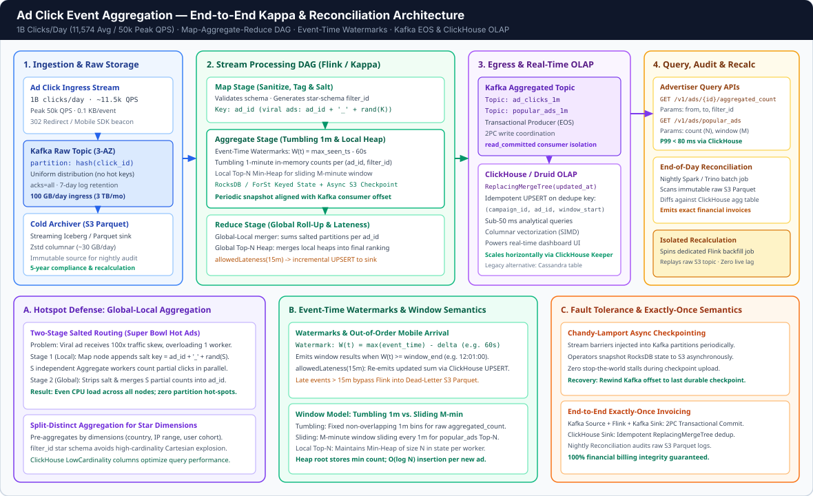

#### Component Deep Dive & Stream Dataflow

1. **Ad Ingestion & Dual Egress Tier**:
   - Clients (browsers and mobile applications) trigger click redirects (`302 Found`) or fire asynchronous beacon POST requests. Ad servers authenticate the click token, extract user and session metadata, and publish an Avro-serialized `AdClickEvent` into the `ad-clicks-raw` Kafka topic.
   - The Kafka topic is partitioned by `hash(click_id)`. Using `click_id` as the partition key guarantees uniform traffic distribution across all broker partitions, avoiding hot partitions regardless of viral ad popularity.
   - Concurrently, a cold-path archiver (Kafka Connect with S3 Sink Connector or an Apache Iceberg streaming committer) continuously flushes raw batches to Amazon S3 in compressed Zstandard columnar Parquet format, creating an immutable compliance audit trail.

2. **Map-Aggregate-Reduce Stream DAG (Apache Flink)**:
   - _Map Task Fleet_: Deserializes Avro records, applies click-fraud validation filters (dropping known bot signatures and malformed tokens), maps geographic IPs to star-schema `filter_id` identifiers, and emits records keyed by `ad_id` (or salted `ad_id` for viral campaigns).
   - _Aggregate Task Fleet_: Manages 1-minute tumbling window state using embedded RocksDB/ForSt engines. Maintains window accumulators in off-heap memory. Keyed state snapshots are periodically written to S3 via asynchronous Chandy-Lamport barriers.
   - _Watermarks and Lateness Control_: Evaluates event timestamps using bounded out-of-orderness watermarks ($W(t) = \max(t_{\text{event}}) - 60\text{ s}$). When $W(t)$ passes window close, the window fires. For delayed records arriving within `allowedLateness(15 minutes)`, the window recalculates and emits an incremental update. Records arriving after 15 minutes are routed to a Dead-Letter Side-Output stream written directly to S3.
   - _Top-N Sliding Window Fleet_: Computes Top-100 popular ads across sliding windows of length $M$ minutes. Each worker maintains a local Min-Heap of size 100, streaming local top candidates to the global reducer every minute.

3. **Storage & Serving Tier**:
   - Aggregated metrics flow into the `ad-clicks-aggregated` Kafka topic under transactional commit control.
   - The primary OLAP store is ClickHouse, employing the `ReplacingMergeTree` storage engine to ingest streaming window aggregates:

```sql
CREATE TABLE ad_clicks_aggregated_1m (
  campaign_id  UInt64,
  ad_id        UInt64,
  filter_id    LowCardinality(String),
  window_start DateTime,
  click_count  UInt64,
  updated_at   DateTime64(3)
) ENGINE = ReplacingMergeTree(updated_at)
PARTITION BY toYYYYMMDD(window_start)
PRIMARY KEY (campaign_id, ad_id, filter_id, window_start)
ORDER BY (campaign_id, ad_id, filter_id, window_start);
```

4. **Query & Reconciliation Tier**:
   - The API Gateway routes advertiser dashboard queries directly to ClickHouse query nodes. Analytical queries over hours or days execute via SIMD vectorized scans in tens of milliseconds.
   - Every night, the End-of-Day Reconciliation Spark job reads raw S3 Parquet logs, calculates exact billing numbers, and adjusts financial ledger accounts.
   - If an aggregation bug is detected, the Isolated Recalculation cluster reads historical S3 Parquet archives, computes corrected aggregates, and atomically updates ClickHouse without interrupting real-time streaming operations.

### 4.9 Architectural Evolution: 2021 Legacy Default vs. 2026 Modern Standard

Between 2021 and 2026, ad click stream aggregation systems underwent a major transformation driven by cloud-native stream-storage disaggregation, vectorized analytical database maturity, privacy-first mobile tracking regulations, and machine-learning fraud detection:

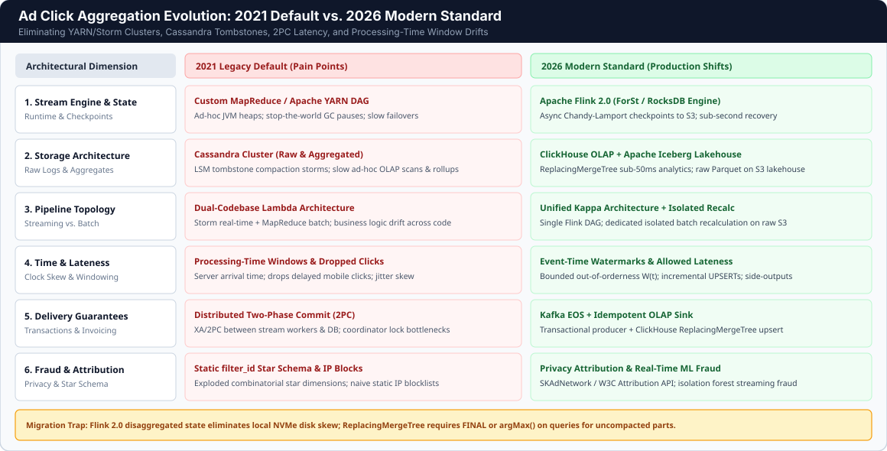

The table below contrasts the 2021 legacy defaults against the 2026 production standards across six foundational dimensions:

| Architectural Dimension | 2021 Legacy Default (Pain Points) | 2026 Modern Standard (Production Shifts) | Architectural Motivation & Technical Impact |
| --- | --- | --- | --- |
| **1. Stream Engine & State** | **Custom MapReduce / YARN DAG**: Ad-hoc in-memory JVM heaps; manual memory tuning; coarse checkpointing; high GC pause risk. | **Apache Flink 2.0 (ForSt / RocksDB)**: Async Chandy-Lamport checkpoints to S3; cloud-native disaggregated state; sub-second recovery. | Eliminates stop-the-world JVM GC pauses and local NVMe storage limits; decouples state size from local TaskManager disk capacity. |
| **2. Storage Architecture** | **Cassandra Cluster (Raw & Aggregated)**: LSM tombstone compaction storms; read latency degradation; manual compaction tuning. | **ClickHouse OLAP + Apache Iceberg**: ReplacingMergeTree sub-50ms analytics; raw columnar Parquet on S3 lakehouse. | Reduces query latency from seconds to $< 50\text{ ms}$; lowers raw log storage costs by $70\%\text{–}80\%$ via columnar Zstandard compression. |
| **3. Pipeline Topology** | **Dual-Codebase Lambda Architecture**: Separate Storm real-time and MapReduce/Spark batch codebases; logic drift; dual ops burden. | **Unified Kappa Architecture + Isolated Recalc**: Single Flink stream codebase; dedicated isolated batch recalculation on raw S3 replay. | Eliminates duplicate code and subtle cross-engine calculation bugs; enables zero-downtime historical recalculations. |
| **4. Time & Lateness** | **Processing-Time Windows & Dropped Clicks**: Server arrival time; drops delayed mobile clicks; campaign pacing corrupted by jitter. | **Event-Time Watermarks & Allowed Lateness**: Bounded out-of-orderness $W(t)$; incremental UPSERTs; side-output dead-letters. | Preserves true user interaction timestamps; accommodates cellular dead-zones without stalling real-time stream progression. |
| **5. Delivery Guarantees** | **Distributed Two-Phase Commit (2PC)**: XA/2PC between stream workers and DB; coordinator lock bottlenecks; high latency. | **Kafka EOS + Idempotent OLAP Sink**: Transactional producer + ClickHouse ReplacingMergeTree upsert; zero distributed locks. | Achieves strict end-to-end exactly-once financial billing accuracy without blocking stream threads or risking distributed lock deadlocks. |
| **6. Privacy & Fraud** | **Static filter_id Star Schema & IP Blocks**: Rigid combinatorial dimensions; static IP blocklists; blind to click injection. | **Privacy Attribution & Real-Time ML Fraud**: SKAdNetwork / W3C Attribution API; isolation forest streaming fraud detection. | Complies with Apple ATT / Privacy Sandbox regulations while filtering complex click-farm and SDK spoofing attacks in real time. |

#### Deep-Dive: Apache Flink 2.0 & Disaggregated Cloud State

In 2021, stateful stream processing clusters were constrained by local NVMe storage. Operators using RocksDB state backends had to provision local SSDs sized for peak historical state. Rebalancing partitions during traffic surges required transferring hundreds of gigabytes of SSTables across the network, causing TaskManager restarts to take minutes or hours.

Modern 2026 architectures adopt **Apache Flink 2.0 with Disaggregated State (ForSt Engine)**:

- _Cloud-Native Tiered Storage_: Flink 2.0 introduces ForSt, a storage engine designed natively for disaggregated cloud environments. Local NVMe drives function strictly as an ephemeral write buffer and read-ahead block cache, while the primary durable state resides on cloud object storage (Amazon S3 / Google Cloud Storage).
- _Instant Rescaling & Fast Recovery_: Because state is disaggregated, re-allocating a TaskManager does not require transferring state files between nodes. A newly scheduled worker mounts the existing S3 SSTables immediately, pulling only working-set pages into local cache on demand. Checkpoint recovery time drops from tens of minutes to sub-second durations.

#### Deep-Dive: Real-Time OLAP vs. Monolithic Cassandra

In 2021, Apache Cassandra was the standard database for both raw click logs and aggregated counts due to its high write throughput. However, Cassandra's row-based wide-column storage model creates severe operational bottlenecks in analytical advertising workloads:

- _Tombstone Storms_: Frequently updating or deleting rolling metric records generates tombstones. Read queries scanning ranges must evaluate millions of tombstones, triggering read timeouts and JVM garbage collection spikes.
- _Ad-Hoc Aggregation Limitations_: Queries requiring multi-dimensional slice-and-dice (`SUM`, `COUNT DISTINCT` across dynamic date ranges) require full table scans across nodes, forcing teams to maintain fragile pre-computed tables.

In 2026, architectures separate raw event lakehousing from analytical serving:

- _Raw Storage_: Apache Iceberg tables backed by Parquet on object storage provide ACID transactions, time-travel queries, and partition evolution at commodity storage pricing.
- _Analytical Serving_: Columnar OLAP engines (ClickHouse, Apache Pinot, Apache Druid) execute vectorized SIMD instruction sets and sparse primary keys. ClickHouse processes aggregated ad queries at hundreds of millions of rows per second per server, serving complex multi-dimensional dashboard queries with P99 latencies under $50\text{ ms}$.

#### Deep-Dive: Privacy-Preserving Attribution (SKAdNetwork & W3C Attribution Reporting)

Between 2021 and 2026, advertising tracking underwent a fundamental shift driven by consumer privacy protections (Apple App Tracking Transparency / SKAdNetwork 4.0, Google Privacy Sandbox on Android, and the W3C Attribution Reporting API):

- _Elimination of Raw User Identifiers_: Mobile operating systems deprecate persistent cross-app identifiers (`IDFA`, `GAID`). Client beacons no longer transmit raw `user_id` or precise device fingerprints in ad click payloads.
- _Cryptographic Conversion Windows & Noise Injection_: Postback beacons are transmitted with randomized delays (24–48 hours) to prevent temporal re-identification. Conversion values are coarse-grained (e.g., 2-bit or 6-bit tiered buckets), and differential privacy noise is added to aggregated conversion reports.
- _Aggregation Service Enclaves_: To obtain fine-grained attribution metrics, ad platforms route encrypted event reports through an Aggregation Service running within a Trusted Execution Environment (TEE, such as AWS Nitro Enclaves). The TEE decrypts individual events, computes multi-party aggregations, adds calibrated Laplace noise, and outputs summary reports to the OLAP cluster—guaranteeing that individual user clicks cannot be reverse-engineered from dashboard queries.

#### Deep-Dive: Real-Time Streaming ML Click-Fraud Detection

Click fraud—including botnets, click farms, competitor click spam, and SDK spoofing—distorts campaign analytics and drains advertiser budgets. In 2021, fraud detection relied primarily on static IP blocklists and rule-based thresholds (e.g., flagging $> 10$ clicks/minute from the same IP) executed during nightly batch jobs.

Modern 2026 pipelines embed **Real-Time Streaming Machine Learning Detection** directly into the Flink Map-Aggregate DAG:

1. _Streaming Feature Extraction_: Flink operators maintain sliding-window state tracking velocity features: click-to-impression latency distribution, click entropy across user agents, and IP subnet velocity.
2. _Real-Time Inference via ONNX Runtime_: Ingested clicks pass through lightweight vectorized machine-learning models (e.g., Isolation Forest, XGBoost) compiled via ONNX Runtime and embedded in worker task threads.
3. _Dynamic Fraud Tagging_: Suspect clicks are not immediately dropped (which would alert bot operators to probe detection thresholds); instead, they are tagged with a `fraud_prob` score and assigned a dedicated `filter_id` dimension. Fraudulent clicks are excluded from real-time advertiser billing while being captured in security telemetry dashboards for adversarial defense.

---

## 5. Metrics Monitoring Platform

A metrics platform ingests tens of millions of numeric `(metric_name, labels, timestamp, value)` samples per second for infrastructure health, alerting, and PromQL dashboards. Unlike general log or trace stores, time-series engines achieve `10×` higher density by exploiting monotonic timestamps and slow-changing floating-point values—and their #1 catastrophic outage mode is **label cardinality explosion**.

> [!NOTE]
> For the complete system-level architecture, pull-versus-push collection trade-offs, Gorilla double-delta and XOR compression mechanics, Google SRE multi-window burn-rate alerting, and the 2021-versus-2026 observability evolution, see the detailed deep dive in [Module 11: Reliability, Observability, SLO Math, and Disaster Recovery](./11-reliability-slos-observability-and-dr.md#41-end-to-end-metrics-platform-architecture-10m-metrics--100m-dau), alongside architectural blueprints [11-metrics-monitoring-architecture.svg](../assets/11-metrics-monitoring-architecture.svg) and [11-observability-2021-vs-2026.svg](../assets/11-observability-2021-vs-2026.svg).

### 5.1 Metrics Requirements & SLAs

- **Functional requirements**: Multi-dimensional time-series ingestion (counters, gauges, native/exponential histograms), PromQL/MetricsQL range and instant queries, alerting rule evaluation, downsampled long-term retention (`15 s` raw -> `5 m` -> `1 h`), and multi-tenant cardinality guardrails.
- **Non-functional requirements**: Sustained ingestion of `20M` samples/sec (`~1.2B` samples/min); query latency `p95 < 500 ms` for last-hour dashboards, `< 3 s` for 30-day rollups; high write availability (never drop alerts during query storms—isolate write/ingester paths from heavy ad-hoc PromQL scans).

### 5.2 Metrics Capacity Estimation

- **Active series & write rate**: `100,000` hosts/pods * `3,000` active time series per host (including `~30×` container and `le` HTTP route/status histogram-bucket expansion over [Module 11 §4.1](11-reliability-slos-observability-and-dr.md#41-end-to-end-metrics-platform-architecture-10m-metrics--100m-dau)'s `100` base host metrics = `10M` base series) = `300M` active time series. Scraped/pushed every `15 s` -> `300M / 15 = 20M` samples/sec.
- **Storage with Gorilla compression**: Uncompressed `(int64 timestamp, float64 value)` = `16 bytes/sample` -> `20M * 16 = 320 MB/s` (`27.6 TB/day`). With Gorilla delta-of-delta + XOR compression (`~1.37–1.6 bytes/sample` in production), storage drops by `~10×` to `~32 MB/s` (`~2.76 TB/day` raw, `~8.3 TB/day` with `3×` RF in hot/warm tiers before downsampling).
- **In-memory index overhead**: `300M` active series labels + postings lists require `~2–4 KB` per series in RAM if unoptimized (`~600 GB–1.2 TB` cluster RAM across sharded ingesters), making active series count—not sample rate—the primary driver of RAM and OOM risk.

### 5.3 Metrics Ingestion & Query APIs

- **Ingestion**: Prometheus Remote Write (`POST /api/v1/write`, Snappy-compressed Protobuf batches) or OpenTelemetry `OTLP/gRPC` (`ExportMetricsServiceRequest`), partitioned across ingesters by consistent hash of the canonical label set (`__name__` + sorted labels).
- **Query**: PromQL HTTP API `GET /api/v1/query_range?query=rate(http_requests_total[5m])&start=...&end=...&step=60s`.

### 5.4 Metrics High-Level Design

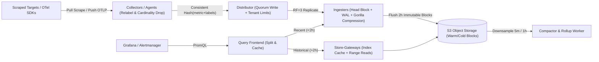

### 5.5 Metrics Deep Dives & Failure Modes

- **Pull (Prometheus) vs. Push (OTLP)**: Pull scraping gives built-in target liveness (`up == 1`), natural backpressure (the server scrapes at its own pace), and centralized scrape intervals, but struggles with short-lived serverless/batch jobs and NAT/firewall boundaries (see [Observability](../../../technologies/observability/README.md)). Push via OTLP Collector / Grafana Alloy solves ephemeral jobs and cross-VPC telemetry while allowing edge aggregation and relabeling before hitting the TSDB core; large platforms support **both** via OTel collectors forwarding into a Mimir/VictoriaMetrics/Thanos backend.
- **Gorilla Delta-of-Delta & XOR Compression**: Because scrape intervals are regular (`t_0, t_1, t_2` separated by `15 s`), second-order differences `D = (t_n - t_{n-1}) - (t_{n-1} - t_{n-2})` are almost always `0` (encoded as a single `0` bit) or tiny jitter values (variable bit-length prefixes). Similarly, consecutive float64 measurements share almost identical leading/trailing bits; XORing `v_n XOR v_{n-1}` yields mostly zeros, compressed to leading-zero count + meaningful bits (`1.37 bytes/sample` average in Facebook's Gorilla paper).
- **Tiered Hot/Warm/Cold Storage & Downsampling Rollups**: Ingesters append incoming samples to an in-memory head block backed by a local NVMe WAL (`2-hour` window) and flush immutable sorted chunks (`XOR` compressed + inverted label index) to S3 every `2 hours`. A background Compactor merges overlapping blocks and builds `5-minute` and `1-hour` downsampled rollups. Crucially, downsampling stores **`min`, `max`, `sum`, `count`** (never precomputed `p99`s, because quantiles are non-associative and cannot be averaged across time or hosts—see [Observability](../../../technologies/observability/README.md)).
- **Cardinality Guardrails**: A single code deploy adding `user_id` or unnormalized URL paths (`/users/12345/profile`) as a metric label multiplies active series from `10k` to `50M` in minutes, exhausting ingester RAM and blowing up inverted index postings lists. Defenses must be layered: (1) collector-side `relabel_configs` / OTTL drops high-cardinality labels before ingestion; (2) distributors enforce per-tenant `max_series_per_metric` and `max_active_series` quotas, rejecting offending label sets with `429` rather than OOMing the shared cluster; (3) adopt **Native / Exponential Histograms** instead of `10–20` static `le` buckets per metric; and (4) route high-cardinality debugging (`user_id`, `trace_id`) to traces/logs or Exemplars, never metric labels.
- **Query Federation & Scatter-Gather**: A `30-day` PromQL query hits the **Query Frontend**, which splits the query into `1-day` sub-queries, serves immutable past days from Memcached/Redis result cache, and fans out remaining ranges in parallel across **Store-Gateways** (for S3 blocks) and **Ingesters** (for the live `2h` head window). Separating a dedicated Alerting Rule Evaluator path from ad-hoc dashboard queries ensures an analyst running an unindexed regex query `{__name__=~".*"}` cannot starve SLO burn-rate alerts.

| Compression Step | Mechanism | Typical Bit Width | Effective Reduction |
| --- | --- | --- | --- |
| **Raw Uncompressed** | `int64` epoch ms + `float64` IEEE-754 | `128 bits` (`16 bytes`) | Baseline (`1.0×`) |
| **Delta-of-Delta Timestamps** | $D = (t_n - t_{n-1}) - (t_{n-1} - t_{n-2})$; `0` encodes as single `0` bit | `~1–2 bits` (regular scrapes) | `~32–64×` on timestamp half |
| **XOR Floating-Point** | `v_n XOR v_{n-1}` compressed via leading-zero + meaningful-bit window | `~8–11 bits` (smooth gauges/counters) | `~10–12×` combined (`~1.37 B/sample`) |

> [!WARNING]
> High-cardinality labels (`user_id`, `session_id`, `request_id`, or unparameterized URLs) do not merely increase storage—they trigger quadratic memory growth in the TSDB's inverted postings index inside live Ingesters. Always enforce cardinality drop rules at the OTel Collector / Prometheus `metric_relabel_configs` boundary and cap `max_active_series` per tenant before samples reach storage.

---

## 6. Distributed Job Scheduler

A Distributed Job Scheduler executes millions of one-off delayed tasks (abandoned cart emails, webhook retries, trial expirations) and recurring cron jobs reliably at scale without losing jobs on worker crashes, firing duplicates on leader failover, or triggering synchronized thundering herds at `:00` minutes.

### 6.1 Scheduler Requirements & SLAs

- **Functional requirements**: One-shot delayed execution (`run_at`), recurring cron schedules with timezone support, configurable misfire policies, priority queues, idempotent job identity, configurable retry/backoff policies, and Dead-Letter Queues (DLQ).
- **Non-functional requirements**: Scale to `10M+` registered scheduled jobs and `50k` job triggers/sec; scheduling jitter `< 1 s` for real-time delayed tasks (`< 5 s` for cron); at-least-once trigger guarantee combined with idempotent execution keys; `99.99%` scheduler availability.

### 6.2 Scheduler Capacity Estimation

- **Storage**: `10M` active schedules + `50M` pending delayed tasks * `~512 bytes` (payload pointer, cron expr, `next_fire_at`, lease metadata) = `~30.7 GB`, easily partitioned across `8–16` PostgreSQL/CockroachDB shards (or DynamoDB/Cassandra time-bucketed partitions).
- **Trigger QPS**: `50,000` triggers/sec average (`150k` peak at top-of-the-hour boundaries before jittering).

### 6.3 Scheduler API & Job State Machine

```json
{
  "job_id": "billing_invoice_usr_4421",
  "schedule": { "type": "CRON", "expr": "0 2 * * *", "tz": "Europe/Prague", "max_jitter_sec": 300 },
  "misfire_policy": "FIRE_ONCE_NOW",
  "execution_endpoint": "grpc://billing-worker/GenerateInvoice",
  "retry_policy": { "max_attempts": 5, "backoff": "EXPONENTIAL_JITTER" }
}
```

Job instances transition cleanly across states: `SCHEDULED -> CLAIMED (with lease_until, fencing_token) -> RUNNING -> SUCCEEDED | FAILED_RETRYING | DEAD_LETTERED`.

```sql
CREATE TABLE scheduled_tasks (
  shard_id         SMALLINT NOT NULL,
  task_id          UUID NOT NULL,
  job_id           TEXT NOT NULL,
  scheduled_for    TIMESTAMPTZ NOT NULL,
  next_fire_at     TIMESTAMPTZ NOT NULL,
  status           TEXT NOT NULL, -- SCHEDULED, CLAIMED, RUNNING, SUCCEEDED, DLQ
  lease_owner      TEXT,
  lease_until      TIMESTAMPTZ,
  fencing_token    BIGINT NOT NULL DEFAULT 0,
  idempotency_key  TEXT NOT NULL,
  PRIMARY KEY (shard_id, task_id)
);

CREATE INDEX idx_tasks_due ON scheduled_tasks (shard_id, status, next_fire_at) WHERE status = 'SCHEDULED';
```

### 6.4 Scheduler High-Level Design

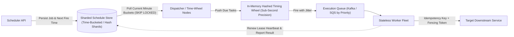

### 6.5 Scheduler Deep Dives & Failure Modes

- **Partitioned Timing Wheel vs. DB Lease Claiming (`FOR UPDATE SKIP LOCKED`)**: Scanning an entire `60M`-row database table every second (`WHERE next_fire_at <= NOW()`) causes full-index thrashing and lock contention across competing dispatcher nodes. Two complementary patterns solve this:
  1. **Time-bucketed DB lease claiming**: Partition pending tasks by `(shard_id, minute_bucket, status, next_fire_at)`. Dispatchers claim batches for the upcoming `10–60 s` window using PostgreSQL `SELECT ... FROM tasks WHERE shard = $1 AND status = 'SCHEDULED' AND next_fire_at <= NOW() + INTERVAL '5 seconds' ORDER BY next_fire_at LIMIT 500 FOR UPDATE SKIP LOCKED`, immediately advancing `status = 'CLAIMED'`, `lease_until = NOW() + 60s`, and incrementing `fencing_token`. `SKIP LOCKED` ensures competing dispatchers never block each other on row locks.
  2. **In-memory Hierarchical Hashed Timing Wheel**: Once claimed for the current `60 s` horizon, dispatchers load tasks into a `O(1)` ring-buffer timing wheel (`60` slots at `1 s` ticks, or multi-level `ms -> s -> min`) for crisp sub-second firing without hammering the DB. If a dispatcher crashes mid-minute, its DB leases expire after `60 s` and another dispatcher re-claims the uncompleted tasks.
- **Worker Heartbeats & Fencing Tokens**: Long-running jobs (`10 minutes`) can outlive an initial `60 s` lease. Workers send periodic lease-renewal heartbeats (`UPDATE tasks SET lease_until = NOW() + 60s WHERE task_id = $1 AND fencing_token = $2 AND status = 'RUNNING'`). If a worker experiences a long GC pause and loses its lease, a second worker claims the task with `fencing_token + 1`; downstream storage rejects any late writes bearing the stale fencing token (see [Distributed Systems](../../distributed-systems/README.md)).
- **Misfire Handling Policies**: After a scheduler outage or downstream maintenance window, millions of cron tasks may sit overdue. Blindly executing every missed tick (`CATCH_UP_ALL`) triggers a self-inflicted DoS. Jobs must explicitly declare one of three misfire policies: `SKIP` (advance `next_fire_at` to the next future cron tick—best for periodic cache refreshes), `FIRE_ONCE_NOW` (coalesce all missed ticks into a single run—best for daily billing/report aggregation), or `CATCH_UP_ALL` (replay every missed window sequentially—required only for strict time-window ETL).
- **Jittered Cron Triggers**: Customers and developers overwhelmingly configure `0 * * * *` or `0 0 * * *`, creating `100×` QPS spikes at `:00:00`. Adding deterministic hash-based jitter (`hash(job_id) % max_jitter_sec`, e.g., spreading `0 2 * * *` across `02:00:00–02:05:00`) flattens infrastructure peaks without altering job fairness or causing drift across consecutive days.
- **Idempotent Execution Keys & Durable Workflow Boundary**: Because at-least-once dispatch can fire a trigger twice on network partition, every job trigger passes an immutable idempotency key `(job_id, scheduled_fire_time)` to the target service. When a job is not a single RPC—instead requiring multi-step branching, human-in-the-loop waits, or saga compensations across days—do not build ad-hoc cron state machines; delegate orchestration to a durable execution engine such as Temporal.

```sql
-- Atomic batch lease claiming without lock contention across dispatcher nodes
WITH due AS (
  SELECT task_id
  FROM scheduled_tasks
  WHERE shard_id = $1
    AND status = 'SCHEDULED'
    AND next_fire_at <= NOW() + INTERVAL '5 seconds'
  ORDER BY next_fire_at
  LIMIT 500
  FOR UPDATE SKIP LOCKED
)
UPDATE scheduled_tasks t
SET status = 'CLAIMED',
    lease_owner = $2,
    lease_until = NOW() + INTERVAL '60 seconds',
    fencing_token = t.fencing_token + 1
FROM due
WHERE t.task_id = due.task_id
RETURNING t.*;
```

| Misfire Policy | Behavior After Scheduler Outage | Thundering-Herd Risk | Intended Workload |
| --- | --- | --- | --- |
| **`SKIP`** | Discards missed ticks; jumps to next future cron fire time | Low (with deterministic jitter) | Cache warmers, periodic health probes, telemetry rollups |
| **`FIRE_ONCE_NOW`** | Collapses all missed runs into one immediate catch-up execution | Moderate (stagger via jitter pool) | Daily invoice generation, subscription renewals |
| **`CATCH_UP_ALL`** | Enqueues one execution per missed interval sequentially | Very high (needs per-tenant concurrency cap) | Strict hourly/daily billing or regulatory ETL backfills |

---

## Interview Drill

1. **Why do chat systems reject wall-clock timestamps for ordering messages inside a conversation, and what breaks if you use a global Snowflake ID alone?**

<details><summary>Model Answer</summary>

Client clocks drift or can be manipulated maliciously, and even NTP-synchronized servers exhibit `5–50 ms` skew—meaning two messages sent sequentially across different gateways can receive inverted wall-clock timestamps. Even global Snowflake IDs across stateless gateways only order within a coarse millisecond bucket per node and leave gaps (`1042`, `1099`), so a client cannot tell whether a gap means another conversation got an ID or a frame for _this_ conversation was dropped. Assigning a contiguous per-conversation `seq_id` (`1, 2, 3, ...`) at the conversation partition sequencer establishes a strict total order _and_ deterministic gap detection (`expected = last_seq + 1`).

</details>

2. **A user with 5,000 friends toggles airplane mode repeatedly on a commuter train. Why does a naive WhatsApp presence design degrade into an outage, and how do you fix it?**

<details><summary>Model Answer</summary>

Eagerly broadcasting every `online/offline` state flip to `5,000` friends creates a `5,000×` fan-out storm per network flap across millions of commuters, saturating gateways and Redis Pub/Sub. Fix it by: (1) adding a `60–120 s` server-side presence TTL grace period so brief cellular drops do not mark the user offline; (2) switching to **lazy pull** so clients query/subscribe to presence only for the currently visible chat thread or batched contact screen; (3) jittering and piggybacking heartbeats onto normal traffic; and (4) capping live presence broadcasts for high-fan-out accounts.

</details>

3. **In a Multi-Channel Notification System, how do you prevent a 10M-user marketing campaign from violating the `< 1s` p99 latency SLA of 2FA OTP SMS messages?**

<details><summary>Model Answer</summary>

Enforce physical bulkhead isolation across the entire pipeline: separate Kafka topics (`notif.p0`, `notif.p1`, `notif.p2`), separate autoscaled worker fleets, separate downstream connection pools/rate-limiters, and dedicated primary/fallback SMS provider quotas reserved for `P0`. Additionally, shape `P2` marketing batch ingestion with a token-bucket rate governor and evaluate `expires_at` before calling external vendors so stalled alerts are dropped rather than draining retry budgets.

</details>

4. **Why does PostgreSQL/PostGIS melt under Uber's 250k driver GPS writes/sec, and how do H3 k-ring lookups eliminate the Geohash boundary miss?**

<details><summary>Model Answer</summary>

Relational spatial indexes (GiST/R-tree or B-tree geohashes) persist every `4 s` position update as a WAL-logged row mutation, creating massive index page splits, MVCC dead-tuple bloat, and random buffer-pool churn for ephemeral data that expires in seconds. Moving live coordinates into a city-sharded in-memory H3 store with a `15–30 s` TTL keeps all `1M` drivers in `~200 MB` of RAM. Querying only the rider's single cell misses drivers standing just across a cell boundary; running an H3 `gridDisk(cell, k)` lookup fetches the center hexagon plus all uniform-distance surrounding rings (`7` cells for `k=1`, `19` for `k=2`) before scoring candidates with Contraction Hierarchies road-network ETAs.

</details>

5. **How do you guarantee two nearby riders never get matched to the same Uber driver concurrently?**

<details><summary>Model Answer</summary>

Candidate selection in the spatial store is a read-only heuristic; exclusivity requires an atomic state transition. Dispatch acquires a short-lived exclusive offer lease (`SET driver:lock:{driver_id} {trip_id} NX PX 15000` or fenced lease) AND executes a conditional versioned transition in the authoritative state store (`WHERE driver_id = :id AND state = 'AVAILABLE' AND version = :v`). Parallel dispatchers hitting the same top-ranked driver fail the lease/CAS check immediately and fall through to the second-best candidate.

</details>

6. **In an Ad Click Aggregator, mobile clicks frequently arrive 20 minutes late after a subway ride. How do Watermarks, `allowedLateness`, and Lambda/Kappa reconciliation reconcile fast dashboards with exact billing?**

<details><summary>Model Answer</summary>

Flink windows events by `event_time_ms` rather than Kafka arrival time, advancing a watermark `W(t) = max_event_time - 60s` so normal `1-minute` windows emit promptly within `~60 s`. Setting an `allowedLateness` window (e.g., `15 minutes`) emits incremental `UPSERT` corrections to ClickHouse for moderately late clicks, while clicks arriving even later route via a side output to the immutable S3 Parquet raw log. Exact financial billing runs a deterministic batch (Lambda) or full-history stream replay (Kappa) over the deduplicated (`click_id`) S3 Parquet archive so advertisers are never under- or over-billed due to real-time watermark cutoffs.

</details>

7. **Why does a Metrics Monitoring Platform suffer catastrophic OOMs when developers attach `user_id` or raw URL paths as Prometheus labels, and why can't downsampled rollups average `p99`?**

<details><summary>Model Answer</summary>

Every unique combination of `(metric_name, label_key=label_value)` creates a distinct time series stored in the TSDB's in-memory head block and inverted postings index (`~2–4 KB` RAM per series). Attaching `user_id` (`10M` values) explodes active series by orders of magnitude, exhausting ingester RAM before disk compression even helps. Guard against this via collector relabel drops, per-tenant active-series caps, and Native Histograms. When downsampling historical series (`15 s -> 5 m -> 1 h`), you must store additive/associative statistics (`min`, `max`, `sum`, `count`, or histogram bucket counts)—never precomputed `p99`s—because quantiles are non-linear and averaging percentiles across hosts or time intervals is mathematically invalid.

</details>

8. **A database outage pauses your Distributed Job Scheduler for 25 minutes. How do you prevent a post-recovery thundering herd and split-brain duplicate executions?**

<details><summary>Model Answer</summary>

First, honor per-job `misfire_policy`: `SKIP` stale periodic jobs or coalesce them with `FIRE_ONCE_NOW` instead of replaying every missed minute (`CATCH_UP_ALL`), and stagger triggered jobs using deterministic hash jitter. Second, claim tasks via sharded `FOR UPDATE SKIP LOCKED` with bounded `lease_until` and a monotonic `fencing_token`; workers renew leases via heartbeats and pass `(job_id, scheduled_fire_time)` plus the fencing token to downstream targets so any zombie worker waking from a pause is rejected before mutating state.

</details>
