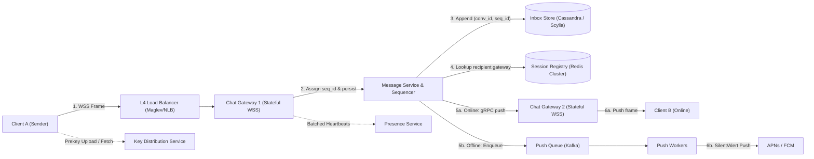
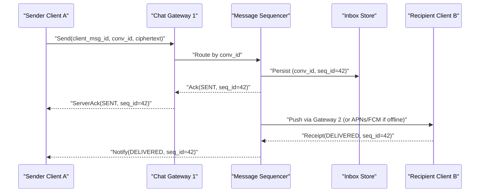
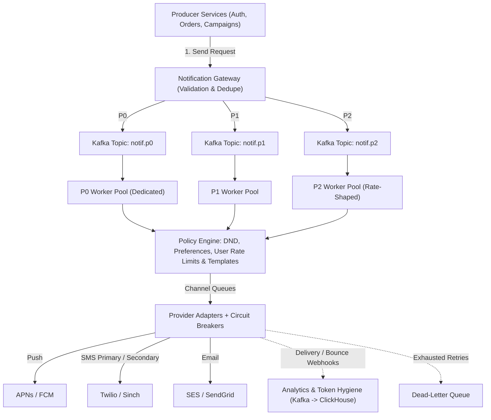
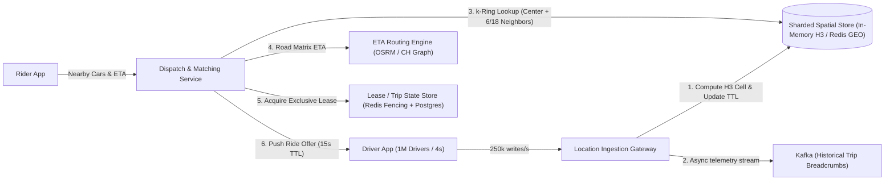
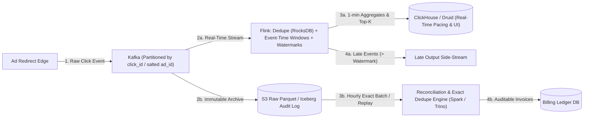
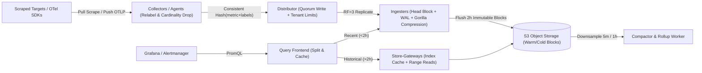
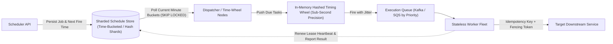

# Module 13 — Canonical Designs II: Real-Time, Geospatial, and Write-Heavy Systems

Real-time communication, continuous geospatial telemetry, high-throughput stream aggregation, time-series monitoring, and distributed job scheduling share a defining architectural constraint: write velocity and tail latency dominate over simple read caching. Naive relational polling, unpartitioned queues, or wall-clock ordering collapse under millions of concurrent sockets, hundreds of thousands of location updates per second, or out-of-order mobile events. This module works through six canonical write-heavy and real-time designs end to end, from requirements and back-of-the-envelope capacity sizing to wire contracts, component composition, and production failure modes.

Throughout these designs, internal algorithms and foundational distributed primitives are cross-linked to their owning curricula rather than re-derived here: consensus, clocks, fencing tokens, and delivery semantics live in [Distributed Systems](../../distributed-systems/README.md); storage engines, replication, and stream-table duality in [Data Systems](../../data-systems/README.md); transport protocols, WebSockets, and load balancing in [Networking](../../networking/README.md); Redis data structures and Lua atomicity in [Redis](../../../technologies/redis/README.md); telemetry signals, OTLP, Prometheus, and SLO burn rates in [Observability](../../../technologies/observability/README.md); and probabilistic sketches, heaps, and consistent hashing in [Data Structures & Algorithms](../../../algorithms/dsa/README.md).

---

## 1. Real-Time Messaging: Chat & WhatsApp

Instant messaging combines massive persistent connection state (`10^8` concurrent TCP/TLS/WebSocket sessions) with strict per-conversation causal ordering, multi-device synchronization, delivery receipts, and end-to-end encryption. Unlike request-response HTTP workloads where stateless application servers discard connection state after milliseconds, a chat architecture must route messages across stateful edge gateways in sub-second time while surviving mobile network transitions.

### 1.1 Chat Requirements & SLAs

- **Functional requirements**: One-to-one messaging, small-to-medium group chats (capped at `500–1,024` members), per-message delivery receipts (`sent`, `delivered`, `read`), online/last-seen presence indicators, offline mobile push notifications, multi-device inbox synchronization, and optional End-to-End Encryption (E2EE) key exchange.
- **Non-functional requirements**: End-to-end message delivery latency `p99 < 250 ms` intra-region for online recipients; strict monotonic ordering within each conversation; `99.99%` availability for message send/receive; zero message loss once the gateway emits a `sent` acknowledgement; graceful degradation of presence and typing indicators under overload so core message delivery never stalls.
- **Scale assumptions**: `100M` concurrent connected users (`500M` DAU), `50B` messages/day, average payload `200 bytes` text (media blobs offloaded via presigned URLs to object storage), and up to `5` linked devices per user.

### 1.2 Chat Capacity Estimation

Let us derive the infrastructure footprint from the stated traffic assumptions:

- **Message QPS**: `50 * 10^9 / 86,400 ≈ 578,700` messages/sec average. Applying a `3×` diurnal peak multiplier yields `~1.74M` messages/sec at peak. With an average group fan-out factor of `1.5×`, gateway outbound delivery reaches `~2.6M` frames/sec.
- **Gateway fleet sizing (100M concurrent WebSockets)**: A Linux kernel tuned for `fs.nr_open`, `net.ipv4.ip_local_port_range`, and minimal per-socket buffers (`~16–32 KB` kernel + user-space state per idle connection) comfortably holds `500,000` concurrent TLS WebSocket connections per `32-vCPU / 64 GB RAM` node (~16 GB socket/app memory, leaving generous headroom for frame parsing and GC/epoll overhead). Holding `100M` concurrent sockets requires `100M / 500k = 200` active gateway nodes, or `~250` nodes for `N + 20%` AZ failover capacity.
- **Session registry size**: `100M` active `(user_id, device_id) -> gateway_node_id` mappings at `~128 bytes` per entry consume `~12.8 GB` of RAM, fitting comfortably inside a modest sharded Redis Cluster (`3–6` shards with replicas).
- **Storage sizing**: `50B * 200 bytes = 10 TB/day` raw message payloads. With metadata (`message_id`, `seq_id`, `sender_id`, timestamps, index entries) totaling `~350 bytes/message`, daily raw data is `~17.5 TB/day`. Over `5` years with `3×` replication (e.g., ScyllaDB/Cassandra or sharded RocksDB-backed inbox), total storage reaches `17.5 TB * 365 * 5 * 3 ≈ 95.8 PB` before Zstd compression (~40–50% savings on text/metadata).

### 1.3 Chat API & Wire Protocol

Clients maintain a persistent bi-directional WebSocket (or HTTP/3 WebTransport) frame stream using compact binary framing (Protobuf over WebSocket) alongside REST endpoints for media uploads and initial history sync:

```protobuf
// WebSocket Envelope (Client <-> Chat Gateway)
message ClientSendMessage {
  string client_msg_id = 1; // UUIDv7 idempotency key generated by sender
  string conversation_id = 2;
  bytes ciphertext_payload = 3; // E2EE Signal ciphertext or plaintext JSON
  uint64 sender_device_id = 4;
}

message ServerAck {
  string client_msg_id = 1;
  string conversation_id = 2;
  uint64 seq_id = 3; // Server-assigned monotonic per-conversation sequence
  int64 server_ts_ms = 4;
  enum Status { SENT = 0; DELIVERED = 1; READ = 2; }
  Status status = 5;
}
```

- **Inbox catch-up REST endpoint**: `GET /v1/conversations/{conversation_id}/messages?after_seq={last_acked_seq}&limit=100` returns missed frames in ascending `seq_id` order when a device reconnects after offline sleep.
- **Key bundle endpoint**: `GET /v1/keys/{user_id}/bundle` fetches a recipient's Identity Key, Signed Prekey, and one consumed One-Time Prekey for X3DH session establishment.

```sql
-- ScyllaDB / Cassandra conversation log (bucketed to bound partition size < 100 MB)
CREATE TABLE messages_by_conversation (
  conversation_id UUID,
  bucket_ym       INT,     -- e.g. 202611 (keeps wide rows bounded)
  seq_id          BIGINT,  -- server-assigned monotonic sequence per conversation
  message_id      UUID,    -- client UUIDv7 for idempotent dedupe
  sender_id       BIGINT,
  payload         BLOB,    -- opaque E2EE ciphertext
  created_at      TIMESTAMP,
  PRIMARY KEY ((conversation_id, bucket_ym), seq_id)
) WITH CLUSTERING ORDER BY (seq_id DESC);
```

### 1.4 Chat High-Level Design



### 1.5 Chat Deep Dives & Failure Modes

- **Stateful Chat Gateways & Connection Draining**: Because WebSockets are long-lived TCP connections, L4 consistent-hashing load balancers route packets to the pinned gateway without inspecting TLS after handshake (see [Networking](../../networking/README.md)). Each gateway registers `(user_id, device_id) -> gateway_id` in Redis with a `90 s` TTL refreshed lazily on inbound client activity. During rolling deploys, gateways stop accepting new connections, send a `GOAWAY` / reconnect frame with randomized `[0, 30s]` jitter to spread reconnection storms across healthy nodes, and drain active sockets.
- **Per-Conversation Monotonic Sequence IDs vs. Wall Clocks**: Wall-clock timestamps (`Date.now()` on clients or even NTP-synced servers) cannot establish total message order: client clocks can lag by hours or jump backward, and two concurrent messages hitting different API servers within a `10 ms` NTP skew window reorder inconsistently across participants' screens. Instead, the Message Service routes `conversation_id` via consistent hashing to a deterministic partition sequencer (or uses a lightweight per-conversation atomic counter in Redis/storage backed by a durable high-water mark, or a Raft shard per partition) that assigns a contiguous monotonic `seq_id = 1, 2, 3, ...` per conversation. Contiguous `seq_id`s simultaneously solve gap detection: if a client holds `seq_id = 41` and receives `43`, it knows immediately that `42` was dropped in transit and pulls `after_seq=41`.
- **Group Chat Fan-Out Cap & Delivery Receipts**: Capping interactive group chats at `500–1,024` members bounds fan-out amplification. For each message, the Message Service writes once to the canonical conversation log `(conversation_id, bucket, seq_id)` (avoiding `1,000×` storage duplication for group histories), and fans out lightweight notification pointers `(conversation_id, seq_id)` to online members' gateways or offline push queues. For delivery receipts (`sent` -> `delivered` -> `read`), state transitions are monotonic (`max(current_state, new_state)`). In groups above `~50` members, displaying per-member `read` avatars creates `O(N^2)` receipt traffic (`1,000` users reading `1` message = `1,000` receipt writes), so groups either batch receipts or aggregate read counts lazily (`read_count`) rather than pushing individual receipt frames to every participant.
- **Offline Push & Inbox Sync**: When the Session Registry shows no active gateway for a recipient's device (or the gateway push times out), the Message Service publishes to a Push Queue consumed by APNs/FCM workers. Note that push payloads under E2EE carry either ciphertext (decrypted locally by an iOS Notification Service Extension) or a wake-up trigger (`content-available: 1`) prompting the app to sync via `after_seq` cursor. Keeping an explicit per-device `ack_seq` watermark prevents duplicate redelivery once the client confirms receipt.
- **Presence Heartbeat Batching & Celebrity Storms**: Naive presence broadcasts every heartbeat (`100M` users sending a ping every `5 s` = `20M` presence updates/sec) and fans out online/offline transitions to all contacts. If a user with `5,000` friends toggles airplane mode on a subway, that triggers a `5,000`-message presence storm repeatedly. Production systems fix this with four defenses: (1) piggyback presence on existing WebSocket traffic and send explicit heartbeats only when idle every `30–60 s` with a `90–120 s` TTL grace period so brief cellular drops do not flap status; (2) **lazy pull**—clients do not receive global presence pushes; instead, opening a chat screen subscribes/fetches status solely for that visible peer; (3) batch contact-list presence queries in `30 s` intervals; and (4) disable live presence broadcasting automatically for accounts exceeding a contact threshold.



- **E2EE Signal Protocol Key Distribution**: Under the Signal Protocol, each device publishes a long-term Identity Key, a medium-term Signed Prekey, and a pool of One-Time Prekeys to the Key Distribution Service (KDS). When Alice messages Bob for the first time, Alice fetches Bob's bundle from KDS (KDS atomically pops one One-Time Prekey via `LPOP` or SQL `DELETE ... RETURNING` so two senders never reuse the same ephemeral prekey), runs X3DH to derive a shared root key, and advances a Double Ratchet per message for forward secrecy and post-compromise security. For groups up to `1,024` members, Sender Keys amortize encryption to `1` symmetric encryption + `1` server fan-out instead of `N` pairwise ratchets, rotating keys only when a member leaves. The architectural trade-off is stark: because the server holds only opaque ciphertext, server-side full-text message search, spam keyword filtering, and URL preview unfurling cannot execute on the backend and must shift to the client device.

| Messaging Mode | Group Cap | Storage Pattern | Receipt Strategy | Fan-Out & Encryption Trade-Off |
| --- | --- | --- | --- | --- |
| **1:1 Direct Chat** | `2` | Single partition `(conv_id, bucket)` | Immediate `sent`/`delivered`/`read` | Pairwise Double Ratchet; trivial `1×` gateway push |
| **Interactive Group** | `500–1,024` | Shared log + per-member cursor | Batched or read-count aggregate | Sender Keys amortize E2EE; `1` DB write + `N` lightweight pointers |
| **Broadcast Channel** | `100k–10M+` | Append-only channel log + CDN/SSE | Aggregated view counters only | No E2EE Sender Keys, no per-member receipts, pull/chunked edge fan-out |

---

## 2. Multi-Channel Notification System

A Multi-Channel Notification System decouples business producers (auth, billing, order tracking, marketing) from heterogeneous, rate-limited, and frequently flaky third-party delivery providers (APNs, FCM, SMS aggregators, email ESPs). Its core challenge is strict priority isolation: a `10M`-recipient promotional blast must never delay a `2FA` one-time passcode beyond `1 second`.

### 2.1 Notification Requirements & SLAs

- **Functional requirements**: Multi-channel dispatch (`iOS APNs`, `Android FCM`, `SMS`, `Email`, `In-App`), priority tiers (`P0` security/OTP, `P1` transactional receipts/alerts, `P2` marketing campaigns), template versioning and i18n rendering, per-user channel preferences and Do-Not-Disturb (DND) quiet hours, automatic deduplication, provider fallback, and delivery/click analytics.
- **Non-functional requirements**: `P0` OTP end-to-end dispatch latency `p99 < 1 s`; `P1` transactional `p95 < 10 s`; `P2` batch throughput `>= 100k` notifications/sec without starving `P0`/`P1`; at-least-once ingestion with downstream deduplication (`notification_id`) to minimize duplicate user alerts; `99.99%` ingestion availability.

### 2.2 Notification Capacity Estimation

- **Daily volume**: `200M` notifications/day (`10M` P0 OTPs, `70M` P1 transactional, `120M` P2 marketing).
- **Peak QPS**: Average QPS is `200M / 86,400 ≈ 2,315` notifications/sec. However, marketing campaigns create sharp scheduled spikes (e.g., `10M` campaign notifications triggered at `09:00` local time, shaped to `50k–100k/sec`), while P0 OTP peaks around login surges (`~5k/sec`).
- **Storage**: Retaining `90 days` of notification audit logs at `~1 KB/record` (`200M * 90 * 1 KB = 18 TB` raw; `~54 TB` replicated, or tiered to object storage after `7 days`).

### 2.3 Notification API & Event Contract

Producers submit notifications via gRPC or Kafka events carrying an explicit `notification_id` for idempotent deduplication and an immutable `(template_id, template_version)` reference:

```json
{
  "notification_id": "01934a8b-7c10-7b22-9f41-88a1c3d2e010",
  "tenant_id": "auth-service",
  "user_id": "usr_982341",
  "priority": "P0_CRITICAL",
  "channels": ["sms", "push"],
  "fallback_policy": "SEQUENTIAL_ON_FAILURE",
  "template": { "id": "login_otp", "version": 4, "locale": "cs-CZ" },
  "params": { "code": "492817", "ttl_minutes": 5 },
  "bypass_dnd": true,
  "expires_at": "2026-11-20T12:05:00Z"
}
```

### 2.4 Notification High-Level Design



### 2.5 Notification Deep Dives & Failure Modes

- **Priority Queue & Worker Pool Isolation**: Sharing a single Kafka topic or single worker thread pool across OTPs and marketing batches guarantees head-of-line blocking during a marketing blast (`10M` P2 messages sitting ahead of P0). Physical isolation—separate Kafka topics (`notif.p0`, `notif.p1`, `notif.p2`), separate consumer groups, and dedicated autoscaled worker fleets—ensures P0 workers never contend with P2 traffic for CPU, DB connections, or outbound NAT sockets. P2 workers also enforce a token-bucket rate shaper so downstream user-profile and template stores are not overwhelmed when a campaign launches.
- **Provider Adapters, Circuit Breakers & Fallback**: Each external vendor (APNs, FCM, Twilio, Sinch, SES) has distinct rate quotas, payload limits, and failure modes. Wrapping every provider behind a standardized adapter with a per-provider sliding-window circuit breaker (tracking `5xx`, timeouts, and latency) prevents a brownout at Twilio from exhausting worker threads waiting on `30 s` HTTP timeouts. For `P0` alerts, if the primary SMS provider's circuit opens or returns a transient `503`, the adapter fails over immediately to a secondary SMS aggregator (or falls back from Push to SMS if push delivery fails within `15 s`). Conversely, permanent `4xx` errors (`Unregistered` APNs token, `InvalidPhoneNumber`) must **never** retry—they route directly to token hygiene to mark the device token inactive.
- **User Rate Limits & DND Preferences**: Beyond protecting providers, the Policy Engine protects users from notification fatigue via sliding-window per-user caps in Redis (e.g., max `3` marketing pushes/day per user) and DND evaluation using the user's stored IANA timezone (`Europe/Prague`, converting quiet hours like `22:00–08:00` safely across DST transitions). `P0` security alerts set `bypass_dnd: true`, whereas `P1/P2` notifications intercepted by DND are either dropped (marketing) or parked in a delayed schedule bucket to fire at `08:00` local time with jitter.
- **Template Versioning & Deduplication**: Storing rendered strings inside queue messages wastes bandwidth and breaks late localization updates, while mutating a live template in-place can break in-flight schema parameters. Instead, producers reference an immutable `(template_id, version)` compiled and cached in-memory by workers (with JSON Schema / Zod parameter checks at the gateway). Deduplication occurs at two boundaries: (1) ingestion checks `SET notif:dedupe:{notification_id} 1 NX EX 86400` in Redis (backed by a partitioned DB unique index if multi-day dedupe is needed) so producer retries do not double-enqueue; (2) workers drop expired alerts (`now > expires_at`) before calling external providers, preventing stale OTP SMS charges after a backlog recovery.
- **Analytics Tracking & Feedback Loops**: Email opens (tracking pixel), link clicks (redirect wrapper), and APNs/FCM/SMS delivery receipts emit asynchronous events to an analytics topic ingested into ClickHouse/Parquet, keeping read-heavy reporting completely isolated from the hot dispatch path.

> [!WARNING]
> Never reuse a single shared worker pool or unpartitioned retry queue across `P0` OTPs and `P2` marketing campaigns. If an external SMS vendor throttles `P2` traffic with `429 Too Many Requests` and workers sleep on exponential backoff, `P0` login codes stall behind backed-up threads—violating `< 1 s` SLAs even when `P0` vendor quota is healthy.

| Priority Tier | Latency SLO | Queue & Worker Isolation | DND & Rate-Limit Policy | Expiration & Fallback |
| --- | --- | --- | --- | --- |
| **`P0` Critical (OTP / Fraud)** | `p99 < 1 s` | Dedicated Kafka topic + reserved workers | `bypass_dnd = true`; strict anti-abuse cap only | Short TTL (`3–5 min`); immediate SMS failover across providers |
| **`P1` Transactional (Receipts)** | `p95 < 10 s` | Isolated topic + autoscaled pool | Respects opt-out; defers non-urgent alerts across DND | Retry with jittered backoff up to `1 h` then DLQ |
| **`P2` Marketing (Batch)** | Best-effort (`min–hours`) | Token-bucket shaped topic; throttled egress | Enforces daily user caps (`<= 3/day`) & quiet hours | Drop silently on DND or TTL expiry; zero fallback spend |

---

## 3. Geospatial Dispatch: Uber, Proximity Service & Nearby Friends

Location-based dispatch systems sustain massive continuous geospatial writes from moving clients while serving low-latency k-nearest-neighbor queries and transactional ride matching. A single naive design choice—updating a relational geospatial index in-place—cripples the database before reaching a fraction of production fleet scale.

### 3.1 Geospatial Requirements & SLAs

- **Functional requirements**: Continuous driver GPS ingestion (`lat`, `lon`, `bearing`, `speed`, `status`), real-time nearby-driver search for rider quote/ETA screens, atomic ride dispatch matching (preventing double-booking a driver), road-network ETA estimation, and (for the Nearby Friends variant) real-time friend proximity updates within a user-configured radius.
- **Non-functional requirements**: Ingestion throughput `>= 250k` location writes/sec (`500k+` at peak); nearby driver search latency `p99 < 50 ms`; dispatch match finality `p99 < 200 ms` with strict exclusivity (zero double-booked drivers); high availability across metro cells (partitioned by city/region so an outage in one city is blast-radius isolated).

### 3.2 Geospatial Capacity Estimation

- **Write QPS**: `1M` active online drivers reporting GPS every `4 s` = `1,000,000 / 4 = 250,000` writes/sec average (`~500k` writes/sec peak). Each update payload (`driver_id` 8B, `lat/lon` 16B, `h3_cell` 8B, `heading/speed/status/ts` 16B ≈ `48–64 bytes` binary) generates `~16 MB/s` raw ingress (`~128 Mbps`), trivial for network bandwidth but punishing for disk-backed B-trees or R-trees.
- **Memory footprint of the live spatial index**: `1M` active drivers * `~200 bytes` per in-memory entry (driver metadata + secondary index pointers) = `~200 MB`! Even `10M` global active drivers fit in `~2 GB` of RAM—meaning the entire live world driver state fits comfortably in memory across a small sharded cluster without touching disk on the hot path.
- **Read QPS (Rider app polling + Dispatch)**: `1M–2M` concurrent active riders polling nearby cars every `5 s` during peak commute ≈ `200k–400k` spatial queries/sec.

### 3.3 Geospatial API & Data Contracts

- **Driver Telemetry Stream (gRPC bi-di stream / UDP-QUIC / HTTPS keep-alive)**: `POST /v1/drivers/location` or persistent stream frame `{ driver_id, lat, lon, h3_res9, heading, speed_mps, client_ts_ms, availability_state }`.
- **Rider Nearby Search**: `GET /v1/riders/nearby-drivers?lat=50.0755&lon=14.4378&product=uberx&radius_m=3000` returns masked driver positions (`lat`, `lon`, `bearing`) and road-adjusted ETAs.
- **Dispatch Match Command**: `POST /v1/dispatch/trips/{trip_id}/offer` atomically attempts to lease a candidate driver for `15 s`.

### 3.4 Geospatial High-Level Design



### 3.5 Geospatial Deep Dives & Failure Modes

- **Why Relational Spatial Indexes Melt at 250k Writes/sec**: A PostgreSQL/PostGIS GiST (R-tree) or B-tree geohash index persists every `4 s` coordinate change as a row mutation, generating WAL records, MVCC dead tuples (requiring aggressive `autovacuum`), and random B-tree/R-tree page splits across disk buffer pools. Sustaining `250k` durable transactional updates/sec on disk requires dozens of write-sharded RDBMS instances for data whose previous position becomes garbage `4 seconds` later! Ephemeral driver positions belong in an **in-memory spatial store** partitioned by metro region (`city_id`) with a `15–30 s` TTL (so drivers who lose connectivity vanish automatically without ghost cars), while historical GPS breadcrumbs stream asynchronously via Kafka to cold object storage for safety/billing audits.
- **In-Memory H3 vs. Quadtree vs. Redis GEO**:
  - **Uber H3 (Hexagonal Hierarchical Spatial Index)**: Partitions Earth into nested hexagons (e.g., resolution `7` `~5.16 km²` for city-level sharding/surge buckets, resolution `9` `~0.1 km²` for driver indexing). Hexagons have a decisive geometric advantage over square Geohash/Quadtree grids: every neighbor shares an edge at **uniform center-to-center distance**, eliminating the diagonal corner distortion (`\sqrt{2}` distance ratio) of square cells.
  - **Quadtree**: Adapts resolution dynamically to density (deep trees in Manhattan, shallow trees in rural areas), ideal for static POI databases (Yelp/Proximity Service) where updates are rare, but requires fine-grained locking or copy-on-write rebuilds under `250k` updates/sec unless wrapped in per-partition event loops.
  - **Redis GEO**: Stores points as `52-bit` Geohash integers inside a Sorted Set (`ZSET` using `GEOADD` / `GEOSEARCH` — see [Redis](../../../technologies/redis/README.md)). Works cleanly up to tens of thousands of writes/sec per shard, though Redis `ZSET` lacks per-member TTL (`EX` applies only to the whole key), requiring a periodic sweep or separate TTL tracking to evict stale drivers.
- **8-Neighbor / k-Ring Lookup (The Cell Boundary Trap)**: Querying only the rider's single Geohash or H3 cell fails catastrophically whenever the rider stands near a cell edge—a driver `30 meters` away across the border has a different cell ID and is missed completely. Every spatial lookup must query the target cell plus its adjacent ring: `8` neighbors (`3×3` grid) in Geohash, or `gridDisk(cell, k)` (`1 + 6 = 7` cells for `k=1`, `19` cells for `k=2`) in H3, before filtering candidates by exact Haversine or road-network distance.
- **Dispatch Matching & Double-Booking Prevention**: Two concurrent rider requests near the same intersection can easily select the same top-ranked driver during candidate scoring. Dispatch prevents double-booking using a two-layer state guard: (1) an atomic short-lived **driver offer lease** (`SET driver:lock:{driver_id} {trip_id} NX PX 15000` with a monotonic fencing token) in the region's coordinator, backed by (2) a conditional state transition in the authoritative Trip/Driver store (`UPDATE drivers SET state = 'OFFERED', current_trip_id = :trip_id, version = version + 1 WHERE driver_id = :id AND state = 'AVAILABLE' AND version = :v`). If the driver rejects or `15 s` elapses, the lease expires/releases and dispatch retries the next candidate. Notice how dispatch also locks onto the _rider's_ trip (`trip_id`) so parallel retries never dispatch two drivers to one rider.
- **ETA Routing Graph (Contraction Hierarchies / OSRM)**: Euclidean distance (`straight-line / avg_speed`) produces fatal dispatch errors near rivers, divided highways, or one-way grids where a driver `200 m` away as the crow flies needs `12 minutes` of U-turns to reach the pickup. Real dispatch takes the top `10–20` spatial candidates from H3 and queries an in-memory road-network routing service running **Contraction Hierarchies (CH)** or **Customizable Route Planning (CRP)** (as in OSRM/Valhalla). CH precomputes hierarchical shortcut edges over the static road graph so `shortest-path` queries execute in `< 1 ms`, while CRP separates topology from dynamic edge weights so live traffic telemetry updates speed profiles in seconds without rebuilding the full hierarchy.
- **Nearby Friends Delta**: For Nearby Friends (`10M` concurrent users sharing locations with `~200` friends), location updates run slower (`~30 s` battery-friendly interval = `~333k` updates/sec) and do not need global spatial dispatch locking. Instead, each user's update publishes to a sharded **Pub/Sub channel per user_id** (see [Redis](../../../technologies/redis/README.md)); online friends subscribe only to their friends' channels upon opening the map, filtering distances client-side or at the gateway—avoiding a global spatial index join across `N * F` friend edges.

| Spatial Index | Update Cost (`250k/s`) | Cell-Boundary Behavior | Dynamic Density Adaptation | Best-Fit Workload |
| --- | --- | --- | --- | --- |
| **PostgreSQL GiST (R-tree)** | Collapses (WAL + page splits) | Accurate bounding-box range | Yes (tree splits) | Static/low-write POI catalogs (`< 5k` writes/s) |
| **Geohash Grid** | `O(1)` in-memory hash/prefix | `8` uneven square neighbors ($\sqrt{2}$ corner skew) | Fixed resolution buckets | Simple prefix sharding & coarse spatial caches |
| **Quadtree** | Needs lock/rebuild under heavy writes | Traverses parent/sibling nodes | Excellent (splits dense cities) | Static POI search (Yelp, Google Places) |
| **Uber H3** | `O(1)` integer cell update in RAM | Uniform `6`-neighbor `gridDisk(k)` distance | Hierarchical (`res 0..15`) | High-write ride dispatch, dynamic surge hexagons |
| **Redis GEO (`ZSET`)** | `O(log N)` per shard (`~50k/s` max/shard) | `GEOSEARCH` handles radius natively | Fixed `52-bit` Geohash score | Mid-scale ephemeral proximity (manual member TTL cleanup) |

---

## 4. Ad Click Aggregator & Real-Time Top-K

Online advertising pipelines ingest millions of click/impression events per second to power two conflicting consumers: **real-time campaign pacing and anomaly dashboards** (requiring sub-minute visibility and Top-K heavy hitters) and **financial advertiser billing** (requiring exact, deduplicated, auditable accuracy even when mobile SDKs deliver clicks hours late).

### 4.1 Ad Click Requirements & SLAs

- **Functional requirements**: Real-time ad click aggregation per `ad_id` and `campaign_id` at `1-minute` and `1-hour` tumbling/sliding granularities, real-time `Top-K` (e.g., Top 100) trending ads over sliding windows, click deduplication (bot/retry fraud defense), and exact reconciled billing exports.
- **Non-functional requirements**: Ingestion throughput `1M` clicks/sec average (`3M+` peak during global sports/shopping events); real-time dashboard freshness `< 30 s` lag; zero lost acknowledged clicks (`acks=all`); billing accuracy `100%` against immutable raw click logs.

### 4.2 Ad Click Capacity Estimation

- **Ingress bandwidth**: `1M` clicks/sec * `~400 bytes/event` (`click_id`, `ad_id`, `campaign_id`, `user_id`, `ip_hash`, `event_ts`, `geo`) = `400 MB/s` (`3.2 Gbps` raw, `~1.2 GB/s` at `3M` peak).
- **Daily & 5-year raw log storage**: `400 MB/s * 86,400 ≈ 34.5 TB/day` uncompressed JSON, or `~8–10 TB/day` in columnar Zstd Parquet on S3 (`~15 PB` over `5` years before retention pruning).
- **Deduplication state size**: Retaining `24 hours` of `16-byte` `click_id` hashes for `86.4B` daily events in exact RocksDB state would require `~1.4 TB` of key-value state across the Flink cluster (`~70–100 GB` per `16`-shard TaskManager fleet, well within local NVMe RocksDB state budgets), or far smaller if scoped to a `1-hour` real-time dedupe window with full-day dedupe handled in Parquet compaction.

### 4.3 Ad Click API & Event Schema

Ad servers emit redirects (`302 Found` with a signed click token) and fire asynchronous Avro/Protobuf click events into Kafka partitioned by `ad_id` (or salted `ad_id` for viral campaigns):

```protobuf
message AdClickEvent {
  string click_id = 1;       // Cryptographically signed unique click token from impression
  uint64 ad_id = 2;
  uint64 campaign_id = 3;
  int64 event_time_ms = 4;   // Client/Ad-server event timestamp
  string user_fingerprint = 5;
  string region = 6;
}
```

### 4.4 Ad Click High-Level Design



### 4.5 Ad Click Deep Dives & Failure Modes

- **Event-Time Windows & Watermarks for Late Mobile Clicks**: Mobile apps frequently queue click beacons while users enter tunnels or airplane mode, uploading them minutes or hours after `event_time_ms`. Using **Processing Time** (when Kafka/Flink receives the packet) corrupts campaign pacing and breaks hourly comparisons across retries or consumer lag spikes. Instead, Flink assigns windows using `event_time_ms` and advances **Watermarks** (`W(t) = max_seen_event_time - max_out_of_orderness`, e.g., `60 s`) to close `1-minute` tumbling windows (`[12:00, 12:01)`) cleanly while tolerating normal network jitter. For clicks arriving after the watermark (`event_time < W(t)`), Flink configures an `allowedLateness` grace window (e.g., `15 minutes`) that emits incremental window updates (`UPSERT` into ClickHouse `ReplacingMergeTree`) and routes anything beyond `allowedLateness` to a **Side Output** written straight to the raw S3 audit archive—guaranteeing real-time pipelines never hang waiting on arbitrarily delayed devices.
- **Deduplication by `click_id` & Click-Fraud Protection**: Network retries on mobile SDKs and deliberate replay attacks submit the same `click_id` multiple times. Keying the first Flink operator by `click_id` and checking RocksDB keyed state (`seen_click_ids` with TTL, pre-filtered optionally by an in-memory Bloom filter to skip unnecessary disk lookups on novel IDs) drops duplicates before aggregation. Note the partitioning trade-off: keying by `click_id` distributes load evenly without hot-key skew during deduplication, after which events re-shuffle by `ad_id` (or `hash(ad_id) % k` **two-stage salted aggregation**) so a viral Super Bowl ad does not overwhelm a single Flink aggregation subtask.
- **Real-Time Top-K Heavy Hitters**: Computing exact `Top-K` over `10M` distinct `ad_id`s across sliding windows in a single reducer melts memory. Instead, a two-stage pipeline aggregates partial counts per salted shard (or uses a Count-Min Sketch + min-heap of size `K` per partition—see [Data Structures & Algorithms](../../../algorithms/dsa/README.md)) and merges only the local Top-K candidates (`K * P` items) in a global aggregator every `10–30 s`.
- **Lambda vs. Kappa Reconciliation for Exact Billing**:
  - **Lambda Architecture**: Runs the low-latency Flink stream for real-time budget pacing (`stop serving ad when 95% budget spent`) alongside an hourly/daily deterministic batch job over the immutable S3 Parquet raw log (`SELECT ad_id, COUNT(DISTINCT click_id) ...`) that produces exact financial invoices, overwriting provisional streaming aggregates.
  - **Kappa Architecture**: Eliminates the separate batch codebase by retaining Kafka/tiered storage (or Iceberg event logs) as a single replayable source of truth and re-running the exact same Flink job from an earlier offset whenever business logic changes or late data requires restatement.
  - **Staff insight**: Advertising billing systems routinely keep a **Lambda-style audit reconciliation** (even when streaming uses Kappa replay) because finance/auditors demand an independent SQL check against immutable Parquet files to detect silent stream-state corruption or RocksDB checkpoint bugs before charging advertisers millions of dollars.

| Architecture | Source of Truth | Late Data Handling | Code & Ops Complexity | Best Fit in Ad Tech |
| --- | --- | --- | --- | --- |
| **Lambda** | Raw S3 Parquet + Kafka | Watermark + `allowedLateness` for UI; nightly SQL overwrites for billing | High (two codebases: Flink + Spark/Trino) | Financial ad invoicing requiring independent audit reconciliation |
| **Kappa** | Long-retention Kafka / Tiered Iceberg | Watermark + stream state; historical offset replay on bug fixes | Lower (single Flink topology) | Real-time campaign pacing, anomaly detection, ML feature aggregates |

```sql
-- ClickHouse real-time sink handling incremental late-window UPSERTs
CREATE TABLE ad_clicks_1m (
  window_start DateTime,
  ad_id        UInt64,
  campaign_id  UInt64,
  clicks       UInt64,
  updated_at   DateTime64(3)
) ENGINE = ReplacingMergeTree(updated_at)
PARTITION BY toYYYYMMDD(window_start)
ORDER BY (campaign_id, ad_id, window_start);
```

---

## 5. Metrics Monitoring Platform

A metrics platform ingests tens of millions of numeric `(metric_name, labels, timestamp, value)` samples per second for infrastructure health, alerting, and PromQL dashboards. Unlike general log or trace stores, time-series engines achieve `10×` higher density by exploiting monotonic timestamps and slow-changing floating-point values—and their #1 catastrophic outage mode is **label cardinality explosion**.

### 5.1 Metrics Requirements & SLAs

- **Functional requirements**: Multi-dimensional time-series ingestion (counters, gauges, native/exponential histograms), PromQL/MetricsQL range and instant queries, alerting rule evaluation, downsampled long-term retention (`15 s` raw -> `5 m` -> `1 h`), and multi-tenant cardinality guardrails.
- **Non-functional requirements**: Sustained ingestion of `20M` samples/sec (`~1.2B` samples/min); query latency `p95 < 500 ms` for last-hour dashboards, `< 3 s` for 30-day rollups; high write availability (never drop alerts during query storms—isolate write/ingester paths from heavy ad-hoc PromQL scans).

### 5.2 Metrics Capacity Estimation

- **Active series & write rate**: `100,000` hosts/pods * `3,000` active time series per host (container, CPU, HTTP route/status histogram buckets) = `300M` active time series. Scraped/pushed every `15 s` -> `300M / 15 = 20M` samples/sec.
- **Storage with Gorilla compression**: Uncompressed `(int64 timestamp, float64 value)` = `16 bytes/sample` -> `20M * 16 = 320 MB/s` (`27.6 TB/day`). With Gorilla delta-of-delta + XOR compression (`~1.37–1.6 bytes/sample` in production), storage drops by `~10×` to `~32 MB/s` (`~2.76 TB/day` raw, `~8.3 TB/day` with `3×` RF in hot/warm tiers before downsampling).
- **In-memory index overhead**: `300M` active series labels + postings lists require `~2–4 KB` per series in RAM if unoptimized (`~600 GB–1.2 TB` cluster RAM across sharded ingesters), making active series count—not sample rate—the primary driver of RAM and OOM risk.

### 5.3 Metrics Ingestion & Query APIs

- **Ingestion**: Prometheus Remote Write (`POST /api/v1/write`, Snappy-compressed Protobuf batches) or OpenTelemetry `OTLP/gRPC` (`ExportMetricsServiceRequest`), partitioned across ingesters by consistent hash of the canonical label set (`__name__` + sorted labels).
- **Query**: PromQL HTTP API `GET /api/v1/query_range?query=rate(http_requests_total[5m])&start=...&end=...&step=60s`.

### 5.4 Metrics High-Level Design



### 5.5 Metrics Deep Dives & Failure Modes

- **Pull (Prometheus) vs. Push (OTLP)**: Pull scraping gives built-in target liveness (`up == 1`), natural backpressure (the server scrapes at its own pace), and centralized scrape intervals, but struggles with short-lived serverless/batch jobs and NAT/firewall boundaries (see [Observability](../../../technologies/observability/README.md)). Push via OTLP Collector / Grafana Alloy solves ephemeral jobs and cross-VPC telemetry while allowing edge aggregation and relabeling before hitting the TSDB core; large platforms support **both** via OTel collectors forwarding into a Mimir/VictoriaMetrics/Thanos backend.
- **Gorilla Delta-of-Delta & XOR Compression**: Because scrape intervals are regular (`t_0, t_1, t_2` separated by `15 s`), second-order differences `D = (t_n - t_{n-1}) - (t_{n-1} - t_{n-2})` are almost always `0` (encoded as a single `0` bit) or tiny jitter values (variable bit-length prefixes). Similarly, consecutive float64 measurements share almost identical leading/trailing bits; XORing `v_n XOR v_{n-1}` yields mostly zeros, compressed to leading-zero count + meaningful bits (`1.37 bytes/sample` average in Facebook's Gorilla paper).
- **Tiered Hot/Warm/Cold Storage & Downsampling Rollups**: Ingesters append incoming samples to an in-memory head block backed by a local NVMe WAL (`2-hour` window) and flush immutable sorted chunks (`XOR` compressed + inverted label index) to S3 every `2 hours`. A background Compactor merges overlapping blocks and builds `5-minute` and `1-hour` downsampled rollups. Crucially, downsampling stores **`min`, `max`, `sum`, `count`** (never precomputed `p99`s, because quantiles are non-associative and cannot be averaged across time or hosts—see [Observability](../../../technologies/observability/README.md)).
- **Cardinality Guardrails**: A single code deploy adding `user_id` or unnormalized URL paths (`/users/12345/profile`) as a metric label multiplies active series from `10k` to `50M` in minutes, exhausting ingester RAM and blowing up inverted index postings lists. Defenses must be layered: (1) collector-side `relabel_configs` / OTTL drops high-cardinality labels before ingestion; (2) distributors enforce per-tenant `max_series_per_metric` and `max_active_series` quotas, rejecting offending label sets with `429` rather than OOMing the shared cluster; (3) adopt **Native / Exponential Histograms** instead of `10–20` static `le` buckets per metric; and (4) route high-cardinality debugging (`user_id`, `trace_id`) to traces/logs or Exemplars, never metric labels.
- **Query Federation & Scatter-Gather**: A `30-day` PromQL query hits the **Query Frontend**, which splits the query into `1-day` sub-queries, serves immutable past days from Memcached/Redis result cache, and fans out remaining ranges in parallel across **Store-Gateways** (for S3 blocks) and **Ingesters** (for the live `2h` head window). Separating a dedicated Alerting Rule Evaluator path from ad-hoc dashboard queries ensures an analyst running an unindexed regex query `{__name__=~".*"}` cannot starve SLO burn-rate alerts.

| Compression Step | Mechanism | Typical Bit Width | Effective Reduction |
| --- | --- | --- | --- |
| **Raw Uncompressed** | `int64` epoch ms + `float64` IEEE-754 | `128 bits` (`16 bytes`) | Baseline (`1.0×`) |
| **Delta-of-Delta Timestamps** | $D = (t_n - t_{n-1}) - (t_{n-1} - t_{n-2})$; `0` encodes as single `0` bit | `~1–2 bits` (regular scrapes) | `~32–64×` on timestamp half |
| **XOR Floating-Point** | `v_n XOR v_{n-1}` compressed via leading-zero + meaningful-bit window | `~8–11 bits` (smooth gauges/counters) | `~10–12×` combined (`~1.37 B/sample`) |

> [!WARNING]
> High-cardinality labels (`user_id`, `session_id`, `request_id`, or unparameterized URLs) do not merely increase storage—they trigger quadratic memory growth in the TSDB's inverted postings index inside live Ingesters. Always enforce cardinality drop rules at the OTel Collector / Prometheus `metric_relabel_configs` boundary and cap `max_active_series` per tenant before samples reach storage.

---

## 6. Distributed Job Scheduler

A Distributed Job Scheduler executes millions of one-off delayed tasks (abandoned cart emails, webhook retries, trial expirations) and recurring cron jobs reliably at scale without losing jobs on worker crashes, firing duplicates on leader failover, or triggering synchronized thundering herds at `:00` minutes.

### 6.1 Scheduler Requirements & SLAs

- **Functional requirements**: One-shot delayed execution (`run_at`), recurring cron schedules with timezone support, configurable misfire policies, priority queues, idempotent job identity, configurable retry/backoff policies, and Dead-Letter Queues (DLQ).
- **Non-functional requirements**: Scale to `10M+` registered scheduled jobs and `50k` job triggers/sec; scheduling jitter `< 1 s` for real-time delayed tasks (`< 5 s` for cron); at-least-once trigger guarantee combined with idempotent execution keys; `99.99%` scheduler availability.

### 6.2 Scheduler Capacity Estimation

- **Storage**: `10M` active schedules + `50M` pending delayed tasks * `~512 bytes` (payload pointer, cron expr, `next_fire_at`, lease metadata) = `~30.7 GB`, easily partitioned across `8–16` PostgreSQL/CockroachDB shards (or DynamoDB/Cassandra time-bucketed partitions).
- **Trigger QPS**: `50,000` triggers/sec average (`150k` peak at top-of-the-hour boundaries before jittering).

### 6.3 Scheduler API & Job State Machine

```json
{
  "job_id": "billing_invoice_usr_4421",
  "schedule": { "type": "CRON", "expr": "0 2 * * *", "tz": "Europe/Prague", "max_jitter_sec": 300 },
  "misfire_policy": "FIRE_ONCE_NOW",
  "execution_endpoint": "grpc://billing-worker/GenerateInvoice",
  "retry_policy": { "max_attempts": 5, "backoff": "EXPONENTIAL_JITTER" }
}
```

Job instances transition cleanly across states: `SCHEDULED -> CLAIMED (with lease_until, fencing_token) -> RUNNING -> SUCCEEDED | FAILED_RETRYING | DEAD_LETTERED`.

```sql
CREATE TABLE scheduled_tasks (
  shard_id         SMALLINT NOT NULL,
  task_id          UUID NOT NULL,
  job_id           TEXT NOT NULL,
  scheduled_for    TIMESTAMPTZ NOT NULL,
  next_fire_at     TIMESTAMPTZ NOT NULL,
  status           TEXT NOT NULL, -- SCHEDULED, CLAIMED, RUNNING, SUCCEEDED, DLQ
  lease_owner      TEXT,
  lease_until      TIMESTAMPTZ,
  fencing_token    BIGINT NOT NULL DEFAULT 0,
  idempotency_key  TEXT NOT NULL,
  PRIMARY KEY (shard_id, task_id)
);

CREATE INDEX idx_tasks_due ON scheduled_tasks (shard_id, status, next_fire_at) WHERE status = 'SCHEDULED';
```

### 6.4 Scheduler High-Level Design



### 6.5 Scheduler Deep Dives & Failure Modes

- **Partitioned Timing Wheel vs. DB Lease Claiming (`FOR UPDATE SKIP LOCKED`)**: Scanning an entire `60M`-row database table every second (`WHERE next_fire_at <= NOW()`) causes full-index thrashing and lock contention across competing dispatcher nodes. Two complementary patterns solve this:
  1. **Time-bucketed DB lease claiming**: Partition pending tasks by `(shard_id, minute_bucket, status, next_fire_at)`. Dispatchers claim batches for the upcoming `10–60 s` window using PostgreSQL `SELECT ... FROM tasks WHERE shard = $1 AND status = 'SCHEDULED' AND next_fire_at <= NOW() + INTERVAL '5 seconds' ORDER BY next_fire_at LIMIT 500 FOR UPDATE SKIP LOCKED`, immediately advancing `status = 'CLAIMED'`, `lease_until = NOW() + 60s`, and incrementing `fencing_token`. `SKIP LOCKED` ensures competing dispatchers never block each other on row locks.
  2. **In-memory Hierarchical Hashed Timing Wheel**: Once claimed for the current `60 s` horizon, dispatchers load tasks into a `O(1)` ring-buffer timing wheel (`60` slots at `1 s` ticks, or multi-level `ms -> s -> min`) for crisp sub-second firing without hammering the DB. If a dispatcher crashes mid-minute, its DB leases expire after `60 s` and another dispatcher re-claims the uncompleted tasks.
- **Worker Heartbeats & Fencing Tokens**: Long-running jobs (`10 minutes`) can outlive an initial `60 s` lease. Workers send periodic lease-renewal heartbeats (`UPDATE tasks SET lease_until = NOW() + 60s WHERE task_id = $1 AND fencing_token = $2 AND status = 'RUNNING'`). If a worker experiences a long GC pause and loses its lease, a second worker claims the task with `fencing_token + 1`; downstream storage rejects any late writes bearing the stale fencing token (see [Distributed Systems](../../distributed-systems/README.md)).
- **Misfire Handling Policies**: After a scheduler outage or downstream maintenance window, millions of cron tasks may sit overdue. Blindly executing every missed tick (`CATCH_UP_ALL`) triggers a self-inflicted DoS. Jobs must explicitly declare one of three misfire policies: `SKIP` (advance `next_fire_at` to the next future cron tick—best for periodic cache refreshes), `FIRE_ONCE_NOW` (coalesce all missed ticks into a single run—best for daily billing/report aggregation), or `CATCH_UP_ALL` (replay every missed window sequentially—required only for strict time-window ETL).
- **Jittered Cron Triggers**: Customers and developers overwhelmingly configure `0 * * * *` or `0 0 * * *`, creating `100×` QPS spikes at `:00:00`. Adding deterministic hash-based jitter (`hash(job_id) % max_jitter_sec`, e.g., spreading `0 2 * * *` across `02:00:00–02:05:00`) flattens infrastructure peaks without altering job fairness or causing drift across consecutive days.
- **Idempotent Execution Keys & Durable Workflow Boundary**: Because at-least-once dispatch can fire a trigger twice on network partition, every job trigger passes an immutable idempotency key `(job_id, scheduled_fire_time)` to the target service. When a job is not a single RPC—instead requiring multi-step branching, human-in-the-loop waits, or saga compensations across days—do not build ad-hoc cron state machines; delegate orchestration to a durable execution engine such as Temporal.

```sql
-- Atomic batch lease claiming without lock contention across dispatcher nodes
WITH due AS (
  SELECT task_id
  FROM scheduled_tasks
  WHERE shard_id = $1
    AND status = 'SCHEDULED'
    AND next_fire_at <= NOW() + INTERVAL '5 seconds'
  ORDER BY next_fire_at
  LIMIT 500
  FOR UPDATE SKIP LOCKED
)
UPDATE scheduled_tasks t
SET status = 'CLAIMED',
    lease_owner = $2,
    lease_until = NOW() + INTERVAL '60 seconds',
    fencing_token = t.fencing_token + 1
FROM due
WHERE t.task_id = due.task_id
RETURNING t.*;
```

| Misfire Policy | Behavior After Scheduler Outage | Thundering-Herd Risk | Intended Workload |
| --- | --- | --- | --- |
| **`SKIP`** | Discards missed ticks; jumps to next future cron fire time | Low (with deterministic jitter) | Cache warmers, periodic health probes, telemetry rollups |
| **`FIRE_ONCE_NOW`** | Collapses all missed runs into one immediate catch-up execution | Moderate (stagger via jitter pool) | Daily invoice generation, subscription renewals |
| **`CATCH_UP_ALL`** | Enqueues one execution per missed interval sequentially | Very high (needs per-tenant concurrency cap) | Strict hourly/daily billing or regulatory ETL backfills |

---

## Interview Drill

1. **Why do chat systems reject wall-clock timestamps for ordering messages inside a conversation, and what breaks if you use a global Snowflake ID alone?**

<details><summary>Model Answer</summary>

Client clocks drift or can be manipulated maliciously, and even NTP-synchronized servers exhibit `5–50 ms` skew—meaning two messages sent sequentially across different gateways can receive inverted wall-clock timestamps. Even global Snowflake IDs across stateless gateways only order within a coarse millisecond bucket per node and leave gaps (`1042`, `1099`), so a client cannot tell whether a gap means another conversation got an ID or a frame for _this_ conversation was dropped. Assigning a contiguous per-conversation `seq_id` (`1, 2, 3, ...`) at the conversation partition sequencer establishes a strict total order _and_ deterministic gap detection (`expected = last_seq + 1`).

</details>

2. **A user with 5,000 friends toggles airplane mode repeatedly on a commuter train. Why does a naive WhatsApp presence design degrade into an outage, and how do you fix it?**

<details><summary>Model Answer</summary>

Eagerly broadcasting every `online/offline` state flip to `5,000` friends creates a `5,000×` fan-out storm per network flap across millions of commuters, saturating gateways and Redis Pub/Sub. Fix it by: (1) adding a `60–120 s` server-side presence TTL grace period so brief cellular drops do not mark the user offline; (2) switching to **lazy pull** so clients query/subscribe to presence only for the currently visible chat thread or batched contact screen; (3) jittering and piggybacking heartbeats onto normal traffic; and (4) capping live presence broadcasts for high-fan-out accounts.

</details>

3. **In a Multi-Channel Notification System, how do you prevent a 10M-user marketing campaign from violating the `< 1s` p99 latency SLA of 2FA OTP SMS messages?**

<details><summary>Model Answer</summary>

Enforce physical bulkhead isolation across the entire pipeline: separate Kafka topics (`notif.p0`, `notif.p1`, `notif.p2`), separate autoscaled worker fleets, separate downstream connection pools/rate-limiters, and dedicated primary/fallback SMS provider quotas reserved for `P0`. Additionally, shape `P2` marketing batch ingestion with a token-bucket rate governor and evaluate `expires_at` before calling external vendors so stalled alerts are dropped rather than draining retry budgets.

</details>

4. **Why does PostgreSQL/PostGIS melt under Uber's 250k driver GPS writes/sec, and how do H3 k-ring lookups eliminate the Geohash boundary miss?**

<details><summary>Model Answer</summary>

Relational spatial indexes (GiST/R-tree or B-tree geohashes) persist every `4 s` position update as a WAL-logged row mutation, creating massive index page splits, MVCC dead-tuple bloat, and random buffer-pool churn for ephemeral data that expires in seconds. Moving live coordinates into a city-sharded in-memory H3 store with a `15–30 s` TTL keeps all `1M` drivers in `~200 MB` of RAM. Querying only the rider's single cell misses drivers standing just across a cell boundary; running an H3 `gridDisk(cell, k)` lookup fetches the center hexagon plus all uniform-distance surrounding rings (`7` cells for `k=1`, `19` for `k=2`) before scoring candidates with Contraction Hierarchies road-network ETAs.

</details>

5. **How do you guarantee two nearby riders never get matched to the same Uber driver concurrently?**

<details><summary>Model Answer</summary>

Candidate selection in the spatial store is a read-only heuristic; exclusivity requires an atomic state transition. Dispatch acquires a short-lived exclusive offer lease (`SET driver:lock:{driver_id} {trip_id} NX PX 15000` or fenced lease) AND executes a conditional versioned transition in the authoritative state store (`WHERE driver_id = :id AND state = 'AVAILABLE' AND version = :v`). Parallel dispatchers hitting the same top-ranked driver fail the lease/CAS check immediately and fall through to the second-best candidate.

</details>

6. **In an Ad Click Aggregator, mobile clicks frequently arrive 20 minutes late after a subway ride. How do Watermarks, `allowedLateness`, and Lambda/Kappa reconciliation reconcile fast dashboards with exact billing?**

<details><summary>Model Answer</summary>

Flink windows events by `event_time_ms` rather than Kafka arrival time, advancing a watermark `W(t) = max_event_time - 60s` so normal `1-minute` windows emit promptly within `~60 s`. Setting an `allowedLateness` window (e.g., `15 minutes`) emits incremental `UPSERT` corrections to ClickHouse for moderately late clicks, while clicks arriving even later route via a side output to the immutable S3 Parquet raw log. Exact financial billing runs a deterministic batch (Lambda) or full-history stream replay (Kappa) over the deduplicated (`click_id`) S3 Parquet archive so advertisers are never under- or over-billed due to real-time watermark cutoffs.

</details>

7. **Why does a Metrics Monitoring Platform suffer catastrophic OOMs when developers attach `user_id` or raw URL paths as Prometheus labels, and why can't downsampled rollups average `p99`?**

<details><summary>Model Answer</summary>

Every unique combination of `(metric_name, label_key=label_value)` creates a distinct time series stored in the TSDB's in-memory head block and inverted postings index (`~2–4 KB` RAM per series). Attaching `user_id` (`10M` values) explodes active series by orders of magnitude, exhausting ingester RAM before disk compression even helps. Guard against this via collector relabel drops, per-tenant active-series caps, and Native Histograms. When downsampling historical series (`15 s -> 5 m -> 1 h`), you must store additive/associative statistics (`min`, `max`, `sum`, `count`, or histogram bucket counts)—never precomputed `p99`s—because quantiles are non-linear and averaging percentiles across hosts or time intervals is mathematically invalid.

</details>

8. **A database outage pauses your Distributed Job Scheduler for 25 minutes. How do you prevent a post-recovery thundering herd and split-brain duplicate executions?**

<details><summary>Model Answer</summary>

First, honor per-job `misfire_policy`: `SKIP` stale periodic jobs or coalesce them with `FIRE_ONCE_NOW` instead of replaying every missed minute (`CATCH_UP_ALL`), and stagger triggered jobs using deterministic hash jitter. Second, claim tasks via sharded `FOR UPDATE SKIP LOCKED` with bounded `lease_until` and a monotonic `fencing_token`; workers renew leases via heartbeats and pass `(job_id, scheduled_fire_time)` plus the fencing token to downstream targets so any zombie worker waking from a pause is rejected before mutating state.

</details>
