# Module 14 — Canonical Designs III: Transactional, Infrastructure, and LLM Serving Systems

Transactional contention, financial correctness, microsecond deterministic matching, real-time collaborative state convergence, erasure-coded blob storage, and GPU-bound LLM inference represent the upper tier of modern system design. Unlike read-heavy feeds or approximate analytics, these architectures fail catastrophically if invariants slip: a double-booked stadium seat ruins customer trust, a missing idempotency check double-charges a card, a GC pause in a matching engine drops orders, and naive contiguous KV-cache allocation wastes over 60% of scarce H100/B200 GPU memory. This closing module synthesizes seven Staff/Principal canonical architectures, formalizes deep-dive facilitation and pushback handling, and catalogs how architectural defaults evolved between 2015 and 2026.

Foundational primitives remain cross-linked to their owning curricula: consensus, leases, fencing tokens, linearizability, and CRDT formalisms in [Distributed Systems](../../distributed-systems/README.md); ACID isolation levels, MVCC, WAL, and storage engines in [Data Systems](../../data-systems/README.md); HTTP/2, HTTP/3, SSE, WebSockets, and CDNs in [Networking](../../networking/README.md); Redis atomic Lua scripting in [Redis](../../../technologies/redis/README.md); SLO burn-rate alerting in [Observability](../../../technologies/observability/README.md); and probabilistic sketches and consistent hashing in [Data Structures & Algorithms](../../../algorithms/dsa/README.md).

---

## 1. High-Contention Flash Sales: Ticketmaster

A major stadium concert drop concentrates `10,000,000` eager buyers onto `50,000` seats within `60 seconds`—a `200:1` contention ratio where `99.5%` of visitors leave empty-handed. Treating seat selection like ordinary e-commerce (`SELECT * FROM seats WHERE status = 'AVAILABLE'` followed by `UPDATE`) collapses under lock contention, connection-pool exhaustion, and bot scraping long before the first ticket sells.

### 1.1 Ticketmaster Requirements & SLAs

- **Functional requirements**: Browse venue seating charts and live section availability, enter a fair admission queue during high-demand drops, hold selected seats exclusively for a `10-minute` checkout window, complete payment atomically, expire abandoned holds automatically, and enforce per-account/anti-bot purchase limits.
- **Non-functional requirements**: Strict exclusivity invariant—a seat can belong to at most **one** active hold or confirmed ticket at any instant; zero overselling; admission & browse tier must absorb `10M` concurrent fans without cascading DB failure (`99.99%` availability for queue/browse); hold acquisition latency `p99 < 250 ms` once admitted to checkout.

### 1.2 Ticketmaster Capacity Estimation

- **Peak browse & poll QPS**: `10M` concurrent users refreshing seat availability every `5 s` generates `2M` read QPS. Static venue SVG maps and seat coordinates (`~500 KB` per venue) served from CDN edge nodes absorb `100%` of static asset bandwidth (`2M * 500 KB` would otherwise demand `1 TB/s`!). Dynamic seat-status overlays are cached at the CDN/edge with `1–2 s` micro-TTL (`Stale-While-Revalidate`) or pushed only to admitted checkout sessions.
- **Admitted checkout QPS**: A Virtual Waiting Room throttles origin checkout admissions to match database write capacity—say `5,000` concurrent active shoppers (`~2,000` hold attempts/sec) across `50,000` seats, draining the `50k` inventory cleanly over `~2–5 minutes`.
- **Database connection sizing (Little's Law)**: At `2,000` hold transactions/sec with mean DB transaction time `W = 5 ms`, Little's Law ($L = \lambda W$) requires only `2,000 * 0.005 = 10` concurrent active DB connections per shard—well within a `64–128` connection pool when the Virtual Waiting Room caps origin concurrency. Without admission control, `500k` simultaneous hold requests queue behind row locks, driving `W` to `10+ s` and crashing the database pool (`L -> 5,000,000`).

### 1.3 Ticketmaster API & Data Model

```sql
CREATE TABLE seats (
  event_id        BIGINT NOT NULL,
  seat_id         BIGINT NOT NULL,
  section_id      INT NOT NULL,
  price_minor     BIGINT NOT NULL,
  status          SMALLINT NOT NULL, -- 0=AVAILABLE, 1=HELD, 2=SOLD
  hold_token      UUID,
  hold_expires_at TIMESTAMPTZ,
  version         BIGINT NOT NULL DEFAULT 0,
  PRIMARY KEY (event_id, seat_id)
);

CREATE INDEX idx_seats_avail ON seats (event_id, section_id, status) WHERE status = 0;
```

- **Queue join**: `POST /v1/events/{event_id}/queue` issues an opaque signed position token; clients poll or receive SSE/WebSocket updates until promoted.
- **Acquire hold**: `POST /v1/events/{event_id}/holds` with `{ seat_ids: [...], mode: "EXACT" | "BEST_AVAILABLE", admission_jwt }` returns `{ hold_id, expires_at }` (`409 Conflict` if stolen concurrently).
- **Confirm purchase**: `POST /v1/holds/{hold_id}/confirm` with `Idempotency-Key` completes payment and flips seats from `HELD` to `SOLD`.

```json
// POST /v1/events/ev_9021/holds response (201 Created)
{
  "hold_id": "hold_01934b12",
  "seat_ids": [10412, 10413],
  "expires_at": "2026-11-20T12:10:00Z",
  "total_minor": 35000,
  "currency": "USD"
}
```

### 1.4 Ticketmaster High-Level Design

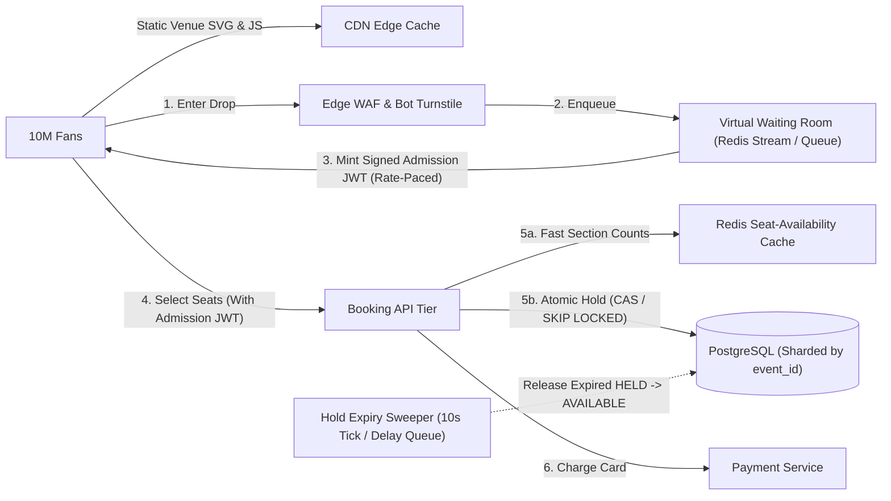

### 1.5 Ticketmaster Deep Dives & Failure Modes

- **CDN-Cached Static Seat Maps**: Venue geometry, row/seat coordinates, and pricing tiers are static before an on-sale starts. Serving them directly from CDN edge POPs keeps `99%` of initial landing traffic off origin compute; only a compact bitmask or per-section availability array (`50k` seats = `~6.25 KB` uncompressed bitset!) travels over the dynamic API.
- **Virtual Waiting Room Admission Queue**: Before an on-sale opens, arriving users enter a randomized lottery or FIFO waiting room backed by sharded Redis queues (`ZSET` / `List`). Once the sale starts, a token-bucket pacer pops batches (e.g., `2,500` users/sec) and mints short-lived HMAC/EdDSA-signed `admission_jwt` tokens bound to `user_id` and `event_id`. The Booking API rejects any hold/checkout request lacking a valid admission signature at the edge gateway, guaranteeing the relational database never faces unbounded thundering herds.
- **10-Minute TTL Holds (`FOR UPDATE SKIP LOCKED` vs. OCC `version` CAS)**:
  - **Specific seat selection**: Uses Optimistic Concurrency Control (`UPDATE seats SET status = 1, hold_token = $1, hold_expires_at = NOW() + INTERVAL '10 minutes', version = version + 1 WHERE event_id = $2 AND seat_id = ANY($3) AND status = 0 AND version = $4 RETURNING seat_id`). Notice how passing all `N` seats in one multi-row `UPDATE` (with `seat_id` sorted canonically to avoid deadlocks) guarantees all-or-nothing atomicity: if `returned_rows < requested_count`, the transaction rolls back immediately with `409 Conflict` without holding locks.
  - **Best-available auto-pick ("Give me 4 adjacent seats")**: Runs `SELECT seat_id FROM seats WHERE event_id = $1 AND section_id = $2 AND status = 0 ORDER BY row_num, seat_num LIMIT 4 FOR UPDATE SKIP LOCKED`. `SKIP LOCKED` lets concurrent buyers claim disjoint seats in parallel without blocking each other on row locks.
- **Background Hold Expiry Sweeper & Late-Checkout Race**: If a buyer abandons checkout after `10 minutes`, seats must return to `AVAILABLE`. A background sweeper runs every `5–10 s` (`UPDATE seats SET status = 0, hold_token = NULL, hold_expires_at = NULL, version = version + 1 WHERE status = 1 AND hold_expires_at < NOW()`) or pops delayed expiry jobs from a timing wheel, and triggers async Redis cache invalidation. Crucially, the confirmation query during payment completion MUST include `AND status = 1 AND hold_token = $1 AND hold_expires_at > NOW()` inside the final `SOLD` transition—if the sweeper reclaimed the seat `50 ms` before the user clicked "Pay", checkout fails cleanly and refunds/voids the authorization rather than double-selling the seat.
- **Anti-Bot Rate Limiting & Account Caps**: Bots spin up headless browsers and residential proxies to hoard holds without paying, starving real fans. Defenses layer device-attestation/proof-of-work challenges prior to queue entry, verified phone/payment-method identity bindings before minting an admission JWT, per-account/per-card max-ticket caps (`<= 4` seats) enforced transactionally, and edge rate limiting (see Section 5).

```sql
-- Atomic hold confirmation guarded against sweeper expiration race
UPDATE seats
SET status = 2, -- SOLD
    version = version + 1
WHERE event_id = $1
  AND seat_id = ANY($2)
  AND status = 1
  AND hold_token = $3
  AND hold_expires_at > NOW()
RETURNING seat_id;
```

> [!WARNING]
> Never track remaining event capacity by decrementing a single `events.available_count` row inside the seat-hold transaction. A single row lock on `event_id` serializes every buyer in the stadium onto one lock queue, capping throughput at ~200–500 TPS even if `50,000` disjoint seat rows sit unlocked. Keep seat availability in the `seats` rows (or sharded section counters) and cache counts asynchronously in Redis.

---

## 2. Payment System & Digital Wallet

Payment systems and digital wallets prioritize **zero silent money creation or loss** above all else. Unlike social apps where a dropped like is harmless, an unguarded retry on a network timeout double-charges a customer, floating-point arithmetic loses cents on FX conversions, and in-place `balance = balance - amount` mutations destroy auditability.

### 2.1 Payment Requirements & SLAs

- **Functional requirements**: Pay-in/checkout orchestration across external Payment Service Providers (PSPs like Stripe/Adyen), peer-to-peer digital wallet transfers, multi-currency minor-unit accounting, immutable double-entry ledger, and asynchronous T+1 PSP settlement reconciliation.
- **Non-functional requirements**: Strict idempotency on every mutating endpoint; **strict conservation of money** ($\sum \text{debits} = \sum \text{credits}$ per journal entry); zero floating-point rounding drift; durability RPO = `0` (`acks=all`, synchronous multi-AZ commit); checkout authorization `p99 < 1.5 s` (dominated by external PSP round-trips); `99.99%` ledger availability.

### 2.2 Payment Capacity Estimation

- **Transaction QPS**: `100M` payment/wallet transactions per day -> `100M / 86,400 ≈ 1,157` TPS average, `~5,000–10,000` TPS peak (Black Friday). Even `10,000` TPS is modest in raw QPS compared to social media, meaning **correctness, serializability, and hot-account contention**—not raw network bandwidth—govern the database design.
- **Ledger storage**: Each payment creates `~4–6` double-entry postings (`buyer -> clearing`, `clearing -> merchant`, `clearing -> fee_revenue`) at `~250 bytes/row` = `~150 GB/day` (`~55 TB/year` uncompressed ledger-only; `~270 GB/day` or `~98.6 TB/year` when including `payment_events`, `payment_orders`, and `1.5×` B-Tree index overhead, partitioned by `posted_at` month for fast active partitions and cold archival compliance).

### 2.3 Payment API & Double-Entry Ledger Schema

Clients send a mandatory `Idempotency-Key` (UUIDv7) per logical checkout attempt, and monetary amounts travel strictly as `int64` minor units alongside ISO-4217 currency codes:

```json
{
  "idempotency_key": "01934a90-221a-7f10-81cc-9b2a10190021",
  "payer_wallet_id": "wal_10293",
  "merchant_id": "mrc_88412",
  "amount_minor": 1999,
  "currency": "USD"
}
```

```sql
CREATE TABLE idempotency_records (
  merchant_id     TEXT NOT NULL,
  idempotency_key TEXT NOT NULL,
  request_hash    BYTEA NOT NULL,
  status          SMALLINT NOT NULL, -- 0=IN_PROGRESS, 1=COMPLETED, 2=FAILED
  response_code   INT,
  response_body   JSONB,
  created_at      TIMESTAMPTZ NOT NULL DEFAULT NOW(),
  PRIMARY KEY (merchant_id, idempotency_key)
);

CREATE TABLE ledger_postings (
  posting_id      BIGINT GENERATED ALWAYS AS IDENTITY PRIMARY KEY,
  journal_id      UUID NOT NULL,
  account_id      BIGINT NOT NULL,
  direction       SMALLINT NOT NULL, -- +1=DEBIT, -1=CREDIT (or signed amount)
  amount_minor    BIGINT NOT NULL CHECK (amount_minor > 0),
  currency        CHAR(3) NOT NULL,
  created_at      TIMESTAMPTZ NOT NULL DEFAULT NOW()
);

CREATE TABLE account_balances (
  account_id      BIGINT PRIMARY KEY,
  currency        CHAR(3) NOT NULL,
  available_minor BIGINT NOT NULL CHECK (available_minor >= 0),
  pending_minor   BIGINT NOT NULL DEFAULT 0,
  version         BIGINT NOT NULL DEFAULT 0,
  updated_at      TIMESTAMPTZ NOT NULL DEFAULT NOW()
);
```

### 2.4 Payment High-Level Design

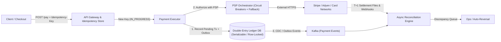

### 2.5 Payment Deep Dives & Failure Modes

- **Idempotency Store & Request Hash Verification**: Before touching the ledger or calling a PSP, the gateway inserts `(merchant_id, idempotency_key, request_hash, status=IN_PROGRESS)` atomically. If the key already exists: (1) if `request_hash` differs (client accidentally reused a key for a different amount), fail immediately with `422 Unprocessable Entity`; (2) if `status = IN_PROGRESS`, return `409 Conflict` / `Retry-After` so concurrent duplicate clicks do not launch parallel PSP calls; (3) if `status = COMPLETED`, replay the exact saved `response_code` and `response_body` without re-executing anything.
- **PSP Orchestration & Unknown Timeout Outcomes**: The deadliest distributed payment bug is treating an HTTP `504` or TCP socket timeout from Stripe/Adyen as a failed charge and automatically retrying against a fallback PSP—charging the customer twice! A network timeout after sending an authorization request is an **unknown outcome**. The Payment Executor persists the attempt in `PENDING_UNKNOWN` state, attaches the _same_ `psp_idempotency_key` if retrying the _same_ PSP, and defers fallback or user failure until an asynchronous poller (`GET /v1/charges/{psp_tx_id}`) or webhook resolves the ambiguity. Per-PSP circuit breakers route **new** checkouts away from degraded PSPs, never mid-flight ambiguous transactions.
- **Immutable Double-Entry Ledger & Hot Omnibus Contention**: Every monetary movement inserts balanced postings inside one ACID transaction where $\sum \text{debits} = \sum \text{credits}$ (`amount_minor` always positive; direction indicated explicitly, verified by a deferred constraint trigger or application invariant). Balances are never mutated blindly without a corresponding ledger journal entry; a cached `account_balances` materialized row is updated in the same transaction for fast balance checks (`balance >= amount_minor`). When a high-volume merchant or platform fee account becomes a **hot lock** (`10,000` TPS updating one `platform_fees` balance row serializes all writes!), split hot omnibus accounts into `N` sub-shards (`platform_fees_00`..`platform_fees_63`), picking `hash(tx_id) % 64` per posting and summing across shards on read (see [Data Systems](../../data-systems/README.md) and [Module 24 (Digital Wallet)](./24-digital-wallet.md) for wallet event-sourcing and Raft CQRS internals).
- **Async Settlement Reconciliation**: External card networks settle batches asynchronously (`T+1` or `T+2` clearing files) and occasionally adjust fees, process chargebacks, or deliver delayed capture webhooks. A nightly/hourly Reconciliation Engine joins internal `ledger_postings` against PSP settlement reports by `psp_tx_id`. Clean matches mark entries `SETTLED`; missing internal records (a timeout where the PSP succeeded but our DB crashed before recording) or amount mismatches route automatically to a discrepancy alert queue and trigger compensating ledger entries—never silent overwrites.
- **Multi-Currency Rounding in Minor Units**: Never store money in IEEE-754 `float64` (`0.1 + 0.2 !== 0.3`). Store integer minor units (`1999` cents for `\$19.99` USD, `1000` yen for `¥1000` JPY since JPY has `0` decimals, `1000` fils for `1.000` KWD since KWD has `3` decimals). When splitting `\$10.00` (`1000` cents) 3 ways or converting FX rates, apply deterministic banker's rounding (`ROUND_HALF_EVEN`) and route the leftover `1 cent` (`1000 - 333 * 3 = 1`) explicitly to a designated rounding/remainder account so $\sum \text{debits} - \sum \text{credits} = 0$ holds to the exact single minor unit. The table below illustrates a `2.9%` flat-fee split with `1¢` rounding remainder (whereas §2.8 illustrates the full `2.9% + \$0.30` take-rate):

| Journal Line | Account | Direction | Amount (Minor Units) | Purpose |
| --- | --- | --- | --- | --- |
| **1** | `buyer_wallet:wal_10293` | `DEBIT` (`+1000`) | `1000` (`\$10.00`) | Deduct funds from buyer wallet |
| **2** | `merchant_payable:mrc_88412` | `CREDIT` (`-970`) | `970` (`\$9.70`) | Credit merchant net payout |
| **3** | `platform_fees_shard_19` | `CREDIT` (`-29`) | `29` (`\$0.29`) | Sharded fee revenue (`2.9%` flat, rounded) |
| **4** | `fx_rounding_reserve` | `CREDIT` (`-1`) | `1` (`\$0.01`) | Deterministic remainder (`sum == 0`) |

### 2.6 Primary Literature & Systems Foundations Matrix

Modern transactional payment systems operate at the intersection of distributed consensus, immutable double-entry accounting, strict regulatory compliance, and multi-rail banking interfaces. Early e-commerce payment implementations treated card processing as synchronous RPC calls directly from web application servers, introducing catastrophic risks of double charging under network partition, silent rounding errors from floating-point arithmetic, and severe compliance exposure under legacy PCI-DSS frameworks. Over the past decade, seminal contributions from primary literature, foundational industrial engineering disclosures (Stripe, Airbnb, Uber, Modern Treasury), and international security standards established formal architectural paradigms for financial software. The matrix below synthesizes these foundational works, detailing the core mechanism, correctness invariant, and failure modes governing modern payment engineering.

| Milestone / Primary Paper | Domain & Key Focus | Core Architectural Mechanism | Scalability & Correctness Invariant | Failure Modes & Trade-Offs |
| --- | --- | --- | --- | --- |
| **Brandur Leach** (Stripe Engineering, 2017) _Idempotency Keys and Designing Robust APIs_ | API Idempotency & Distributed Deduplication | Mandatory `Idempotency-Key` request header; atomic database insertion of `(merchant_id, idempotency_key, request_hash, status)` at ingress (with `payment_order_id` as downstream PSP nonce); cached responses replayed on duplicate arrivals. | At-most-once execution; prevents double charges on client retries and network timeouts; invariant: $\forall k, \mathrm{Exec}(k) \le 1$. | Key lease expiration races; mutating request parameters with identical key triggers `422 Unprocessable Entity`; requires dedicated high-availability distributed state store. |
| **Gao et al.** (Airbnb Engineering, 2019) _Avoiding Double Payments in a Distributed Payments System_ (Orpheus) | End-to-End Payment Orchestration | Orpheus architecture: decoupled three-layer state machine (pre-computation, idempotent execution with external PSPs, post-processing settlement); distributed locking via ephemeral token leases. | Global linearizable idempotency across heterogeneous payment providers; zero duplicate authorization on worker crash or network timeout. | Lease management latency overhead; distributed lock acquisition stalls during Redis partition; complex compensation sagas required on partial downstream failures. |
| **Modern Treasury & Uber** (Modern Treasury, 2020; Uber Engineering, 2021) _Designing Double-Entry Bookkeeping Systems & Scalable Ledger Architecture_ | Financial Accounting & Auditability | Immutable append-only double-entry journal; balanced transaction lines where total debits equal total credits; account balances derived as materialized projections over immutable log lines. | Strict conservation of money: $\sum \text{Debits} - \sum \text{Credits} = 0$; zero in-place balance updates; full temporal auditability. | Extreme write amplification ($4\text{--}6$ postings per transaction); hot omnibus accounts (such as platform fee reserves) serialize relational database row locks without sharding. |
| **PCI Security Standards Council** (PCI-DSS v4.0, 2022–2025) _Payment Card Industry Data Security Standard Version 4.0_ | Cardholder Data Security & Boundary Isolation | Hosted Payment Pages (HPP) and client-side iframe tokenization (SAQ-A scope); cryptographic network tokens replacing Primary Account Numbers (PAN); client-side script integrity verification (Req 6.4.3 / 11.6.1). | Cardholder data boundary isolation; origin backend servers remain zero-knowledge regarding plaintext 16-digit card numbers and CVV codes. | Dependent on third-party PSP iframe availability; browser supply-chain script injection attacks require rigorous Content Security Policy (CSP) and SRI hashes. |
| **Alex Xu** (ByteByteGo, Vol. 2 Ch. 11 & Ch. 26, 2022) _Payment System & Digital Wallet Design_ | Canonical Payment & Ledger Architecture | Dual-table ACID state machine (`payment_events` and `payment_orders`); asynchronous settlement reconciliation engine; separation of synchronous pay-in from batch pay-out. | 1M transactions/day baseline ($10\text{--}12$ TPS); deterministic reconciliation against T+1 PSP clearing files; decoupling of execution from accounting. | Nightly batch clearing delays discrepancy detection by 24 hours; single-PSP routing creates vendor availability lock-in without dynamic multi-PSP circuit breaking. |

Distributed payments require absolute convergence between external provider state and internal financial accounting. Brandur Leach established that network boundaries are inherently unreliable: an HTTP timeout conveys zero information regarding whether an external payment gateway processed a charge. Airbnb's Orpheus generalized this principle into an end-to-end distributed system that enforces idempotency at the database boundary before mutating external financial state. Concurrently, Modern Treasury and Uber formalized the mathematical requirement of immutable double-entry ledgers, eliminating the catastrophic anti-pattern of in-place balance mutations (`UPDATE accounts SET balance = balance + amount`). Under double-entry accounting, money cannot be created or destroyed by software defect; it can only transition between balanced accounts across verified transaction journals.

Regulatory boundaries concurrently reshaped payment software topology. The evolution from PCI-DSS v3.2 to v4.0 mandated that application backends completely divest themselves of raw Primary Account Numbers (PAN) and sensitive authentication data (SAD). Modern architectures enforce perimeter isolation via Hosted Payment Pages and client-side tokenization iframes, reducing compliance scope from the draconian SAQ-D audit regime (spanning hundreds of infrastructure controls) to the streamlined SAQ-A evaluation. This perimeter isolation converts the merchant backend into a coordination engine that handles only cryptographically signed, ephemeral processor tokens.

### 2.7 Verified ByteByteGo Canonical Worked Architecture & Capacity Delta (Chapter 26)

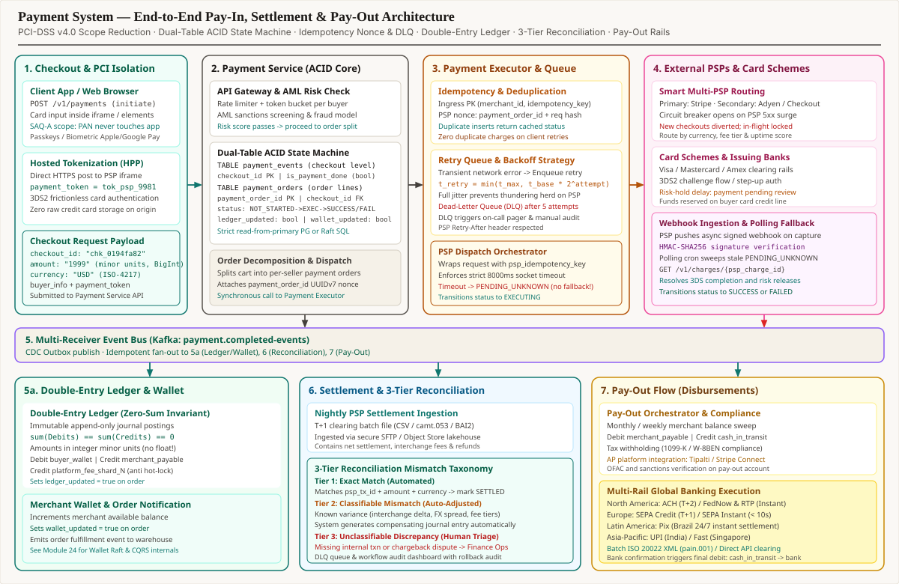

The canonical ByteByteGo Chapter 26 specification models a robust payment platform supporting an e-commerce marketplace (analogous to Amazon). The design captures the fundamental lifecycle of funds: collecting money from customers on behalf of merchants (**Pay-In**), managing internal balances via an immutable double-entry ledger, detecting discrepancies via asynchronous settlement reconciliation, and transferring accumulated earnings to sellers across the globe (**Pay-Out**).

The table below contrasts the canonical ByteByteGo Chapter 26 baseline with the enterprise-scale payment orchestrator ($100\text{M}$ transactions/day) established in §2.2.

| Architectural Parameter / Metric | ByteByteGo Ch. 26 Canonical Baseline | Enterprise Payment Platform Tier (§2.2) | Architectural Implication & Scaling Delta |
| --- | --- | --- | --- |
| **Daily Transaction Volume** | $1\text{M}$ payments/day | $100\text{M}$ transactions/day | $100\times$ transaction scale expansion; requires horizontal database sharding and distributed ledger engines. |
| **Average Transaction Throughput** | $\approx 11.6\text{ TPS}$ ($\sim 10\text{ TPS}$) | $\approx 1{,}157\text{ TPS}$ | 10 TPS is comfortably handled by a single primary relational database; 1,157 TPS requires distributed partition hashing and row-lock optimization. |
| **Peak Transaction Throughput** | $\approx 30\text{--}50\text{ TPS}$ (assumed $3\times$ surge) | $\approx 5{,}000\text{--}10{,}000\text{ TPS}$ (Black Friday surges) | High-volume flash sales serialize writes on merchant balance rows; requires sharded accumulator accounts. |
| **Ledger Storage Growth** | $\approx 1.5\text{ GB/day}$ ledger-only ($550\text{ GB/year}$) | $\approx 150\text{ GB/day}$ ledger-only ($55\text{ TB/year}$); $\approx 270\text{ GB/day}$ ($98.6\text{ TB/year}$) with events, orders, and $1.5\times$ B-Tree indexes | Enterprise volume requires monthly range partitioning, cold S3 Parquet archiving, and distributed query engines. |
| **Processor Integration Model** | Single external PSP (Stripe/Braintree) | Multi-PSP Smart Routing (Stripe, Adyen, J.P. Morgan) | Multi-PSP eliminates vendor lock-in, optimizes interchange fees, and dynamically fails over via circuit breakers. |
| **Reconciliation Frequency** | Nightly T+1 batch file ingestion (CSV) | Continuous streaming ingestion + T+1 settlement files | Near-real-time streaming detects fraud and gateway configuration errors within minutes rather than 24 hours. |
| **Pay-Out Rails** | Third-party AP platform (e.g. Tipalti) | Hybrid AP provider + direct clearing (ACH, SEPA, FedNow, Pix) | Direct integration with domestic real-time gross settlement (RTGS) rails reduces merchant payout latency from days to seconds. |

#### Reconciling Capacity: The 10 TPS Paradox

A common point of confusion in system design interviews is the apparent modesty of ByteByteGo's 10 TPS baseline ($1{,}000{,}000 / 86{,}400 \approx 11.57\text{ TPS}$). In high-throughput distributed systems (such as messaging queues or metrics collection), engineers routinely design for millions of events per second. However, financial transaction systems are governed by strict transactional correctness rather than raw network ingestion throughput:

1. **Transactional Weight vs. Raw QPS**: A single payment is not a lightweight key-value write. Executing one payment involves API authentication, rate limiting, anti-money laundering (AML) sanctions checks, external PSP network round-trips over TLS, dual-table database state machine transitions, double-entry ledger postings across multiple journal lines, and outbox event streaming.
2. **Enterprise Platform Scope (§2.2)**: While a single mid-market merchant generates 10 to 50 TPS, an enterprise payment aggregator (such as Shopify, Stripe, or Uber) aggregates tens of thousands of merchants, reaching an average of $1{,}157\text{ TPS}$ and peaks exceeding $10{,}000\text{ TPS}$.
3. **Scale Invariance of Correctness**: In practice, the architectural primitives required to process 10 TPS without silent financial loss—ACID dual-table state machines, idempotent deduplication nonces, immutable double-entry constraints, and cryptographic reconciliation—are mathematically identical to those required at 10,000 TPS. Scaling the system from 10 to 10,000 TPS shifts the storage layer from a single PostgreSQL instance to distributed sharded ledgers (such as TigerBeetle or CockroachDB), while the domain invariant $\sum \text{Debits} = \sum \text{Credits}$ remains unaltered.

#### Mathematical Derivations & Sizing Proofs

##### 1. Payment Order Sizing & Ledger Growth

Let daily payment volume be $N_{\text{daily}} = 100{,}000{,}000$ transactions. Each payment transaction generates exactly one record in `payment_events`, one or more records in `payment_orders`, and an average of $M = 4$ ledger postings (debit buyer clearing, credit merchant payable, credit platform processing fee, credit rounding reserve).

The average transaction throughput $Q_{\text{avg}}$ and sustained peak throughput $Q_{\text{peak}}$ under a standard $k_{\text{surge}} = 5$ diurnal multiplier (with $10{,}000\text{ payments/s}$ as the Black Friday burst ceiling) are:

$$Q_{\text{avg}} = \frac{N_{\text{daily}}}{86{,}400} = \frac{100{,}000{,}000}{86{,}400} \approx 1{,}157.4\text{ payments/s}$$

$$Q_{\text{peak}} = Q_{\text{avg}} \cdot k_{\text{surge}} \approx 1{,}157.4 \cdot 5 \approx 5{,}787\text{ payments/s}$$

Given average row sizes:

- `payment_events`: $B_{\text{event}} \approx 350\text{ bytes}$
- `payment_orders`: $B_{\text{order}} \approx 450\text{ bytes}$
- `ledger_postings`: $B_{\text{post}} \approx 250\text{ bytes}$ per row ($M = 4$ rows $\implies 1{,}000\text{ bytes/payment}$, or $\approx 150\text{ GB/day}$ ledger-only at $6$ max postings)
- Secondary B-Tree indexes: factor of $1.5\times$ storage overhead

The daily total storage accumulation $S_{\text{daily,total}}$ (events, orders, postings, and indexes) is derived as:

$$S_{\text{daily,total}} = N_{\text{daily}} \cdot \left( B_{\text{event}} + B_{\text{order}} + M \cdot B_{\text{post}} \right) \cdot 1.5$$

$$S_{\text{daily,total}} = 10^8 \cdot \left( 350 + 450 + 1{,}000 \right) \cdot 1.5 = 10^8 \cdot 1{,}800\text{ bytes} \cdot 1.5 = 2.70 \cdot 10^{11}\text{ bytes} \approx 270\text{ GB/day}$$

Over a standard 7-year financial audit retention horizon ($D = 2{,}555\text{ days}$):

$$S_{\text{7yr,total}} = 270\text{ GB/day} \cdot 2{,}555\text{ days} \approx 689.85\text{ TB}$$

This massive volume proves that operational relational databases cannot retain multi-year transaction histories on primary NVMe volumes. Production payment architectures partition ledger tables by month, streaming immutable historical partitions to columnar Parquet formats on cloud object storage (Amazon S3) queried via federated analytical engines.

#### Pay-In vs. Pay-Out Architectural Dichotomy

Money movement divides strictly into two opposing operational flows, each presenting distinct latency, regulatory, and failure characteristics:

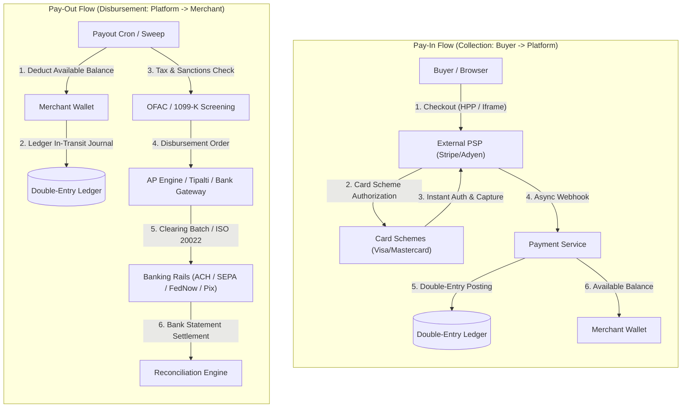

1. **Pay-In Flow (Funds Ingestion)**:
   - _Direction_: Inbound transfer of funds from buyer payment instruments (credit cards, digital wallets, bank debits) to the e-commerce platform's acquiring account.
   - _Latency Profile_: Synchronous user authorization loop (`p99 < 1.5 s`) coupled with asynchronous payment capture via webhooks.
   - _Risk Mechanics_: Governed by fraud scoring, card-not-present (CNP) chargebacks, and 3D Secure 2.0 liability shifts.
2. **Pay-Out Flow (Funds Disbursement)**:
   - _Direction_: Outbound transfer of accumulated earnings from the platform's omnibus clearing accounts to external seller bank accounts.
   - _Latency Profile_: Asynchronous scheduled batches (daily, weekly, or monthly balance sweeps), historically clearing over multi-day batch windows ($T+1$ to $T+3$).
   - _Risk Mechanics_: Governed by anti-money laundering (AML) regulations, Know Your Customer (KYC) identity verification, Office of Foreign Assets Control (OFAC) sanctions screening, and IRS tax reporting (Form 1099-K in the US). Pay-outs are frequently routed through specialized accounts payable (AP) automation platforms (such as Tipalti or Stripe Connect) to manage cross-border currency exchange, localized remittance formats, and tax withholdings.

#### API Contracts & Numerical Precision: POST /v1/payments

Financial APIs require explicit idempotency keys, ISO-4217 currency identifiers, and absolute protection against floating-point corruption.

```
POST /v1/payments
Idempotency-Key: 01934a90-221a-7f10-81cc-9b2a10190021
Content-Type: application/json

{
  "checkout_id": "chk_0194fa82_99a1",
  "buyer_info": {
    "buyer_id": "usr_998124",
    "email": "buyer@example.com"
  },
  "payment_token": "tok_psp_sec_991823741",
  "payment_orders": [
    {
      "payment_order_id": "ord_0194fa82_01",
      "seller_account": "acct_mrc_7712",
      "amount": "1999",
      "currency": "USD"
    },
    {
      "payment_order_id": "ord_0194fa82_02",
      "seller_account": "acct_mrc_4409",
      "amount": "3500",
      "currency": "USD"
    }
  ]
}
```

##### The Prohibition of Floating-Point Representations

In financial software, the use of IEEE-754 binary floating-point types (`float`, `double`, `f32`, `f64`) is strictly forbidden. Binary floating-point cannot represent fractional decimal powers ($10^{-1}, 10^{-2}$) exactly. For example, in double-precision floating-point arithmetic:

$$0.1_{10} + 0.2_{10} = 0.3000000000000000444089209850062616169452667236328125_2$$

Over millions of daily transactions, fractional rounding errors accumulate into significant balance discrepancies, violating regulatory audit requirements and breaking zero-sum ledger invariants. Modern payment engines enforce two standards:

1. **Integer Minor Units**: Monetary values are stored and transmitted as 64-bit signed integers representing the currency's smallest atomic denomination (e.g., cents for USD/EUR, where \$19.99 is encoded as `1999`; Japanese Yen has zero decimal places, where ¥1000 is encoded as `1000`; Kuwaiti Dinar has three decimal places, where 1.000 KWD is encoded as `1000`).
2. **String-Serialized Decimal Minor Units**: If string representations are transmitted in JSON payloads (e.g., `"amount": "1999"` or `"amount": "19.99"`), the runtime parses the string directly into arbitrary-precision integer or fixed-point decimal structures (such as `BigInt` in JavaScript/TypeScript, `java.math.BigDecimal` in Java, or `rust_decimal::Decimal` in Rust), bypassing IEEE-754 floating-point hardware registers entirely.

#### The Dual-Table ACID State Machine: `payment_events` & `payment_orders`

Payment lifecycle management requires segregating high-level checkout intent from individual seller disbursement lines. A single customer checkout event frequently encompasses goods fulfilled by multiple distinct marketplace sellers. This mandates a relational parent-child schema managed across strict ACID state transitions.

```sql
-- Parent table: Represents the user checkout session
CREATE TABLE payment_events (
  checkout_id      VARCHAR(64) PRIMARY KEY,
  buyer_id         VARCHAR(64) NOT NULL,
  payment_token    VARCHAR(128) NOT NULL,
  total_amount     BIGINT NOT NULL CHECK (total_amount > 0),
  currency         CHAR(3) NOT NULL,
  is_payment_done  BOOLEAN NOT NULL DEFAULT FALSE,
  created_at       TIMESTAMPTZ NOT NULL DEFAULT NOW(),
  updated_at       TIMESTAMPTZ NOT NULL DEFAULT NOW()
);

-- Child table: Represents individual seller payment orders executed against PSPs
CREATE TABLE payment_orders (
  payment_order_id     VARCHAR(64) PRIMARY KEY,
  checkout_id          VARCHAR(64) NOT NULL REFERENCES payment_events(checkout_id),
  seller_account       VARCHAR(64) NOT NULL,
  amount               BIGINT NOT NULL CHECK (amount > 0),
  currency             CHAR(3) NOT NULL,
  payment_order_status VARCHAR(20) NOT NULL, -- NOT_STARTED, EXECUTING, SUCCESS, FAILED
  ledger_updated       BOOLEAN NOT NULL DEFAULT FALSE,
  wallet_updated       BOOLEAN NOT NULL DEFAULT FALSE,
  psp_charge_id        VARCHAR(128),
  retry_count          INT NOT NULL DEFAULT 0,
  created_at           TIMESTAMPTZ NOT NULL DEFAULT NOW(),
  updated_at           TIMESTAMPTZ NOT NULL DEFAULT NOW()
);

CREATE INDEX idx_payment_orders_checkout ON payment_orders(checkout_id);
CREATE INDEX idx_payment_orders_status ON payment_orders(payment_order_status) WHERE payment_order_status = 'EXECUTING';
```

##### State Machine Transitions & Flag Invariants

The `payment_orders` lifecycle transitions through a strictly bounded, non-reversible state machine:

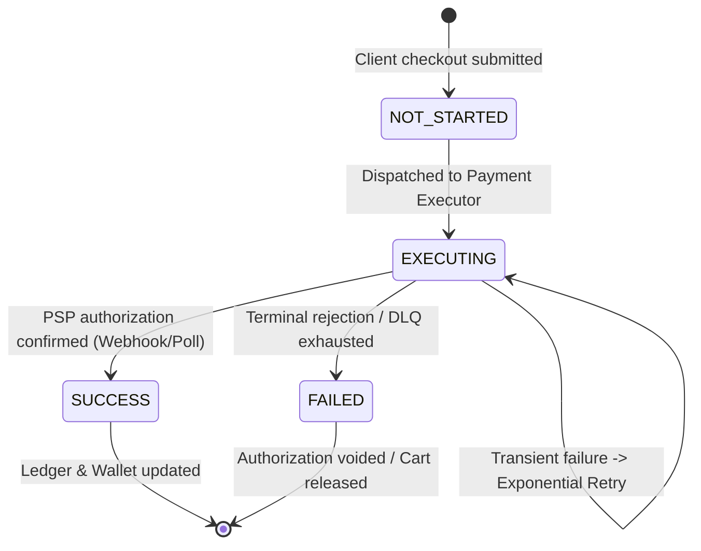

- `NOT_STARTED`: Order record persisted in database; payment has not yet been dispatched across the external network.
- `EXECUTING`: The Payment Executor has acquired an execution lock, generated an idempotency nonce, and transmitted an authorization request to the external PSP.
- `SUCCESS`: The external PSP has confirmed authorization/capture. The order transitions to success, enabling downstream ledger and wallet updates.
- `FAILED`: The transaction was terminally declined by the issuing bank (insufficient funds, stolen card) or exhausted all retry attempts in the Dead-Letter Queue.

The flags `ledger_updated` and `wallet_updated` serve as distributed checkpoint barriers. Even if the network drops or worker nodes crash mid-transaction, background recovery sweepers inspect orders in `SUCCESS` where `ledger_updated = FALSE` or `wallet_updated = FALSE`, replaying idempotent event dispatches to downstream consumers until both systems confirm journal insertion.

#### The 11-Step Hosted Payment Page (HPP) & Webhook Workflow

To eliminate the severe security and regulatory burdens of handling raw cardholder data (PAN, CVV), enterprise architectures implement an 11-step Hosted Payment Page (or client-side tokenization iframe) flow:

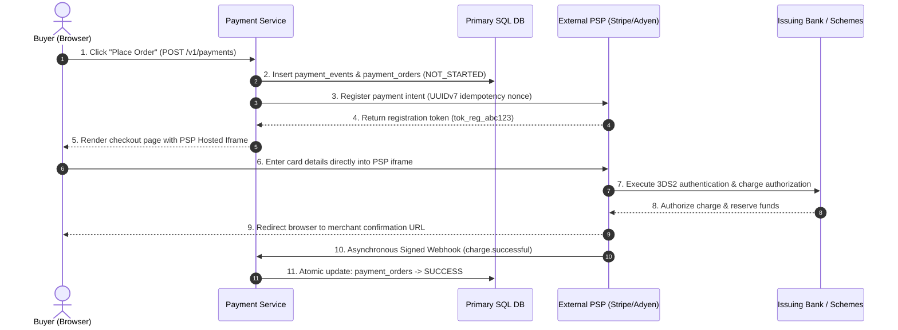

1. **Order Initiation**: The user clicks "Place Order" in the e-commerce client. The browser sends cart details to the merchant Payment Service.
2. **State Persistence**: The Payment Service creates parent `payment_events` and child `payment_orders` rows in state `NOT_STARTED` within an ACID transaction.
3. **Payment Registration**: The Payment Service calls the external PSP registration API over HTTPS, passing the order amount, currency, merchant identifier, and `payment_order_id` as the external idempotency nonce.
4. **Token Generation**: The PSP registers the pending intent and returns an ephemeral registration token (`tok_reg_abc123`).
5. **Client Handoff**: The Payment Service returns the token to the client browser, which initializes the PSP Hosted Payment Page or secure iframe elements.
6. **Isolated Card Ingestion**: The buyer enters their card number, expiration date, and CVV directly into the secure iframe. Plaintext cardholder data flows directly from the user's browser to the PSP servers, bypassing merchant infrastructure entirely.
7. **Issuing Bank Authorization**: The PSP coordinates with the card schemes (Visa, Mastercard) and the issuing bank, triggering frictionless 3DS2 authentication or step-up verification.
8. **Credit Reservation**: The issuing bank verifies available funds and reserves the credit line, returning an authorization approval to the PSP.
9. **Browser Redirect**: The PSP iframe redirects the user's browser to the merchant's redirect URL (`https://shop.example.com/checkout/success?token=tok_reg_abc123`).
10. **Asynchronous Signed Webhook**: Concurrently and out-of-band, the PSP issues an HTTP `POST` webhook to the merchant Payment Service containing the full payment receipt and signature header (`Stripe-Signature` or `X-Adyen-Signature`).
11. **State Finalization**: The Payment Service verifies the cryptographic webhook signature, transitions `payment_orders.payment_order_status` to `SUCCESS`, records the `psp_charge_id`, and emits an outbox event to downstream ledger and fulfillment pipelines.

#### Cross-Service Communication: Synchronous HTTP vs. Multi-Receiver Event Bus

Early microservice architectures connected payment subsystems using synchronous point-to-point HTTP/REST calls:

$$\text{Client} \xrightarrow{\text{HTTP}} \text{Payment Service} \xrightarrow{\text{HTTP}} \text{Executor} \xrightarrow{\text{HTTP}} \text{PSP} \xrightarrow{\text{HTTP}} \text{Ledger} \xrightarrow{\text{HTTP}} \text{Wallet}$$

This synchronous call chain creates severe production anti-patterns:

- **Compounding Latency**: The total round-trip time is the sum of all individual service latencies: $T_{\text{total}} = \sum_{i=1}^K T_i$. If the external PSP takes $1{,}200\text{ ms}$ to execute fraud checks and banking handshakes, upstream client threads remain blocked, exhausting web server connection pools.
- **Cascading Failure & Blast Radius**: If the Wallet or Ledger service experiences a transient outage, the entire synchronous call chain fails, aborting checkouts even though the external credit card was successfully charged.
- **Orphaned State Anomalies**: If a network timeout severs the connection between Payment Service and Ledger after the PSP has completed the charge, the system enters an inconsistent state: the customer is charged, but the merchant balance is not updated and the order is marked failed.

Modern payment architectures enforce a **Multi-Receiver Event Bus** pattern backed by the Transactional Outbox pattern:

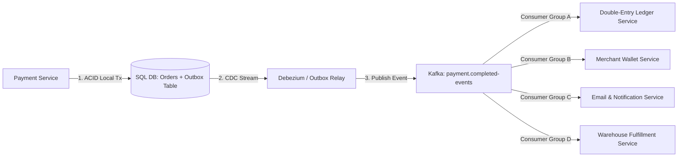

1. **Transactional Outbox Decoupling**: Upon receiving a valid PSP authorization, the Payment Service writes the order status update and an event payload into an `outbox` table within the **same local database transaction**. This eliminates distributed dual-write races.
2. **Change Data Capture (CDC)**: A change data capture daemon (such as Debezium or an in-house tailing reader) streams committed events from the database Write-Ahead Log (WAL) into an Apache Kafka topic: `payment.completed-events`.
3. **Parallel Multi-Receiver Consumption**: Multiple downstream consumer groups subscribe independently to the event stream:
   - _Double-Entry Ledger Service_: Ingests the event, validates the zero-sum balance invariant, and inserts balanced immutable journal postings.
   - _Merchant Wallet Service_: Increments the seller's available balance in its localized datastore (see [Module 24 (Digital Wallet)](./24-digital-wallet.md) for wallet event-sourcing and consensus details).
   - _Warehouse Fulfillment_: Releases reserved physical inventory for packing and shipping.
   - _Customer Communications_: Dispatches branded payment receipts and order confirmations.

Because consumer offsets are tracked independently, a failure or maintenance window in the Notification Service has zero impact on financial ledger ingestion or checkout authorization availability.

### 2.8 Core Subsystem Mechanics & Deep Dives

#### Subsystem 1: Double-Entry Ledger Zero-Sum Invariant & Accounting Topology

The core foundation of financial reliability is double-entry bookkeeping, established by Luca Pacioli in 1494 and required by modern regulatory frameworks. In double-entry accounting, accounts are categorized into five fundamental classes: **Assets**, **Liabilities**, **Equity**, **Revenue**, and **Expenses**.

$$\text{Assets} = \text{Liabilities} + \text{Equity} + (\text{Revenue} - \text{Expenses})$$

Every financial movement consists of at least two balanced entries: a **Debit** and a **Credit**. Under standard accounting conventions:

- A **Debit** ($+$) increases Asset and Expense accounts, and decreases Liability, Equity, and Revenue accounts.
- A **Credit** ($-$) increases Liability, Equity, and Revenue accounts, and decreases Asset and Expense accounts.

Across every discrete financial transaction, the fundamental conservation invariant must hold unconditionally:

$$\sum_{i=1}^{M} \text{Debit}_i - \sum_{j=1}^{K} \text{Credit}_j = 0$$

##### Balanced Multi-Line Journal Execution

Consider a \$10.00 customer purchase on an e-commerce platform. The customer pays \$10.00 (`1000` minor units). The platform charges the merchant a $2.9\%$ processing fee plus a fixed \$0.30 fee, totaling \$0.59 (`59` minor units). The merchant receives a net credit of \$9.41 (`941` minor units). The double-entry ledger records this single economic event across balanced journal lines:

| Line ID | Account Name | Account Type | Direction | Amount (Minor Units) | Economic Purpose |
| --- | --- | --- | --- | --- | --- |
| `ln_01` | `assets:psp_receivable:stripe` | Asset | `DEBIT` ($+$) | `1000` (\$10.00) | Funds held by PSP pending settlement payout |
| `ln_02` | `liabilities:merchant_payable:mrc_7712` | Liability | `CREDIT` ($-$) | `941` (\$9.41) | Funds owed by platform to merchant |
| `ln_03` | `revenue:platform_processing_fee` | Revenue | `CREDIT` ($-$) | `59` (\$0.59) | Net platform take-rate revenue |

$$\text{Balance Verification}: +1000 - 941 - 59 = 0$$

##### Mitigating Hot Omnibus Lock Contention

In high-volume marketplaces processing thousands of payments per second, omnibus platform accounts (such as `revenue:platform_processing_fee` or `liabilities:merchant_payable:amazon`) become severe database bottlenecks. If the system maintains a materialized `account_balances` table and updates balances in-place inside the transaction:

```sql
-- Anti-pattern: Serializes every payment transaction on a single row lock!
UPDATE account_balances
SET available_balance = available_balance + 59
WHERE account_id = 'revenue:platform_processing_fee';
```

At $10{,}000\text{ TPS}$, ten thousand concurrent transactions attempt to acquire an exclusive row lock (`FOR UPDATE`) on the same physical database page. The database row lock queue saturates, transaction latencies spike from milliseconds to tens of seconds, and deadlocks force cascading aborts.

To eliminate hot omnibus lock contention, enterprise architectures implement **Account Sharding**:

1. High-velocity omnibus accounts are split into $S$ distinct physical sub-accounts: `platform_fees_00`, `platform_fees_01`, ..., `platform_fees_63` (where $S = 64$ or $128$).
2. When recording a transaction, the ledger engine hashes the `payment_order_id` to pick a deterministic shard:

   $$\mathrm{shardIndex} = \mathrm{hash}(\text{payment-order-id}) \pmod S$$

3. The transaction locks and updates only that designated sub-account shard, spreading lock contention evenly across 64 independent database rows.
4. When querying the total platform fee balance, the ledger engine sums across all shards:

   $$\text{Total Balance} = \sum_{i=0}^{S-1} \mathrm{Balance}(\text{platform-fees}_i)$$

#### Subsystem 2: 3-Tier Settlement Reconciliation Mismatch Taxonomy

In a payment system, the operational transaction log recorded in real time represents internal intent. External reality is dictated by the banking system, which settles funds through asynchronous clearing files delivered 24 hours later ($T+1$). Settlement reconciliation is the critical process that joins internal `payment_orders` and `ledger_postings` against external PSP settlement reports (delivered via SFTP or cloud object storage as CSV, ISO 20022 `camt.053`, or BAI2 files).

Discrepancies inevitably arise due to currency exchange rate fluctuations, timing cutoffs, unexpected interchange fee surcharges, and chargeback dispute withholdings. Production reconciliation engines process mismatches across an exhaustive **3-Tier Mismatch Taxonomy**:

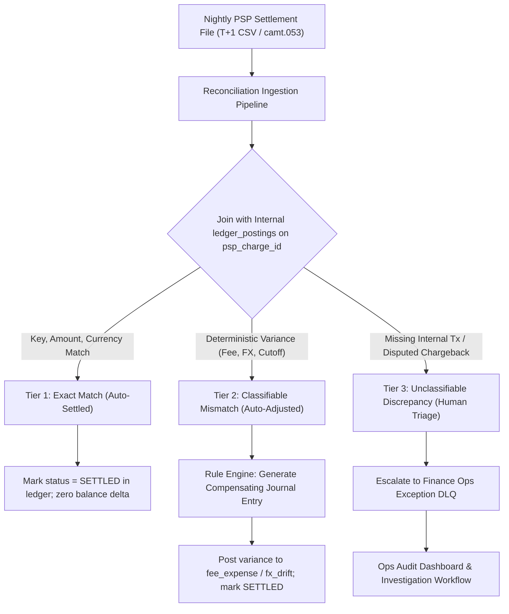

1. **Tier 1: Exact Match (Fully Automated)**:
   - _Characteristics_: The external settlement record matches the internal `payment_order_id`, `psp_charge_id`, currency, and net amount within an acceptable timestamp window ($\Delta t \le 48\text{ hours}$).
   - _Action_: The reconciliation engine marks the internal journal entries as `SETTLED`. Zero manual intervention is required. Over $98.5\%$ of all transactions resolve in Tier 1.
2. **Tier 2: Classifiable Mismatch (Algorithmic Auto-Adjustment)**:
   - _Characteristics_: The transaction identity matches, but the settled net amount differs by a predictable, algorithmically classifiable variance.
     - _Interchange Fee Delta_: The external processor applied a different interchange qualification fee (e.g., standard consumer debit vs. commercial reward credit card, creating a \$0.04 fee variance).
     - _FX Conversion Drift_: A multi-currency transaction converted between order authorization time and settlement capture time, producing a minor decimal conversion variance.
     - _Batch Cutoff Crossing_: A payment authorized at 23:59:58 UTC was captured in the following day's settlement batch.
   - _Action_: The automated reconciliation rule engine classifies the root cause and generates a **compensating journal entry** to absorb the delta. For example, if settled processing fees were \$0.04 higher than estimated at checkout:

     ```sql
     -- Compensating journal entry for interchange fee variance
     INSERT INTO ledger_postings (journal_id, account_id, direction, amount_minor, currency)
     VALUES
       ('comp_0194fa82', 'expenses:interchange_fee_variance', 1, 4, 'USD'), -- DEBIT
       ('comp_0194fa82', 'assets:psp_receivable:stripe', -1, 4, 'USD');      -- CREDIT
     ```

   - The transaction is marked `SETTLED_WITH_ADJUSTMENT`.
3. **Tier 3: Unclassifiable Discrepancy (Human Triage & Forensics)**:
   - _Characteristics_: Severe anomalies that cannot be resolved deterministically:
     - _Orphaned External Charge_: A charge exists in the PSP settlement file with no corresponding record in the internal database (indicating a catastrophic merchant database crash during checkout after the PSP charge succeeded).
     - _Orphaned Internal Capture_: An internal order is marked `SUCCESS`, but the funds never appear in any PSP settlement file across 72 hours.
     - _Unannounced Chargeback Withholding_: The PSP withheld settlement funds due to a customer fraud dispute or account freeze that was not communicated via webhook.
   - _Action_: The engine immediately isolates the record and enqueues it into a **Finance Operations Exception Queue**. Automated alerts notify the on-call treasury team, opening an investigation incident with full forensic audit logs (PSP transaction identifiers, raw payload snapshots, and customer account linkages). Discrepancy amounts are moved into an escrow suspense account (`liabilities:unreconciled_suspense`) until human operators execute an authorized manual reversal or write-off.

#### Subsystem 3: Asynchronous 3DS2 Step-Up Challenges & Risk-Hold Delay Handling

In modern online payments, transactions do not execute instantaneously. Under the European Union Payment Services Directive 2 (PSD2) and global risk frameworks, credit card transactions are subjected to **Strong Customer Authentication (SCA)** via the **3D Secure 2.0 (3DS2)** protocol.

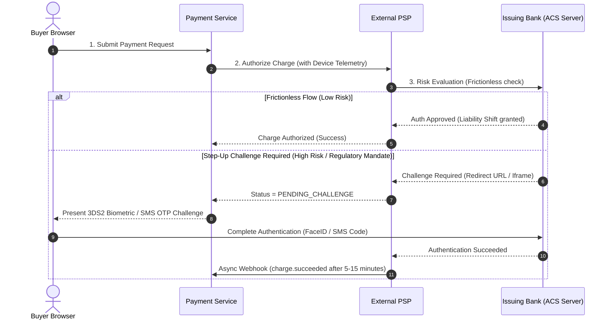

When an issuing bank flags a transaction as high-risk, requires multi-factor authentication, or places a manual risk hold on suspicious velocity, the authorization transitions to an asynchronous holding pattern:

1. **The `PENDING_UNKNOWN` State Barrier**: If the PSP API responds with an HTTP status indicating pending review, or if an HTTP socket connection times out without a terminal response, the Payment Executor **must never assume failure**. The payment order is transitioned to `PENDING_UNKNOWN` (or `EXECUTING`).
2. **Dual-Path Resolution Mechanism**:
   - **Primary Push (Async Webhook)**: The issuing bank Access Control Server (ACS) authenticates the user. Minutes later, the PSP pushes a signed webhook (`payment_intent.succeeded` or `payment_intent.payment_failed`) to the merchant Payment Service.
   - **Safety-Net Polling Cron**: Because webhooks travel over the public internet and can be delayed or dropped, an asynchronous poller daemon continuously scans for orders in `EXECUTING` older than a threshold (e.g., $t_{\text{stale}} \ge 10\text{ minutes}$). The poller executes an idempotent `GET /v1/charges/{psp_charge_id}` against the PSP API, synchronizing state if a webhook was dropped.
3. **User Experience Decoupling**: Rather than freezing the browser on an indefinite spinning indicator, the UI transitions to an asynchronous order status view: _"Your payment is currently being processed by your bank. We will email your confirmation receipt as soon as processing completes."_

#### Subsystem 4: Exactly-Once Execution Mechanics: Idempotency, Retries & Dead-Letter Queues

Achieving exactly-once semantics across an unreliable distributed network requires combining **at-least-once delivery** with **at-most-once execution**.

##### 1. At-Least-Once Delivery via Exponential Backoff with Jitter

When a transient network failure or remote 5xx server error interrupts communication with an external PSP, the Payment Executor retries the operation. Naive retry algorithms (such as immediate retries or fixed intervals) synchronize retry bursts across thousands of failing workers, causing an aggressive **thundering herd** that overwhelms degraded external gateways.

Production payment executors implement **Truncated Exponential Backoff with Full Jitter**:

$$t_{\text{backoff}} = \mathrm{random}\left(0, \, \min\left(t_{\text{max}}, \, t_{\text{base}} \cdot 2^{\text{attempt}}\right)\right)$$

Where $t_{\text{base}} = 500\text{ ms}$, $t_{\text{max}} = 32\text{ seconds}$, and $\mathrm{random}(0, x)$ draws uniformly from $[0, x]$.

```
Attempt 1: [0, 500 ms]
Attempt 2: [0, 1000 ms]
Attempt 3: [0, 2000 ms]
Attempt 4: [0, 4000 ms]
Attempt 5: [0, 8000 ms] -> Max retries reached -> Route to DLQ
```

##### 2. At-Most-Once Execution via Database Unique Constraints & PSP Nonces

Retries create the catastrophic risk of double charging a buyer. At-most-once execution is enforced at two distinct boundaries:

1. **Internal Ingestion Boundary**: The database enforces a `UNIQUE` constraint on `(merchant_id, idempotency_key)`. When a client clicks "Pay" multiple times, the first request inserts an active lease (`IN_PROGRESS`). Concurrent requests encounter a unique key violation (`23505 unique_violation` in PostgreSQL), prompting the application to return `409 Conflict` or wait for the cached completion payload.
2. **External PSP Boundary**: When transmitting the charge authorization to Stripe, Adyen, or Braintree, the Payment Executor attaches the internal `payment_order_id` as the processor's `Idempotency-Key` or `nonce` header. Even if a network timeout severs the HTTP socket after the processor debited the card, an automated retry transmits the identical nonce. The processor detects the duplicate nonce, executes zero additional card charges, and returns the existing authorization receipt.

##### 3. The Dead-Letter Queue (DLQ) Fallback

If an order fails persistently across 5 retry attempts, the retry coordinator terminates automatic execution. The failed order payload, complete with error diagnostics, stack traces, and attempt logs, is published to an Apache Kafka **Dead-Letter Queue (DLQ)**: `payment.orders.dlq`.

The DLQ acts as a forensic safety net:

- Prevents poison-pill messages from permanently blocking FIFO processing queues.
- Triggers high-priority telemetry alerts on internal engineering and operations dashboards.
- Enables support engineers to inspect the exact failure condition, apply manual corrections, and trigger authorized replay workflows without data loss.

#### Subsystem 5: Database Consistency: Primary Read Enforcement & Raft-Backed SQL

A critical vulnerability in transactional payment systems is the phenomenon of **Replication Lag Anomalies**. In traditional database deployments employing asynchronous primary-replica architectures (e.g., PostgreSQL with streaming replication), writes execute on the primary instance and propagate asynchronously to multiple read replicas.

Under heavy checkout surges, asynchronous replication lag often stretches to several seconds ($\Delta t_{\text{lag}} \approx 500\text{--}3{,}000\text{ ms}$). If application services route read queries to read replicas:

1. A buyer clicks "Submit Payment".
2. The Payment Service writes `payment_orders.status = SUCCESS` to the database primary.
3. The browser redirects to `/orders/status?id=ord_0194fa82`.
4. The web service queries an asynchronous read replica where the replication stream has not yet caught up.
5. The replica returns `status = NOT_STARTED`.
6. The browser incorrectly presents an error banner: _"Payment Failed or Not Found"_.
7. The confused buyer clicks "Pay" a second time, initiating duplicate checkout confusion.

To eliminate replication lag anomalies, payment architectures enforce two database consistency guarantees:

1. **Strict Read-from-Primary Routing**: All read operations on transactional payment tables (`payment_events`, `payment_orders`, `idempotency_records`, `account_balances`) are pinned strictly to the **database primary instance**. Read replicas are reserved exclusively for non-transactional analytical reporting, reconciliation pipelines, and customer support history queries.
2. **Raft-Backed Distributed SQL Engines**: In modern cloud-native architectures, legacy primary-replica configurations are replaced with distributed consensus databases (such as CockroachDB, YugabyteDB, or Google Cloud Spanner). These engines run the **Raft** or **Paxos** consensus algorithm at the storage layer. Every transactional write must achieve a synchronous quorum commit across a majority of replicas ($\lceil (N+1)/2 \rceil$) before acknowledging success. Reads rely on leaseholder routing and hybrid logical clocks (HLC) to guarantee strict serializability and linearizable read-your-writes consistency across all regions without the risk of stale dirty reads.

#### Subsystem 6: The 8 Critical Payment Security Controls

Because payment systems manage monetary assets and sensitive financial identities, they represent the highest-priority targets for cyber adversaries. Architecture specifications mandate eight core security controls spanning network, cryptographic, and operational domains:

| # | Security Vulnerability / Threat Vector | Production Defense Mechanism & Architectural Standard | Implementation Topology |
| --- | --- | --- | --- |
| **1** | **Request/Response Eavesdropping** | Mandatory TLS 1.3 encryption across all public ingress and internal service boundaries; forward secrecy enforced via ECDHE ciphers; HTTP Strict Transport Security (HSTS) with preloading. | Edge L7 Load Balancer & Kubernetes Envoy Service Mesh sidecars. |
| **2** | **Data Tampering & Payload Alteration** | Cryptographic payload hashing; request body verification via HMAC-SHA256 signatures; internal service requests signed via mutual TLS (mTLS) with short-lived X.509 SPIFFE/SPIRE certificates. | API Gateway ingress filter and zero-trust service mesh proxies. |
| **3** | **Man-in-the-Middle (MitM) Attacks** | Public Key Pinning (HPKP) on mobile applications; strict internal CA trust validation; complete prohibition of cleartext HTTP across all VPC networks. | Mobile iOS/Android network security config and egress gateways. |
| **4** | **Catastrophic Data Loss** | Synchronous multi-Availability Zone (AZ) database replication with zero recovery point objective ($\text{RPO} = 0$); continuous WAL archiving to durable object storage with Point-in-Time Recovery (PITR). | Replicated Raft distributed SQL cluster across 3 independent AZs. |
| **5** | **Distributed Denial of Service (DDoS)** | Edge Web Application Firewall (WAF) integration (Cloudflare/AWS Shield); distributed token-bucket rate limiting per IP, API key, and cardholder account; aggressive connection timeouts. | Edge CDN POPs and API Gateway rate-limiting middleware. |
| **6** | **Cardholder Data Theft (PAN/CVV)** | Complete elimination of raw card numbers on origin infrastructure; perimeter tokenization via PCI-DSS SAQ-A compliant Hosted Payment Pages; secure memory wiping of ephemeral tokens. | Client-side sandboxed iframes directly integrated with PSP tokenizers. |
| **7** | **PCI-DSS v4.0 Compliance Failures** | Strict network segmentation between corporate networks and Cardholder Data Environments (CDE); automated client-side script integrity monitoring (Requirements 6.4.3 & 11.6.1); quarterly ASV vulnerability scans. | Isolated PCI VPC subnetworks, Content Security Policies (CSP), and Subresource Integrity (SRI) hashes. |
| **8** | **Card-Not-Present (CNP) Payment Fraud** | Multi-variable machine learning risk scoring (evaluating IP velocity, device fingerprinting, behavioral biometrics); Address Verification Service (AVS) matching; CVV validation; 3DS2 step-up challenge routing. | Payment Service pre-authorization risk gateway and third-party fraud scoring engines (Sift/Radar). |

**Staff Edge-Case Checklist (Payment):**

- **Idempotency TTL vs. 7-Year Audit Retention**: Hot `idempotency_records` expire after `24–72 hours` to bound index size, whereas immutable `ledger_postings` and `payment_orders` remain partitioned for `7 years`; a late client retry after key TTL hits a `payment_order` uniqueness check or order-state guard rather than re-charging.
- **Webhook Key Rotation & Replay Protection**: Verify HMAC signatures against a keyring supporting overlapping active + retiring secrets, and reject timestamps older than `300 seconds` combined with an idempotent `event_id` deduplication cache.
- **Hot-Shard Sum Read Staleness & PSP `Retry-After`**: Summing across `64` omnibus shards under `READ COMMITTED` can observe partial skew unless wrapped in `REPEATABLE READ` or snapshot isolation; meanwhile, retry workers must honor PSP `Retry-After` headers (`429`/`503`) before applying jittered exponential backoff.

### 2.9 Payment Architecture Evolution: 2021 Default vs. 2026 Modern Standard

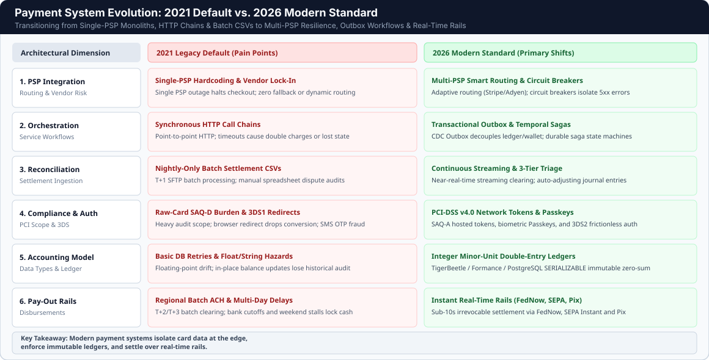

Between 2021 and 2026, financial infrastructure underwent an architectural paradigm shift. The convergence of strict regulatory mandates (PCI-DSS v4.0 enforcement deadlines in March 2025), the maturation of durable workflow orchestration runtimes (Temporal, Cadence), the rise of hardware-aligned ledger databases (TigerBeetle), and the global rollout of domestic instant payment rails (FedNow in the US, Pix in Brazil, UPI in India, SEPA Instant in Europe) rendered early microservice payment designs obsolete.

The deep dive below analyzes the six primary architectural dimensions contrasting 2021 legacy defaults with the 2026 modern standard.

#### Dimension 1: PSP Integration & Routing Architecture

- **2021 Legacy Default (Single-PSP Hardcoding)**: Early payment architectures were hardcoded against a single external payment service provider (e.g., exclusively Stripe or Braintree). Application services imported vendor-specific client SDKs directly into checkout controllers. When the primary PSP suffered an unscheduled network outage or elevated API error rates, the merchant platform was paralyzed: checkout conversion dropped to zero, creating massive revenue loss. In addition, merchants possessed zero economic bargaining power over interchange processor markups and payment processing fees.
- **2026 Modern Standard (Multi-PSP Smart Routing & Circuit Breaking)**: Modern payment platforms operate as **payment orchestrators** abstracting multiple acquiring PSPs (e.g., Stripe, Adyen, J.P. Morgan Payments, Checkout.com) behind a unified internal payment contract. An intelligent routing engine dynamically evaluates every transaction against a multi-factor optimization function:

  $$\mathrm{Route}(T) = \mathrm{argmin}_{P \in \text{PSPs}} \left( w_1 \cdot \text{Cost}(P, \text{currency}, \text{card-bin}) + w_2 \cdot \text{Latency}(P) - w_3 \cdot \text{AuthRate}(P) \right)$$

  Transactions are routed to minimize interchange fees and maximize card authorization rates based on the card's Bank Identification Number (BIN) and issuing country. Each PSP connector is guarded by an autonomous **Circuit Breaker** (such as Resilience4j or Envoy outlier detection). If a PSP's $5\text{xx}$ error rate exceeds $5\%$ over a rolling 30-second window, the circuit trips to `OPEN`, instantly diverting **new** incoming checkouts to healthy secondary processors without downtime. Mid-flight ambiguous requests are never retried blindly across alternative PSPs, eliminating duplicate charges.

#### Dimension 2: Execution & Workflow Orchestration

- **2021 Legacy Default (Synchronous HTTP Call Chains)**: Microservices communicated via synchronous point-to-point HTTP/REST or gRPC calls. A checkout request initiated a linear chain of synchronous remote calls: API Gateway $\to$ Order Service $\to$ Payment Service $\to$ PSP API $\to$ Wallet Service $\to$ Notification Service. A transient socket timeout at any hop caused the entire request to abort or hang. Developers attempted to patch failures with uncoordinated local retry loops, inducing thundering herds and severe orphaned state anomalies where customers were charged on card schemes without receiving order confirmations.
- **2026 Modern Standard (Transactional Outbox & Temporal Durable Sagas)**: Modern architectures eliminate synchronous inter-service chains in favor of **Durable Execution Workflows** (powered by Temporal, Cadence, or AWS Step Functions) paired with the **Transactional Outbox** pattern. Payment state transitions are modeled as fault-tolerant, deterministic sagas. If a worker node crashes mid-execution, an external supervisor resumes the workflow from its last persisted event history checkpoint. Compensation workflows are formalized mathematically: if downstream accounting fails after payment authorization, the durable saga coordinates an automated payment void or reversal with cryptographic verification, ensuring absolute eventual consistency across all microservice boundaries.

#### Dimension 3: Settlement Reconciliation Paradigms

- **2021 Legacy Default (Nightly-Only Batch Settlement CSVs)**: Reconciliation was relegated to a batch cron job executing once every 24 hours (typically at 02:00 UTC). The system downloaded large CSV or BAI2 settlement files from processor SFTP servers, parsing rows and attempting to reconcile them against internal database records. Discrepancies were output into massive spreadsheets reviewed manually by finance teams over multi-week cycles. Fraudulent chargebacks, configuration errors in platform fee rates, and currency conversion bugs went undetected for days, accumulating substantial financial losses before discovery.
- **2026 Modern Standard (Continuous Streaming & Automated 3-Tier Triage)**: Modern reconciliation platforms consume real-time clearing streams and continuous webhook feeds alongside formal $T+1$ banking clearing reports. Ingestion engines stream settlement events through distributed stream processing pipelines (Apache Flink or Kafka Streams), joining internal ledger postings against external clearing events within seconds of receipt. The system applies the **3-Tier Mismatch Taxonomy**: over $98\%$ of transactions match exactly (Tier 1); predictable fee and FX variances automatically trigger compensating journal entries without human intervention (Tier 2); and only genuine anomalies route to a prioritized Finance Operations dead-letter queue with real-time audit dashboards (Tier 3).

#### Dimension 4: Compliance, Identity & Authentication

- **2021 Legacy Default (Raw-Card SAQ-D Burden & 3DS1 Redirects)**: Merchants frequently accepted cardholder numbers directly onto web application servers before transmitting them to processors, falling under the full scope of PCI-DSS Self-Assessment Questionnaire D (SAQ-D). SAQ-D mandates compliance with over 300 rigorous security controls, requiring massive annual forensic audits, dedicated physical firewall architectures, and continuous intrusion detection testing. Card authentication relied on legacy 3D Secure 1.0 (3DS1), which forced full-page browser redirects to clunky bank authentication portals, causing catastrophic checkout abandonment rates ($15\text{--}25\%$). Fraud defenses were vulnerable to SMS OTP interception and SIM-swapping attacks.
- **2026 Modern Standard (PCI-DSS v4.0 Network Tokenization, Passkeys & 3DS2)**: Modern platforms mandate strict perimeter tokenization via Hosted Payment Pages, shrinking compliance scope to the streamlined **SAQ-A** evaluation. Under PCI-DSS v4.0 (enforced in 2025), origin servers implement automated tamper detection and Subresource Integrity (SRI) on all client-side checkout scripts (Requirements 6.4.3 and 11.6.1). Primary Account Numbers are replaced with **Network Tokens** provisioned directly by Visa and Mastercard; network tokens are cryptographically bound to the specific merchant domain, rendering stolen tokens completely useless to external attackers. Authentication transitions to frictionless **3DS2** (evaluating over 100 device telemetry attributes without user interruption) combined with biometric **Passkeys (FIDO2 / WebAuthn)**, eliminating passwords and SMS OTPs in favor of cryptographic device-bound public key credentials.

#### Dimension 5: Accounting Models & Ledger Storage Engines

- **2021 Legacy Default (Basic DB Retries & Float/String Rounding Hazards)**: Financial accounting was routinely handled via in-place row mutations on general-purpose relational database tables (`UPDATE accounts SET balance = balance + 10.00`). Balance checks were performed through non-serializable queries subject to race conditions and dirty reads. Software runtimes frequently stored monetary amounts in IEEE-754 floating-point variables, producing subtle fractional rounding errors that silently corrupted account balances over time. In-place balance mutations destroyed historical auditability, making it impossible to reconstruct balance state at a historical point in time without parsing database binary logs.
- **2026 Modern Standard (Integer Minor-Unit Double-Entry Ledgers)**: Accounting is governed strictly by immutable, append-only **Double-Entry Ledgers**. Balances are never updated in-place; they represent the mathematical sum of immutable debit and credit postings. Monetary values are strictly encoded as 64-bit integer minor units combined with ISO-4217 currency identifiers, verified by database constraint triggers enforcing $\sum \text{Debits} = \sum \text{Credits}$ to the exact atomic unit. In ultra-high-throughput environments, traditional relational engines are replaced with specialized, memory-aligned ledger databases such as **TigerBeetle**, **Formance**, or PostgreSQL operating in strict `SERIALIZABLE` isolation, applying static pre-allocated memory buffers and deterministic state machine replication to process tens of thousands of financial journal postings per second with formal safety proofs.

#### Dimension 6: Pay-Out Rails & Liquidity Settlement

- **2021 Legacy Default (Regional Batch ACH & Multi-Day Clearing)**: Merchant disbursements relied almost exclusively on legacy regional batch banking rails (such as Automated Clearing House [ACH] in the United States or standard BACS in the United Kingdom). Payouts were compiled into rigid NACHA batch text files uploaded once daily prior to strict bank cutoff times (e.g., 17:00 EST). Funds took 2 to 3 business days ($T+2$ or $T+3$) to clear, and banking operations halted completely over weekends and statutory holidays. Marketplace sellers experienced delayed access to working capital, while platforms faced high operational overhead managing returned ACH files and bank debit exceptions.
- **2026 Modern Standard (Instant Real-Time Rails: FedNow, SEPA Instant, Pix, UPI)**: Global disbursements execute over next-generation **Real-Time Payment (RTP)** and **Instant Gross Settlement** rails:
  - **FedNow & RTP (United States)**: Sub-second, irrevocable interbank fund transfers operating 24 hours a day, 365 days a year.
  - **SEPA Instant Credit Transfer (Europe)**: Pan-European irrevocable fund settlement completing in under 10 seconds across 36 countries.
  - **Pix (Brazil)**: Central bank-operated instant payment ecosystem processing peer-to-peer and merchant disbursements within 3 seconds using cryptographic QR codes and national directory keys.
  - **Unified Payments Interface [UPI] (India)**: High-throughput instant settlement protocol connecting commercial banks directly to mobile applications.

Disbursements use standardized modern **ISO 20022 XML** schemas (such as `pain.001` customer credit transfers and `pacs.008` interbank payments), enabling automated end-to-end reconciliation, immediate merchant liquidity, and programmatic, real-time treasury management.
---

## 3. Ultra-Low-Latency Stock Exchange Matching Engine

An electronic stock exchange matching engine is an extreme antithesis of typical web-scale microservice architectures: adding network hops, distributed databases, or garbage-collected runtimes to the critical matching path destroys latency SLAs (`< 50 μs` tick-to-trade). Instead, exchanges exploit **deterministic single-threaded state machines**, **lock-free ring buffers**, and **sequencer-driven replication**.

### 3.1 Stock Exchange Requirements & SLAs

- **Functional requirements**: Ingest limit, market, and cancel orders (`NewOrder`, `CancelOrder`, `ReplaceOrder`), maintain a strict Price-Time Priority (FIFO) L3 order book per ticker symbol, emit deterministic fills (`ExecutionReport`) and public L2/L3 market data feeds, and enforce pre-trade risk/margin checks.
- **Non-functional requirements**: Tick-to-trade matching latency `p99 < 50 μs` (`p50 < 10 μs`); throughput `500k–1M` orders/sec per symbol shard; deterministic reproducibility across primary and hot-standby replicas; zero order loss on single-node crash (`RPO = 0` via replicated sequencer log).

### 3.2 Stock Exchange Capacity & Latency Budget

- **Latency budget (`50 μs` total)**: Kernel-bypass NIC (Solarflare OpenOnload / DPDK) `~3 μs` -> FIX/SBE gateway decode + risk check `~5 μs` -> Sequencer append/replicate `~15 μs` -> Matching engine L3 book match `~2–5 μs` -> Outbound report serialization + NIC egress `~5 μs` (`~30–35 μs` total, leaving jitter headroom).
- **Order book memory**: `100k` resting limit orders per active symbol * `~128 bytes` per pre-allocated order slot = `~12.8 MB`—small enough to sit **L3-resident (and L2-tiled per active price level)**, eliminating DRAM cache misses during price-level traversal.

### 3.3 Stock Exchange Wire Protocol & Order Book Model

Retail/institutional brokers connect over persistent TCP or multicast UDP using **FIX** (Financial Information eXchange) at the external edge, immediately translated into fixed-offset **SBE (Simple Binary Encoding)** structs so the core engine reads binary fields directly with zero heap allocations or string parsing. Inside the matching engine, each symbol maintains two red-black trees or sorted price-level maps (`Bids` descending, `Asks` ascending), where each price level owns an intrusive doubly linked list of resting orders (`O(1)` head match, `O(1)` cancel via hash-map `order_id -> slot_ptr`).

```c
// Cache-line aligned fixed-size order slot (64 bytes, zero heap allocation)
struct OrderSlot {
  uint64_t order_id;
  uint64_t price_ticks; // Fixed-point integer ticks (never IEEE-754 float)
  uint32_t qty_remaining;
  uint32_t account_id;
  uint64_t prev_idx;    // Intrusive doubly linked list index in flat pool
  uint64_t next_idx;
  uint8_t  side;        // 0=BUY, 1=SELL
  uint8_t  pad[23];
};
```

### 3.4 Stock Exchange High-Level Design

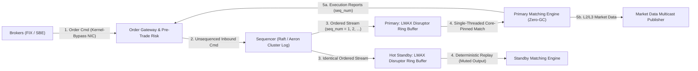

### 3.5 Stock Exchange Deep Dives & Failure Modes

- **Single-Threaded Deterministic Matching & LMAX Disruptor**: Locking an order book across multiple threads causes mutex contention, OS context switches (`5–15 μs` each), and non-deterministic execution ordering. Instead, symbols are partitioned across independent single-threaded matching engine shards (`Shard A: AAPL..AMZN`, `Shard B: MSFT..NVDA`), each pinned to an isolated physical CPU core (`isolcpus` + `taskset`, hyperthreading disabled to avoid L1/L2 cache thrashing). Inbound messages flow through an **LMAX Disruptor** pre-allocated ring buffer using cache-line-padded atomic cursors (eliminating false sharing and locks). Memory for all order nodes is pre-allocated in flat object pools at market open—ensuring **zero garbage collection pauses** (C++/Rust, or Zing/zero-allocation Java) during trading hours.
- **The Sequencer & Why Distributed Databases Stay Out of the Hot Path**: Calling PostgreSQL, Spanner, or Redis inside the matching loop adds millisecond-scale network and disk-fsync latency (`1,000×` slower than the `50 μs` budget). Instead, the **Sequencer** acts as the single source of total order: every inbound command receives a contiguous global monotonic `seq_num` in a replicated memory/RDMA log (e.g., Aeron Cluster / Raft quorum across 3 low-latency nodes in the same rack/AZ) _before_ reaching the matching engine. Because the matching engine is a pure deterministic function $S_{n+1}, \text{Fills}_n = f(S_n, \text{Cmd}_n)$ with zero calls to `wall_clock()` or random number generators, every standby replica consuming the exact same sequenced stream arrives at bit-identical book state!
- **Hot-Standby Failover & Snapshot Replay**: Outbound `ExecutionReports` carry the originating `seq_num` and a monotonic `exec_id`. The hot standby runs the identical matching loop with its outbound network publisher muted. If the primary halts or misses a heartbeat, the Sequencer fences the old primary epoch, promotes the hot standby (which already holds the warm in-memory order book up to `seq_num - 1`), and unmutes outbound publishing in milliseconds—requiring zero slow DB recovery. At end-of-day (or periodically), an out-of-band snapshotter serializes the book state at `seq_num = K` to durable storage so cold restarts replay only the delta `> K`.
- **Pre-Trade Risk & Fair Clock-Skew Protection**: Gateways validate account buying power, fat-finger price collars (`±10%` from reference price), and max-order-rate kill switches _before_ entering the Sequencer, preventing malformed or runaway algorithmic floods from polluting the deterministic sequence log.

> [!NOTE]
> Regulatory audit standards (such as MiFID II RTS 25 and SEC Rule 613 CAT) require nanosecond/microsecond UTC timestamps on order events via PTP (Precision Time Protocol). Gateways stamp **metadata** timestamps for compliance logging at ingress, but the Matching Engine never branches on wall-clock time—preserving strict deterministic replay solely from `seq_num`.

| Hot-Path Stage | Mechanism | Typical Budget (`p99`) | Anti-Pattern Eliminated |
| --- | --- | --- | --- |
| **Network Ingress** | Solarflare OpenOnload / DPDK kernel-bypass | `~3 μs` | Linux `sk_buff` copy, epoll context switches |
| **Gateway & Risk** | SBE fixed-offset struct decode + local limits | `~5 μs` | JSON parsing, heap allocations, remote auth RPC |
| **Sequencer Log** | Aeron Cluster / RDMA Raft in-memory quorum | `~15 μs` | Disk `fsync` or multi-region Spanner 2PC |
| **Matching Core** | Single-threaded Disruptor + L3 price-level tree | `~3 μs` | Mutex contention, GC stop-the-world pauses |
| **Egress & Feed** | Unicast FIX/SBE fill + UDP multicast market data | `~5 μs` | Synchronous fan-out blocking the matching thread |

### 3.6 Primary Literature & Systems Foundations Matrix

Electronic stock exchange matching engines represent the most demanding operational domain in distributed systems engineering: tick-to-trade response times are budgeted in single-digit microseconds, and any failure of ordering, determinism, or data integrity results in catastrophic financial and regulatory liability. The modern ultra-low-latency architecture synthesizes seminal contributions across lock-free inter-thread messaging, high-throughput binary wire protocols, kernel-bypass network drivers, in-memory distributed consensus, and deterministic finite state machines. The table below anchors the electronic exchange architecture in these primary foundational works.

| Milestone / Primary Source | Domain & Focus | Core Architectural Mechanism | Latency & Scalability Invariant | Key Trade-Offs & Failure Modes |
| --- | --- | --- | --- | --- |
| **Martin Thompson et al.** (LMAX Group 2011) _The LMAX Disruptor: High performance alternative to bounded queues_ | Inter-Thread Messaging & Lock-Free Concurrency | Pre-allocated circular ring buffer with sequence cursors; cache-line padding (`alignas(64)`); single-writer sequencing pattern eliminating locks and CAS contention. | Handles $> 6{,}000{,}000\text{ orders/sec}$ on a single core; inter-thread transfer latency $< 50\text{ ns}$. | Fixed ring buffer size limits maximum in-flight backlog; consumer thread stalls block ring buffer overwrite. |
| **Todd Montgomery & Martin Thompson** (Real Logic / Adaptive 2014–2026) _Aeron: Efficient reliable UDP unicast, multicast, and cluster consensus_ | Low-Latency Transport & Replicated State Machines | Zero-copy shared memory (`/dev/shm`) driver; reliable UDP unicast/multicast protocol; Raft-based consensus cluster (`Aeron Cluster`) with contiguous log recording. | Replicated log commit $< 15\text{ }\mu\text{s}$ over 100GbE RDMA/UDP; zero GC pauses via pre-allocated off-heap memory. | Requires high-speed dedicated network switches; network partitions trigger leader election stalls. |
| **FIX Protocol Ltd.** (1998–2026) _Financial Information eXchange (FIX 4.2 / 4.4) & Simple Binary Encoding (SBE) RC4_ | Financial Wire Protocols & Serialization | Tag-value ASCII protocol (FIX 4.2) for client edge ingress; compiled schema-driven fixed-offset binary structs (SBE) for core matching engine pipelines. | SBE eliminates string parsing and heap allocation; decodes in $< 25\text{ ns}$ directly in L1 CPU cache. | ASCII FIX requires CPU-intensive string conversions (`atoi`, `atof`); field changes require binary schema compilation. |
| **NASDAQ Inc.** (2015–2026) _NASDAQ TotalView-ITCH 5.0 (Market Data) & OUCH 5.0 (Order Entry) Specs_ | Proprietary Exchange Native Interfaces | Fixed-length binary message structures; individual order lifecycle dissemination (ITCH L3); direct point-to-point socket order entry (OUCH). | ITCH processes hundreds of millions of daily price changes with sub-microsecond wire serialization. | Exposes full individual order queue position, enabling predatory quantitative order book profiling. |
| **Diego Ongaro & John Ousterhout** (Stanford / USENIX ATC 2014) _In Search of an Understandable Consensus Algorithm (Raft)_ | Distributed Consensus & Leader Replication | Leader election via randomized timers; monotonic log sequence indexing; strict quorum commitment before state machine application. | Guarantees total order replication with $2F + 1$ node tolerance; zero state divergence across hot-standby replicas. | Disk `fsync` consensus adds millisecond jitter; modern exchanges must replace disk writes with RDMA in-memory quorums. |
| **Alex Xu & Sahn Lam** (ByteByteGo 2020–2024) _System Design Interview Vol. 2, Ch. 13 & Ch. 28: Stock Exchange_ | Canonical Exchange Architecture Curriculum | Three decoupled flows (Trading, Market Data, Reporter); `/dev/shm` mmap event bus; O(1) Price-Time FIFO book; embedded risk/wallet checks. | Baseline scale: 100 symbols, $1\text{B orders/day}$ ($42{,}735\text{ avg QPS}$, $215{,}000\text{ peak QPS}$); $99.99\%$ HA ($8.64\text{ s/day}$). | Reference `match()` pseudocode contains a critical partial-fill order deletion bug; single-server bare-metal limits geo-distribution. |

The evolution of stock exchange technology over the past three decades reflects a continuous migration from distributed multi-tier database architectures toward single-node, core-pinned, zero-allocation state machines. In legacy financial platforms, inbound broker orders crossed multiple network hops and ORM database layers before reaching a multi-threaded matching engine guarded by OS-level mutexes. This architecture produced wild latency jitter (tail latencies exceeding $50\text{ ms}$) caused by lock contention, Linux kernel scheduler preemptions, and Java Virtual Machine garbage collection pauses.

The foundational breakthrough of the LMAX Disruptor demonstrated that a single physical CPU core operating on a pre-allocated, lock-free ring buffer can execute millions of state transitions per second if CPU cache lines are protected from false sharing. Building upon this mechanic, modern low-latency messaging frameworks like Aeron extended lock-free ring buffers across process boundaries using Linux shared memory (`/dev/shm`) and network boundaries using kernel-bypass reliable UDP. By combining deterministic single-threaded execution with monotonic sequence numbering, modern matching engines eliminate distributed transactions entirely from the critical trading path, relegating market data fan-out and regulatory reporting to asynchronous, non-blocking auxiliary pipelines.

### 3.7 Verified ByteByteGo Canonical Worked Architecture & Capacity Delta (Chapter 28)

The canonical ByteByteGo Chapter 28 specification outlines an electronic stock exchange matching stocks across normal trading hours ($09:30\text{ to }16:00$), enforcing limit order matching, basic pre-trade risk controls, user wallet fund holds, real-time L1/L2/L3 market data generation, and high availability. The table below contrasts the canonical Chapter 28 baseline with a tier-1 global equities exchange environment.

| Metric / Parameter | ByteByteGo Ch. 28 Canonical Baseline | Tier-1 Global Exchange Production Tier (§3.2 Scale) | Architectural Implication & Engineering Delta |
| --- | --- | --- | --- |
| **Tradable Instruments** | 100 equity symbols | $10{,}000+$ equities, ETFs, and options series | Requires symbol-based horizontal partitioning across independent core-pinned matching shards. |
| **Daily Order Volume** | $1{,}000{,}000{,}000\text{ orders/day}$ | $5{,}000{,}000{,}000 - 10{,}000{,}000{,}000\text{ orders/day}$ | Order volume swells by $5\times - 10\times$; necessitates continuous zero-allocation memory recycling. |
| **Trading Session Length** | $6.5\text{ hours}$ ($23{,}400\text{ seconds}$) | $6.5\text{ hours}$ continuous $+ 10\text{ hours}$ pre/post-market | Eliminates static maintenance windows; requires dynamic online snapshotting and ring-buffer compaction. |
| **Average Order QPS** | $\approx 42{,}735\text{ orders/s}$ ($\approx 43{,}000\text{ QPS}$) | $\approx 213{,}675 - 427{,}350\text{ orders/s}$ | Aggregate exchange average easily handled by partitioned cores; per-symbol bursts dictate sizing. |
| **Peak Order QPS** | $\approx 215{,}000\text{ orders/s}$ ($5\times\text{ average}$) | $1{,}000{,}000 - 2{,}000{,}000\text{ orders/s}$ (Aggregate) | Mega-cap symbols (SPY, AAPL, NVDA) reach $500\text{k} - 1\text{M QPS}$ during market open auctions and CPI prints. |
| **Tick-to-Trade Latency SLA** | Millisecond-level ($p99 < 10\text{ ms}$) | Microsecond-level ($p99 < 50\text{ }\mu\text{s}$, $p50 < 10\text{ }\mu\text{s}$) | Eliminates kernel network stacks, disk access, and IPC context switches from the critical path. |
| **Availability Target** | $99.99\%$ ($8.64\text{ seconds downtime/day}$) | $99.999\%$ ($< 864\text{ milliseconds downtime/day}$) | Requires active-active or sub-millisecond hot-standby failover with zero uncommitted state loss ($RPO = 0$). |
| **Order Book Implementation** | `limitMap` + Doubly Linked List + `orderMap` | Cache-aligned contiguous flat pools + intrusive pointers | Flat memory arrays stay L3-resident ($< 16\text{ MB}$ per symbol, L2-tiled per active price level), preventing DRAM stalls. |
| **Sequencing & Storage Bus** | Single bare-metal server with `/dev/shm` mmap | In-memory Raft quorum over 100GbE RDMA (Aeron Cluster) | Shared memory provides microsecond intra-host bus; RDMA extends zero-copy sequencing across redundant physical nodes. |

#### Stock Exchange Capacity & Latency Derivations

##### 1. Canonical Throughput & Reconciling ByteByteGo with Section 3.2 Scale

In ByteByteGo Chapter 28, the exchange operates across standard continuous trading hours on US equity markets (09:30:00 to 16:00:00 EST). The total continuous trading duration is:

$$T = 6.5\text{ hours} = 6.5 \times 3{,}600\text{ seconds} = 23{,}400\text{ seconds}$$

Given the canonical daily ingest target of $N_{\text{orders}} = 1{,}000{,}000{,}000\text{ orders/day}$, the exact mean order throughput is:

$$QPS_{\text{avg, BBG}} = \frac{1{,}000{,}000{,}000\text{ orders}}{23{,}400\text{ seconds}} = 42{,}735.0427\dots\text{ orders/s} \approx 42{,}735\text{ orders/s} \approx 43{,}000\text{ QPS}$$

Order arrival in financial markets is intensely bursty: trading activity concentrates heavily during the opening 30 minutes (09:30–10:00) as overnight news is priced, and during the closing 30 minutes (15:30–16:00) during market-on-close (MOC) index rebalancing auctions. Applying the standard financial market peak multiplier of $k = 5.0$:

$$QPS_{\text{peak, BBG}} = 42{,}735.04 \times 5.0 = 213{,}675.21\dots\text{ orders/s} \approx 215{,}000\text{ QPS}$$

**Reconciliation with Section 3.2**: Section 3.2 specifies an operational throughput capacity of $500{,}000 - 1{,}000{,}000\text{ orders/s}$ _per symbol shard_. While the aggregate peak rate across all 100 symbols in Chapter 28 is $215{,}000\text{ QPS}$, equity order flow follows an extreme power-law (Pareto) distribution: the top 5 mega-cap equities and index ETFs (e.g., SPY, QQQ, AAPL, NVDA, TSLA) account for over $50\%$ of total exchange traffic. During scheduled macroeconomic data releases (such as Federal Open Market Committee rate decisions or Consumer Price Index releases), trading algorithms flood a single symbol with quote cancellations and limit updates exceeding $500{,}000\text{ operations/sec}$. Therefore, sizing each CPU-pinned symbol matching engine core for $500\text{k} - 1\text{M QPS}$ ensures that individual hot symbol shards absorb peak volatility spikes without queuing delay, while the aggregate 100-symbol baseline ($215\text{k QPS}$) easily runs with $> 10\times$ headroom.

##### 2. Market Data Quote Tiers & Candlestick Math

The market data publisher constructs three distinct levels of quotation data and streaming time-series aggregates from the raw execution stream:

- **Level 1 (L1 / Best Bid and Offer - BBO)**: Consists solely of the highest current buy price (bid), the lowest current sell price (ask/offer), and the aggregated share volume available at those two prices. L1 represents the minimum data tier required for retail price displays: $\text{L1 Frame} = \{\text{symbol}, \text{timestamp}, P_{\text{best-bid}}, Q_{\text{best-bid}}, P_{\text{best-ask}}, Q_{\text{best-ask}}\}$.
- **Level 2 (L2 / Aggregated Market Depth)**: Exposes the aggregated order volume across the top $N$ price levels (typically $N \in \{5, 10, 20\}$) on both sides of the book. As limit orders enter, fill, or cancel, the publisher emits price-level delta updates: $\text{L2 Delta} = \{\text{symbol}, \text{timestamp}, \text{side}, \text{price-tick}, \text{aggregate-qty}, \text{action} \in (\text{ADD}, \text{MODIFY}, \text{DELETE})\}$.
- **Level 3 (L3 / TotalView / Full Order Book)**: Disseminates every individual order resting in the book, exposing its unique system `order_id`, precise timestamp, side, price, and individual quantity. L3 provides complete transparency into queue priority and individual algorithmic positions.
- **OHLCV Candlestick Aggregation**: A candlestick aggregates trading activity over a fixed time duration $\Delta t$ (e.g., $1\text{ second}$, $1\text{ minute}$, $5\text{ minutes}$, $1\text{ day}$). Given a sequence of execution fills $\{(p_1, q_1), (p_2, q_2), \dots, (p_k, q_k)\}$ occurring within window $[t_{\text{start}}, t_{\text{start}} + \Delta t)$, the bar calculates $O = p_1$, $H = \max_{1 \le i \le k}(p_i)$, $L = \min_{1 \le i \le k}(p_i)$, $C = p_k$, and $V = \sum_{i=1}^{k} q_i$. To prevent heap allocation churn during high-frequency execution processing, the Market Data Publisher maintains pre-allocated fixed-size circular ring buffers for each supported timeframe. When a fill occurs, the active bar updates in-place in $O(1)$ CPU operations. At interval rollover, the completed candle is emitted to downstream subscribers and stored in columnar memory (KDB+).

##### 3. FIX 4.2 Message Anatomy vs. Simple Binary Encoding (SBE)

The Financial Information eXchange (FIX) protocol version 4.2 is the universal standard for client-to-exchange order ingress. A standard FIX message is a stream of ASCII `tag=value` pairs delimited by the non-printable ASCII `0x01` character (Start-of-Header `^A`, denoted below as `|`).

A representative `NewOrderSingle` message (`35=D`):

```text
8=FIX.4.2|9=130|35=D|49=BROKER_DESK_A|56=EXCHANGE_MATCH|34=10492|52=20261121-14:30:00.002|11=ORD_AAPL_9821|55=AAPL|54=1|38=500|40=2|44=18550|59=0|10=046|
```

Anatomy of key FIX tags:

- `8=FIX.4.2`: Protocol version specification (mandatory header).
- `9=130`: Body length in bytes from tag `35` through the delimiter preceding tag `10` (exact count for the payload above).
- `35=D`: Message type indicator (`D` = New Order Single, `8` = Execution Report, `F` = Order Cancel Request).
- `49=BROKER_DESK_A`: Sender Component ID (identifying the broker/institutional client).
- `56=EXCHANGE_MATCH`: Target Component ID (identifying the exchange engine).
- `34=10492`: Monotonic client message sequence number for transport-level gap detection.
- `52=20261121-14:30:00.002`: UTC timestamp generated at client transmission.
- `11=ORD_AAPL_9821`: Client Order ID (unique tracking identifier assigned by broker).
- `55=AAPL`: Ticker symbol of the traded financial instrument.
- `54=1`: Order side (`1` = Buy, `2` = Sell, `5` = Sell Short).
- `38=500`: Order quantity in shares.
- `40=2`: Order type (`1` = Market, `2` = Limit, `3` = Stop, `4` = Stop Limit).
- `44=18550`: Limit price expressed in integer ticks (e.g., $18550 = \$185.50$ with a tick size of $\$0.01$).
- `59=0`: Time in Force (`0` = Day order, `1` = Good Till Cancel / GTC, `3` = Immediate or Cancel / IOC, `4` = Fill or Kill / FOK).
- `10=218`: Three-digit modulo-256 checksum over all preceding bytes including delimiters.

**Why ASCII FIX is Replaced by SBE on the Hot Path**: While ASCII FIX provides human readability, parsing ASCII tags requires sequential byte scanning, delimiter searches, integer/float string conversions (`atoi`, `strtod`), and dynamic heap allocations. In contrast, **Simple Binary Encoding (SBE)** uses a pre-compiled XML schema to generate fixed-offset binary structs in little-endian format. The matching engine reads fields directly from memory using native CPU register offsets with zero parsing overhead:

```text
SBE Order Struct Layout (32 Bytes Fixed-Width, 64-Bit Word Aligned):
+-----------------------------------+-----------------------------------+
| Offset 00: uint64_t client_seq_id | Offset 08: uint64_t price_ticks   |
+-----------------------------------+-----------------------------------+
| Offset 16: uint32_t order_qty     | Offset 20: uint32_t account_id    |
+-----------------------------------+-----------------------------------+
| Offset 24: uint16_t symbol_id     | Offset 26: uint8_t side (1=B,2=S) |
+-----------------------------------+-----------------------------------+
| Offset 27: uint8_t  order_type    | Offset 28: uint32_t padding       |
+-----------------------------------+-----------------------------------+
```

### 3.8 Three-Flow Ultra-Low-Latency Exchange Architecture & Implementation Mechanics

Modern stock exchange systems cleanly decouple operations into three independent pipelines: the **Critical Trading Flow**, the **Non-Critical Market Data Flow**, and the **Non-Critical Reporter Flow**. This segregation guarantees that analytical queries, compliance archiving, and network distribution stalls never propagate backpressure to the single-threaded matching core.

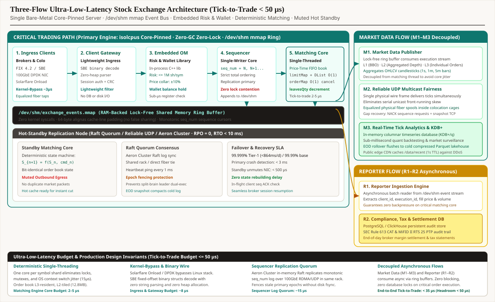

#### 1. The Three Decoupled Flows

##### Flow 1: Critical Trading Flow (The Hot Path)

The critical trading path operates on a single bare-metal server using CPU core pinning and RAM-backed shared memory (`/dev/shm`):

1. **Ingress & Hardware Gateway**: Institutional and colocated broker clients transmit binary SBE orders over 100GbE fiber using kernel-bypass network interface cards (Solarflare OpenOnload or Intel DPDK). Incoming packets transfer directly from the NIC ring buffer to user-space memory in $< 2\text{ }\mu\text{s}$, completely bypassing the Linux network stack and socket context switches.
2. **Client Gateway**: Authenticates the client session, verifies sequence continuity, and validates message checksums.
3. **Embedded Order Manager**: Compiled as a native static C++ library linked directly into the ingress process. It executes sub-microsecond pre-trade risk checks (verifying that the client's cumulative daily volume does not breach the $1{,}000{,}000\text{-share}$ limit and that the order price falls within $\pm 10\%$ fat-finger collars of the current NBBO) and reserves required wallet funds in-memory.
4. **Single-Writer Sequencer**: The gatekeeper of determinism. It stamps every valid inbound command with a strictly monotonic 64-bit sequence number (`seq_num = 1, 2, 3, ...`) and appends the command to the `/dev/shm` shared memory ring buffer. The sequencer concurrently replicates the sequenced frame to a hot-standby node over Aeron Cluster RDMA.
5. **Deterministic Matching Engine**: Pinned to a dedicated physical CPU core (`isolcpus`). It consumes commands sequentially from the `/dev/shm` ring buffer, matches orders in memory against the Price-Time FIFO order book, updates the book state, and emits execution events (`ExecutionReports`) to `/dev/shm`.
6. **Egress Gateway**: Reads execution events from `/dev/shm` and transmits confirmation packets back to the originating broker.

##### Flow 2: Non-Critical Market Data Flow (M1–M3)

1. **M1 (Market Data Publisher)**: An asynchronous thread consumes execution events from the `/dev/shm` event bus via a cache-line padded lock-free ring buffer. It maintains an in-memory replica of the order book to compute L1 (BBO) quotes, L2 (depth) quotes, and L3 updates, while concurrently rolling 1-second, 1-minute, and 5-minute OHLCV candlestick bars.
2. **M2 (Reliable UDP Multicast)**: Encodes market data into binary ITCH/FAST packets and broadcasts them over UDP multicast channels. Multicast guarantees that all subscriber switches receive the identical packet at the identical physical moment. Retransmissions for lost packets are served out-of-band via TCP historical replay servers to prevent slowing down the multicast feed.
3. **M3 (Real-Time Analytics & KDB+)**: A real-time tick logger ingests market data events into an in-memory columnar database (KDB+/q or ClickHouse) for quantitative analysis, broker volume attribution, and market surveillance.

##### Flow 3: Non-Critical Reporter Flow (R1–R2)

1. **R1 (Reporter Ingestion Engine)**: An asynchronous background daemon reads execution events and order lifecycle transitions from `/dev/shm`. Because reporting operates outside the latency-sensitive path, it batches events into large chunks.
2. **R2 (Compliance, Tax, and Settlement DB)**: Persists enriched trading records to relational and time-series stores (PostgreSQL / CockroachDB / ClickHouse). Generates regulatory audit trails required by SEC Rule 613 (Consolidated Audit Trail - CAT) and European MiFID II RTS 25, calculates broker commission billing, and delivers end-of-day clearing files for $T+1$ settlement.

---

#### 2. Order Book Mechanics & Exposing the ByteByteGo / liquidslr Partial-Fill Bug

An order book organizes active resting limit orders for a single financial instrument. To satisfy microsecond SLAs, the data structure must provide:

- $O(1)$ query of the current best bid and best ask price.
- $O(1)$ addition of a new resting limit order at the tail of a price queue.
- $O(1)$ cancellation and removal of an unexecuted resting order.
- $O(1)$ matching and execution of an aggressive order against resting orders at the head of a price queue.

##### The Triad Data Structure

The production order book combines three cooperating structures:

1. `limit_map`: A sparse array or bounded red-black tree indexed by discrete integer price ticks (`price_tick = round(price / tick_size)`). Each slot points to a `PriceLevel` object.
2. `PriceLevel`: Represents a discrete price and maintains an intrusive doubly linked list of resting orders:
   - `head`: Points to the oldest resting order at this price (highest time priority).
   - `tail`: Points to the newest resting order at this price.
   - `total_volume`: Sum of remaining unexecuted shares across all resting orders at this price level.
3. `order_map`: A flat array or robin-hood hash map indexing `order_id` to direct pointers/indices in the pre-allocated order pool. Because each order contains `prev` and `next` intrusive pointers, canceling an order requires looking up its pointer in `order_map` in $O(1)$ and unlinking it from its `PriceLevel` doubly linked list in $O(1)$.

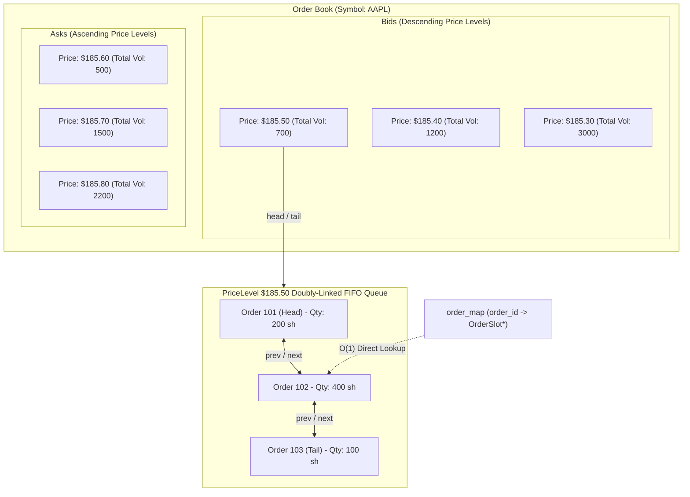

##### Exposing the Subtle Partial-Fill Bug in ByteByteGo / liquidslr

In the canonical reference literature (ByteByteGo Vol. 2 Ch. 28 and liquidslr Chapter 28), the core matching loop is presented in pseudocode as follows:

```java
// CRITICAL BUG in canonical reference pseudocode (ByteByteGo / liquidslr Ch. 28):
Context match(OrderBook book, Order order) {
    Quantity leavesQuantity = order.quantity - order.matchedQuantity;
    Iterator<Order> limitIter = book.limitMap.get(order.price).orders;
    while (limitIter.hasNext() && leavesQuantity > 0) {
        Quantity matched = min(limitIter.next.quantity, order.quantity); // BUG 1
        order.matchedQuantity += matched;
        leavesQuantity = order.quantity - order.matchedQuantity;
        remove(limitIter.next); // FATAL BUG 2: unconditionally removes resting order!
        generateMatchedFill();
    }
    return SUCCESS(MATCH_SUCCESS, order);
}
```

This reference implementation contains three catastrophic flaws that would corrupt financial state in production:

1. **Flaw 1a (Incorrect Quantity Comparison)**: The statement `Quantity matched = min(limitIter.next.quantity, order.quantity)` compares the resting order's _initial total quantity_ against the incoming order's _initial total quantity_. It completely ignores `leavesQuantity` (the unfulfilled remainder of the incoming order) and any prior partial fills on the resting order itself.
2. **Flaw 1b (Double `next()` Iterator Advance)**: Calling `limitIter.next` twice inside the loop (`min(limitIter.next.quantity, ...)` followed by `remove(limitIter.next)`) advances a Java-style iterator _twice_ per iteration—reading quantity from order $i$ while deleting order $i+1$. Correct code must bind `Order resting = limitIter.next()` once before reading or mutating it.
3. **Flaw 2 (The Fatal Partial-Fill Deletion Bug)**: The code unconditionally executes `remove(limitIter.next)` on _every single iteration_ of the matching loop! Consider a common scenario:
   - Resting order $A$ sits at the head of the book for $100\text{ shares}$ at $\$185.50$.
   - An aggressive incoming order $B$ enters to buy $20\text{ shares}$ at $\$185.50$ (`leavesQuantity = 20`).
   - The loop matches $20\text{ shares}$.
   - The reference algorithm unconditionally executes `remove(limitIter.next)`, completely deleting order $A$ from the order book!
   - **Financial disaster**: The remaining $80\text{ shares}$ belonging to trader $A$ vanish into thin air without ever being matched, cancelled, or returned. The exchange's inventory state diverges immediately from client ledger accounts, creating catastrophic financial deficit.

##### The Verified, Zero-Allocation Production Implementation

A correct matching engine must evaluate partial fills on both the resting order and the aggressive incoming order. If an incoming order only partially fills a resting order, the resting order must remain at the exact head of the FIFO queue with its `remaining_qty` decremented in-place, preserving its time priority:

```cpp
// Production-grade, zero-allocation C++ matching core with verified partial-fill semantics
struct OrderSlot {
    uint64_t order_id;
    uint64_t price_ticks;
    uint32_t remaining_qty;
    uint32_t initial_qty;
    uint32_t account_id;
    uint8_t  side;          // 0 = BUY, 1 = SELL
    OrderSlot* prev;        // Intrusive pointers
    OrderSlot* next;
};

struct PriceLevel {
    uint64_t   price_ticks;
    uint64_t   total_volume;
    OrderSlot* head;
    OrderSlot* tail;
};

void match_order(OrderBook& book, OrderSlot* incoming_order, ExecutionBuffer& exec_stream) {
    uint32_t leaves_qty = incoming_order->remaining_qty;

    while (leaves_qty > 0) {
        PriceLevel* best_level = (incoming_order->side == 0) ? book.get_best_ask() : book.get_best_bid();
        if (!best_level) break; // Opposite book empty

        // Limit price crossing check
        if (incoming_order->side == 0 && incoming_order->price_ticks < best_level->price_ticks) break;
        if (incoming_order->side == 1 && incoming_order->price_ticks > best_level->price_ticks) break;

        OrderSlot* resting = best_level->head;
        while (resting != nullptr && leaves_qty > 0) {
            uint32_t match_qty = std::min(leaves_qty, resting->remaining_qty);

            // Emit dual execution fills
            exec_stream.emit_fill(incoming_order->order_id, resting->order_id,
                                  best_level->price_ticks, match_qty);

            // Update remaining quantities
            leaves_qty -= match_qty;
            incoming_order->remaining_qty = leaves_qty;
            resting->remaining_qty -= match_qty;
            best_level->total_volume -= match_qty;

            if (resting->remaining_qty == 0) {
                // Resting order completely filled: unlink from FIFO queue and recycle
                OrderSlot* next_resting = resting->next;
                best_level->unlink(resting);
                book.order_pool.recycle(resting);
                book.order_map.erase(resting->order_id);
                resting = next_resting;
            } else {
                // PARTIAL FILL: Resting order retains head priority with decremented quantity!
                // incoming order is exhausted; break matching loop immediately
                break;
            }
        }

        // If all orders at this price level were exhausted, prune the price level
        if (best_level->head == nullptr) {
            book.remove_price_level(best_level);
        }
    }

    // If incoming order still has unexecuted shares, insert remainder as resting limit order
    if (incoming_order->remaining_qty > 0) {
        book.insert_resting_order(incoming_order);
    } else {
        book.order_pool.recycle(incoming_order);
    }
}
```

---

#### 3. Operational Mechanics for Ultra-Low Latency and Determinism

##### The `/dev/shm` mmap Event Store & Core Pinning

Modern exchanges run the entire critical trading path on a single bare-metal server using Linux shared memory (`/dev/shm`). Because `/dev/shm` is mounted on `tmpfs` (a RAM-backed filesystem), calling `mmap()` on a file in `/dev/shm` maps physical RAM directly into the process's address space. Appending to or reading from this bus requires zero disk I/O, zero filesystem journaling, and zero kernel `read()`/`write()` context switches.

The primary matching core process is pinned to a dedicated physical CPU core using `pthread_setaffinity_np` and the Linux kernel boot parameter `isolcpus=2-4,nohz_full=2-4,rcu_nocbs=2-4`. Operating system scheduler interruptions (timer ticks) and hyperthreading (SMT) are completely disabled on these cores. The matching engine executes an uninterrupted tight loop (a busy-spin polling loop), reading from the shared memory ring buffer without ever yielding the CPU or sleeping on mutexes.

##### Functional vs. Latency Determinism

- **Functional Determinism**: Guarantees that given the exact same initial state $S_0$ and the exact same ordered sequence of inputs $C_1, C_2, \dots, C_n$, any replica will transition through identical states and produce identical outputs: $S_{n+1}, \text{Fills}_n = f(S_n, C_n)$. To achieve functional determinism, the matching engine core is strictly isolated from non-deterministic system calls: it never reads the wall clock (`clock_gettime(CLOCK_REALTIME)`), never generates pseudorandom numbers, and never makes asynchronous network or disk calls. All order priority decisions derive exclusively from the integer limit price and the sequencer-assigned monotonic `seq_num`.
- **Latency Determinism**: Guarantees that every order is processed within a tight, bounded latency distribution without tail spikes ($p99.99 < 15\text{ }\mu\text{s}$). Garbage-collected runtimes (Java, Go, C#) fundamentally fail latency determinism because garbage collection cycles introduce unpredictable stop-the-world pauses ($10 - 100\text{ ms}$). Production matching engines are implemented in C++23 or Rust with all memory pre-allocated in contiguous pools at system startup.

##### Cache-Line Padding Against False Sharing

Modern CPUs exchange memory between cores in $64\text{-byte}$ cache lines via cache coherency protocols (MESI/MOESI). In a lock-free ring buffer architecture, if the producer write cursor (`tail_sequence`) and the consumer read cursor (`head_sequence`) reside within the same $64\text{-byte}$ memory slice, whenever the producer updates its cursor, the CPU invalidates the entire cache line in the consumer core's L1/L2 cache. This phenomenon—**false sharing**—forces the consumer core to stall for $50 - 200\text{ CPU cycles}$ waiting to reload the cache line from L3 cache or DRAM.

To guarantee zero false sharing, all atomic sequence cursors and queue boundaries enforce strict $64\text{-byte}$ memory alignment and padding:

```cpp
// Cache-line aligned sequence cursor eliminating MESI cache line bouncing
struct alignas(64) PaddedAtomicCursor {
    std::atomic<uint64_t> sequence{0};
    uint8_t               padding[56]; // 8 bytes sequence + 56 bytes pad = 64 bytes
};
static_assert(sizeof(PaddedAtomicCursor) == 64, "PaddedAtomicCursor must equal exactly one cache line");
```

##### High Availability (99.99% Baseline / 99.999% Tier-1 Target) & Hot-Standby Replication

A $99.99\%$ baseline availability SLA permits at most $8.64\text{ seconds}$ of total downtime per day ($52\text{ minutes/year}$), while Tier-1 global equity exchanges target $99.999\%$ ($< 864\text{ ms/day}$, $\text{RTO} < 10\text{ ms}$, $\text{RPO} = 0$). Because a stock exchange cannot tolerate uncommitted state loss ($RPO = 0$), traditional active-passive cold restarts that rebuild order books from database logs are out of the question.

Instead, the exchange deploys a **Hot-Standby Replication Node** using Aeron Cluster consensus:

1. The primary sequencer replicates the sequenced command log to the hot standby over a dedicated point-to-point fiber connection using Aeron UDP/RDMA.
2. The hot standby runs an identical matching engine state machine, consuming the exact same sequenced log and maintaining a bit-identical in-memory order book.
3. By design, the hot standby has its **outbound network transmission muted**: it processes matching transitions but does not publish duplicate execution reports or market data packets.
4. Heartbeat pings monitor node health every $1\text{ ms}$. If the primary node crashes or loses power, the sequencer cluster triggers an epoch fence against the failed primary, promotes the hot standby, and un-mutes the standby's network interfaces in $< 1\text{ millisecond}$ ($RTO < 10\text{ ms}$, $RPO = 0$).

##### Market Data Distribution Fairness & Colocation Cable Equalization

Information fairness is legally mandated by securities regulators. If Broker A receives market price updates even $100\text{ nanoseconds}$ before Broker B, Broker A can front-run Broker B's pending orders (latency arbitrage).

- **UDP Multicast**: Unlike TCP (which requires serial unicast transmission, meaning the 1st client receives packets milliseconds before the 1,000th client), UDP Multicast transmits a single packet frame onto the network switch backplane, which replicates the frame simultaneously to all subscriber ports in hardware.
- **Physical Cable Length Equalization**: In exchange colocation facilities (e.g., NASDAQ's facility in Carteret, NJ or CME in Aurora, IL), brokers pay for direct rack placement adjacent to the exchange matching engines. Because light travels through optical fiber at approximately $200\text{ meters per microsecond}$ ($5\text{ ns per meter}$), a broker whose server rack is 20 meters closer to the core switch gains a $100\text{ ns}$ speed advantage. To enforce absolute regulatory fairness, exchanges spool optical fiber cross-connect cables to identical lengths (e.g., exactly 100 meters of fiber spooled above each rack) so that physical propagation time is equalized across all colocated market participants.

##### DDoS URL Cache Hardening (`/data/recent`)

While institutional brokers connect via dedicated fiber cross-connects, retail brokerage applications query market data over public HTTPS APIs. A common denial-of-service vulnerability occurs when retail web applications issue dynamic parameterized queries:

```text
GET /api/v1/marketdata?symbol=AAPL&from=1700000000&to=1700000060
```

Because the `from` and `to` query timestamps increment with every client request, each query produces a unique URL string. Reverse proxies and edge CDNs cannot match these requests to cached objects, causing all queries to bypass the cache and flood backend market data servers.

The **DDoS URL Cache Hardening** pattern eliminates this vulnerability:

1. Retail clients are restricted to querying canonical, parameterless static URIs:
   ```text
   GET /api/v1/marketdata/AAPL/candles/1m/recent
   ```
2. The edge reverse proxy (Cloudflare, Akamai, or NGINX) caches this canonical URL with a $1\text{-second}$ time-to-live (`Cache-Control: public, max-age=1, s-maxage=1, stale-while-revalidate=5`).
3. During market volatility spikes, even if $100{,}000\text{ retail clients}$ request the latest candlestick simultaneously, $99{,}999$ requests are served directly from edge CDN cache memory, and the origin market data server receives exactly $1\text{ request/second}$.

**Staff Edge-Case Checklist (Exchange):**

- **Self-Match Prevention (STP) & Odd Lots**: Tag orders with firm/account `trader_group_id` so the matching core cancels or decrements resting self-crossing orders before emitting a wash-trade fill; handle odd-lot orders (`< 100` shares) in the same book without updating NBBO protected quotes.
- **Regulatory Halts (LULD) & Cancel-Replace Atomicity**: Trading halts freeze matching while still accepting `CancelOrder` requests; `CancelReplace` that _increases_ quantity or changes price loses time priority (atomic cancel + new-order tail append), whereas quantity _reductions_ preserve queue position.
- **Sequence-Gap Recovery & PTP Failover**: Multicast subscribers detect gaps via monotonic `seq_num` and replay missing frames from a separate TCP Retransmission Server without touching the matching core; dual atomic/GPS PTP grandmasters with boundary-clock holdover prevent UTC drift during antenna loss.

### 3.9 Technology Comparison: Then vs. Now (2021 vs. 2026)

Over the past five years, the architectural baseline for financial exchanges has transitioned from monolithic, garbage-collected bare-metal servers relying on ASCII text protocols toward hardware-accelerated, zero-allocation binary engines deployed across hybrid cloud and FPGA infrastructure.

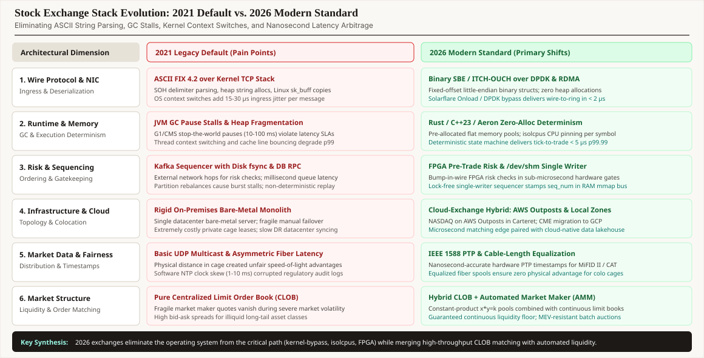

| Architectural Dimension | 2021 Legacy Default (Pain Points) | 2026 Modern Standard (Primary Shifts) | Engineering Impact & Production Trade-Offs |
| --- | --- | --- | --- |
| **1. Wire Protocol & NIC** | ASCII FIX 4.2 over Linux kernel TCP network stack; string parsing, `atoi` conversions, Linux `sk_buff` buffer copies. | Binary Simple Binary Encoding (SBE) / NASDAQ ITCH-OUCH over kernel-bypass DPDK / Solarflare OpenOnload / RDMA. | Cuts network ingress latency from $25\text{ }\mu\text{s}$ to $< 2\text{ }\mu\text{s}$; eliminates Linux socket context switches and heap allocation churn. |
| **2. Runtime & Memory** | Java/JVM runtimes with G1/CMS collectors; periodic stop-the-world GC pauses ($10 - 100\text{ ms}$) violate execution SLAs. | C++23 / Rust / Aeron Cluster with zero heap allocations during trading; contiguous memory pools; `isolcpus` core pinning. | Eliminates tail latency spikes ($p99.99 < 10\text{ }\mu\text{s}$); prevents CPU cache thrashing via strict cache-line alignment. |
| **3. Pre-Trade Risk & Sequencing** | Multi-threaded Kafka sequencers or relational database locks; disk `fsync` logging; microservice network RPCs for risk. | Bump-in-wire FPGA pre-trade risk checks ($< 500\text{ ns}$); single-writer sequencer stamping monotonic `seq_num` into `/dev/shm`. | Pre-trade risk evaluation drops from milliseconds to sub-microsecond hardware gates; total order sequencing without lock contention. |
| **4. Infrastructure & Cloud** | Rigid on-premises bare-metal server monoliths; manual disaster recovery procedures; multi-million dollar colocation leases. | Cloud-Exchange hybrid topologies: AWS Outposts & Local Zones (NASDAQ on AWS) and CME on Google Cloud Platform. | Microsecond matching cores sit at physical colocation edges while analytical lakehouses scale dynamically on cloud infrastructure. |
| **5. Market Data & Fairness** | Unprotected UDP multicast or serial TCP unicast; software NTP clock synchronization ($1 - 10\text{ ms}$ drift); fiber distance skew. | IEEE 1588 PTP nanosecond hardware timestamping; physical fiber length equalization; reliable UDP multicast with NACK gap recovery. | Eliminates microsecond latency arbitrage; satisfies strict regulatory compliance audits (SEC Rule 613 CAT, MiFID II RTS 25). |
| **6. Market Structure & Liquidity** | Pure Centralized Limit Order Book (CLOB); highly dependent on designated market makers who withdraw quotes during crises. | Hybrid CLOB + Automated Market Maker (AMM $x \cdot y = k$) liquidity pools; on-chain/off-chain crossing networks; MEV protections. | Continuous mathematical liquidity floor for illiquid and long-tail asset classes; MEV-resistant cryptographic batch auctions. |

#### Deep Operational Pitfalls & Production Failure Modes

##### Pitfall 1: JVM Garbage Collection Pause Stalls Causing Execution Queue Inversion

In legacy exchange systems implemented on the Java Virtual Machine (JVM), matching engines rely on generational garbage collectors (such as G1GC or CMS). Even with aggressive off-heap tuning, runtime objects (such as temporary string tokens, wrapper boxed primitives, or iterator instances) eventually allocate into Young Generation Eden space. During heavy market volatility, allocation rates explode, triggering a Stop-the-World Minor GC pause lasting $15 - 50\text{ ms}$. During this pause, the matching engine thread is completely frozen by the OS. Inbound orders continue buffering in kernel network socket queues. When the GC pause completes, the engine resumes processing the buffered backlog. However, because market conditions shifted during the 50 ms freeze, incoming market orders are executed against stale resting limit orders that clients had desperately attempted to cancel while the engine was frozen! This produces severe financial execution errors, broken broker hedges, and massive regulatory fines. _Production Mitigation_: Modern exchanges mandate zero-allocation native languages (C++23 or Rust) or specialized zero-pause runtimes (Azul Zing with C4 collector). All order slots, price levels, and execution buffers are pre-allocated at market open, ensuring that zero memory allocations or deallocations occur during the trading session.

##### Pitfall 2: Cache-Line False Sharing on Sequencer Ring Buffer Cursors

In high-throughput multi-core ring buffer designs (such as the LMAX Disruptor or custom lock-free queues), the sequencer maintains a monotonic write cursor while consumer threads maintain read cursors. If these 64-bit integer variables are declared consecutively in a class or struct:

```cpp
// ANTI-PATTERN: False sharing disaster!
struct RingBufferCursors {
    std::atomic<uint64_t> write_cursor{0}; // Bytes 00-07
    std::atomic<uint64_t> read_cursor{0};  // Bytes 08-15
}; // Fits in a single 64-byte CPU cache line
```

Both variables share a single $64\text{-byte}$ CPU cache line. When the producer core increments `write_cursor`, the CPU's hardware cache coherence protocol (MESI) marks that cache line as `Invalid` in the L1/L2 caches of all consumer cores. When the consumer core attempts to read `read_cursor`, it experiences a cache miss and must stall execution while the modified line is flushed and transferred over the CPU inter-connect bus. Under a load of $1\text{M ops/sec}$, this constant cross-core cache line bouncing degrades throughput by over $80\%$ and adds unpredictable microsecond latency jitter. _Production Mitigation_: Enforce `alignas(64)` and explicit 56-byte dummy padding arrays between every atomic cursor, ensuring that each cursor occupies its own exclusive 64-byte cache line.

##### Pitfall 3: Partial-Fill Order Book State Desynchronization

When an aggressive limit order matches against resting volume, the order may match against multiple resting orders or only partially fill a single resting order. As exposed in Section 3.8, naive implementations that unconditionally unlink the resting order from the intrusive price level list upon any match immediately corrupt the order book. When a resting limit order of 100 shares is matched for 20 shares, deleting the order erases the remaining 80 shares from the exchange's internal book. When the broker subsequently submits an `OrderCancelRequest` for the original order, the engine returns `OrderNotFound`, while the broker's local order state still shows 80 shares active. _Production Mitigation_: The matching engine state machine must strictly separate order lifecycle updates:

- If `incoming.remaining_qty < resting.remaining_qty`: decrement `resting.remaining_qty` in-place, leave the resting order at the head of the intrusive doubly linked list, and emit a `PARTIALLY_FILLED` execution report.
- If `incoming.remaining_qty >= resting.remaining_qty`: mark the resting order `FILLED`, unlink it from the intrusive list, recycle the `OrderSlot` to the pre-allocated pool, and delete its entry from `order_map`.

##### Pitfall 4: Clock Skew in Distributed Feeds Violating Regulatory Audit Trails

Financial regulations (SEC Rule 613 CAT in the United States and MiFID II RTS 25 in the European Union) impose strict legal requirements on timestamp precision. Under MiFID II RTS 25, high-frequency algorithmic trading venues must timestamp order events with a maximum divergence of $100\text{ microseconds}$ from UTC, with a timestamp resolution of $1\text{ microsecond}$ or better. Traditional Network Time Protocol (NTP) synchronizes server clocks over standard network sockets and commonly experiences drifts of $1 - 10\text{ milliseconds}$ due to asymmetric network delays and OS interrupt handling. Relying on software NTP causes exchange timestamps to drift out of compliance, resulting in severe regulatory enforcement actions and invalidated cross-market order auditing. _Production Mitigation_: Deploy hardware **Precision Time Protocol (IEEE 1588v2 PTP)** tied to atomic rubidium clocks or GPS time receivers within the exchange datacenter. Specialized network interface cards (such as Solarflare Flareon with PTP hardware timestamping engines) stamp incoming and outgoing packet frames directly in the physical layer (PHY) silicon as bits cross the wire, delivering UTC timestamp accuracy within $\pm 10\text{ nanoseconds}$.
---

## 4. Collaborative Editing: Google Docs

Real-time collaborative editing allows dozens of users to edit the same structured document concurrently—even while offline on an airplane—and converge cleanly to the exact same state without locking sentences or overwriting each other's paragraphs.

### 4.1 Collaborative Editing Requirements & SLAs

- **Functional requirements**: Concurrent multi-user character/formatting edits, local-first offline editing with clean merge upon reconnect, live remote cursor/selection awareness, full revision history with point-in-time snapshots, and document export.
- **Non-functional requirements**: **Strong Eventual Consistency (SEC)**—all clients receiving the same set of operations converge to identical document bytes regardless of arrival order (see [Distributed Systems](../../distributed-systems/README.md)); local keystroke latency `< 16 ms` (optimistic local apply); remote edit propagation `p95 < 150 ms`; support `100+` concurrent editors and `1M+` characters per document.

### 4.2 Collaborative Editing Capacity Estimation

- **Active collaboration load**: `50M` DAU editing `10M` active docs/day, `~100k` concurrent open editor WebSockets at peak. At `2` keystrokes/sec average per active typist -> `~200k` op frames/sec globally.
- **Document storage & oplog**: A `50,000`-character doc serialized as raw text is `50 KB`, but an uncompacted character-level CRDT metadata graph (`~40–64 bytes` per character ID + tombstones) swells to `2–3 MB` in RAM unless compacted with run-length encoding (RLE) and periodic garbage collection.

### 4.3 Collaborative Editing API & Operation Envelope

Clients stream lightweight delta operations over a sticky WebSocket routed by `document_id` (consistent-hashed to the owning Collaboration Server shard):

```json
{
  "doc_id": "doc_8921a",
  "client_id": "c_771",
  "base_rev": 1482,
  "op_id": ["c_771", 49],
  "ops": [{ "type": "insert", "pos_or_parent_id": ["c_102", 88], "char": "s" }]
}
```

### 4.4 Collaborative Editing High-Level Design

The Collaboration Gateway pins all active editors of `doc_id` to a single stateful Collaboration Server instance (via consistent hashing + Redis routing directory, failing over cleanly to an append-only OpLog if the node dies). Ephemeral cursor broadcasts bypass the durable OpLog entirely, while edits append to the OpLog, broadcast to peers, and periodically compact into cold snapshots in S3/PostgreSQL.

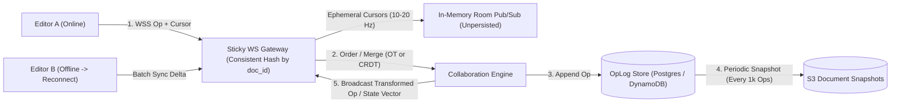

### 4.5 Collaborative Editing Deep Dives & Failure Modes

- **Operational Transformation (OT) vs. CRDTs**:
  - **Operational Transformation (OT, Google Docs model)**: Operations express positional mutations (`insert("x", index=5)`, `delete(index=5)`). Because indices shift when peers edit earlier positions concurrently, every incoming operation must be **transformed** against concurrent operations (`T(op1, op2)`). Proving convergence without a central coordinator requires satisfying both **TP1** and **TP2** (Transformation Property 2)—notoriously subtle and bug-prone across rich-text attributes. Google Docs sidesteps TP2 by routing every operation through a **central authoritative server** per document: the server orders all edits sequentially against a canonical revision number (`base_rev`), transforms late client ops against the server's **history buffer**, and clients buffer at most one unacknowledged batch in flight (`Jupiter` protocol).
  - **CRDTs (RGA / Yjs / Automerge, modern local-first & decentralized model)**: Assign every inserted character or block a globally unique, immutable identifier `(client_id, lamport_seq)` linked to its left/right neighbor IDs rather than mutable integer array indices. Because merge is a commutative, associative, idempotent join-semilattice operation (see [Distributed Systems](../../distributed-systems/README.md)), **any peer-to-peer or multi-server topology converges automatically** without a central transformation matrix—making CRDTs vastly superior for extended offline editing and federated topologies.
- **Tombstone Compaction & CRDT Metadata Overhead**: In a CRDT, deleting a character cannot physically erase its node immediately because a concurrent offline peer might still reference that deleted node's ID as an insertion anchor (`insert after ('c_102', 88)`). Deleted nodes become **tombstones**, which accumulate over years of editing until a `10-page` doc consumes `50 MB` of deleted history! Production CRDT engines (like Yjs) mitigate this in two ways: (1) **Run-Length Encoding (RLE)** merges sequential characters typed by one user into a single contiguous `Item` struct (`1` struct per burst instead of `1` per character, cutting metadata `10–20×`); and (2) **Causal Stability Garbage Collection** compacts tombstones safely once all clients (or a central checkpoint barrier) have acknowledged versions past the deletion epoch.
- **Ephemeral WebSocket Presence Cursors**: Typing indicators, colored caret positions, and text selection highlights fire `10×` more frequently than persisted edits during mouse drags, yet carry zero durability value. Route cursor telemetry as unpersisted ephemeral frames over the document's WebSocket room (throttled to `~10–20 Hz` per client) so cursor chatter never inflates the durable OpLog.
- **Periodic Snapshot Compaction**: Replaying `500,000` tiny keystroke operations every time someone opens a document stalls load times. Background workers periodically squash every `N` ops (e.g., `1,000` ops or every `5 minutes` of inactivity) into a single compressed binary document snapshot stored in object storage (`S3`) alongside a `snapshot_rev` pointer, trimming older OpLog rows while preserving named version-history checkpoints.

| Dimension | Operational Transformation (OT) | Sequence CRDT (Yjs / Automerge / RGA) |
| --- | --- | --- |
| **Topology requirement** | Central authoritative server per doc (Jupiter) | Decentralized, peer-to-peer, or multi-server |
| **Memory & wire overhead** | Very low (`index` + `op`, no per-char IDs) | Moderate–high (IDs + tombstones; reduced via RLE) |
| **Offline / partition support** | Fragile over long multi-day offline divergence | Native strong eventual consistency |
| **Implementation risk** | Complex rich-text transform matrix edge cases | Tombstone GC & interleaving edge cases on concurrent inserts |

---

## 5. Core Infrastructure: Rate Limiter as a Service & S3-Like Object Storage

Large platforms expose shared infrastructure primitives—global rate limiting and durable exabyte object storage—that underpin every product above. Both share a clear separation between a **low-QPS strongly consistent control/metadata plane** and an **ultra-high-throughput data plane**.

### 5.1 Distributed Rate Limiter Requirements & Sizing

- **Requirements**: Enforce multi-tenant quotas (`RPM`, `RPS`, burst limits, concurrent connection caps) across globally distributed edge POPs with `< 2 ms` added latency (`p99`), atomic accuracy without `N×` node drift, and fail-open resilience so a rate-limiter outage never takes down production APIs.
- **Sizing**: `1M` API requests/sec -> `1M` Redis Lua/GCRA checks/sec across `10–15` Redis shards (`~80k` ops/sec per shard), or `~50k` sync calls/sec if edge gateways batch local approximate counters every `100 ms`.

### 5.2 Distributed Rate Limiter Architecture & Failure Modes

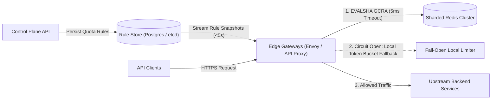

- **Global Control Plane vs. Edge Data Plane**: A Control Plane persists tenant quota rules (`tier: pro -> 1,000 req/min`) in etcd/PostgreSQL and pushes versioned rule snapshots to Envoy/API Gateway memory within seconds. On the hot Data Plane, gateways run **GCRA (Generic Cell Rate Algorithm)** or **Sliding-Window Counter** atomically inside Redis via `EVALSHA` (see [Redis](../../../technologies/redis/README.md))—avoiding both the `2×` boundary-burst flaw of fixed windows and the `N×` drift of uncoordinated per-node memory counters.
- **High-QPS Batching & Fail-Open Circuit Breaking**: For ultra-hot keys (`> 100k` req/s on one API key), gateways track local token buckets and synchronize deltas to Redis asynchronously every `50–200 ms` (trading sub-second soft overshoot for `20×` lower Redis load). Crucially, every gateway wraps its Redis rate-limiter client in a **strict `5 ms` timeout + fail-open circuit breaker**: if Redis partitions or stalls, the gateway logs a warning metric, fails **open** (falling back to a generous local per-node safety cap to prevent infinite floods), and serves valid customer traffic rather than turning a cache hiccup into a `100%` global outage.

```lua
-- Atomic Redis GCRA (Generic Cell Rate Algorithm) executed via EVALSHA
-- Aligned with ../examples/08-redis-integration.test.ts
-- KEYS[1] = rate-limit key, ARGV = { now_ms, period_ms, limit, burst } (burst B >= 1)
local now_ms = tonumber(ARGV[1])
local period_ms = tonumber(ARGV[2])
local limit = tonumber(ARGV[3])
local burst = tonumber(ARGV[4])
local emission_ms = period_ms / limit
local tau_ms = (burst - 1) * emission_ms

local tat = tonumber(redis.call("GET", KEYS[1]) or now_ms)
local allow_at = tat - tau_ms
if now_ms < allow_at then
  return { 0, math.ceil(allow_at - now_ms) } -- Reject + Retry-After ms
end
local new_tat = math.max(now_ms, tat) + emission_ms
local ttl_ms = math.max(1, math.ceil(period_ms + tau_ms)) -- guard >= 1 ms; note SET PX rounds sub-ms emission at >= 1M RPM
redis.call("SET", KEYS[1], tostring(new_tat), "PX", ttl_ms)
return { 1, 0 }
```

### 5.3 S3 Object Storage Requirements & Sizing

- **Requirements**: Store arbitrarily sized immutable objects (`1 KB` to `5 TB` via multipart upload) in flat bucket/key namespaces with `11 nines` (`99.999999999%`) durability, `99.99%` availability, strong read-after-write consistency for `PUT`/`DELETE`, and minimal raw disk overhead per usable TB.
- **Sizing**: Storing `100 PB` of usable customer data with naive `3×` replication consumes `300 PB` of raw disks (`200 PB` waste!). Using **Reed-Solomon `(8, 4)` erasure coding** (`8` data shards + `4` parity shards across `12` independent failure domains/racks) drops storage overhead from `3.0×` to `12 / 8 = 1.5×` (`150 PB` raw—**saving `150 PB`**, i.e., `50%` of total disk capex/power) while surviving up to **4 simultaneous node/rack failures** (even better fault tolerance than `3×` replication, which tolerates only `2` failures!).

### 5.4 S3 Object Storage High-Level Design

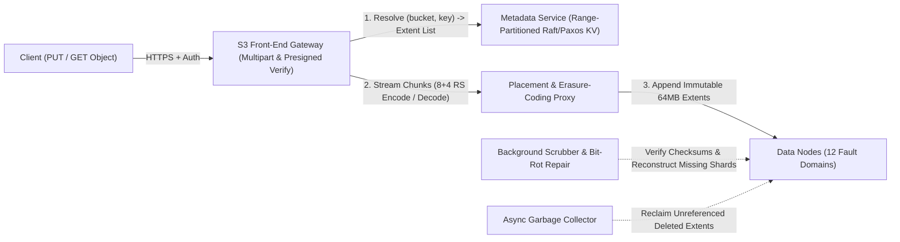

### 5.5 S3 Object Storage Deep Dives & Failure Modes

- **Metadata Service Partitioning & Hot-Prefix Mitigation**: Object keys are logically flat strings (`photos/2026/11/img_01.jpg`) stored in a **range-partitioned** B-tree/LSM KV cluster (backed by Raft/Paxos groups per range) so lexicographical `LIST ?prefix=photos/2026/` scans remain `O(log N + k)` range scans. A classic failure mode occurs when clients name keys with sequential timestamps (`2026-11-20T12:00:01_...`), concentrating all inserts onto the rightmost range partition; modern S3 auto-splits hot key-prefixes dynamically based on QPS rather than only byte size, eliminating manual prefix-hashing requirements.
- **Immutable Append-Only Extents & Small-Object Packing**: Storing millions of `10 KB` thumbnails as individual POSIX files exhausts filesystem inodes and triggers random disk seeks. Data Nodes allocate large immutable **append-only extents / volumes** (`64 MB–1 GB`), packing thousands of small objects sequentially into one extent with an offset/length index tracked by the Metadata Service (`(extent_id, offset, length)`). Writes never mutate extents in place—overwrites write new extents and atomically swap the metadata pointer (delivering clean strong read-after-write consistency).
- **Reed-Solomon `(k, m)` Erasure Coding & Small-Object Replication Hybrid**: Erasure coding cuts storage by `50%` (`8+4` -> `1.5×`), yet reading a `4 KB` object split across `8` shards incurs `8` disk I/Os and reconstruction CPU on degraded reads. Production object stores keep small/hot objects (`< 1 MB`) at `3×` replication inside fast NVMe extents for low tail latency, then **compact and erasure-code (`8+4` or `10+4`)** cold/large objects asynchronously into immutable `64 MB+` stripes.
- **Background Scrubber & Garbage Collection**: Silent bit-rot on HDDs/SSDs corrupts sectors long before SMART reports a dead drive. A background scrubber continuously reads extent shards, verifies `CRC32C` / SHA-256 checksums, and reconstructs corrupted shards from remaining RS parity shards before a second failure causes data loss. Separately, `DELETE` operations only tombstone metadata synchronously (returning `204` in milliseconds); an asynchronous Garbage Collector compacts partially dead extents and reclaims physical blocks safely after a grace period.

| Durability Scheme | Data + Parity Shards | Storage Overhead | Max Simultaneous Shard Loss | Best-Fit Object Tier |
| --- | --- | --- | --- | --- |
| **`3×` Replication** | `3` full copies | `3.0×` (`200%` overhead) | `2` domains | Small/hot objects (`< 1 MB`), metadata Raft logs |
| **Reed-Solomon `(6, 3)`** | `6` data + `3` parity | `1.5×` (`50%` overhead) | `3` domains | Mid-sized regional clusters (`9` rack fault domains) |
| **Reed-Solomon `(8, 4)`** | `8` data + `4` parity | `1.5×` (`50%` overhead) | `4` domains | Standard S3 bulk/cold extents (`50%` cheaper than `3×`) |
| **Reed-Solomon `(10, 4)`** | `10` data + `4` parity | `1.4×` (`40%` overhead) | `4` domains | Exabyte archival tiers with `14+` rack fault domains |

### 5.6 S3-Like Object Storage: Primary Literature & Systems Foundations Matrix

_(Note: Subsections `§5.6–§5.9` deepen **S3-Like Object Storage**; for Rate Limiter literature, distributed token-bucket/GCRA capacity math, and 2021-vs-2026 edge evolution, see [Module 08 (Rate Limiting, Load Shedding & Resilience)](./08-rate-limiting-load-shedding-and-resilience.md).)_

Modern cloud-native object storage decouples user-facing namespaces from distributed physical storage, transforming raw disks and solid-state media into virtually limitless, durable, and strongly consistent binary stores. Foundational engineering principles for exabyte-scale object stores originate from peer-reviewed storage systems literature, spanning high-throughput photo stores (Facebook Haystack), warm multi-tier BLOB architectures (Facebook f4), algorithmic data placement (Ceph CRUSH), empirical multi-drive durability analyses (Backblaze), and formally verified key-value storage engines (AWS ShardStore). The table below anchors the object storage architecture in these primary systems contributions.

| Milestone / Primary Source | Domain & Key Focus | Core Architectural Mechanism | Scalability Invariant / Limit | Trade-Offs & Failure Modes |
| --- | --- | --- | --- | --- |
| **Bornholt et al.** (Amazon Web Services, SOSP 2021) _Using Lightweight Formal Methods to Validate a Key-Value Storage Node in Amazon S3_ | Storage Node Verification & Concurrency Correctness | Formal specification and property-based test harness for ShardStore; model checking crash-consistency protocols and concurrent log-structured merge trees against axiomatic specifications. | Provable correctness across millions of storage nodes storing trillions of objects and exabytes of data. | Verification bounds limited to single-node software layers; hardware memory corruption requires out-of-band scrubbing. |
| **Beaver et al.** (Facebook, OSDI 2010) _Finding a Needle in Haystack: Facebook's Photo Storage_ | Small-Object Storage & POSIX Inode Elimination | Appending immutable small objects into large multi-gigabyte log files (`Haystack Store`); holding in-memory hash tables of offsets to eliminate filesystem directory lookups and disk seeks. | Reduces disk operations to exactly one random read per image retrieve ($1\text{ IOPS}$ per request). | In-memory index scales linearly with object count; requires asynchronous compaction to purge deleted records. |
| **Muralidhar et al.** (Facebook, OSDI 2014) _f4: Facebook's Warm BLOB Storage System_ | Erasure-Coded Archival & Cross-DC Fault Tolerance | Segregating hot mutable data from cold immutable BLOBs; applying Reed-Solomon $(10, 4)$ erasure coding across distinct data centers with companion parity cells. | Drops raw storage overhead from $3.0\times$ ($200\%$ tax) down to $1.4\times$ ($40\%$ tax) at exabyte scale. | Reconstruction of degraded reads across WAN links introduces latency spikes and saturates network backbones. |
| **Backblaze** (Backblaze Systems, 2015–2026) _Open-Source Reed-Solomon Durability Analysis & Multi-Drive Vaults_ | Storage Durability Modeling & Open-Source Erasure Coding | Java/C SIMD Reed-Solomon matrix math libraries; empirical annual drive failure rate (AFR) modeling validating 11 nines durability with $8+4$ and $16+4$ parity schemes. | Sustains multi-exabyte customer datasets across commodity chassis while surviving concurrent drive loss. | Parity matrix calculations consume CPU cycles; rebuild storms on drive failures impact foreground tail latency. |
| **Weil et al.** (University of California Santa Cruz, SC 2006) _CRUSH: Controlled, Scalable, Decentralized Placement of Replicated Data_ | Algorithmic Pseudo-Random Data Placement | Pseudo-random deterministic placement function mapping object IDs directly to storage devices using hierarchical cluster maps, eliminating centralized metadata lookups. | Scales to millions of storage targets without maintaining centralized disk block allocation tables. | Cluster map reorganizations trigger network rebalancing migrations; weighted bucket imbalances under drive additions. |
| **Alex Xu** (ByteByteGo, 2022) _System Design Interview Vol. 2, Ch. 9 & Ch. 24: S3-like Object Storage_ | Canonical Object Storage Architecture Standard | Separated control and data planes; stateless API and routing layers; sharded metadata KV with TIMEUUID versioning; 5-7 node Raft placement service; WAL pack files with SQLite index. | Supports $100\text{ PB/year}$ ingestion ($\approx 0.68\text{B objects}$) with 6 to 11 nines of durability. | Cross-shard scatter-gather bottlenecks for prefix listing queries; write serialization bottlenecks on shared pack files. |

Object storage fundamentally diverges from traditional block and file abstractions by enforcing **immutability** and **namespace decoupling**. The POSIX filesystem model couples directory tree hierarchies and file metadata to physical disk blocks via inodes. As Beaver et al. demonstrated in Facebook's Haystack architecture, storing hundreds of millions of small files under standard operating system filesystems exhausts inode caches and forces multiple disk seeks per file access (directory traversal, inode retrieval, and data block retrieval). Haystack resolved this by packing multiple individual images into large append-only files and retaining object offsets in memory, reducing disk reads to a single physical seek.

Building upon Haystack's lessons, modern exabyte storage divides cold and warm tiers using Reed-Solomon erasure coding. Muralidhar et al. formalized in Facebook's f4 system that while $3\times$ replication provides low-latency reads for hot, recently uploaded files, keeping inactive data triple-replicated incurs unacceptable capital expenditure. Transitioning stable objects into Reed-Solomon $(8, 4)$ or $(10, 4)$ erasure-coded stripes slashes storage overhead by half or more while simultaneously elevating data durability from 6 nines to 11 nines across independent fault domains.

To maintain unwavering correctness across distributed physical disks, modern hyper-scale operators have eliminated manual testing heuristics in favor of formal specification. Bornholt et al. documented Amazon S3's ShardStore storage engine, demonstrating that lightweight formal methods, property-based testing, and model checking are required to verify crash consistency and concurrency invariants across multi-threaded log-structured storage engines under arbitrary hardware faults.

### 5.7 S3-Like Object Storage: Verified ByteByteGo Worked Architecture & Capacity Delta (Chapter 24)

Storage systems operate across three primary abstractions: **Block Storage**, **File Storage**, and **Object Storage**. Designing an exabyte-scale S3-compatible service requires selecting appropriate boundary trade-offs across access interfaces, data mutability, latency profiles, and cost structures.

| Architectural Dimension | Block Storage | File Storage | Object Storage |
| --- | --- | --- | --- |
| **Data Abstraction** | Fixed-size raw physical/virtual blocks (e.g., $4\text{ KB}$) | Hierarchical directory tree, subfolders, and files | Flat namespace; bucket and key mapped to arbitrary byte BLOB |
| **Mutability** | Highly mutable; in-place byte/block updates | Highly mutable; file append, truncate, and offset writes | Immutable; update replaces entire object or creates new version |
| **Access Interface & Protocols** | Low-level storage bus: FC, iSCSI, SAS, NVMe-oF | Network filesystem: POSIX, NFS, SMB/CIFS | RESTful HTTP(S) API: PUT, GET, DELETE, LIST, HEAD |
| **Storage Cost & Density** | High (expensive enterprise SSDs / SAN arrays) | Medium to High (NAS appliances, managed EFS) | Ultra-low (dense commodity HDDs, multi-tier archival) |
| **Latency & IOPS Profile** | Sub-millisecond ($< 1\text{ ms}$); tens of thousands of IOPS | Low to medium ($2 - 10\text{ ms}$); constrained by locks | Medium ($10 - 100\text{ ms}$; single-digit ms on NVMe tiers) |
| **Scalability Limit** | Moderate (single server or SAN fabric bounds) | High (multi-petabyte file filers; inode caps) | Virtually unbounded (exabytes across hundreds of thousands of nodes) |
| **Primary Workloads** | Database storage engines, VM disks (SAN/EBS) | Shared user directories, legacy applications, media editing | Cloud-native backends, data lakehouses, AI datasets, backups |

The canonical ByteByteGo Chapter 24 specification models an object storage engine supporting bucket creation, object upload, download, listing, and versioning. The table below compares the canonical baseline against large-scale enterprise deployments.

| Architectural Metric / Parameter | ByteByteGo Ch. 24 Canonical Baseline | Enterprise Production Tier (§5.3 Sizing) | Architectural Implication & Engineering Delta |
| --- | --- | --- | --- |
| **Annual Storage Provisioning** | $100\text{ PB/year}$ gross capacity ($40\text{ PB}$ active $\to 60\text{ PB}$ raw at $8+4$) | $100\text{ PB}$ net usable dataset ($150\text{ PB}$ raw at $8+4$ EC) | Aligns ByteByteGo's $40\%$ utilized gross pool with §5.3's net usable sizing; requires proactive cluster expansion. |
| **Storage Capacity Utilization** | $40\%$ active utilization ($40\text{ PB}$ stored) | $\sim 80\text{--}85\%$ operational ceiling ($100\text{ PB}$ usable dataset) | Retains headroom for degraded rebuilds and compaction rather than running at $100\%$ physical fill. |
| **Object Size Distribution** | $20\%$ small ($0.5\text{ MB}$), $60\%$ mid ($32\text{ MB}$), $20\%$ large ($200\text{ MB}$) | $20\%$ small ($0.5\text{ MB}$), $60\%$ mid ($32\text{ MB}$), $20\%$ large ($200\text{ MB}$) | Weighted average object size equals $59.3\text{ MB}$. |
| **Total Stored Objects** | $\approx 0.68\text{ billion objects}$ ($674.5\text{M}$) | Trillions of objects across global regions | Metadata footprint expands into petabyte scale. |
| **Metadata Storage Volume** | $\approx 0.68\text{ TB}$ ($1\text{ KB}$ record per object) | Multi-petabyte distributed metadata tier | Requires distributed KV with automated key-prefix rebalancing. |
| **Placement Quorum** | 5 to 7 node Raft/Paxos consensus cluster | Multi-region Raft cluster with cell architecture | High-availability topology survives multiple datacenter outages. |
| **Small-Object Storage** | Multi-GB WAL pack files + local SQLite index | Log-structured storage + core-pinned NVMe writers | Eliminates OS inode bottlenecks and lock contention. |
| **Durability Strategy** | $3\times$ Replication ($6\text{ nines}$) or $8+4$ EC ($11\text{ nines}$) | $8+4$ Reed-Solomon EC across 12 failure domains | Cuts raw disk overhead by $50\%$ ($150\text{ PB}$ saved on $100\text{ PB}$). |
| **Metadata Sharding** | `hash(bucket_name, object_name)` sharding | Consistent hashing + dynamic range splitting | Balances point lookups while handling hot ingestion prefixes. |
| **Object Listing** | Denormalized table sharded by `bucket_id` | Range-partitioned B-tree/LSM indexes | Enables $O(\log N + k)$ range scans without cross-shard scatter. |
| **Object Versioning** | TIMEUUID ordering + tombstone delete markers | Cryptographic version IDs + S3 Object Lock | Guarantees compliance immutability and instant point-in-time rollback. |
| **Large-Object Ingestion** | Multipart upload with MD5 ETags | Resumable multipart upload with CRC32C streaming | Parallelizes chunk uploads and permits fine-grained retry. |

#### S3 Object Storage Capacity & Durability Derivations

##### 1. Worked Capacity, Object Count & Metadata Sizing Reconciliation

In ByteByteGo Chapter 24, the storage sizing starts from an annual storage volume of $100\text{ PB}$ gross capacity with a $40\%$ active utilization factor. The object size distribution across the system is defined by three distinct tiers:

- Small objects ($< 1\text{ MB}$): $20\%$ of total objects, with a median size of $S_{\text{small}} = 0.5\text{ MB}$.
- Medium objects ($1 - 64\text{ MB}$): $60\%$ of total objects, with a median size of $S_{\text{med}} = 32\text{ MB}$.
- Large objects ($> 64\text{ MB}$): $20\%$ of total objects, with a median size of $S_{\text{large}} = 200\text{ MB}$.

The weighted mean object size $S_{\text{avg}}$ across all ingested objects is:

$$S_{\text{avg}} = (0.20 \times 0.5\text{ MB}) + (0.60 \times 32\text{ MB}) + (0.20 \times 200\text{ MB}) = 0.1\text{ MB} + 19.2\text{ MB} + 40.0\text{ MB} = 59.3\text{ MB}$$

With $100\text{ PB}$ total capacity ($1\text{ PB} = 10^9\text{ MB}$ decimal) and $40\%$ active capacity consumption:

$$V_{\text{stored}} = 100\text{ PB} \times 0.40 = 40\text{ PB} = 40 \times 10^9\text{ MB} = 4 \times 10^{10}\text{ MB}$$

The total number of stored objects $N_{\text{objects}}$ supported by the system is:

$$N_{\text{objects}} = \frac{V_{\text{stored}}}{S_{\text{avg}}} = \frac{4 \times 10^{10}\text{ MB}}{59.3\text{ MB/object}} \approx 674{,}536{,}256\text{ objects} \approx 0.675\text{B} \sim 0.68\text{B objects}$$

Assuming an average metadata footprint of $1\text{ KB}$ per object (recording bucket name, object key, version UUID, physical extent URI, file offset, object size, owner ID, and checksum):

$$M_{\text{meta}} = N_{\text{objects}} \times 1\text{ KB} = 674{,}536{,}256\text{ KB} \approx 674.54\text{ GB} \approx 0.675\text{ TB} \sim 0.68\text{ TB}$$

This mathematical derivation aligns directly with Section 5.3 sizing. In Section 5.3, storing $100\text{ PB}$ of usable customer data under naive $3\times$ replication requires $300\text{ PB}$ of raw hard disk capacity ($200\text{ PB}$ of raw storage overhead). By transitioning to Reed-Solomon $(8, 4)$ erasure coding ($8$ data shards plus $4$ parity shards across $12$ independent failure domains), the raw disk requirement drops to:

$$V_{\text{raw, EC}} = 100\text{ PB} \times \frac{8 + 4}{8} = 100\text{ PB} \times 1.5 = 150\text{ PB}$$

This yields an immediate hardware reduction of $150\text{ PB}$ ($50\%$ savings in disk count, chassis, rack space, power, and cooling) while elevating hardware fault tolerance from surviving $2$ concurrent drive failures to surviving $4$ concurrent rack or failure-domain outages.

##### 2. Drive Failure Rates & 11 Nines Durability Mathematics

Hard disk reliability is quantified using the Annual Failure Rate ($\text{AFR}$). For typical enterprise hard drives in datacenter environments, the observed annual failure rate is approximately $\text{AFR} = 0.81\% = 0.0081$.

Under a standard $3\times$ replication strategy, data loss occurs only if all 3 independent drive replicas containing the object fail within the mean time to repair ($T_{\text{repair}}$):

- Annual probability of failure for a single drive: $p = 0.0081$.
- Assuming drive failures are independent across isolated datacenter racks, the annual probability of all 3 drives failing simultaneously is:

$$P(\text{failure}_{3\times}) \approx p^3 = (0.0081)^3 \approx 5.31 \times 10^{-7}$$

The corresponding theoretical annual durability is:

$$D_{3\times} = 1 - P(\text{failure}_{3\times}) = 1 - 5.31 \times 10^{-7} \approx 99.999947\% \quad (\approx 6\text{ nines})$$

In contrast, under Reed-Solomon $(8, 4)$ erasure coding, an object stripe is divided into $N = 12$ total shards ($K = 8$ data shards and $M = 4$ parity shards). Data loss occurs if and only if more than $M = 4$ shards fail before reconstruction completes (i.e., $5$ or more out of $12$ failure domains become permanently unrecoverable). As a naïve annual-simultaneous upper bound assuming independent drive failures across 12 racks:

$$P(\text{loss}_{8+4}) = \sum_{j=5}^{12} \binom{12}{j} p^j (1 - p)^{12 - j}$$

Because $p = 0.0081 \ll 1$, the first term where $j = 5$ completely dominates the summation:

$$P(\text{loss}_{8+4}) \approx \binom{12}{5} p^5 = \frac{12!}{5! \times 7!} \times (0.0081)^5 = 792 \times (3.487 \times 10^{-11}) \approx 2.76 \times 10^{-8}$$

In production, durability is governed by a repair-window Markov chain ($\text{MTTDL} \approx \text{MTBF}^5 / \dots$ scaled by $(T_{\text{repair}} / T_{\text{year}})^4$): when failed shards are reconstructed in $T_{\text{repair}} \approx 1\text{ to }4\text{ hours}$ across internal $100\text{ Gbps}$ mesh links rather than a full year, the independent failure probability drops well below $10^{-11}$ (noting that correlated failures—ToR switch, rack power, AZ outage, or bad drive firmware batches—dominate real-world risk at 11 nines and must be mitigated via cross-AZ shard placement):

$$D_{8+4} \ge 1 - 10^{-11} = 99.999999999\% \quad (11\text{ nines})$$

### 5.8 S3-Like Object Storage: Separated Control and Data Plane Deep Dives

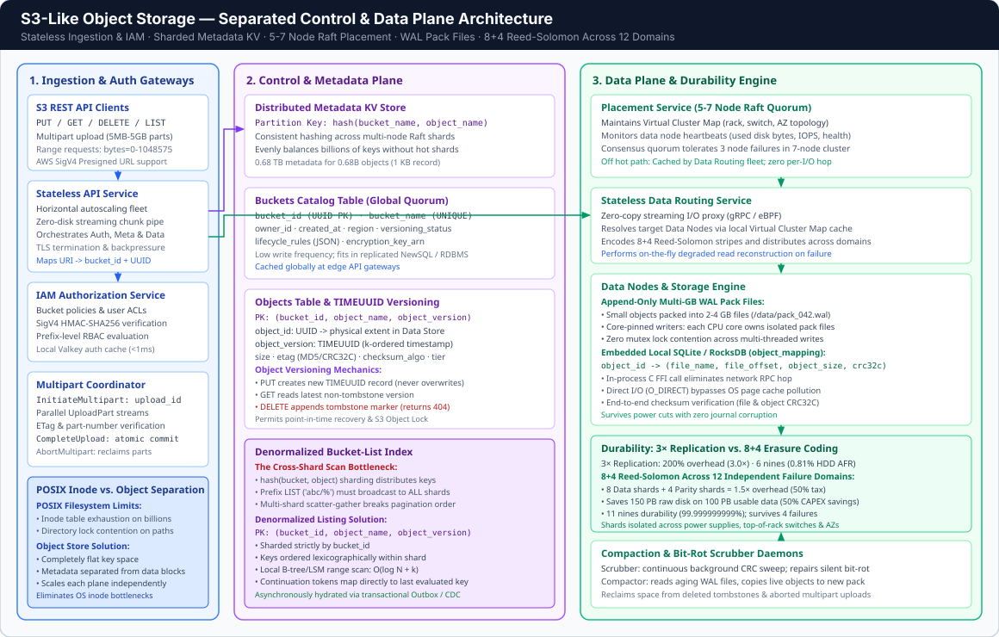

The production object storage engine partitions responsibilities into two decoupled tiers: a **Control and Metadata Plane** that tracks bucket policies, credentials, object versions, and physical extent mapping; and a **Data Plane** that manages streaming data ingestion, hardware chunk striping, erasure coding, and disk pack compaction.

#### 1. Inode Exhaustion vs. Object Namespace Decoupling

Standard POSIX filesystems rely on an `inode` table to index file metadata (ownership, permissions, file size, and pointers to indirect data blocks). When an application creates billions of small files in a standard filesystem, three distinct bottlenecks emerge:

1. **Inode Table Exhaustion**: Filesystems allocate a finite number of inodes during formatting (or suffer overhead in dynamic inode allocation), crashing file creation even when hundreds of gigabytes of disk storage remain free.
2. **Directory Lock Contention**: Modifying files inside large shared directory paths acquires locks on directory inodes, serializing concurrent writes across worker threads.
3. **Block Internal Fragmentation**: Standard filesystems allocate disk space in fixed blocks (typically $4\text{ KB}$). Persisting a $500\text{ byte}$ object consumes an entire $4\text{ KB}$ block, wasting $87.5\%$ of disk capacity.

Object storage eliminates these constraints by decoupling the namespace from physical storage. Object keys (`photos/vacation/beach.jpg`) are treated as flat, arbitrary strings within a logical bucket container. The Metadata Store indexes the key and points to an abstract `object_id` (UUID), while the underlying Data Nodes store raw bytes sequentially within large multi-gigabyte pack files.

#### 2. 5-7 Node Raft Placement Service & Virtual Cluster Map

The **Placement Service** acts as the central topology authority for the data plane:

- **Consensus Quorum**: Operates as a 5-node or 7-node consensus group running Raft or Multi-Paxos. A 7-node cluster tolerates up to 3 simultaneous node crashes while maintaining authoritative quorum.
- **Virtual Cluster Map**: Maintains the physical layout of the infrastructure, organizing disks, servers, racks, network switches, and availability zones into a hierarchical topology tree.
- **Heartbeat & Health Monitoring**: Data node background daemons transmit periodic heartbeats to the placement service, reporting disk space utilization, drive temperatures, SMART diagnostics, and available IOPS.
- **Decoupled from Data Path**: The placement service does not sit on the request hot path. Stateless Data Routing Services fetch and cache the Virtual Cluster Map locally, refreshing it periodically or invalidating it via asynchronous cluster events. Client PUT and GET requests stream directly through routing nodes to data nodes without placement coordinator hops.

#### 3. WAL Pack Files & Core-Pinned Storage Nodes

To persist hundreds of thousands of small objects without inode degradation, Data Nodes implement an append-only Write-Ahead Log (WAL) pack file architecture:

- **Multi-Gigabyte Pack Files**: Instead of writing separate disk files, incoming objects are appended sequentially to a shared pack file (`/data/pack_042.wal`) until the file reaches a size threshold (typically $2\text{ GB}$ to $4\text{ GB}$).
- **Core-Pinned Writers**: Concurrently writing to a single shared file creates lock contention across CPU cores. The storage engine assigns individual pack files exclusively to dedicated CPU cores (thread-per-core architecture). Each core writes exclusively to its assigned open pack file, eliminating thread synchronization locks and context switches.
- **Embedded Local Mapping Database**: Each Data Node hosts an embedded key-value database (such as SQLite or RocksDB) mapping each `object_id` to its physical location:

```sql
CREATE TABLE object_mapping (
    object_id TEXT PRIMARY KEY,
    file_name TEXT NOT NULL,
    file_offset INTEGER NOT NULL,
    object_size INTEGER NOT NULL,
    checksum INTEGER NOT NULL
);
```

- **Direct I/O (`O_DIRECT`)**: Storage writes bypass the operating system page cache using `O_DIRECT`, preventing large file streams from evicting hot memory pages and allowing the node to control disk synchronization explicitly.

#### 4. Metadata Sharding & The Denormalized Listing Index

A production metadata store must support two fundamentally conflicting query patterns:

1. Point lookups by object key (`GET /bucket/images/cat.jpg`): High throughput ($> 1\text{M QPS}$), requiring even distribution across database shards.
2. Prefix range scans (`LIST /bucket?prefix=images/&limit=1000`): Sequential scans across lexicographically ordered keys.

##### Hash Sharding Distribution

To scale point queries, the primary **Objects Table** is sharded across a distributed KV or NewSQL tier by hashing the combined bucket and object name:

$$\text{shard-id} = \text{hash}(\text{bucket-name}, \text{object-name}) \pmod N$$

This sharding scheme guarantees uniform key distribution across all database instances, completely eliminating hot-prefix hotspots when users write millions of objects with sequential timestamps. However, because keys within the same prefix hash to arbitrary shards, executing a prefix listing query requires broadcasting the query to all $N$ database shards (scatter-gather) and merging sorted streams in memory—an operation that degrades response times and complicates limit/offset pagination.

##### Denormalized Bucket-Listing Index

To support ultra-fast prefix listing, the system maintains an auxiliary denormalized listing table:

```sql
CREATE TABLE bucket_object_listing (
    bucket_id TEXT NOT NULL,
    object_name TEXT NOT NULL,
    object_version TEXT NOT NULL,
    object_id TEXT NOT NULL,
    size INTEGER NOT NULL,
    etag TEXT NOT NULL,
    PRIMARY KEY (bucket_id, object_name, object_version)
);
```

By sharding this table strictly by `bucket_id`, all objects belonging to a given bucket reside on a single database partition (or a bounded set of partitions). Within that partition, the B-tree or LSM storage engine stores `object_name` in strict lexicographical order:

```sql
SELECT object_name, object_version, size, etag
FROM bucket_object_listing
WHERE bucket_id = :bucket_id
  AND object_name >= :continuation_token
ORDER BY object_name ASC
LIMIT :page_size;
```

This transforms a cross-cluster scatter-gather operation into a local $O(\log N + k)$ index range scan. Updates to the primary objects table propagate to the listing table either within a distributed transaction or asynchronously via a transactional Outbox and Change Data Capture (CDC) stream.

#### 5. TIMEUUID Object Versioning & Tombstones

Object versioning enables users to retain historical variants of objects in the same bucket, protecting against accidental deletions and ransomware:

- **Monotonic TIMEUUID Keys**: When versioning is enabled on a bucket, every `PUT` operation generates a new version record tagged with a `TIMEUUID` (a globally unique, monotonically increasing timestamp identifier). The new version is written with a unique `object_id` pointing to fresh storage extents.
- **Non-Overwriting Invariant**: A `PUT` operation on an existing object key never overwrites previous physical extents. The Metadata Store inserts a new row with the latest `TIMEUUID`. `GET` requests without an explicit version ID automatically resolve to the newest non-tombstone record.
- **Delete-Marker Tombstones**: Calling `DELETE` on a versioned object does not remove underlying data. Instead, the API Service appends a new version row with a special `delete_marker = true` flag. Subsequent `GET` requests encounter the tombstone and return an HTTP `404 Not Found` response. To permanently purge an object, the client must issue an explicit `DELETE` targeting the specific historical `version_id`.

#### 6. Multipart Upload & Compaction Garbage Collection

##### Multipart Upload Protocol

Uploading objects larger than $100\text{ MB}$ (up to $5\text{ TB}$) over WAN connections risks total transfer failure if network connectivity drops. S3 provides a three-phase **Multipart Upload** protocol:

1. **Initiate Multipart Upload**: Client sends a request to initiate upload. The API Service generates an `upload_id` (UUID), creates an entry in the multipart metadata tracking table, and returns the identifier.
2. **Upload Parts**: Client splits the large file into discrete chunks ($5\text{ MB}$ to $5\text{ GB}$ per chunk, up to $10{,}000$ parts) and uploads each part independently:
   - Parts upload in parallel across multiple worker threads.
   - If an individual part fails due to a network glitch, only that specific chunk is retried.
   - For each successful part, the Data Store writes the chunk and returns an `ETag` (a checksum identifying the part).
3. **Complete Multipart Upload**: Once all parts are uploaded, the client sends a completion request containing the `upload_id`, an ordered list of part numbers, and their corresponding `ETag` hashes. The API Service verifies that all parts exist, creates the canonical object metadata entry, and marks the upload complete.

##### Compaction Garbage Collection & Bit-Rot Scrubbing

Because objects are immutable and pack files are append-only, deleting an object or replacing it with a new version leaves orphaned bytes on disk:

- **Compaction Engine**: Background compaction workers periodically scan aging pack files. The worker queries the local `object_mapping` SQLite database: active live records are read and copied into a new compact pack file (`/data/pack_099.wal`), while deleted or obsolete records are skipped.
- **Atomic Mapping Swap**: Once the live records are safely written to the new pack file and flushed to disk via `fsync()`, the worker updates the `object_mapping` table inside an atomic database transaction and deletes the old fragmented pack file.
- **Orphan Part Cleanup**: Clients occasionally abort multipart uploads or drop connections midway through large transfers. An asynchronous garbage collector identifies multipart upload sessions older than a configured TTL (e.g., 7 days) and reclaims their allocated data chunks.
- **Bit-Rot Scrubbing**: Silent magnetic flux reversals and cosmic radiation can corrupt disk sectors without reporting SMART hardware alerts. Storage node scrubbers continuously read stored extents in the background, calculate CRC32C and SHA-256 checksums, compare them against the stored checksum manifest, and trigger Reed-Solomon reconstruction if corruption is detected.

### 5.9 S3-Like Object Storage: Technology Comparison — Then vs. Now (2021 vs. 2026)

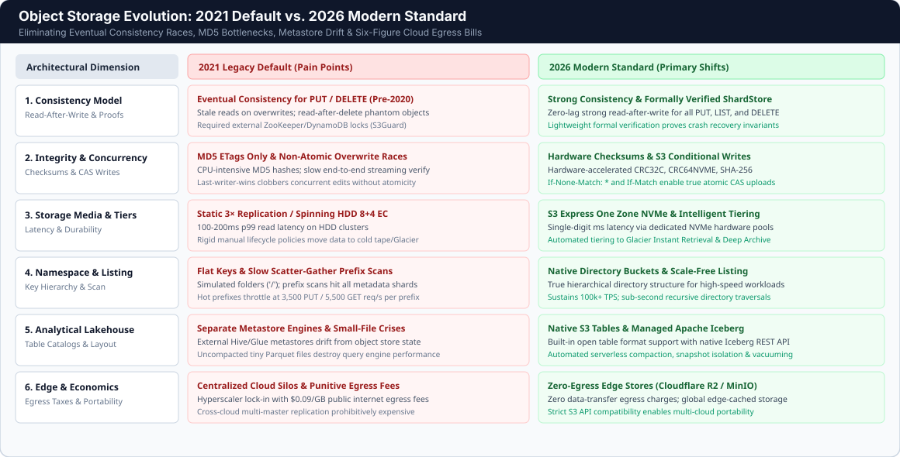

Object storage architectures have undergone significant modernization between 2021 and 2026. What was once characterized as high-latency, eventually consistent cold archival has evolved into a strongly consistent, ultra-low-latency data backbone for analytical lakehouses and distributed machine learning.

| Architectural Dimension | 2021 Legacy Default | 2026 Modern Standard |
| --- | --- | --- |
| **Consistency Model** | Eventual consistency on `PUT` overwrites and `DELETE` (pre-Dec 2020); read-after-update lag; external consistency engines (S3Guard / DynamoDB locks). | Strong read-after-write consistency across all `PUT`, `LIST`, and `DELETE` operations; formal verification of crash recovery (ShardStore SOSP 2021). |
| **Integrity & Concurrency** | Slow MD5 ETags calculated on CPU; non-atomic last-writer-wins overwrite races; missing conditional write primitives. | Hardware-accelerated CRC32C, CRC64NVME, and SHA-256 end-to-end checksums; S3 Conditional Writes (`If-None-Match: *`, `If-Match` CAS). |
| **Storage Media & Tiering** | Homogeneous spinning HDDs ($100 - 200\text{ ms}$ tail read latency); static manual lifecycle migration rules to Glacier cold tapes. | S3 Express One Zone NVMe clusters with single-digit millisecond latency; automated ML-driven tiering to Glacier Instant Retrieval and Deep Archive. |
| **Namespace & Listing** | Flat namespace with simulated `/` delimiters; slow cross-shard scatter-gather prefix `LIST` queries; hot-prefix request throttling ($3{,}500\text{ PUT} / 5{,}500\text{ GET}$). | Native hierarchical Directory Buckets; scale-free recursive directory scans; automated dynamic prefix partitioning supporting $> 100{,}000\text{ TPS}$. |
| **Analytical Lakehouse** | External Hive/Glue metastores decoupled from object store; file listing bottlenecks; uncompacted small-file crises degrading Spark/Presto queries. | Native S3 Tables with integrated Apache Iceberg REST catalog; automated serverless small-file compaction, snapshot isolation, and vacuuming. |
| **Edge & Cost Economics** | Hyperscaler vendor lock-in with punitive data transfer charges (\$0.09/GB egress); costly cross-region replication taxes. | Zero-egress S3-compatible edge stores (Cloudflare R2, MinIO); strict API compatibility enabling frictionless multi-cloud workload portability. |

#### Detailed Architectural Evolution Shifts

##### 1. Consistency Model & Formal Verification

Prior to Amazon S3's global consistency update in December 2020, object storage operated under an eventual consistency model for object updates and deletions. While new object `PUT` requests provided read-after-write consistency, overwriting an existing key or deleting an object propagated asynchronously across replicas. A client updating `config.json` and immediately reading it could receive stale data, while a delete followed by a list could return phantom objects. Distributed frameworks like Apache Spark required complex consistency layers (such as Netflix's S3Guard backed by DynamoDB) to coordinate state.

By 2026, strong read-after-write consistency is the universal baseline across all standard S3-compatible systems. Any successful `PUT`, `DELETE`, or tag update is immediately visible to all subsequent `GET` and `LIST` requests across all availability zones with zero performance penalty. In addition, operators have embraced formal specification: AWS ShardStore (Bornholt et al., SOSP 2021) demonstrated that lightweight formal methods and property-based test suites can mathematically prove crash-recovery invariants and concurrency linearizability across distributed log-structured storage engines.

##### 2. Hardware-Accelerated Checksums & Atomic Conditional Writes

In 2021 architectures, data integrity verification relied primarily on MD5-based `ETag` headers. Calculating MD5 on multi-gigabyte payloads consumed significant CPU cycles and could not easily execute hardware vector instructions. At the same time, concurrency control was primitive: two writers concurrently uploading to the same key triggered a last-writer-wins race condition, where the slower upload silently clobbered the faster one without atomic synchronization.

By 2026, storage engines have adopted hardware-accelerated streaming checksum algorithms, specifically `CRC32C` (accelerated via SSE 4.2 / ARMv8 CRC instructions) and `CRC64NVME`. These checksums compute at multi-gigabyte-per-second wire speed, enabling end-to-end validation from client memory, across TLS streams, down to physical flash media. The introduction of **S3 Conditional Writes** provides native Compare-And-Swap (CAS) semantics via HTTP headers:

- `If-None-Match: *`: Guarantees the upload succeeds if and only if the target key does not currently exist, preventing accidental overwrites.
- `If-Match: "<etag>"`: Ensures an update succeeds only if the target object matches a specific expected revision, enabling distributed locks and optimistic concurrency control without external locking databases.

##### 3. Storage Media & Intelligent Tiering

In 2021, object storage was synonymous with high-latency spinning magnetic disks, exhibiting $p99$ tail read latencies between $100\text{ ms}$ and $200\text{ ms}$. Tiering was governed by rigid, static lifecycle rules (e.g., move to Infrequent Access after 30 days, move to Glacier after 90 days), which penalized unpredictable access patterns with expensive retrieval fees.

By 2026, storage hardware is bifurcated into specialized tiers:

- **S3 Express One Zone**: Employs dedicated NVMe solid-state hardware pools co-located within a single Availability Zone, delivering consistent single-digit millisecond latency ($p99 < 5\text{ ms}$) and up to $10\times$ faster access speeds than standard S3.
- **Intelligent Automated Tiering**: Machine-learning monitoring monitors access frequencies per object, automatically moving dormant data between Frequent Access, Infrequent Access, Glacier Instant Retrieval (sub-second retrieval), and Glacier Deep Archive without operational overhead or retrieval penalty charges.

##### 4. Namespace Hierarchy & Scale-Free Listing

In 2021, object namespaces were strictly flat strings. Forward slashes (`/`) were purely visual conventions simulated by the client. Executing a recursive prefix listing on a bucket with hundreds of millions of keys scattered across hash-partitioned metadata shards resulted in slow, expensive queries. Hot prefixes suffered strict throughput caps ($3{,}500\text{ PUT}$ and $5{,}500\text{ GET}$ requests per second per prefix), forcing engineers to prepend random hash strings to keys.

The 2026 standard introduces **Directory Buckets** (exemplified by S3 Express One Zone). Directory buckets replace the flat namespace with a true hierarchical directory structure optimized for high transaction rates. Directory buckets sustain hundreds of thousands of transactions per second without key-partition throttling, enabling lightning-fast recursive directory listing and instant directory-level rename operations.

##### 5. Analytical Lakehouses & S3 Tables

In 2021, building a cloud data lakehouse on top of object storage required managing an external metastore (such as Hive Metastore or AWS Glue) alongside distributed compute engines (Spark, Trino, Flink). These external catalogs suffered from synchronization drift, where the object storage reality deviated from the catalog metadata. In addition, streaming write jobs created millions of tiny Parquet files, crippling analytical query performance until manual compaction jobs were run.

By 2026, object stores provide native table abstractions, such as **S3 Tables**. S3 Tables integrate an open-standard Apache Iceberg REST catalog directly into the object store's control plane. The storage service automatically manages background file compaction, squashing small streaming commits into optimized Parquet files, pruning obsolete snapshot manifests, and vacuuming expired tombstones. Analytical engines query table metadata directly over standardized APIs with zero metastore maintenance.

##### 6. Edge Deployment & Zero-Egress Economics

In 2021, multi-cloud object storage was economically non-viable due to aggressive hyperscaler data egress fees (typically \$0.09 per gigabyte transferred over the public internet). Migrating or replicating a petabyte of analytical data between cloud providers incurred nearly \$100,000 in egress penalties alone.

By 2026, modern alternative object stores such as **Cloudflare R2**, **MinIO Enterprise**, and **Ceph** have disrupted cloud economics by offering complete S3 API compatibility with **zero data-transfer egress fees**. Applications deploy worldwide across edge networks, caching frequently read assets close to end-users and syncing data between clouds without egress penalties. This architectural shift enables resilient multi-cloud disaster recovery and decentralized data storage topologies.

**Staff Edge-Case Checklist (S3 Object Storage):**

- **Multipart Abort-Leak Sweeper (`AbortMultipartUpload`)**: Uncompleted multipart uploads still consume physical extent space invisibly until explicitly aborted; lifecycle policies (`AbortIncompleteMultipartUpload`, e.g., `7 days`) must sweep orphaned parts on a schedule.
- **Conditional-Write Races (`If-None-Match: *` / `If-Match`)**: Distributed leader election or Iceberg manifest commits rely on atomic Compare-And-Swap inside the Metadata Raft group (`PUT` fails with `412 Precondition Failed` on ETag mismatch).
- **Degraded-Read Amplification**: When a single data shard in an `8+4` stripe is unavailable, reconstructing that shard requires reading `8` healthy shards (`8×` read fan-out), motivating hedged requests and local NVMe cache tiers for hot prefixes.

---

## 6. LLM Serving & ChatGPT Architecture (Modern 2026 Staff Design)

Serving frontier Large Language Models (`70B–400B+` parameters) at ChatGPT scale looks nothing like traditional stateless microservice inference. Latency, throughput, and unit economics are governed by **two hardware-opposite compute phases**, **GPU HBM memory capacity**, and **KV-cache fragmentation**.

### 6.1 LLM Serving Requirements & SLAs

- **Functional requirements**: Multi-turn autoregressive chat completions with system prompts and RAG contexts (`8k–128k` context window), real-time token streaming via Server-Sent Events (SSE), per-tenant Token-Per-Minute (TPM) & Request-Per-Minute (RPM) rate limiting, prompt/prefix caching, and safety/moderation checks.
- **Non-functional requirements**: **Time-To-First-Token (TTFT)** `p95 < 500 ms` for interactive chat; **Inter-Token Latency (ITL / TPOT)** `p95 < 35–50 ms/token` (`20–30+ tokens/sec` reading speed); immediate decode cancellation on client disconnect; graceful degradation under GPU saturation.

### 6.2 LLM Compute Phases: Prefill vs. Decode

Every LLM request executes two physically distinct phases with opposite GPU bottlenecks:

1. **Prefill Phase (Compute-Bound)**: Processes all `P` input prompt tokens simultaneously in parallel via large matrix-matrix multiplications (GEMM), saturating GPU Tensor Cores (`FLOPs`-bound) and producing the initial `K` and `V` activation tensors for every layer plus the first output token. Prefill duration directly dominates **TTFT**.
2. **Decode Phase (Memory-Bandwidth-Bound)**: Generates output tokens one at a time autoregressively (`t_1, t_2, ..., t_G`). Each single-token step performs matrix-vector multiplications (GEMV) that must stream **all model weights** (e.g., `140 GB` for FP16 70B) plus the **entire accumulated KV cache** from High-Bandwidth Memory (HBM) into SRAM just to compute `1` token per sequence! Arithmetic intensity is tiny (`~1–2` FLOPs/byte at batch=1), leaving Tensor Cores idle while HBM bandwidth (`3.35 TB/s` on H100, `~8 TB/s` on B200) caps **ITL**. Increasing batch size amortizes weight reads across many concurrent users—making **KV-cache VRAM capacity** the primary limit on concurrent batch size and cost per token.

### 6.3 KV-Cache VRAM Mathematics & Worked Sizing

For a Transformer with Grouped-Query Attention (GQA), the exact GPU HBM memory consumed by the Key-Value cache across active sequences is:

$$
M_{\text{KV}} = 2 \times n_{\text{layers}} \times n_{\text{kv-heads}} \times d_{\text{head}} \times \text{seq-len} \times \text{bytes} \times \text{batch}
$$

- **Worked calculation (70B GQA model in FP16)**: Consider $n_{\text{layers}} = 80$, $n_{\text{kv-heads}} = 8$ (8× GQA reduction vs 64 query heads), $d_{\text{head}} = 128$, $\text{bytes} = 2$ (FP16/BF16), and $\text{seq-len} = 8,192$ tokens for a single request ($\text{batch} = 1$):

$$
M_{\text{KV}} = 2 \times 80 \times 8 \times 128 \times 8,192 \times 2 = 2,684,354,560\text{ bytes} \approx 2.50\text{ GiB}
$$

- **Why naive contiguous allocation wastes 60%+ VRAM**: Without GQA (standard Multi-Head Attention with $n_{\text{kv-heads}} = 64$), that same `8k`-token sequence explodes to `20.0 GiB`! Even with GQA (`2.50 GiB` at `8k`, or `40 GiB` at `128k` context!), pre-allocating a contiguous tensor for `max_seq_len` upfront wastes **60–80% of GPU HBM** on internal fragmentation (most chats finish in `500` tokens while reserving `8k–32k` slots) and external fragmentation between requests—starving batch size and crashing throughput.

| Model Config (`80` Layers, `d_head = 128`) | Context (`seq-len`) | KV Precision | Per-Sequence KV VRAM | Max Sequences in `500 GB` Free HBM (`8× H100`) |
| --- | --- | --- | --- | --- |
| **70B MHA (`64` KV heads)** | `8,192` | FP16 (`2 B`) | `20.00 GiB` | `~25` sequences (bandwidth-starved) |
| **70B GQA (`8` KV heads)** | `8,192` | FP16 (`2 B`) | `2.50 GiB` | `~200` sequences |
| **70B GQA (`8` KV heads)** | `128,000` | FP16 (`2 B`) | `39.06 GiB` | `~12` sequences |
| **70B GQA (`8` KV heads)** | `8,192` | FP8 (`1 B`) | `1.25 GiB` | `~400` sequences (PagedAttention) |

### 6.4 LLM Serving High-Level Design

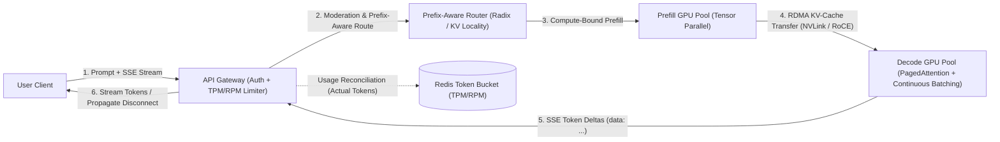

### 6.5 LLM Serving Deep Dives & Failure Modes

- **PagedAttention (vLLM) Virtual Memory Paging**: Borrowed directly from OS virtual memory, **PagedAttention** splits each sequence's KV cache into small fixed-size **KV blocks** (e.g., `16` or `32` tokens per block) mapped via a logical-to-physical **Block Table**. Physical blocks sit non-contiguously anywhere in GPU HBM and are allocated lazily one block at a time as decode advances—shrinking KV waste from `60–80%` down to `< 4%` (only the final partially filled block), unlocking `2–4×` larger batch sizes on identical GPUs.
- **Continuous (Iteration-Level) Batching vs. Static Batching**: Traditional static batching packs `B` requests together and forces fast `50`-token replies to sit idle in VRAM waiting for a `2,000`-token essay in the same batch before returning or admitting new work. **Continuous Batching** reschedules at **every single decode iteration (~30 ms)**: completed requests exit immediately and free their KV blocks, while newly arrived requests slot straight into the active batch on the very next forward pass.
- **Prefill-Decode Disaggregation**: Co-locating Prefill and Decode on the same GPU pool creates severe **TTFT vs. ITL interference**: whenever a user submits a `64k`-token PDF for Prefill (`~1.5 s` compute spike), every co-located Decode request pauses mid-stream, causing visible `1.5 s` UI freezes (`ITL` spike!). **Prefill-Decode Disaggregation** separates GPUs into specialized Prefill pools (tuned for Tensor Core FLOPs) and Decode pools (tuned for HBM bandwidth + large batch concurrency). Once Prefill computes the prompt's KV blocks, it transfers them over high-speed **NVLink / InfiniBand / RoCE RDMA** directly into the Decode worker's PagedAttention blocks—eliminating chunked-prefill stalls and letting each tier autoscale independently.
- **Prefix Caching (RadixAttention / Content-Addressed KV Blocks)**: Thousands of requests share identical `2k–10k` token system prompts, tool schemas, or RAG company documents. By hashing token chunks (`hash(prefix_tokens) -> physical_kv_block_id` in a radix tree), **Prefix Caching** shares read-only physical KV blocks across concurrent users via Copy-on-Write—skipping `90%+` of Prefill FLOPs and slashing TTFT on repeated agentic loops. Combine this with a **Prefix-Aware Router** (consistent-hashing on the first `N` prompt tokens, falling back when a replica's queue depth exceeds a threshold) so requests land on GPUs already holding hot KV blocks in HBM or CPU DRAM.

> [!NOTE]
> Prefix caching introduces a subtle **cache-locality vs. load-balancing trade-off**: routing strictly by prefix hash keeps KV cache hit rates near 100%, but if 10,000 users invoke the same company-wide RAG system prompt simultaneously, that single replica saturates. Production routers use **bounded-load consistent hashing** (or power-of-two choices across replicas sharing the cached prefix) so hot prefixes replicate gracefully across `K` nodes instead of melting one GPU pool.

- **SSE Token Streaming, Disconnect Cancellation & Token Rate Limiting**: Decode emits tokens incrementally over **Server-Sent Events (`text/event-stream`)** (`Connection` kept alive through Envoy/CDN with response buffering explicitly disabled: `X-Accel-Buffering: no`, see [Networking](../../networking/README.md)). Two subtle failure modes dominate production operations:
  1. **Zombie Decodes**: If a user closes their browser tab mid-generation and the API gateway buffers or ignores `TCP RST` / HTTP/2 `RST_STREAM`, the GPU burns precious HBM slots finishing `2,000` unwanted tokens. Propagating client cancellation down to the scheduler aborts the sequence and reclaims its KV blocks on the very next iteration.
  2. **TPM / RPM Rate Limiting**: Checking only Requests-Per-Minute (`RPM`) lets a single caller exhaust the cluster with `128k`-token prompts. Enforce dual limits in Redis Lua: upfront **estimated reservation** (`prompt_tokens + max_tokens_cap`) before dispatching to GPUs, followed by **post-stream reconciliation** crediting back unused reserved tokens (`max_tokens_cap - actual_completion_tokens`) once `[DONE]` fires.

> [!IMPORTANT]
> On an `8× H100 80 GB` node (`640 GB` total HBM), an FP16 `70B` model consumes `140 GB` for weights alone, leaving `500 GB` for activations and KV cache. With `PagedAttention` and FP8 KV quantization (`1 byte/element`), that `500 GB` fits ~`400` concurrent `8k`-token GQA sequences—whereas static contiguous `32k` pre-allocation fits only ~`50` sequences (`8×` lower concurrency and `8×` worse cost per token).

| Serving Optimization | Bottleneck Targeted | Latency / Cost Win | Operational Trade-Off |
| --- | --- | --- | --- |
| **PagedAttention (vLLM)** | HBM KV-cache fragmentation | Cuts waste `60–80% -> < 4%` (`2–4×` batch) | Block-table indirection inside attention kernels |
| **Continuous Batching** | Static batch straggler padding | Eliminates idle slot waiting (`~3–5×` throughput) | Iteration-level scheduler complexity |
| **Prefill-Decode Disaggregation** | Prefill stalling co-located Decode | Isolates TTFT vs ITL (`< 50 ms` ITL) | Requires NVLink / RoCE RDMA KV transfer |
| **Prefix Caching (Radix)** | Repeated system/RAG prompt FLOPs | Cuts TTFT `5–10×` on shared prefixes | Needs prefix-aware routing + LRU HBM eviction |

---

## 7. Staff & Principal Deep-Dive Facilitation and Architectural Evolution

At Staff and Principal levels, drawing boxes on a whiteboard is table stakes; interviews evaluate **how you steer ambiguity, quantify bottlenecks, defend trade-offs under adversarial pressure, and apply modern primitives instead of 2015 cargo-cult defaults**.

### 7.1 Driving the Deep Dive & Handling Adversarial Pushback

- **Anchor the deep dive on the 2–3 riskiest bottlenecks**: After completing the High-Level Design (~15 minutes into a 45–60 minute loop), explicitly propose where to spend the remaining 20 minutes: _"Our HLD covers ingestion and storage, but the two places this system breaks in production are KV-cache HBM fragmentation during 64k prefills and zombie decode cancellation. Unless you want to inspect auth or billing first, let's dive into those two."_ Interviewers reward candidates who diagnose structural risk proactively.
- **Respond to adversarial pushback with invariants, not defensiveness**: When an interviewer attacks your architecture (_"Your Redis cluster just vanished"_, _"Traffic just spiked 10× on one celebrity key"_, _"Why didn't you just use PostgreSQL?"_), follow a crisp four-step loop:
  1. **Validate the premise & classify impact**: State immediately whether the failure violates **Availability**, **Latency**, or **Correctness** (e.g., _"If Redis dies in our rate limiter, we refuse to fail closed; correctness softens slightly to local per-node safety caps while availability stays 100%"_).
  2. **Quantify the delta**: Compare numbers (`PostgreSQL GiST melts at 250k writes/sec due to WAL + page splits vs. 200 MB in-memory H3`), never vague adjectives (_"faster"_ / _"more scalable"_).
  3. **Offer the exact mitigation & its cost**: Every fix has a price—state it openly (_"Adding Prefill-Decode disaggregation eliminates ITL stalls, at the cost of RDMA KV transfer complexity and two separate autoscaling pools"_).
  4. **Know when to simplify**: If the interviewer reveals scale is `500` QPS rather than `500,000` QPS, happily pivot back to a single-node PostgreSQL with `SKIP LOCKED`—demonstrating pragmatic engineering over resume-driven complexity.

| Interviewer Pushback | Primary Risk Dimension | Weak Response | Staff / Principal Response Pattern |
| --- | --- | --- | --- |
| _"What if traffic spikes `10×` on one celebrity key?"_ | Hot partition / saturation | _"We will autoscale the database"_ | Identify single-shard bottleneck; propose key salting (`k % N`), local micro-caching (`1 s`), or single-flight coalescing + cost |
| _"Your Redis cluster just died for `5` minutes."_ | Availability vs accuracy | _"Redis Sentinel fails over instantly"_ | State blast radius (`fail-open` for rate limiter, degraded DB read-through with stampede jitter, or pre-warmed fallback) |
| _"Why not just use PostgreSQL here?"_ | Complexity vs throughput | _"NoSQL is always faster"_ | Cite concrete write mechanics (`250k/s` GPS WAL/GiST churn vs `200 MB` RAM H3; or offer Postgres cleanly if QPS `< 5k`) |
| _"Can we run multi-region active-active?"_ | Latency vs consistency | _"Yes, just replicate both ways"_ | Distinguish read-local/write-home vs CRDT merge vs global consensus RTT (`~100 ms` cross-ocean 2PC/Paxos penalty) |

### 7.2 Then vs. Now: System Design Evolution (2015 vs. 2026)

| Architectural Dimension | Then (~2015 Default) | Why It Changed | Now (2026 Practice) | Migration & Mixing Pitfall |
| --- | --- | --- | --- | --- |
| **Storage I/O & Networking** | Spinning HDDs (`~100` random IOPS, `~10 ms` seek) + `1–10 GbE`; optimize fiercely for sequential disk seeks | NVMe SSDs (`1M+` IOPS, `< 100 μs`), `100–400 GbE` NICs, kernel-bypass (`io_uring`, DPDK) | Network serialization, tail-latency amplification, and CPU cache misses dominate over disk seeks; local NVMe caches absorb hot state | Treating NVMe like zero-latency RAM still breaks on write amplification and SSD wear-out; mixing `mmap` buffer management under memory pressure causes hidden stall spikes |
| **Analytics & Stream Pipelines** | Hadoop MapReduce / batch Hive ETL overnight (`T+24h` freshness) | Real-time personalization/fraud + vectorized columnar engines + open lakehouse table formats | **Apache Flink** stateful streams + **ClickHouse / DuckDB** vectorized OLAP over **Iceberg / Parquet** | Mixing unversioned streaming `UPSERT`s with batch Parquet overwrites causes billing drift unless anchored on immutable event logs + deterministic replay |
| **Primary Keys & Sharding IDs** | Random **UUIDv4** (`128-bit` random) as clustered B-tree primary keys | Random inserts fragment B-tree leaf pages, thrash buffer pools, and amplify WAL writes | **UUIDv7 (RFC 9562)** (48-bit Unix ms timestamp + monotonic counter + random) or **Snowflake** | Storing UUIDv7 as `TEXT` (`36 bytes`) instead of native `uuid` (`16 bytes`) wastes index RAM; unguarded Snowflake generators duplicate IDs on backward NTP steps |
| **Rate Limiting Algorithms** | **Fixed Window** counters (`INCR` + `EXPIRE`) per minute | Allows **`2×` burst spikes** across window boundaries (`00:59` + `01:00`) | **GCRA (Generic Cell Rate Algorithm)** or **Sliding-Window Counter** via atomic Redis Lua (`EVALSHA`) | Mixing per-node in-memory limits behind round-robin LBs silently multiplies effective tenant quotas by `N` gateway instances |
| **Multi-Step Jobs & Scheduling** | Custom cron polling + ad-hoc `status` columns & state machines in SQL | Crash loops, zombie retries, and manual compensating logic leaked into every service | **Durable Execution Engines (Temporal)** for multi-step sagas; **`SKIP LOCKED` / Partitioned Time-Wheels** for high-QPS triggers | Putting massive binary payloads (`> 2 MB`) inside Temporal workflow histories or triggering un-jittered `:00` crons causes DB/history bloat and thundering herds |
| **ML / LLM Inference Serving** | **Static Batching** + contiguous `max_seq_len` tensor allocation | Wasted `60–80%` GPU HBM on padding/fragmentation; long prompts stalled short replies | **PagedAttention (vLLM)** + **Continuous Batching** + **Prefill-Decode Disaggregation** + **Prefix Caching** | Enabling disaggregation without high-bandwidth RDMA (NVLink/RoCE) turns KV transfer into a TCP bottleneck worse than co-location |
| **SLO Alerting & Detection** | **Single-Threshold Static Alerts** (`CPU > 80%` or `5xx > 1%` for `5 min`) | High false-positive pager fatigue on transient blips; completely misses slow `2%` error-budget burns | **SRE Multi-Window Multi-Burn-Rate** alerts (`14.4×` over `1h/5m`, `6×` over `6h/30m`, `1×` over `3d/6h`) | Alerting on per-host averaged `p99`s masks localized brownouts and violates mathematical validity; always aggregate histogram buckets |
| **API Pagination** | **Static Offset Pagination** (`LIMIT 20 OFFSET 1000000`) | `OFFSET` scans and discards `1M` rows (`O(N)` degradation) and drifts/duplicates items under concurrent inserts | **Keyset / Cursor Pagination** (`WHERE (ts, id) < ($1, $2) ORDER BY ts DESC, id DESC LIMIT 20`) | Passing raw unencrypted DB tuples or mutable sort columns without a unique tie-breaker (`id`) leaks schema internals and skips rows on ties |

---

## Interview Drill

1. **In Ticketmaster, you have `10M` users waiting for `50k` seats. Why isn't PostgreSQL `SELECT ... FOR UPDATE SKIP LOCKED` alone enough without a Virtual Waiting Room?**

<details><summary>Model Answer</summary>

Even though `SKIP LOCKED` avoids row-lock blocking across parallel seat claims, `10M` users hitting the origin API directly still exhaust TCP/TLS accept queues, saturate stateless app-tier workers, and overwhelm PostgreSQL's `max_connections` (`500–2,000` connections vs millions of requests), driving transaction latency `W` upward via Little's Law ($L = \lambda W$) until the entire database collapses in a connection storm. Serving static venue maps via CDN and placing a Virtual Waiting Room in front of the Booking API bounds admitted checkout concurrency to match database capacity (`~2,000–5,000` active shoppers), keeping `W` near `5 ms` and total DB throughput maximal.

</details>

2. **A Payment Executor sends an HTTP charge request to Stripe and receives a `504 Gateway Timeout` after `10 seconds`. What happens if your code immediately catches the timeout and fails over to Adyen?**

<details><summary>Model Answer</summary>

You risk **double-charging the customer**. A gateway timeout means the request's outcome is **unknown**—Stripe may have received the packet, authorized and captured the card, and dropped the response on the return path. Failing over immediately to a second PSP creates two independent charges for one order. Instead, mark the internal attempt `PENDING_UNKNOWN`, allow safe idempotent retries **only** against the same PSP using the same `psp_idempotency_key`, or query the PSP status API / wait for reconciliation webhooks before declaring failure or retrying elsewhere.

</details>

3. **Why does a Stock Exchange Matching Engine run single-threaded per symbol with a Sequencer log instead of sharding across a distributed ACID database like Spanner or CockroachDB?**

<details><summary>Model Answer</summary>

Distributed ACID databases incur cross-node consensus RTTs, distributed locking/2PC, and disk `fsync`s totaling `2–20 ms` per transaction—roughly `1,000×` slower than a `< 50 μs` tick-to-trade matching SLA. By placing a low-latency **Sequencer** (RDMA/in-memory Raft log) in front of a **single-threaded, core-pinned, zero-GC LMAX Disruptor matching engine**, the engine executes lock-free L3 order book updates entirely in L2/L3 CPU cache (`~2–5 μs`), while standby replicas deterministically replay the identical sequenced command stream to achieve microsecond failover with zero DB in the hot path.

</details>

4. **Compare Operational Transformation (OT) and CRDTs for Google Docs: why can Google Docs avoid CRDT tombstone overhead, and when would you choose a CRDT anyway?**

<details><summary>Model Answer</summary>

Google Docs uses a **central authoritative server** per document (`Jupiter` OT protocol), which assigns a single canonical operation order and transforms concurrent client edits against its history buffer—avoiding decentralized `TP2` anomalies and eliminating per-character CRDT IDs and tombstones. You choose a **sequence CRDT** (such as Yjs or Automerge with Run-Length Encoding and causal tombstone GC) when the product demands true **local-first / multi-day offline editing**, peer-to-peer sync, or multi-region active-active document writes without routing every keystroke through one central document leader.

</details>

5. **How does Reed-Solomon `(8, 4)` erasure coding in S3-like object storage achieve both lower cost and higher durability than `3×` replication, and why do small objects still use `3×` replication initially?**

<details><summary>Model Answer</summary>

`3×` replication consumes `3.0×` raw storage (`200%` overhead) and survives at most `2` simultaneous disk/rack failures. Reed-Solomon `(8, 4)` splits data into `8` data shards + `4` parity shards (`12 / 8 = 1.5×` raw storage—**50% less raw disk**), while surviving **any `4` simultaneous shard failures**. However, reading a tiny `10 KB` object striped across `8` erasure-coded nodes triggers `8` random disk seeks/RPCs and high tail latency; therefore, S3 packs small/hot objects (`< 1 MB`) into `3×`-replicated append-only extents first, then compacts and erasure-codes cold/large extents asynchronously.

</details>

6. **Compute the per-request KV-cache VRAM for a `16,384`-token prompt on an 80-layer model with `n_kv_heads = 8`, `d_head = 128`, and FP16 (`2 bytes`), and explain how PagedAttention prevents 60%+ VRAM waste.**

<details><summary>Model Answer</summary>

Using $M_{\text{KV}} = 2 \times n_{\text{layers}} \times n_{\text{kv-heads}} \times d_{\text{head}} \times \text{seq-len} \times \text{bytes} \times \text{batch}$: `2 * 80 * 8 * 128 * 16,384 * 2 = 5,368,709,120 bytes = 5.0 GiB` per single active sequence. Contiguous pre-allocation reserves the full `max_seq_len` buffer upfront even when most replies finish at `500` tokens, wasting `60–80%` of GPU HBM on internal and external fragmentation. **PagedAttention** virtualizes KV memory into fixed-size blocks (e.g., `16` tokens) via a block table, allocating non-contiguous physical GPU blocks lazily one block at a time so fragmentation drops under `4%` and batch concurrency scales `2–4×`.

</details>

7. **Why do modern 2026 LLM serving architectures disaggregate Prefill and Decode onto separate GPU pools, and what breaks if the interconnect between them is slow?**

<details><summary>Model Answer</summary>

**Prefill** is compute-bound (Tensor Core GEMMs over all prompt tokens, governing TTFT), whereas **Decode** is HBM memory-bandwidth-bound (streaming model weights + KV cache for `1` token per step, governing ITL). Co-locating them causes incoming `64k`-token prefill bursts to monopolize SMs and stall concurrent decode streams, blowing ITL SLOs (`> 50 ms/token` jitter). Disaggregating them isolates both phases and allows independent scaling—**provided** the cluster transfers the precomputed KV cache (`2.5–5 GiB` per long prompt) over high-bandwidth **NVLink / InfiniBand / RoCE RDMA**; over slow `10–25 Gbps` TCP, KV transfer serialization takes seconds and destroys TTFT!

</details>

8. **During a Staff system design review, the interviewer pushes back: _"Your rate limiter depends on Redis—what happens to our entire product if Redis goes down for 3 minutes?"_ How do you respond?**

<details><summary>Model Answer</summary>

Classify the failure immediately: Redis outage threatens **availability** if we fail closed, whereas failing open trades strict global accuracy temporarily to preserve **100% revenue/API availability**. Wrap the Redis Lua GCRA client in a tight `5 ms` timeout and circuit breaker: once Redis errors cross the trip threshold, gateways **fail open** to a coarse local per-node token bucket (preventing catastrophic downstream overload while letting legitimate traffic through), emit a high-severity burn-rate/dependency alert, and resume global Redis synchronization automatically when health checks recover.

</details>
