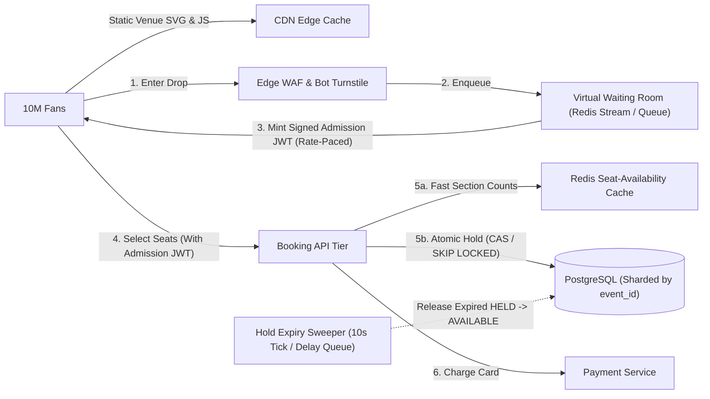
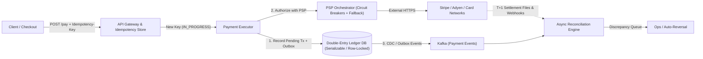
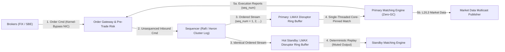
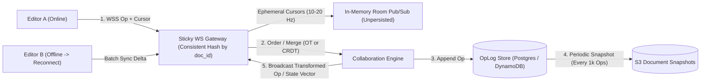
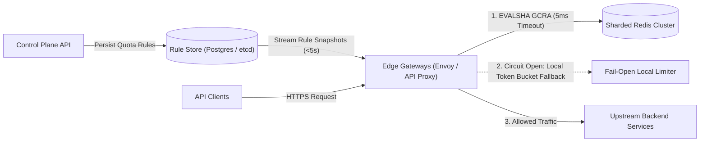
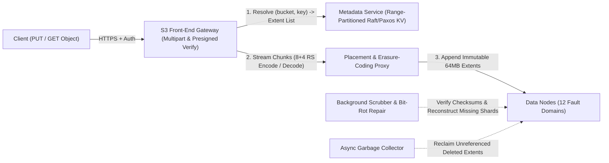
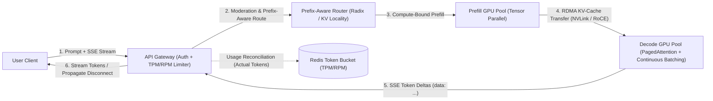

# Module 14 — Canonical Designs III: Transactional, Infrastructure, and LLM Serving Systems

Transactional contention, financial correctness, microsecond deterministic matching, real-time collaborative state convergence, erasure-coded blob storage, and GPU-bound LLM inference represent the upper tier of modern system design. Unlike read-heavy feeds or approximate analytics, these architectures fail catastrophically if invariants slip: a double-booked stadium seat ruins customer trust, a missing idempotency check double-charges a card, a GC pause in a matching engine drops orders, and naive contiguous KV-cache allocation wastes over 60% of scarce H100/B200 GPU memory. This closing module synthesizes seven Staff/Principal canonical architectures, formalizes deep-dive facilitation and pushback handling, and catalogs how architectural defaults evolved between 2015 and 2026.

Foundational primitives remain cross-linked to their owning curricula: consensus, leases, fencing tokens, linearizability, and CRDT formalisms in [Distributed Systems](../../distributed-systems/README.md); ACID isolation levels, MVCC, WAL, and storage engines in [Data Systems](../../data-systems/README.md); HTTP/2, HTTP/3, SSE, WebSockets, and CDNs in [Networking](../../networking/README.md); Redis atomic Lua scripting in [Redis](../../../technologies/redis/README.md); SLO burn-rate alerting in [Observability](../../../technologies/observability/README.md); and probabilistic sketches and consistent hashing in [Data Structures & Algorithms](../../../algorithms/dsa/README.md).

---

## 1. High-Contention Flash Sales: Ticketmaster

A major stadium concert drop concentrates `10,000,000` eager buyers onto `50,000` seats within `60 seconds`—a `200:1` contention ratio where `99.5%` of visitors leave empty-handed. Treating seat selection like ordinary e-commerce (`SELECT * FROM seats WHERE status = 'AVAILABLE'` followed by `UPDATE`) collapses under lock contention, connection-pool exhaustion, and bot scraping long before the first ticket sells.

### 1.1 Ticketmaster Requirements & SLAs

- **Functional requirements**: Browse venue seating charts and live section availability, enter a fair admission queue during high-demand drops, hold selected seats exclusively for a `10-minute` checkout window, complete payment atomically, expire abandoned holds automatically, and enforce per-account/anti-bot purchase limits.
- **Non-functional requirements**: Strict exclusivity invariant—a seat can belong to at most **one** active hold or confirmed ticket at any instant; zero overselling; admission & browse tier must absorb `10M` concurrent fans without cascading DB failure (`99.99%` availability for queue/browse); hold acquisition latency `p99 < 250 ms` once admitted to checkout.

### 1.2 Ticketmaster Capacity Estimation

- **Peak browse & poll QPS**: `10M` concurrent users refreshing seat availability every `5 s` generates `2M` read QPS. Static venue SVG maps and seat coordinates (`~500 KB` per venue) served from CDN edge nodes absorb `100%` of static asset bandwidth (`2M * 500 KB` would otherwise demand `1 TB/s`!). Dynamic seat-status overlays are cached at the CDN/edge with `1–2 s` micro-TTL (`Stale-While-Revalidate`) or pushed only to admitted checkout sessions.
- **Admitted checkout QPS**: A Virtual Waiting Room throttles origin checkout admissions to match database write capacity—say `5,000` concurrent active shoppers (`~2,000` hold attempts/sec) across `50,000` seats, draining the `50k` inventory cleanly over `~2–5 minutes`.
- **Database connection sizing (Little's Law)**: At `2,000` hold transactions/sec with mean DB transaction time `W = 5 ms`, Little's Law ($L = \lambda W$) requires only `2,000 * 0.005 = 10` concurrent active DB connections per shard—well within a `64–128` connection pool when the Virtual Waiting Room caps origin concurrency. Without admission control, `500k` simultaneous hold requests queue behind row locks, driving `W` to `10+ s` and crashing the database pool (`L -> 5,000,000`).

### 1.3 Ticketmaster API & Data Model

```sql
CREATE TABLE seats (
  event_id        BIGINT NOT NULL,
  seat_id         BIGINT NOT NULL,
  section_id      INT NOT NULL,
  price_minor     BIGINT NOT NULL,
  status          SMALLINT NOT NULL, -- 0=AVAILABLE, 1=HELD, 2=SOLD
  hold_token      UUID,
  hold_expires_at TIMESTAMPTZ,
  version         BIGINT NOT NULL DEFAULT 0,
  PRIMARY KEY (event_id, seat_id)
);

CREATE INDEX idx_seats_avail ON seats (event_id, section_id, status) WHERE status = 0;
```

- **Queue join**: `POST /v1/events/{event_id}/queue` issues an opaque signed position token; clients poll or receive SSE/WebSocket updates until promoted.
- **Acquire hold**: `POST /v1/events/{event_id}/holds` with `{ seat_ids: [...], mode: "EXACT" | "BEST_AVAILABLE", admission_jwt }` returns `{ hold_id, expires_at }` (`409 Conflict` if stolen concurrently).
- **Confirm purchase**: `POST /v1/holds/{hold_id}/confirm` with `Idempotency-Key` completes payment and flips seats from `HELD` to `SOLD`.

```json
// POST /v1/events/ev_9021/holds response (201 Created)
{
  "hold_id": "hold_01934b12",
  "seat_ids": [10412, 10413],
  "expires_at": "2026-11-20T12:10:00Z",
  "total_minor": 35000,
  "currency": "USD"
}
```

### 1.4 Ticketmaster High-Level Design



### 1.5 Ticketmaster Deep Dives & Failure Modes

- **CDN-Cached Static Seat Maps**: Venue geometry, row/seat coordinates, and pricing tiers are static before an on-sale starts. Serving them directly from CDN edge POPs keeps `99%` of initial landing traffic off origin compute; only a compact bitmask or per-section availability array (`50k` seats = `~6.25 KB` uncompressed bitset!) travels over the dynamic API.
- **Virtual Waiting Room Admission Queue**: Before an on-sale opens, arriving users enter a randomized lottery or FIFO waiting room backed by sharded Redis queues (`ZSET` / `List`). Once the sale starts, a token-bucket pacer pops batches (e.g., `2,500` users/sec) and mints short-lived HMAC/EdDSA-signed `admission_jwt` tokens bound to `user_id` and `event_id`. The Booking API rejects any hold/checkout request lacking a valid admission signature at the edge gateway, guaranteeing the relational database never faces unbounded thundering herds.
- **10-Minute TTL Holds (`FOR UPDATE SKIP LOCKED` vs. OCC `version` CAS)**:
  - **Specific seat selection**: Uses Optimistic Concurrency Control (`UPDATE seats SET status = 1, hold_token = $1, hold_expires_at = NOW() + INTERVAL '10 minutes', version = version + 1 WHERE event_id = $2 AND seat_id = ANY($3) AND status = 0 AND version = $4 RETURNING seat_id`). Notice how passing all `N` seats in one multi-row `UPDATE` (with `seat_id` sorted canonically to avoid deadlocks) guarantees all-or-nothing atomicity: if `returned_rows < requested_count`, the transaction rolls back immediately with `409 Conflict` without holding locks.
  - **Best-available auto-pick ("Give me 4 adjacent seats")**: Runs `SELECT seat_id FROM seats WHERE event_id = $1 AND section_id = $2 AND status = 0 ORDER BY row_num, seat_num LIMIT 4 FOR UPDATE SKIP LOCKED`. `SKIP LOCKED` lets concurrent buyers claim disjoint seats in parallel without blocking each other on row locks.
- **Background Hold Expiry Sweeper & Late-Checkout Race**: If a buyer abandons checkout after `10 minutes`, seats must return to `AVAILABLE`. A background sweeper runs every `5–10 s` (`UPDATE seats SET status = 0, hold_token = NULL, hold_expires_at = NULL, version = version + 1 WHERE status = 1 AND hold_expires_at < NOW()`) or pops delayed expiry jobs from a timing wheel, and triggers async Redis cache invalidation. Crucially, the confirmation query during payment completion MUST include `AND status = 1 AND hold_token = $1 AND hold_expires_at > NOW()` inside the final `SOLD` transition—if the sweeper reclaimed the seat `50 ms` before the user clicked "Pay", checkout fails cleanly and refunds/voids the authorization rather than double-selling the seat.
- **Anti-Bot Rate Limiting & Account Caps**: Bots spin up headless browsers and residential proxies to hoard holds without paying, starving real fans. Defenses layer device-attestation/proof-of-work challenges prior to queue entry, verified phone/payment-method identity bindings before minting an admission JWT, per-account/per-card max-ticket caps (`<= 4` seats) enforced transactionally, and edge rate limiting (see Section 5).

```sql
-- Atomic hold confirmation guarded against sweeper expiration race
UPDATE seats
SET status = 2, -- SOLD
    version = version + 1
WHERE event_id = $1
  AND seat_id = ANY($2)
  AND status = 1
  AND hold_token = $3
  AND hold_expires_at > NOW()
RETURNING seat_id;
```

> [!WARNING]
> Never track remaining event capacity by decrementing a single `events.available_count` row inside the seat-hold transaction. A single row lock on `event_id` serializes every buyer in the stadium onto one lock queue, capping throughput at ~200–500 TPS even if `50,000` disjoint seat rows sit unlocked. Keep seat availability in the `seats` rows (or sharded section counters) and cache counts asynchronously in Redis.

---

## 2. Payment System & Digital Wallet

Payment systems and digital wallets prioritize **zero silent money creation or loss** above all else. Unlike social apps where a dropped like is harmless, an unguarded retry on a network timeout double-charges a customer, floating-point arithmetic loses cents on FX conversions, and in-place `balance = balance - amount` mutations destroy auditability.

### 2.1 Payment Requirements & SLAs

- **Functional requirements**: Pay-in/checkout orchestration across external Payment Service Providers (PSPs like Stripe/Adyen), peer-to-peer digital wallet transfers, multi-currency minor-unit accounting, immutable double-entry ledger, and asynchronous T+1 PSP settlement reconciliation.
- **Non-functional requirements**: Strict idempotency on every mutating endpoint; **strict conservation of money** ($\sum \text{debits} = \sum \text{credits}$ per journal entry); zero floating-point rounding drift; durability RPO = `0` (`acks=all`, synchronous multi-AZ commit); checkout authorization `p99 < 1.5 s` (dominated by external PSP round-trips); `99.99%` ledger availability.

### 2.2 Payment Capacity Estimation

- **Transaction QPS**: `100M` payment/wallet transactions per day -> `100M / 86,400 ≈ 1,157` TPS average, `~5,000–10,000` TPS peak (Black Friday). Even `10,000` TPS is modest in raw QPS compared to social media, meaning **correctness, serializability, and hot-account contention**—not raw network bandwidth—govern the database design.
- **Ledger storage**: Each payment creates `~4–6` double-entry postings (`buyer -> clearing`, `clearing -> merchant`, `clearing -> fee_revenue`) at `~250 bytes/row` = `~150 GB/day` (`~55 TB/year` uncompressed, partitioned by `posted_at` month for fast active partitions and cold archival compliance).

### 2.3 Payment API & Double-Entry Ledger Schema

Clients send a mandatory `Idempotency-Key` (UUIDv7) per logical checkout attempt, and monetary amounts travel strictly as `int64` minor units alongside ISO-4217 currency codes:

```json
{
  "idempotency_key": "01934a90-221a-7f10-81cc-9b2a10190021",
  "payer_wallet_id": "wal_10293",
  "merchant_id": "mrc_88412",
  "amount_minor": 1999,
  "currency": "USD"
}
```

```sql
CREATE TABLE idempotency_records (
  merchant_id     TEXT NOT NULL,
  idempotency_key TEXT NOT NULL,
  request_hash    BYTEA NOT NULL,
  status          SMALLINT NOT NULL, -- 0=IN_PROGRESS, 1=COMPLETED, 2=FAILED
  response_code   INT,
  response_body   JSONB,
  created_at      TIMESTAMPTZ NOT NULL DEFAULT NOW(),
  PRIMARY KEY (merchant_id, idempotency_key)
);

CREATE TABLE ledger_postings (
  posting_id      BIGINT GENERATED ALWAYS AS IDENTITY PRIMARY KEY,
  journal_id      UUID NOT NULL,
  account_id      BIGINT NOT NULL,
  direction       SMALLINT NOT NULL, -- +1=DEBIT, -1=CREDIT (or signed amount)
  amount_minor    BIGINT NOT NULL CHECK (amount_minor > 0),
  currency        CHAR(3) NOT NULL,
  created_at      TIMESTAMPTZ NOT NULL DEFAULT NOW()
);

CREATE TABLE account_balances (
  account_id      BIGINT PRIMARY KEY,
  currency        CHAR(3) NOT NULL,
  available_minor BIGINT NOT NULL CHECK (available_minor >= 0),
  pending_minor   BIGINT NOT NULL DEFAULT 0,
  version         BIGINT NOT NULL DEFAULT 0,
  updated_at      TIMESTAMPTZ NOT NULL DEFAULT NOW()
);
```

### 2.4 Payment High-Level Design



### 2.5 Payment Deep Dives & Failure Modes

- **Idempotency Store & Request Hash Verification**: Before touching the ledger or calling a PSP, the gateway inserts `(merchant_id, idempotency_key, request_hash, status=IN_PROGRESS)` atomically. If the key already exists: (1) if `request_hash` differs (client accidentally reused a key for a different amount), fail immediately with `422 Unprocessable Entity`; (2) if `status = IN_PROGRESS`, return `409 Conflict` / `Retry-After` so concurrent duplicate clicks do not launch parallel PSP calls; (3) if `status = COMPLETED`, replay the exact saved `response_code` and `response_body` without re-executing anything.
- **PSP Orchestration & Unknown Timeout Outcomes**: The deadliest distributed payment bug is treating an HTTP `504` or TCP socket timeout from Stripe/Adyen as a failed charge and automatically retrying against a fallback PSP—charging the customer twice! A network timeout after sending an authorization request is an **unknown outcome**. The Payment Executor persists the attempt in `PENDING_UNKNOWN` state, attaches the _same_ `psp_idempotency_key` if retrying the _same_ PSP, and defers fallback or user failure until an asynchronous poller (`GET /v1/charges/{psp_tx_id}`) or webhook resolves the ambiguity. Per-PSP circuit breakers route **new** checkouts away from degraded PSPs, never mid-flight ambiguous transactions.
- **Immutable Double-Entry Ledger & Hot Omnibus Contention**: Every monetary movement inserts balanced postings inside one ACID transaction where $\sum \text{debits} = \sum \text{credits}$ (`amount_minor` always positive; direction indicated explicitly, verified by a deferred constraint trigger or application invariant). Balances are never mutated blindly without a corresponding ledger journal entry; a cached `account_balances` materialized row is updated in the same transaction for fast balance checks (`balance >= amount_minor`). When a high-volume merchant or platform fee account becomes a **hot lock** (`10,000` TPS updating one `platform_fees` balance row serializes all writes!), split hot omnibus accounts into `N` sub-shards (`platform_fees_00`..`platform_fees_63`), picking `hash(tx_id) % 64` per posting and summing across shards on read (see [Data Systems](../../data-systems/README.md)).
- **Async Settlement Reconciliation**: External card networks settle batches asynchronously (`T+1` or `T+2` clearing files) and occasionally adjust fees, process chargebacks, or deliver delayed capture webhooks. A nightly/hourly Reconciliation Engine joins internal `ledger_postings` against PSP settlement reports by `psp_tx_id`. Clean matches mark entries `SETTLED`; missing internal records (a timeout where the PSP succeeded but our DB crashed before recording) or amount mismatches route automatically to a discrepancy alert queue and trigger compensating ledger entries—never silent overwrites.
- **Multi-Currency Rounding in Minor Units**: Never store money in IEEE-754 `float64` (`0.1 + 0.2 !== 0.3`). Store integer minor units (`1999` cents for `\$19.99` USD, `1000` yen for `¥1000` JPY since JPY has `0` decimals, `1000` fils for `1.000` KWD since KWD has `3` decimals). When splitting `\$10.00` (`1000` cents) 3 ways or converting FX rates, apply deterministic banker's rounding (`ROUND_HALF_EVEN`) and route the leftover `1 cent` (`1000 - 333 * 3 = 1`) explicitly to a designated rounding/remainder account so $\sum \text{debits} - \sum \text{credits} = 0$ holds to the exact single minor unit.

| Journal Line | Account | Direction | Amount (Minor Units) | Purpose |
| --- | --- | --- | --- | --- |
| **1** | `buyer_wallet:wal_10293` | `DEBIT` (`-1000`) | `1000` (`\$10.00`) | Deduct funds from buyer wallet |
| **2** | `merchant_payable:mrc_88412` | `CREDIT` (`+970`) | `970` (`\$9.70`) | Credit merchant net payout |
| **3** | `platform_fees_shard_19` | `CREDIT` (`+29`) | `29` (`\$0.29`) | Sharded fee revenue (`2.9%` rounded) |
| **4** | `fx_rounding_reserve` | `CREDIT` (`+1`) | `1` (`\$0.01`) | Deterministic remainder (`sum == 0`) |

---

## 3. Ultra-Low-Latency Stock Exchange Matching Engine

An electronic stock exchange matching engine is an extreme antithesis of typical web-scale microservice architectures: adding network hops, distributed databases, or garbage-collected runtimes to the critical matching path destroys latency SLAs (`< 50 μs` tick-to-trade). Instead, exchanges exploit **deterministic single-threaded state machines**, **lock-free ring buffers**, and **sequencer-driven replication**.

### 3.1 Stock Exchange Requirements & SLAs

- **Functional requirements**: Ingest limit, market, and cancel orders (`NewOrder`, `CancelOrder`, `ReplaceOrder`), maintain a strict Price-Time Priority (FIFO) L3 order book per ticker symbol, emit deterministic fills (`ExecutionReport`) and public L2/L3 market data feeds, and enforce pre-trade risk/margin checks.
- **Non-functional requirements**: Tick-to-trade matching latency `p99 < 50 μs` (`p50 < 10 μs`); throughput `500k–1M` orders/sec per symbol shard; deterministic reproducibility across primary and hot-standby replicas; zero order loss on single-node crash (`RPO = 0` via replicated sequencer log).

### 3.2 Stock Exchange Capacity & Latency Budget

- **Latency budget (`50 μs` total)**: Kernel-bypass NIC (Solarflare OpenOnload / DPDK) `~3 μs` -> FIX/SBE gateway decode + risk check `~5 μs` -> Sequencer append/replicate `~15 μs` -> Matching engine L3 book match `~2–5 μs` -> Outbound report serialization + NIC egress `~5 μs` (`~30–35 μs` total, leaving jitter headroom).
- **Order book memory**: `100k` resting limit orders per active symbol * `~128 bytes` per pre-allocated order slot = `~12.8 MB`—small enough to sit almost entirely inside CPU **L2/L3 cache**, eliminating DRAM cache misses during price-level traversal.

### 3.3 Stock Exchange Wire Protocol & Order Book Model

Retail/institutional brokers connect over persistent TCP or multicast UDP using **FIX** (Financial Information eXchange) at the external edge, immediately translated into fixed-offset **SBE (Simple Binary Encoding)** structs so the core engine reads binary fields directly with zero heap allocations or string parsing. Inside the matching engine, each symbol maintains two red-black trees or sorted price-level maps (`Bids` descending, `Asks` ascending), where each price level owns an intrusive doubly linked list of resting orders (`O(1)` head match, `O(1)` cancel via hash-map `order_id -> slot_ptr`).

```c
// Cache-line aligned fixed-size order slot (64 bytes, zero heap allocation)
struct OrderSlot {
  uint64_t order_id;
  uint64_t price_ticks; // Fixed-point integer ticks (never IEEE-754 float)
  uint32_t qty_remaining;
  uint32_t account_id;
  uint64_t prev_idx;    // Intrusive doubly linked list index in flat pool
  uint64_t next_idx;
  uint8_t  side;        // 0=BUY, 1=SELL
  uint8_t  pad[23];
};
```

### 3.4 Stock Exchange High-Level Design



### 3.5 Stock Exchange Deep Dives & Failure Modes

- **Single-Threaded Deterministic Matching & LMAX Disruptor**: Locking an order book across multiple threads causes mutex contention, OS context switches (`5–15 μs` each), and non-deterministic execution ordering. Instead, symbols are partitioned across independent single-threaded matching engine shards (`Shard A: AAPL..AMZN`, `Shard B: MSFT..NVDA`), each pinned to an isolated physical CPU core (`isolcpus` + `taskset`, hyperthreading disabled to avoid L1/L2 cache thrashing). Inbound messages flow through an **LMAX Disruptor** pre-allocated ring buffer using cache-line-padded atomic cursors (eliminating false sharing and locks). Memory for all order nodes is pre-allocated in flat object pools at market open—ensuring **zero garbage collection pauses** (C++/Rust, or Zing/zero-allocation Java) during trading hours.
- **The Sequencer & Why Distributed Databases Stay Out of the Hot Path**: Calling PostgreSQL, Spanner, or Redis inside the matching loop adds millisecond-scale network and disk-fsync latency (`1,000×` slower than the `50 μs` budget). Instead, the **Sequencer** acts as the single source of total order: every inbound command receives a contiguous global monotonic `seq_num` in a replicated memory/RDMA log (e.g., Aeron Cluster / Raft quorum across 3 low-latency nodes in the same rack/AZ) _before_ reaching the matching engine. Because the matching engine is a pure deterministic function $S_{n+1}, \text{Fills}_n = f(S_n, \text{Cmd}_n)$ with zero calls to `wall_clock()` or random number generators, every standby replica consuming the exact same sequenced stream arrives at bit-identical book state!
- **Hot-Standby Failover & Snapshot Replay**: Outbound `ExecutionReports` carry the originating `seq_num` and a monotonic `exec_id`. The hot standby runs the identical matching loop with its outbound network publisher muted. If the primary halts or misses a heartbeat, the Sequencer fences the old primary epoch, promotes the hot standby (which already holds the warm in-memory order book up to `seq_num - 1`), and unmutes outbound publishing in milliseconds—requiring zero slow DB recovery. At end-of-day (or periodically), an out-of-band snapshotter serializes the book state at `seq_num = K` to durable storage so cold restarts replay only the delta `> K`.
- **Pre-Trade Risk & Fair Clock-Skew Protection**: Gateways validate account buying power, fat-finger price collars (`±10%` from reference price), and max-order-rate kill switches _before_ entering the Sequencer, preventing malformed or runaway algorithmic floods from polluting the deterministic sequence log.

> [!NOTE]
> Regulatory audit standards (such as MiFID II RTS 25 and SEC Rule 613 CAT) require nanosecond/microsecond UTC timestamps on order events via PTP (Precision Time Protocol). Gateways stamp **metadata** timestamps for compliance logging at ingress, but the Matching Engine never branches on wall-clock time—preserving strict deterministic replay solely from `seq_num`.

| Hot-Path Stage | Mechanism | Typical Budget (`p99`) | Anti-Pattern Eliminated |
| --- | --- | --- | --- |
| **Network Ingress** | Solarflare OpenOnload / DPDK kernel-bypass | `~3 μs` | Linux `sk_buff` copy, epoll context switches |
| **Gateway & Risk** | SBE fixed-offset struct decode + local limits | `~5 μs` | JSON parsing, heap allocations, remote auth RPC |
| **Sequencer Log** | Aeron Cluster / RDMA Raft in-memory quorum | `~15 μs` | Disk `fsync` or multi-region Spanner 2PC |
| **Matching Core** | Single-threaded Disruptor + L3 price-level tree | `~3 μs` | Mutex contention, GC stop-the-world pauses |
| **Egress & Feed** | Unicast FIX/SBE fill + UDP multicast market data | `~5 μs` | Synchronous fan-out blocking the matching thread |

---

## 4. Collaborative Editing: Google Docs

Real-time collaborative editing allows dozens of users to edit the same structured document concurrently—even while offline on an airplane—and converge cleanly to the exact same state without locking sentences or overwriting each other's paragraphs.

### 4.1 Collaborative Editing Requirements & SLAs

- **Functional requirements**: Concurrent multi-user character/formatting edits, local-first offline editing with clean merge upon reconnect, live remote cursor/selection awareness, full revision history with point-in-time snapshots, and document export.
- **Non-functional requirements**: **Strong Eventual Consistency (SEC)**—all clients receiving the same set of operations converge to identical document bytes regardless of arrival order (see [Distributed Systems](../../distributed-systems/README.md)); local keystroke latency `< 16 ms` (optimistic local apply); remote edit propagation `p95 < 150 ms`; support `100+` concurrent editors and `1M+` characters per document.

### 4.2 Collaborative Editing Capacity Estimation

- **Active collaboration load**: `50M` DAU editing `10M` active docs/day, `~100k` concurrent open editor WebSockets at peak. At `2` keystrokes/sec average per active typist -> `~200k` op frames/sec globally.
- **Document storage & oplog**: A `50,000`-character doc serialized as raw text is `50 KB`, but an uncompacted character-level CRDT metadata graph (`~40–64 bytes` per character ID + tombstones) swells to `2–3 MB` in RAM unless compacted with run-length encoding (RLE) and periodic garbage collection.

### 4.3 Collaborative Editing API & Operation Envelope

Clients stream lightweight delta operations over a sticky WebSocket routed by `document_id` (consistent-hashed to the owning Collaboration Server shard):

```json
{
  "doc_id": "doc_8921a",
  "client_id": "c_771",
  "base_rev": 1482,
  "op_id": ["c_771", 49],
  "ops": [{ "type": "insert", "pos_or_parent_id": ["c_102", 88], "char": "s" }]
}
```

### 4.4 Collaborative Editing High-Level Design

The Collaboration Gateway pins all active editors of `doc_id` to a single stateful Collaboration Server instance (via consistent hashing + Redis routing directory, failing over cleanly to an append-only OpLog if the node dies). Ephemeral cursor broadcasts bypass the durable OpLog entirely, while edits append to the OpLog, broadcast to peers, and periodically compact into cold snapshots in S3/PostgreSQL.



### 4.5 Collaborative Editing Deep Dives & Failure Modes

- **Operational Transformation (OT) vs. CRDTs**:
  - **Operational Transformation (OT, Google Docs model)**: Operations express positional mutations (`insert("x", index=5)`, `delete(index=5)`). Because indices shift when peers edit earlier positions concurrently, every incoming operation must be **transformed** against concurrent operations (`T(op1, op2)`). Proving convergence without a central coordinator requires satisfying both **TP1** and **TP2** (Transformation Property 2)—notoriously subtle and bug-prone across rich-text attributes. Google Docs sidesteps TP2 by routing every operation through a **central authoritative server** per document: the server orders all edits sequentially against a canonical revision number (`base_rev`), transforms late client ops against the server's **history buffer**, and clients buffer at most one unacknowledged batch in flight (`Jupiter` protocol).
  - **CRDTs (RGA / Yjs / Automerge, modern local-first & decentralized model)**: Assign every inserted character or block a globally unique, immutable identifier `(client_id, lamport_seq)` linked to its left/right neighbor IDs rather than mutable integer array indices. Because merge is a commutative, associative, idempotent join-semilattice operation (see [Distributed Systems](../../distributed-systems/README.md)), **any peer-to-peer or multi-server topology converges automatically** without a central transformation matrix—making CRDTs vastly superior for extended offline editing and federated topologies.
- **Tombstone Compaction & CRDT Metadata Overhead**: In a CRDT, deleting a character cannot physically erase its node immediately because a concurrent offline peer might still reference that deleted node's ID as an insertion anchor (`insert after ('c_102', 88)`). Deleted nodes become **tombstones**, which accumulate over years of editing until a `10-page` doc consumes `50 MB` of deleted history! Production CRDT engines (like Yjs) mitigate this in two ways: (1) **Run-Length Encoding (RLE)** merges sequential characters typed by one user into a single contiguous `Item` struct (`1` struct per burst instead of `1` per character, cutting metadata `10–20×`); and (2) **Causal Stability Garbage Collection** compacts tombstones safely once all clients (or a central checkpoint barrier) have acknowledged versions past the deletion epoch.
- **Ephemeral WebSocket Presence Cursors**: Typing indicators, colored caret positions, and text selection highlights fire `10×` more frequently than persisted edits during mouse drags, yet carry zero durability value. Route cursor telemetry as unpersisted ephemeral frames over the document's WebSocket room (throttled to `~10–20 Hz` per client) so cursor chatter never inflates the durable OpLog.
- **Periodic Snapshot Compaction**: Replaying `500,000` tiny keystroke operations every time someone opens a document stalls load times. Background workers periodically squash every `N` ops (e.g., `1,000` ops or every `5 minutes` of inactivity) into a single compressed binary document snapshot stored in object storage (`S3`) alongside a `snapshot_rev` pointer, trimming older OpLog rows while preserving named version-history checkpoints.

| Dimension | Operational Transformation (OT) | Sequence CRDT (Yjs / Automerge / RGA) |
| --- | --- | --- |
| **Topology requirement** | Central authoritative server per doc (Jupiter) | Decentralized, peer-to-peer, or multi-server |
| **Memory & wire overhead** | Very low (`index` + `op`, no per-char IDs) | Moderate–high (IDs + tombstones; reduced via RLE) |
| **Offline / partition support** | Fragile over long multi-day offline divergence | Native strong eventual consistency |
| **Implementation risk** | Complex rich-text transform matrix edge cases | Tombstone GC & interleaving edge cases on concurrent inserts |

---

## 5. Core Infrastructure: Rate Limiter as a Service & S3-Like Object Storage

Large platforms expose shared infrastructure primitives—global rate limiting and durable exabyte object storage—that underpin every product above. Both share a clear separation between a **low-QPS strongly consistent control/metadata plane** and an **ultra-high-throughput data plane**.

### 5.1 Distributed Rate Limiter Requirements & Sizing

- **Requirements**: Enforce multi-tenant quotas (`RPM`, `RPS`, burst limits, concurrent connection caps) across globally distributed edge POPs with `< 2 ms` added latency (`p99`), atomic accuracy without `N×` node drift, and fail-open resilience so a rate-limiter outage never takes down production APIs.
- **Sizing**: `1M` API requests/sec -> `1M` Redis Lua/GCRA checks/sec across `10–15` Redis shards (`~80k` ops/sec per shard), or `~50k` sync calls/sec if edge gateways batch local approximate counters every `100 ms`.

### 5.2 Distributed Rate Limiter Architecture & Failure Modes



- **Global Control Plane vs. Edge Data Plane**: A Control Plane persists tenant quota rules (`tier: pro -> 1,000 req/min`) in etcd/PostgreSQL and pushes versioned rule snapshots to Envoy/API Gateway memory within seconds. On the hot Data Plane, gateways run **GCRA (Generic Cell Rate Algorithm)** or **Sliding-Window Counter** atomically inside Redis via `EVALSHA` (see [Redis](../../../technologies/redis/README.md))—avoiding both the `2×` boundary-burst flaw of fixed windows and the `N×` drift of uncoordinated per-node memory counters.
- **High-QPS Batching & Fail-Open Circuit Breaking**: For ultra-hot keys (`> 100k` req/s on one API key), gateways track local token buckets and synchronize deltas to Redis asynchronously every `50–200 ms` (trading sub-second soft overshoot for `20×` lower Redis load). Crucially, every gateway wraps its Redis rate-limiter client in a **strict `5 ms` timeout + fail-open circuit breaker**: if Redis partitions or stalls, the gateway logs a warning metric, fails **open** (falling back to a generous local per-node safety cap to prevent infinite floods), and serves valid customer traffic rather than turning a cache hiccup into a `100%` global outage.

```lua
-- Atomic Redis GCRA (Generic Cell Rate Algorithm) executed via EVALSHA
-- Aligned with ../examples/08-redis-integration.test.ts
-- KEYS[1] = rate-limit key, ARGV = { now_ms, period_ms, limit, burst } (burst B >= 1)
local now_ms = tonumber(ARGV[1])
local period_ms = tonumber(ARGV[2])
local limit = tonumber(ARGV[3])
local burst = tonumber(ARGV[4])
local emission_ms = period_ms / limit
local tau_ms = (burst - 1) * emission_ms

local tat = tonumber(redis.call("GET", KEYS[1]) or now_ms)
local allow_at = tat - tau_ms
if now_ms < allow_at then
  return { 0, math.ceil(allow_at - now_ms) } -- Reject + Retry-After ms
end
local new_tat = math.max(now_ms, tat) + emission_ms
local ttl_ms = math.max(1, math.ceil(period_ms + tau_ms))
redis.call("SET", KEYS[1], tostring(new_tat), "PX", ttl_ms)
return { 1, 0 }
```

### 5.3 S3 Object Storage Requirements & Sizing

- **Requirements**: Store arbitrarily sized immutable objects (`1 KB` to `5 TB` via multipart upload) in flat bucket/key namespaces with `11 nines` (`99.999999999%`) durability, `99.99%` availability, strong read-after-write consistency for `PUT`/`DELETE`, and minimal raw disk overhead per usable TB.
- **Sizing**: Storing `100 PB` of usable customer data with naive `3×` replication consumes `300 PB` of raw disks (`200 PB` waste!). Using **Reed-Solomon `(8, 4)` erasure coding** (`8` data shards + `4` parity shards across `12` independent failure domains/racks) drops storage overhead from `3.0×` to `12 / 8 = 1.5×` (`150 PB` raw—**saving `150 PB`**, i.e., `50%` of total disk capex/power) while surviving up to **4 simultaneous node/rack failures** (even better fault tolerance than `3×` replication, which tolerates only `2` failures!).

### 5.4 S3 Object Storage High-Level Design



### 5.5 S3 Object Storage Deep Dives & Failure Modes

- **Metadata Service Partitioning & Hot-Prefix Mitigation**: Object keys are logically flat strings (`photos/2026/11/img_01.jpg`) stored in a **range-partitioned** B-tree/LSM KV cluster (backed by Raft/Paxos groups per range) so lexicographical `LIST ?prefix=photos/2026/` scans remain `O(log N + k)` range scans. A classic failure mode occurs when clients name keys with sequential timestamps (`2026-11-20T12:00:01_...`), concentrating all inserts onto the rightmost range partition; modern S3 auto-splits hot key-prefixes dynamically based on QPS rather than only byte size, eliminating manual prefix-hashing requirements.
- **Immutable Append-Only Extents & Small-Object Packing**: Storing millions of `10 KB` thumbnails as individual POSIX files exhausts filesystem inodes and triggers random disk seeks. Data Nodes allocate large immutable **append-only extents / volumes** (`64 MB–1 GB`), packing thousands of small objects sequentially into one extent with an offset/length index tracked by the Metadata Service (`(extent_id, offset, length)`). Writes never mutate extents in place—overwrites write new extents and atomically swap the metadata pointer (delivering clean strong read-after-write consistency).
- **Reed-Solomon `(k, m)` Erasure Coding & Small-Object Replication Hybrid**: Erasure coding cuts storage by `50%` (`8+4` -> `1.5×`), yet reading a `4 KB` object split across `8` shards incurs `8` disk I/Os and reconstruction CPU on degraded reads. Production object stores keep small/hot objects (`< 1 MB`) at `3×` replication inside fast NVMe extents for low tail latency, then **compact and erasure-code (`8+4` or `10+4`)** cold/large objects asynchronously into immutable `64 MB+` stripes.
- **Background Scrubber & Garbage Collection**: Silent bit-rot on HDDs/SSDs corrupts sectors long before SMART reports a dead drive. A background scrubber continuously reads extent shards, verifies `CRC32C` / SHA-256 checksums, and reconstructs corrupted shards from remaining RS parity shards before a second failure causes data loss. Separately, `DELETE` operations only tombstone metadata synchronously (returning `204` in milliseconds); an asynchronous Garbage Collector compacts partially dead extents and reclaims physical blocks safely after a grace period.

| Durability Scheme | Data + Parity Shards | Storage Overhead | Max Simultaneous Shard Loss | Best-Fit Object Tier |
| --- | --- | --- | --- | --- |
| **`3×` Replication** | `3` full copies | `3.0×` (`200%` overhead) | `2` domains | Small/hot objects (`< 1 MB`), metadata Raft logs |
| **Reed-Solomon `(6, 3)`** | `6` data + `3` parity | `1.5×` (`50%` overhead) | `3` domains | Mid-sized regional clusters (`9` rack fault domains) |
| **Reed-Solomon `(8, 4)`** | `8` data + `4` parity | `1.5×` (`50%` overhead) | `4` domains | Standard S3 bulk/cold extents (`50%` cheaper than `3×`) |
| **Reed-Solomon `(10, 4)`** | `10` data + `4` parity | `1.4×` (`40%` overhead) | `4` domains | Exabyte archival tiers with `14+` rack fault domains |

---

## 6. LLM Serving & ChatGPT Architecture (Modern 2026 Staff Design)

Serving frontier Large Language Models (`70B–400B+` parameters) at ChatGPT scale looks nothing like traditional stateless microservice inference. Latency, throughput, and unit economics are governed by **two hardware-opposite compute phases**, **GPU HBM memory capacity**, and **KV-cache fragmentation**.

### 6.1 LLM Serving Requirements & SLAs

- **Functional requirements**: Multi-turn autoregressive chat completions with system prompts and RAG contexts (`8k–128k` context window), real-time token streaming via Server-Sent Events (SSE), per-tenant Token-Per-Minute (TPM) & Request-Per-Minute (RPM) rate limiting, prompt/prefix caching, and safety/moderation checks.
- **Non-functional requirements**: **Time-To-First-Token (TTFT)** `p95 < 500 ms` for interactive chat; **Inter-Token Latency (ITL / TPOT)** `p95 < 35–50 ms/token` (`20–30+ tokens/sec` reading speed); immediate decode cancellation on client disconnect; graceful degradation under GPU saturation.

### 6.2 LLM Compute Phases: Prefill vs. Decode

Every LLM request executes two physically distinct phases with opposite GPU bottlenecks:

1. **Prefill Phase (Compute-Bound)**: Processes all `P` input prompt tokens simultaneously in parallel via large matrix-matrix multiplications (GEMM), saturating GPU Tensor Cores (`FLOPs`-bound) and producing the initial `K` and `V` activation tensors for every layer plus the first output token. Prefill duration directly dominates **TTFT**.
2. **Decode Phase (Memory-Bandwidth-Bound)**: Generates output tokens one at a time autoregressively (`t_1, t_2, ..., t_G`). Each single-token step performs matrix-vector multiplications (GEMV) that must stream **all model weights** (e.g., `140 GB` for FP16 70B) plus the **entire accumulated KV cache** from High-Bandwidth Memory (HBM) into SRAM just to compute `1` token per sequence! Arithmetic intensity is tiny (`~1–2` FLOPs/byte at batch=1), leaving Tensor Cores idle while HBM bandwidth (`3.35 TB/s` on H100, `~8 TB/s` on B200) caps **ITL**. Increasing batch size amortizes weight reads across many concurrent users—making **KV-cache VRAM capacity** the primary limit on concurrent batch size and cost per token.

### 6.3 KV-Cache VRAM Mathematics & Worked Sizing

For a Transformer with Grouped-Query Attention (GQA), the exact GPU HBM memory consumed by the Key-Value cache across active sequences is:

$$
M_{\text{KV}} = 2 \times n_{\text{layers}} \times n_{\text{kv-heads}} \times d_{\text{head}} \times \text{seq-len} \times \text{bytes} \times \text{batch}
$$

- **Worked calculation (70B GQA model in FP16)**: Consider $n_{\text{layers}} = 80$, $n_{\text{kv-heads}} = 8$ (8× GQA reduction vs 64 query heads), $d_{\text{head}} = 128$, $\text{bytes} = 2$ (FP16/BF16), and $\text{seq-len} = 8,192$ tokens for a single request ($\text{batch} = 1$):

$$
M_{\text{KV}} = 2 \times 80 \times 8 \times 128 \times 8,192 \times 2 = 2,684,354,560\text{ bytes} \approx 2.50\text{ GiB}
$$

- **Why naive contiguous allocation wastes 60%+ VRAM**: Without GQA (standard Multi-Head Attention with $n_{\text{kv-heads}} = 64$), that same `8k`-token sequence explodes to `20.0 GiB`! Even with GQA (`2.50 GiB` at `8k`, or `40 GiB` at `128k` context!), pre-allocating a contiguous tensor for `max_seq_len` upfront wastes **60–80% of GPU HBM** on internal fragmentation (most chats finish in `500` tokens while reserving `8k–32k` slots) and external fragmentation between requests—starving batch size and crashing throughput.

| Model Config (`80` Layers, `d_head = 128`) | Context (`seq-len`) | KV Precision | Per-Sequence KV VRAM | Max Sequences in `500 GB` Free HBM (`8× H100`) |
| --- | --- | --- | --- | --- |
| **70B MHA (`64` KV heads)** | `8,192` | FP16 (`2 B`) | `20.00 GiB` | `~25` sequences (bandwidth-starved) |
| **70B GQA (`8` KV heads)** | `8,192` | FP16 (`2 B`) | `2.50 GiB` | `~200` sequences |
| **70B GQA (`8` KV heads)** | `128,000` | FP16 (`2 B`) | `39.06 GiB` | `~12` sequences |
| **70B GQA (`8` KV heads)** | `8,192` | FP8 (`1 B`) | `1.25 GiB` | `~400` sequences (PagedAttention) |

### 6.4 LLM Serving High-Level Design



### 6.5 LLM Serving Deep Dives & Failure Modes

- **PagedAttention (vLLM) Virtual Memory Paging**: Borrowed directly from OS virtual memory, **PagedAttention** splits each sequence's KV cache into small fixed-size **KV blocks** (e.g., `16` or `32` tokens per block) mapped via a logical-to-physical **Block Table**. Physical blocks sit non-contiguously anywhere in GPU HBM and are allocated lazily one block at a time as decode advances—shrinking KV waste from `60–80%` down to `< 4%` (only the final partially filled block), unlocking `2–4×` larger batch sizes on identical GPUs.
- **Continuous (Iteration-Level) Batching vs. Static Batching**: Traditional static batching packs `B` requests together and forces fast `50`-token replies to sit idle in VRAM waiting for a `2,000`-token essay in the same batch before returning or admitting new work. **Continuous Batching** reschedules at **every single decode iteration (~30 ms)**: completed requests exit immediately and free their KV blocks, while newly arrived requests slot straight into the active batch on the very next forward pass.
- **Prefill-Decode Disaggregation**: Co-locating Prefill and Decode on the same GPU pool creates severe **TTFT vs. ITL interference**: whenever a user submits a `64k`-token PDF for Prefill (`~1.5 s` compute spike), every co-located Decode request pauses mid-stream, causing visible `1.5 s` UI freezes (`ITL` spike!). **Prefill-Decode Disaggregation** separates GPUs into specialized Prefill pools (tuned for Tensor Core FLOPs) and Decode pools (tuned for HBM bandwidth + large batch concurrency). Once Prefill computes the prompt's KV blocks, it transfers them over high-speed **NVLink / InfiniBand / RoCE RDMA** directly into the Decode worker's PagedAttention blocks—eliminating chunked-prefill stalls and letting each tier autoscale independently.
- **Prefix Caching (RadixAttention / Content-Addressed KV Blocks)**: Thousands of requests share identical `2k–10k` token system prompts, tool schemas, or RAG company documents. By hashing token chunks (`hash(prefix_tokens) -> physical_kv_block_id` in a radix tree), **Prefix Caching** shares read-only physical KV blocks across concurrent users via Copy-on-Write—skipping `90%+` of Prefill FLOPs and slashing TTFT on repeated agentic loops. Combine this with a **Prefix-Aware Router** (consistent-hashing on the first `N` prompt tokens, falling back when a replica's queue depth exceeds a threshold) so requests land on GPUs already holding hot KV blocks in HBM or CPU DRAM.

> [!NOTE]
> Prefix caching introduces a subtle **cache-locality vs. load-balancing trade-off**: routing strictly by prefix hash keeps KV cache hit rates near 100%, but if 10,000 users invoke the same company-wide RAG system prompt simultaneously, that single replica saturates. Production routers use **bounded-load consistent hashing** (or power-of-two choices across replicas sharing the cached prefix) so hot prefixes replicate gracefully across `K` nodes instead of melting one GPU pool.

- **SSE Token Streaming, Disconnect Cancellation & Token Rate Limiting**: Decode emits tokens incrementally over **Server-Sent Events (`text/event-stream`)** (`Connection` kept alive through Envoy/CDN with response buffering explicitly disabled: `X-Accel-Buffering: no`, see [Networking](../../networking/README.md)). Two subtle failure modes dominate production operations:
  1. **Zombie Decodes**: If a user closes their browser tab mid-generation and the API gateway buffers or ignores `TCP RST` / HTTP/2 `RST_STREAM`, the GPU burns precious HBM slots finishing `2,000` unwanted tokens. Propagating client cancellation down to the scheduler aborts the sequence and reclaims its KV blocks on the very next iteration.
  2. **TPM / RPM Rate Limiting**: Checking only Requests-Per-Minute (`RPM`) lets a single caller exhaust the cluster with `128k`-token prompts. Enforce dual limits in Redis Lua: upfront **estimated reservation** (`prompt_tokens + max_tokens_cap`) before dispatching to GPUs, followed by **post-stream reconciliation** crediting back unused reserved tokens (`max_tokens_cap - actual_completion_tokens`) once `[DONE]` fires.

> [!IMPORTANT]
> On an `8× H100 80 GB` node (`640 GB` total HBM), an FP16 `70B` model consumes `140 GB` for weights alone, leaving `500 GB` for activations and KV cache. With `PagedAttention` and FP8 KV quantization (`1 byte/element`), that `500 GB` fits ~`400` concurrent `8k`-token GQA sequences—whereas static contiguous `32k` pre-allocation fits only ~`50` sequences (`8×` lower concurrency and `8×` worse cost per token).

| Serving Optimization | Bottleneck Targeted | Latency / Cost Win | Operational Trade-Off |
| --- | --- | --- | --- |
| **PagedAttention (vLLM)** | HBM KV-cache fragmentation | Cuts waste `60–80% -> < 4%` (`2–4×` batch) | Block-table indirection inside attention kernels |
| **Continuous Batching** | Static batch straggler padding | Eliminates idle slot waiting (`~3–5×` throughput) | Iteration-level scheduler complexity |
| **Prefill-Decode Disaggregation** | Prefill stalling co-located Decode | Isolates TTFT vs ITL (`< 50 ms` ITL) | Requires NVLink / RoCE RDMA KV transfer |
| **Prefix Caching (Radix)** | Repeated system/RAG prompt FLOPs | Cuts TTFT `5–10×` on shared prefixes | Needs prefix-aware routing + LRU HBM eviction |

---

## 7. Staff & Principal Deep-Dive Facilitation and Architectural Evolution

At Staff and Principal levels, drawing boxes on a whiteboard is table stakes; interviews evaluate **how you steer ambiguity, quantify bottlenecks, defend trade-offs under adversarial pressure, and apply modern primitives instead of 2015 cargo-cult defaults**.

### 7.1 Driving the Deep Dive & Handling Adversarial Pushback

- **Anchor the deep dive on the 2–3 riskiest bottlenecks**: After completing the High-Level Design (~15 minutes into a 45–60 minute loop), explicitly propose where to spend the remaining 20 minutes: _"Our HLD covers ingestion and storage, but the two places this system breaks in production are KV-cache HBM fragmentation during 64k prefills and zombie decode cancellation. Unless you want to inspect auth or billing first, let's dive into those two."_ Interviewers reward candidates who diagnose structural risk proactively.
- **Respond to adversarial pushback with invariants, not defensiveness**: When an interviewer attacks your architecture (_"Your Redis cluster just vanished"_, _"Traffic just spiked 10× on one celebrity key"_, _"Why didn't you just use PostgreSQL?"_), follow a crisp four-step loop:
  1. **Validate the premise & classify impact**: State immediately whether the failure violates **Availability**, **Latency**, or **Correctness** (e.g., _"If Redis dies in our rate limiter, we refuse to fail closed; correctness softens slightly to local per-node safety caps while availability stays 100%"_).
  2. **Quantify the delta**: Compare numbers (`PostgreSQL GiST melts at 250k writes/sec due to WAL + page splits vs. 200 MB in-memory H3`), never vague adjectives (_"faster"_ / _"more scalable"_).
  3. **Offer the exact mitigation & its cost**: Every fix has a price—state it openly (_"Adding Prefill-Decode disaggregation eliminates ITL stalls, at the cost of RDMA KV transfer complexity and two separate autoscaling pools"_).
  4. **Know when to simplify**: If the interviewer reveals scale is `500` QPS rather than `500,000` QPS, happily pivot back to a single-node PostgreSQL with `SKIP LOCKED`—demonstrating pragmatic engineering over resume-driven complexity.

| Interviewer Pushback | Primary Risk Dimension | Weak Response | Staff / Principal Response Pattern |
| --- | --- | --- | --- |
| _"What if traffic spikes `10×` on one celebrity key?"_ | Hot partition / saturation | _"We will autoscale the database"_ | Identify single-shard bottleneck; propose key salting (`k % N`), local micro-caching (`1 s`), or single-flight coalescing + cost |
| _"Your Redis cluster just died for `5` minutes."_ | Availability vs accuracy | _"Redis Sentinel fails over instantly"_ | State blast radius (`fail-open` for rate limiter, degraded DB read-through with stampede jitter, or pre-warmed fallback) |
| _"Why not just use PostgreSQL here?"_ | Complexity vs throughput | _"NoSQL is always faster"_ | Cite concrete write mechanics (`250k/s` GPS WAL/GiST churn vs `200 MB` RAM H3; or offer Postgres cleanly if QPS `< 5k`) |
| _"Can we run multi-region active-active?"_ | Latency vs consistency | _"Yes, just replicate both ways"_ | Distinguish read-local/write-home vs CRDT merge vs global consensus RTT (`~100 ms` cross-ocean 2PC/Paxos penalty) |

### 7.2 Then vs. Now: System Design Evolution (2015 vs. 2026)

| Architectural Dimension | Then (~2015 Default) | Why It Changed | Now (2026 Practice) | Migration & Mixing Pitfall |
| --- | --- | --- | --- | --- |
| **Storage I/O & Networking** | Spinning HDDs (`~100` random IOPS, `~10 ms` seek) + `1–10 GbE`; optimize fiercely for sequential disk seeks | NVMe SSDs (`1M+` IOPS, `< 100 μs`), `100–400 GbE` NICs, kernel-bypass (`io_uring`, DPDK) | Network serialization, tail-latency amplification, and CPU cache misses dominate over disk seeks; local NVMe caches absorb hot state | Treating NVMe like zero-latency RAM still breaks on write amplification and SSD wear-out; mixing `mmap` buffer management under memory pressure causes hidden stall spikes |
| **Analytics & Stream Pipelines** | Hadoop MapReduce / batch Hive ETL overnight (`T+24h` freshness) | Real-time personalization/fraud + vectorized columnar engines + open lakehouse table formats | **Apache Flink** stateful streams + **ClickHouse / DuckDB** vectorized OLAP over **Iceberg / Parquet** | Mixing unversioned streaming `UPSERT`s with batch Parquet overwrites causes billing drift unless anchored on immutable event logs + deterministic replay |
| **Primary Keys & Sharding IDs** | Random **UUIDv4** (`128-bit` random) as clustered B-tree primary keys | Random inserts fragment B-tree leaf pages, thrash buffer pools, and amplify WAL writes | **UUIDv7 (RFC 9562)** (48-bit Unix ms timestamp + monotonic counter + random) or **Snowflake** | Storing UUIDv7 as `TEXT` (`36 bytes`) instead of native `uuid` (`16 bytes`) wastes index RAM; unguarded Snowflake generators duplicate IDs on backward NTP steps |
| **Rate Limiting Algorithms** | **Fixed Window** counters (`INCR` + `EXPIRE`) per minute | Allows **`2×` burst spikes** across window boundaries (`00:59` + `01:00`) | **GCRA (Generic Cell Rate Algorithm)** or **Sliding-Window Counter** via atomic Redis Lua (`EVALSHA`) | Mixing per-node in-memory limits behind round-robin LBs silently multiplies effective tenant quotas by `N` gateway instances |
| **Multi-Step Jobs & Scheduling** | Custom cron polling + ad-hoc `status` columns & state machines in SQL | Crash loops, zombie retries, and manual compensating logic leaked into every service | **Durable Execution Engines (Temporal)** for multi-step sagas; **`SKIP LOCKED` / Partitioned Time-Wheels** for high-QPS triggers | Putting massive binary payloads (`> 2 MB`) inside Temporal workflow histories or triggering un-jittered `:00` crons causes DB/history bloat and thundering herds |
| **ML / LLM Inference Serving** | **Static Batching** + contiguous `max_seq_len` tensor allocation | Wasted `60–80%` GPU HBM on padding/fragmentation; long prompts stalled short replies | **PagedAttention (vLLM)** + **Continuous Batching** + **Prefill-Decode Disaggregation** + **Prefix Caching** | Enabling disaggregation without high-bandwidth RDMA (NVLink/RoCE) turns KV transfer into a TCP bottleneck worse than co-location |
| **SLO Alerting & Detection** | **Single-Threshold Static Alerts** (`CPU > 80%` or `5xx > 1%` for `5 min`) | High false-positive pager fatigue on transient blips; completely misses slow `2%` error-budget burns | **SRE Multi-Window Multi-Burn-Rate** alerts (`14.4×` over `1h/5m`, `6×` over `6h/30m`, `1×` over `3d/6h`) | Alerting on per-host averaged `p99`s masks localized brownouts and violates mathematical validity; always aggregate histogram buckets |
| **API Pagination** | **Static Offset Pagination** (`LIMIT 20 OFFSET 1000000`) | `OFFSET` scans and discards `1M` rows (`O(N)` degradation) and drifts/duplicates items under concurrent inserts | **Keyset / Cursor Pagination** (`WHERE (ts, id) < ($1, $2) ORDER BY ts DESC, id DESC LIMIT 20`) | Passing raw unencrypted DB tuples or mutable sort columns without a unique tie-breaker (`id`) leaks schema internals and skips rows on ties |

---

## Interview Drill

1. **In Ticketmaster, you have `10M` users waiting for `50k` seats. Why isn't PostgreSQL `SELECT ... FOR UPDATE SKIP LOCKED` alone enough without a Virtual Waiting Room?**

<details><summary>Model Answer</summary>

Even though `SKIP LOCKED` avoids row-lock blocking across parallel seat claims, `10M` users hitting the origin API directly still exhaust TCP/TLS accept queues, saturate stateless app-tier workers, and overwhelm PostgreSQL's `max_connections` (`500–2,000` connections vs millions of requests), driving transaction latency `W` upward via Little's Law ($L = \lambda W$) until the entire database collapses in a connection storm. Serving static venue maps via CDN and placing a Virtual Waiting Room in front of the Booking API bounds admitted checkout concurrency to match database capacity (`~2,000–5,000` active shoppers), keeping `W` near `5 ms` and total DB throughput maximal.

</details>

2. **A Payment Executor sends an HTTP charge request to Stripe and receives a `504 Gateway Timeout` after `10 seconds`. What happens if your code immediately catches the timeout and fails over to Adyen?**

<details><summary>Model Answer</summary>

You risk **double-charging the customer**. A gateway timeout means the request's outcome is **unknown**—Stripe may have received the packet, authorized and captured the card, and dropped the response on the return path. Failing over immediately to a second PSP creates two independent charges for one order. Instead, mark the internal attempt `PENDING_UNKNOWN`, allow safe idempotent retries **only** against the same PSP using the same `psp_idempotency_key`, or query the PSP status API / wait for reconciliation webhooks before declaring failure or retrying elsewhere.

</details>

3. **Why does a Stock Exchange Matching Engine run single-threaded per symbol with a Sequencer log instead of sharding across a distributed ACID database like Spanner or CockroachDB?**

<details><summary>Model Answer</summary>

Distributed ACID databases incur cross-node consensus RTTs, distributed locking/2PC, and disk `fsync`s totaling `2–20 ms` per transaction—roughly `1,000×` slower than a `< 50 μs` tick-to-trade matching SLA. By placing a low-latency **Sequencer** (RDMA/in-memory Raft log) in front of a **single-threaded, core-pinned, zero-GC LMAX Disruptor matching engine**, the engine executes lock-free L3 order book updates entirely in L2/L3 CPU cache (`~2–5 μs`), while standby replicas deterministically replay the identical sequenced command stream to achieve microsecond failover with zero DB in the hot path.

</details>

4. **Compare Operational Transformation (OT) and CRDTs for Google Docs: why can Google Docs avoid CRDT tombstone overhead, and when would you choose a CRDT anyway?**

<details><summary>Model Answer</summary>

Google Docs uses a **central authoritative server** per document (`Jupiter` OT protocol), which assigns a single canonical operation order and transforms concurrent client edits against its history buffer—avoiding decentralized `TP2` anomalies and eliminating per-character CRDT IDs and tombstones. You choose a **sequence CRDT** (such as Yjs or Automerge with Run-Length Encoding and causal tombstone GC) when the product demands true **local-first / multi-day offline editing**, peer-to-peer sync, or multi-region active-active document writes without routing every keystroke through one central document leader.

</details>

5. **How does Reed-Solomon `(8, 4)` erasure coding in S3-like object storage achieve both lower cost and higher durability than `3×` replication, and why do small objects still use `3×` replication initially?**

<details><summary>Model Answer</summary>

`3×` replication consumes `3.0×` raw storage (`200%` overhead) and survives at most `2` simultaneous disk/rack failures. Reed-Solomon `(8, 4)` splits data into `8` data shards + `4` parity shards (`12 / 8 = 1.5×` raw storage—**50% less raw disk**), while surviving **any `4` simultaneous shard failures**. However, reading a tiny `10 KB` object striped across `8` erasure-coded nodes triggers `8` random disk seeks/RPCs and high tail latency; therefore, S3 packs small/hot objects (`< 1 MB`) into `3×`-replicated append-only extents first, then compacts and erasure-codes cold/large extents asynchronously.

</details>

6. **Compute the per-request KV-cache VRAM for a `16,384`-token prompt on an 80-layer model with `n_kv_heads = 8`, `d_head = 128`, and FP16 (`2 bytes`), and explain how PagedAttention prevents 60%+ VRAM waste.**

<details><summary>Model Answer</summary>

Using $M_{\text{KV}} = 2 \times n_{\text{layers}} \times n_{\text{kv-heads}} \times d_{\text{head}} \times \text{seq-len} \times \text{bytes} \times \text{batch}$: `2 * 80 * 8 * 128 * 16,384 * 2 = 5,368,709,120 bytes = 5.0 GiB` per single active sequence. Contiguous pre-allocation reserves the full `max_seq_len` buffer upfront even when most replies finish at `500` tokens, wasting `60–80%` of GPU HBM on internal and external fragmentation. **PagedAttention** virtualizes KV memory into fixed-size blocks (e.g., `16` tokens) via a block table, allocating non-contiguous physical GPU blocks lazily one block at a time so fragmentation drops under `4%` and batch concurrency scales `2–4×`.

</details>

7. **Why do modern 2026 LLM serving architectures disaggregate Prefill and Decode onto separate GPU pools, and what breaks if the interconnect between them is slow?**

<details><summary>Model Answer</summary>

**Prefill** is compute-bound (Tensor Core GEMMs over all prompt tokens, governing TTFT), whereas **Decode** is HBM memory-bandwidth-bound (streaming model weights + KV cache for `1` token per step, governing ITL). Co-locating them causes incoming `64k`-token prefill bursts to monopolize SMs and stall concurrent decode streams, blowing ITL SLOs (`> 50 ms/token` jitter). Disaggregating them isolates both phases and allows independent scaling—**provided** the cluster transfers the precomputed KV cache (`2.5–5 GiB` per long prompt) over high-bandwidth **NVLink / InfiniBand / RoCE RDMA**; over slow `10–25 Gbps` TCP, KV transfer serialization takes seconds and destroys TTFT!

</details>

8. **During a Staff system design review, the interviewer pushes back: _"Your rate limiter depends on Redis—what happens to our entire product if Redis goes down for 3 minutes?"_ How do you respond?**

<details><summary>Model Answer</summary>

Classify the failure immediately: Redis outage threatens **availability** if we fail closed, whereas failing open trades strict global accuracy temporarily to preserve **100% revenue/API availability**. Wrap the Redis Lua GCRA client in a tight `5 ms` timeout and circuit breaker: once Redis errors cross the trip threshold, gateways **fail open** to a coarse local per-node token bucket (preventing catastrophic downstream overload while letting legitimate traffic through), emit a high-severity burn-rate/dependency alert, and resume global Redis synchronization automatically when health checks recover.

</details>
