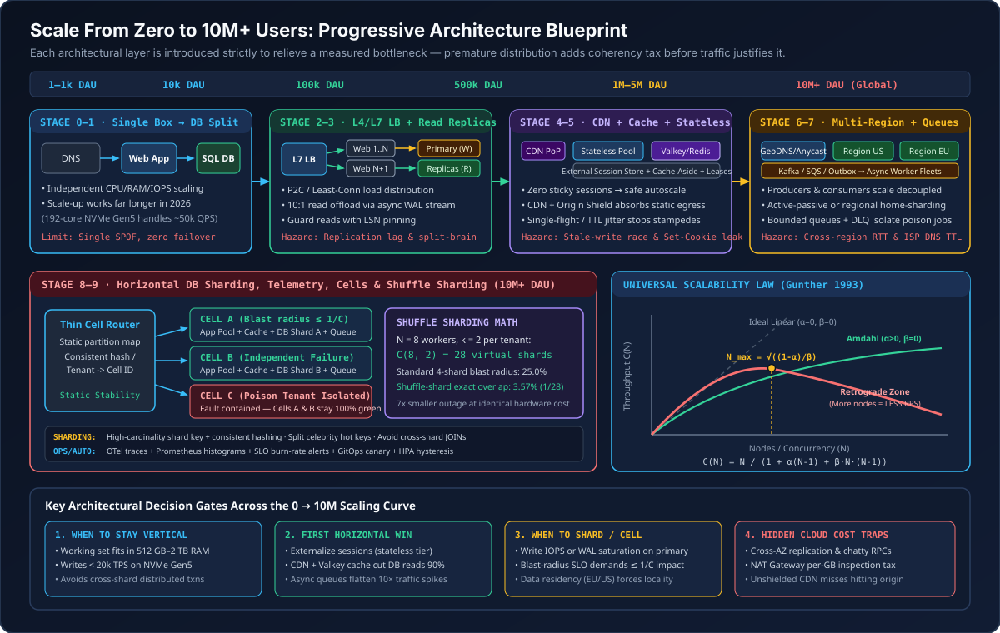
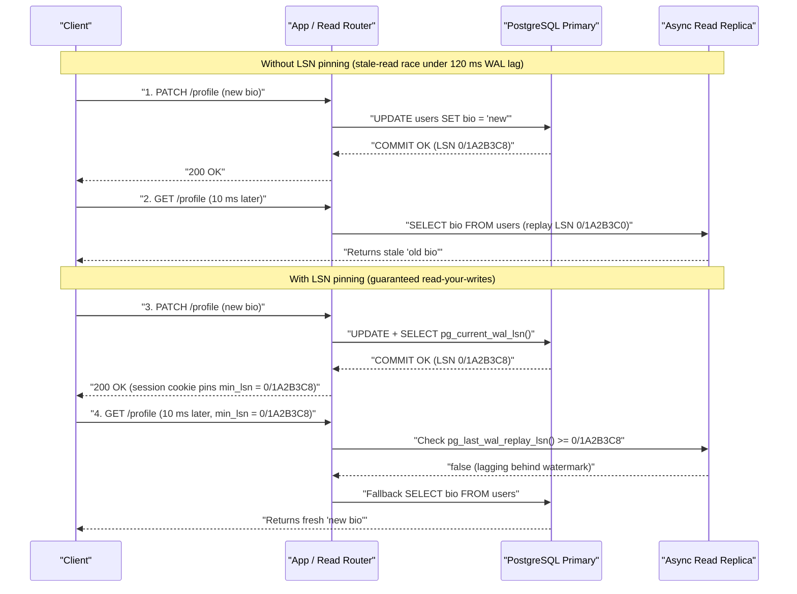
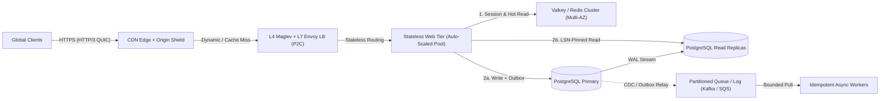
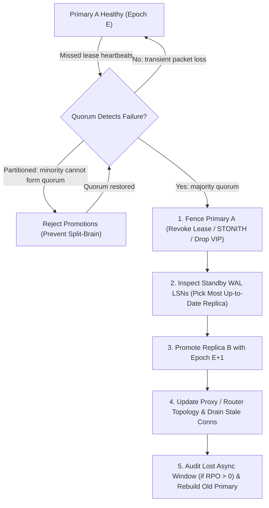
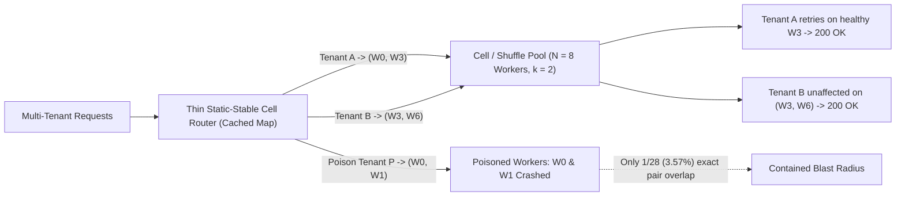
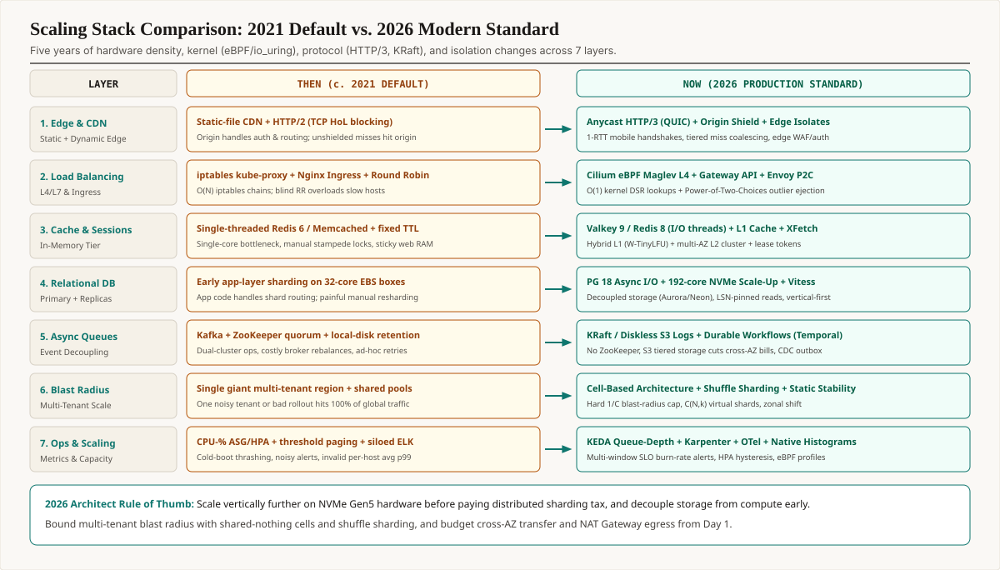

# Module 15 — Scale From Zero to Millions of Users: Progressive Architectural Evolution

Scaling a production system from one user to ten million daily active users is not a series of speculative rewrites; it is a disciplined engineering progression in which every new architectural layer relieves a measured bottleneck and is deferred until its distributed coordination tax is smaller than the local ceiling it removes. Grounded in Amdahl's Law (1967), Gustafson's Law (1988), Neil Gunther's Universal Scalability Law (1993/2007), the AWS Builders' Library (cell-based isolation, shuffle sharding, and static stability), DDIA 2e, and Alex Xu's _System Design Interview_ Vol. 1 Chapter 1, this module formalizes each transition from a single host to globally distributed, fault-isolated cells, compares the 2021 infrastructure baseline against 2026 production defaults, and backs every quantitative claim with deterministic TypeScript proofs.

This module composes foundational primitives owned by earlier tracks rather than duplicating their internals: storage engines, replication mechanics, WAL, sharding internals, and caching theory live in [Data Systems](../../data-systems/README.md); consensus, split-brain prevention, fencing tokens, and consistency models live in [Distributed Systems](../../distributed-systems/README.md); DNS, Anycast, BGP, TLS 1.3, HTTP/2–3, L4/L7 load balancers, and CDNs live in [Networking](../../networking/README.md); and consistent-hashing algorithms live in [Data Structures & Algorithms](../../../algorithms/dsa/README.md). Engine-specific operational depth lives in [PostgreSQL](../../../technologies/postgres/README.md) (PostgreSQL 18.6 MVCC, WAL, async I/O, replication), [Redis](../../../technologies/redis/README.md) (Redis 8.10.3 / Valkey 9.2.0), and [Observability](../../../technologies/observability/README.md) (OpenTelemetry, Prometheus 3.16.0, SLO burn-rate alerting). Within this track, capacity sizing formulas come from [Module 02](02-back-of-the-envelope-estimation.md), edge composition from [Module 03](03-networking-edge-and-cdn-composition.md), API and ID generation from [Module 04](04-api-design-data-modeling-and-id-generation.md), caching strategies from [Module 05](05-caching-strategies-and-invalidation.md), partitioning from [Module 06](06-scaling-reads-writes-and-partitioning.md), asynchronous queues from [Module 07](07-asynchrony-queues-streams-and-workflows.md), rate limiting and resilience from [Module 08](08-rate-limiting-load-shedding-and-resilience.md), and SLOs/DR from [Module 11](11-reliability-slos-observability-and-dr.md).

---

## 1. Mathematical Scaling Laws: Amdahl, Gustafson, and the Universal Scalability Law

Adding servers does not buy linear capacity indefinitely. Before changing a topology, quantify the upper bound of parallelism using three progressively more realistic laws.

### 1.1 Applying Amdahl's and Gustafson's Bounds to Service Capacity

Formal derivations of Amdahl's Law (strong scaling on a fixed workload) and Gustafson's Law (weak scaling under a fixed wall-clock latency budget) live in [Data Structures & Algorithms — Module 14](../../../algorithms/dsa/modules/14-parallel-algorithms-concurrency-and-interview-execution.md). In capacity engineering, those two bounds distinguish single-request parallelization from multi-user throughput: with a $5\%$ serial fraction ($s = 0.05$) on $N = 192$ cores, Amdahl caps speeding up one fixed request at $1 / (0.05 + 0.95/192) \approx 18.20\times$ (ceiling $1/s = 20\times$), whereas Gustafson lets a stateless web fleet scale aggregate request throughput across independent users to $0.05 + 0.95 \times 192 = 182.45\times$ inside the same `50 ms` SLO.

### 1.2 Gunther's Universal Scalability Law (USL) and Retrograde Scaling

Both Amdahl and Gustafson ignore inter-node coordination overhead. Neil Gunther's **Universal Scalability Law (USL)** adds a quadratic **coherency penalty** $\beta$ alongside linear **contention** $\alpha$ to model real distributed clusters:

$$C(N) = \frac{N}{1 + \alpha (N - 1) + \beta N (N - 1)}$$

- $\alpha \in [0, 1)$ represents **serialization contention** (waiting in line for a shared mutex, single primary database writer, or connection pool). When $\beta = 0$, USL reduces algebraically to Amdahl's Law with ceiling $1/\alpha$.
- $\beta \ge 0$ represents **pairwise coherency / crosstalk delay** (cache invalidation broadcasts, distributed lock leases, cluster membership gossip, or cross-node consensus rounds). Because every node exchanges state with other nodes, crosstalk grows as $O(N(N-1)) = O(N^2)$.

Differentiating $C(N)$ with respect to $N$ and setting $\frac{dC}{dN} = 0$ yields the exact peak concurrency $N_{\max}$ beyond which **retrograde scaling** occurs:

$$N_{\max} = \sqrt{\frac{1 - \alpha}{\beta}}$$

> [!IMPORTANT]
> Beyond $N_{\max}$, every additional server **reduces** total cluster throughput and **increases** tail latency because pairwise coherency chatter consumes more aggregate capacity than the new server contributes. Retrograde scaling is why blindly scaling out a tightly coupled database cluster or chatty distributed cache can worsen an active outage.

**Worked retrograde example (matching `examples/09-scaling-evolution.test.ts`).** Suppose a service exhibits $\alpha = 0.05$ (5% serialization) and $\beta = 0.005$ (0.5% cross-node coherency cost from synchronous invalidation and shared lock chatter). Its analytical throughput peak is $N_{\max} = \sqrt{(1 - 0.05) / 0.005} = \sqrt{190} \approx 13.78$ nodes:

| Nodes ($N$) | Contention $\alpha(N - 1)$ | Coherency $\beta N(N - 1)$ | Denominator | Relative Capacity $C(N)$ | Regime |
| --: | --: | --: | --: | --: | --- |
| `1` | `0.00` | `0.00` | `1.00` | `1.00×` | Baseline single node |
| `4` | `0.15` | `0.06` | `1.21` | `3.31×` | Sub-linear growth |
| `8` | `0.35` | `0.28` | `1.63` | `4.91×` | Diminishing marginal returns |
| `14` | `0.65` | `0.91` | `2.56` | **`5.47×`** | **Analytical peak** ($N_{\max} \approx 13.8$) |
| `32` | `1.55` | `4.96` | `7.51` | `4.26×` | Retrograde decay (`-22%` vs peak) |
| `64` | `3.15` | `20.16` | `24.31` | **`2.63×`** | **Severe collapse (`-52%` vs peak at `4.6×` cost)** |

Notice that quadrupling the fleet from 14 to 64 nodes cuts total throughput in half while multiplying cloud compute spend by 4.6×. Removing retrograde scaling requires attacking $\beta \to 0$ architecturally—partitioning state into independent shards or cells that never coordinate across boundaries—before adding more nodes.

### 1.3 Scale-Up vs. Scale-Out Economics on 2026 Hardware

Textbook scaling diagrams written in the 2010s assumed single servers topped out at 8–16 cores, 64 GB RAM, and spinning disks (`~200 IOPS`), forcing teams into premature sharding at low traffic. In 2026, a single flagship dual-socket server delivers **192 cores**, **1–2 TB DRAM**, and **NVMe Gen5 SSDs** pushing `10–14 GB/s` sequential throughput and millions of random IOPS with sub-millisecond local latency and zero network serialization.

> [!TIP]
> Exhaust vertical scale-up until single-box cost per QPS stops improving, single-writer WAL throughput saturates, or availability/blast-radius SLOs require multiple fault domains. On 2026 hardware, a well-indexed PostgreSQL 18 primary with connection pooling routinely handles `20k–50k` mixed QPS before sharding is justified; crossing into distributed sharding prematurely adds network hops, cross-shard transaction bans, and nonzero $\beta$ coherency tax without solving a measured bottleneck.

---

## 2. Progressive Evolution Blueprint: From 1 User to 10M+ DAU

Every stage below resolves one concrete bottleneck from Alex Xu's _System Design Interview_ Vol. 1 Chapter 1 while naming the new failure mode introduced by that layer.



### 2.0 Scaling Milestone Matrix

| Stage | Target DAU | Peak QPS | Dominant Bottleneck | Architectural Shift | New Primary Failure Mode |
| :-: | --- | --- | --- | --- | --- |
| **0** | `1–100` | `< 5` | None | Single host (DNS A record → Web + DB) | Total SPOF; disk exhaustion; zero HA |
| **1** | `100–10k` | `10–100` | App/DB CPU, RAM, and NVMe IOPS contention | Separate web server and dedicated database host | Network partition; DB connection-pool exhaustion |
| **2** | `10k–100k` | `100–1,000` | Single web host CPU & zero deploy redundancy | Horizontal web pool behind L4/L7 Load Balancer | Load balancer SPOF; sticky-session node loss |
| **3** | `100k–1M` | `1k–10k` | Read query saturation (`10:1`–`100:1` R:W ratio) | Primary DB + asynchronous/semi-sync read replicas | Stale reads during WAL lag; split-brain promotion |
| **4** | `1M–3M` | `10k–30k` | Repeated hot-key reads & static asset egress | Valkey/Redis cache tier + CDN with Origin Shield | Cache stampede; stale-write race; `Set-Cookie` CDN leak |
| **5** | `3M–5M` | `30k–60k` | Local in-memory sessions block autoscaling/AZ loss | Strictly stateless web tier + external Valkey sessions | Session store outage; cold-start autoscale thrashing |
| **6** | `5M–8M` | `60k–120k` | Single-region latency & regional outage blast radius | Multi-region topology (GeoDNS / Anycast + regional DBs) | ISP DNS TTL caching lag; cross-region write conflicts |
| **7** | `8M–10M` | `120k–200k` | Tightly coupled slow writes & bursty traffic spikes | Message queues, transactional outbox, async workers | Unbounded queue backlog; poison-pill retry loops |
| **8** | `10M+` | `200k+` | Single primary write IOPS, storage & WAL ceiling | Horizontal DB sharding via consistent hashing | Hot celebrity shard; resharding storms; lost JOINs |
| **9** | `10M+ global` | `500k+` | Operational complexity & multi-tenant blast radius | OTel/SLO burn-rate alerts, HPA hysteresis, Cells & Shuffle Shards | Deep health-check cascades; control-plane coupling |

### 2.1 Stage 0–1: Single Server to Web / Database Tier Separation

At **Stage 0**, DNS resolves `api.example.com` to one host running the reverse proxy, application runtime, database, and background cron tasks. Both web clients (HTML/JS/CSS) and mobile clients (HTTP/JSON or Protobuf) hit the same socket. This architecture is intentionally minimal: zero network hops between app and DB, trivial local transactions, and zero distributed state.

At **Stage 1**, growth exposes resource contention: application garbage collection and request bursts evict PostgreSQL's OS page cache, while random HTTP asset reads compete with synchronous database `fsync` WAL commits for disk IOPS. Moving the database onto a dedicated private-subnet host lets each tier scale CPU, RAM, and NVMe independently.

**SQL vs. NoSQL boundary at Stage 1.** Select relational storage (PostgreSQL 18.6) by default whenever the domain requires ACID transactions, foreign-key integrity, secondary indexes, or ad-hoc joins. Introduce NoSQL (key-value, document, wide-column, or graph stores) only when measured access patterns prove one of four constraints: ultra-low sub-millisecond key-value latency at extreme scale, genuinely schemaless/polymorphic payloads where relational normalization degrades queries, pure append-heavy wide-column telemetry exceeding single-primary write IOPS, or multi-region active-active writes with tunable quorum consistency (see [Data Systems](../../data-systems/README.md) and [Module 04](04-api-design-data-modeling-and-id-generation.md)).

### 2.2 Stage 2–3: Load Balancers and Database Read Replication

At **Stage 2**, cloning the application tier behind a **Load Balancer** removes the web-tier single point of failure and enables rolling deployments. Clients connect to the load balancer's public virtual IP (VIP); the balancer forwards traffic over private RFC 1918 subnets using **Power of Two Random Choices (P2C)** or **Least Connections** rather than blind Round Robin (which overloads slow instances). Use **L4** balancers (NLB, eBPF/Cilium Maglev) for maximum packet throughput and TCP/UDP protocol agnosticism, and **L7** balancers (Envoy, ALB, Gateway API) for TLS 1.3 termination, HTTP/2–3 multiplexing, path/header routing, and gRPC request-level balancing (see [Networking](../../networking/README.md) and [Module 03](03-networking-edge-and-cdn-composition.md)). Always deploy load balancers in redundant pairs across Availability Zones so the balancer never becomes the new SPOF.

At **Stage 3**, read traffic (`10:1` to `100:1` read-to-write ratio) saturates the database long before writes do. **Primary–Replica replication** routes all `INSERT`/`UPDATE`/`DELETE` mutations to the Primary, which streams its Write-Ahead Log (WAL) to $R$ Read Replicas serving `SELECT` traffic:

- **Asynchronous replication** acknowledges commits as soon as the Primary flushes local WAL (`~1 ms` write latency), but replicas lag by `5–500 ms` (or seconds during heavy batch writes).
- **Semi-synchronous / quorum replication** waits for at least one standby in another AZ to durably flush the WAL before acknowledging the client (`RPO = 0` for single-AZ loss at the cost of `+1–2 ms` cross-AZ RTT).

> [!WARNING]
> Unplanned primary failover is the #1 source of silent data corruption in Stage 3 clusters. Promoting an asynchronous replica drops every committed transaction still in flight across the replication lag window (`RPO > 0`), and promoting a replica while the old primary is merely network-partitioned creates **split-brain**: two writable primaries accepting conflicting mutations. Always fence the old primary (lease revocation / STONITH / epoch increment) before opening writes on the promoted standby (see [Distributed Systems](../../distributed-systems/README.md)).

**Eliminating read-your-writes staleness with PostgreSQL 18 LSN pinning.** When a user updates their profile and immediately reloads the page, hitting a lagging replica displays stale data. Capture the primary's WAL Log Sequence Number (`pg_current_wal_lsn()`) at write commit, persist it in the user's short-lived session watermark, and route subsequent reads to a replica only once its applied replay position reaches that LSN—falling back to the primary if replica lag exceeds a strict wait budget (e.g., `20 ms`):

```sql
-- 1. On Primary immediately after COMMIT inside the write transaction:
SELECT pg_current_wal_lsn()::text AS commit_lsn; -- e.g. '0/1A2B3C8'

-- 2. On Read Replica (or connection router) before serving the user's immediate read:
SELECT pg_wal_lsn_diff(
  pg_last_wal_replay_lsn(),
  '0/1A2B3C8'::pg_lsn
) >= 0 AS replica_caught_up;
-- If false beyond lag budget (e.g. 20 ms), route this single read to Primary.
```



### 2.3 Stage 4–5: Caching, CDN Edge Offload, and Stateless Web Tier

At **Stage 4**, two distinct caching layers absorb `80%–98%` of read load and egress bandwidth:

1. **CDN Edge + Origin Shield**: Offloads static media (images, JS/CSS bundles, video segments) and cacheable public API responses to globally distributed edge PoPs. An **Origin Shield** (a designated regional mid-tier cache) collapses simultaneous cache misses across 200+ edge PoPs into a single origin request. Never allow `Set-Cookie` or unsegmented authenticated pages to be cached publicly (`Cache-Control: private, no-store`), or the CDN will leak User A's response to User B (see [Module 03](03-networking-edge-and-cdn-composition.md)).
2. **In-Memory Data Cache (Valkey 9.2.0 / Redis 8.10.3)**: Absorbs hot database reads in `< 1 ms` using **cache-aside** paired with **single-flight request coalescing**, **TTL jitter** (preventing synchronized expiry storms), **W-TinyLFU** or LFU eviction, and **Memcache Leases** to close the cache-aside stale-write race (see [Module 05](05-caching-strategies-and-invalidation.md) and [Redis](../../../technologies/redis/README.md)). Never treat the cache as a single point of failure: deploy across multiple AZs and cap warm-up queries when a node restarts.

At **Stage 5**, the application tier becomes **strictly stateless**. Storing user sessions in local web-server RAM forces sticky load-balancer affinity; losing a single AZ immediately logs out `1/3` of active users and triggers a re-authentication thundering herd against the database and identity provider. Externalizing session state into a multi-AZ Valkey/Redis cluster (keyed by opaque high-entropy session ID with sliding TTL) enables instant revocation and makes every web node interchangeable during autoscaling and rolling deploys. Alternatively, short-lived asymmetric **signed JWTs** (`EdDSA`/`ES256`, 5–15 min TTL) eliminate session-store lookups on read paths at the cost of delayed revocation unless paired with a compact revocation list or short refresh-token rotation.



### 2.4 Stage 6–8: Multi-Region Topologies, Message Queues, and Database Sharding

At **Stage 6**, serving global users under `< 100 ms` RTT and surviving regional outages requires **Multi-Data-Center / Multi-Region** deployment. **GeoDNS** resolves hostnames to the nearest healthy region based on the client's recursive resolver IP, whereas **Anycast** advertises one VIP globally over BGP so edge routers steer packets to the closest PoP instantaneously. Speed-of-light physics fixes trans-oceanic round trips (`us-east-1` ↔ `eu-west-1` is `~75–90 ms`, `us-west-2` ↔ `ap-northeast-1` is `~110–130 ms`), making synchronous global consensus commits prohibitively slow for general web writes. Production systems therefore choose between:

- **Active-Passive DR** (one primary write region, warm standby region with async replication, `RPO > 0` seconds, `RTO` minutes).
- **Geo-Partitioned Active-Active (Home-Region Sharding)** (EU users write exclusively to `eu-central-1`, US users write exclusively to `us-east-1` — combining low local latency with GDPR data residency and zero cross-region write conflicts).
- **True Multi-Leader Active-Active** (only where domain semantics tolerate CRDTs, LWW, or commutative counters).

At **Stage 7**, **Message Queues and Partitioned Logs** (Kafka in KRaft mode, SQS, NATS JetStream) decouple slow or bursty side effects (image transcoding, email dispatch, search indexing, webhook delivery) from the synchronous HTTP critical path. Producers write business state plus an outbox row inside one atomic database transaction; a relay publishes to the queue asynchronously, and consumers enforce **idempotency keys** to handle at-least-once redelivery cleanly while routing repeatedly failing poison messages to a **Dead-Letter Queue (DLQ)** (see [Module 07](07-asynchrony-queues-streams-and-workflows.md)).

At **Stage 8**, when vertical scale-up, read replicas, caching, and async buffering still leave the single primary saturated on write IOPS or storage capacity (`> 5–10 TB` hot relational data or `> 30k–50k` sustained write TPS), horizontally **shard** the database across $S$ independent primary clusters. Every shard runs the identical schema on a disjoint key range:

- **Shard key selection**: Pick a high-cardinality, immutable key aligned with `> 90%` of operational queries (e.g., `tenant_id` or `user_id`) so transactions remain single-shard.
- **Resharding**: Avoid naive `hash(key) % S` (which remaps $\frac{S}{S+1}$ of all keys on expansion); use **consistent hashing with virtual nodes** (100–200 vnodes/host) or managed logical-shard splitting (Vitess / Citus / DynamoDB) to move only $\approx 1/S$ of keys (see [Module 06](06-scaling-reads-writes-and-partitioning.md) and [Data Structures & Algorithms](../../../algorithms/dsa/README.md)).
- **Celebrity / hot-shard mitigation**: Isolate extreme hot tenants onto dedicated shards or salt read-heavy keys across $K$ sub-keys with L1 micro-caching.
- **Cross-shard JOIN ban**: Denormalize read views or assemble secondary views asynchronously via CDC streams into Elasticsearch/ClickHouse rather than issuing scatter-gather distributed joins on the OLTP critical path.



### 2.5 Stage 9: Telemetry, Automation, and Autoscaling Stability

At 10M+ DAU, manual operations collapse. Instrument every tier with **OpenTelemetry** traces, structured logs, and Prometheus 3.16.0 native histograms, paging strictly on **multi-window multi-burn-rate SLO alerts** rather than raw CPU spikes (see [Module 11](11-reliability-slos-observability-and-dr.md)).

**Preventing deep health-check cascades and autoscaler thrashing.** Two operational misconfigurations cause more Stage 9 outages than traffic itself:

1. **Shallow vs. deep health probes**: If `/readyz` queries PostgreSQL or Valkey on every 5-second load-balancer probe, a 3-second database blip marks 100% of healthy stateless web pods unready, ejects the entire fleet from the load balancer, and triggers an autoscaler storm that keeps the product down long after the database recovers. Keep `/livez` strictly process-local and degrade `/readyz` gracefully (circuit breakers + fail-open/partial responses).
2. **Autoscaler cooldown hysteresis**: When pods require 60–120 s to pull images, warm JIT, and hydrate caches, scaling on raw CPU with zero cooldown causes overshoot during boot delay followed by immediate scale-in on brief dips (sawtooth thrashing). Account for in-flight booting pods, scale workers on **queue depth (KEDA)** rather than CPU, widen scale-in hysteresis, and enforce a `300–600 s` scale-down stabilization window:

```yaml
# Kubernetes HPA v2 + KEDA-compatible hysteresis policy preventing cold-start thrashing
apiVersion: autoscaling/v2
kind: HorizontalPodAutoscaler
metadata:
  name: checkout-api
spec:
  scaleTargetRef:
    apiVersion: apps/v1
    kind: Deployment
    name: checkout-api
  minReplicas: 6
  maxReplicas: 120
  metrics:
    - type: Resource
      resource:
        name: cpu
        target:
          type: Utilization
          averageUtilization: 65
  behavior:
    scaleUp:
      stabilizationWindowSeconds: 15
      policies:
        - type: Percent
          value: 50
          periodSeconds: 60
    scaleDown:
      stabilizationWindowSeconds: 300 # Hold warmed capacity across 5-minute dips
      policies:
        - type: Percent
          value: 10
          periodSeconds: 60
```

```nginx
# Shallow Nginx/Envoy local health endpoint — NEVER probe downstream DB/Cache here
location = /livez {
    access_log off;
    return 200 "ok\n";
}
# Readiness checks only local worker initialization / drain flag, not remote DB reachability
location = /readyz {
    access_log off;
    if (-f /var/run/app/draining) { return 503; }
    return 200 "ready\n";
}
```

---

## 3. Niche and Principal-Level Scaling Patterns

Once horizontal scaling crosses millions of users, the limiting factor shifts from raw throughput to **blast radius**, **noisy neighbors**, and **control-plane coupling**.

### 3.1 Cell-Based Architecture

A **cell** is a complete, fixed-maximum-size vertical instance of the entire service stack (stateless compute, cache, database shard, and queue) operating as an independent failure domain. A **thin, ultra-simple stateless Cell Router** sits in front, mapping each `tenant_id` or `account_id` deterministically to its assigned cell.

- **Hard blast-radius ceiling**: With $C = 20$ cells, a bad deployment, schema lock, poison-pill request, or database corruption inside one cell can impact at most $1/C = 5\%$ of traffic.
- **Eliminates USL retrograde scaling**: Because cells never coordinate with each other ($\beta = 0$ across cells), aggregate capacity scales strictly linearly as new cells are stamped out via Infrastructure as Code.
- **Wave deployments**: Changes roll out to Cell 0 (canary) → 1 cell → 5 cells → all cells, catching subtle scaling regressions before global exposure.

### 3.2 Shuffle Sharding Combinatorics

Standard multi-tenant sharding splits $N$ workers into $N/k$ disjoint shards of size $k$ (for redundancy, $k \ge 2$). With $N = 8$ workers and $k = 2$, you get only $4$ disjoint pairs: a poison-pill tenant that crashes both of its workers takes down **25%** ($1/4$) of all other tenants sharing that pair.

**Shuffle sharding** (AWS Builders' Library; used in Amazon Route 53, Hyperplane, and SQS) assigns each tenant a deterministic, pseudo-random subset of $k$ distinct workers chosen without replacement from the full pool of $N$ workers. The number of unique virtual shards grows combinatorially:

$$\binom{N}{k} = \frac{N!}{k!\,(N - k)!}$$

| Physical Workers ($N$) | Workers per Tenant ($k$) | Fixed Disjoint Shards | Fixed Total-Outage Blast Radius | Shuffle Virtual Shards $\binom{N}{k}$ | Shuffle Exact-Overlap Blast Radius | Reduction Factor |
| --: | --: | --: | --: | --: | --: | --: |
| `8` | `2` | `4` | `25.00%` | `28` | **`3.57%`** (`1/28`) | **`7.0×`** |
| `16` | `2` | `8` | `12.50%` | `120` | **`0.83%`** (`1/120`) | **`15.0×`** |
| `32` | `4` | `8` | `12.50%` | `35,960` | **`0.0028%`** (`1/35,960`) | **`4,495×`** |

At $N = 8, k = 2$, even if a poison tenant crashes both of its workers (25% of physical fleet), **96.43% of other tenants retain at least one completely healthy worker** and continue serving transparently via retry! Below is the exact deterministic Fisher–Yates SHA-256 allocator verified in [`examples/lib/scaling-models.ts`](../examples/lib/scaling-models.ts):

```typescript
import { createHash } from 'node:crypto';

export function assignShuffleShard(
  tenantId: string,
  totalWorkers: number,
  shardSize: number,
): number[] {
  const pool = Array.from({ length: totalWorkers }, (_, idx) => idx);
  const chosen: number[] = [];
  for (let i = 0; i < shardSize; i++) {
    const digest = createHash('sha256').update(`${tenantId}#${i}`).digest();
    const pickIdx = digest.readUInt32BE(0) % pool.length;
    chosen.push(pool.splice(pickIdx, 1)[0]!);
  }
  return chosen.sort((a, b) => a - b);
}
```

### 3.3 Static Stability

Defined by Colm MacCárthaigh in the AWS Builders' Library, **Static Stability** requires that the **data plane continues serving steady-state traffic even if the control plane is completely unavailable**. Concretely:

- Pre-provision multi-AZ compute headroom (e.g., run 3 AZs at `<= 60%` peak utilization) so losing one AZ does not require the EC2/Kubernetes control plane to launch new nodes during an active regional impairment.
- Cache routing tables, cell maps, and feature flags locally inside data-plane nodes with fail-static fallback instead of making synchronous RPCs to configuration stores on the request path.



---

## 4. Production Gotchas and Failure Modes

1. **USL retrograde collapse under hidden coherency.** _Symptom:_ Scaling a stateful cluster from 16 to 64 nodes _lowers_ aggregate QPS and doubles p99 latency. _Root cause:_ Cross-node coherency ($\beta > 0$) from cluster-wide cache invalidations, distributed lock chatter, or full-mesh gossip grows as $O(N^2)$ past $N_{\max} = \sqrt{(1-\alpha)/\beta}$. _Mitigation:_ Fit $\alpha$ and $\beta$ via load tests, cap cluster size below $N_{\max}$, and partition into shared-nothing cells ($\beta \to 0$).
2. **Sticky-session AZ evacuation storm.** _Symptom:_ Losing one of three Availability Zones forces `33%` of logged-in users to re-authenticate simultaneously, overwhelming the identity provider and database. _Root cause:_ Session state stored in web-node local RAM with LB cookie affinity. _Mitigation:_ Externalize sessions to multi-AZ Valkey/Redis or short-lived signed tokens so the web tier is 100% stateless.
3. **Async replica promotion split-brain and silent write loss.** _Symptom:_ After automated DB failover, recent confirmed customer orders vanish and two nodes briefly accept conflicting writes. _Root cause:_ Promoting a lagging async replica (`RPO > 0`) without fencing the partitioned old primary. _Mitigation:_ Enforce quorum leader election, hard fencing (lease revocation / STONITH / monotonic epochs), and semi-synchronous standby replication where `RPO = 0` is mandatory.
4. **Cold-cache failover thundering herd.** _Symptom:_ Shifting regional traffic to a healthy failover cluster causes immediate database CPU `100%` collapse despite adequate DB sizing. _Root cause:_ The failover region's Redis/Valkey cache starts cold, turning a normal `95%` cache-hit workload into a `20×` database read surge. _Mitigation:_ Shadow-warm failover caches via async replication/traffic mirroring, enforce `singleflight` request coalescing, and deploy CDN Origin Shield.
5. **GeoDNS recursive-resolver TTL ignoring.** _Symptom:_ Even after setting Route 53 / GeoDNS TTL to `30 s` and shifting weight to `0%`, `10%–25%` of clients keep hammering the dead region for 15–60 minutes. _Root cause:_ ISP recursive resolvers, corporate proxies, and JVM/client DNS caches routinely clamp minimum TTLs or hold open HTTP/2 TCP sockets indefinitely. _Mitigation:_ Front global traffic with **Anycast** VIPs (e.g., Global External ALB / CloudFront / Cloudflare) or Route 53 ARC zonal shift, and close/drain keep-alive connections cleanly.
6. **Cross-AZ NAT Gateway and inter-zone egress cost shock.** _Symptom:_ Cloud networking bills exceed EC2/GKE compute bills even when external user traffic is flat. _Root cause:_ Chatty microservices and read replicas route randomly across AZs (`$0.01/GB` each direction = `$0.02/GB` round trip) and send S3/DynamoDB calls through regional NAT Gateways (`$0.045/GB` data-processing fee). _Mitigation:_ Provision zero-fee VPC Gateway Endpoints for object/KV storage, enable Kubernetes Topology Aware Routing / Envoy AZ-local preference, and cross AZ boundaries only during failover.
7. **Celebrity hot-shard saturation.** _Symptom:_ One database or cache shard hits `100%` CPU while the remaining 31 shards sit at `15%` utilization. _Root cause:_ Zipfian skew (a viral creator or enterprise tenant) hashes every request onto a single shard key. _Mitigation:_ Add short-TTL L1 in-process caching, salt read-heavy keys across $K$ sub-keys, isolate extreme tenants into dedicated cells, and enforce per-tenant rate limits ([Module 08](08-rate-limiting-load-shedding-and-resilience.md)).
8. **Autoscaler oscillation under cold-start latency.** _Symptom:_ Fleet replica count swings violently between 10 and 60 pods every few minutes while p99 spikes repeatedly. _Root cause:_ Evaluation interval (`15 s`) is shorter than pod boot/warm-up (`90 s`) with zero scale-down cooldown, causing overshoot during warm-up and premature termination on minor dips. _Mitigation:_ Account for in-flight booting pods, widen scale-in hysteresis (`65%` up / `35%` down), enforce a `300 s` `stabilizationWindowSeconds`, and scale workers on queue depth via KEDA.

---

## 5. Technology Comparison: Then vs. Now (2021 vs. 2026)

Five years of hardware density leaps, Linux kernel adoption (`eBPF`, `io_uring`), protocol standardization (`HTTP/3`, `KRaft`, `Gateway API`), and open-source ecosystem shifts fundamentally changed default scaling architectures.



| Architectural Layer | 2021 Default | 2026 Modern Standard | Why It Changed & Migration Pitfall |
| --- | --- | --- | --- |
| **Edge & CDN** | Static-file CDN over HTTP/2 (TCP head-of-line blocking) | Anycast **HTTP/3 (QUIC)** + **Origin Shield** + Edge Isolates (Cloudflare Workers / Fastly Compute) | Eliminates mobile TCP HoL stalls and coalesces edge misses; _pitfall:_ duplicating auth logic at edge without matching origin revocation. |
| **L4 / L7 Load Balancing** | `iptables` `kube-proxy` + Nginx Ingress + Round Robin | **Cilium eBPF + Maglev** L4 DSR + **Kubernetes Gateway API** + **Envoy P2C** | $O(N)$ `iptables` rules degrade past 5k services while eBPF maps stay $O(1)$; _pitfall:_ misconfigured Envoy outlier ejection ejecting the entire pool. |
| **Web Compute** | VM Auto Scaling Groups (`90–180 s` cold boot) | Containers + **Karpenter** rapid node provisioning + serverless/edge isolates for spiky workloads | Cuts scale-out lag from minutes to seconds; _pitfall:_ deep `/readyz` checks causing cascading pod restarts. |
| **Session & Cache Tier** | Single-threaded Redis 6 / Memcached + fixed TTL | **Valkey 9.2.0 / Redis 8.10.3** (multi-threaded I/O) + L1 **W-TinyLFU** micro-cache + XFetch/Leases | Relieves single-core NIC bottlenecks and license uncertainty; _pitfall:_ L1 local caches serving stale RBAC/revoked sessions if TTL exceeds security bounds. |
| **Relational Scaling** | Premature app-layer sharding on 32-core EBS boxes | **PostgreSQL 18.6** (async I/O) on 192-core NVMe Gen5 scale-up + LSN-pinned replicas + decoupled storage (Aurora / Neon / Vitess) | Vertical hardware grew `5×–8×` while decoupled storage cuts replica lag; _pitfall:_ promoting async replicas without fencing tokens. |
| **Distributed SQL / NoSQL** | Early CockroachDB/TiDB; hand-sharded MySQL; Cassandra 3 | Mature Spanner / CockroachDB / TiKV / ScyllaDB (shard-per-core C++) / DynamoDB | Predictable tail latency without JVM GC pauses; _pitfall:_ assuming cross-region distributed SQL transactions are free of speed-of-light RTT. |
| **Async Queues & Workflows** | Kafka + **ZooKeeper** ensemble + hand-rolled retry state machines | Kafka **KRaft** / diskless S3-backed logs (WarpStream / AutoMQ) + **Temporal** durable workflows + CDC outbox | Eliminates ZooKeeper ops and slashes cross-AZ broker replication bills; _pitfall:_ missing idempotency keys on at-least-once consumers. |
| **Multi-Region & Isolation** | Single giant multi-tenant region + GeoDNS `60 s` TTL | **Cell-Based Architecture** + **Shuffle Sharding** + Anycast / ARC Zonal Shift + Static Stability | Caps noisy-neighbor and regional blast radius deterministically; _pitfall:_ leaving one shared global DB underneath "cells", voiding isolation. |
| **Autoscaling** | CPU-% HPA with tight thresholds and no cooldown | **KEDA** queue-depth / RPS scaling + HPA `stabilizationWindowSeconds` + predictive pre-warming | CPU lags actual queueing overload on I/O-bound services; _pitfall:_ scaling workers faster than downstream DB connection pools can absorb. |
| **Observability** | Siloed StatsD/ELK + static CPU threshold paging | **OpenTelemetry** + **Prometheus 3.16.0** native histograms + multi-window SLO burn-rate alerts + eBPF continuous profiling | Pages on user-visible error-budget burn instead of noisy host alerts; _pitfall:_ attaching `user_id` labels and OOMing TSDB RAM. |

**Pitfalls of mixing 2021 and 2026 layers during live migration.** Hybrid transition states cause subtle regressions when invariants across adjacent tiers silently conflict. Migrating sessions to a modern multi-AZ Valkey cluster provides zero AZ-outage resilience if legacy load-balancer sticky-cookie rules remain enabled and pin users to dead instances; enabling L1 in-process caching without RESP3 client-side invalidation tracking serves silently stale entries; running two autoscalers (for example CPU HPA alongside KEDA) on the same Deployment triggers immediate replica-count oscillation; and adopting PostgreSQL 18 LSN-pinned reads with Patroni-managed quorum failover while leaving a `300 s` GeoDNS TTL (plus negative DNS caching in ISP resolvers) lets routing lag erase the correctness gain. Audit every cross-layer contract explicitly before cutting traffic over, and validate transitions via shadow traffic and GameDay AZ-evacuation drills.

---

## 6. Executable Proof Map

Every quantitative model and failure mode in this module is backed by deterministic unit and property tests in [`examples/09-scaling-evolution.test.ts`](../examples/09-scaling-evolution.test.ts) (implementing models in [`examples/lib/scaling-models.ts`](../examples/lib/scaling-models.ts)):

| Concept in This Module | Deterministic Test in `09-scaling-evolution.test.ts` | Verified Invariant / Negative Proof |
| --- | --- | --- |
| **USL Retrograde Scaling** | `uslRelativeCapacity` & `uslPeakNodes` with $\alpha = 0.05, \beta = 0.005$ | Proves throughput peaks near $N_{\max} \approx 13.78$ (`~5.47×`) and collapses by `> 45%` at $N = 64$ (`~2.63×`), while $\beta = 0$ never regresses. |
| **Sticky vs. Stateless AZ Loss** | `simulateSessionTierFailure` losing 3 of 9 web nodes (`1/3` AZs) with `sessionStoreFailed` toggled | Negative tests proving sticky local sessions drop `30,000 / 90,000` (`33.3%`) users, multi-AZ Valkey preserves `100%` of sessions (assuming replicated store availability), and an un-replicated Valkey SPOF drops `100%` if it fails. |
| **Async Replica Stale Read vs. LSN Pinning** | `PrimaryReplicaCluster` with `120 ms` WAL lag | Negative test proving immediate naive replica read returns stale `'old-bio'` at `t = 10 ms`, while `readWithLsnPin` routes safely to primary and shifts back to replica once caught up. |
| **Shuffle Sharding Blast Radius** | `assignShuffleShard` vs. `assignFixedShard` ($N = 8, k = 2$, 2,800 tenants) + `fast-check` property test | Proves poison-pill tenant total-outage overlap drops from `~25%` (`1/4`) to `~3.57%` (`1/28`, `> 5×` reduction) and verifies deterministic sorted $k$-subset invariants across 200 seeds. |
| **Autoscaler Cold-Start Thrashing** | `simulateAutoscaler` separating `trackInflightBoots` and `scaleDownCooldownTicks` (`bootDelayTicks = 3`) | Negative tests proving naive scaling without in-flight boot tracking thrashes `>= 2×` more than stabilized HPA, and that even with in-flight boot tracking enabled, zero cooldown still flaps more than hysteresis + cooldown stabilization. |

---

## Interview Drill

### Question 1: A stateless service's throughput scales cleanly from 1 to 14 nodes, plateaus, and then drops by half when you expand to 64 nodes. Derive the law explaining this behavior and name two concrete architectural fixes.

<details><summary>Answer</summary>

This is **retrograde scaling** governed by Gunther's Universal Scalability Law: $C(N) = \frac{N}{1 + \alpha(N-1) + \beta N(N-1)}$, where $\alpha$ is linear contention and $\beta$ is quadratic cross-node coherency overhead. Throughput peaks at $N_{\max} = \sqrt{(1-\alpha)/\beta}$ (for $\alpha = 0.05, \beta = 0.005$, $N_{\max} \approx 13.78$ nodes at `5.47×`, collapsing to `2.63×` at $N = 64$). Concrete fixes: (1) locate and eliminate $O(N^2)$ crosstalk such as full-mesh gossip, broadcast cache invalidations, or shared distributed locks, driving $\beta \to 0$; and (2) partition the fleet into independent **shared-nothing cells** capped below $N_{\max}$ so aggregate capacity scales linearly with cell count.

</details>

### Question 2: During an unplanned primary PostgreSQL crash, your automated failover promotes an asynchronous read replica in 15 seconds. Customers report both missing recent orders and duplicate invoice IDs. Diagnose both defects and specify the safe failover protocol.

<details><summary>Answer</summary>

Missing confirmed orders occur because asynchronous replication has `RPO > 0`: transactions committed on the primary inside the WAL lag window had not reached the replica before promotion. Duplicate/divergent state occurs when the old primary was network-partitioned rather than dead and continued accepting writes concurrently with the promoted replica (**split-brain**). Safe protocol: (1) detect failure via majority quorum rather than a single monitor; (2) **fence** the former primary (revoke its lease, cut VIP/network traffic, or STONITH) before opening writes on the standby; (3) bump a monotonic **epoch/fencing token** so storage/proxies reject stale-leader writes; (4) select the replica with the highest WAL LSN (or run semi-sync quorum where `RPO = 0` is required); and (5) enforce client idempotency keys for safe retries across cutover.

</details>

### Question 3: Your 12-node web tier spans 3 Availability Zones using load-balancer cookie stickiness to local in-memory sessions. Why does a single-AZ failure trigger a full-site outage even though 8 healthy nodes remain?

<details><summary>Answer</summary>

Losing one AZ destroys `4 / 12` (`33.3%`) of local session memory instantaneously. Every user pinned to those nodes gets silently logged out and hits the remaining 8 nodes simultaneously with login/OAuth token exchanges—a **re-authentication thundering herd** that saturates password hashing CPU (`Argon2id`/`bcrypt`), identity providers, and primary database writes, cascading into a total outage. Fix: externalize sessions into a multi-AZ Valkey/Redis cluster (or short-lived signed JWTs with bounded revocation) so the web tier is strictly stateless, and maintain `>= 33%` spare multi-AZ compute headroom (**static stability**).

</details>

### Question 4: Explain how Shuffle Sharding with $N = 8$ physical workers and $k = 2$ workers per tenant achieves a 7× smaller blast radius than standard 4-shard isolation without buying a single extra server.

<details><summary>Answer</summary>

Standard fixed sharding partitions 8 workers into $8 / 2 = 4$ disjoint pairs, so a poison-pill tenant crashing both of its workers takes out every other tenant assigned to that exact pair—`1/4 = 25%` of all tenants. Shuffle sharding assigns each tenant a deterministic pseudo-random subset of $k = 2$ workers out of $N = 8$, creating $\binom{8}{2} = 28$ distinct virtual shards. Even though the poison tenant still crashes 2 physical workers, only $1/28 \approx 3.57\%$ of other tenants share _both_ crashed workers; the remaining `96.43%` still have at least one healthy worker in their pair and stay online via client/router retry—a `7×` total-outage blast-radius reduction at identical hardware cost.

</details>

### Question 5: An engineer proposes sharding your PostgreSQL database into 16 shards at 50k DAU (`~200` write TPS) "so we never have to migrate later." Push back quantitatively using 2026 hardware economics and operational trade-offs.

<details><summary>Answer</summary>

Sharding at `200` write TPS is premature distribution that trades a `~1%` utilized single box for permanent architectural complexity: loss of cross-shard `JOIN`s and ACID transactions, complex resharding pipelines, operational multiplication across 16 backup/failover topologies, and nonzero distributed coherency overhead. On 2026 hardware, a single vertical scale-up PostgreSQL 18 primary (up to 192 cores, 1–2 TB RAM, NVMe Gen5) paired with read replicas, PgBouncer pooling, and Valkey caching handles `20k–50k` QPS cleanly—100× above current demand. Better path: keep one relational primary now, enforce **shard-ready discipline** (include `tenant_id` in every primary/foreign key and avoid cross-tenant joins) so sharding or cell extraction later is mechanical when measured write IOPS or blast-radius SLOs actually require it.

</details>

### Question 6: You update GeoDNS weights to evacuate `us-east-1` with a `60 s` TTL, yet 18% of users keep failing against `us-east-1` for 20 minutes. Explain why and design the modern 2026 routing architecture that avoids this.

<details><summary>Answer</summary>

GeoDNS TTL is advisory, not enforceable: many ISP recursive resolvers, enterprise proxies, and client runtimes clamp minimum TTLs to `5–30 minutes` or reuse long-lived HTTP/2 TCP connections without re-resolving DNS. Modern 2026 fix: terminate traffic at a **Global Anycast L4/L7 Edge** (e.g., CloudFront, Cloudflare, GCP Global External ALB) where a single unchanging Anycast VIP steers packets at BGP/edge speed using sub-second backend health checks, pair with **Route 53 ARC Zonal Shift** for single-AZ evacuations, and send HTTP/2 `GOAWAY` frames to force clients to reconnect cleanly to healthy pools.

</details>

### Question 7: Your microservices team complains that AWS networking bills doubled even though customer traffic stayed flat. Where are the hidden scaling costs, and how do you fix them without sacrificing multi-AZ availability?

<details><summary>Answer</summary>

Two silent cloud cost traps dominate flat-traffic bills: (1) **cross-AZ data transfer** (`$0.01/GB` egress + `$0.01/GB` ingress = `$0.02/GB` per hop) caused by chatty microservice RPCs, Kafka broker-to-consumer cross-zone reads, and load balancers spraying traffic evenly across all AZs; and (2) **NAT Gateway data-processing charges** (`$0.045/GB`) when private-subnet pods call S3 or DynamoDB over the public internet path. Fixes preserving multi-AZ HA: deploy zero-fee **VPC Gateway Endpoints** for S3 and DynamoDB, enable **AZ-local / Topology-Aware Routing** (Kubernetes / Envoy / Kafka `rack.id` follower fetching) so steady-state traffic stays inside the caller's AZ and crosses AZ boundaries only during failover, and switch Kafka to KRaft + S3-backed tiered/diskless storage where appropriate.

</details>
