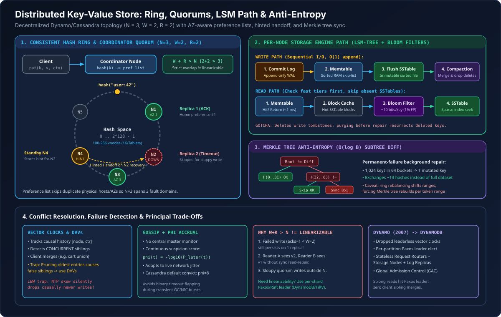
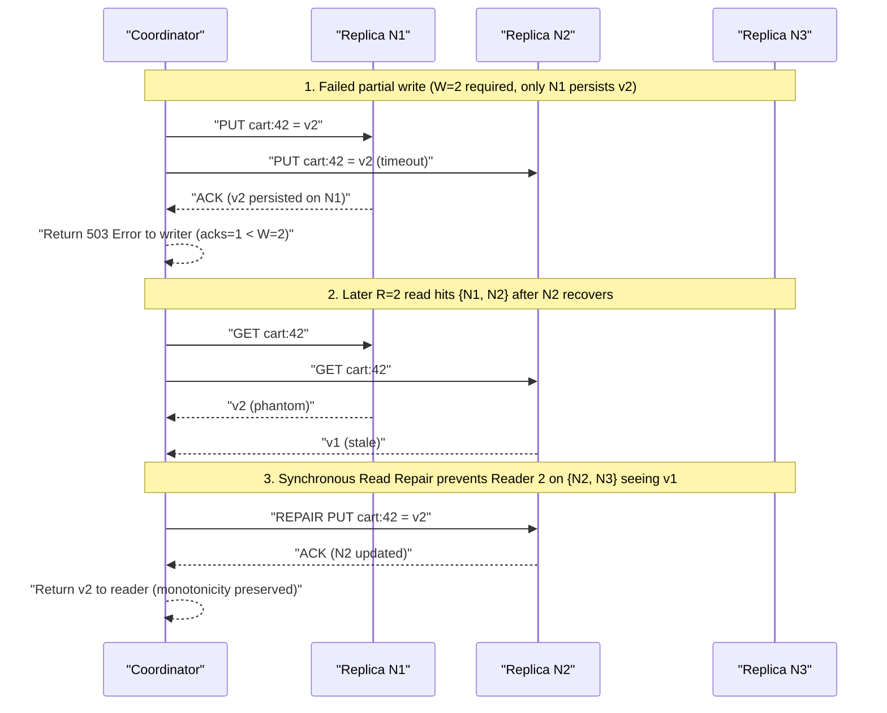
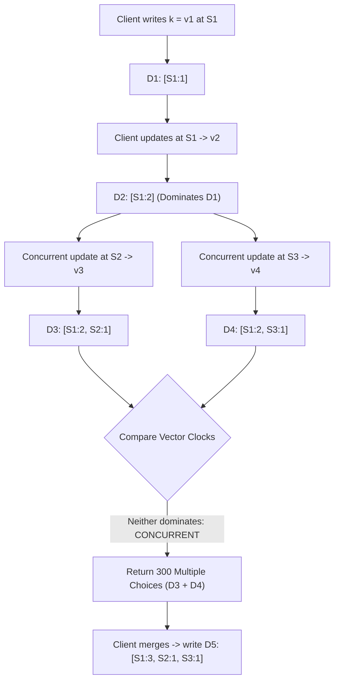
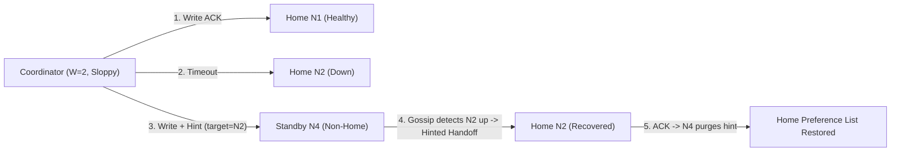
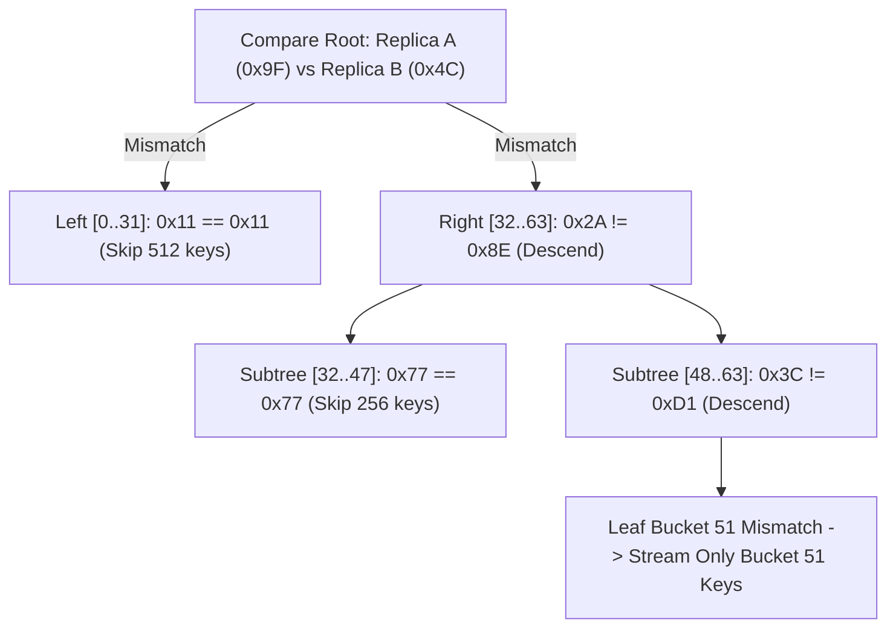
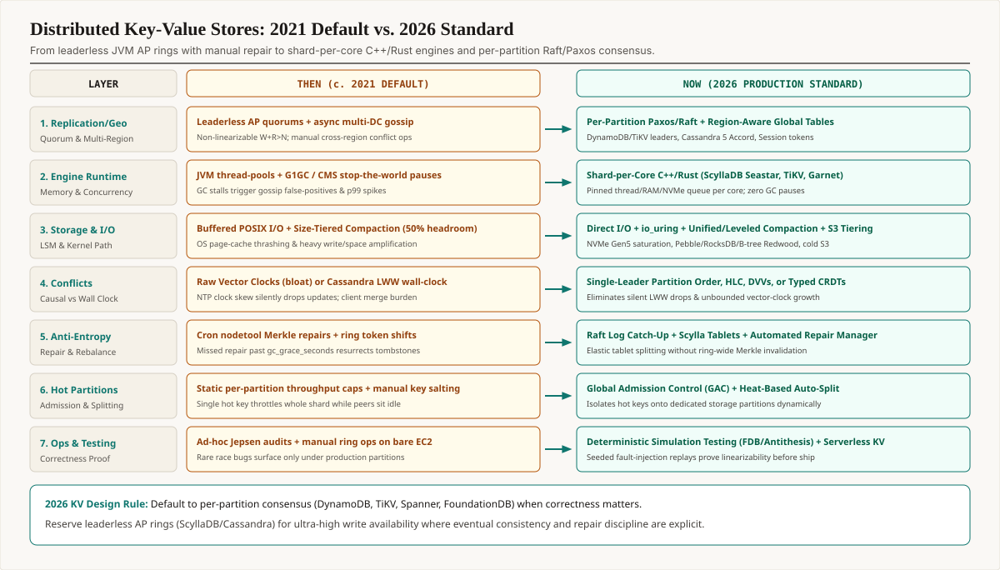

# Module 16 — Distributed Key-Value Store: Dynamo, Cassandra, and Modern Cloud KV Systems

A distributed key-value store replaces a single host's in-memory hash table with a partitioned, replicated cluster that keeps serving reads and writes while individual disks, racks, and Availability Zones fail. The architectural lineage spans Amazon's original leaderless **Dynamo** paper (DeCandia et al., SOSP 2007), Google **Bigtable** (Chang et al., OSDI 2006), Apache **Cassandra** (Lakshman & Malik, LADIS 2009), Riak's **Dotted Version Vectors** (Preguiça et al., 2012), **Amazon DynamoDB**'s per-partition Paxos rewrite (Elhemali et al., USENIX ATC 2022), and modern shard-per-core or decoupled-log engines such as ScyllaDB, TiKV, and FoundationDB. This module walks the end-to-end architecture from consistent-hash routing and LSM storage composition to quorum failure modes, conflict resolution, anti-entropy repair, 2021-vs-2026 evolution, and deterministic TypeScript proofs.

Foundational theory remains cross-linked to its owning tracks per `.agents/OWNERSHIP.md` rather than re-derived here: LSM-tree compaction, WAL/ARIES, and storage-engine mechanics live in [Data Systems — Storage Engines](../../data-systems/modules/02-storage-engines-b-trees-and-lsm.md); replication and partitioning theory live in [Data Systems — Replication](../../data-systems/modules/07-replication-mechanics-and-consensus.md) and [Partitioning](../../data-systems/modules/08-partitioning-sharding-and-routing.md); formal CAP/PACELC theorems, clocks, quorum theory, and Paxos/Raft consensus live in [Distributed Systems — System Models & CAP/PACELC](../../distributed-systems/modules/01-system-models-and-impossibility.md), [Clocks & Ordering](../../distributed-systems/modules/03-time-clocks-and-ordering.md), [Replication & Quorums](../../distributed-systems/modules/05-replication-protocols-and-quorums.md), and [Consensus & Paxos](../../distributed-systems/modules/06-consensus-foundations-and-paxos.md); and consistent-hashing and Bloom-filter math live in [DSA — Hashing](../../../algorithms/dsa/modules/03-hashing-and-hash-tables.md) and [Probabilistic Structures](../../../algorithms/dsa/modules/13-probabilistic-data-structures-and-randomized-algorithms.md). Within this track, quantitative estimation methods live in [Module 02](02-back-of-the-envelope-estimation.md), caching strategies in [Module 05](05-caching-strategies-and-invalidation.md), sharding skew in [Module 06](06-scaling-reads-writes-and-partitioning.md), and progressive scaling laws in [Module 15](15-scale-from-zero-to-millions.md).

---

## 1. Requirements, Workload Envelope, and Capacity Sizing

### 1.1 Functional and Non-Functional Requirements

A distributed key-value store exposes a deliberately narrow data-plane interface so partitioning, replication, and failure recovery stay predictable:

- **Functional API**: `get(key)` retrieves the value (or concurrent sibling versions with causal contexts); `put(key, value, context)` stores a value tagged with the caller's prior causal context; `delete(key, context)` appends an immutable **tombstone** marker rather than erasing disk bytes in place so lagging replicas cannot resurrect deleted records.
- **Non-functional targets**: Small opaque payloads (`<= 10 KB` per value, average `2 KB` on hot reads and up to `10 KB` on cold records); high availability (`99.99%` at the API edge); low point-lookup tail latency (`p99 < 10 ms` intra-region); tunable per-request consistency (`ONE`, `QUORUM`, `ALL`); automatic elastic scaling without planned downtime; and zero single point of failure across racks and Availability Zones.

### 1.2 Back-of-the-Envelope Capacity Sizing

Derive storage, memory, IOPS, and network budgets explicitly from a concrete target workload (`500k` peak read QPS, `100k` peak write QPS, `100M` distinct new keys/day retained for 100 days = `10B` keys):

- **Storage footprint**: At `10 KB` average stored record (value plus key/metadata overhead), `100M` keys/day ingests `1 TB/day`, yielding **`100 TB` raw** over 100 days. Replicating with `N = 3` across distinct failure domains requires **`300 TB` physical storage**. Provisioning `4 TB` usable NVMe per node (leaving `25%–50%` compaction headroom) yields `75` minimum nodes; rounding to **`100` nodes** (`3 TB/node` replicated) leaves margin for rebalancing and multi-AZ placement.
- **RAM sizing (Bloom filters, memtables, block cache)**:
  - **Bloom filters**: At `10 bits/key` (`~1.25 bytes/key`, `~1%` false-positive rate), `10B` keys require `~12.5 GB` cluster-wide (`~125 MB/node`).
  - **Memtables**: `100k` writes/s across `100` nodes with `N = 3` drives `3k` local replica appends/s per node (`~6 MB/s` at `2 KB` avg write, or `~30 MB/s` at `10 KB`). Holding active plus flushing `64 MB` memtables needs `1–2 GB/node`.
  - **Block cache & sparse indexes**: Holding the hot `1%` working set (`~1 TB` raw) plus SSTable sparse indexes in RAM takes `~10–16 GB/node` (`~1–1.6 TB` cluster-wide).
- **NVMe IOPS under LSM write amplification**: `100k` edge writes/s × `N = 3` = `300k` replica writes/s. Accounting for `8×–10×` steady-state LSM compaction write amplification produces `2.4M–3.0M` total storage ops/s cluster-wide (`24k–30k` IOPS/node), comfortably inside a modern NVMe Gen5 SSD when compaction I/O is rate-limited to protect foreground `p99`.
- **Network bandwidth**: `500k` reads/s × `2 KB` typical hot response = `1 GB/s` (`8 Gbps` client egress). Coordinating `100k` writes/s × `2 KB` to `N - 1 = 2` peer replicas adds `400 MB/s` (`3.2 Gbps` inter-node replication), totaling `~11.2 Gbps` cluster-wide (`~112 Mbps/node` across `100` nodes). Provisioning `25 Gbps` NICs per node reserves `> 200×` aggregate cluster headroom (`2.5 Tbps` vs. `11.2 Gbps`) for hinted-handoff storms, Merkle repair streams, and node replacement (though a single hot key can still saturate one partition's CPU/WCU ceiling).

| Resource | Cluster Total (`100` Nodes) | Per-Node Allocation | Primary Sizing Driver |
| --- | --- | --- | --- |
| **Raw Dataset** | `100 TB` (`10B` keys) | `1 TB` | `100M` keys/day × `10 KB` × 100-day retention |
| **Replicated Storage** | `300 TB` | `3 TB` (`4 TB+` NVMe) | Replication factor `N = 3` plus compaction headroom |
| **Bloom Filter RAM** | `~12.5 GB` | `~125 MB` | `10 bits/key` (`~1%` false-positive rate) |
| **Memtable + Block Cache** | `~1.2 TB` | `~12 GB` | Hot working-set residency + active flush buffers |
| **Storage IOPS** | `2.4M–3.0M` | `24k–30k` | `300k` replica writes/s × `8×–10×` LSM amplification |
| **Steady-State Network** | `~11.2 Gbps` | `~112 Mbps` (`25 Gbps` NIC) | `8 Gbps` read egress + `3.2 Gbps` replica fan-out |

### 1.3 Wire API and Causal Context Contract

Leaderless KV stores make causal context explicit on the wire rather than hiding conflicts behind silent overwrites. Clients pass back the opaque `X-Causal-Context` received from a prior `GET`; when concurrent siblings exist, `GET` returns `300 Multiple Choices` so the application resolves them explicitly:

```http
PUT /v1/kv/cart:42 HTTP/1.1
Host: kv.internal.example.com
Content-Type: application/json
X-Consistency-Level: QUORUM
X-Causal-Context: {"S1":2,"S2":2}

{"items":["book","mug","lamp"]}
```

```json
// GET /v1/kv/cart:42 -> 300 Multiple Choices (concurrent sibling conflict detected)
{
  "key": "cart:42",
  "causal_context": { "S1": 2, "S2": 2 },
  "siblings": [
    { "version": { "S1": 2, "S2": 1 }, "value": "{\"items\":[\"book\",\"mug\"]}" },
    { "version": { "S1": 1, "S2": 2 }, "value": "{\"items\":[\"book\",\"lamp\"]}" }
  ]
}
```

A `DELETE /v1/kv/{key}` carries the same causal context and writes a tombstone with a retention window (`gc_grace_seconds`, default `864,000 s` = 10 days in Cassandra) so disconnected replicas learn of the deletion before compaction purges the marker.

---

## 2. Coordinator, Partitioning, and Storage Write/Read Path

Every node in a Dynamo/Cassandra ring is symmetric and can act as a **Coordinator** for any client request. Clients may connect to any node (or use token-aware drivers that jump straight to a home replica to save one network hop).



### 2.1 Ring Partitioning and AZ-Aware Preference Lists

The coordinator hashes `key` onto a `128-bit` consistent-hash ring (`0 .. 2^128 - 1`) and walks clockwise to construct the **preference list** of `N` replicas:

- **Skipping duplicate failure domains**: Because each physical host owns `100–256` virtual nodes (vnodes) scattered around the ring, naive clockwise traversal could place two replicas of the same key on the same physical server or rack. The preference list algorithm skips any virtual node belonging to an already-selected physical host, rack, or Availability Zone so `N = 3` spans three independent fault domains.
- **Vnode count trade-off**: Higher vnode counts smooth key distribution across heterogeneous hardware, but excessive vnodes (`256+` per node) fragment token ranges, multiply Merkle tree repair ranges, and increase the probability that losing two nodes simultaneously hits overlapping ranges. Modern Cassandra 5 and ScyllaDB deployments favor lower vnode counts (`16` tokens) or dynamic **Tablets**.

### 2.2 Per-Node LSM Write and Read Path Composition

Each replica composes four local storage stages detailed in [Data Systems — Storage Engines](../../data-systems/modules/02-storage-engines-b-trees-and-lsm.md):

1. **Write path (`O(1)` sequential append)**: The replica appends the mutation to an on-disk **Commit Log (WAL)** for crash durability, inserts the key-value pair into an in-memory sorted **Memtable** (skip list / red-black tree), and acknowledges the coordinator immediately without random disk seeks. Once the memtable crosses its memory threshold (e.g., `64–256 MB`), it freezes and flushes sequentially to disk as an immutable **SSTable** (Sorted String Table). Background **Compaction** merges overlapping SSTables, drops superseded values, and purges tombstones older than `gc_grace_seconds`.
2. **Read path (tiered filter pipeline)**: The replica checks the **Memtable** first, then the in-memory **Block Cache**. On a miss, it consults each candidate SSTable's in-RAM **Bloom Filter** to skip SSTables that definitely lack the key (`99%` elimination at `10 bits/key`), performs a binary search on the SSTable's **Sparse Key Index**, and executes one sequential read of the target compressed data block. Across multiple replicas during a quorum read, the coordinator fetches the full payload from the fastest replica and compact cryptographic **digests** from the remaining `R - 1` replicas, issuing full fetches and read repair only when digests disagree.

---

## 3. Tunable Quorums and Why W + R > N Is Not Linearizability

Tunable quorum parameters `(N, W, R)` allow each request to trade latency against consistency and fault tolerance (see formal quorum analysis in [Replication & Quorums](../../distributed-systems/modules/05-replication-protocols-and-quorums.md)):

| Configuration | Write Latency | Read Latency | Write Fault Tolerance | Read Fault Tolerance | Overlap Property |
| --- | --- | --- | --- | --- | --- |
| `N=3, W=2, R=2` | 2nd-fastest replica | 2nd-fastest replica | 1 replica down | 1 replica down | **Strong quorum** ($2 + 2 > 3$, `>= 1` overlap) |
| `N=3, W=3, R=1` | Slowest of 3 replicas | Fastest single replica | 0 replicas down | 2 replicas down | **Strong quorum** ($3 + 1 > 3$, read-optimized) |
| `N=3, W=1, R=3` | Fastest single replica | Slowest of 3 replicas | 2 replicas down | 0 replicas down | **Strong quorum** ($1 + 3 > 3$, write-optimized) |
| `N=3, W=1, R=1` | Fastest single replica | Fastest single replica | 2 replicas down | 2 replicas down | **No overlap** ($1 + 1 \le 3$, eventual only) |

> [!WARNING]
> **Critical Staff Gotcha: $W + R > N$ does NOT guarantee linearizability.** Even with `N = 3, W = 2, R = 2`, four distinct production scenarios break linearizability unless layered with consensus or synchronous write-back.

1. **Failed partial writes (phantom persistence)**: A client issues `put(k, v2)` with `W = 2`. Replica `N1` persists `v2`, while `N2` and `N3` time out, so the coordinator returns `503 Error` to the client. Leaderless stores do **not** roll back `N1`; `v2` survives durably as a phantom write. Once `N2` recovers, a read across `{N1, N2}` observes `v2`, while a read across `{N2, N3}` still observes `v1`.
2. **Read-before-repair non-monotonicity**: If Reader 1 queries `{N1, N2}`, sees `v2` on `N1` and `v1` on `N2`, and returns `v2` _before_ repairing `N2`, then Reader 2 querying `{N2, N3}` milliseconds later observes the older `v1`—a textbook violation of real-time linearizability. Preventing this inversion requires **synchronous read repair** (writing `v2` to `N2` and waiting for its ACK before returning to Reader 1, as in ABD registers).
3. **Concurrent writes with no total order**: Two clients writing `vA` and `vB` concurrently at `W = 2` can both collect two acknowledgements on overlapping pairs (`{N1, N2}` and `{N2, N3}`), leaving no single agreed order on `N2`.
4. **Sloppy quorums**: Routing writes to non-home standby nodes breaks the home-set intersection entirely (Section 4.3).

Managed cloud KV engines add finer client-session guarantees between strict linearizability and eventual consistency. Azure Cosmos DB exposes five consistency levels, defaulting to **Session** consistency: each write returns a lightweight session token (`x-ms-session-token`) that the client attaches to subsequent reads so a single local replica aligned with that token's log position serves **read-your-writes**, monotonic reads, and monotonic writes at half the RU read cost of Strong consistency (which reads from a 2-replica quorum) and without cross-region synchronous commit round trips.



---

## 4. Conflict Resolution, Failure Detection, and Anti-Entropy Repair

### 4.1 Vector Clocks, Dotted Version Vectors, and the LWW Clock-Skew Trap

A **Vector Clock** associates each version with a list of `[node, counter]` pairs tracking causal ancestry (formal partial-order axioms live in [Clocks & Ordering](../../distributed-systems/modules/03-time-clocks-and-ordering.md)):

- `A` is `BEFORE` `B` (ancestor) if every coordinate in `A` is `<=` its counterpart in `B` and at least one is strictly smaller; `B` safely supersedes `A`.
- `A` and `B` are `CONCURRENT` **siblings** if `A` leads on at least one node while `B` leads on another (e.g., `[S1:2, S2:1]` vs. `[S1:1, S2:2]`). The store retains both siblings and requires the client to merge them (such as taking shopping-cart union) and write back a merged version whose vector dominates both.



**Vector-clock bloat, false siblings, and Dotted Version Vectors (DVVs).** Plain server-side vector clocks grow with every coordinator that touches a key. Dynamo pruned oldest entries past a threshold (`10` entries), which erased causal history and created **false siblings**. Even without pruning, concurrent writes from two clients sharing one coordinator ID can produce false conflicts in naive server clocks. **Dotted Version Vectors** (Preguiça et al., 2012; deployed in Riak 2+) separate a single write's unique `(node, counter)` **dot** from the compact causal **context** observed by the writer, bounding metadata size to active cluster nodes while eliminating false siblings.

**The Last-Write-Wins (LWW) NTP clock-skew trap.** Apache Cassandra avoids vector clocks by stamping each cell with a microsecond wall-clock timestamp and silently discarding any write carrying a smaller timestamp. Because NTP-synchronized hosts routinely drift by `10–250 ms` (or jump during VM live migrations), a causally later update written on Node B whose clock lags Node A by `250 ms` is **silently dropped without error**. Both writers receive `200 OK`, yet the newer user update vanishes forever—proved deterministically in `examples/10-kv-store.test.ts`.

### 4.2 Gossip Membership and Phi Accrual Failure Detection

Rather than relying on a single master health monitor, Dynamo/Cassandra nodes exchange membership tables via decentralized **Gossip** every second, picking `1–3` random peers to reconcile per-node heartbeat counters and state.

Fixed binary timeouts break in production: a tight `500 ms` timeout ejects healthy nodes during brief JVM GC pauses or NIC micro-bursts, while a loose `10 s` timeout sends thousands of requests into a dead host. **Hayashibara's Phi Accrual Failure Detector** (SRDS 2004) instead tracks a sliding window of observed heartbeat inter-arrival times (mean $\mu$, standard deviation $\sigma$) and emits a continuous suspicion score:

$$\phi(t_{\text{now}}) = -\log_{10}\!\left(P_{\text{later}}(t_{\text{now}} - t_{\text{last}})\right)$$

- $\phi = 1$ implies a `10%` probability that a healthy heartbeat is simply late; $\phi = 2$ implies `1%`.
- Apache Cassandra defaults to `phi_convict_threshold = 8` ($P_{\text{later}} \le 10^{-8}$), adapting automatically to each peer's actual network jitter while quickly convicting genuinely silent nodes.

### 4.3 Temporary Failures: Sloppy Quorums and Hinted Handoff

When a home replica (`N2`) suffers a transient outage, strict quorum writes fail if fewer than `W` home nodes respond. **Sloppy Quorum** preserves write availability by walking past the failed home node to the first healthy non-home standby (`N4`) on the ring and storing the write wrapped in a **Hint Envelope** naming the intended owner (`targetNode = N2`). Once gossip reports `N2` back online, `N4` streams queued hints to `N2` (**Hinted Handoff**) and deletes local hint files upon acknowledgement.



> [!IMPORTANT]
> Sloppy quorums deliberately **break the $W + R > N$ intersection invariant**. Until hinted handoff finishes draining from `N4` to `N2`, a strict read on reachable home replicas `{N2, N3}` shares zero nodes with `{N1, N4}` and misses the committed write. Hints also expire (typically after `3 hours` in Cassandra) and vanish if `N4` crashes permanently—hinted handoff is an availability optimization, never a durability replacement for anti-entropy repair.

### 4.4 Permanent Failures: Merkle Tree Anti-Entropy Synchronization

To heal permanent hardware failures, dropped hints, or silent bit-rot without streaming terabytes across the network, replicas run background **Anti-Entropy Repair** using **Merkle Trees** (hash trees):

1. Each replica partitions a shared token range into $B$ deterministic leaf buckets, hashes the sorted `(key, value)` pairs inside each bucket, and hashes adjacent pairs bottom-up to a single **Root Hash**.
2. Replicas compare Root Hashes first (`1` hash exchange). Identical roots terminate repair immediately.
3. On mismatch, replicas traverse only divergent child subtrees top-down, pinpointing $k$ corrupted buckets in $O(k \log B)$ hash comparisons (for $B = 64$ buckets and `1` mutated key out of `1,024`, only `13` hash nodes are compared!) and streaming solely the mismatched bucket's keys.



**Production Merkle tree caveat:** Because each Merkle tree hashes a specific key-range boundary, adding or removing nodes on a consistent-hash ring shifts token ownership and invalidates cached Merkle trees across affected ranges, forcing expensive full-range disk scans (`nodetool repair`) to rebuild trees.

Below are the exact `compareVectorClocks` and `diffMerkleTrees` primitives verified in [`examples/lib/kv-store-models.ts`](../examples/lib/kv-store-models.ts):

```typescript
export function compareVectorClocks(a: VectorClock, b: VectorClock): CausalRelation {
  const keys = new Set([...Object.keys(a), ...Object.keys(b)]);
  let aLessThanB = false;
  let bLessThanA = false;
  for (const k of keys) {
    const va = a[k] ?? 0;
    const vb = b[k] ?? 0;
    if (va < vb) aLessThanB = true;
    if (vb < va) bLessThanA = true;
  }
  if (!aLessThanB && !bLessThanA) return 'EQUAL';
  if (aLessThanB && !bLessThanA) return 'BEFORE';
  if (bLessThanA && !aLessThanB) return 'AFTER';
  return 'CONCURRENT';
}

export function diffMerkleTrees(
  a: MerkleNode,
  b: MerkleNode,
): { divergentBuckets: number[]; nodesCompared: number } {
  const divergentBuckets: number[] = [];
  let nodesCompared = 0;
  function walk(na: MerkleNode, nb: MerkleNode): void {
    nodesCompared++;
    if (na.hash === nb.hash) return;
    if (!na.left || !na.right || !nb.left || !nb.right) {
      divergentBuckets.push(na.bucketStart);
      return;
    }
    walk(na.left, nb.left);
    walk(na.right, nb.right);
  }
  walk(a, b);
  return { divergentBuckets, nodesCompared };
}
```

```sql
-- Cassandra CQL operational guardrail: gc_grace_seconds MUST exceed full repair cadence
ALTER TABLE orders.line_items
  WITH gc_grace_seconds = 864000 -- 10 days; schedule incremental repair every <= 3 days
  AND compaction = { 'class': 'UnifiedCompactionStrategy' };
```

---

## 5. Niche and Principal-Level KV Architectures

### 5.1 Amazon Dynamo (2007) vs. Amazon DynamoDB (2022–2026)

One of the highest-signal Staff interview insights is knowing that **production Amazon DynamoDB abandoned almost every headline design choice of the 2007 Dynamo paper** (Elhemali et al., USENIX ATC 2022):

- **Per-Partition Paxos Leader Election (no leaderless vector clocks)**: Instead of pushing vector-clock sibling resolution onto application engineers, DynamoDB splits tables into ~10 GB storage partitions, each replicated across 3 AZs as a **Paxos consensus group** with an elected leader. The leader serializes every write for that key range, enabling conditional writes (`ConditionExpression`), ACID transactions, and strongly consistent reads (`1 RCU / 4 KB` vs. `0.5 RCU` eventually consistent) with zero client sibling merges.
- **Stateless Request Routers + Partition Metadata**: Decoupling stateless Request Routers from Storage Nodes lets DynamoDB split hot partitions and migrate replicas behind the scenes without exposing consistent-hash ring churn to clients.
- **Global Admission Control (GAC) & Log Replicas**: Instead of static per-partition token buckets that throttle bursty keys while peer capacity sits idle, GAC dynamically tracks table-wide token budgets while lightweight Log Replicas accelerate Paxos healing when a storage node fails.

### 5.2 ScyllaDB Shard-per-Core (Seastar) vs. JVM Cassandra

Apache Cassandra runs on the JVM, where shared heap locks, OS page-cache contention, and stop-the-world GC pauses inflate `p99.9` tail latency and trigger false-positive gossip ejections. **ScyllaDB** re-implements the CQL/DynamoDB-compatible engine in C++ atop the **Seastar** shared-nothing framework: every physical CPU core pins one pinned user-space thread, its own memory allocator, its own NVMe queue (`io_uring` / DMA bypassing the OS page cache), and its own NIC queue, passing cross-core messages exclusively over lock-free ring buffers. The result is predictable single-digit millisecond `p99` at `5×–10×` higher throughput per host without GC stalls.

### 5.3 Decoupled Log/Storage KV (FoundationDB & TiKV)

**FoundationDB** and **TiKV** decompose the database vertically into stateless proxy/coordinator processes, consensus-ordered transaction logs (Paxos / multi-Raft regions), and pluggable storage engines (`RocksDB` or FoundationDB's B-tree `Redwood`). Decoupling lets compute proxies scale independently of storage while delivering **strict serializability** across multi-key transactions. FoundationDB pairs this with **Deterministic Simulation Testing (DST)**—running the entire distributed cluster, simulated network partitions, clock skew, and disk corruptions inside a single deterministic seeded event loop—to prove linearizability invariants before code ships (see [Distributed Systems — Verification](../../distributed-systems/modules/12-verification-testing-and-fault-injection.md)).

### 5.4 Primary-Literature Architecture Comparison Matrix

Selecting among KV families in an architecture review depends on whether the workload demands range scans, multi-key ACID transactions, extreme write uptime, or predictable tail latency:

| System (Primary Source) | Partitioning Strategy | Replication & Ordering | Conflict Resolution | Local Storage Engine | Best-Fit Production Workload |
| --- | --- | --- | --- | --- | --- |
| **Amazon Dynamo** (SOSP 2007) | Consistent hash ring + vnodes | Leaderless AP quorum + sloppy quorum | Vector clocks + client sibling merge | Pluggable (BDB / MySQL) | Historical blueprint for always-writable shopping carts |
| **Google Bigtable** (OSDI 2006) | Lexicographic range tablets | Single-tablet server over GFS/Colossus + Chubby locks | Ordered per-tablet server timestamps | LSM (Memtable + SSTables) | Wide-column time-series, range scans, web indexing |
| **Apache Cassandra** (LADIS 2009) | Consistent hash ring + vnodes | Leaderless tunable quorums + Cassandra 5 Accord | Cell-level LWW (wall clock) or Accord txns | JVM LSM (Commit log + SSTables) | High-write multi-DC ingestion, append-heavy timelines |
| **ScyllaDB** (Seastar) | Shard-per-core ring / Tablets | Leaderless tunable quorums + Raft schema/tablets | Cell-level LWW / Raft LWT | C++ `io_uring` DMA LSM | Ultra-low-`p99` Cassandra/DynamoDB drop-in workloads |
| **Amazon DynamoDB** (ATC 2022) | Dynamic ~10 GB hash partitions + GAC | Per-partition **Paxos** leader + Log Replicas | Leader total order (regional); LWW (Global Tables) | B-tree + Paxos WAL on NVMe | Serverless high-scale OLTP, conditional writes, managed ops |
| **FoundationDB / TiKV** | Ordered key-range shards / regions | Decoupled Paxos/Raft transaction logs | Strict serializable MVCC / OCC | Redwood B-tree / RocksDB LSM | Metadata planes, multi-key ACID KV, distributed SQL backing |

---

## 6. Production Gotchas and Failure Modes

1. **Failed partial-write phantom persistence.** _Symptom:_ A client receives a `503` write timeout (`W = 2`), treats the mutation as aborted, yet subsequent reads randomly return the "failed" value. _Root cause:_ One replica persisted the mutation before quorum timed out, and leaderless stores never roll back partial writes. _Mitigation:_ Treat write timeouts as `UNKNOWN` outcome, attach idempotency keys, and read-before-retry or use consensus-backed conditional writes.
2. **Sloppy quorum invisible writes until handoff drains.** _Symptom:_ A client receives `201 Created` on a sloppy `W = 2` write, yet strict reads against healthy home replicas return old data for minutes. _Root cause:_ Acknowledgements came from non-home standby nodes outside the home preference list, voiding $W + R > N$. _Mitigation:_ Disable sloppy quorums for read-your-writes paths, alert on hint-queue backlog, and verify home-quorum convergence.
3. **LWW silent data loss under NTP clock skew.** _Symptom:_ Confirmed user updates silently vanish without errors or conflicts. _Root cause:_ Wall-clock Last-Write-Wins compares unsynchronized host clocks; a `250 ms` trailing clock loses to an older write stamped ahead. _Mitigation:_ Replace raw LWW with per-partition leader ordering, Hybrid Logical Clocks (HLC), DVVs, or domain CRDTs, and alert aggressively on NTP offset drift.
4. **Tombstone accumulation and zombie data resurrection.** _Symptom:_ Deleted rows reappear weeks later, or range scans time out reading millions of dead markers. _Root cause:_ A replica offline longer than `gc_grace_seconds` rejoins after surviving nodes compacted away tombstones, so repair copies its stale live record back across the cluster; meanwhile high-churn delete queues pile up unreadable tombstones. _Mitigation:_ Guarantee anti-entropy repair completes strictly inside `gc_grace_seconds`, decommission/re-bootstrap any node offline longer, and partition time-series deletes by TTL-expiring tables instead of row-level deletes.
5. **Merkle tree invalidation during ring rebalancing.** _Symptom:_ Background anti-entropy consumes massive disk I/O or misses diverged ranges right after scaling the cluster. _Root cause:_ Adding/removing nodes changes token boundaries, invalidating precomputed range Merkle trees. _Mitigation:_ Run incremental range-aligned repairs, stagger topology changes, or adopt Tablet-based architectures (ScyllaDB Tablets / TiKV Raft regions).
6. **Synchronous read-repair latency amplification.** _Symptom:_ One slow or disk-degraded replica drags cluster-wide `p99` read latency from `5 ms` to `400 ms`. _Root cause:_ Synchronous read repair blocks every caller waiting on digest checks and repair ACKs from the degraded peer. _Mitigation:_ Use speculative retry / dynamic snitch scoring to route around slow peers, cap per-request repair budget, and rely on Phi Accrual eviction once suspicion crosses threshold.
7. **Hot-key partition saturation and monotonic row-key hotspotting.** _Symptom:_ Cluster CPU averages `15%`, yet one node pins at `100%` and throttles callers (`ProvisionedThroughputExceededException` in DynamoDB or tail-tablet saturation in Bigtable). _Root cause:_ Zipfian celebrity keys exceeding a single partition's `1,000 WCU` ceiling, or lexicographically monotonic prefixes (`<seq_user_id>#<timestamp>`) landing exclusively on Bigtable's tail tablet. _Mitigation:_ Salt/hash hot partition prefixes (`key#0..N`) with bounded scatter-gather reads, reverse timestamps for per-entity recent scans, and layer L1/L2 caching for read-heavy keys ([Module 05](05-caching-strategies-and-invalidation.md)).
8. **JVM GC pauses triggering false-positive gossip ejections.** _Symptom:_ Healthy Cassandra nodes flap `DOWN`/`UP` in gossip during high-allocation compaction bursts, triggering cascading hint storms. _Root cause:_ Multi-second stop-the-world GC pauses starve heartbeat threads, pushing peers' Phi Accrual score past $\phi = 8$. _Mitigation:_ Tune Shenandoah/ZGC low-pause collectors, cap heap pressure, size `phi_convict_threshold` for burst variance, or migrate to a shard-per-core C++/Rust engine.

### 6.1 Production SRE Signals and Alert Guardrails

Monitoring only HTTP `5xx` rate and QPS misses every silent correctness degradation in a distributed KV store. Alert on the six structural signals below:

| Operational Signal | Healthy Baseline | Page / Escalation Threshold | Immediate Mitigation Action |
| --- | --- | --- | --- |
| **Repair Lag vs. `gc_grace_seconds`** | `< 30%` of grace window | `> 60%` of `gc_grace_seconds` | Run incremental repair; block rejoin of nodes down longer than grace window |
| **Hinted Handoff Backlog Age** | `0` queued hints (`< 60 s`) | `> 30 min` or disk `> 5%` | Inspect down home replica; throttle handoff replay before disk fills |
| **Tombstones Scanned per Read** | `< 100` markers | `> 1,000` warn / `> 100k` abort | Refactor queue/TTL pattern into time-windowed tables; tune compaction |
| **NTP / Chrony Clock Offset** | `< 2 ms` across nodes | `> 20 ms` on any LWW node | Quarantine drifting host before silent LWW drops corrupt active keys |
| **Pending Compaction Tasks** | `< 4` per NVMe volume | Monotonic rise `> 30 min` | Raise compaction I/O budget or shed write bursts before read `p99` explodes |
| **Gossip Phi Accrual Score ($\phi$)** | `< 2.0` steady-state | Repeated bursts `> 5.0` | Inspect GC pause logs, NIC packet drops, or noisy neighbor CPU steal |

---

## 7. Technology Comparison: Then vs. Now (2021 vs. 2026)



| KV Architectural Layer | 2021 Default | 2026 Modern Standard | Why It Changed & Migration Pitfall |
| --- | --- | --- | --- |
| **Replication & Consistency** | Leaderless AP quorums (`N=3, W=2, R=2`, Cassandra 3 / Riak) | Per-partition **Paxos/Raft** consensus (DynamoDB, TiKV, FoundationDB, Cassandra 5 **Accord** transactions) | Eliminates client sibling merges and non-linearizable quorum traps; _pitfall:_ expecting leaderless AP write uptime during majority-AZ partitions. |
| **Runtime & Threading** | JVM thread pools with G1GC / CMS shared-heap locks | **Shard-per-core** C++/Rust engines (**ScyllaDB Seastar**, TiKV, Garnet) | Removes stop-the-world GC stalls and cross-core contention; _pitfall:_ introducing blocking syscalls inside cooperative reactor threads. |
| **Storage Engine & I/O** | Buffered POSIX I/O + Size-Tiered Compaction (`50%` disk slack) | Direct I/O + **`io_uring`** + Unified/Leveled Compaction + S3 cold tiering | Saturates NVMe Gen5 and cuts space amplification; _pitfall:_ mis-sizing memory budgets when bypassing OS page cache. |
| **Conflict Resolution** | Raw vector clocks (unbounded growth) or Cassandra wall-clock LWW | Per-partition leader order, **HLC**, **Dotted Version Vectors (DVVs)**, or typed CRDTs | Stops silent NTP clock-skew data loss and false siblings; _pitfall:_ mixing LWW tables with clients still sending causal contexts. |
| **Failure Detection** | Fixed binary timeouts or untuned early Phi Accrual | Adaptive **Phi Accrual** ($\phi = 8$) or consensus leader leases | Eliminates jitter-induced false ejections; _pitfall:_ booting fresh nodes with too-short heartbeat history windows. |
| **Anti-Entropy & Rebalance** | Scheduled `nodetool` full-range Merkle repairs + static vnode shifts | Continuous Raft log catch-up + **ScyllaDB Tablets** + automated repair managers | Avoids ring-wide Merkle invalidation and missed `gc_grace_seconds` windows; _pitfall:_ lowering `gc_grace_seconds` below actual repair completion time. |
| **Hot-Key & Admission** | Static per-partition throughput caps + manual client throttling | **Global Admission Control (GAC)** + heat-based dynamic partition auto-splitting | Absorbs transient skew automatically; _pitfall:_ assuming adaptive capacity bypasses DynamoDB's `1,000 WCU` single-key ceiling. |
| **Multi-Region** | Async multi-DC gossip replication with manual conflict handling | Region-aware consensus placement (Spanner / CockroachDB / Cosmos DB Session tokens / DynamoDB Global Tables) | Gives explicit per-session read-your-writes or bounded staleness; _pitfall:_ assuming DynamoDB Global Tables are linearizable across regions (they use LWW). |
| **Correctness Verification** | Ad-hoc staging tests and occasional external Jepsen audits | **Deterministic Simulation Testing (DST)** (FoundationDB / Antithesis) in CI | Catches multi-fault race conditions deterministically before release; _pitfall:_ mocking network partitions with instant errors instead of asymmetric drops and stalls. |

**Pitfalls of mixing 2021 and 2026 layers during migration.** Partial upgrades break cross-layer invariants silently: running a modern shard-per-core ScyllaDB cluster behind legacy Cassandra clients that write with `CL=ONE` and `USING TIMESTAMP` from unsynchronized client clocks still suffers LWW silent data loss; similarly, migrating a hot table to DynamoDB Global Tables without partitioning region-affine keys replaces leaderless sibling conflicts with silent cross-region LWW overwrites. Stage migrations by locking down consistency contracts and idempotency keys first, verifying `gc_grace_seconds` and repair coverage second, and swapping the underlying engine or cloud service last.

---

## 8. Executable Proof Map

Every quorum trap, causal ordering axiom, clock-skew hazard, Merkle repair bound, and failure-detector threshold in this module is proved deterministically in [`examples/10-kv-store.test.ts`](../examples/10-kv-store.test.ts) (backed by [`examples/lib/kv-store-models.ts`](../examples/lib/kv-store-models.ts)):

| Concept in This Module | Deterministic Test in `10-kv-store.test.ts` | Verified Invariant / Negative Proof |
| --- | --- | --- |
| **Strict Quorum, Partial-Write Phantom & Sloppy Quorum** | `DynamoReplicaCluster` (`N=3, W=2, R=2`, standby `N4`) | Proves strict `W=2, R=2` returns committed `v1`; **negative proof 1**: failed write (`acks=1 < W=2` on `N1`) persists phantom `v2` seen by `{N1, N2}` while `{N2, N3}` sees `v1` until `syncReadRepair: true` repairs `N2`; **negative proof 2**: sloppy write acknowledged by `{N1, N4}` is invisible to strict read on `{N2, N3}` until `replayHints()` drains. |
| **Vector Clock Partial-Order Axioms** | `incrementClock`, `compareVectorClocks`, `mergeVectorClocks` + `fast-check` | Proves `BEFORE`/`AFTER`/`CONCURRENT` detection and verifies reflexivity, antisymmetry, and merge upper-bound domination across `200` seeded random vector pairs. |
| **LWW NTP Clock-Skew Silent Data Loss** | `applyLwwWrite` with `node-a` clock `+250 ms` fast | Negative test proving a causally later update on `node-b` (`1100 ms`) is silently discarded in favor of an earlier write stamped `1250 ms`. |
| **Merkle Tree $O(\log B)$ Anti-Entropy** | `buildMerkleTree` & `diffMerkleTrees` over `1,024` keys / `64` buckets | Proves identical replicas terminate in `1` root comparison and mutating `1` key out of `1,024` locates the exact single divergent bucket in exactly `13` node hash comparisons (`1 + 2 * 6`). |
| **Phi Accrual Failure Detector** | `PhiAccrualDetector` with `50` jittered `1000 ms +/- 60 ms` heartbeats | Proves normal arrival stays $\phi < 2.0$, transient `200 ms` jitter stays well below `8.0`, and a `2500 ms` crash silence crosses Cassandra's $\phi > 8.0$ conviction threshold. |

---

## Interview Drill

### Question 1: A client writes `k = v2` with `N = 3, W = 2`, receives a `503` timeout error, and abandons the write. Ten seconds later, one user reads `v2` while another user reads `v1` at `R = 2`. How is that possible when $W + R > N$?

<details><summary>Answer</summary>

Two failure modes combine here. First, leaderless quorum writes do not execute distributed rollback when they fail: replica `N1` persisted `v2` before `N2` and `N3` timed out, leaving a durable **phantom write** even though the client saw an error (`acks = 1 < W = 2`). Second, when `N2` recovers, Reader 1 hitting `{N1, N2}` sees `v2`, while Reader 2 hitting `{N2, N3}` sees `v1` unless Reader 1's coordinator ran **synchronous read repair** (writing `v2` to `N2` and awaiting ACK before returning). $W + R > N$ only guarantees overlap with completed strict writes, not linearizability.

</details>

### Question 2: Explain how Sloppy Quorum with Hinted Handoff increases write availability and why it simultaneously breaks read-your-writes consistency.

<details><summary>Answer</summary>

When a home replica (`N2`) in `{N1, N2, N3}` is unreachable, a sloppy quorum walks clockwise past the preference list to a healthy non-home standby (`N4`), persists the write with a hint envelope (`target = N2`), and counts `N4`'s acknowledgement toward `W`. Writes stay available even when multiple home replicas fail. However, a subsequent strict read at `R = 2` queries only the home preference list (`{N1, N2, N3}`); if `N1` is unreachable or not polled, `{N2, N3}` shares zero nodes with `{N1, N4}` and returns stale data until gossip detects recovery and hinted handoff drains `N4`'s hints back to `N2`.

</details>

### Question 3: Why do production teams replace plain vector clocks with Dotted Version Vectors (DVVs), and why is Cassandra's Last-Write-Wins (LWW) dangerous for user-facing state?

<details><summary>Answer</summary>

Plain server-side vector clocks grow with every distinct coordinator that handles a key; truncating old entries loses causal ancestry and spawns false siblings, while concurrent writes from clients sharing a coordinator ID cannot always be distinguished from causal chains. **DVVs** separate a write's unique `(node, counter)` dot from its observed causal context vector, bounding metadata size to active nodes and eliminating false siblings. **LWW** avoids vector metadata by comparing wall-clock timestamps, which fails silently under NTP clock skew: if Node A's clock runs `250 ms` fast, a causally later update written on Node B carries a smaller timestamp and is silently discarded despite both writes returning `200 OK`.

</details>

### Question 4: A Cassandra node goes offline for 14 days, is powered back on without rebuilding, and previously deleted customer records suddenly reappear. Diagnose the exact mechanism and the operational fix.

<details><summary>Answer</summary>

This is **zombie data resurrection**. Deletes in an LSM-tree KV store write immutable **tombstones** that compaction retains for `gc_grace_seconds` (default `10 days` = `864,000 s`) so offline replicas can learn about the deletion. Because the node stayed down for `14 days > 10 days`, surviving replicas compacted away the tombstones. When the stale node rejoined holding the old live rows, anti-entropy repair saw live cells with no competing tombstones and streamed the deleted records back across the ring. Operational rules: run anti-entropy repair strictly inside `gc_grace_seconds`, and **never** rejoin a node offline longer than `gc_grace_seconds`—decommission/replace and re-bootstrap it fresh from healthy peers.

</details>

### Question 5: Walk through how Merkle trees reduce anti-entropy bandwidth from terabytes to kilobytes, and name the topology event that invalidates them.

<details><summary>Answer</summary>

Each replica divides a shared token range into $B$ buckets, hashes sorted `(key, value)` pairs per leaf bucket, and builds a binary hash tree up to one Root Hash. Two replicas exchange only their Root Hashes first (`32 bytes`). If they match, repair stops with zero data transfer. If they differ, replicas descend only along mismatched child hashes, isolating $k$ divergent buckets in $O(k \log B)$ hash comparisons (e.g., `13` comparisons for `1` mutated key across `64` buckets / `1,024` keys) and transferring only keys in the divergent leaf bucket. **Invalidation event:** adding or removing nodes on a consistent-hash ring shifts token-range ownership boundaries, invalidating previously built Merkle trees and requiring costly disk scans to rebuild trees for the new ranges.

</details>

### Question 6: Why did Amazon DynamoDB (USENIX ATC 2022) move away from the 2007 Dynamo paper's leaderless vector-clock ring to per-partition Paxos leaders?

<details><summary>Answer</summary>

In practice, pushing vector-clock sibling resolution onto every application team proved error-prone and prevented conditional writes and strongly consistent reads. DynamoDB splits tables into ~10 GB partitions, each replicated across 3 AZs as a **Paxos consensus group** with an elected leader that establishes a single total write order per partition. Pairing per-partition Paxos with stateless Request Routers, Storage Nodes, Log Replicas, and Global Admission Control enables strongly consistent reads (`1 RCU`), atomic conditional expressions, and transparent partition splits without exposing ring churn or sibling conflicts to clients.

</details>

### Question 7: You operate a JVM Cassandra cluster suffering `p99.9` latency spikes and false-positive gossip node ejections during heavy compaction. What explains the link between GC and gossip, and what does a 2026 architecture change?

<details><summary>Answer</summary>

In a JVM engine, heavy allocation during memtable flushes and compaction triggers multi-second stop-the-world GC pauses that stall gossip heartbeat threads. Peers observing sudden multi-second gaps see their **Phi Accrual Failure Detector** score climb past `phi_convict_threshold = 8` and mark the healthy node `DOWN`, triggering hint accumulation, retry traffic, and secondary overload. A 2026 **shard-per-core C++/Rust engine** (such as ScyllaDB on Seastar with `io_uring` / DMA) pins one thread, allocator, and NVMe/NIC queue per core with zero JVM garbage collection—eliminating stop-the-world heartbeat stalls and tightening `p99.9` latency while keeping CQL compatibility.

</details>
