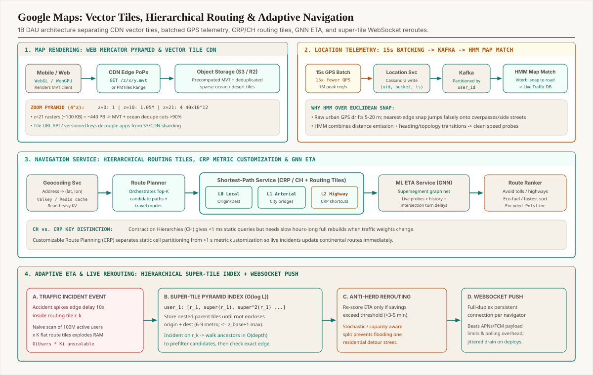
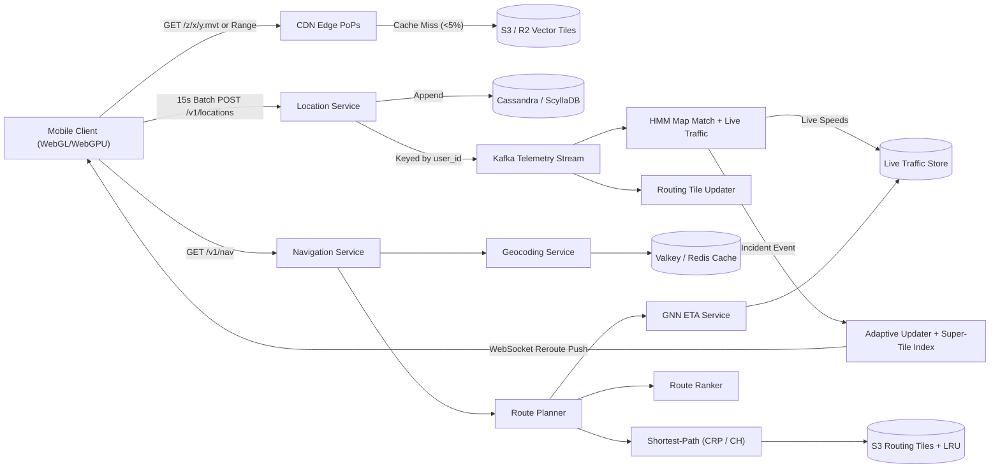
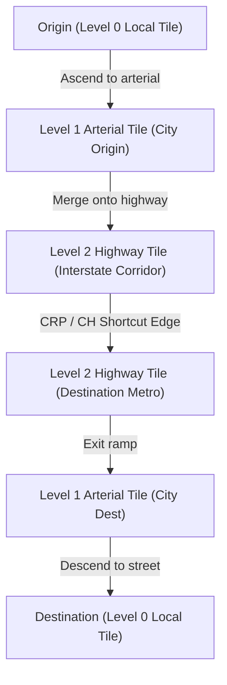
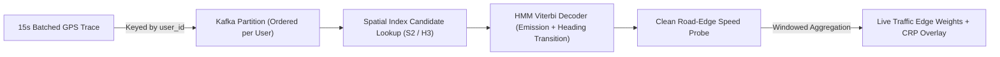
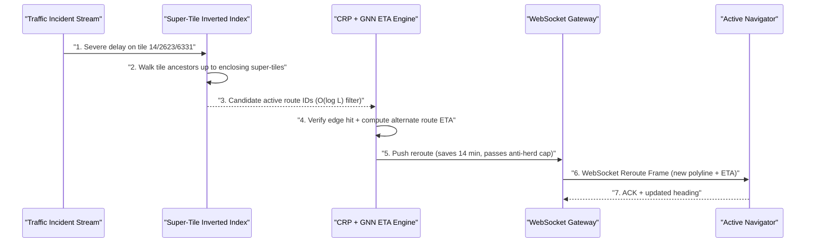
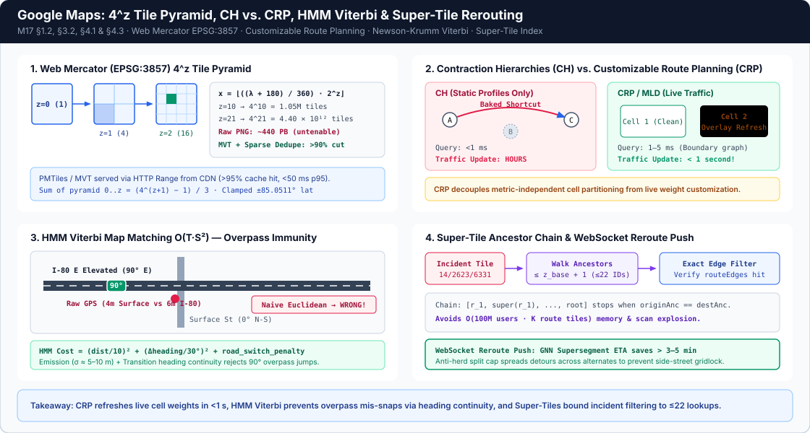
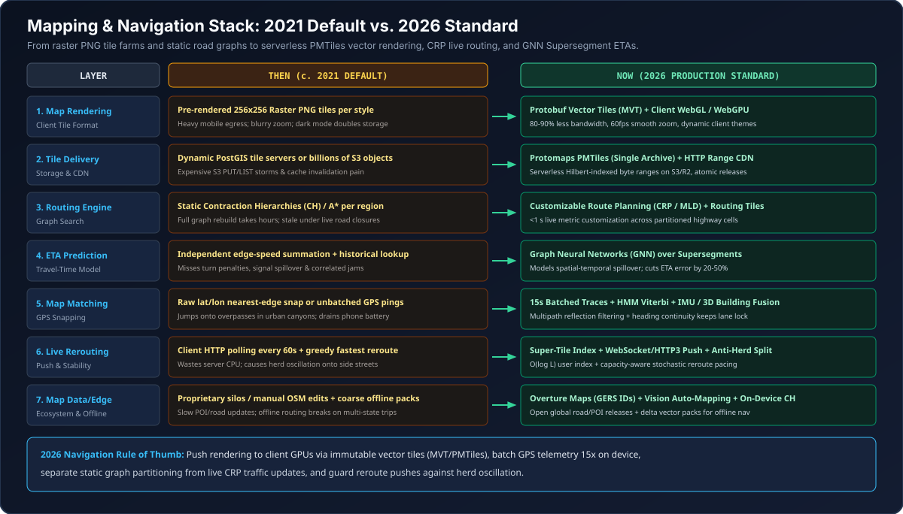

# Module 17 — Google Maps: Tile Rendering, Hierarchical Routing, and Adaptive Navigation

A planetary-scale navigation platform serving 1 billion daily active users composes three coupled subsystems that scale along independent axes: a static-heavy **tile rendering pipeline** painting the Earth across 22 zoom levels, a write-heavy **location telemetry pipeline** ingesting millions of mobile GPS probes per second, and a latency-sensitive **navigation and adaptive rerouting engine** computing continental shortest paths and live traffic ETAs in milliseconds. Grounded in Alex Xu & Sahn Lam's _System Design Interview_ Vol. 2 Chapter 3, Web Mercator EPSG:3857 tile math, Geisberger et al. (_Contraction Hierarchies_, WEA 2008), Delling et al. (_Customizable Route Planning_, SEA 2011), DeepMind/Google Maps (_ETA Prediction with Graph Neural Networks in Google Maps_, CIKM 2021), Newson & Krumm (_Hidden Markov Map Matching Through Noise and Sparseness_, ACM SIGSPATIAL 2009), and modern Mapbox Vector Tiles (MVT) / Protomaps PMTiles delivery, this module builds the architecture end to end and backs each quantitative claim with deterministic TypeScript proofs.

Foundational primitives stay cross-linked to their owning tracks per `.agents/OWNERSHIP.md` rather than re-derived here: shortest-path algorithm proofs (Dijkstra/A*) live in [DSA — Shortest Paths](../../../algorithms/dsa/modules/08-shortest-paths-mst-and-disjoint-sets.md); spatial indexing foundations (Geohash, Quadtree, S2, H3) live in [Module 09](09-search-geospatial-and-specialized-components.md); CDN edge caching, HTTP/3, and WebSockets/SSE mechanics live in [Networking](../../networking/README.md) and [Module 03](03-networking-edge-and-cdn-composition.md); partitioned Kafka streaming lives in [Module 07](07-asynchrony-queues-streams-and-workflows.md); and write-heavy Cassandra/ScyllaDB storage internals live in [Module 16](16-distributed-key-value-store.md) and [Data Systems](../../data-systems/README.md).

---

## 1. Requirements, Map Projections, and Capacity Sizing

### 1.1 Functional and Non-Functional Requirements

- **Functional requirements**: (1) **Map rendering** across zoom levels `0–21` with smooth pan, tilt, and zoom; (2) **User location updates** batched from mobile/embedded clients to feed live traffic estimation and road-closure detection; (3) **Navigation and ETA** computing fast, accurate turn-by-turn routes across driving, walking, and cycling modes with user filters (avoid tolls, avoid highways); and (4) **Adaptive ETA and live rerouting** pushing updated routes when an incident degrades an active trip. (Multi-stop enterprise TSP optimization and rich POI/photo reviews stay out of core interview scope unless requested.)
- **Non-functional requirements**: Scale to **1 billion DAU**; smooth `60 fps` map rendering (`p95` tile fetch `< 50 ms` from CDN); route computation `p99 < 200 ms`; strict mobile battery and metered-data efficiency (minimizing cellular radio wake-ups); high directional accuracy (GPS snapping must not jump across highway overpasses); and regional fault tolerance without global outages.

### 1.2 Web Mercator Projection and Zoom-Level Tile Pyramid Math

To render a 3D ellipsoid onto flat 2D screens while preserving local right angles (`90°` street intersections), Google Maps and web mapping engines adopt the **Web Mercator projection (EPSG:3857)** clamped at $\pm 85.05112878^\circ$ latitude (since $\tan(\pi/4 + \phi/2) \to \infty$ at the poles). At zoom level $z \in \{0, 1, \dots, 21\}$, the world map divides into $n = 2^z$ columns and $2^z$ rows with origin `(0, 0)` at the northwest corner:

$$x_{\text{tile}} = \left\lfloor \frac{\lambda + 180}{360}\, 2^z \right\rfloor, \qquad y_{\text{tile}} = \left\lfloor \frac{1 - \ln(\tan \phi_{\text{rad}} + \sec \phi_{\text{rad}})/\pi}{2}\, 2^z \right\rfloor$$

Because each zoom increment doubles tiles along both axes, zoom level $z$ contains $4^z$ tiles and the cumulative pyramid across $0 \dots z$ holds $\sum_{i=0}^{z} 4^i = (4^{z+1} - 1)/3$ tiles:

- At $z = 0$: `1` tile covers the entire Earth.
- At $z = 10$: $4^{10} = 1{,}048{,}576$ tiles (`~1M` tiles; San Francisco lands at `(163, 395)`).
- At $z = 21$: $4^{21} = 4{,}398{,}046{,}511{,}104 \approx 4.40 \times 10^{12}$ tiles.

At `100 KB` per uncompressed `256 × 256` raster PNG, zoom 21 alone would consume **`~440 PB`** of raw storage (and trillions of tiny S3 objects). Two architectural optimizations cut this by **`> 90%`**: (1) **sparse deduplication** collapsing ~70% ocean and empty desert tiles onto shared empty objects, and (2) **Mapbox Vector Tiles (MVT)** encoding quantized road/building geometry as compact Protobuf command streams (`5–25 KB` per populated tile) rendered dynamically on the client GPU so one tile set serves day, night, and high-DPI displays.

### 1.3 Back-of-the-Envelope Capacity Sizing

Start from **1B DAU** navigating an average of **35 minutes/week** (`5B` navigation minutes/day = `300B` navigation seconds/day):

- **Raw vs. batched location telemetry QPS**: Sampling GPS at `1 Hz` produces $300\text{B} / 86{,}400 \approx 3.47\text{M}$ raw GPS samples/sec on average (and `~17.4M` samples/sec at a `5×` rush-hour peak). Sending one HTTPS request per second would destroy smartphone batteries and burn millions of TLS handshakes. **Client-side 15-second batching** packs 15 compressed `(lat, lon, ts, heading, accuracy)` points into one `~500 B` HTTP/2 or HTTP/3 request, cutting API load `15×` down to **`~231k` avg QPS** and **`~1.16M` peak QPS**.
- **Telemetry storage (Cassandra / ScyllaDB)**: At `~1.16M` batched writes/sec peak × `~500 B` × `N = 3` replication factor, the location cluster absorbs `~1.7 GB/s` logical write throughput across time-windowed append-only partitions (TTL-expired after analytics/model training ingestion).
- **CDN tile egress**: At `5B` nav-minutes/day × `~40` tile loads/min = `200B` tile requests/day (`~2.3M` tile req/s average, `~10M+` peak). With a `> 95%` CDN edge cache-hit ratio (and `~15 KB` average vector tile), edge PoPs absorb `> 95%` of traffic while S3/object storage handles only the `~5%` long-tail miss stream.

| Dimension | Derived Value | Formula / Engineering Assumption |
| --- | --- | --- |
| **Daily Active Users** | `1B` DAU | `35 min/week` nav usage → `5B` nav-minutes/day |
| **Raw GPS Sample Rate** | `~3.47M/s` avg (`~17.4M/s` peak) | `1 Hz` on-device GPS sampling, `5×` rush-hour peak |
| **Batched Location API QPS** | `~231k/s` avg (`~1.16M/s` peak) | `15 s` client batching (`15×` request & radio-wake reduction) |
| **Zoom-21 Uncompressed Raster** | `~440 PB` (`4.40 × 10^12` tiles) | $4^{21} \times 100\text{ KB}$ → cut `> 90%` via sparse dedupe + MVT |
| **Map Tile Requests / Day** | `~200B/day` (`~2.3M/s` avg) | `> 95%` served from CDN edge PoPs (`< 50 ms` p95) |

**Wire contracts (`POST /v1/locations` batched telemetry, `GET /v1/nav` route response, and PMTiles HTTP Range fetch):**

```json
// POST /v1/locations (15-second client batch; Protobuf on wire in production)
{
  "user_id": "u_8f3a19",
  "session_id": "nav_91c2",
  "samples": [
    { "lat": 37.7749, "lon": -122.4194, "ts": 1795140000, "heading_deg": 88, "accuracy_m": 6 },
    { "lat": 37.775, "lon": -122.4178, "ts": 1795140015, "heading_deg": 90, "accuracy_m": 5 }
  ]
}
```

```json
// GET /v1/nav?origin=37.7749,-122.4194&destination=37.8044,-122.2712&mode=DRIVING
{
  "route_id": "rt_40912",
  "eta_seconds": 1140,
  "distance_meters": 18420,
  "polyline": "_fhcFjbhgVuAwDsCal",
  "travel_mode": "DRIVING",
  "steps": [
    { "maneuver": "merge-right", "road": "I-80 E", "distance_m": 12400 },
    { "maneuver": "exit-right", "road": "Grand Ave", "distance_m": 6020 }
  ]
}
```

```http
GET /releases/2026-11-20/planet.pmtiles HTTP/1.1
Host: tiles.cdn.example.com
Range: bytes=184920448-184942100
```

---

## 2. High-Level Architecture: Tile Serving, Location Telemetry, and Navigation

The platform separates into three independently scalable planes so rush-hour telemetry spikes never degrade static map rendering or geocoding latency:



1. **Map Rendering & Tile Plane**: Precomputed static vector tiles (MVT or single-archive **PMTiles** indexed by Hilbert curve) live in S3/R2 behind global CDN edge PoPs (`Cache-Control: public, max-age=31536000, immutable` on versioned release prefixes). Clients either compute `(z, x, y)` URLs locally for zero extra round trips, or bootstrap a signed URL template once per session from a **Tile URL Service** so backend teams can migrate S3/CDN sharding schemes without forcing mobile app updates. Client GPUs (WebGL/WebGPU/Metal) render labels, rotations, and dark-mode styles locally.
2. **Location Telemetry Plane**: Mobile devices buffer `1 Hz` GPS traces locally and POST `15 s` compressed batches to the **Location Service**. The service writes append-only records into **Cassandra / ScyllaDB** (partitioned by `(user_id, time_bucket)` with `timestamp` clustering key) and publishes events to a `user_id`-partitioned **Kafka** topic so each driver's GPS sequence stays ordered for HMM map matching. Four downstream consumer groups fan out from Kafka: **Traffic Update** (live edge speeds), **Routing Tile Updater** (new/closed road detection), **Personalization**, and **Analytics**.
3. **Navigation & Adaptive Rerouting Plane**: `GET /v1/nav` resolves addresses via a **Geocoding Service** backed by a read-heavy **Valkey / Redis** cache, then delegates to the **Route Planner**. The planner orchestrates the **Shortest-Path Service** (loading compressed routing tiles from S3 into worker LRU RAM), the **ML ETA Service** (scoring candidate paths with live traffic), and the **Ranker** (applying avoid-tolls, avoid-highways, or eco-route filters). Active navigators maintain a persistent **WebSocket** to the **Updater Pipeline** for live ETA adjustments and incident reroutes.

### 2.1 Key Design Trade-Offs: Tile URL Resolution and Reroute Push Protocol

| Decision Axis | Option A | Option B | Production Selection |
| --- | --- | --- | --- |
| **Tile URL Construction** | Client computes `(z, x, y)` URL locally (zero bootstrap RTT) | Lightweight **Tile URL Service** returns signed CDN template once/session | Tile URL template cached `24 h` decouples mobile binaries from S3/CDN sharding migrations at negligible overhead |
| **Push Delivery Protocol** | Mobile Push (APNs/FCM) or HTTP Long-Polling | **WebSockets** (full-duplex persistent) vs. SSE (unidirectional) | **WebSockets** support bidirectional reroute ACKs, live heading updates, and last-mile delivery telemetry on mobile + web |

```sql
-- Cassandra / ScyllaDB write-heavy telemetry table (time-bucketed to cap partition size)
CREATE TABLE maps_telemetry.user_locations (
  user_id      UUID,
  day_bucket   DATE,
  recorded_at  TIMESTAMP,
  lat          DOUBLE,
  lon          DOUBLE,
  heading_deg  SMALLINT,
  speed_mps    FLOAT,
  accuracy_m   FLOAT,
  PRIMARY KEY ((user_id, day_bucket), recorded_at)
) WITH CLUSTERING ORDER BY (recorded_at DESC)
  AND default_time_to_live = 2592000; -- 30-day rolling TTL, zero manual row deletes
```



---

## 3. Hierarchical Routing Tiles, Contraction Hierarchies, and CRP

A continental road network contains **`100M+` vertices** and **`250M+` directed edges** once turn restrictions, one-way lanes, and freeway ramps are modeled. Running flat Dijkstra or A* across the full graph fails on two fronts: holding the global adjacency list in every worker wastes tens of gigabytes of RAM, and exploring millions of local residential streets for a 1,000 km trip takes seconds rather than `< 200 ms` (shortest-path complexity proofs live in [DSA — Shortest Paths](../../../algorithms/dsa/modules/08-shortest-paths-mst-and-disjoint-sets.md)).

### 3.1 Three-Tier Hierarchical Routing Tiles

Instead of one monolithic graph, an offline pipeline partitions the road network into compressed binary **Routing Tiles** stored in S3 and cached in worker memory across three road-class resolutions:

- **Level 0 (Local Streets)**: Dense residential and neighborhood graphs loaded _only_ around the trip's origin and destination tiles.
- **Level 1 (Arterial Roads)**: Major city corridors and bridges connecting local tiles to highway interchanges.
- **Level 2 (Highway Network)**: Sparse continental expressways and motorways carrying long-distance transit with minimal vertices.

Each routing tile stores adjacency lists plus explicit pointers to adjacent boundary tiles. A cross-country search ascends from Level 0 → Level 1 → Level 2 near the origin, traverses sparse highway tiles across states, and descends back to Level 0 at the destination—touching dozens of tiles instead of millions of streets.



### 3.2 Contraction Hierarchies (CH) vs. Customizable Route Planning (CRP)

Precomputation accelerates continental queries by `1,000×`, but live traffic splits routing algorithms into two distinct regimes:

| Property | Contraction Hierarchies (CH — Geisberger et al., 2008) | Customizable Route Planning (CRP / MLD — Delling et al., 2011) |
| --- | --- | --- |
| **Core Mechanism** | Orders vertices by importance and inserts **shortcut edges** bypassing contracted nodes; bidirectional upward search | Separates **metric-independent** multi-level graph partitioning (done once) from **metric-dependent** cell-overlay weight customization |
| **Static Query Latency** | **`< 1 ms`** across continental graphs | **`1–5 ms`** across continental graphs |
| **Live Traffic Update Cost** | **Hours** (changing edge weights invalidates contraction order and shortcuts across the graph) | **`< 1 second`** (bottom-up recomputation restricted solely to cells containing changed edges and their ancestors) |
| **Best Production Fit** | Walking, cycling, or offline static profiles where edge speeds barely change | **Live traffic-aware driving**, dynamic road closures, and personalized cost metrics (avoid tolls / EV range) |

> [!IMPORTANT]
> When an interviewer pushes back on "just use Contraction Hierarchies for Google Maps," explain the **metric-coupling flaw**: CH bakes travel times into shortcut edges during offline contraction, so a highway crash cannot invalidate shortcuts globally every 30 seconds. **CRP (Multi-Level Dijkstra)** solves this by partitioning the static road topology once and refreshing affected cell overlays in `< 1 s` as live traffic probes stream in.

---

## 4. Real-Time Traffic, HMM Map Matching, and Adaptive Rerouting

### 4.1 Client Batching and HMM Map Matching

Raw smartphone GPS in dense urban canyons suffers `5–20 m` multipath error as signals bounce off skyscrapers. **Naive Euclidean nearest-road snapping** breaks immediately at multi-level highway interchanges and parallel frontage roads: a `6 m` drift snaps a vehicle driving East at `100 km/h` on `I-80` onto a perpendicular North–South overpass `4 m` away, poisoning both turn-by-turn voice prompts and live traffic speed telemetry.

**Newson & Krumm (ACM SIGSPATIAL 2009)** solved this with a **Hidden Markov Model (HMM)** decoded via the **Viterbi algorithm** in $O(T \cdot S^2)$ time (for $T$ batched samples and $S$ spatial candidates per sample retrieved via S2/H3):

- **Emission probability**: Models the Gaussian likelihood of observing the raw GPS coordinate given candidate road segment $r_i$ ($\sigma \approx 5\text{–}10\text{ m}$).
- **Transition probability**: Scores whether moving from previous road segment $r_{i-1}$ to $r_i$ matches actual shortest road-network distance versus straight-line displacement **plus heading continuity** (rejecting impossible 90° jumps onto an overpass).



### 4.2 ML Supersegment ETA Prediction

Computing trip ETA by summing independent road-segment travel times systematically underestimates real arrival times because urban delay concentrates at **intersections, protected left turns, traffic signal phases, and upstream congestion spillover**.

In production Google Maps (Derrow-Pinion et al., DeepMind / Google Research, CIKM 2021), routes are decomposed into contiguous multi-edge chains called **Supersegments** and scored by a **Graph Neural Network (GNN)**:

- Message passing across neighboring road segments captures how congestion on a downstream off-ramp propagates backward onto the mainline highway.
- Input features fuse live HMM-matched probe speeds, historical diurnal/day-of-week curves, road class, turn angles, and weather signals.
- Replacing independent segment sums with Supersegment GNNs reduced ETA errors by `20%–50%` across major metropolitan areas.

### 4.3 Adaptive ETA, Hierarchical Super-Tile Indexing, and WebSocket Push

To reroute active drivers when an accident blocks tile `r_k` without scanning `100M` active sessions × `K` flat route tiles (`O(Users · K)` RAM and CPU blowup), the Updater Pipeline indexes each active navigator using a **Hierarchical Super-Tile Chain**:

- Starting from the origin tile `r_1` at base zoom $z_{\text{base}}$, store `[r_1, super(r_1), super(super(r_1)), ...]` walking upward through parent quadtree tiles until the root super-tile encloses **both** origin and destination—exactly $z_{\text{base}} - z_{\text{enclosing}} + 1 \le z_{\text{base}} + 1$ entries (`6–9` IDs for typical metro trips, capped at `<= 22` even for cross-country zoom-21 trips).
- Index active navigators in an inverted map keyed by enclosing super-tile ID. When an incident fires on tile `r_k`, Stage 1 walks `r_k` up its ancestor chain (`<= z_base + 1`, at most `22` hash lookups at zoom `21`) as a coarse spatial prefilter; Stage 2 checks each candidate navigator's exact remaining route edges (`findImpactedUsers`), recomputes Supersegment ETA only for confirmed edge hits, and pushes a reroute only when time savings exceed a hysteresis threshold (e.g., `> 3–5 minutes`).
- **Delivery protocol choice**: Mobile push notifications (APNs/FCM) are best-effort, rate-limited, and unavailable for web clients; HTTP long-polling wastes server connections and radio cycles. Persistent **WebSockets** (or HTTP/3 streams) deliver low-latency bidirectional frames with client acknowledgements and resumable session tokens.





_Step-by-step mechanics:_ (1) **Web Mercator `4^z` Pyramid** subdivides EPSG:3857 tiles from `z=0` (`1` tile) to `z=21` (`4.40 × 10¹²` tiles), cutting storage `> 90%` with MVT/PMTiles and sparse deduplication. (2) **CRP vs. CH** keeps graph partitioning metric-independent so live traffic only refreshes affected cell overlays in `< 1 s` rather than invalidating global CH shortcuts for hours. (3) **HMM Viterbi Map Matching** (`O(T · S²)`) combines Gaussian emission distance with heading continuity to keep `I-80 E` vehicles from snapping onto perpendicular surface streets. (4) **Super-Tile Inverted Indexing** walks at most `z_base + 1 <= 22` ancestor tiles to prefilter impacted navigators before pushing WebSocket reroutes.

Below are the verified `latLonToTile`, `SuperTileRoutingIndex`, and `snapGpsPoint` primitives implemented in [`examples/lib/maps-models.ts`](../examples/lib/maps-models.ts):

```typescript
export function latLonToTile(latDeg: number, lonDeg: number, zoom: number): TileCoord {
  const clampedLat = Math.max(-85.05112878, Math.min(85.05112878, latDeg));
  const latRad = (clampedLat * Math.PI) / 180;
  const n = 2 ** zoom;
  const x = Math.min(n - 1, Math.max(0, Math.floor(((lonDeg + 180) / 360) * n)));
  const mercY = (1 - Math.log(Math.tan(latRad) + 1 / Math.cos(latRad)) / Math.PI) / 2;
  const y = Math.min(n - 1, Math.max(0, Math.floor(mercY * n)));
  return { z: zoom, x, y };
}

export class SuperTileRoutingIndex {
  private readonly userChainLength = new Map<string, number>();
  private readonly userRouteEdges = new Map<string, ReadonlySet<string>>();
  private readonly invertedBySuperTile = new Map<string, Set<string>>();

  registerNavigator(
    userId: string,
    originTile: TileCoord,
    destTile: TileCoord,
    routeEdges?: readonly string[],
  ): TileCoord[] {
    if (originTile.z !== destTile.z) {
      throw new RangeError('originTile and destTile must share base zoom');
    }
    const chain: TileCoord[] = [];
    let z = originTile.z;
    while (z >= 0) {
      const oAnc = ancestorTile(originTile, z);
      const dAnc = ancestorTile(destTile, z);
      chain.push(oAnc);
      if (oAnc.x === dAnc.x && oAnc.y === dAnc.y) {
        this.userChainLength.set(userId, chain.length);
        if (routeEdges) this.userRouteEdges.set(userId, new Set(routeEdges));
        const key = tileKey(oAnc);
        const bucket = this.invertedBySuperTile.get(key) ?? new Set<string>();
        bucket.add(userId);
        this.invertedBySuperTile.set(key, bucket);
        return chain;
      }
      z--;
    }
    return chain;
  }

  findCandidateUsers(incidentTile: TileCoord): string[] {
    const impacted = new Set<string>();
    for (let z = incidentTile.z; z >= 0; z--) {
      const users = this.invertedBySuperTile.get(tileKey(ancestorTile(incidentTile, z)));
      if (users) for (const u of users) impacted.add(u);
    }
    return [...impacted].sort();
  }

  findImpactedUsers(incidentTile: TileCoord, incidentEdgeId: string): string[] {
    return this.findCandidateUsers(incidentTile).filter((uid) =>
      this.userRouteEdges.get(uid)?.has(incidentEdgeId),
    );
  }
}

export function snapGpsPoint(options: {
  vehicleHeadingDeg: number;
  candidates: readonly RoadCandidate[];
  mode: 'naive-euclidean' | 'hmm-heading-continuity';
}): string {
  // Naive Euclidean compares distanceMeters only; HMM-inspired mode adds heading & road continuity penalties
  let bestId = options.candidates[0]!.roadId;
  let bestCost = Number.POSITIVE_INFINITY;
  for (const c of options.candidates) {
    const cost =
      options.mode === 'naive-euclidean'
        ? c.distanceMeters
        : (c.distanceMeters / 10) ** 2 +
          (angularDiffDeg(options.vehicleHeadingDeg, c.roadHeadingDeg) / 30) ** 2 +
          (c.sameRoadAsPrevious ? 0 : 2.5);
    if (cost < bestCost) {
      bestCost = cost;
      bestId = c.roadId;
    }
  }
  return bestId;
}
```

---

## 5. Production Gotchas and Failure Modes

1. **Naive Euclidean GPS snapping jumping onto overpasses or frontage roads.** _Symptom:_ Turn-by-turn audio tells a highway driver to "turn left" onto a street crossing underneath an elevated bridge. _Root cause:_ Nearest-point distance ignores vertical z-level separation, heading, and road-graph continuity. _Mitigation:_ Run HMM Viterbi map matching incorporating heading alignment, topological reachability, and z-level/bridge metadata.
2. **Zoom-21 empty-ocean tile explosion and style-redeploy purge storms.** _Symptom:_ Object counts cross trillions and changing dark-mode colors forces global CDN invalidations. _Root cause:_ Baking raster PNG pixels per style for every `(z, x, y)` coordinate. _Mitigation:_ Deduplicate empty ocean/desert tiles, serve client-styled **MVT / PMTiles** vector tiles, and version release prefixes immutably instead of purging CDN paths.
3. **Hardcoding client tile URL templates blocking storage migrations.** _Symptom:_ Millions of older mobile clients keep hammering a retired S3/CDN hostname for years. _Root cause:_ Tile coordinate-to-URL mapping was compiled directly into mobile binaries. _Mitigation:_ Bootstrap signed URL templates from a lightweight Tile URL API once per session (cached 24 h) so CDN/storage sharding changes transparently.
4. **Unbatched 1 Hz GPS pings draining battery and multiplying TLS QPS 15×.** _Symptom:_ Mobile power complaints and `15×` higher ingress compute/TLS cost at rush hour. _Root cause:_ Waking the cellular radio and issuing an HTTP request on every single 1-second GPS fix. _Mitigation:_ Batch 15 samples locally into one compressed request over keep-alive HTTP/2–3, reserving immediate unbatched sends solely for user-tapped incident reports.
5. **Static Contraction Hierarchies routing drivers into live highway closures.** _Symptom:_ Navigation directs traffic straight into a closed motorway until the overnight graph build completes. _Root cause:_ CH shortcuts bake static edge weights into contraction order and cannot refresh in seconds. _Mitigation:_ Use **CRP (Multi-Level Dijkstra)** with `< 1 s` overlay customization for driving while keeping CH for static walking/cycling modes.
6. **Rerouting herd oscillation (Braess / Waze residential-street flood).** _Symptom:_ Diverting `5,000` highway drivers simultaneously onto one narrow residential bypass immediately jams the bypass and flips everyone back. _Root cause:_ Greedy identical reroutes evaluated against a single traffic snapshot ignore the capacity impact of the rerouted cohort itself. _Mitigation:_ Apply capacity-aware corridor saturation penalties in the Ranker, split cohorts stochastically across top-K alternates, and require minimum ETA savings hysteresis (`>= 3–5 min`).
7. **WebSocket thundering-herd reconnect storms during gateway deploys.** _Symptom:_ Rolling gateway restarts drop 2M persistent sockets simultaneously, overwhelming TLS CPU and session stores. _Root cause:_ Synchronized client reconnects with zero jitter and gateway-local session state. _Mitigation:_ Drain gateways gracefully (`GOAWAY` / close codes over 60–120 s), enforce exponential backoff with **full jitter** on clients, and store resumable navigation session tokens in shared Valkey/Redis.
8. **Geocoding alias ambiguity and stale offline map-pack drift.** _Symptom:_ Users searching newly opened streets get wrong pins or offline routes attempt turns onto recently closed roads. _Root cause:_ Static place lookup tables without viewport/session ranking and un-versioned monolithic offline packs. _Mitigation:_ Rank geocoding hits with spatial viewport proximity + popularity, and distribute compact delta-updated vector/routing packs tagged with graph version hashes.

### 5.1 Production SRE Signals and Alert Guardrails

| Operational Signal | Healthy Baseline | Page / Escalation Threshold | Immediate Mitigation Action |
| --- | --- | --- | --- |
| **Tile CDN Cache-Hit Ratio** | `> 95%` | `< 92%` for `10 min` | Audit cache-key normalization (`Vary`/query params) and recent version rollouts |
| **Routing Engine `p99` Latency** | `< 200 ms` | `> 300 ms` for `5 min` | Check S3 routing-tile LRU miss rate and pause non-critical CRP batch rebuilds |
| **Traffic Ingestion Freshness Lag** | `< 30 s` | `> 60 s` | Scale Kafka HMM consumers; check `user_id` partition skew or Cassandra write latency |
| **HMM Map-Match Failure Rate** | `< 1%` | `> 3%` | Verify road-graph tile version parity and candidate search radius |
| **WebSocket Reconnect Rate** | `< 2% / hr` | `> 8% / hr` | Halt gateway rollout immediately; verify connection drain timers and client jitter |
| **ETA Mean Absolute Error (MAE)** | Within `5%` of baseline | `> 8%` drift for `1 hr` | Check live probe feature pipeline and fallback GNN model to historical + live blend |

---

## 6. Technology Comparison: Then vs. Now (2021 vs. 2026)



| Mapping & Routing Layer | 2021 Default | 2026 Modern Standard | Why It Changed & Migration Pitfall |
| --- | --- | --- | --- |
| **Map Rendering & Tiles** | Pre-rendered `256 × 256` raster PNG tiles per theme | **Mapbox Vector Tiles (MVT)** + client **WebGL / WebGPU** styling | Cuts storage/bandwidth `80%–90%` and enables smooth `60 fps` zoom; _pitfall:_ GPU driver/font-glyph regressions across mid-range devices. |
| **Tile Storage & Delivery** | Dynamic PostGIS tile servers or billions of flat S3 objects | **Protomaps PMTiles** (single Hilbert-indexed archive) + CDN HTTP `Range` requests | Eliminates billion-object S3 PUT/LIST bills and enables atomic releases; _pitfall:_ losing individual tile invalidation (must version archive key). |
| **Shortest-Path Engine** | Static **Contraction Hierarchies (CH)** rebuilt nightly | **Customizable Route Planning (CRP / MLD)** + compressed routing tiles | Absorbs live traffic closures in `< 1 s` without full contraction rebuilds; _pitfall:_ extreme traffic spikes unbalancing static cell partitions. |
| **ETA Prediction** | Independent edge-speed summation + historical buckets | **Graph Neural Networks (GNN)** over **Supersegments** | Captures intersection turns and upstream jam spillover (`20%–50%` lower error); _pitfall:_ training-serving feature skew on newly opened roads. |
| **GPS Map Matching** | Nearest-edge Euclidean snap or basic distance thresholds | **HMM Viterbi** + on-device IMU dead reckoning + 3D building multipath filtering | Stops overpass/frontage-road snapping errors in urban canyons; _pitfall:_ forgetting to partition Kafka by `user_id`, breaking sequence order. |
| **Adaptive Reroute Push** | `60 s` HTTP client polling + greedy fastest reroute | **WebSocket / HTTP/3** resumable streams + Super-Tile index + anti-herd pacing | Cuts polling CPU and prevents residential detour floods; _pitfall:_ rolling gateway deploys causing synchronized reconnect storms. |
| **Map Data Ecosystem** | Closed proprietary map silos or manual OSM pipelines | **Overture Maps Foundation** (stable GERS IDs) + OSM + automated vision/probe mapping | Shared global road/building/POI basemaps cut licensing cost; _pitfall:_ conflating external POI IDs with internal road-segment IDs across updates. |
| **Offline Navigation** | Rarely refreshed monolithic regional raster/graph packs | Delta-updated vector + on-device CH packs with version parity checks | Preserves turn-by-turn guidance in dead zones at low storage footprint; _pitfall:_ stale offline packs mis-routing onto newly restricted turns. |

**Pitfalls of mixing 2021 and 2026 layers during migration.** Running modern MVT/PMTiles vector maps alongside a legacy tile-URL client that expects `/z/x/y.png` requires an edge Worker raster fallback until old app versions expire. Similarly, switching Kafka ingestion from `user_id` partitioning to `geohash_tile_id` partitioning to speed up traffic aggregation silently breaks per-user sequence ordering required by HMM Viterbi map matching—always keep a two-stage pipeline (`user_id`-partitioned HMM stage → `tile_id`-repartitioned traffic aggregation stage).

---

## 7. Executable Proof Map

All five quantitative and correctness claims in this module are proved deterministically in [`examples/11-maps-routing.test.ts`](../examples/11-maps-routing.test.ts) (backed by [`examples/lib/maps-models.ts`](../examples/lib/maps-models.ts)):

| Concept in This Module | Deterministic Test in `11-maps-routing.test.ts` | Verified Invariant / Negative Proof |
| --- | --- | --- |
| **Web Mercator Tile Math & Zoom-21 Pyramid** | `latLonToTile`, `ancestorTile` (`fast-check` 200 seeds), `tilePyramidStats(21, 100_000)` | Verifies San Francisco `z=10 -> (163, 395)`, proves parent-child bit-shift quadtree invariant across 200 random coordinates, and confirms $4^{21} \approx 4.40 \times 10^{12}$ tiles (`~439.8 PB` raw). |
| **`A*` Speedup & Live-Traffic Rerouting** | `shortestPathAStar` on 9-node road graph (`maxSpeedKmh = Infinity` vs `100`, congestion `1×` vs `10×`) | Proves admissible `A*` expands strictly fewer vertices than Dijkstra for identical `18 min` highway route, and a `10×` highway incident triggers automatic reroute onto the `32 min` arterial bypass. |
| **Hierarchical Super-Tile Reroute Index** | `SuperTileRoutingIndex` (`driver-bay` SF→Oakland, `driver-golden-gate` SF→Marin, `driver-nyc` NYC→Brooklyn) | Proves per-navigator chain stays compact (`z_base - z_enclosing + 1 <= z_base + 1`, `<= 22` at `z = 21`) and two-stage prefilter + `findImpactedUsers` exact edge check matches `driver-bay` while rejecting both `driver-nyc` (coarse miss) and `driver-golden-gate` (shared root, disjoint edges). |
| **15-Second Telemetry Batching QPS Math** | `estimateLocationBatching` (`1B` DAU, `35 min/wk`, `15 s` batch, `5×` peak) | Proves `15×` QPS reduction from `~3.47M/s` raw GPS samples down to `~231k/s` avg and `~1.16M/s` peak batched requests. |
| **Euclidean Overpass Trap vs. Single-Step HMM Proxy** | `snapGpsPoint` (`naive-euclidean` vs `hmm-heading-continuity`) | Negative test proving naive Euclidean snapping jumps an Eastbound `I-80` vehicle onto a perpendicular `4 m`-away overpass, while the single-step emission + heading/continuity proxy stays locked on `highway-i80-e` (full $O(T \cdot S^2)$ Viterbi runs over $T$ sequential fixes). |

---

## Interview Drill

### Question 1: Derive the storage requirement for uncompressed zoom-21 raster tiles across the globe and explain why modern stacks use vector tiles (MVT) inside PMTiles archives instead.

<details><summary>Answer</summary>

At zoom $z$, the Web Mercator pyramid has $2^z \times 2^z = 4^z$ tiles. At $z = 21$, $4^{21} \approx 4.40 \times 10^{12}$ tiles; at `100 KB` per PNG raster, zoom 21 alone totals `~440 PB` plus trillions of tiny object-storage keys, and supporting dark mode or high-DPI screens multiplies that further. Modern stacks eliminate `> 90%` of storage and egress by deduplicating empty oceans/deserts, shipping quantized Protobuf **Mapbox Vector Tiles (MVT)** rendered dynamically on client GPUs, and packing tiles into Hilbert-indexed **PMTiles** archives served from private S3/R2 buckets via CloudFront HTTP `Range` requests on versioned immutable release keys.

</details>

### Question 2: Why can't Google Maps run plain A* on a continental road graph, and why does Customizable Route Planning (CRP) beat static Contraction Hierarchies (CH) for live driving?

<details><summary>Answer</summary>

A continental road graph holds `100M+` vertices; flat A* exceeds single-worker memory and expands millions of local streets, taking seconds instead of `< 200 ms`. Static **Contraction Hierarchies (CH)** precomputes shortcut edges for `< 1 ms` queries, but shortcuts bake static travel times into the contraction order—changing live edge weights during a highway accident invalidates shortcuts globally and requires hours to rebuild. **CRP (Multi-Level Dijkstra)** separates one-time metric-independent graph partitioning from `< 1 s` bottom-up overlay metric customization across only affected cells, so live closures and traffic incidents reshape continental routes immediately.

</details>

### Question 3: Explain the two-stage Kafka partitioning pattern needed to run both HMM map matching and live tile-level traffic aggregation at 1M batched GPS requests/sec.

<details><summary>Answer</summary>

HMM Viterbi map matching requires every user's sequential GPS trace to arrive in strict timestamp order on one consumer, whereas traffic speed aggregation groups matched probes by road segment / geohash tile. Partitioning raw ingest by `geohash_tile_id` creates massive city-center hot partitions and scrambles each driver's trajectory across shards. The correct architecture uses two stages: Stage 1 partitions raw telemetry by `hash(user_id)` (uniform load spread + strict per-user order for HMM Viterbi), and Stage 2 emits clean `(road_edge_id, speed, ts)` probes repartitioned by `tile_id` / `road_edge_id` into windowed traffic aggregation jobs.

</details>

### Question 4: Why does storing a hierarchical super-tile chain (`[r_1, super(r_1), ...]`) beat storing a flat list of `K` route tiles for adaptive ETA and live rerouting?

<details><summary>Answer</summary>

A cross-country route can traverse hundreds of base routing tiles (`O(K)` memory per active navigator across `100M` concurrent users), making flat inverted indexes expensive to update and scan. Storing the origin tile plus nested parent super-tiles up to the smallest common enclosing ancestor of origin and destination takes exactly $z_{\text{base}} - z_{\text{enclosing}} + 1 \le z_{\text{base}} + 1$ entries (`6–9` IDs for typical metro trips, capped at `<= 22` even at zoom `21`). When an incident fires on tile `r_k`, Stage 1 walks `r_k` up its ancestor chain (`<= z_base + 1` hash lookups) against the inverted super-tile index as a coarse spatial prefilter, and Stage 2 checks exact route-edge overlap before running GNN ETA recomputation.

</details>

### Question 5: A driver traveling East on an elevated highway gets suddenly rerouted onto a surface street crossing underneath. Diagnose why Euclidean GPS snapping failed and how HMM map matching prevents it.

<details><summary>Answer</summary>

Urban-canyon multipath GPS drift (`5–20 m`) frequently places a noisy fix closer in 2D Euclidean distance to a perpendicular underpass or parallel frontage road than to the elevated highway centerline. Naive nearest-edge snapping evaluates a single coordinate in isolation and jumps car state onto the wrong road. **HMM map matching** (Newson & Krumm) scores candidate segments across a sequence of batched fixes by combining Gaussian emission distance with transition probability—verifying that road-network path distance matches straight-line displacement and penalizing sharp heading discontinuities (`90°` mismatch)—so Viterbi decoding stays locked onto the true highway trajectory.

</details>

### Question 6: Why does summing individual road-segment travel times produce systematic ETA errors, and how do GNN Supersegments fix it?

<details><summary>Answer</summary>

Independent per-edge travel times ignore non-additive intersection dynamics—protected left-turn queues, uncoordinated traffic signals, highway merge bottlenecks, and congestion spilling backward from a blocked off-ramp onto upstream segments. DeepMind/Google Maps **Supersegment GNNs** group contiguous road segments into larger connected subgraphs and run graph message passing over live probe speeds, historical diurnal curves, road class, and turn geometry, predicting joint travel-time distributions that capture spatial-temporal spillover and cut metropolitan ETA errors by `20%–50%`.

</details>

### Question 7: You push an optimal detour for an interstate accident to 5,000 active navigators over WebSockets, and within three minutes the detour side street becomes gridlocked while the gateway tier hits 100% CPU during a deploy. Fix both failures.

<details><summary>Answer</summary>

First, **herd rerouting oscillation** happens because every navigator receives the exact same greedy detour from one traffic snapshot, saturating a low-capacity side street; mitigate with capacity-aware corridor saturation penalties in the Ranker, stochastic cohort splitting across multiple alternates, and minimum ETA-savings hysteresis (`>= 3–5 min`). Second, **WebSocket reconnect storms** happen when a gateway deploy drops millions of sockets simultaneously; mitigate with graceful connection draining over 60–120 seconds, client exponential backoff with **full jitter** (turning `2M` reconnects in `1 s` into `~16.7k/s` over `120 s`), and resumable session tokens stored in shared Valkey/Redis so reconnects do not recompute routes from scratch.

</details>
