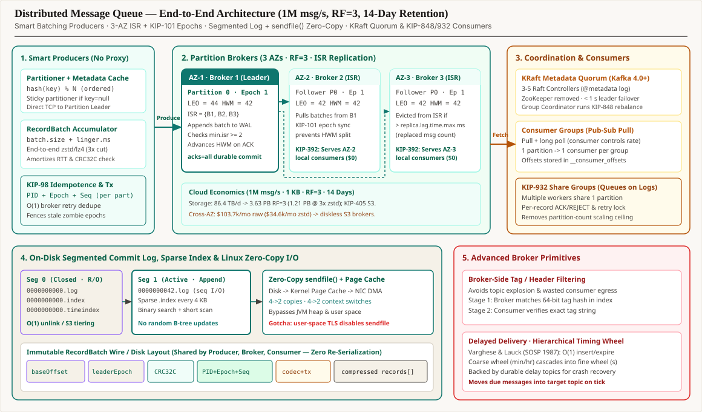
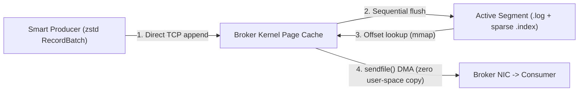
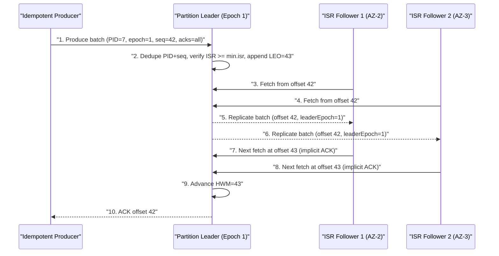
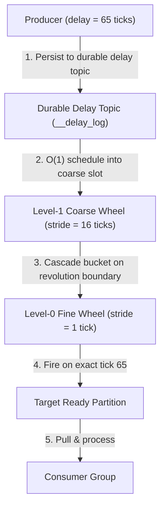
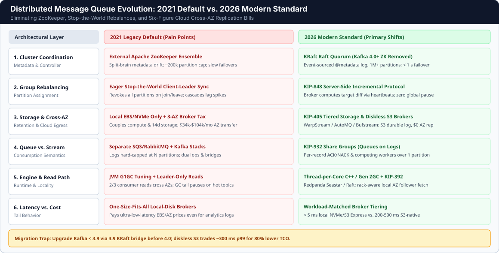

# Module 18 — Distributed Message Queue: Commit Logs, Replication, Coordination, and Modern Cloud Brokers

This module designs a **distributed message queue** from first principles as a durable storage and replication system rather than a black-box application pipe. Following ByteByteGo Chapter 19 (_Distributed Message Queue_) and primary systems literature — Kreps et al. on Apache Kafka (2011), Varghese and Lauck on Hierarchical Timing Wheels (SOSP 1987), and the Kafka Improvement Proposals defining modern correctness and cloud economics (`KIP-98`, `KIP-101`, `KIP-392`, `KIP-405`, `KIP-500`, `KIP-848`, `KIP-932`) — we examine the on-disk segmented commit log, Linux zero-copy I/O, ISR replication and leader-epoch truncation, producer idempotence and transactions, consumer rebalancing, KRaft coordination, delayed delivery, and the 2021-to-2026 shift toward tiered and diskless object-store brokers.

> [!NOTE]
> **Knowledge Ownership & Cross-Links.** This module owns broker-level distributed message queue architecture from first principles. For black-box application usage of queues, streams, transactional outbox, and Temporal durable workflows, see [Module 07](07-asynchrony-queues-streams-and-workflows.md). For stream-processing operators and event-time windowing, see [`architecture/data-systems/modules/11-stream-processing-and-event-logs.md`](../../data-systems/modules/11-stream-processing-and-event-logs.md). For OS page-cache and buffer-pool internals, see [`architecture/data-systems/modules/04-buffer-management-and-operating-system-io.md`](../../data-systems/modules/04-buffer-management-and-operating-system-io.md). For formal delivery-semantics theory (`at-most-once`, `at-least-once`, `effectively-once`), see [`architecture/distributed-systems/modules/10-messaging-logs-and-delivery-semantics.md`](../../distributed-systems/modules/10-messaging-logs-and-delivery-semantics.md). For Raft consensus internals reused by KRaft, see [`architecture/distributed-systems/modules/07-raft-consensus-deep-dive.md`](../../distributed-systems/modules/07-raft-consensus-deep-dive.md).

---

## 1. Requirements, Messaging Models, and Quantitative Capacity Sizing

### 1.1 Functional & Non-Functional Scope

Traditional work queues (RabbitMQ, Amazon SQS) delete a message once a worker acknowledges it and offer no built-in replay or multi-day history. Modern event streaming platforms (Apache Kafka, Apache Pulsar, Redpanda, WarpStream, AutoMQ) retain an immutable, partitioned append-only log for days or indefinitely so multiple independent services can read and replay the same stream at different speeds. Designing a unified distributed message queue requires supporting both workloads cleanly:

- **Producers & Consumers**: Producers append `KB`-sized messages to named topics; consumers read either as competing workers (point-to-point) or as independent fan-out subscriber groups (publish-subscribe).
- **Repeated Consumption & Retention**: Messages remain durably persisted on disk and replicated across failure domains for a configurable retention window (e.g., `14 days`), allowing replay from any offset or timestamp and automatic expiration of old data.
- **Strict Scoped Ordering**: FIFO ordering is preserved within each partition (`hash(key) % N`), guaranteeing per-entity causality (e.g., all state transitions for `order_id` stay ordered).
- **Configurable Delivery Semantics**: Supports `at-most-once`, `at-least-once`, and intra-cluster `effectively-once` (idempotent + transactional writes with `read_committed` consumers).
- **Tunable Throughput vs. Latency**: High-throughput log aggregation (`> 1M msg/s` via batching and compression) alongside low-latency transactional command queues (`< 10 ms` `p99`).

### 1.2 Messaging Model Convergence: Point-to-Point, Pub-Sub, and KIP-932 Share Groups

In a partitioned log, **consumer groups** unify point-to-point and publish-subscribe semantics. Across different groups (`billing-svc`, `search-indexer`, `fraud-ml`), every group receives the full topic stream and tracks its own offsets independently (pub-sub fan-out). Within a single group, each partition is assigned to at most one active consumer (competing consumers with strict per-partition ordering).

The classic limitation of partitioned logs is the hard parallelism ceiling: a consumer group cannot run more active workers than the topic's partition count $P$ (`active_consumers <= P`). **Apache Kafka KIP-932 (Queues for Kafka / Share Groups)** closes this gap by introducing shared consumption over the same underlying commit log: multiple competing workers in a share group acquire individual records from the same partition with per-record states (`AVAILABLE`, `ACQUIRED`, `ACKNOWLEDGED`, `REJECTED`, `ARCHIVED`), per-record delivery-attempt tracking, and lock timeouts. Organizations can now serve both ordered event streams and high-fan-out point-to-point worker pools from one replicated storage engine instead of maintaining separate RabbitMQ/SQS and Kafka estates.

| Model | Consumption Semantics | Parallelism Ceiling | Ordering Scope | Replay Support |
| --- | --- | --- | --- | --- |
| **Classic Point-to-Point Queue** (SQS, RabbitMQ) | Destructive; deleted on worker `ACK` | Unlimited workers per queue (until broker CPU/storage limit) | Best-effort (or per-group FIFO at lower throughput) | None after `ACK` |
| **Partitioned Consumer Group** (Kafka, Kinesis, Event Hubs) | Non-destructive offset tracking per group | Hard-capped at partition count $P$ | Strict total order within each partition | Full offset & timestamp replay |
| **Share Group on Commit Log** (Kafka KIP-932) | Non-destructive log with per-record `ACK`/`REJECT` lock state | Workers can exceed partition count $P$ | Best-effort across competing workers | Retained in log; other groups replay independently |

### 1.3 Back-of-the-Envelope Capacity & Cloud Cross-AZ Economics

In cloud deployments, **cross-Availability-Zone network transfer** — not local SSD storage — is frequently the single largest line item on a high-throughput message queue bill. Consider a canonical production cluster running across `3` cloud Availability Zones (`AZ-1`, `AZ-2`, `AZ-3`):

- **Workload Assumptions**: `1,000,000 msg/s` average ingest (`5,000,000 msg/s` peak), `1 KB` (`1,000 B` decimal) average payload, replication factor `RF = 3`, `14-day` retention, `3` independent consumer groups, `3x` `zstd` batch compression, and AWS-equivalent cross-AZ transfer priced at `$0.02/GB` (`$0.01/GB` egress + `$0.01/GB` ingress per inter-AZ hop).
- **Raw Ingest Rate**: `1,000,000 msg/s × 1,000 B = 1 GB/s` (`86.4 TB/day` raw; `5 GB/s` peak).
- **14-Day Storage Footprint**:
  - Logical retained data: `86.4 TB/day × 14 days = 1,209.6 TB ≈ 1.21 PB`.
  - Physical replicated storage (`RF = 3`, uncompressed): `1.21 PB × 3 ≈ 3.63 PB`.
  - Physical replicated storage (`3x` `zstd` compression): `3.63 PB / 3 ≈ 1.21 PB` across broker disks (or `~0.17 PB` hot local NVMe for 2 days + `~1.04 PB` cheap S3/object storage under KIP-405 Tiered Storage).
- **Intra-Cluster Cross-AZ Replication Tax**: Each partition leader keeps 1 local copy and streams to `RF - 1 = 2` followers in remote AZs (`2 GB/s` raw, or `0.667 GB/s` at `3x` `zstd`). Over a 30-day month (`2,592,000 s`):
  - Uncompressed: `2 GB/s × 2,592,000 s × $0.02/GB = $103,680/month`.
  - Compressed (`3x` `zstd`): `0.667 GB/s × 2,592,000 s × $0.02/GB ≈ $34,560/month` purely for inter-broker replication.
- **Cross-AZ Consumer Fetch Tax**: With `3` consumer groups fetching `1 GB/s` each (`3 GB/s` raw; `1 GB/s` at `3x` `zstd`), leader-only fetching causes `(RF - 1)/RF = 2/3` of reads to cross AZ boundaries (`0.667 GB/s` compressed = another `~$34,560/month`, bringing combined cross-AZ fees to `~$69,120/month` even after compression!). Enabling **KIP-392 rack-aware follower fetching** routes consumers to same-AZ replicas, dropping the consumer cross-AZ bill to **`$0/month`**. Eliminating the remaining `$34,560/month` inter-broker replication bill is the exact economic driver behind 2026 **diskless object-store brokers** (WarpStream, AutoMQ, Bufstream).

### 1.4 Primary Literature & Specification Matrix

| Source / Specification | Year | Core Mechanism | Why It Matters Here |
| --- | :-: | --- | --- |
| Kreps, Narkhede & Rao — _Kafka: A Distributed Messaging System for Log Processing_ (NetDB) | 2011 | Partitioned append-only commit log, OS page cache, `sendfile()` zero-copy, pull consumers | Establishes why sequential file I/O + OS caching beats B-tree message stores by orders of magnitude |
| Varghese & Lauck — _Hashed and Hierarchical Timing Wheels_ (SOSP) | 1987 | Multi-level circular timer buckets with $O(1)$ amortized insert and cascade | Foundation for scalable delayed/scheduled message delivery in Kafka purgatory, RocketMQ, and Netty |
| Apache Kafka **KIP-98** (Idempotent & Transactional Producer) | 2017 | Per-partition `(PID, epoch, sequence)` deduplication + 2PC `COMMIT`/`ABORT` markers + `LSO` | Eliminates retry duplicates and enables atomic multi-partition `read_committed` workflows |
| Apache Kafka **KIP-101** (Leader Epoch Truncation) | 2017 | `OffsetsForLeaderEpoch` RPC replacing High Watermark truncation on failover | Eliminates silent log divergence and committed-data loss during rapid leader failovers |
| Apache Kafka **KIP-392** (Rack-Aware Follower Fetching) | 2019 | Consumers read committed records from closest same-AZ ISR follower | Cuts cross-AZ consumer data-transfer fees to `$0` in multi-AZ cloud deployments |
| Apache Kafka **KIP-405** (Tiered Storage) | 2020 (EA in 3.6, 2023) | Separates hot local NVMe log tail from immutable historical segments in S3/GCS/Blob | Decouples compute from multi-week retention and prevents cold replays from thrashing broker disks |
| Apache Kafka **KIP-500** (KRaft) & Kafka 4.0 Release | 2020–2025 | Self-managed Raft `@metadata` quorum; complete removal of ZooKeeper in Kafka 4.0 (March 2025) | Removes dual-metadata split-brain and cuts controller failover to `< 1 s` at `1M+` partitions |
| Apache Kafka **KIP-848** (Next-Gen Consumer Rebalance Protocol) | 2025 (GA) | Broker-driven incremental partition reconciliation via heartbeats | Eliminates stop-the-world consumer group pauses and client-leader rebalance storms |
| Apache Kafka **KIP-932** (Queues for Kafka / Share Groups) | 2025–2026 (EA/Preview) | Per-record competing-consumer acquisition, `ACK`/`REJECT`, and delivery limits over log partitions | Converges point-to-point queues and durable event logs onto one storage engine (verify broker version before production adoption) |

---

## 2. High-Level Architecture, Segmented Commit Log, and Zero-Copy I/O



### 2.1 On-Disk Segmented Commit Log and Sparse Indexes

A partition is stored on disk as a directory of immutable, fixed-cap **segment files** (typically rolling every `1 GB` or `7 days`). Only the tail segment (the **active segment**) accepts writes; every older closed segment is strictly read-only. Each segment consists of three co-named files keyed by the segment's `baseOffset` (for example, `00000000000000000042.log`):

1. **`.log` (Data File)**: Concatenated binary `RecordBatch` frames written strictly sequentially at the end of the active file.
2. **`.index` (Sparse Offset Index)**: Maps `(relativeOffset -> physicalBytePosition)` once every `log.index.interval.bytes` (default `4 KB`). Because the index is sparse, it stays small enough to remain memory-mapped (`mmap`) in RAM. Locating an arbitrary offset runs in two fast steps: binary search over segment base offsets and the segment's sparse `.index` ($O(\log S + \log I)$), followed by a bounded sequential scan of at most `4 KB` inside `.log`.
3. **`.timeindex` (Sparse Timestamp Index)**: Maps `(maxTimestamp -> relativeOffset)` at the same sparse stride so consumers can seek by timestamp (`offsetsForTimes`) and retention sweeps can evaluate expiry without reading message payloads.

This layout unlocks two massive advantages over B-tree-backed queues (such as traditional relational DB queues):

- **Sequential I/O & OS Page Cache**: Modern NVMe SSDs sustain `> 3 GB/s` sequential writes and even spinning HDDs sustain `> 100–200 MB/s` sequentially — orders of magnitude faster than random 4 KB B-tree page updates and node splits. Producers append to the kernel **OS Page Cache**, and real-time consumers trailing within seconds of the log tail read directly from warm RAM pages without touching physical disks (detailed in [`architecture/data-systems/modules/04-buffer-management-and-operating-system-io.md`](../../data-systems/modules/04-buffer-management-and-operating-system-io.md)).
- **$O(1)$ Whole-Segment Retention & Compaction**: Expiring 14-day-old records never triggers per-row tombstones or B-tree rebalancing. Once a closed segment's newest timestamp falls behind the retention cutoff, the broker executes a single filesystem `unlink()` on the segment triplet in $O(1)$ time, leaving active writes completely untouched.

### 2.2 Zero-Copy `sendfile()` and the User-Space TLS Gotcha

On a conventional broker serving a consumer fetch, moving a 1 MB batch from disk to socket requires **4 data copies** and **4 kernel/user context switches**: `Disk -> Kernel Page Cache -> User-Space JVM Buffer -> Kernel Socket Buffer -> NIC`. Because the `RecordBatch` binary layout is identical across producer wire format, on-disk `.log` storage, and consumer fetch responses, the broker never needs to deserialize or transform record payloads on the read path.

Using Linux `sendfile(2)` with NIC scatter-gather DMA cuts this to **2 data transfers** and **2 context switches**: `Disk -> Kernel Page Cache -> NIC DMA` (only small descriptor metadata passes to the socket buffer). Zero bytes enter the JVM heap, avoiding GC pauses at multi-GB/s egress.



> [!WARNING]
> **Production Gotcha — User-Space TLS Disables Zero-Copy `sendfile()`.** When client-to-broker TLS is terminated inside the JVM (Java `SSLEngine`), the kernel cannot encrypt page-cache bytes before DMA; the broker must copy every byte out of page cache into user-space JVM heap buffers to run AES-GCM, then copy ciphertext back into kernel socket buffers — silently reverting to the 4-copy path and spiking broker CPU and GC overhead. Production mitigations include sizing broker vCPUs for TLS encryption, adopting **Kernel TLS (`kTLS`)** where supported by the OS/runtime, offloading TLS at an edge/sidecar proxy only inside a trusted VPC, or running C++ thread-per-core brokers (Redpanda) with zero-GC I/O engines.

### 2.3 Immutable Binary `RecordBatch` Layout

Sharing one self-describing binary batch envelope across producer, disk, and consumer eliminates re-serialization and couples storage directly to durability and idempotence metadata:

| Field | Size | Purpose |
| --- | :-: | --- |
| `baseOffset` | `8 B` | First absolute offset in this batch assigned by the partition leader |
| `batchLength` | `4 B` | Byte length of the remaining batch payload for framing and scan skipping |
| `partitionLeaderEpoch` | `4 B` | Monotonic leader term stamped by the leader for KIP-101 safe truncation |
| `magic` | `1 B` | Record format version (`2` for modern KIP-98 batches) |
| `CRC32C` | `4 B` | Hardware-accelerated integrity checksum validated against bit flips on wire/disk |
| `attributes` | `2 B` | Bitmask: compression codec (`none`/`gzip`/`snappy`/`lz4`/`zstd`), timestamp type, `isTransactional`, `isControlBatch` |
| `lastOffsetDelta` | `4 B` | Offset delta of the final record in the batch (`LEO = baseOffset + lastOffsetDelta + 1`) |
| `baseTimestamp` | `8 B` | Epoch millisecond timestamp of the first record in the batch (records store compact varint deltas from `baseTimestamp`) |
| `maxTimestamp` | `8 B` | Maximum timestamp across records in the batch (used directly by `.timeindex` and retention sweeps; fixed header totals `61 B`) |
| `producerId` (`PID`) | `8 B` | Unique producer identity assigned by broker for KIP-98 idempotence and transactions |
| `producerEpoch` | `2 B` | Monotonic epoch fencing zombie producer instances holding the same `PID` |
| `baseSequence` | `4 B` | First per-partition monotonic sequence number in the batch for $O(1)$ retry deduplication |
| `records[]` | Variable | Compressed array of compact length-prefixed `(key, value, headers[])` records |

Below is the verified sparse-index lookup and $O(1)$ segment truncation primitive implemented in [`examples/lib/message-queue-models.ts`](../examples/lib/message-queue-models.ts):

```typescript
  readByOffset(targetOffset: number): LookupResult {
    const firstSegment = this.segments[0];
    if (!firstSegment || targetOffset < firstSegment.baseOffset) {
      return { record: null, indexProbes: 0, linearScans: 0 };
    }

    // Binary search for the segment whose baseOffset <= targetOffset
    let segLo = 0;
    let segHi = this.segments.length - 1;
    let segIdx = 0;
    while (segLo <= segHi) {
      const mid = (segLo + segHi) >>> 1;
      const midSeg = this.segments[mid];
      if (midSeg && midSeg.baseOffset <= targetOffset) {
        segIdx = mid;
        segLo = mid + 1;
      } else {
        segHi = mid - 1;
      }
    }

    const segment = this.segments[segIdx];
    if (!segment) {
      return { record: null, indexProbes: 0, linearScans: 0 };
    }

    let lo = 0;
    let hi = segment.sparseIndex.length - 1;
    let startRecordIdx = 0;
    let indexProbes = 0;

    while (lo <= hi) {
      indexProbes++;
      const mid = (lo + hi) >>> 1;
      const idxEntry = segment.sparseIndex[mid];
      if (idxEntry && idxEntry.offset <= targetOffset) {
        startRecordIdx = idxEntry.recordIndex;
        lo = mid + 1;
      } else {
        hi = mid - 1;
      }
    }

    let linearScans = 0;
    for (let i = startRecordIdx; i < segment.records.length; i++) {
      linearScans++;
      const rec = segment.records[i];
      if (!rec) break;
      if (rec.offset === targetOffset) {
        return { record: rec, indexProbes, linearScans };
      }
      if (rec.offset > targetOffset) break;
    }
    return { record: null, indexProbes, linearScans };
  }
```

---

## 3. Producer Flow, Replication, ISR, and KIP-101 Leader Epoch Safety

### 3.1 Embedded Smart Routing, Batching, and Sticky Partitioning

Putting a stateless proxy routing tier between producers and brokers adds an extra network hop, doubles serialization cost, and prevents per-partition batching. Instead, modern message queues embed a lightweight **metadata cache and partitioner inside the producer SDK**. The producer fetches partition-leader metadata from any bootstrap broker and opens direct TCP connections to each partition leader.

Records enter an in-memory per-partition **RecordAccumulator** bounded by two tuning knobs:

- **`batch.size`** (e.g., `64 KB–256 KB`): Sends the batch immediately once full.
- **`linger.ms`** (e.g., `5–20 ms` for throughput, `0–1 ms` for low latency): Upper bound on how long the producer waits to coalesce additional records before flushing an under-full batch.
- **Sticky Partitioner (KIP-480)**: For keyless records (`key = null`), legacy round-robin scattered consecutive records across every partition, producing tiny inefficient batches. The sticky partitioner fills one full batch for a single partition before switching to the next, cutting `p99` produce latency and broker CPU while maintaining balanced long-run load.

### 3.2 Replication, ISR, and the `replica.lag.max.messages` Correction

Each partition has one **Leader** replica handling all writes (and default reads) plus `RF - 1` **Follower** replicas continuously pulling batches from the leader. The **In-Sync Replicas (ISR)** set tracks replicas that remain caught up with the leader.

> [!IMPORTANT]
> **Then vs. Now (Correcting Legacy Textbooks).** ByteByteGo Chapter 19 and older Kafka tutorials cite `replica.lag.max.messages` as the threshold governing ISR membership. Apache Kafka **removed `replica.lag.max.messages` in version 0.9** because bursty traffic spikes temporarily exceeded any static message-count bound and caused healthy followers to flap in and out of the ISR repeatedly. Modern Kafka uses a single time-based parameter: **`replica.lag.time.max.ms`** (default `30,000 ms`). A follower stays in the ISR as long as it catches up to the leader's **Log End Offset** ($LEO$) at least once within that time window.

Producer durability is controlled by combining `acks` with broker-side `min.insync.replicas` and `unclean.leader.election.enable`:

| Configuration | Durability Behavior | Throughput / Latency | Production Verdict |
| --- | --- | --- | --- |
| `acks=0` | Fire-and-forget; producer does not wait for socket response | Highest throughput, lowest latency | Metrics/clickstreams where silent packet loss is acceptable |
| `acks=1` | Leader appends to local page cache and ACKs before followers fetch | High throughput, low latency | Loses acknowledged writes if leader crashes before follower replication |
| `acks=all` + `min.insync.replicas=1` | **Durability mirage**: if ISR shrinks to `{Leader}`, writes still succeed on 1 broker | Degrades silently to `acks=1` | **Anti-pattern** — never pair `acks=all` with `min.insync.replicas=1` for critical data |
| `acks=all` + `min.insync.replicas=2` + `unclean=false` (`RF=3`) | Leader waits for all ISR members and requires $\ge 2$ brokers; rejects writes with `NotEnoughReplicasException` if ISR $< 2$ | Survives any 1 broker/AZ crash with zero acknowledged data loss | **Production standard** for orders, payments, and state-changing events |

### 3.3 High Watermark (HWM) vs. KIP-101 Leader Epoch Truncation

The **High Watermark** ($HWM$) is the minimum replicated offset across all replicas in the ISR; consumers cannot read beyond $HWM$ because records between $HWM$ and $LEO$ are not yet replicated to every ISR member. Prior to **KIP-101**, followers updated their local $HWM$ lazily on the _next_ fetch round-trip, and a restarted former leader truncated its log to its stale local $HWM$. This caused two subtle correctness bugs:

| Step | Broker 1 (Initial Leader) | Broker 2 (Follower → New Leader) | Failure Under Legacy HWM-Only vs. KIP-101 Leader Epoch |
| :-: | --- | --- | --- |
| `t0` | `offset 0: "committed-0"` (`epoch 0`, `HWM=1`) | `offset 0: "committed-0"` (`epoch 0`, `HWM=1`) | Both replicas agree on committed offset `0`. |
| `t1` | Accepts `offset 1: "stale-b1"` (`epoch 0`, `acks=1`); crashes or partitions with stale local `HWM=2` race | Never received `offset 1` | `B1` holds uncommitted record `"stale-b1"` at `offset 1`. |
| `t2` | Offline | Elected Leader at `epoch 1`; appends & commits `offset 1: "new-leader-1"` (`epoch 1`, `HWM=2`) | Authoritative history at `offset 1` is now `("new-leader-1", epoch 1)`. |
| `t3` | Restarts and rejoins as follower | Active Leader (`epoch 1`) | **HWM-only bug**: `B1` checks local `HWM=2`, truncates nothing, and keeps `"stale-b1"` at `offset 1` — **permanent silent log divergence**! |
| `t4` | Sends `OffsetsForLeaderEpoch(epoch=0)` to `B2` | Replies: `epoch 0` ended at `offset 1` | **KIP-101 fix**: `B1` truncates its log to `offset 1`, discards `"stale-b1"`, and fetches `("new-leader-1", epoch 1)` — **exact convergence**. |

Every partition broker maintains a small local `leader-epoch-checkpoint` file mapping `(epoch -> startOffset)`. Upon failover, returning followers send `OffsetsForLeaderEpoch` instead of trusting a lagged local $HWM$, making log truncation deterministic across arbitrary sequences of crashes.

### 3.4 Producer Idempotence (`PID + Seq`) and 2PC Transactions (KIP-98)

Network timeouts between producer and leader create the classic retry dilemma: if the broker committed a batch right before the TCP connection dropped, a naive producer retry appends a duplicate record. **KIP-98 Idempotent Producers** (enabled by default in modern Kafka clients) solve this in $O(1)$ per partition:

1. Each producer receives a broker-assigned `PID` and monotonic `producerEpoch`, and attaches a per-partition incrementing `baseSequence` (`0, 1, 2, ...`) to every batch.
2. Each partition leader tracks the last `5` committed sequences per `PID` (matching `max.in.flight.requests.per.connection <= 5`). If a retried batch arrives with `seq <= lastSeq`, the leader returns an idempotent `ACK` with the original offset without appending a duplicate; if a sequence gap arrives (`seq > lastSeq + 1`), it rejects with `OutOfOrderSequenceError`; if a stale zombie producer writes with `epoch < activeEpoch`, it rejects with `ProducerFencedError`.
3. **Cross-Partition Transactions (2PC)** layer a durable **Transaction Coordinator** (`__transaction_state`) on top of idempotent producers. Producers write batches across multiple partitions plus consumer-offset commits atomically; upon commit, the coordinator writes `COMMIT` (or `ABORT`) control markers into every participating partition. Consumers configured with `isolation.level=read_committed` only expose records up to the **Last Stable Offset** ($LSO$, the lowest offset of any still-open transaction) and discard aborted batches. Formal delivery-semantics proofs are owned by [`architecture/distributed-systems/modules/10-messaging-logs-and-delivery-semantics.md`](../../distributed-systems/modules/10-messaging-logs-and-delivery-semantics.md).



---

## 4. Consumer Pull Protocol, Rebalancing Evolution, Coordination, and Advanced Broker Features

### 4.1 Pull + Long Polling vs. Push

In a **push** broker, the server dispatches messages as soon as they arrive. While push minimizes idle latency, a broker cannot accurately pace thousands of heterogeneous downstream consumers (some doing 1 ms Redis lookups, others running 500 ms ML inference or backfilling 14 days of history); slow consumers get overwhelmed or force complex per-client flow-control state inside the broker.

High-throughput distributed queues therefore default to a **pull model with long polling**:

- Each consumer pulls at its exact processing capacity (`max.poll.records`, `fetch.max.bytes`), giving natural end-to-end backpressure with zero broker push-buffer memory explosion.
- Consumers fetch large contiguous byte chunks, maximizing `sendfile()` and network batch efficiency.
- To avoid busy-wait spin loops on quiet topics, the broker holds empty `Fetch` requests in an in-memory purgatory until either `fetch.min.bytes` accumulate or `fetch.max.wait.ms` expires.

### 4.2 Consumer Rebalancing Evolution: Eager → Cooperative Sticky → KIP-848

When a consumer joins, deploys, scales, or misses heartbeats, partitions must be reassigned across the consumer group:

1. **Eager Rebalance (Legacy)**: Every membership change triggers a **stop-the-world barrier**. Every consumer revokes _all_ of its partitions, halts processing, rejoins the group, waits for a single elected client-side group leader to compute the entire group plan, and resumes. Under rolling deploys or transient GC pauses, this induces multi-second lag spikes across the entire group.
2. **Cooperative Sticky Rebalance**: Consumers keep unaffected partitions active and revoke only the specific partitions moving to another member, reducing downtime but still relying on multi-round client-side leader coordination.
3. **KIP-848 Next-Gen Consumer Rebalance Protocol (GA in Apache Kafka 4.0)**: Shifts assignment calculation completely to the **broker-side Group Coordinator**. Each consumer sends lightweight heartbeats carrying its current owned partitions; the coordinator computes minimal target diffs server-side and reconciles members incrementally with zero global synchronization barriers, slashing rebalance latency from tens of seconds to milliseconds even across hundreds of members and thousands of partitions.

### 4.3 Coordination: From ZooKeeper to KRaft (Kafka 4.0+)

Legacy Kafka split state across two distributed systems: brokers stored log data while an external **Apache ZooKeeper** ensemble stored cluster metadata, topic configs, ACLs, and controller elections. That architecture suffered from dual-metadata drift, double operational burden, a practical ceiling near `~200k` partitions, and minute-long controller failovers whenever a new controller had to re-read every ZNode from ZooKeeper.

**KIP-500 (KRaft — Kafka Raft)** replaces ZooKeeper with a dedicated 3-to-5-node Raft controller quorum embedded inside Kafka, persisting all cluster metadata as an event-sourced `@metadata` log. Standby controllers tail `@metadata` continuously in RAM, cutting controller failover to `< 1 second` and scaling comfortably beyond `1M+` partitions. **Apache Kafka 4.0 (March 2025) removed ZooKeeper support completely**, making KRaft the sole coordination architecture. (Raft leader election, log matching, and term safety are owned by [`architecture/distributed-systems/modules/07-raft-consensus-deep-dive.md`](../../distributed-systems/modules/07-raft-consensus-deep-dive.md).)

### 4.4 Scaling Partitions: Expansion Hazard vs. Safe Decommissioning

- **Increasing Partitions (`N -> N + k`)**: New messages route via `hash(key) % (N + k)`, immediately remapping roughly $1 - \frac{1}{N+k}$ of keys to different partitions. Unconsumed records for `order-42` sitting in old partition `P2` can now be processed _after_ newer records for `order-42` arriving in new partition `P9`, permanently violating per-key causality. **Rule**: Pre-size partition counts for 2–3 years of peak parallelism upfront, or migrate stateful ordered workloads via a new topic with coordinated consumer drain and cutover.
- **Decommissioning / Decreasing Partitions**: You cannot immediately delete a decommissioned partition while unconsumed records remain within the 14-day retention window. As ByteByteGo Chapter 19 notes, producers first stop routing new writes to the retiring partition while existing consumers continue draining it; only after the full retention period expires and offsets advance past its tail is the partition removed and the group rebalanced.

### 4.5 Broker-Side Message Filtering

When downstream services want only a subset of events from a shared topic (e.g., `region=EU` or `event_type=REFUND`):

- **Topic Explosion**: Creating one topic per filter combination destroys shared ordering, duplicates storage, and couples producers to every new consumer requirement.
- **Pure Client-Side Filtering**: Consumers pull 100% of topic traffic and discard `95%` locally, wasting network egress and deserialization CPU.
- **Two-Stage Tag / Header Hash Filtering (RocketMQ / Pulsar pattern)**: Producers attach lightweight metadata tags in message headers; brokers maintain a fixed-size `64-bit` tag hash inside the consume-queue index (never parsing encrypted payloads!). Stage 1 skips non-matching entries on the broker; Stage 2 lets the consumer verify the exact tag string to guard against rare 64-bit hash collisions.

### 4.6 Delayed & Scheduled Messages: Hierarchical Timing Wheels (SOSP 1987)

Use cases such as order-payment expiration (`30 min`), webhook retry backoff (`5 s`, `1 m`, `15 m`), or delayed fraud checks require delivering a message at `now + delay`. Using a single sorted heap (`O(log M)` per insert/pop) or polling a relational database table melts down at millions of pending timers.

Following **Varghese & Lauck (SOSP 1987)**, brokers (including Kafka's internal request purgatory and RocketMQ/Pulsar delay schedulers) combine a **Hierarchical Timing Wheel** with durable internal delay topics:

- Each wheel is a circular array of $W$ fixed-tick buckets (`O(1)` insertion by modulo arithmetic, zero heap rebalancing).
- A **Level-0 (fine) wheel** covers short horizons (e.g., `16` slots × `1 s` = `16 s`). A **Level-1 (coarse) wheel** covers longer horizons (`16` slots × `16 s` = `256 s`), cascading upward to minute/hour wheels as needed.
- Whenever Level 0 completes one full revolution, it cascades the single due bucket from Level 1 down into Level 0 slots in $O(1)$ amortized work per timer.
- **Crash Durability**: Because an in-memory timing wheel is volatile, producers append delayed records to a replicated internal **delay topic** (or tier of delay topics like `__delay_30m`); on broker restart, the timing wheel rebuilds pending entries from the unconsumed tail of the delay topic before promoting due messages into the target ready topic.





_Step-by-step mechanics:_ (1) A delayed record (`delay = 65 ticks`) is first appended to the durable replicated `__delay_log` topic for crash recovery and inserted into **Level-1** slot `⌊65 / 16⌋ = 4` in $O(1)$. (2) As the **Level-0** seconds pointer steps `1 s/tick` through its 16-slot ring, immediate timers fire in $O(1)$ without heap rebalancing. (3) Upon completing full revolutions up to tick `64`, Level-1 slot `4` cascades its bucket down into Level-0 slot `65 mod 16 = 1`. (4) At exact tick `65`, the Level-0 pointer fires the due message into the target ready partition for consumer pull.

---

## 5. Production Gotchas, Failure Modes, and SRE Guardrails

### 5.1 Six High-Severity Production Failure Modes

1. **`acks=all` + `min.insync.replicas=1` + `unclean.leader.election.enable=true` (Durability Mirage)**: A transient network partition shrinks the ISR to `{Leader}`. Because `min.insync.replicas=1`, writes keep returning `acks=all` on a single disk; if that broker loses its volume and unclean election promotes a lagging follower, acknowledged financial transactions vanish permanently and consumer offsets point past the truncated log end. **Fix**: Enforce `RF=3`, `acks=all`, `min.insync.replicas=2`, and `unclean.leader.election.enable=false` via broker-level policy.
2. **Cross-AZ Replication & Fetch Egress Bill Shock**: Running `1 GB/s` across 3 AZs without compression or rack-aware fetching generates `~$103.7k/mo` in inter-broker replication plus `~$103.7k/mo` across three consumer groups (`~$207k/mo` in network fees alone). **Fix**: Mandate end-to-end `zstd` compression, enable KIP-392 `RackAwareReplicaSelector`, and move latency-tolerant analytical streams to diskless S3-native brokers (WarpStream/AutoMQ).
3. **Poison-Pill Rebalance Death Spiral**: A malformed message crashes or blocks a consumer handler longer than `max.poll.interval.ms` (`5 min` default). The coordinator evicts the member, triggering a rebalance that hands the exact same partition and poison offset to another consumer — cascading across the entire fleet until lag skyrockets. **Fix**: Catch non-retryable deserialization/domain exceptions and route to a Dead-Letter Topic with error headers; cap `max.poll.records`; adopt KIP-848 incremental rebalancing.
4. **Hot-Key Partition Skew & Emergency Partition Expansion**: A celebrity merchant or global tenant key sends `40%` of topic traffic to Partition 7 while 63 other partitions sit at `2%` CPU. Expanding partitions from `64` to `128` breaks `hash(key) % N` ordering for in-flight keys. **Fix**: Salt known hot keys across $K$ bounded sub-keys (`tenant#0..tenant#7`) with downstream merge/dedupe, or isolate whale tenants onto dedicated topics.
5. **User-Space TLS Disabling Zero-Copy + Cold Replay Page-Cache Eviction**: Enabling JVM TLS forces 4-copy encryption overhead while a single backfill job reading 7-day-old segments floods the OS page cache and evicts hot live tail pages, spiking live producer/consumer `p99` from `4 ms` to `400 ms`. **Fix**: Offload historical reads to KIP-405 Tiered Storage (S3), throttle backfill consumer quotas (`consumer_byte_rate`), and evaluate `kTLS` or C++ thread-per-core brokers.
6. **Auto-Commit Data Loss (`enable.auto.commit=true`)**: Background timers commit fetched offsets every `5 s` regardless of whether application business logic finished writing to the database. A pod OOM between auto-commit and DB commit permanently drops unprocessed events. **Fix**: Set `enable.auto.commit=false`, commit offsets explicitly _after_ idempotent downstream processing completes, or use transactional consume-transform-produce (`sendOffsetsToTransaction`).

### 5.2 Quantitative SRE Guardrails

| SLI / Metric | Healthy Target | Page Threshold | Primary Remediation |
| --- | --- | --- | --- |
| **`OfflinePartitionsCount`** | `0` | `> 0` for `60 s` | Page immediately; verify KRaft controller quorum health and restore unavailable ISR brokers |
| **`UnderReplicatedPartitions` (URP)** | `0` steady state | `> 0` sustained for `5 min` | Inspect lagging follower disk I/O, network saturation, or GC pauses before a second broker fails |
| **Consumer Group Lag (Time Equivalent)** | `< 30 s` | `> 5 min` or monotonic growth `> 2x` | Scale consumer pods (up to partition count $P$), inspect hot-key skew, and isolate poison pills |
| **Consumer Group Rebalance Rate** | `< 1 / hr / group` | `> 3` in `10 min` | Audit `max.poll.interval.ms` timeouts and pod OOM kills; migrate clients to KIP-848 protocol |
| **Produce Request `p99` Latency** | `< 20 ms` (`acks=all`) | `> 100 ms` for `5 min` | Check ISR follower latency, `linger.ms` / `batch.size`, disk flush queues, and TLS CPU saturation |
| **OS Page Cache Hit Ratio (Tail Reads)** | `> 95%` | `< 80%` for `10 min` | Throttle cold backfill consumer quotas and route historical replays to KIP-405 Tiered Storage |

---

## 6. Technology Comparison: Then vs. Now (2021 vs. 2026)



| Messaging Layer | 2021 Default | 2026 Modern Standard | Why It Changed & Migration Pitfall |
| --- | --- | --- | --- |
| **Cluster Coordination** | External **Apache ZooKeeper** ensemble | Embedded **KRaft** Raft quorum (**ZooKeeper removed in Kafka 4.0**) | Eliminates dual-metadata split-brain and enables `< 1 s` failover at `1M+` partitions; _pitfall:_ direct upgrades from Kafka `< 3.9` to `4.0` fail without first running the `3.9` ZK-to-KRaft bridge migration. |
| **Consumer Rebalancing** | Eager stop-the-world (or client-led Cooperative Sticky) | **KIP-848** server-side incremental rebalance (GA in Kafka 4.0) | Removes whole-group processing pauses and client-leader bottlenecks; _pitfall:_ old client SDKs in the same group force fallback to classic protocol until upgraded. |
| **Storage & Cross-AZ Economics** | Local NVMe/EBS only with 3-AZ inter-broker replication | **KIP-405 Tiered Storage** + **Diskless S3 Brokers** (WarpStream, AutoMQ, Bufstream) | Decouples retention from compute and eliminates `$34k–$104k/mo` cross-AZ replication bills; _pitfall:_ S3-native brokers trade `~200–500 ms` `p99` write latency for `~80%` lower TCO (unsuitable for `< 10 ms` trading paths). |
| **Queue vs. Stream Convergence** | Separate SQS/RabbitMQ clusters + Kafka clusters | **KIP-932 Share Groups** (EA/Preview in Kafka 4.x — verify broker version) + unified log | Runs point-to-point competing workers over partitioned logs without hitting the `consumers <= P` ceiling; _pitfall:_ Share Groups are still maturing in 4.x and relax per-partition strict ordering, so never use them for ordered financial ledgers. |
| **Broker Runtime & GC** | JVM + G1GC tuning (`-XX:MaxGCPauseMillis`) | **C++ Thread-per-Core / Seastar** (Redpanda) or **Generational ZGC** (JVM 21+) | Slashes `p99.9` tail latency spikes caused by stop-the-world GC pauses; _pitfall:_ thread-per-core engines require dedicated pinned NVMe and careful CPU isolation in Kubernetes. |
| **Consumer Read Locality** | Leader-only consumer fetches (`2/3` cross-AZ) | **KIP-392 Rack-Aware Follower Fetching** | Cuts cross-AZ consumer data transfer to `$0` in 3-AZ clouds; _pitfall:_ requires propagating `client.rack` accurately from cloud instance metadata to every consumer pod. |
| **Wire Format & Governance** | Unvalidated JSON payloads | **Schema Registry** + Protobuf / Avro with compatibility gates | Prevents silent downstream consumer crashes on schema drift and cuts payload size `40%–70%`; _pitfall:_ breaking field-type changes without `BACKWARD` compatibility checks poison DLQs. |
| **Multi-Region Replication** | MirrorMaker 1 (consumer + producer bridge, offset loss) | **MirrorMaker 2** / **Cluster Linking** (byte-for-byte offset preservation) | Preserves partition offsets and consumer checkpoints across DR failover; _pitfall:_ active-active bi-directional topics still require application-level conflict resolution or region-prefixed topics. |

**Pitfalls of mixing 2021 and 2026 layers during migration.** Never attempt an in-place jump from a ZooKeeper-managed Kafka `3.6` cluster straight to Kafka `4.0` — ZooKeeper code is absent in `4.0`, so you must upgrade through `3.9`, run the dual-write KRaft migration controller, finalize KRaft mode, and only then upgrade to `4.x`. Likewise, migrating a latency-sensitive payment topic (`p99 < 15 ms`) onto a standard S3 diskless broker (`p99 ~300 ms`) will trip upstream RPC timeouts; partition workloads into a **low-latency NVMe/S3 Express tier** (`< 10 ms`) and a **cost-optimized S3 diskless tier** (`250–400 ms`) for analytics, CDC, and telemetry.

---

## 7. Executable Proof Map

All five quantitative and correctness invariants in this module are verified deterministically in [`examples/12-message-queue.test.ts`](../examples/12-message-queue.test.ts) (backed by [`examples/lib/message-queue-models.ts`](../examples/lib/message-queue-models.ts)):

| Concept in This Module | Deterministic Test in `12-message-queue.test.ts` | Verified Invariant / Negative Proof |
| --- | --- | --- |
| **Segmented Commit Log & Sparse Index** | `SegmentedCommitLog` (`maxSegmentBytes: 1_000`, `indexIntervalBytes: 256`, modeling Kafka's 4 KB sparse stride across 60 records) | Proves automatic segment rollover, logarithmic sparse-index binary search (`<= 4` probes) plus bounded linear scan (`<= 5` records), and $O(1)$ whole-segment expiration without disturbing the active tail. |
| **ISR Quorum & KIP-101 Leader Epoch Safety** | `ReplicatedPartitionCluster` (`RF=3`, `min.insync.replicas=2`; lagged-HWM loss + multi-epoch failover) | Proves `acks='all'` throws `NotEnoughReplicasError` when ISR shrinks below `2`; proves legacy `hwm-only` truncation drops replicated offset `1` on lagged follower restart while iterative KIP-101 `leader-epoch` preserves committed records and truncates multi-epoch diverged tails cleanly. |
| **Producer Idempotence & Zombie Fencing** | `IdempotentPartitionBroker(5)` + `fast-check` (`100` runs over arbitrary retry counts) | Proves $O(1)$ retry deduplication inside the 5-sequence KIP-98 window, rejects evicted stale retries and sequence gaps (`OutOfOrderSequenceError`), fences stale epochs (`ProducerFencedError`), and preserves exact monotonic sequences across arbitrary retries. |
| **Hierarchical Timing Wheel (SOSP 1987)** | `HierarchicalTimingWheel(16)` scheduling delays `3`, `16`, `17`, and `65` ticks | Proves $O(1)$ bucket insertion across Level-0 fine (`1..15` ticks ahead) and Level-1 coarse (`16..255` ticks ahead) wheels, cascading the due Level-1 bucket at each 16-tick revolution boundary and firing every delayed task (including exact boundary `16`) on its due tick. |
| **1M msg/s Capacity & Cross-AZ Economics** | `estimateMessageQueueCluster` (`1M msg/s`, `1 KB`, `RF=3`, `14 d`, `3` groups, `$0.02/GB`) | Proves `86.4 TB/day` raw, `~1.21 PB` raw / `~3.63 PB` replicated uncompressed (`~1.21 PB` at `3x` `zstd`), `~$103,680/mo` uncompressed (`~$34,560/mo` compressed) inter-broker cross-AZ tax, and `$0` consumer cross-AZ tax with KIP-392 enabled. |

---

## Interview Drill

### Question 1: Why does a segmented append-only commit log with OS page caching outperform a B-tree database for a distributed message queue, and when does that advantage break down?

<details><summary>Answer</summary>

Message queue workloads are append-only at the tail and read sequentially in batches. Sequential appends eliminate random disk seeks and B-tree page splits, allowing NVMe (`> 3 GB/s`) and even HDDs to run near raw hardware bandwidth while the OS page cache serves live tail consumers directly out of RAM via zero-copy `sendfile()`. Retention expiration becomes an $O(1)$ `unlink()` of an entire closed segment file rather than per-row deletes and compaction. This advantage breaks down when workloads need arbitrary point updates, secondary-index lookups across historical data, or heavy cold-history replays that evict the live working set from the page cache.

</details>

### Question 2: Why is `acks=all` paired with `min.insync.replicas=1` a dangerous production anti-pattern, and what exact combination guarantees zero acknowledged data loss?

<details><summary>Answer</summary>

`acks=all` instructs the leader to wait for every replica _currently in the ISR_ — not every configured replica (`RF`). If network jitter or a rack outage shrinks the ISR to just the lone leader (`|ISR| = 1`), `min.insync.replicas=1` still permits writes to commit and acknowledge on a single broker, silently degrading durability to `acks=1`. If that broker crashes before replicating (especially if `unclean.leader.election.enable=true` promotes a stale follower), acknowledged writes are permanently lost. True durability requires **`RF=3`**, **`acks=all`**, **`min.insync.replicas=2`**, and **`unclean.leader.election.enable=false`**, converting single-broker degradation into an explicit `NotEnoughReplicasException` rather than silent data loss.

</details>

### Question 3: Walk through a concrete failover where High Watermark (HWM) truncation causes silent log divergence, and explain how KIP-101 Leader Epoch fixes it.

<details><summary>Answer</summary>

Suppose Broker 1 (leader in `epoch 0`) holds committed `offset 0` (`HWM=1`), accepts an uncommitted `offset 1` (`"stale-b1"`, `acks=1`), and crashes or partitions with a stale local `HWM` race while Broker 2 is elected leader in `epoch 1` and commits a different record (`"new-leader-1"`) at `offset 1` (`HWM=2`). When Broker 1 restarts, legacy HWM-only truncation compares against its stale local HWM rather than leader generation, leaving `"stale-b1"` at `offset 1` permanently diverged from Broker 2. Under **KIP-101**, Broker 1 queries Broker 2 with `OffsetsForLeaderEpoch(epoch=0)`, learns that `epoch 0` ended at `offset 1`, truncates its uncommitted `epoch 0` tail back to `offset 1`, and replicates `("new-leader-1", epoch 1)` cleanly.

</details>

### Question 4: Derive the monthly cross-AZ network cost for a `1M msg/s` (`1 KB`, `RF=3`, `3` consumer groups, `$0.02/GB`) cluster and explain which architectural levers eliminate each half of the bill.

<details><summary>Answer</summary>

Raw ingest is `1 GB/s`. Replicating to `RF - 1 = 2` remote-AZ followers moves `2 GB/s` cross-AZ (`2 × 2,592,000 s × $0.02/GB = $103,680/mo` uncompressed, or `~$34,560/mo` at `3x` `zstd` compression). Separately, `3` consumer groups fetching from random partition leaders send `2/3` of `3 GB/s` (`= 2 GB/s` raw, `0.667 GB/s` compressed) across AZs — another `~$34,560/mo` compressed (`~$69,120/mo` total). **KIP-392 rack-aware follower fetching** routes consumers to same-AZ replicas, dropping the consumer half to `$0`. Eliminating the remaining `$34,560/mo` inter-broker replication tax requires **diskless object-store brokers** (WarpStream, AutoMQ, Bufstream) that write directly to multi-AZ object storage (S3) instead of replicating broker-to-broker across AZs.

</details>

### Question 5: How does enabling standard JVM TLS impact Kafka broker throughput, and how do you architect around it?

<details><summary>Answer</summary>

Standard Linux `sendfile()` zero-copy streams log bytes directly from kernel page cache to the NIC via DMA without touching user space. When TLS executes inside the JVM (`SSLEngine`), bytes must be copied out of the kernel page cache into user-space JVM heap buffers to encrypt and then copied back into kernel socket buffers — doubling copies and context switches while spiking CPU and GC pressure. Production mitigations include provisioning extra broker CPU headroom for TLS, enabling **Kernel TLS (`kTLS`)** where supported, using C++ thread-per-core brokers (Redpanda) to avoid JVM GC amplification, and isolating cold historical replays onto KIP-405 Tiered Storage.

</details>

### Question 6: Compare Eager rebalancing, Cooperative Sticky rebalancing, and KIP-848, and explain how KIP-932 Share Groups change the partition-parallelism ceiling.

<details><summary>Answer</summary>

**Eager** rebalancing halts every consumer in the group (`stop-the-world`), revoking all partitions before reassigning via a client-side group leader. **Cooperative Sticky** keeps unaffected partitions running but still requires multi-round client-led coordination. **KIP-848** (GA in Kafka 4.0) moves assignment logic into the broker-side Group Coordinator and reconciles only partition deltas incrementally over heartbeats with zero global pauses. Independently, **KIP-932 Share Groups** allow multiple competing workers to acquire and acknowledge individual records concurrently from the _same_ partition — breaking the classic `active_consumers <= partition_count` ceiling and bringing SQS/RabbitMQ-style work-queue semantics directly onto durable Kafka logs (at the trade-off of relaxing strict per-partition ordering across workers).

</details>

### Question 7: Why do distributed brokers use Hierarchical Timing Wheels (Varghese & Lauck, SOSP 1987) instead of min-heaps or database polling for delayed messages, and how do they survive broker crashes?

<details><summary>Answer</summary>

Polling a relational table at millions of pending delayed messages creates severe index-scan lock contention, and a single priority heap costs $O(\log M)$ per insert/delete under lock contention. A **Hierarchical Timing Wheel** hashes timers into circular tick buckets in $O(1)$ time across cascading levels of granularity (e.g., fine 1-second slots backed by coarse 16-second/minute/hour wheels), cascading coarse buckets down only when the finer wheel completes a revolution ($O(1)$ amortized per timer). Because the in-memory wheel is volatile, brokers persist every delayed record to a replicated internal **delay topic** first; on broker restart, the wheel reconstructs pending timers from the unconsumed tail of the delay topic before promoting due records into the target topic.

</details>
