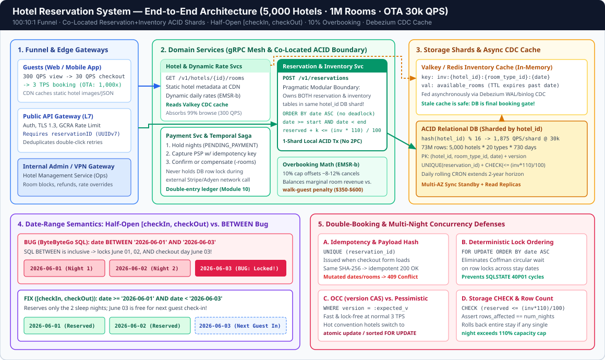
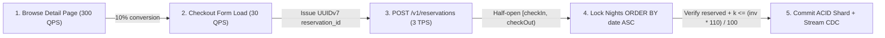
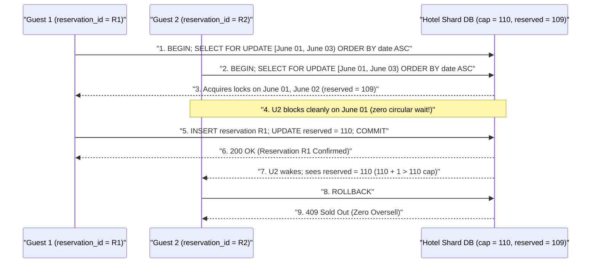
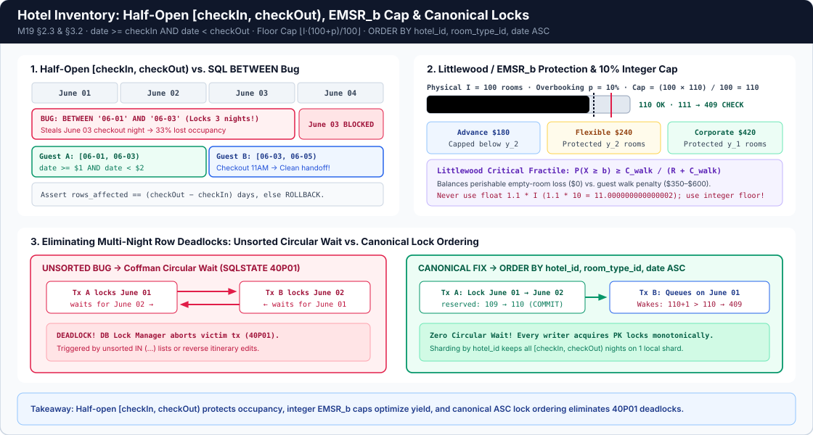
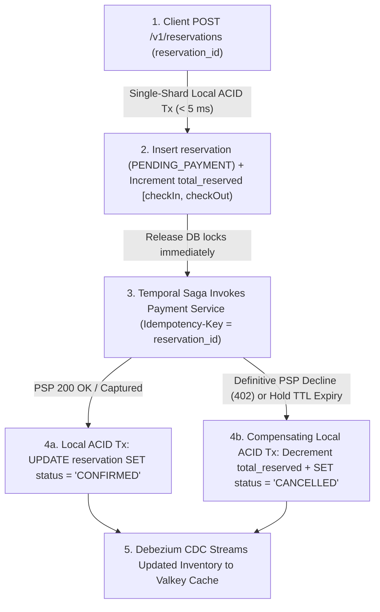
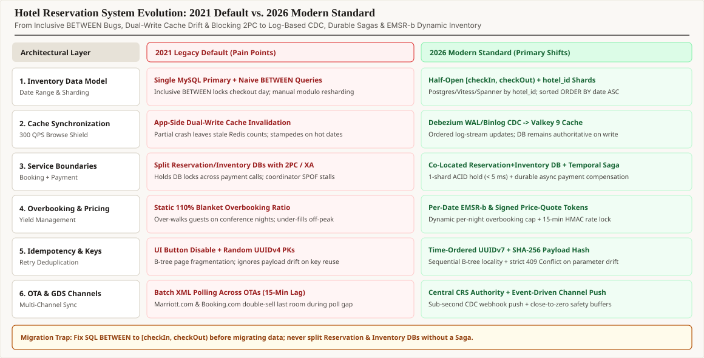

# Module 19 — Hotel Reservation System: Room-Type Inventory, Overbooking Economics, Concurrency Control, and OTA Scale-Out

This module designs a **hotel reservation system** from first principles — scaling from a global hotel chain (Marriott, Hilton) to a planetary Online Travel Agency (Booking.com, Expedia). Following ByteByteGo Chapter 22 (_Hotel Reservation System_) and primary hospitality revenue-management and database systems literature — Littlewood (1972) on marginal capacity pricing, Belobaba (1987, 1989) on Expected Marginal Seat/Room Revenue ($EMSR_b$), Coffman, Elphick, and Shoshani (1971) on deadlock resource ordering, Berenson et al. (SIGMOD 1995) on snapshot isolation anomalies, and Garcia-Molina and Salem (SIGMOD 1987) on compensating Sagas — we examine the room-type inventory model, correct a high-severity SQL off-by-one checkout bug in the source textbook, formalize controlled overbooking economics, layer four concurrency-control defenses against double-booking and multi-night deadlocks, scale reads and writes via `hotel_id` sharding and Debezium CDC caching, and define the pragmatic ACID boundary between reservation, inventory, and payment services.

> [!NOTE]
> **Knowledge Ownership & Cross-Links.** This module owns hospitality room-type inventory modeling, half-open date-range booking semantics, controlled overbooking and $EMSR_b$ yield management, `hotel_id`-sharded OTA scale-out with CDC inventory caching, and co-located reservation-plus-inventory service boundary trade-offs. For generic high-contention primitives (`FOR UPDATE SKIP LOCKED`, OCC retry storms, two-phase TTL holds, virtual waiting rooms, fencing tokens, and double-entry payment ledgers), see [Module 10](10-contention-inventory-and-financial-correctness.md). For MVCC internals, Write Skew, and the ANSI SQL isolation hierarchy, see [`architecture/data-systems/modules/05-transactions-acid-and-isolation-levels.md`](../../data-systems/modules/05-transactions-acid-and-isolation-levels.md). For formal Two-Phase Commit (2PC) blocking proofs and distributed Saga theory, see [`architecture/distributed-systems/modules/09-distributed-transactions-and-atomic-commit.md`](../../distributed-systems/modules/09-distributed-transactions-and-atomic-commit.md).

---

## 1. Requirements, Funnel Conversion, and Quantitative Capacity Sizing

### 1.1 Functional & Non-Functional Scope

Designing a reservation engine for a major hotel chain (`5,000` properties, `1,000,000` rooms) or an OTA aggregator requires separating read-heavy catalog discovery from strict transactional inventory allocation:

- **Core Guest & Admin Journeys**: Guests browse hotel details, query daily room-type availability and dynamic rates across a `[checkIn, checkOut)` stay window, pay in full at reservation time, inspect reservation history, and cancel bookings. Operations staff manage hotel metadata, room-type capacities, rate overrides, and refunds through an internal VPN-protected admin surface.
- **Room-Type Allocation (Not Physical Room Number)**: Unlike Airbnb (where a guest books one unique listing) or airlines/theaters (where seat selection binds a physical `seat_id`), hotel guests reserve a **quantity of a room category** (for example, `2` rooms of `Deluxe King` at Hotel `211`). The physical room number (`Room 412`) is assigned days or weeks later during front-desk check-in.
- **Controlled Overbooking (`10%`)**: Because `8%–15%` of hotel bookings cancel or fail to show, properties intentionally sell up to `110%` of physical capacity (`total_reserved + roomCount <= (total_inventory * 110) / 100`), governed by per-date yield-management thresholds.
- **Dynamic Daily Pricing**: Room rates fluctuate every day based on remaining occupancy, seasonality, day of week, and local events.
- **Non-Functional Asymmetry**:
  - **Strict Transactional Invariant**: Zero unmanaged overselling beyond the configured overbooking cap, and zero duplicate charges on client double-clicks or network retries.
  - **High Concurrency on Hot Dates**: Thousands of guests may simultaneously attempt to book the last available rooms at a convention headquarters hotel or on New Year's Eve.
  - **Asymmetric Latency Budgets**: Browsing and availability search require low tail latency (`p99 < 150 ms`) and high availability (`99.99%`), whereas final reservation confirmation (`POST /v1/reservations`) tolerates moderate latency (`1–3 seconds`) because it encompasses an ACID inventory commit and a payment authorization round-trip.

### 1.2 Back-of-the-Envelope Capacity & Funnel Conversion Math

Consider the baseline hotel-chain sizing from ByteByteGo Chapter 22 alongside its `1,000x` OTA scale-out:

- **Daily Reservation Volume**: With `5,000` hotels and `1,000,000` total rooms operating at `70%` average occupancy and a `3-day` average stay duration:
  - Occupied room-nights per day: `1,000,000 × 0.70 = 700,000 room-nights/day`.
  - New reservations per day: `700,000 / 3 = 233,333.33 ≈ 240,000 reservations/day`.
- **Write Throughput (Reservation TPS)**:
  - Exact daily average: `233,333.33 / 86,400 s ≈ 2.70 TPS` (or `240,000 / 86,400 s ≈ 2.78 TPS`; using the `10^5 s/day` mental-math approximation yields **`~3 TPS`**).
  - Diurnal / seasonal peak (`10x` multiplier): `~30 TPS` across the chain.
- **10% Funnel Conversion Cascade (`100 : 10 : 1` Read-to-Write Ratio)**:
  - Assuming a three-step booking funnel with a `10%` conversion rate at each transition:
  - **Step 1 — View Hotel / Room Detail Page**: **`300 QPS`** average (`3,000 QPS` diurnal peak).
  - **Step 2 — Initiate Order / Checkout Page**: **`30 QPS`** average (`300 QPS` diurnal peak).
  - **Step 3 — Confirm Reservation (`POST /v1/reservations`)**: **`3 TPS`** average (`30 TPS` diurnal peak).
- **73M-Row Inventory Horizon Footprint**:
  - Pre-populating `room_type_inventory` for `5,000` hotels × `20` room types per hotel × `2 years` (`730 days`) of future booking horizon yields:
  - $\text{Rows} = 5{,}000 \times 20 \times 2 \times 365 = 73{,}000{,}000\text{ rows}$.
  - At `~120–160 bytes` per row (including tuple headers and the composite B-tree primary key `(hotel_id, room_type_id, date)`), the entire 2-year inventory table occupies **`~9–12 GB`** — small enough to reside entirely in the RAM buffer pool of a single modern PostgreSQL/MySQL primary (with multi-AZ synchronous standby and read replicas for high availability).
- **OTA Scale-Out (`1,000x` Booking.com / Expedia Workload)**:
  - If the platform expands from a single hotel chain to a global OTA aggregator handling **`1,000x`** traffic, funnel rates climb to **`300,000 QPS`** detail views, **`30,000 QPS`** checkout/inventory queries, and **`3,000 TPS`** reservations.
  - Sharding the relational database across **`16` shards by `hotel_id`** (`hash(hotel_id) % 16`) reduces per-shard load to:
  - $\text{QPS}_{\text{shard}} = \frac{30{,}000}{16} = 1{,}875\text{ QPS/shard}$ (`~187.5 TPS/shard` writes), comfortably inside a single relational cluster's transactional ceiling while Valkey/Redis absorbs `> 95%` of read queries.

| Metric / Dimension | Single Hotel Chain (`5,000` Hotels) | Global OTA Aggregator (`1,000x` Scale) | Architectural Implication |
| --- | --- | --- | --- |
| **Total Properties / Rooms** | `5,000` hotels · `1,000,000` rooms | `~5,000,000` properties / listings | Partition all inventory queries by `hotel_id` |
| **Daily Confirmed Bookings** | `~233.3k–240k / day` (`70%` occ, `3d` stay) | `~233M–240M / day` | Single-node SQL suffices for chain; OTA requires sharding |
| **Detail Page View QPS** | `~300 QPS` avg (`~270.1 QPS` exact) | `~300,000 QPS` | Aggressive CDN + Valkey/Redis CDC inventory cache |
| **Checkout Initiation QPS** | `~30 QPS` avg | `~30,000 QPS` (`1,875 QPS/shard` across `16` shards) | Issue client `reservation_id` + short-lived rate quote token |
| **Booking Write TPS** | `~3 TPS` avg (`~2.70 TPS` exact) | `~3,000 TPS` (`~187.5 TPS/shard` across `16` shards) | Co-located single-shard ACID transaction per `hotel_id` |
| **2-Year Inventory Rows** | `73,000,000` rows (`~9–12 GB` in RAM) | `~7.3B–73B` rows across shards (`5M` properties × `2–20` room types × `730d`) | Rolling 730-day CRON horizon + archive past stays to S3 |

### 1.3 Primary Literature & Specification Matrix

| Source / Specification | Year | Core Mechanism | Why It Matters Here |
| --- | :-: | --- | --- |
| Beckmann (1958) & Rothstein — _Hotel Overbooking as a Markovian Sequential Decision Process_ (_Decision Sciences_) | 1958 / 1971 | Newsvendor critical-fractile overbooking optimization balancing no-show distribution against walk penalty $C_{\text{walk}}$ | Establishes the marginal overbooking condition $P(X \ge b) \ge C_{\text{walk}} / (R + C_{\text{walk}})$ |
| Littlewood — _Forecasting and Control of Passenger Bookings_ (AGIFORS) | 1972 | Two-class marginal revenue rule: accept discount fare $F_2$ iff $F_2 \ge F_1 \cdot P(D_1 > x)$ | Theoretical foundation for dynamic daily hotel pricing across advance-discount and rack rate tiers |
| Belobaba — _Application of a Probabilistic Decision Model to Airline Seat Inventory Control_ (_Operations Research_) | 1989 | Expected Marginal Seat/Room Revenue (**EMSR-b**) across nested fare classes | Governs how hotels protect room inventory across refundable, corporate, and OTA discount rate tiers |
| Coffman, Elphick & Shoshani — _System Deadlocks_ (_ACM Computing Surveys_) | 1971 | Four necessary deadlock conditions (Mutual Exclusion, Hold & Wait, No Preemption, Circular Wait) | Proves why acquiring multi-night row locks in canonical `ORDER BY date ASC` eliminates `SQLSTATE 40P01` deadlocks |
| Berenson et al. — _A Critique of ANSI SQL Isolation Levels_ (SIGMOD) | 1995 | Formalizes Lost Update and Write Skew anomalies under `READ COMMITTED` and Snapshot Isolation | Explains why unguarded `SELECT` + `UPDATE` double-books rooms even inside an ACID transaction |
| Garcia-Molina & Salem — _Sagas_ (SIGMOD) | 1987 | Decomposes long-lived transactions into local steps $T_1 \dots T_n$ with compensating actions $C_1 \dots C_{n-1}$ | Replaces blocking 2PC between Reservation/Inventory DB and external Payment Service |
| Kleppmann (_DDIA_) & Debezium Log-Based CDC Architecture | 2017–2026 | Streams committed WAL/binlog mutations in commit order to downstream caches and search indexes | Keeps Valkey/Redis inventory cache synchronized without dual-write race conditions |

---

## 2. High-Level Architecture, API Contracts, and Data Model Evolution



### 2.1 Public REST & Internal gRPC API Contracts

The system separates public guest traffic (routed through a CDN for static assets/photos and a **Public L7 API Gateway** enforcing TLS 1.3, authentication, and GCRA rate limiting) from internal back-office traffic (routed through a VPN-protected **Internal Admin Gateway** to the `Hotel Management Service`). Inter-service calls inside the VPC use **gRPC over HTTP/2** with Protobuf schemas.

| Domain | HTTP Method & Endpoint | Access Scope | Purpose & Idempotency Contract |
| --- | --- | :-: | --- |
| **Hotel Catalog** | `GET /v1/hotels/{hotelId}` | Public (CDN + Cache) | Fetch hotel description, address, amenities, and static media links |
| **Hotel Ops** | `POST /v1/hotels`, `PUT /v1/hotels/{hotelId}`, `DELETE /v1/hotels/{hotelId}` | Admin / Ops VPN only | Create, update, or decommission hotel properties |
| **Room Types & Rates** | `GET /v1/hotels/{hotelId}/room-types?startDate=...&endDate=...` | Public (Valkey Cache) | Query available room categories and dynamic daily rates for `[startDate, endDate)` |
| **Room Ops** | `POST /v1/hotels/{hotelId}/rooms`, `PUT /v1/hotels/{hotelId}/rooms/{roomId}` | Admin / Ops VPN only | Manage physical room inventory and maintenance blocks |
| **Reservation History** | `GET /v1/reservations`, `GET /v1/reservations/{reservationId}` | Authenticated Guest | List guest booking history or inspect a single reservation status |
| **Create Booking** | `POST /v1/reservations` | Authenticated Guest | Atomically reserve `roomCount` rooms of `roomTypeID` over `[startDate, endDate)` using client `reservationID` idempotency key |
| **Cancel Booking** | `DELETE /v1/reservations/{reservationId}` | Authenticated Guest | Idempotently cancel reservation, release `total_reserved` across nights, and trigger payment refund policy |

In the improved room-type model, `POST /v1/reservations` reserves a **`roomTypeID`** and **`roomCount`** rather than a physical `roomID`, and carries a mandatory client-generated **`reservationID`** (UUIDv7) issued when the checkout form loads:

```json
{
  "startDate": "2026-06-01",
  "endDate": "2026-06-03",
  "hotelID": "211",
  "roomTypeID": "1001",
  "roomCount": 3,
  "reservationID": "01972a40-7c1b-7000-8a10-134224450001"
}
```

### 2.2 Why Relational ACID Wins + Room-Instance vs. Room-Type Data Model

Why choose a **Relational Database (PostgreSQL / MySQL)** over a write-optimized NoSQL wide-column store for the core reservation engine?

1. **Read-Heavy `100 : 1` Funnel**: Browsing dominates writes by two orders of magnitude. Relational databases paired with an in-memory cache handle read-heavy workloads effortlessly, whereas eventual-consistency NoSQL write optimizations solve a bottleneck we do not have at `3 TPS`.
2. **ACID Multi-Night Range Atomicity**: A 4-night stay must either reserve all 4 consecutive date rows or reserve none. Relational ACID transactions enforce all-or-nothing updates and `CHECK` constraints natively, preventing negative inventory or partial-stay allocations.

Furthermore, the schema must match the **hospitality domain mental model**:

| Attribute | Airbnb / Flight / Theater Instance Model | Hotel Room-Type Inventory Model (ByteByteGo Ch. 22) |
| --- | --- | --- |
| **What the Guest Reserves** | A specific physical unit (`listing_id`, `seat_id = 14A`, `room_id = 412`) | A room category (`room_type_id = Standard King`) + `roomCount` (`3` rooms) |
| **When Physical Unit Is Assigned** | At checkout time | At **front-desk check-in** (allowing housekeeping & maintenance flexibility) |
| **Concurrency Target** | Per-unit row lock or GiST date-range exclusion constraint | Per-night aggregate counter row `(hotel_id, room_type_id, date)` |
| **Overbooking Support** | Impossible on a unique Airbnb house (`capacity = 1`) | Native (`total_reserved + roomCount <= (total_inventory * 110) / 100`) |

The relational schema therefore centers on four core tables (`room`, `room_type_rate`, `reservation`, and `room_type_inventory`), where `room_type_inventory` tracks one row per `(hotel_id, room_type_id, date)`:

```sql
CREATE TABLE room_type_rate (
  hotel_id      BIGINT      NOT NULL,
  room_type_id  BIGINT      NOT NULL,
  date          DATE        NOT NULL,
  rate_minor    BIGINT      NOT NULL CHECK (rate_minor > 0), -- Integer minor units (cents), NEVER float!
  currency      CHAR(3)     NOT NULL DEFAULT 'USD',
  PRIMARY KEY (hotel_id, room_type_id, date)
);

CREATE TABLE room_type_inventory (
  hotel_id         BIGINT   NOT NULL,
  room_type_id     BIGINT   NOT NULL,
  date             DATE     NOT NULL,
  total_inventory  INT      NOT NULL CHECK (total_inventory >= 0),
  total_reserved   INT      NOT NULL DEFAULT 0 CHECK (total_reserved >= 0),
  version          BIGINT   NOT NULL DEFAULT 1,
  PRIMARY KEY (hotel_id, room_type_id, date),
  -- Storage-level backstop enforcing the 10% controlled overbooking cap via exact integer floor math:
  CONSTRAINT chk_overbooking_cap
    CHECK (total_reserved <= (total_inventory * 110) / 100)
);

CREATE TABLE reservation (
  reservation_id   UUID        PRIMARY KEY, -- Client-generated idempotency key (UUIDv7)
  hotel_id         BIGINT      NOT NULL,
  room_type_id     BIGINT      NOT NULL,
  guest_id         BIGINT      NOT NULL,
  start_date       DATE        NOT NULL,
  end_date         DATE        NOT NULL,
  room_count       INT         NOT NULL CHECK (room_count > 0),
  payload_hash     CHAR(64)    NOT NULL,
  status           TEXT        NOT NULL CHECK (status IN ('PENDING_PAYMENT', 'CONFIRMED', 'CANCELLED')),
  created_at       TIMESTAMPTZ NOT NULL DEFAULT NOW(),
  CHECK (end_date > start_date)
);
```

**Idempotent Rolling 730-Day CRON Horizon**: Rather than storing infinite future dates, a daily background job extends the 2-year (`730-day`) horizon by inserting the newly opened day across all `(hotel_id, room_type_id)` pairs using `ON CONFLICT (hotel_id, room_type_id, date) DO NOTHING` so duplicate job executions never overwrite active `total_reserved` counts.

### 2.3 The Off-By-One Checkout Bug (`BETWEEN` vs. Half-Open `[checkIn, checkOut)`) and Controlled Overbooking

> [!CAUTION]
> **Critical Correctness Bug in ByteByteGo Chapter 22 (`BETWEEN` Reserves the Checkout Night!).** ByteByteGo Chapter 22 writes the availability check and reservation update as: `WHERE room_type_id = ${roomTypeId} AND hotel_id = ${hotelId} AND date BETWEEN ${startDate} AND ${endDate}` In SQL, `date BETWEEN '2026-06-01' AND '2026-06-03'` is equivalent to `date >= '2026-06-01' AND date <= '2026-06-03'` — **inclusive of both endpoints**! A guest checking in on `2026-06-01` and checking out on `2026-06-03` sleeps **2 nights** (`June 1` and `June 2`) and vacates the room by 11:00 AM on `June 3`. Using `BETWEEN` erroneously reserves and locks **`2026-06-03`** as a third night, blocking the next incoming guest from checking in on `2026-06-03` and destroying up to `33%` of hotel occupancy on a 3-night average stay!

Every hospitality inventory query and mutation **must** treat stay intervals as **half-open `[checkIn, checkOut)`**:

```sql
-- Step 1: Lock and inspect only the actual sleep nights in canonical ascending date order
SELECT date, total_inventory, total_reserved, version
FROM room_type_inventory
WHERE hotel_id = $1
  AND room_type_id = $2
  AND date >= $3   -- checkIn (inclusive)
  AND date < $4    -- checkOut (STRICTLY EXCLUSIVE: checkout morning is free for the next guest!)
ORDER BY date ASC
FOR UPDATE;

-- Step 2: Increment total_reserved across the half-open [checkIn, checkOut) interval
UPDATE room_type_inventory
SET total_reserved = total_reserved + $5,
    version = version + 1
WHERE hotel_id = $1
  AND room_type_id = $2
  AND date >= $3
  AND date < $4
  AND total_reserved + $5 <= (total_inventory * 110) / 100;
-- Application MUST assert rows_affected == ($4::date - $3::date), else ROLLBACK!
```

| Query Formulation | Stay `'2026-06-01'` to `'2026-06-03'` | Nights Decremented | Can Next Guest Check In on `'2026-06-03'`? | Production Verdict |
| --- | --- | :-: | :-: | --- |
| `date BETWEEN startDate AND endDate` (ByteByteGo text) | Closed interval `[June 1, June 3]` | `3` (`June 1, 2, 3`) | **No** (false conflict on `June 3`) | **Bug** — off-by-one checkout night theft |
| `date >= startDate AND date < endDate` (Standard) | Half-open interval `[June 1, June 3)` | `2` (`June 1, 2`) | **Yes** (`[June 1, 3)` and `[June 3, 5)` are disjoint) | **Mandatory hospitality standard** |

**Controlled Overbooking Formula & Revenue-Management Economics (Littlewood & $EMSR_b$)**:

1. **Exact Integer Overbooking Bound**: For a night with physical capacity $I$ (`total_inventory`, total rooms minus maintenance out-of-order blocks), current bookings $R_{\text{reserved}}$ (`total_reserved`), an overbooking percentage $p$ (e.g., $p = 10$ for `10%`), and a request for $k$ (`roomCount`) rooms, the booking invariant is: $R_{\text{reserved}} + k \le \left\lfloor \frac{I \times (100 + p)}{100} \right\rfloor$ Never evaluate `1.1 * total_inventory` in IEEE-754 floating point (`1.1 * 10 = 11.000000000000002`), which can admit an illegal extra room at exact boundaries; always use integer division `(total_inventory * 110) / 100` or `FLOOR`.
2. **Why `10%` Overbooking Exists — Newsvendor Overbooking (Beckmann 1958 / Rothstein 1971), Littlewood's Rule (1972), and Belobaba's $EMSR_b$ (1989)**: A hotel room is **perishable inventory** — an empty room at midnight generates `$0` forever. Conversely, if more guests physically arrive at the front desk than $I$, the hotel must **"walk" the overflow guest** at a steep penalty $C_{\text{walk}}$ (typically `$350–$600`: paying for a room at a nearby comparable hotel, taxi transport, meal voucher, loyalty points, and brand attrition). Under the **Beckmann/Rothstein newsvendor critical-fractile rule** (paired with **Littlewood's 1972 marginal capacity rule**), the revenue-management engine authorizes the $b$-th overbooked room at rate $R$ only while the expected marginal revenue exceeds the expected walk cost given the historical cancellation/no-show distribution $X$: $R \cdot P(X \ge b) \ge C_{\text{walk}} \cdot P(X < b) \iff P(X \ge b) \ge \frac{C_{\text{walk}}}{R + C_{\text{walk}}}$ When multiple rate classes (`Non-Refundable Advance $180`, `OTA Flexible $240`, `Corporate Last-Minute $420`) share the same `room_type_id`, **Belobaba's Expected Marginal Room Revenue** ($EMSR_b$) aggregates higher-fare classes into a weighted composite revenue $\bar{R}_k$ with combined demand distribution $(\mu_k, \sigma_k)$ and sets nested protection limits $y_k$ inside `room_type_rate` so cheap early bookings cannot consume capacity that has a high expected value for late corporate arrivals.



Below is the verified `reserve()` implementation from [`examples/lib/hotel-models.ts`](../examples/lib/hotel-models.ts) showing SHA-256 `payloadHash` verification, half-open `[startDate, endDate)` expansion, canonical composite-key `ORDER BY hotel_id, room_type_id, date ASC` ordering, controlled overbooking enforcement, and atomic commit into the Debezium CDC outbox:

```typescript
  reserve(
    req: ReservationRequest,
    options: {
      intervalMode?: 'half-open' | 'inclusive-between';
      expectedVersions?: ReadonlyMap<string, number>;
      initialStatus?: 'PENDING_PAYMENT' | 'CONFIRMED';
    } = {},
  ): { record: ReservationRecord; deduplicated: boolean } {
    if (!Number.isInteger(req.roomCount) || req.roomCount <= 0) {
      throw new RangeError('roomCount must be a positive integer');
    }

    const payloadHash = canonicalReservationHash(req);
    const existing = this.reservations.get(req.reservationId);
    if (existing) {
      if (existing.payloadHash !== payloadHash) {
        throw new IdempotencyPayloadMismatchError(req.reservationId);
      }
      return { record: existing, deduplicated: true };
    }

    // Canonical lock/update ordering across composite PK (`ORDER BY hotel_id ASC, room_type_id ASC, date ASC`)
    const nights = expandStayDates(
      req.startDate,
      req.endDate,
      options.intervalMode ?? 'half-open',
    ).sort((a, b) =>
      inventoryKey(req.hotelId, req.roomTypeId, a).localeCompare(
        inventoryKey(req.hotelId, req.roomTypeId, b),
      ),
    );

    const rowsToMutate: Array<{ key: string; row: RoomTypeInventoryRow; cap: number }> = [];
    for (const date of nights) {
      const key = inventoryKey(req.hotelId, req.roomTypeId, date);
      const row = this.inventory.get(key);
      if (!row) {
        throw new Error(`Missing pre-populated inventory row for ${key}`);
      }

      if (options.expectedVersions) {
        const expectedVer = options.expectedVersions.get(date);
        if (expectedVer !== undefined && row.version !== expectedVer) {
          throw new OptimisticLockConflictError(date, expectedVer, row.version);
        }
      }

      const cap = computeOverbookingCap(row.totalInventory, this.overbookingPct);
      if (row.totalReserved + req.roomCount > cap) {
        throw new OverbookingLimitExceededError(date, req.roomCount, row.totalReserved, cap);
      }
      rowsToMutate.push({ key, row, cap });
    }

    // Commit phase: mutate all nights atomically and enqueue Debezium CDC events
    for (const { key, row, cap } of rowsToMutate) {
      row.totalReserved += req.roomCount;
      row.version += 1;
      this.cdcOutbox.push({ key, availableToSell: cap - row.totalReserved });
    }

    const record: ReservationRecord = {
      reservationId: req.reservationId,
      hotelId: req.hotelId,
      roomTypeId: req.roomTypeId,
      startDate: req.startDate,
      endDate: req.endDate,
      nights,
      roomCount: req.roomCount,
      payloadHash,
      status: options.initialStatus ?? 'CONFIRMED',
    };
    this.reservations.set(req.reservationId, record);
    return { record, deduplicated: false };
  }
```

---

## 3. Concurrency Control: Idempotency, Locking, Ordered Dates, and Database Constraints

A hotel reservation system faces two distinct concurrency hazards: **(1) the same user submits the same booking twice** (double-clicking "Complete Booking" or automatic mobile SDK retry after a network timeout), and **(2) multiple independent users race for the last room** on overlapping dates.

### 3.1 Single-User Double-Click Defense: Idempotency Key + Payload-Drift Rejection

Graying out the "Book" button in JavaScript is a UX convenience, never a safety control: users with unstable cellular connections, disabled scripts, or retrying HTTP gateways will still transmit duplicate `POST /v1/reservations` packets.

1. **Pre-Allocated `reservation_id`**: When the guest navigates to the checkout screen (`30 QPS`), the backend (or client SDK) generates a globally unique **UUIDv7 `reservation_id`** embedded in the checkout form.
2. **Database `UNIQUE` Constraint + Payload Hash**: The `reservation` table enforces `PRIMARY KEY (reservation_id)` alongside a SHA-256 `payload_hash` of `(hotel_id, room_type_id, start_date, end_date, room_count)`.
3. **Retry Behavior**: If a second request arrives with the same `reservation_id` and identical `payload_hash`, the database detects the conflict and returns the already-created reservation (`200 OK` idempotent replay) without incrementing `total_reserved` a second time. If a buggy client reuses `reservation_id` with mutated dates or a different `roomCount`, the server rejects immediately with **`409 Conflict` (`IdempotencyPayloadMismatchError`)** (detailed in [Module 10](10-contention-inventory-and-financial-correctness.md)).

### 3.2 Multi-User Race Defenses and Canonical Lock Ordering (`ORDER BY date ASC`)

When User 1 and User 2 simultaneously attempt to reserve the last room (`total_reserved = 99`, cap `100`) under default `READ COMMITTED` isolation, an unguarded `SELECT` in both transactions observes `99`, and both transactions issue `UPDATE ... SET total_reserved = total_reserved + 1`, committing `101` and breaching the cap (a classic **Lost Update / Write Skew** anomaly; see [`architecture/data-systems/modules/05-transactions-acid-and-isolation-levels.md`](../../data-systems/modules/05-transactions-acid-and-isolation-levels.md)). ByteByteGo Chapter 22 evaluates three storage-level mechanisms to eliminate this race:

#### Option 1: Pessimistic Locking (`SELECT ... FOR UPDATE ORDER BY date ASC`)

Acquires exclusive row-level locks on all `[checkIn, checkOut)` rows in `room_type_inventory` before checking availability.

> [!IMPORTANT]
> **Row-Lock Deadlock Elimination via Coffman Linear Resource Ordering.** ByteByteGo notes that `SELECT ... FOR UPDATE` can deadlock when locking multiple rows. Why? Suppose Transaction A locks multi-night dates in order `('2026-08-01', '2026-08-02')` while Transaction B (e.g., an itinerary modification or unsorted `IN (...)` list) locks `('2026-08-02', '2026-08-01')`. Transaction A holds `Aug 1` and waits for `Aug 2`; Transaction B holds `Aug 2` and waits for `Aug 1` — forming a **Coffman circular wait** (`SQLSTATE 40P01`). When all writers acquire pre-populated row-level locks at the same `(hotel_id, room_type_id, date)` primary-key granularity and strictly enforce **`ORDER BY hotel_id ASC, room_type_id ASC, date ASC`** on every `SELECT ... FOR UPDATE` and batch `UPDATE`, every transaction acquires night locks in the exact same topological order, preventing row-lock circular-wait cycles across multi-night stays.

#### Option 2: Optimistic Concurrency Control (`version` Column CAS)

Adds a monotonic `version` integer column to `room_type_inventory` (never use wall-clock timestamps, which suffer NTP skew). The application reads `(total_reserved, version)` without locking, then updates each night with `WHERE hotel_id = $1 AND room_type_id = $2 AND date = $3 AND version = $expected_version`, rolling back if `rows_affected < num_nights`. At chain-level `3 TPS`, conflicts are rare and OCC runs with zero lock-manager overhead; under a `1,000-user` convention flash sale on one hotel, `999` concurrent transactions abort and trigger retry amplification.

#### Option 3: Database `CHECK` Constraints + Single-Statement Atomic Range `UPDATE`

Combines `CONSTRAINT chk_overbooking_cap CHECK (total_reserved <= (total_inventory * 110) / 100)` with a single set-based `UPDATE` statement covering `date >= $checkIn AND date < $checkOut AND total_reserved + $roomCount <= (total_inventory * 110) / 100`. The storage engine acquires row locks only for the duration of the single `UPDATE` statement (`< 1 ms`), verifies `rows_affected == num_nights`, and commits.

| Concurrency Mechanism | DB Lock Duration | Deadlock Risk | Behavior at Normal `3 TPS` | Behavior on Hot Convention Hotel (`500 RPS`) | Production Recommendation |
| --- | --- | --- | --- | --- | --- |
| **Client `reservation_id` (`UNIQUE`)** | Single PK insert check | None | Deduplicates user double-clicks in $O(1)$ | Deduplicates retries; does not stop cross-user races | **Mandatory Layer 1** on every mutation endpoint |
| **Pessimistic (`FOR UPDATE ORDER BY date ASC`)** | Entire local DB transaction (`2–5 ms`) | **Zero** when sorted by `date ASC` (`40P01` if unsorted!) | Serializes overlapping writes cleanly | Queues conflicting writers in DB lock manager without wasted rollbacks | **Use for multi-step read+rate+inventory modifications** (never hold across external PSP RPCs!) |
| **Optimistic (`version` CAS)** | Zero during read; row lock only on `UPDATE` | None | Fastest read-to-write path with zero lock waits | **Degrades sharply** due to conflict aborts and retry storms | **Great for `3 TPS` hotel chains** or admin inventory edits |
| **Atomic Range `UPDATE` + `CHECK` Constraint** | Single SQL `UPDATE` statement (`< 1 ms`) | **Zero** when sorted / single index scan | Minimal round-trips (`1` statement instead of `SELECT` + `UPDATE`) | Highest single-row throughput; storage engine rejects cap breaches deterministically | **Mandatory Layer 2 backstop** + default hot-path booking query |





_Step-by-step mechanics:_ (1) **Half-open `[checkIn, checkOut)`** (`date >= $1 AND date < $2`) locks only sleep nights (`June 01, 02`), leaving `June 03` free for the next incoming guest instead of losing `33%` occupancy to `BETWEEN`. (2) **Littlewood / `EMSR_b` Overbooking** enforces the exact integer floor cap `((total_inventory * 110) / 100)` (`110` OK, `111 → 409`) while nesting fare protection levels `y_k`. (3) **Canonical Lock Ordering** (`ORDER BY hotel_id, room_type_id, date ASC`) forces all concurrent writers into identical monotonic acquisition order, eliminating Coffman circular-wait `SQLSTATE 40P01` deadlocks.

---

## 4. OTA Scale-Out: Sharding by `hotel_id` and CDC-Driven Inventory Caching

### 4.1 Why Sharding by `hotel_id` Keeps Multi-Night Bookings Single-Shard Local

When scaling from a single chain (`3 TPS`) to a global OTA (`30,000 QPS`), stateless microservices scale horizontally behind L7 load balancers, leaving the relational database as the stateful bottleneck. How should we shard `room_type_inventory` and `reservation`?

- **Why `hotel_id` Is the Ideal Shard Key**: Every availability search (`GET /v1/hotels/{hotelId}/room-types`) and every booking transaction (`POST /v1/reservations`) targets a single `hotel_id`. Routing via `shard_id = hash(hotel_id) % 16` (or consistent hashing with virtual shards in Vitess / Citus) co-locates all `room_type_inventory`, `room_type_rate`, and `reservation` rows for Hotel `211` onto the **exact same physical database shard**.
- **Zero Cross-Shard Distributed Transactions**: Even when a guest books `3` rooms across `7` consecutive nights, all `7` night rows belong to the same `hotel_id` and therefore reside on **one shard**. The booking executes as a fast, local single-shard ACID transaction (`1,875 QPS/shard` across `16` shards) with zero cross-shard 2PC! (Guest-centric queries like `GET /v1/reservations` for a user's past trips query a lightweight asynchronous guest-lookup index or fan out across shards on cold paths.)
- **Hot/Cold Lifecycle Archiving**: Active shards retain only current and future inventory (`date >= CURRENT_DATE - 30`). Completed historical stays are streamed to cold object storage (Apache Iceberg / Parquet on S3) for analytics and $EMSR_b$ no-show model training, keeping the hot OLTP B-tree working set compact in RAM.

### 4.2 Valkey/Redis Inventory Cache Synchronized via Debezium CDC

Because `99%` of funnel traffic consists of read queries (`300 QPS` chain / `300,000 QPS` OTA), hitting relational shards on every page view wastes database CPU. We place an in-memory **Valkey / Redis Inventory Cache** in front of the database:

- **Key-Value Layout**:
  - `key`: `inv:{hotel_id}:{room_type_id}:{YYYY-MM-DD}` (e.g., `inv:211:1001:2026-06-01`)
  - `value`: integer count of remaining sellable rooms (`((total_inventory * 110) / 100) - total_reserved`), with an automatic `EXPIREAT` TTL set `24 hours` after the stay date passes.
- **Why Log-Based CDC (Debezium) Beats Application Dual-Writes**: If application servers update PostgreSQL and then issue `SET` to Valkey directly, a crash or network packet reordering between the two network calls leaves the cache permanently out of sync with the database (the classic dual-write race covered in [Module 05](05-caching-strategies-and-invalidation.md)). Instead, **Debezium** tails the database's committed Write-Ahead Log (WAL / MySQL binlog) and streams ordered row-change events into Valkey/Redis asynchronously within `20–80 ms`.
- **Why Async Cache Staleness Never Causes an Oversell**: Because CDC is asynchronous, a Valkey key can lag the database by `50 ms` during a traffic burst — showing `1` room available when the last room was just booked `20 ms` ago. **This never compromises inventory correctness** because the cache is consulted _only_ for read-path display; the final `POST /v1/reservations` write **always** executes against the authoritative relational database shard, which enforces `total_reserved + k <= cap` and rejects the stale checkout cleanly. The user simply sees _"Sorry, this room type just sold out — please refresh"_, which is indistinguishable from another guest clicking "Book" while the user was reading the page.

---

## 5. Microservice Consistency: Co-Located ACID Boundary vs. 2PC and Saga Workflows

### 5.1 Pragmatic Modular Boundary vs. Pure-Microservice Dogma

In a dogmatic microservice decomposition, one team builds an **Inventory Service** (owning `room_type_inventory` in Database A) while another team builds a **Reservation Service** (owning `reservation` in Database B). That split turns every single hotel booking into a distributed cross-database consistency problem: if Reservation DB commits but Inventory DB fails (or vice versa), inventory and bookings drift apart.

As ByteByteGo Chapter 22 highlights, **draw microservice boundaries around transactional invariants, not around nouns**:

- **The Pragmatic Co-Located Design**: Keep both `reservation` and `room_type_inventory` owned by the **Reservation Service** inside the **same `hotel_id`-sharded relational database**. Inserting the `reservation` row and incrementing `total_reserved` across `[checkIn, checkOut)` execute inside a single local ACID transaction (`< 5 ms`), eliminating 90% of distributed consistency complexity at zero scalability cost.

### 5.2 Coordinating with External Payment Service: Why Saga Beats 2PC

Even with Reservation and Inventory co-located, completing a pay-in-full booking requires charging the guest's card via a separate **Payment Service** (and third-party PSP such as Stripe or Adyen). Why not wrap the Reservation DB and Payment Service in a **Two-Phase Commit (2PC / XA)**?

1. **Blocking Coordinator & Lock Amplification**: 2PC is a blocking atomic commit protocol (proven in [`architecture/distributed-systems/modules/09-distributed-transactions-and-atomic-commit.md`](../../distributed-systems/modules/09-distributed-transactions-and-atomic-commit.md)). Holding `room_type_inventory` row locks open during the prepare/commit phases across a `500–2,500 ms` external PSP HTTP call destroys database throughput via Little's Law ($L = \lambda W$) and freezes the entire hotel's inventory if the coordinator crashes.
2. **Third-Party PSPs Do Not Speak XA**: External credit-card gateways expose REST APIs with idempotency keys, not XA two-phase commit sockets.

Production hospitality platforms therefore execute an **Orchestrated Saga (via Temporal Durable Execution)**:



- **Forward Path**: Step 1 commits the inventory increment and `reservation` row in state `PENDING_PAYMENT` inside one local `< 5 ms` ACID transaction and releases all database locks immediately. Step 2 calls the Payment Service with `Idempotency-Key: reservation_id`. Step 3 marks the reservation `CONFIRMED`.
- **Compensating Rollback Path**: If the card is definitively declined (or the hold TTL expires before payment clears), the Temporal saga executes an idempotent **compensating transaction** that decrements `total_reserved` across `[checkIn, checkOut)` and transitions `status = 'CANCELLED'`. (As proven in [Module 10](10-contention-inventory-and-financial-correctness.md), network timeouts to the PSP stay in `PENDING_PSP` until resolved via same-key retry or webhook polling — never compensated prematurely while a charge might still settle!)

---

## 6. Production Gotchas, SRE Guardrails, and 2021 vs. 2026 Comparison

### 6.1 Six High-Severity Production Gotchas

1. **Inclusive `BETWEEN` Checkout-Night Off-By-One Bug**: Querying or updating `room_type_inventory` with `date BETWEEN startDate AND endDate` locks the checkout date, blocking same-day turnarounds (` Guest A out at 11:00, Guest B in at 15:00`) and silently discarding up to `33%` of sellable room-nights. **Fix**: Mandate half-open `[checkIn, checkOut)` predicates (`date >= startDate AND date < endDate`) across availability search, booking, cancellation, and rate calculation, and assert `rows_affected == (endDate - startDate)`.
2. **Unordered Multi-Night Row Locks Causing `SQLSTATE 40P01` Deadlocks**: Concurrent transactions locking overlapping date ranges in arbitrary set/parameter order form circular wait cycles under peak load. **Fix**: Sort every multi-night `SELECT ... FOR UPDATE` and batch `UPDATE` by canonical `ORDER BY hotel_id ASC, room_type_id ASC, date ASC`.
3. **Holding Database Row Locks Across External Payment RPCs**: Executing `SELECT ... FOR UPDATE` on `room_type_inventory` and calling Stripe/Adyen before `COMMIT` stretches lock hold time $W$ from `3 ms` to `2,000 ms`, exhausting the 100-connection pool at just `50 RPS`. **Fix**: Commit the local reservation hold (`PENDING_PAYMENT`) in `< 5 ms` and orchestrate payment asynchronously via a Temporal Saga with compensating inventory release.
4. **Multi-Channel OTA / GDS Split-Brain Overselling**: A hotel sells rooms simultaneously on its own website, Booking.com, and Expedia via Global Distribution Systems (GDS). If each channel caches its own allotment and syncs via 15-minute batch XML polls, all three channels sell the last 2 rooms simultaneously during a concert drop. **Fix**: Route all channels through a single authoritative Central Reservation System (CRS) shard per `hotel_id`, push real-time webhook deltas via CDC, and enforce close-to-zero safety buffers on external indirect channels when remaining inventory drops below `5` rooms.
5. **Rolling 730-Day CRON Horizon Starvation or Non-Idempotent Reset**: If the daily CRON job fails for 14 days, wedding or conference guests booking 24 months ahead hit `0 rows matched` and fail checkout; worse, if a buggy CRON reruns with `ON CONFLICT DO UPDATE SET total_reserved = 0`, it wipes out existing bookings! **Fix**: Use `ON CONFLICT (hotel_id, room_type_id, date) DO NOTHING`, run the job daily with a 30-day lookahead overlap buffer, and alert if `MAX(date) - CURRENT_DATE < 720`.
6. **Mid-Funnel Dynamic Rate Drift**: Because `room_type_rate` changes dynamically with occupancy, the price of a room can jump from `$220/night` on the search page to `$290/night` by the time the guest submits `POST /v1/reservations` 4 minutes later. **Fix**: Issue a cryptographically signed, short-lived (`15-minute`) **price-quote JWT/HMAC token** binding `(hotel_id, room_type_id, checkIn, checkOut, nightly_rates[], exp)` at checkout load so the guest is guaranteed the quoted price within the checkout window.

### 6.2 Quantitative SRE Guardrails

| SLI / Metric | Healthy Target | Page Threshold | Primary Remediation |
| --- | --- | --- | --- |
| **`OversellInvariantBreachCount`** (`total_reserved > (inv * 110) / 100`) | **`0`** (strict invariant) | **`> 0`** (page immediately) | Verify `chk_overbooking_cap` constraint integrity and audit any manual ops overrides |
| **Multi-Night DB Deadlock Rate (`SQLSTATE 40P01`)** | `0 / min` | `> 1 / min` on any shard | Audit query plans for missing `ORDER BY hotel_id ASC, room_type_id ASC, date ASC` |
| **Debezium CDC -> Valkey Replication Lag** | `< 100 ms` `p99` | `> 2 s` for `3 min` | Inspect WAL replication slot lag, Kafka consumer backlog, and Valkey pipeline saturation |
| **Stale-Cache Checkout Rejection Rate (`409 Sold Out` at POST)** | `< 0.5%` of checkouts | `> 3%` over `5 min` | Correlate with CDC lag or single-hotel flash-sale spike; trigger proactive cache refresh on `409` |
| **Rolling Inventory Horizon Coverage (`MAX(date) - TODAY`)** | `>= 730 days` | `< 720 days` | Trigger idempotent horizon-seeding CRON job and inspect scheduler failure logs |
| **Temporal Payment Saga Compensation Backlog** | `< 10` in-flight compensations | `> 100` or stuck `> 5 min` | Inspect PSP webhook/poller latency and verify idempotent `cancelReservation` consumer health |

### 6.3 Technology Comparison: Then vs. Now (2021 vs. 2026)



| Architectural Layer | 2021 Legacy Default | 2026 Modern Standard | Why It Changed & Migration Pitfall |
| --- | --- | --- | --- |
| **Inventory Data Model & Sharding** | Single MySQL primary + naive `BETWEEN` queries + manual modulo scripts | **`hotel_id`-Sharded PostgreSQL / Vitess / Cloud Spanner** + half-open `[checkIn, checkOut)` | Keeps multi-night stays in a 1-shard local ACID tx while fixing checkout-day theft; _pitfall:_ migrating from `BETWEEN` to `[checkIn, checkOut)` requires backfilling historical `end_date` semantics first. |
| **Inventory Cache Sync** | Application dual-write (`DB update` + `redis.del()`) or 15-min cron flush | **Log-Based CDC (Debezium WAL/binlog -> Kafka -> Valkey 9)** | Eliminates dual-write cache/DB divergence without adding latency to the booking tx; _pitfall:_ size PostgreSQL `max_wal_size` and monitor inactive replication slots so a paused Debezium connector never fills disk. |
| **Service Boundary & Payment Coordination** | Split Reservation/Inventory DBs with 2PC, or holding DB locks across PSP calls | **Co-Located Reservation+Inventory DB** + **Temporal Durable Payment Saga** | Commits local inventory hold in `< 5 ms` and handles PSP retries/refunds asynchronously; _pitfall:_ never run compensating inventory release on an ambiguous PSP timeout before confirming the charge did not settle. |
| **Overbooking & Dynamic Pricing** | Static `110%` blanket overbooking ratio + nightly batch price CSVs | **Per-Date EMSR-b / ML No-Show Overbooking Cap** ($EMSR_b$) + **15-min Signed Price-Quote Tokens** | Prevents costly guest walks on low-cancellation conference nights while protecting checkout UX from mid-funnel price jumps; _pitfall:_ verify signed quote expiration server-side to prevent replay of expired off-peak rates. |
| **Idempotency & Primary Keys** | Front-end button disable + random `UUIDv4` primary keys | **Time-Ordered `UUIDv7` (RFC 9562)** + **DB `UNIQUE(reservation_id)` & SHA-256 Payload Hash** | Preserves B-tree sequential insert locality on 73M+ rows and rejects parameter tampering (`409`); _pitfall:_ never generate a new `reservation_id` inside an automatic client HTTP retry interceptor. |
| **Multi-Channel OTA / GDS Sync** | Legacy SOAP/XML polling every `10–15 minutes` across channels | **Event-Driven CRS Webhook Push** + **Dynamic Low-Stock Buffer Cutoffs** | Slashes cross-channel double-booking window from minutes to sub-second; _pitfall:_ third-party OTAs with slow webhook ingestion still require automatic close-out buffers when `available <= 3`. |
| **Peak Event / Convention Protection** | Direct origin traffic hitting DB connection pools (`max_connections` collapse) | **Edge Bot Filtering + Virtual Waiting Room + PgBouncer Transaction Pooling** | Absorbs 100x convention/tour hotel drops at the CDN edge before touching shard connections; _pitfall:_ PgBouncer transaction pooling forbids session-level prepared statements or advisory locks across transactions. |

**Pitfalls of mixing 2021 and 2026 layers during migration.** Two hybrid states regularly cause production incidents during modernization: (1) **Splitting `reservation` and `room_type_inventory` into separate microservices before deploying a durable Saga orchestrator** — which replaces local ACID atomicity with uncoordinated dual writes that orphan locked room inventory whenever a pod crashes mid-request; and (2) **Fixing `BETWEEN` to half-open `[checkIn, checkOut)` in the write service while leaving `BETWEEN` in the read/rate service** — which charges guests for 3 nights on the checkout summary screen while only reserving 2 nights in `room_type_inventory`. Cut over interval semantics atomically across read, rate, booking, and cancellation paths in a single versioned contract.

---

## 7. Executable Proof Map

All five quantitative and correctness invariants in this module are verified deterministically in [`examples/13-hotel-reservation.test.ts`](../examples/13-hotel-reservation.test.ts) (backed by [`examples/lib/hotel-models.ts`](../examples/lib/hotel-models.ts)):

| Concept in This Module | Deterministic Test in `13-hotel-reservation.test.ts` | Verified Invariant / Negative Proof |
| --- | --- | --- |
| **Half-Open `[checkIn, checkOut)` vs. `BETWEEN` Off-By-One Bug & 10% Overbooking Cap** | `expandStayDates`, `computeOverbookingCap`, and `HotelReservationDatabase.reserve` (`intervalMode: 'inclusive-between'` vs `'half-open'`) | Proves `'2026-06-01'` to `'2026-06-03'` spans `2` nights (`June 1, 2`), proves ByteByteGo's inclusive `BETWEEN` falsely blocks back-to-back check-in on `June 3`, and proves exact `10%` floor overbooking (`100` rooms $\to$ cap `110`, rejecting room `111` with `OverbookingLimitExceededError`). |
| **Idempotent `reservation_id` Deduplication, SHA-256 Drift Rejection & Saga States** | `HotelReservationDatabase.reserve` (`initialStatus: 'PENDING_PAYMENT'`), `confirmPayment`, and `cancelReservation` | Proves 64-char SHA-256 `payloadHash` retry deduplication, rejects parameter drift (`IdempotencyPayloadMismatchError`), and verifies `PENDING_PAYMENT -> CONFIRMED / CANCELLED` Saga transitions and idempotent compensation replay. |
| **Canonical `ORDER BY hotel_id, room_type_id, date ASC` Deadlock Prevention & OCC `version` CAS** | `simulateConcurrentLockOrder` (2-night & 3-night overlaps, `canonicalSort: false` vs `true`) + `reserve` with `expectedVersions` | Proves unsorted multi-night locking across 2-night and 3-night overlapping stays throws `DeadlockDetectedError` (`SQLSTATE 40P01`), canonical ascending composite-key order commits deadlock-free, and stale OCC snapshots throw `OptimisticLockConflictError`. |
| **Asynchronous Debezium CDC -> Valkey Cache Safety** | `checkCachedAvailability`, `reserve`, and `flushCdcToCache` under `1`-room inventory | Proves that even when Valkey/Redis lags behind the database before CDC flush and reports `checkCachedAvailability === true` for a sold-out room, the authoritative relational database deterministically rejects Guest B's write (`OverbookingLimitExceededError`), and `flushCdcToCache()` converges the cache to `false`. |
| **Overbooking & Cancellation Conservation (`fast-check`) + 73M-Row / 16-Shard Capacity Math** | `fc.property` (`100` runs over `40` random overlapping bookings/retries/cancellations) + `estimateHotelSystemCapacity` | Proves `0 <= totalReserved <= cap` and exact conservation against active confirmed stays across every night; proves `~233,333.33` daily bookings (`~2.70 TPS` exact / `~3 TPS` mental anchor), `73,000,000` inventory rows (`5,000 × 20 × 730`), and `1,875 QPS/shard` across `16` `hotel_id` shards at `30,000 QPS`. |

---

## Interview Drill

### Question 1: Why is ByteByteGo Chapter 22's SQL predicate `WHERE date BETWEEN startDate AND endDate` a critical bug for hotel reservations, and how do you fix it alongside the 10% overbooking check?

<details><summary>Answer</summary>

In SQL, `date BETWEEN startDate AND endDate` is **inclusive of both endpoints** (`date >= startDate AND date <= endDate`). When a guest books a stay from `startDate = '2026-06-01'` (check-in) to `endDate = '2026-06-03'` (check-out), they sleep at the hotel for **2 nights** (`2026-06-01` and `2026-06-02`) and vacate the room on the morning of `2026-06-03`. Using `BETWEEN` erroneously selects and increments `total_reserved` on `2026-06-03` as well (`3` rows instead of `2`), preventing the next guest from checking into that room on `2026-06-03` and slashing achievable occupancy by up to `33%`.

The fix is to model every stay as a **half-open interval `[checkIn, checkOut)`**: `WHERE hotel_id = $1 AND room_type_id = $2 AND date >= $checkIn AND date < $checkOut`. Combine this with exact integer overbooking floor math (`AND total_reserved + $roomCount <= (total_inventory * 110) / 100`) and assert in the application transaction that `rows_affected == (checkOut - checkIn in days)` before issuing `COMMIT` (rolling back if any single night in the range lacked capacity or was missing from the pre-populated horizon).

</details>

### Question 2: Two concurrent transactions attempt to book overlapping multi-night stays using `SELECT ... FOR UPDATE`. How can a deadlock occur even on a single hotel shard, and how does canonical resource ordering prevent row-lock cycles?

<details><summary>Answer</summary>

By Coffman's deadlock theorem (1971), a deadlock occurs when concurrent transactions form a **circular wait** over exclusively locked resources. If Transaction 1 acquires row locks on `(hotel 211, room_type 1001)` for dates in the order `2026-08-01` then `2026-08-02`, while Transaction 2 (for instance, an unsorted `WHERE date IN ($1, $2)` query or an itinerary modification) locks `2026-08-02` first and then requests `2026-08-01`, Transaction 1 holds `Aug 1` while waiting for `Aug 2` and Transaction 2 holds `Aug 2` while waiting for `Aug 1`. The database deadlock detector must abort one transaction with `SQLSTATE 40P01`.

When all writers acquire pre-populated row-level locks at the same `(hotel_id, room_type_id, date)` primary-key granularity, you eliminate row-lock circular-wait cycles by enforcing a **canonical total lock ordering** across every query and mutation in the codebase: sort target dates ascending before querying, and explicitly include `ORDER BY hotel_id ASC, room_type_id ASC, date ASC` in every `SELECT ... FOR UPDATE`. Because every transaction acquires row locks in strictly increasing `(hotel_id, room_type_id, date)` order, the row-lock wait-for graph forms a Directed Acyclic Graph (DAG), breaking Coffman's circular-wait condition.

</details>

### Question 3: Compare Pessimistic Locking (`SELECT ... FOR UPDATE`), Optimistic Concurrency Control (`version` CAS), and Database `CHECK` Constraints for a 3 TPS hotel chain versus a hot convention hotel during a 1,000-user spike.

<details><summary>Answer</summary>

At a standard hotel chain averaging **`3 TPS`** across `5,000` hotels, concurrent writes to the exact same `(hotel_id, room_type_id, date)` row are rare. **Optimistic Concurrency Control (`version` CAS)** or a **Database `CHECK` Constraint with a single atomic conditional `UPDATE`** works exceptionally well: reads take zero database locks, and the write verifies `WHERE version = $expectedVersion` (or `CHECK (total_reserved <= (total_inventory * 110) / 100)`), verifying `rows_affected == num_nights`.

During a **1,000-user convention spike on a single hotel**, pure multi-step OCC (`SELECT` then `UPDATE ... WHERE version = $v`) suffers severe **retry amplification**: `1` writer succeeds while `999` writers abort on version mismatch and retry in a loop, churning MVCC dead tuples. Under high single-hotel contention, a **single-statement atomic range `UPDATE`** (`UPDATE room_type_inventory SET total_reserved = total_reserved + $k, version = version + 1 WHERE hotel_id = $1 AND room_type_id = $2 AND date >= $in AND date < $out AND total_reserved + $k <= (total_inventory * 110) / 100`) or canonically ordered **`SELECT ... FOR UPDATE ORDER BY date ASC`** (kept strictly inside a `< 5 ms` local DB transaction, never held across payment network calls) serializes conflicting updates cleanly in the database without wasted multi-round application retries.

</details>

### Question 4: Why does sharding the database by `hotel_id` scale to `30,000 QPS` (Booking.com scale) without requiring distributed Two-Phase Commit across shards?

<details><summary>Answer</summary>

In hospitality systems, every availability query and every multi-night reservation mutation is naturally scoped to a single property (`hotel_id`). When we shard `room_type_inventory`, `room_type_rate`, and `reservation` by `hash(hotel_id) % 16`, every single night row (`2026-06-01`, `2026-06-02`, ...) for Hotel `211` lives on the **exact same database shard**.

Consequently, a guest booking a 5-night stay at Hotel `211` executes as a **100% single-shard local ACID transaction** on that hotel's owning shard (`30,000 QPS / 16 = 1,875 QPS/shard`), requiring zero cross-shard network coordination, zero distributed lock managers, and zero 2PC. Cross-hotel queries (such as a guest viewing their historical bookings across different hotels via `GET /v1/reservations`) are low-QPS read paths served by an asynchronous guest-to-reservation lookup index table keyed by `guest_id`.

</details>

### Question 5: Your system uses Debezium CDC to stream `room_type_inventory` changes into a Valkey/Redis cache. If CDC lags by `200 ms`, two users might both see "1 room left" in the UI and click "Book". Why doesn't this cause an oversell?

<details><summary>Answer</summary>

The Valkey/Redis inventory cache is an **advisory read accelerator** for the `300 QPS` browsing and `30 QPS` funnel-preview tiers — it is **never** the system of record for write authorization. When both users click "Book", their `POST /v1/reservations` requests bypass the cache and execute atomic transactions against the authoritative `hotel_id` relational database shard.

The first transaction to acquire the row locks (or execute the conditional `UPDATE`) increments `total_reserved` to the `110%` cap and commits. The second transaction runs against the updated database row, fails the predicate `total_reserved + k <= (total_inventory * 110) / 100`, rolls back, and returns `409 Conflict (Sold Out)`. The second user's UI refreshes to show the room is gone — an experience identical to a user pausing for 2 seconds on the checkout page while someone else buys the last room. Meanwhile, Debezium streams the committed WAL event to Valkey within milliseconds so subsequent browsers see `0` availability.

</details>

### Question 6: Why does ByteByteGo choose a co-located database for Reservation and Inventory rather than separate microservice databases, and how is the external Payment Service coordinated without 2PC?

<details><summary>Answer</summary>

Splitting `reservation` and `room_type_inventory` across two separate microservice databases violates transactional locality: every booking would require mutating both databases atomically via distributed 2PC or complex multi-hop sagas for an invariant that belongs to a single domain boundary. Having the **Reservation Service own both `reservation` and `room_type_inventory` in the same `hotel_id`-sharded relational database** allows creating the reservation record and incrementing `total_reserved` across `[checkIn, checkOut)` in one `< 5 ms` local ACID transaction.

For the external **Payment Service** (which calls third-party PSPs like Stripe/Adyen over `500–2,000 ms` HTTPS connections that do not support XA/2PC), holding database row locks across the payment RPC would collapse the DB connection pool. Instead, we use a **Temporal Durable Saga**: (1) Local ACID Tx 1 inserts the reservation in state `PENDING_PAYMENT` and increments `total_reserved`, committing and releasing DB locks immediately; (2) the Saga invokes Payment Service with `Idempotency-Key: reservation_id`; (3) on payment capture, Local ACID Tx 2 sets `status = 'CONFIRMED'`; on definitive payment decline (or hold expiry), an idempotent **compensating local transaction** decrements `total_reserved` across `[checkIn, checkOut)` and marks `status = 'CANCELLED'`.

</details>

### Question 7: How do Beckmann/Rothstein newsvendor overbooking optimization, Littlewood's Rule (1972), and Belobaba's $EMSR_b$ (1989) govern the `10%` overbooking cap and dynamic room-type pricing in a production hospitality system?

<details><summary>Answer</summary>

A fixed `10%` overbooking constant across every day of the year is suboptimal: a quiet Tuesday with flexible corporate travelers might experience `18%` cancellations (making `10%` overbooking too conservative and leaving rooms empty), whereas a non-refundable Taylor Swift concert weekend might experience `< 1%` cancellations (making `10%` overbooking disastrous because `10` guests must be "walked" to competitor hotels at a walk penalty $C_{\text{walk}}$ of `$350–$600` per guest).

Under the **Beckmann (1958) / Rothstein (1971) newsvendor critical-fractile rule** (the overbooking analogue of **Littlewood's 1972 marginal revenue rule**), the optimal overbooking pad $B^*$ for a given `(hotel_id, room_type_id, date)` is the largest integer $b$ where the expected marginal revenue of selling the $b$-th overbooked room at fare $R$ exceeds the expected walk penalty: $R \cdot P(\text{no-shows} \ge b) \ge C_{\text{walk}} \cdot P(\text{no-shows} < b)$. When multiple rate tiers compete for the same physical `room_type_id`, **Belobaba's $EMSR_b$** computes nested protection levels $y_k$ so lower-priced advance or OTA discount tiers shut off automatically once remaining capacity reaches the threshold where expected future demand from high-yield corporate rates exceeds the discount price.

</details>
