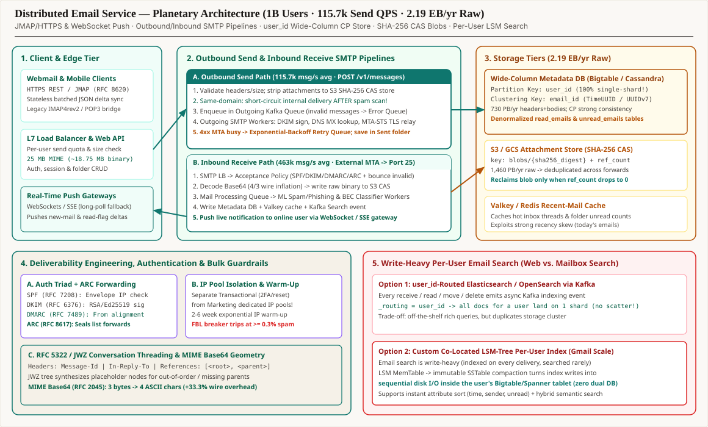
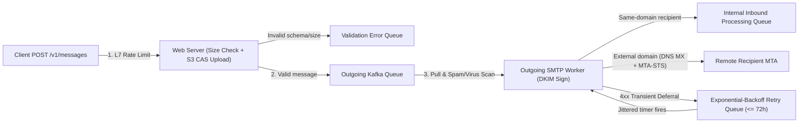
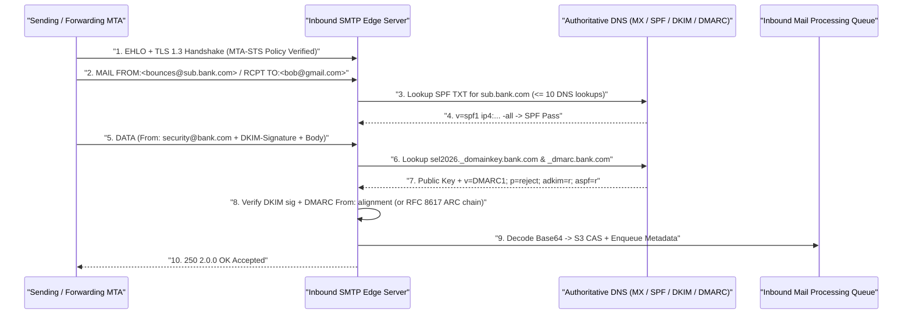
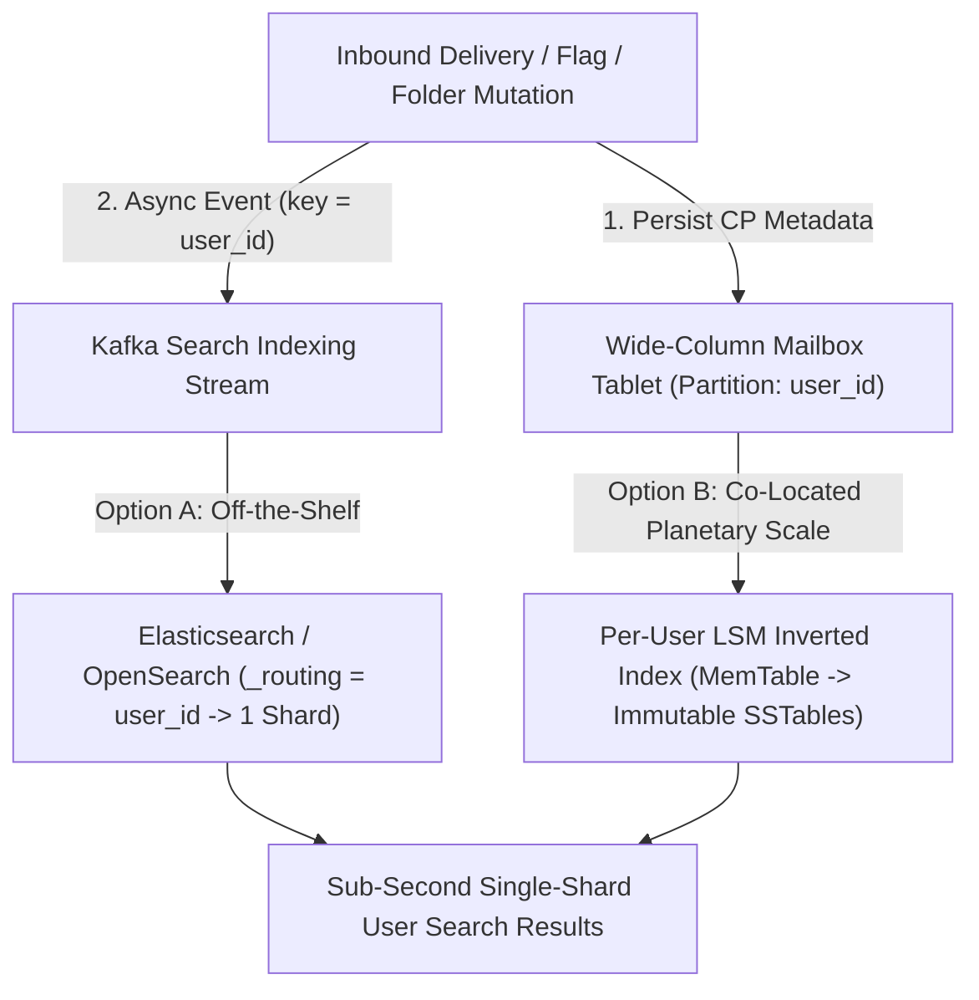
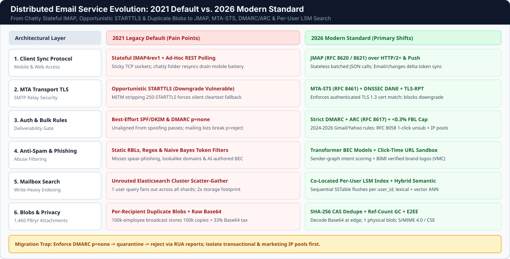

# Module 20 — Distributed Email Service: SMTP/JMAP Pipelines, Wide-Column Mailbox Storage, Deliverability Authentication, and Per-User LSM Search

This module designs a planetary-scale **distributed email service** (Gmail, Outlook.com) serving **`1,000,000,000` active users** (`~115.7k` outbound sends/sec, `~463k` inbound receives/sec, and `2.19 EB/year` of raw un-deduplicated message and attachment volume). Following ByteByteGo Chapter 23 (_Distributed Email Service_) and primary IETF specifications and storage systems literature — RFC 5321 (SMTP), RFC 5322 (Internet Message Format & threading headers), RFC 2045 (MIME Base64), RFC 6154 (Special-Use Mailboxes), RFC 9051 (IMAP4rev2), RFC 8620/8621 (JMAP over stateless HTTP/2+), RFC 7208 (SPF), RFC 6376 (DKIM), RFC 7489 (DMARC), RFC 8617 (ARC), RFC 8461 (MTA-STS), RFC 8058 (One-Click List-Unsubscribe), Jamie Zawinski's JWZ threading algorithm, and Chang et al. (OSDI 2006) on Google Bigtable — we examine end-to-end sending and receiving pipelines, `user_id`-partitioned wide-column data modeling, read/unread denormalization, content-addressed attachment deduplication, cryptographic sender authentication and IP warm-up guardrails, and write-heavy per-user LSM search indexing.

> [!NOTE]
> **Knowledge Ownership & Cross-Links.** This module owns distributed email architecture, SMTP/IMAP/POP3/JMAP protocol composition, wide-column mailbox data modeling (`user_id` partitioning, `TimeUUID`/`UUIDv7` clustering, read/unread denormalization, RFC 5322 / JWZ conversation threading, and SHA-256 content-addressed attachment deduplication), email deliverability engineering (SPF/DKIM/DMARC/ARC, IP warm-up, `< 0.3%` FBL complaint circuit breakers), and write-heavy per-user mailbox search architecture. For LSM-tree storage engine internals (MemTable, SSTables, compaction, Bloom filters), see [`architecture/data-systems/modules/02-storage-engines-b-trees-and-lsm.md`](../../data-systems/modules/02-storage-engines-b-trees-and-lsm.md). For inverted index and BM25/vector search theory, see [`architecture/data-systems/modules/03-indexing-theory-and-vector-search.md`](../../data-systems/modules/03-indexing-theory-and-vector-search.md). For DNS resolution, TLS 1.3, HTTP/2–3, and WebSockets, see [`architecture/networking/README.md`](../../networking/README.md). For PKI, RSA/Ed25519 digital signatures, and SHA-256 hashing, see [`architecture/security-identity/README.md`](../../security-identity/README.md). For distributed commit-log queues, dead-letter queues, and hierarchical timing wheels used in SMTP retry queues, see [Module 18](18-distributed-message-queue.md).

---

## 1. Requirements, Protocol Evolution, and Planetary Storage Sizing

### 1.1 Functional & Non-Functional Scope

Designing an email platform for `1 billion` users requires bridging open 1980s inter-domain federation protocols with low-latency cloud-native storage and multi-device synchronization:

- **Core Mailbox Capabilities**: Compose and send messages (`To`, `Cc`, `Bcc`), receive external and internal mail, organize folders and labels (RFC 6154 special-use roles: `All`, `Archive`, `Drafts`, `Flagged`, `Junk`, `Sent`, `Trash`), filter read vs. unread mail, reconstruct multi-branch conversation threads, upload/download attachments up to `25 MB` MIME size, and execute sub-second full-text and attribute search across a user's entire historical archive.
- **Anti-Spam, Anti-Phishing & Deliverability**: Authenticate inbound and outbound mail (SPF, DKIM, DMARC, ARC), reject malware and Business Email Compromise (BEC) lures at the edge, and protect outbound IP reputation across transactional and bulk streams.
- **Non-Functional Requirements**:
  - **Zero Data Loss & CP Mailbox Consistency**: Dropping a committed email or attachments is unacceptable. Furthermore, mailbox metadata mutations (marking an email read, moving to `Trash`, updating a `Draft`) require **CP (Consistent & Partition-Tolerant)** strong consistency per user: if a user deletes an email on their phone and opens their laptop, the message must never resurrect or display split-brain read state. During a primary partition failover, brief write unavailability for the affected `user_id` shard is preferred over serving divergent mailbox state.
  - **Real-Time Multi-Device Push**: Online web and mobile clients receive sub-second new-mail and flag-change notifications over **WebSockets / Server-Sent Events (SSE)** (with HTTP long-polling fallback for restrictive corporate proxies).
  - **Extensibility Over HTTPS / JMAP**: While inter-provider federation still speaks SMTP over port `25`, native web and mobile apps communicate over stateless HTTPS APIs (REST / JMAP) rather than chatty stateful legacy protocols.

### 1.2 Back-of-the-Envelope Planetary Capacity & MIME Base64 Math

Consider a `1,000,000,000`-user (`1B` user) email platform modeled on ByteByteGo Chapter 23:

- **Outbound Send QPS**:
  - Assume each user sends `10` emails/day: $10^9 \times 10 = 10^{10}\text{ emails/day}$.
  - Average outbound throughput: $\frac{10^{10}}{86{,}400\text{ s}} \approx 115{,}740.74\text{ emails/s}$ (or **`~100,000 QPS`** using the $10^5\text{ s/day}$ mental-math shortcut; `2x–3x` diurnal peak = **`230,000–350,000 QPS`**).
- **Inbound Receive QPS & Annual Metadata/Body Storage (`730 PB/year`)**:
  - Assume each user receives `40` emails/day: $10^9 \times 40 = 4 \times 10^{10}\text{ emails/day}$, or $\frac{4 \times 10^{10}}{86{,}400\text{ s}} \approx 462{,}963\text{ emails/s}$ average inbound.
  - At `50 KB` (`50,000 B` decimal) average metadata + HTML/text body per email:
  - $\text{Daily Metadata + Body} = 4 \times 10^{10} \times 50\text{ KB} = 2 \times 10^{15}\text{ B} = 2{,}000\text{ TB/day} = \mathbf{2\text{ PB/day}}$.
  - $\text{Annual Metadata + Body} = 2\text{ PB/day} \times 365\text{ days} = \mathbf{730\text{ PB/year}}$ raw.
- **Attachment Storage (`1,460 PB/year` Raw) & SHA-256 Deduplication**:
  - Assume `20%` of received emails carry attachments averaging `500 KB` (`500,000 B`):
  - $\text{Daily Attachments} = 4 \times 10^{10} \times 0.20 \times 500\text{ KB} = 4 \times 10^{15}\text{ B} = 4{,}000\text{ TB/day} = \mathbf{4\text{ PB/day}}$.
  - $\text{Annual Raw Attachments} = 4\text{ PB/day} \times 365\text{ days} = \mathbf{1{,}460\text{ PB/year}}$ raw (bringing total un-deduplicated raw storage to **`2,190 PB/year ≈ 2.19 EB/year`**!).
  - Because company-wide broadcasts, newsletters, and forwarded threads attach identical files across thousands of recipients, storing attachments in a **SHA-256 Content-Addressed Store (CAS)** with a conservative `2.5x` deduplication ratio slashes annual physical attachment storage from `1,460 PB/year` to **`584 PB/year`** (saving `876 PB/year` before replication or erasure coding).
- **RFC 2045 MIME Base64 `4/3` (`+33.33%`) Wire-Size Overhead**:
  - Classic SMTP is a 7-bit ASCII text protocol. Binary attachments (PDFs, images, ZIPs) are encoded via **RFC 2045 Base64**, which maps every `3` raw binary bytes (`24 bits`) into `4` ASCII characters (`4 × 6 bits`), plus a 2-byte `\r\n` (`CRLF`) line break every `76` characters:
  - $B_{\text{base64}} = 4 \times \left\lceil \frac{B_{\text{raw}}}{3} \right\rceil$
  - Consequently, a **`25 MB` (`25,000,000 B`) SMTP MIME message size limit** can carry at most $25\text{ MB} \times \frac{3}{4} = \mathbf{18.75\text{ MB}}$ (`18,750,000 B`) of raw binary attachment data! Crucially, edge SMTP/API servers **must decode Base64 back to raw binary** before writing to object storage — storing raw Base64 text in S3 would waste `33.3%` (`+487 PB/year`!) of planetary disk capacity.

### 1.3 Email Protocol Stack: SMTP, POP3, IMAP4rev2, and JMAP over HTTPS

| Protocol & Standard | Primary Role & Transport | State & Sync Semantics | Why It Matters / Modern Verdict |
| --- | --- | --- | --- |
| **SMTP** (RFC 5321) + **DNS MX** + **MTA-STS** (RFC 8461) | Inter-provider mail transfer (`Port 25` relay, `Port 587` submission) | Store-and-forward push; looks up recipient domain's DNS `MX` records (lowest preference integer tried first) | **Mandatory for federation** across providers; pair with **MTA-STS** / **DANE** so MITM attackers cannot strip `250-STARTTLS` and force cleartext downgrade. |
| **POP3** (RFC 1939) | Legacy single-device mail retrieval (`Port 995` TLS) | Destructive pull: downloads messages to local disk and deletes them from server by default | **Obsolete for multi-device users**: breaks synchronization across phone, laptop, and webmail. |
| **IMAP4rev2** (RFC 9051) | Multi-device folder sync for native mail apps (`Port 993` TLS) | Stateful long-lived TCP session per selected folder (`IDLE` push); server retains mail | Supported via compatibility bridge for Apple Mail / Thunderbird, but chatty command round-trips and sticky TCP state scale poorly on cellular networks. |
| **HTTPS REST & JMAP** (RFC 8620 / RFC 8621) | Modern webmail & mobile client protocol (JSON over stateless HTTP/2 & HTTP/3) | Stateless batched RPC (`Email/query`, `Email/get`, `Email/set`) + `Email/changes` delta state tokens | **2026 production standard**: eliminates sticky IMAP TCP sessions, batches folder+thread fetch into 1 HTTP round-trip, and pairs with WebSocket/SSE push. |

### 1.4 Primary Literature & RFC Specification Matrix

| Source / Specification | Year | Core Mechanism | Why It Matters Here |
| --- | :-: | --- | --- |
| **RFC 5321** (Simple Mail Transfer Protocol) & **RFC 5322** (Internet Message Format) | 2008 | SMTP envelope (`MAIL FROM`, `RCPT TO`) vs message headers (`From`, `Message-Id`, `In-Reply-To`, `References`) | Separates routing envelope from visible headers (the root gap exploited by spoofing and closed by DMARC) and defines threading links |
| **RFC 2045** (MIME Part One) & **RFC 6154** (Special-Use Mailboxes) | 1996 / 2011 | Base64 `4/3` binary-to-text encoding; standard folder attributes (`\All`, `\Archive`, `\Drafts`, `\Flagged`, `\Junk`, `\Sent`, `\Trash`) | Governs the `18.75 MB -> 25 MB` attachment wire ceiling and canonical cross-locale folder schemas |
| **RFC 7208** (SPF), **RFC 6376** (DKIM), **RFC 7489** (DMARC) & **RFC 8617** (ARC) | 2011–2019 | Envelope IP authorization (SPF), cryptographic header/body signature (DKIM), `From:` alignment policy (DMARC), and forwarded chain seals (ARC) | The four cryptographic pillars of modern email authentication and anti-spoofing |
| **RFC 8461** (MTA-STS) & **RFC 8058** (One-Click List-Unsubscribe) | 2017–2018 | Mandatory authenticated TLS policy for SMTP relays; signed `List-Unsubscribe-Post` header for bulk mail | Prevents STARTTLS downgrade attacks and satisfies 2024–2026 Gmail/Yahoo bulk-sender enforcement |
| **RFC 8620 / RFC 8621** (JMAP Core & JMAP for Mail) | 2019 | Stateless JSON Meta Application Protocol over HTTP/2+ with `state` delta tokens | Replaces chatty stateful IMAP4 with stateless cloud-native web/mobile synchronization |
| Jamie Zawinski — _Message Threading (JWZ Algorithm)_ | 1997 | Reconstructs conversation DAGs from `Message-Id`, `In-Reply-To`, and `References` with placeholder synthesis and cycle pruning | Handles out-of-order message arrival and missing intermediate replies deterministically |
| Chang et al. — _Bigtable: A Distributed Storage System for Structured Data_ (OSDI) | 2006 | Sparse, distributed, persistent multidimensional sorted map backed by LSM-trees and SSTables | Foundation for Gmail's `user_id`-partitioned wide-column mailbox metadata and per-user LSM search |

---

## 2. High-Level Architecture and End-to-End Send and Receive Pipelines



### 2.1 Why Traditional Single-Server File-Per-Email (`Maildir` / `mbox`) Collapses

Early UNIX mail servers (Sendmail, Postfix + Dovecot on local disk) stored messages either in a single monolithic `mbox` file per user (requiring file-wide locks on every delete) or in `Maildir` directories (`cur/`, `new/`, `tmp/`) storing **one physical filesystem file per email**. At `4 × 10^10` new emails/day across `1B` users, file-per-email collapses immediately:

1. **Inode & Small-File Metadata Exhaustion**: Creating `40 billion` tiny `50 KB` files per day exhausts filesystem inode tables and fragments block allocators.
2. **Random Disk IOPS Bottleneck**: Loading a 50-email inbox view or toggling `is_read` flags triggers dozens of random `4 KB` filesystem `stat()` and `rename()` syscalls, saturating disk IOPS.
3. **No Multi-Datacenter CP Replication**: Local POSIX filesystems lack built-in per-user quorum replication, multi-region failover, and integrated secondary search indexing.

### 2.2 REST / JMAP Webmail API Contracts

Modern webmail and mobile apps talk to stateless **Web Servers** over HTTP/2 and HTTP/3 while maintaining a lightweight connection to **Real-Time Push Gateways** (WebSockets / SSE, falling back to long-polling on older networks) for live inbox delta notifications:

- **`POST /v1/messages`**: Validates headers and size, persists attachments to object storage, and enqueues the message for outbound delivery (or internal same-domain short-circuit) idempotently via client `Idempotency-Key`.
- **`GET /v1/folders`**: Returns all folders for the authenticated `user_id` (`INBOX` as the base protocol mailbox plus folders annotated with the seven **RFC 6154** special-use roles `All`, `Archive`, `Drafts`, `Flagged`, `Junk`, `Sent`, `Trash`):
  ```json
  [
    {
      "id": "fld_all_01",
      "name": "All Mail",
      "role": "All",
      "user_id": "u_948102",
      "unread_count": 4
    },
    {
      "id": "fld_sent_01",
      "name": "Sent",
      "role": "Sent",
      "user_id": "u_948102",
      "unread_count": 0
    },
    {
      "id": "fld_junk_01",
      "name": "Spam",
      "role": "Junk",
      "user_id": "u_948102",
      "unread_count": 12
    }
  ]
  ```
- **`GET /v1/folders/{folder_id}/messages?cursor=...&limit=50`**: Cursor-paginated folder listing sorted chronologically by descending `email_id` (`TimeUUID` / `UUIDv7`), returning compact header previews (`from`, `subject`, `snippet`, `is_read`, `has_attachment`, `timestamp`) from Valkey cache or the wide-column metadata store.
- **`GET /v1/messages/{message_id}`**: Fetches full message headers, body text/HTML, and signed presigned URLs for any SHA-256 content-addressed attachments.

### 2.3 Outbound Sending Pipeline and the Internal Same-Domain Short-Circuit

When Alice clicks "Send" (`~115.7k msg/s` average, `~350k msg/s` peak):

1. **L7 Load Balancer & Per-User Rate Limiting**: Enforces per-user and per-tenant send quotas (preventing a compromised user session from bursting `50,000` spam messages/minute).
2. **Web Server Validation & Attachment Extraction**: Validates RFC 5322 recipient syntax and the `25 MB` message size cap; strips binary attachments into the **S3 / GCS SHA-256 Content-Addressed Attachment Store** and replaces inline payloads with compact `sha256` references. If basic validation fails, the event routes to an **Error Queue** for immediate sender feedback.
3. **Internal Same-Domain Short-Circuit (With Mandatory Anti-Spam Scan!)**: When a `@gmail.com` user emails another `@gmail.com` user, resolving public DNS `MX` records and opening an external SMTP TCP/TLS session back to our own edge wastes network bandwidth and latency. The web/worker tier **short-circuits outbound SMTP relay** and routes the message directly to the internal delivery pipeline — **but strictly after running full spam, phishing, and malware checks**, so compromised internal accounts cannot phish co-workers or other same-provider users!
4. **Outgoing Kafka Queue & SMTP Workers**: External messages enter a durable partitioned **Outgoing Message Queue** ([Module 18](18-distributed-message-queue.md)). Outgoing SMTP Workers pull batches, run outbound virus/spam checks, sign canonicalized headers and body hash (`bh=`) with the domain's **DKIM** private key, resolve the recipient domain's DNS `MX` records (and **MTA-STS** TLS policy), and transmit over encrypted SMTP.
5. **`Sent` Folder Persistence & Exponential-Backoff Retry Queue**: Once accepted, a copy is written to the sender's `Sent` folder. If the remote MTA returns a transient `4xx` deferral (`421 Service busy`, greylisting, or network timeout), the worker moves the message into a delayed **Retry Queue** backed by hierarchical timing wheels (`5 min -> 15 min -> 1 hr -> 4 hr` with full jitter up to `72 hours`) before emitting a Non-Delivery Report (NDR / bounce) back to the sender.



### 2.4 Inbound Receiving Pipeline

When an external MTA connects to our edge (`~463k msg/s` average):

1. **L4/L7 SMTP Load Balancer -> Edge SMTP Acceptance Servers**: Distributes inbound TCP port `25` connections across stateless SMTP edge servers.
2. **Connection-Stage Mail Acceptance Policy**: Before accepting the expensive message body (`DATA`), edge servers evaluate connection-level IP reputation (RBLs), recipient existence, message size ceilings, and cryptographic sender authentication (**SPF**, **DKIM**, **DMARC**, and **ARC**). Obvious botnet flood traffic and `p=reject` spoofing failures are dropped at the SMTP edge with a `550` permanent rejection before consuming downstream storage or queue IOPS.
3. **Base64 Decoding & Attachment Offload**: Validated MIME parts are parsed at the edge; Base64-encoded attachments (`4/3` wire size) are decoded back into raw binary and written to the **S3 / GCS SHA-256 Content-Addressed Attachment Store**.
4. **Mail Processing Queue & Workers**: The lightweight message envelope and S3 references enter the **Inbound Mail Processing Queue**. Workers execute deep ML spam/phishing/BEC classification, persist the message into the user's **Wide-Column Metadata DB** partition (routing `spam` score matches to the `Junk` folder), populate the **Valkey/Redis recent-email cache**, publish an async indexing event to the **Kafka Search Topic**, and notify the user's active devices through the **Real-Time WebSocket/SSE Push Server**.

---

## 3. Mailbox Storage Engine: Data Modeling, Threading, and Attachment Deduplication

### 3.1 Workload Characteristics & Why `user_id`-Partitioned Wide-Column CP Storage Wins

ByteByteGo Chapter 23 highlights five defining access patterns of email metadata and bodies:

1. **Header vs. Body Asymmetry**: Folder list views read hundreds of tiny headers (`From`, `Subject`, `Timestamp`, `is_read`, `snippet` — `< 1 KB`), whereas message bodies (`10 KB–1 MB`) are typically opened and read **only once or twice**.
2. **Strict Single-User Isolation**: `> 99.9%` of mailbox operations (list folder, read email, mark read/unread, search) touch data belonging to a **single `user_id`**.
3. **Strong Recency Skew**: Over `80%` of reads target emails received within the last `7–14 days` — ideal for caching recent inbox metadata in **Valkey / Redis** while streaming older history from disk.
4. **Single-Digit MB Column Cells & Sequential Write IOPS**: At `463,000` inbound writes/sec plus millions of read-flag mutations, traditional B-tree relational databases suffer random 4 KB page-split IOPS amplification, while pure object stores (S3) cannot update `is_read` flags or list folders cleanly.
5. **CP Consistency Requirement**: Mailbox state must be **strongly consistent (CP)**. In Google's production Gmail architecture, each user's mailbox is anchored in a `user_id`-sharded **Google Bigtable / Cloud Spanner** tablet (or in open-source deployments, a `user_id`-partitioned **Cassandra / ScyllaDB** cluster operating with local quorum / linearizable Paxos/Raft consensus per partition). During a cross-datacenter failover, mutating actions for affected users briefly pause rather than allowing divergent split-brain writes.

### 3.2 Wide-Column Schema and the Read/Unread Denormalization Pattern

We partition every mailbox table by **`user_id`** (so an entire user's mailbox resides on a single logical shard/partition) and cluster messages by **`email_id` (`TimeUUID` / `UUIDv7` sorted `DESC`)** so the newest emails are scanned sequentially first:

```sql
-- 1. User folders annotated with RFC 6154 special-use roles (INBOX is the base protocol mailbox; RFC 6154 defines 7 special-use roles)
CREATE TABLE folders_by_user (
  user_id      UUID,
  folder_id    UUID,
  name         TEXT,
  rfc6154_role TEXT, -- 'All', 'Archive', 'Drafts', 'Flagged', 'Junk', 'Sent', 'Trash' (NULL for default INBOX or custom folders)
  unread_count INT,
  PRIMARY KEY ((user_id), folder_id)
);

-- 2. All emails inside a folder, clustered chronologically newest-first by TimeUUID / UUIDv7
CREATE TABLE emails_by_folder (
  user_id         UUID,
  folder_id       UUID,
  email_id        TIMEUUID,
  thread_id       UUID,
  sender          TEXT,
  recipients_to   LIST<TEXT>,
  recipients_cc   LIST<TEXT>,
  subject         TEXT,
  body_preview    TEXT,
  body_text       TEXT,
  is_read         BOOLEAN,
  has_attachments BOOLEAN,
  PRIMARY KEY ((user_id, folder_id), email_id)
) WITH CLUSTERING ORDER BY (email_id DESC);

-- 3. Attachment metadata per email pointing to SHA-256 Content-Addressed Object Storage
CREATE TABLE attachments_by_email (
  user_id          UUID,
  email_id         TIMEUUID,
  filename         TEXT,
  sha256_hash      TEXT,
  byte_size        BIGINT,
  mime_type        TEXT,
  object_store_url TEXT,
  PRIMARY KEY ((user_id, email_id), filename)
);
```

> [!IMPORTANT]
> **Why Filtering `WHERE is_read = false` Fails in Cassandra — and How Denormalization Fixes It.** In a relational database, fetching unread emails in a folder is a simple secondary-index query (`WHERE user_id = ? AND folder_id = ? AND is_read = false`). In Cassandra/wide-column stores, queries must follow the exact `(partition_key, clustering_key)` prefix: filtering on a non-clustering boolean column (`is_read`) forces a full scan of every historical email in the user's folder (`ALLOW FILTERING`), which melts down on a 200,000-email archive!
>
> **The Wide-Column Denormalization Fix**: Maintain two compact materialized projection tables — **`read_emails`** and **`unread_emails`** — both keyed by `PRIMARY KEY ((user_id, folder_id), email_id) WITH CLUSTERING ORDER BY (email_id DESC)`.
>
> - When a new email arrives, it is inserted into `emails_by_folder` and `unread_emails`.
> - When the user opens the email (`mark as read`), an atomic logged batch **deletes** `(user_id, folder_id, email_id)` from `unread_emails` and **inserts** it into `read_emails` (while updating `is_read = true` in `emails_by_folder`). Fetching $K$ unread emails in `Inbox` is now an $O(1)$ partition key lookup plus an $O(K)$ sequential clustering scan over `unread_emails` (independent of total folder archive size $N$)!
> - _(Alternative in Bigtable/Spanner)_: Store a system-flag bitmask (`SEEN | FLAGGED | DRAFT | JUNK | TRASH`) plus a dynamic `label_ids SET<TEXT>` for arbitrary user-created labels on the single canonical `emails_by_user` row, paired with a co-located per-user LSM secondary index on `(user_id, label_id, email_id DESC)`, which is how Gmail supports hundreds of user labels without copying the message body across folders.

### 3.3 Conversation Threading (`Message-Id`, `In-Reply-To`, `References` & JWZ Algorithm)

Email protocols have no central thread coordinator; instead, **RFC 5322** embeds three causal headers inside every message:

```json
{
  "headers": {
    "Message-Id": "<m3-7BA04B2A@gmail.com>",
    "In-Reply-To": "<m2-CAEWTXuP@gmail.com>",
    "References": ["<m1-ROOT9910@gmail.com>", "<m2-CAEWTXuP@gmail.com>"]
  }
}
```

When replies arrive out of order (e.g., `m3` arrives before `m2`, or `m2` was deleted/never CC'd to this recipient), naive `parent_id = In-Reply-To` lookups break the thread into disconnected orphans. Following **Jamie Zawinski's JWZ Threading Algorithm**:

1. Index every arrived message by its `Message-Id`, and synthesize lightweight **placeholder container nodes** (`isPlaceholder = true`) for any ancestor IDs named in `References` or `In-Reply-To` that have not yet arrived.
2. Link consecutive pairs in `References[i] -> References[i + 1]` and link `In-Reply-To -> Message-Id`, running a **cycle check** before every link so malformed or adversarial headers (`A -> B -> A`) can never create an infinite loop.
3. Group all connected components under a deterministic root `thread_id` so the UI renders the full conversation tree cleanly even across missing intermediate replies.



_Step-by-step mechanics:_ (1) Reply `<m3>` arrives out of order before its ancestors, referencing `[<m1>, <m2>]`. (2) JWZ synthesizes placeholder containers `[?] <m1>` and `[?] <m2>` (`isPlaceholder = true`) in `id_table` and wires `References` links. (3) A forged cyclic header (`<m3> → <m1>`) is rejected by the DFS cycle guard while late-arriving `<m1>` hydrates its placeholder in place. (4) Empty placeholders with `0` or `1` child are pruned/spliced while `[?] <m2>` stays as a structural bridge for sibling replies `<m3>` and `<m4>` under root `thread_id = <m1>`.

### 3.4 Content-Addressed Attachment Deduplication (`SHA-256` CAS + Reference Counting)

At `1,460 PB/year` of raw attachments, storing separate physical S3 blobs for every recipient of a `10 MB` corporate all-hands deck sent to `50,000` employees wastes `500 GB` on a single broadcast. Instead, the attachment service computes `sha256 = SHA256(decoded_raw_bytes)` at upload/ingest time and stores the blob under `s3://mail-attachments/cas/{sha256}` alongside a transactional **`ref_count`**:

- When Bob receives or forwards the same file, `putAttachment` detects the existing `sha256`, skips the S3 blob upload completely, and increments `ref_count = ref_count + 1`.
- When Alice empties her `Trash`, `deleteAttachmentRef` decrements `ref_count = ref_count - 1`; the physical S3 object is deleted **only when `ref_count` reaches `0`** (guarded against concurrent upload-vs-delete races by a transactional lease or two-phase grace period).

---

## 4. Email Deliverability, Authentication, and Bulk-Sender Guardrails

Setting up an SMTP server that transmits packets on port `25` takes minutes; getting those messages delivered to a recipient's **Inbox** rather than the **Spam/Junk** folder is one of the hardest operational problems in distributed systems.

### 4.1 The Cryptographic Authentication Triad (SPF, DKIM, DMARC) + ARC Forwarding

Because basic RFC 5321 SMTP performs zero sender verification, anyone can open a socket and claim `MAIL FROM:<support@bank.com>` or `From: "Bank Security" <security@bank.com>`. Modern inbound edge MTAs verify four layered RFC standards:

1. **SPF (Sender Policy Framework — RFC 7208)**: The domain owner publishes a DNS TXT record (`v=spf1 ip4:198.51.100.0/24 include:_spf.google.com -all`) listing the IP addresses authorized to send mail for the **RFC 5321 envelope `MAIL FROM` (Return-Path)** domain.
   - _Limitation_: SPF only validates the invisible envelope `MAIL FROM` domain, **not** the visible RFC 5322 `From:` header shown to the human user in their email client! Also, RFC 7208 enforces a strict **10-DNS-lookup limit** across nested `include:` chains; exceeding 10 lookups triggers `SPF permerror` and fails authentication.
2. **DKIM (DomainKeys Identified Mail — RFC 6376)**: The sending MTA signs canonicalized headers (`From`, `To`, `Subject`, `Date`) and the body hash (`bh=`) using an RSA-2048 or Ed25519 private key, attaching a `DKIM-Signature: v=1; a=rsa-sha256; d=bank.com; s=sel2026; bh=...; b=...` header. The receiving MTA fetches the public key from `sel2026._domainkey.bank.com` in DNS to verify tamper-free provenance.
3. **DMARC (Domain-based Message Authentication, Reporting, and Conformance — RFC 7489)**: Closes the spoofing loophole via **Identifier Alignment**. To pass DMARC, the domain in the **visible RFC 5322 `From:` header** must match (`strict` exact domain match or `relaxed` organizational domain match) at least one passing **SPF `MAIL FROM` domain** OR passing **DKIM `d=` signing domain**. If both fail alignment, the receiver enforces the domain's `_dmarc.<domain>` policy (`p=none`, `p=quarantine`, or `p=reject`) and emits daily aggregate XML reports (`rua=`) back to the domain owner.
4. **ARC (Authenticated Received Chain — RFC 8617)**: When a user forwards mail (`user@alumni.edu -> user@gmail.com`) or posts to a mailing list, the forwarder relays the email from its own IP (breaking **SPF**) and often prepends `[List-Name]` to the subject or appends an unsubscribe footer (breaking **DKIM**). Under strict DMARC `p=reject`, legitimate forwarded mail would bounce! **ARC** solves this by allowing trusted intermediaries to attach a cryptographically signed chain of headers (`ARC-Authentication-Results`, `ARC-Message-Signature`, `ARC-Seal` with hop index `i=1..N`) attesting that the message passed SPF/DKIM/DMARC when it originally arrived at the forwarder (`i=1`).

| Scenario | Visible `From:` (`RFC 5322`) | Envelope `MAIL FROM` (`SPF`) | `DKIM d=` Signature | DMARC Alignment (`relaxed`) | Inbound Edge Verdict (`p=reject`) |
| --- | --- | --- | --- | :-: | --- |
| **Legitimate Transactional Mail** | `alerts@mailer.bank.com` | `bounces.bank.com` (`SPF pass`) | `mailer.bank.com` (`DKIM pass`) | **Pass** (both align with `bank.com`) | **Accept** (`250 OK`) |
| **Envelope Phishing Spoof** | `security@bank.com` | `evil-phish.org` (`SPF pass`!) | None / invalid | **Fail** (`evil-phish.org != bank.com`) | **Reject** (`550 5.7.1 DMARC Reject`) |
| **Direct Subdomain forward (No Footer)** | `news@acm.org` | `forwarder.edu` (`SPF fail`) | `acm.org` (`DKIM pass` intact) | **Pass** (via aligned DKIM `acm.org`) | **Accept** (`250 OK`) |
| **Mailing List Forward (Modified Body + ARC)** | `author@acm.org` | `lists.uni.edu` (`SPF fail`) | `acm.org` (`DKIM fail` due to footer) | **ARC Override** (`i=1` seal verified) | **Accept** (via trusted RFC 8617 ARC chain) |



### 4.2 Dedicated IP Pools, 2-to-6-Week IP Warm-Up, and the `< 0.3%` FBL Circuit Breaker

Even with valid SPF, DKIM, and DMARC, a brand-new IP address that suddenly blasts `1,000,000` emails on Day 1 will be throttled or routed straight to Spam by Gmail, Outlook, and Yahoo:

- **Dedicated IP Pool Isolation (`Transactional` vs. `Marketing`)**: Never send password resets, 2FA OTPs, or billing receipts from the same outbound IP addresses used for marketing promotions. Partition outbound SMTP workers into strictly isolated IP pools (`pool-tx-critical` vs. `pool-mktg-bulk`) with separate DKIM/envelope subdomains (`tx.example.com` vs. `offers.example.com`).
- **2-to-6-Week Exponential IP Warm-Up**: New sending IPs must ramp daily volume gradually over `14 to 42 days` (for example, starting at `500/day` on Day 1 and doubling or growing $1.5\times\text{--}2\times$ daily while maintaining low bounce and complaint rates) so recipient ISP reputation models establish a baseline of positive user engagement.
- **ISP Feedback Loops (FBL) & 2024–2026 Bulk-Sender Mandates (`< 0.3%` Spam Threshold)**: Under the joint Gmail and Yahoo bulk-sender rules (> `5,000` messages/day), senders must (1) authenticate with SPF + DKIM + DMARC, (2) support **RFC 8058 One-Click `List-Unsubscribe-Post`** honored within 48 hours, and (3) keep user spam complaint rates strictly below **`0.1%` target** and never reach or exceed the **`0.3%` (`0.003`) hard enforcement ceiling**. Our outbound controller ingests FBL complaint webhooks in real time and **trips an automated circuit breaker** on any marketing campaign or IP pool whose rolling complaint rate reaches `0.3%`, protecting domain reputation while keeping transactional 2FA mail flowing uninterrupted.

Below is the verified DMARC alignment + ARC evaluator (`evaluateEmailAuth`) and `DeliverabilityPoolGuard` circuit breaker from [`examples/lib/email-models.ts`](../examples/lib/email-models.ts):

```typescript
export function evaluateEmailAuth(input: EmailAuthInput): EmailAuthVerdict {
  const spfAlignedPass =
    input.spfPass &&
    domainsAlign(input.headerFromDomain, input.envelopeMailFromDomain, input.alignmentMode);

  const dkimAlignedPass =
    input.dkimPass &&
    input.dkimSigningDomain !== null &&
    domainsAlign(input.headerFromDomain, input.dkimSigningDomain, input.alignmentMode);

  const dmarcPass = spfAlignedPass || dkimAlignedPass;

  if (dmarcPass) {
    return {
      spfAlignedPass,
      dkimAlignedPass,
      dmarcPass: true,
      disposition: 'accept',
      reason: dkimAlignedPass ? 'DMARC pass via aligned DKIM' : 'DMARC pass via aligned SPF',
    };
  }

  // RFC 8617 ARC override for legitimate indirect mail flows (mailing lists / forwarding)
  if (input.trustedArcChainPass) {
    return {
      spfAlignedPass,
      dkimAlignedPass,
      dmarcPass: false,
      disposition: 'accept',
      reason: 'DMARC override via validated RFC 8617 ARC forwarding seal',
    };
  }

  const disposition =
    input.dmarcPolicy === 'reject'
      ? 'reject'
      : input.dmarcPolicy === 'quarantine'
        ? 'quarantine'
        : 'accept';

  return {
    spfAlignedPass,
    dkimAlignedPass,
    dmarcPass: false,
    disposition,
    reason: `DMARC fail (spfAligned=${spfAlignedPass}, dkimAligned=${dkimAlignedPass}) -> policy ${input.dmarcPolicy}`,
  };
}
```

---

## 5. Write-Heavy Per-User Email Search: Elasticsearch vs. Custom LSM Indexes

### 5.1 Why Email Search Is the Exact Opposite of Google Web Search

Engineers often assume email search works like a miniaturized web search engine. In reality, their workload characteristics are diametrically opposed:

| Dimension | Web Search Engine (Google / Bing) | Distributed Email Search (Gmail / Outlook) | Architectural Consequence |
| --- | --- | --- | --- |
| **Search Scope** | Global shared corpus (billions of public pages) | **Strictly isolated to 1 `user_id`'s mailbox** | Partition index strictly by `user_id`; zero cross-user queries |
| **Read vs. Write Ratio** | Read-heavy (millions of queries per crawl update) | **Write-heavy!** Re-indexed on every delivery, read toggle, folder move, or delete; searched rarely | Index storage engine must optimize for high-throughput sequential write ingestion |
| **Freshness SLA** | Minutes to days after web crawl | **Near-real-time (`< 1–5 seconds`)** after email arrival or move | Streaming index ingestion via Kafka or synchronous MemTable append |
| **Ranking & Sorting** | Global PageRank + BM25 + neural re-ranking | **Deterministic attribute sort** (`date DESC`, `from:`, `has:attachment`, `is:unread`) + lexical/semantic match | Combine structured metadata bitmasks with per-user token postings lists |

### 5.2 Approach 1 (`user_id`-Routed Elasticsearch) vs. Approach 2 (Custom Co-Located LSM Index)

ByteByteGo Chapter 23 contrasts two production architectures for supporting sub-second email search at scale:

1. **Approach 1 — `user_id`-Routed Elasticsearch / OpenSearch Cluster via Kafka**:
   - Every mailbox mutation (new email, mark read, move folder, delete) publishes an asynchronous event to a `user_id`-partitioned Kafka topic. Search consumers index documents into Elasticsearch using **`_routing = user_id`**.
   - **Why `_routing = user_id` Is Mandatory**: By default, Elasticsearch hashes `_id` (`email_id`) across all $S$ shards in the index, scattering one user's `50,000` emails across every shard in the cluster; a single user typing a search query would force a scatter-gather query across all $S$ shards! Setting `_routing = user_id` guarantees that 100% of a user's emails live on **one shard**, turning search into a fast single-shard local lookup.
   - _Trade-off_: Off-the-shelf rich query DSL and analyzers, but requires operating and paying for a **second petabyte-scale storage cluster** alongside the primary metadata database.
2. **Approach 2 — Custom Co-Located LSM-Tree Per-User Index (Google Bigtable / Gmail Model)**:
   - At planetary scale (`730 PB/year` text), duplicating data across both a metadata store and a separate Elasticsearch cluster is prohibitively expensive. Because email search is **write-heavy**, we embed the per-user inverted index directly inside the same **Log-Structured Merge-Tree (LSM)** tablet (`Bigtable` / `RocksDB`) that stores the user's mailbox metadata!
   - New email tokens append to the in-memory **MemTable** (backed by a sequential WAL) in microseconds and flush sequentially into immutable on-disk **SSTables** compacted in the background (detailed in [`architecture/data-systems/modules/02-storage-engines-b-trees-and-lsm.md`](../../data-systems/modules/02-storage-engines-b-trees-and-lsm.md)). This converts random token-posting updates into sequential disk writes, cuts disk IOPS by an order of magnitude, and eliminates dual-cluster storage duplication.



---

## 6. Production Gotchas, SRE Guardrails, and 2021 vs. 2026 Comparison

### 6.1 Six High-Severity Production Gotchas

1. **Shared Outbound IP Pool Poisoning (Marketing Spikes Blocking 2FA OTPs)**: Routing marketing newsletters and password-reset / 2FA codes through the same outbound NAT/SMTP IP pool causes a single promotional spam-complaint spike (`>= 0.3%`) to get the shared IPs throttled by Gmail and Outlook — locking users out of their accounts. **Fix**: Physically separate dedicated IP pools and DKIM signing subdomains (`tx.domain.com` vs. `mktg.domain.com`), and enforce an automated FBL complaint circuit breaker on the marketing pool.
2. **Persisting Undecoded Base64 Attachments in Object Storage**: Writing raw MIME Base64 text directly to S3 inflates the `1,460 PB/year` attachment tier by `+33.3%` (`+487 PB/year` of wasted storage) and breaks content-addressed deduplication when different mail clients wrap Base64 lines at 64 vs. 76 characters. **Fix**: Decode Base64 to canonical raw binary bytes at the SMTP/API edge before computing `SHA-256` and persisting to S3 CAS.
3. **SPF 10-DNS-Lookup `permerror` & Mailing-List DMARC Breakage**: Stacking third-party SaaS `include:` records (Salesforce, SendGrid, Zendesk, HubSpot, Workday) inside `_spf` easily exceeds RFC 7208's hard **10-DNS-lookup limit**, causing receiving MTAs to fail SPF with `permerror`. Separately, enabling `p=reject` without **ARC (RFC 8617)** validation drops legitimate mailing-list and university-forwarded traffic. **Fix**: Flatten SPF records or delegate dedicated subdomains per sender (`billing.example.com`, `support.example.com`), sign all outbound mail with DKIM, and honor validated ARC chains on inbound edge MTAs.
4. **Unrouted Elasticsearch Scatter-Gather Collapse**: Indexing emails into Elasticsearch by `email_id` without `_routing = user_id` forces every single-user search query to hit all $S$ shards in the cluster, saturating thread pools at high concurrency. **Fix**: Mandate `_routing = user_id` on every index and search request (and monitor hot-shard skew for enterprise archival accounts).
5. **Internal Same-Domain Short-Circuit Bypassing Anti-Spam**: Optimizing internal `@company.com -> @company.com` delivery by skipping the outbound DNS/SMTP loop is standard, _unless_ the short-circuit also skips spam, phishing, and malware scanning — which turns a single phished employee mailbox into an unmonitored lateral-movement pivot. **Fix**: Short-circuit only the external DNS MX/SMTP transport hop while running the identical spam/phishing/BEC pipeline on internal mail.
6. **Reference-Counted CAS Attachment Delete-vs-Upload Race**: User A deletes the last reference to blob `sha256_X` (`ref_count: 1 -> 0`) at the exact millisecond User B uploads the identical file. If the GC worker deletes the physical S3 object after User B's dedupe check saw the blob existed, User B's email points to a missing S3 key (`404 NoSuchKey`). **Fix**: Guard `ref_count` increments and zero-transitions inside a single atomic key-value/SQL transaction per `sha256_hash`, and apply a **24-hour tombstone grace period** (`deleted_at` lease) before physical S3 object deletion.

### 6.2 Quantitative SRE Guardrails

| SLI / Metric | Healthy Target | Page / Circuit-Breaker Threshold | Primary Remediation |
| --- | --- | --- | --- |
| **ISP Spam Complaint Rate (FBL)** | `< 0.08%` (`< 0.1%` guideline) | **`>= 0.30%`** (`0.003` hard ceiling) | Automatically trip marketing pool circuit breaker, pause offending campaign ID, and audit RFC 8058 unsubscribe headers |
| **Outbound SMTP Retry Queue Age & Growth** | `p99 < 15 min` (steady drain) | Monotonic growth `> 30 min` or oldest `> 4 h` | Split by recipient domain: single-domain `4xx` spike = remote MTA outage/greylisting (backoff); global growth = scale SMTP workers |
| **Hard Bounce Rate (Invalid Recipients)** | `< 1.0%` per pool | `> 3.0%` over `15 min` | Suspend tenant/sender list upload, enforce real-time suppression list, and block dictionary-attack senders |
| **Inbound Edge SMTP Rejection Latency** | `p99 < 150 ms` | `p99 > 800 ms` | Check DNS resolver cache hit ratio for SPF/DKIM/DMARC lookups and scale stateless SMTP edge pods |
| **Per-User Search Indexing Lag (Kafka -> Index)** | `p99 < 3 s` | `p99 > 30 s` for `5 min` | Scale index consumer group, inspect LSM compaction backlog, or isolate whale archival accounts |
| **Mailbox CP Mutation Availability** | `>= 99.99%` | `< 99.9%` over `5 min` | Check wide-column tablet leader failover health and multi-DC quorum RTT |

### 6.3 Technology Comparison: Then vs. Now (2021 vs. 2026)



| Architectural Layer | 2021 Legacy Default | 2026 Modern Standard | Why It Changed & Migration Pitfall |
| --- | --- | --- | --- |
| **Client Sync Protocol** | Stateful **IMAP4rev1** + custom webmail JSON endpoints | **JMAP (RFC 8620 / 8621)** over stateless HTTP/2 & HTTP/3 + WebSocket push | Eliminates sticky TCP connections, cuts mobile battery/RTT overhead via batched delta sync (`Email/changes`); _pitfall:_ keep a stateless IMAP-to-JMAP proxy for legacy desktop clients. |
| **MTA Transport Encryption** | Opportunistic `STARTTLS` over Port `25` | **MTA-STS (RFC 8461)** + **DNSSEC DANE** + **SMTP TLS Reporting (RFC 8460)** | Prevents active MITM downgrade attacks that strip `250-STARTTLS`; _pitfall:_ deploy MTA-STS in `testing` mode with TLS-RPT monitoring before switching policy to `enforce`. |
| **Sender Auth & Bulk Rules** | Optional SPF/DKIM, `DMARC p=none`, manual unsubscribe links | **Strict DMARC (`p=quarantine/reject`)** + **ARC (RFC 8617)** + **`< 0.3%` FBL Cap & RFC 8058 1-Click Unsubscribe** | Mandatory since 2024–2026 Gmail/Yahoo bulk enforcement; _pitfall:_ jumping straight to `p=reject` without auditing RUA reports breaks third-party SaaS senders. |
| **Anti-Spam & Phishing Engine** | RBL IP blocklists, regex rules, and Naive Bayes token filters | **Transformer BEC / Intent Classifiers** + **Click-Time URL Sandboxing** + **BIMI (VMC)** | Catches payload-less CEO fraud / Business Email Compromise (BEC) that has zero malware or bad links; _pitfall:_ run heavy LLM classifiers asynchronously off the SMTP edge socket to avoid connection timeouts. |
| **Mailbox Search Engine** | Standalone Elasticsearch cluster without routing or custom tuning | **Co-Located Per-User LSM Inverted Index** + **Hybrid Lexical & Vector Semantic Search** | Eliminates petabyte dual-cluster duplication and turns write-heavy token indexing into sequential SSTable flushes while adding semantic query support. |
| **Attachment Storage (`1,460 PB/yr`)** | Per-recipient blob copies or raw Base64 storage | **Edge Base64 Decoding + SHA-256 Content-Addressed Storage (CAS)** + **Tiered S3/Glacier** | Cuts physical attachment footprint by `40%–70%` across broadcasts/forwards and reclaims `33.3%` Base64 bloat; _pitfall:_ enforce atomic ref-count leases before physical GC deletion. |
| **Privacy & Encryption** | Server-side cleartext storage (provider holds all keys) | **Client-Side End-to-End Encryption (E2EE / S/MIME 4.0 / WebCrypto CSE)** | Protects sensitive enterprise and consumer mail against server compromise; _pitfall:_ E2EE bodies cannot be indexed by server-side search unless clients maintain local or encrypted search tokens. |

**Pitfalls of mixing 2021 and 2026 layers during migration.** Never flip a domain's DMARC record directly from absent to `p=reject` in one step: legacy billing, HR, or marketing scripts sending from unaligned envelope domains or exceeding the 10-lookup SPF limit will immediately hard-bounce across all major ISPs. Roll out DMARC progressively (`p=none` with `rua=` telemetry $\to$ fix unaligned senders and DKIM signing $\to$ `p=quarantine; pct=10..100` $\to$ `p=reject`), and isolate transactional vs. marketing IP pools **before** onboarding high-volume campaigns.

---

## 7. Executable Proof Map

All five quantitative, cryptographic, and storage invariants in this module are verified deterministically in [`examples/14-email-service.test.ts`](../examples/14-email-service.test.ts) (backed by [`examples/lib/email-models.ts`](../examples/lib/email-models.ts)):

| Concept in This Module | Deterministic Test in `14-email-service.test.ts` | Verified Invariant / Negative Proof |
| --- | --- | --- |
| **Planetary Capacity & RFC 2045 Base64 `4/3` Wire Overhead** | `estimateEmailStorage` (`1B` users, `10` sent, `40` received, `50 KB` body, `20% × 500 KB` attachments) & `computeBase64WireBytes` | Proves `~115,740.74/s` outbound (`~462,962.96/s` inbound), `2 PB/day` (`730 PB/yr`) metadata+body, `4 PB/day` (`1,460 PB/yr` raw $\to$ `584 PB/yr` at `2.5x` CAS dedupe) attachments, and proves `18.75 MB` raw binary expands to `25.00 MB` Base64 (`> 25.6 MB` with 76-char `CRLF` breaks). |
| **SPF / DKIM / DMARC Alignment & RFC 8617 ARC Forwarding** | `evaluateEmailAuth` (`relaxed` vs `strict` alignment, `eTLD+1` `.co.uk` envelope spoofing negative test, and ARC forward) | Proves subdomain `mailer.bank.com` passes `relaxed` DMARC for `bank.com` but fails `strict`; proves an attacker passing SPF on `evil.co.uk` with `From: security@bank.co.uk` is rejected by `eTLD+1`-aware DMARC alignment; proves trusted RFC 8617 ARC seals recover mailing-list forwards when SPF and DKIM break. |
| **RFC 5322 / JWZ Conversation Threading** | `reconstructThreadTree` (out-of-order `m3` before `m1`, missing intermediate parent `m2`, and timestamp-deterministic cyclic header breaking) | Proves out-of-order messages assemble into the exact `m1 -> m2 (placeholder) -> m3` hierarchy with synthesized placeholder nodes for missing parents and arrival-order-independent cycle prevention on malformed mutual `In-Reply-To` headers. |
| **SHA-256 Content-Addressed Attachment Store & Ref-Count GC** | `ContentAddressedAttachmentStore` (dedupe, draft overwrite, ref-count GC) + `fast-check` property test (`100` runs over `35` ops) | Proves identical files sent across users share `1` physical SHA-256 blob (`deduplicated: true`), overwriting a draft attachment decrements the replaced blob's refCount, and physical bytes are reclaimed when `refCount === 0`. |
| **Dedicated IP Warm-Up Caps & Rolling `0.3%` FBL Circuit Breaker** | `computeWarmupDailyCap` & `DeliverabilityPoolGuard` (`transactional` vs `marketing` pools, `0.4% >= 0.3%` FBL spike & rolling window recovery) | Proves exponential IP warm-up throttling (`500 -> 4,000 -> 1,000,000/day`), trips `COMPLAINT_BREAKER_OPEN` on the marketing pool when rolling FBL complaints hit `0.4%` (`>= 0.3%` ceiling), keeps `transactional` 2FA mail flowing, and recovers once clean batches evict the spike from the rolling window. |

---

## Interview Drill

### Question 1: Derive the annual storage footprint for a 1-billion-user email service (40 received emails/day at 50 KB, 20% with 500 KB attachments) and explain why RFC 2045 Base64 decoding and SHA-256 Content-Addressed Storage (CAS) are mandatory at the ingestion edge.

<details><summary>Answer</summary>

Across `1,000,000,000` users receiving `40` emails/day (`4 × 10^10` emails/day, or `~463,000 emails/sec`), metadata and body text at `50 KB` average consume `4 × 10^10 × 50 KB = 2 PB/day` (`730 PB/year`). The `20%` of emails carrying `500 KB` average attachments generate `4 × 10^10 × 0.20 × 500 KB = 4 PB/day` (`1,460 PB/year`), totaling **`2,190 PB/year` (`2.19 EB/year`)** before replication.

Because SMTP transmits binary attachments using **RFC 2045 Base64 encoding** (`3` binary bytes $\to$ `4` ASCII characters, a `+33.33%` expansion, so a `25 MB` MIME limit carries at most `18.75 MB` of raw binary), storing undecoded Base64 strings directly in object storage would waste `~487 PB/year`. Decoding Base64 back to raw binary at the SMTP/API edge immediately reclaims that `33.3%` tax, and keying S3/GCS blobs by `SHA-256(raw_binary_bytes)` with reference counting deduplicates company-wide broadcasts, newsletters, and forwarded attachments across all recipients — cutting physical attachment storage by `50%–70%` (`~600–900 PB/year` saved).

</details>

### Question 2: In a `user_id`-partitioned Cassandra / wide-column mailbox store, why can't you query unread messages with `SELECT * FROM emails WHERE user_id = ? AND folder_id = ? AND is_read = false`, and what are the two production data-modeling solutions?

<details><summary>Answer</summary>

In Cassandra and wide-column storage engines, queries within a partition (`(user_id, folder_id)`) can only seek efficiently along the primary clustering column (`email_id` `TimeUUID DESC`). Filtering on a non-clustering boolean attribute like `is_read = false` requires scanning every historical row in the user's folder (`ALLOW FILTERING`), turning a simple inbox filter on a 100,000-email archive into an expensive full-partition disk scan.

There are two production solutions:

1. **Materialized Projection Tables (Cassandra Pattern)**: Denormalize folder messages into `emails_by_folder` (all mail), `read_emails`, and `unread_emails`, all keyed by `((user_id, folder_id), email_id DESC)`. When a user marks an email read, an atomic batch deletes the key from `unread_emails` and inserts it into `read_emails`. Listing $K$ unread messages is now an $O(1)$ partition lookup plus an $O(K)$ sequential clustering scan of `unread_emails` (independent of total archive size $N$).
2. **System-Flag Bitmask + Label Set with Co-Located Local LSM Secondary Index (Google Bigtable / Spanner Gmail Pattern)**: Store each email once per `(user_id, email_id)` with a compact system-flag bitmask (`SEEN | FLAGGED | DRAFT`) plus a dynamic `label_ids` set for arbitrary user-created labels, and maintain a co-located per-user LSM secondary index mapping `(user_id, label_id, email_id DESC)` inside the same tablet, avoiding body duplication across folders.

</details>

### Question 3: Why does a mailbox metadata database choose CP (Consistency over Availability) under the CAP theorem, and what happens during an internal same-domain email send?

<details><summary>Answer</summary>

Users interact with their mailbox across multiple devices simultaneously (phone, laptop, webmail) and treat read/unread state, draft edits, and deletions as a single authoritative state machine. Under an eventually consistent AP store, a network partition or replica lag causes deleted spam to resurrect in the inbox, sent drafts to transmit stale text, or read counters to flap across devices. Choosing a **CP architecture** (per-user linearizable quorum or Spanner/Bigtable single-tablet leader consensus) guarantees strict read-your-writes consistency; if a user's owning shard experiences a primary failover, mutating actions for that specific `user_id` pause for a few seconds while cached reads remain viewable.

For an **internal same-domain send** (`alice@gmail.com -> bob@gmail.com`), the sending pipeline **short-circuits external DNS `MX` resolution and external port-25 SMTP relay**, routing the message directly to the internal delivery queue — **but it still executes the full anti-spam, anti-phishing, and virus-scanning pipeline first** so a compromised internal account cannot pivot across the organization.

</details>

### Question 4: Explain how an attacker can pass SPF while spoofing `From: security@bank.com`, how DMARC closes that loophole, and how ARC (RFC 8617) prevents DMARC `p=reject` from breaking legitimate mailing lists.

<details><summary>Answer</summary>

An email carries two different sender identities: the **RFC 5321 envelope `MAIL FROM` (Return-Path)** used by MTAs for bounce routing, and the **RFC 5322 header `From:`** displayed to the human recipient. **SPF (RFC 7208)** only verifies that the sending IP is authorized for the invisible envelope `MAIL FROM` domain. An attacker can therefore send from `MAIL FROM:<bounce@evil-phish.org>` (where `evil-phish.org` publishes a valid SPF record authorizing the attacker's IP, yielding **`SPF pass`**) while setting the visible header to `From: security@bank.com`.

**DMARC (RFC 7489)** closes this gap by enforcing **Identifier Alignment**: the visible RFC 5322 `From:` domain (`bank.com`) must match (`strict` exact match or `relaxed` organizational domain match) at least one passing **SPF domain** or passing **DKIM `d=` signing domain**. Because `evil-phish.org` does not align with `bank.com` and the attacker lacks `bank.com`'s DKIM private key, DMARC fails and `p=reject` drops the spoofed email.

When a legitimate email is forwarded through a **mailing list** (`author@acm.org -> list@uni.edu -> reader@gmail.com`), the list server sends from its own IP (breaking **SPF** for `acm.org`) and often appends a list footer (breaking `acm.org`'s **DKIM** body hash). **ARC (Authenticated Received Chain, RFC 8617)** allows the mailing list (`i=1`) to attach a cryptographically signed `ARC-Seal` and `ARC-Authentication-Results` header recording that the message passed SPF/DKIM/DMARC upon initial receipt, allowing the final recipient MTA to verify the intermediary's chain of custody and accept the message.

</details>

### Question 5: How does the JWZ conversation threading algorithm reconstruct email threads when replies arrive out of order or intermediate parent emails are missing?

<details><summary>Answer</summary>

Every RFC 5322 message carries a unique `Message-Id`, an `In-Reply-To` header naming its immediate parent, and a `References` header listing the ordered chain of ancestor IDs from the thread root to the parent (`[<m1>, <m2>]`).

When Message 3 (`Message-Id: <m3>`, `References: [<m1>, <m2>]`, `In-Reply-To: <m2>`) arrives before `<m1>` and while `<m2>` is completely missing from the user's mailbox (for example, the user was only added to the CC list on `<m3>`), the **JWZ threading algorithm** creates a node table keyed by `Message-Id` and synthesizes **placeholder nodes** (`isPlaceholder = true`) for `<m1>` and `<m2>`. It then links `<m1> -> <m2> -> <m3>` along the `References` chain (performing a reachability check before every link to reject cyclic `A -> B -> A` headers). When `<m1>` subsequently arrives out of order, the placeholder node for `<m1>` is promoted in place to a full message node without disturbing its children, preserving a single connected conversation tree.

</details>

### Question 6: Why is email search considered a write-heavy workload compared to web search, and how do `_routing = user_id` in Elasticsearch and a custom co-located LSM index solve it at different scales?

<details><summary>Answer</summary>

Web search indexes a shared global corpus asynchronously and serves millions of read queries per document update (read-heavy). Email search is strictly isolated to a single user's mailbox and must index **every incoming delivery (`463k/s`), sent message (`115.7k/s`), read/unread toggle, folder move, and deletion** within seconds, while the average user types a search query less than once per day — making email search overwhelmingly **write-heavy**.

At moderate scale, an **Elasticsearch / OpenSearch cluster** fed asynchronously via Kafka works well provided every document and query sets **`_routing = user_id`** so all emails for a user land on **one shard** (avoiding a 100-shard scatter-gather on every search). At planetary scale (`1B` users, `730 PB/year` text), maintaining a separate Elasticsearch cluster doubles storage and network cost. Instead, a **custom co-located LSM-tree per-user inverted index** embedded directly inside the user's Bigtable/RocksDB metadata tablet buffers token-posting updates in an in-memory **MemTable** and flushes them sequentially to immutable **SSTables**, converting random index writes into fast sequential disk I/O with zero dual-cluster storage duplication.

</details>

### Question 7: Your company sends both 2FA login codes and marketing newsletters. After a holiday marketing blast, users report that 2FA login emails are landing in Gmail's Spam folder or timing out. What went wrong, and how do you architect the outbound deliverability system so this can never recur?

<details><summary>Answer</summary>

The platform violated **outbound IP and domain reputation isolation** by dispatching transactional 2FA codes and bulk marketing campaigns through the same outbound SMTP IP pool (and likely the same sender subdomain). When the holiday marketing blast triggered user spam complaints exceeding the **2024–2026 Gmail/Yahoo `0.3%` (`0.003`) FBL complaint threshold** (or burst volume on cold IPs without a 2-to-6-week warm-up ramp), Gmail throttled (`421` deferral) and penalized the sender reputation of those IPs, dragging 2FA emails into the retry queue and Spam folder.

To make this impossible by design:

1. **Strict IP Pool & Subdomain Bulkheads**: Isolate transactional mail (`auth.company.com` on dedicated IP pool `A`) from marketing mail (`news.company.com` on dedicated IP pool `B`) with separate Kafka queues and SMTP worker fleets.
2. **Automated Exponential IP Warm-Up**: Enforce daily per-IP volume caps in `DeliverabilityPoolGuard` (`500/day` on Day 1 ramping exponentially over `2–6 weeks`) whenever new IPs join a pool.
3. **RFC 8058 One-Click Unsubscribe & `< 0.3%` FBL Circuit Breaker**: Include signed `List-Unsubscribe-Post: List-Unsubscribe=One-Click` headers on all marketing mail, ingest ISP Feedback Loop (FBL) and bounce webhooks in real time, and automatically trip the marketing pool's circuit breaker if rolling spam complaints approach `0.2%–0.3%` — halting the offending campaign before domain reputation is harmed while transactional 2FA traffic on Pool A flows with zero degradation.

</details>
