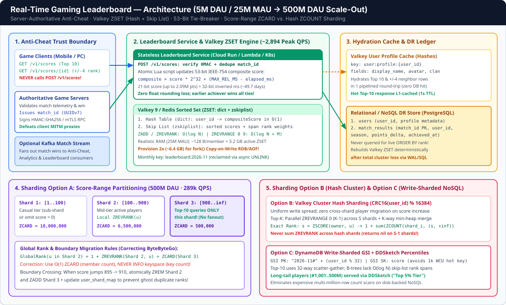
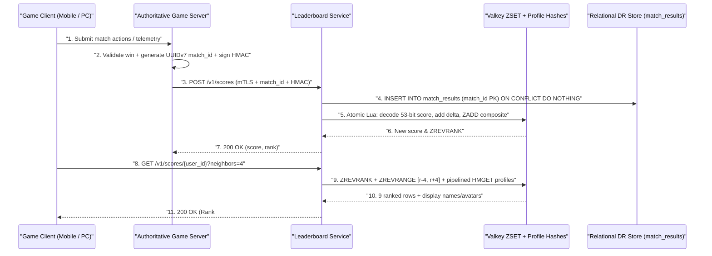
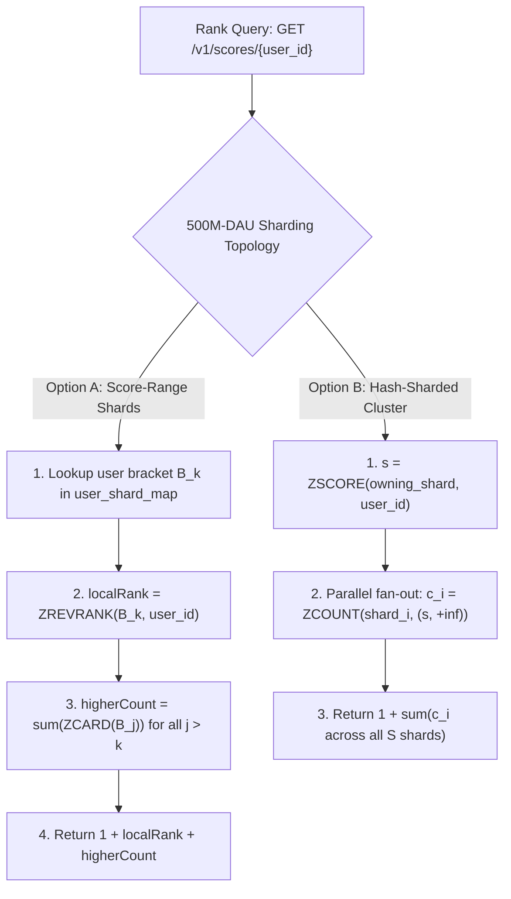
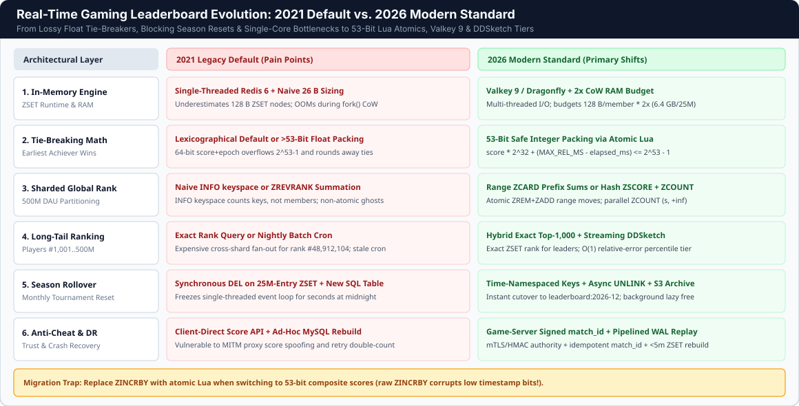

# Module 21 — Real-Time Gaming Leaderboard: Sorted Sets, 53-Bit Tie-Breaking, Sharded Topologies, and Anti-Cheat Ingestion

This module designs a **real-time gaming leaderboard** from first principles — scaling from a `5,000,000 DAU` (`25,000,000 MAU`) mobile tournament to a `500,000,000 DAU` planetary e-sports platform. Following ByteByteGo Chapter 25 (_Real-time Gaming Leaderboard_) and primary computer science and systems literature — William Pugh (1990) on Skip Lists, IEEE 754-2019 Binary64 floating-point arithmetic, Valkey 9 / Redis 8 `zskiplist` + `dict` internal memory allocation, Masson, Rim, and Lee (VLDB 2019) on DDSketch relative-error quantile approximation, and Amazon DynamoDB write-sharded Global Secondary Indexes — we correct two concrete technical bugs in the source textbook (`50M DAU` arithmetic slip and `INFO keyspace` vs. `ZCARD`), replace naive `26-byte` payload memory math with a realistic `128 B/member` + `2x` `fork()` Copy-on-Write capacity model, formalize 53-bit lossless integer tie-breaking, compare Score-Range Sharding against Hash Sharding and Write-Sharded NoSQL, and enforce a server-authoritative anti-cheat ingestion boundary.

> [!NOTE]
> **Knowledge Ownership & Cross-Links.** This module owns end-to-end real-time leaderboard architecture, realistic Valkey/Redis ZSET memory and Copy-on-Write sizing, 53-bit IEEE-754 composite tie-breaking, score-range (`ZCARD` prefix sum + boundary migration) vs. hash-sharded (`ZSCORE` + parallel `ZCOUNT`) vs. write-sharded DynamoDB GSI + DDSketch ranking topologies, and anti-cheat score ingestion. For the introductory survey of specialized components and Count-Min Sketch heavy hitters, see [Module 09](09-search-geospatial-and-specialized-components.md). For low-level Redis/Valkey `listpack` vs. `skiplist` memory encodings and the Redis/Valkey compatibility matrix, see [`technologies/redis/README.md`](../../../technologies/redis/README.md). For formal Skip List probabilistic height and $O(\log N)$ traversal proofs, see [`algorithms/dsa/README.md`](../../../algorithms/dsa/README.md). For user-profile cache invalidation and hot-key stampede defenses, see [Module 05](05-caching-strategies-and-invalidation.md).

---

## 1. Requirements, Capacity Estimation, and Realistic ZSET Memory Sizing

### 1.1 Functional & Non-Functional Scope

A competitive gaming tournament leaderboard must support high-frequency score writes alongside instant global and relative rank reads:

- **Core Ranking Queries & Mutations**:
  1. **Score Update (`POST /v1/scores`)**: Award points when a player wins a match (`+1` or `+points_delta`), reflecting the new rank in real time (`< 100 ms`).
  2. **Global Top 10 (`GET /v1/scores?limit=10`)**: Render the top 10 players globally with their current rank, score, display name, avatar, and clan badge.
  3. **Player Specific Rank & Neighborhood (`GET /v1/scores/{user_id}?neighbors=4`)**: Return the querying user's exact global rank (e.g., `#361` out of `25,000,000`) plus the **`4` players immediately above and `4` players immediately below** (`Ranks 357..365`, `9` rows total).
  4. **Monthly Tournament Seasons**: Each calendar month (`leaderboard:2026-11`) starts a fresh tournament at UTC midnight while archiving completed seasons to historical storage.
  5. **Deterministic Tie-Breaking**: When two players hold identical match points, the player who **achieved that score earlier** (`smaller timestamp`) ranks strictly higher.
- **Non-Functional Requirements**:
  - **Real-Time Consistency**: Sub-second score reflection; hourly or nightly batch ranking jobs are unacceptable for live tournaments.
  - **Anti-Cheat Integrity**: Clients must never be able to spoof or replay score updates via man-in-the-middle (MITM) proxies.
  - **Scale & High Availability**: Support `5M DAU / 25M MAU` on day one and scale horizontally to `500M DAU` (`100x`) with `99.99%` availability and deterministic disaster recovery rebuilds.

### 1.2 Back-of-the-Envelope Throughput & Correcting the Textbook's `50M DAU` Slip

> [!IMPORTANT]
> **Correcting ByteByteGo Chapter 25's QPS Arithmetic Slip.** In Step 1 of ByteByteGo Chapter 25, the scope is explicitly defined as **`5 million DAU` and `25 million MAU`**, with each player averaging `10` matches/day. Seven lines later, the back-of-the-envelope section accidentally writes: _"With 50mil DAU... we'd have an average of 50 users per second"_ (`5,000,000 / 10^5 = 50`, mislabeled as `50mil DAU`). Below are the exact numbers for the baseline `5M DAU / 25M MAU` tier alongside the `100x` (`500M DAU`) scale-out tier:

- **Baseline Tier (`5,000,000 DAU` / `25,000,000 MAU`, `10` matches/day, `5x` diurnal peak)**:
  - **Active Players/sec**: $\frac{5{,}000{,}000}{86{,}400\text{ s}} \approx \mathbf{57.87\text{ users/s}}$ (`~50 users/s` using the $10^5\text{ s/day}$ shortcut; `5x` peak = **`289.35 users/s`** exact / `~250 users/s` rounded).
  - **Score Update Write QPS**: Each active player plays `10` matches/day ($5 \times 10^7\text{ matches/day}$): $\text{Write QPS}_{\text{avg}} = \frac{50{,}000{,}000}{86{,}400} \approx \mathbf{578.70\text{ QPS}} \quad (\approx 500\text{ QPS rounded}), \qquad \text{Write QPS}_{\text{peak}} = 578.70 \times 5 \approx \mathbf{2{,}893.5\text{ QPS}} \quad (\approx 2{,}500\text{ QPS rounded})$
  - **Leaderboard Read QPS**: If a player opens the leaderboard once per day (`~58 QPS` avg, `~289 QPS` peak) or after every match end screen (`~579 QPS` avg, `~2,894 QPS` peak), a single Valkey/Redis primary (`~80,000–120,000 ops/s` per core) handles the combined `~5,787 ops/s` peak read+write load with `~14x–21x` CPU headroom (`~28x–41x` over peak writes alone).
- **Planetary `100x` Write-Throughput Scale-Out Tier (`500,000,000 DAU` / `500,000,000+` active seasonal members)**:
  - $\text{Write QPS}_{\text{avg}} \approx \mathbf{57{,}870\text{ QPS}}$, and $\text{Write QPS}_{\text{peak}} \approx \mathbf{289{,}352\text{ QPS}}$ (`~250,000 QPS` rounded).
  - Because `~289k` atomic ZSET updates/sec and `~64.0 GB` of active ZSET state (`128.0 GB` with `2x` `fork()` CoW headroom) exceed a single Valkey primary, planetary scale requires **multi-shard partitioning** (Section 4).

### 1.3 Realistic Valkey / Redis ZSET Memory Sizing (`128 B/member` + `2x` Copy-on-Write)

ByteByteGo Chapter 25 estimates memory for `25,000,000 MAU` by summing `24-byte user_id + 2-byte score = 26 bytes × 25M = 650 MB`. In production, provisioning a `1 GB` Redis instance for `25M` ZSET members will **crash with `OOM` immediately**:

1. **Real 64-Bit `OBJ_ENCODING_SKIPLIST` Per-Member Overhead (`~128 Bytes/Member`)**:
   - Once a Sorted Set exceeds `zset-max-listpack-entries` (default `128`), Valkey/Redis indexes every member in **two concurrent data structures** (`dict` hash table + `zskiplist` skip list):
   - **Hash Table Entry (`dictEntry` + bucket slot)**: `24 B` struct (`key`, `v.val`, `next` pointers) + `8 B` hash table array slot = **`32 B`**.
   - **Skip-List Node (`zskiplistNode`)**: `32 B` base struct (`ele` pointer, `8-byte` IEEE-754 `double` score — never a 16-bit int! — `backward` pointer) + geometric level array (at promotion probability $p = 0.25$, expected levels $= \frac{1}{1 - 0.25} = 1.333$ levels $\times 16\text{ B}$ for `{forward*, span}` $\approx 22\text{ B}$) = **`~54 B`**.
   - **String Allocation (`sds` header + `24 B` user ID + jemalloc arena rounding)**: **`~42 B`**.
   - **Total Per Member**: $32 + 54 + 42 \approx \mathbf{128\text{ bytes/member}}$ (nearly `5x` larger than the naive `26 B` payload sum!).
   - For **`25,000,000 MAU`**: $25{,}000{,}000 \times 128\text{ B} = \mathbf{3.20\text{ GB}}$ of active ZSET RAM.
2. **Mandatory `2x` `fork()` Copy-on-Write (CoW) Snapshot Headroom (`6.40 GB` for `25M MAU`)**:
   - When Valkey/Redis creates an RDB snapshot (`BGSAVE`), rewrites the Append-Only File (`BGREWRITEAOF`), or performs a full replica resync, it calls POSIX `fork()`. Under heavy tournament write traffic (`~2,894 writes/s` mutating skip-list pointers across random memory pages), the Linux kernel duplicates every modified `4 KB` virtual memory page via Copy-on-Write. Provisioning **`2x` active working-set RAM (`~6.40 GB` for `25M MAU`, `~128.0 GB` across shards for `500M` active seasonal members)** is mandatory so snapshots never trigger the Linux OOM-killer.

| Scale Tier | Active Players (`DAU` / Seasonal `MAU`) | Avg / Peak Write QPS | Naive `26 B` Estimate | Real `128 B` Active ZSET | Provisioned RAM (`2x` `fork()` CoW) | Topology Choice |
| --- | --- | --- | :-: | :-: | :-: | --- |
| **Baseline Mobile Game** | `5M DAU` / `25M MAU` | `579` / `2,894 QPS` | `650 MB` | **`3.20 GB`** | **`6.40 GB`** (`16 GB` node) | Single Valkey primary + HA replica |
| **Global E-Sports (`100x` DAU)** | `500M DAU` / `500M+ MAU` | `57.9k` / `289.4k QPS` | `13.0 GB` | **`64.0 GB`** | **`128.0 GB`** (`256 GB` cluster) | `16–32` Score-Range or Hash Shards |

### 1.4 Primary Literature & Specification Matrix

| Source / Specification | Year | Core Mechanism | Why It Matters Here |
| --- | :-: | --- | --- |
| William Pugh — _Skip Lists: A Probabilistic Alternative to Balanced Trees_ (_CACM_) | 1990 | Probabilistic multi-level linked list with geometric level promotion ($p = 1/4$) and $O(\log N)$ search/insert | Augmented with per-edge `span` counters in Redis/Valkey to support $O(\log N)$ rank queries (`ZREVRANK`) |
| **IEEE 754-2019** (`Binary64` Floating-Point Standard) | 2019 | `1` sign bit, `11` exponent bits, `52` explicit (`53` effective) significand bits (`MAX_SAFE_INTEGER = 2^53 - 1`) | Defines the exact `53-bit` ceiling for lossless integer score + timestamp composite tie-breaking |
| **Valkey 9 / Redis 8** `t_zset.c` (`zskiplist` + `dict`) | 2024–2026 | Dual hash-table ($O(1)$ score lookup) + skip-list ($O(\log N)$ rank/range) with multi-threaded I/O | Core in-memory ranking engine; dictates `~128 B/member` footprint and `UNLINK` / CoW operational rules |
| Masson, Rim & Lee — _DDSketch: A Fast and Fully-Mergeable Quantile Sketch with Relative-Error Guarantees_ (VLDB) | 2019 | Logarithmic bucket histogram providing bounded relative error on percentile ranks in $O(1)$ space | Enables fast `"Top 5%"` / `"Top 1%"` percentile badges for long-tail players in NoSQL/sharded leaderboards |
| AWS Builders' Library / DynamoDB Developer Guide — _Write Sharding for Global Secondary Indexes_ | 2022–2026 | Appends `hash(user_id) % S` suffix to GSI partition keys (`season#0..31`) with `score` sort key | Prevents single-partition `1,000 WCU` hot-key throttling on disk-backed NoSQL leaderboards |

---

## 2. High-Level Architecture, API Contracts, and Anti-Cheat Trust Boundaries



### 2.1 Public Read & Internal Write API Contracts

| Endpoint | Method & Route | Caller Scope | Request / Query Parameters | Response & Complexity |
| --- | --- | :-: | --- | --- |
| **Record Match Win** | `POST /v1/scores` | **Internal Game Servers ONLY** (mTLS + HMAC) | `{ "match_id": "uuidv7", "user_id": "u_42", "points_delta": 25, "achieved_at_ms": 1795000120, "signature": "hmac_hex" }` | `200 OK` `{ "user_id": "u_42", "new_score": 1275, "rank": 84 }` ($O(\log N)$) |
| **Fetch Top 10** | `GET /v1/scores?limit=10` | Public Game Clients | `limit` (default `10`, max `100`), `season` (default current `YYYY-MM`) | `200 OK` `{ "data": [{ "user_id", "user_name", "avatar", "rank", "score" }], "total": 10 }` ($O(\log N + K)$) |
| **Fetch User Rank & `±4` Neighbors** | `GET /v1/scores/{user_id}?neighbors=4` | Public Game Clients | `user_id` path param, `neighbors` (default `4` above and `4` below) | `200 OK` `{ "user_info": { "user_id", "score", "rank" }, "neighbors": [...] }` ($O(\log N + 9)$) |

### 2.2 The Anti-Cheat Trust Boundary: Why Game Clients Must Never Call `POST /v1/scores`

> [!CAUTION]
> **Critical Security Failure Mode — Client-Direct Score Updates.** If the mobile or PC game client calls `POST /v1/scores` directly after a match, any attacker running a local TLS-intercepting proxy (Charles Proxy, `mitmproxy`, Frida memory hook) can replay requests or tamper with `"points_delta": 999999` to seize Rank #1 within seconds!

In a secure production topology:

1. **Authoritative Game Server Validation**: The game client sends raw match telemetry / inputs to the **Game Service**. The authoritative Game Server validates the win according to server-side game physics/rules, generates a globally unique **`match_id` (`UUIDv7`)**, signs the payload with an **HMAC-SHA256** key (or calls over mutually authenticated **mTLS** inside the private VPC), and invokes `POST /v1/scores` on the Leaderboard Service.
2. **Idempotent `match_id` Deduplication**: Network retries between the Game Server and Leaderboard Service (or Kafka consumer redeliveries when an optional **Kafka Match-Outcome Topic** fans match wins out to Leaderboard, Anti-Cheat Replay, and Achievement services simultaneously) must never double-increment a player's score. The Leaderboard Service checks `match_id` against `match_results(match_id PRIMARY KEY)` (or a 24h Valkey idempotency set) before executing the score increment.



---

## 3. Storage Engine Evolution: Relational SQL vs. Valkey Sorted Sets and 53-Bit Tie-Breaking

### 3.1 Why Relational Databases Collapse on Real-Time Rank Queries at 25M Rows

Suppose we store a single relational `leaderboard` table (`season_month`, `user_id`, `score`, `updated_at`) with a B-tree index on `(season_month, score DESC, updated_at ASC)`.

- **Writes**: `INSERT INTO leaderboard ... ON CONFLICT (season_month, user_id) DO UPDATE SET score = leaderboard.score + $3` executes in a few milliseconds (`~2,894 QPS` peak is feasible on a tuned PostgreSQL primary).
- **Top 10 Read**: `SELECT user_id, score FROM leaderboard WHERE season_month = '2026-11' ORDER BY score DESC, updated_at ASC LIMIT 10` walks the tip of the descending B-tree index in `< 2 ms`.
- **The Fatal Bottleneck — Arbitrary Player Rank (`#14,820,119` out of `25,000,000`)**: To tell a mid-tier player their exact global rank, SQL must execute either a window function or a correlated count:
  ```sql
  SELECT user_id, score,
         1 + (SELECT COUNT(*) FROM leaderboard lb2
              WHERE lb2.season_month = '2026-11' AND lb2.score > lb1.score) AS rank
  FROM leaderboard lb1
  WHERE lb1.season_month = '2026-11' AND lb1.user_id = $1;
  ```
  Because standard B-trees do **not** store subtree item counts on internal nodes (doing so would turn the root B-tree page into a global write-lock bottleneck on every `INSERT`), counting how many rows exceed `:score` requires an **$O(N)$ index range scan across millions of entries** — taking `500–3,000 ms` per query and melting database CPU at hundreds of concurrent reads/sec!

### 3.2 Valkey / Redis Sorted Sets (`ZSET`) and Pipelined Profile Hydration

A Valkey / Redis **Sorted Set (`ZSET`)** eliminates the $O(N)$ rank scan by combining a hash table (`user_id -> score` in $O(1)$) with a **Skip List (`zskiplist`)** whose forward pointers carry integer **`span` rank weights** (recording how many level-0 nodes each pointer skips over; see [`technologies/redis/README.md`](../../../technologies/redis/README.md)):

| Operation | Valkey / Redis Command | Time Complexity | How Skip-List `span` Weights Execute It |
| --- | --- | :-: | --- |
| **Upsert / Increment Score** | `ZADD` / `ZINCRBY` (or atomic Lua) | $O(\log N)$ | Looks up current score in `dict` ($O(1)$), deletes/reinserts in skip list, and updates `span` counters along the search path ($O(\log N)$) |
| **Fetch Top 10** | `ZREVRANGE leaderboard:2026-11 0 9 WITHSCORES` | $O(\log N + 10)$ | Starts at the tail of the skip list and walks `10` backward level-0 pointers |
| **Fetch Player Exact Rank** | `ZREVRANK leaderboard:2026-11 "u_42"` | $O(\log N)$ | Looks up target score in `dict` ($O(1)$), then descends the skip list from top level, **summing `span` weights** along traversed edges in $\approx 12\text{--}25$ pointer hops! |
| **Fetch `±4` Neighbors** | `ZREVRANGE leaderboard:2026-11 (r-4) (r+4) WITHSCORES` | $O(\log N + 9)$ | Seeks to 0-based index `max(0, r - 4)` via `span` weights in $O(\log N)$ and reads `9` contiguous nodes |

**Hydrating Player Profiles Without SQL Joins**: Because the ZSET stores only `user_id` and `compositeScore`, the Leaderboard Service maintains a separate Valkey Hash per active user (`user:profile:{user_id}` $\to$ `{ display_name, avatar_url, country }`, populated on login/profile edit per [Module 05](05-caching-strategies-and-invalidation.md)). After fetching `10` (or `9` neighbor) `user_id`s from the ZSET, a single pipelined `HMGET` / `MGET` batch hydrates all display metadata in `< 0.5 ms` without touching the relational database.

### 3.3 Deterministic Tie-Breaking Within IEEE 754 53-Bit Safe Integer Precision

By default, when two members in a Valkey/Redis ZSET share the exact same score (`1500`), `ZREVRANGE` orders them in **reverse lexicographical order by `user_id`** (`"user_99"` ranks above `"user_01"` regardless of who won first!). To enforce **earliest achiever wins ties**, we pack both the integer `score` and an **inverted relative timestamp** into the ZSET's 64-bit IEEE-754 `double` score.

> [!WARNING]
> **The 53-Bit IEEE-754 Precision Trap (`Number.MAX_SAFE_INTEGER = 2^53 - 1`).** Every Valkey/Redis ZSET score is stored as an IEEE-754 double-precision float (`binary64`), which has `1` sign bit, `11` exponent bits, and **`53` bits of exact integer significand** ($2^{53} - 1 = 9{,}007{,}199{,}254{,}740{,}991$). If an engineer attempts to pack a 32-bit score and a 41-bit millisecond Unix epoch timestamp (`73` bits) or shifts `(score << 32) + epochSeconds` (`64` bits), any value exceeding $2^{53} - 1$ suffers **silent ULP rounding** in the low-order bits — collapsing distinct timestamps into the exact same float and corrupting tie-breaking!

To guarantee **zero floating-point rounding loss** across an entire monthly tournament season:

1. **Bit Budget (`21 + 32 = 53` Bits Exactly)**:
   - **High `21` bits for integer `score`**: Supports scores from `0` up to $2^{21} - 1 = \mathbf{2{,}097{,}151}$ points per monthly season.
   - **Low `32` bits for inverted relative milliseconds**: Let $\Delta t_{\text{ms}} = t_{\text{achieved}} - t_{\text{seasonStart}}$. Because $2^{32} - 1 = 4{,}294{,}967{,}295\text{ ms} \approx \mathbf{49.71\text{ days}}$, `32` bits cover an entire 31-day monthly tournament at **1-millisecond resolution**!
   - **Composite Formula**: $\text{compositeScore} = \text{score} \times 2^{32} + \left(2^{32} - 1 - \Delta t_{\text{ms}}\right)$
   - If Alice reaches `1,500` points at $\Delta t = 10{,}000\text{ ms}$ and Bob reaches `1,500` points `5 ms` later at $\Delta t = 10{,}005\text{ ms}$, Alice's low-order tie-breaker ($2^{32} - 1 - 10{,}000$) is strictly greater than Bob's ($2^{32} - 1 - 10{,}005$), so `ZREVRANGE` ranks Alice ahead of Bob deterministically.
   - Dividing by $2^{32}$ (`Math.floor(compositeScore / 4294967296)`) recovers the exact integer `score` (`1500`).
2. **Why Atomic Lua Replaces Raw `ZINCRBY` (and Bit-Budget Comparison with Module 09)**: Calling raw `ZINCRBY lb 25 "u_42"` on a bit-packed composite score adds `25` to the _low-order timestamp bits_ instead of the high-order score bits! Instead, the Leaderboard Service executes an atomic server-side Lua script that reads the current `ZSCORE`, extracts `oldScore = math.floor(cur / 4294967296)`, adds `pointsDelta`, packs the new inverted millisecond timestamp, and writes via `ZADD` (using the same Lua `EVALSHA` pattern introduced in [Module 09 §5.1](09-search-geospatial-and-specialized-components.md#51-redis-sorted-sets-zset-and-composite-tie-breaking), where Module 09 allocates `28-bit score + 25-bit seconds` (`2^25` divisor) for year-long 1-second resolution whereas this monthly tournament schema allocates `21-bit score + 32-bit milliseconds` (`2^32` divisor) for 1-millisecond tie resolution).

Below is the verified 53-bit composite score encoder/decoder (`encodeCompositeScore`, `decodeCompositeScore`) and hash-sharded `ZSCORE + parallel ZCOUNT` rank resolver (`HashShardedLeaderboard.getGlobalRank`) from [`examples/lib/leaderboard-models.ts`](../examples/lib/leaderboard-models.ts):

```typescript
export function encodeCompositeScore(
  score: number,
  achievedAtMs: number,
  seasonStartMs: number,
): number {
  if (!Number.isInteger(score) || score < 0 || score > MAX_SAFE_21_BIT_SCORE) {
    throw new RangeError(`score must be an integer in [0, ${MAX_SAFE_21_BIT_SCORE}]`);
  }
  const elapsedMs = Math.floor(achievedAtMs - seasonStartMs);
  if (elapsedMs < 0 || elapsedMs > MAX_REL_MS) {
    throw new RangeError(`elapsedMs must be in [0, ${MAX_REL_MS}]`);
  }
  const invertedTieBreaker = MAX_REL_MS - elapsedMs;
  return score * TWO_POW_32 + invertedTieBreaker;
}

export function decodeCompositeScore(
  compositeScore: number,
  seasonStartMs: number,
): { score: number; achievedAtMs: number } {
  const score = Math.floor(compositeScore / TWO_POW_32);
  const invertedTieBreaker = compositeScore - score * TWO_POW_32;
  const elapsedMs = MAX_REL_MS - invertedTieBreaker;
  return { score, achievedAtMs: seasonStartMs + elapsedMs };
}
```

---

## 4. Sharding to 500M DAU: Score-Range Partitioning, Hash Sharding, and NoSQL Write Sharding

When traffic scales `100x` to **`500,000,000 DAU`** (`~289,352` peak write QPS and `~64.0 GB` active ZSET state / `~128.0 GB` CoW-provisioned RAM across `500M` active seasonal members), a single Valkey node saturates. We evaluate the three primary horizontal partitioning strategies:

### 4.1 Option A: Score-Range Partitioning (`[1..100)`, `[100..500)`, ..., `[1000..∞)`)

Partition the leaderboard across $B$ independent Valkey ZSET shards by disjoint score brackets, while maintaining a fast secondary lookup map `user_shard_map` (`user_id -> current_bracket_id`):

- **Top 10 Fetch (`Zero Scatter-Gather` in Steady State)**: Because the highest score bracket (`[1000..∞)`) holds all top players once $\ge K$ players reach that bracket, `GET /v1/scores?limit=10` queries **only the top shard** (`ZREVRANGE shard_top 0 9 WITHSCORES`) in $O(\log N_{\text{top}} + 10)$ (spilling sequentially into the next bracket down only at the very start of a season when the top shard holds $< K$ members, as implemented in `RangeShardedLeaderboard.getTopK`)!
- **Player Global Rank & Correcting ByteByteGo's `INFO keyspace` Bug**:
  - To compute the global rank of a player in Shard `[100..500)`, sum their local 0-based rank inside `[100..500)` (`ZREVRANK`) plus the total number of players residing in all strictly higher score shards (`[500..1000)` and `[1000..∞)`): $\text{GlobalRank}(u \in B_k) = 1 + \text{ZREVRANK}(B_k, u) + \sum_{j > k} \text{ZCARD}(B_j)$
  - **Textbook Correction (`ZCARD`, NOT `INFO keyspace`!)**: ByteByteGo Chapter 25 states that the member count of each higher shard is retrieved in $O(1)$ via `INFO keyspace`. In Redis and Valkey, `INFO keyspace` reports the **number of top-level keys in the database** (e.g., `db0:keys=1,expires=0`), **not** how many members are inside a Sorted Set! The true $O(1)$ command that reads a Sorted Set's header cardinality is **`ZCARD <leaderboard_key>`**.
- **Cross-Shard Boundary Migration & Power-Law Skew**:
  - **Ghost Duplicate Hazard**: When a player's score climbs from `95` (Shard `[1..100)`) to `120` (Shard `[100..500)`), the service must **remove (`ZREM`) the player from the old shard**, **insert (`ZADD`) into the new shard**, and update `user_shard_map`. If a partial failure adds the player to Shard 2 without removing them from Shard 1, a **ghost duplicate** remains in Shard 1, inflating `ZCARD(Shard 1)` and shifting the rank of every player in lower shards by `+1`!
  - **Score Distribution Skew**: Player scores follow a steep power law (`80%` of casual players have `< 50` points). Size bracket thresholds logarithmically (`[1..10), [10..50), [50..250), ...`) and never insert `score = 0` accounts until they win their first match.

### 4.2 Option B: Hash Partitioning (Valkey / Redis Cluster `CRC16(user_id) % 16384`)

Partition players uniformly across $S$ Valkey Cluster shards by hashing `user_id` (`shard_idx = hash(user_id) % S`):

- **Write Path (`1` Hop, Zero Migration)**: Every score update for `user_id` routes to the exact same owning shard regardless of how high their score climbs — eliminating `user_shard_map` and cross-shard boundary migrations completely.
- **Top-$K$ Read (`S`-Way Scatter-Gather)**: Fetch `ZREVRANGE shard_i 0 (K-1) WITHSCORES` in parallel across all $S$ shards (cached for `500–1,000 ms` at the API tier so user read bursts never hit the cluster repeatedly) and merge via a $K$-way min-heap in $O(S \cdot K \log S)$.
- **Exact Global Rank via `ZSCORE` + Parallel `ZCOUNT` (Never Sum `ZREVRANK`!)**:
  - As proven in [`examples/lib/leaderboard-models.ts`](../examples/lib/leaderboard-models.ts) (and tested in `Q-SD-050` / `Q-SD-103`), you **cannot** sum `ZREVRANK` across hash shards because `user_id` exists on only **1** shard (`ZREVRANK` returns `nil` on the other $S - 1$ shards!).
  - Instead: (1) fetch `s = ZSCORE owning_shard user_id` in $O(1)$, and (2) dispatch **`ZCOUNT shard_i (s +inf`** in parallel across all $S$ shards (each running in $O(\log N_i)$ via skip-list `span` weights), returning (with reverse-lexicographical tie-break adjustment `otherId > userId` in the rare case where two players share the exact same millisecond composite score $s$, as shown in `HashShardedLeaderboard.getGlobalRank` below): $\text{GlobalRank}(u) = 1 + \sum_{i=0}^{S-1} \text{ZCOUNT}\bigl(\text{shard}_i,\; (s,\; +\infty)\bigr)$

```typescript
  getGlobalRank(userId: string): LeaderboardEntry | null {
    const owningShardIdx = hashUserIdToShard(userId, this.shardCount);
    const compositeScore = this.shards[owningShardIdx]!.get(userId);
    if (compositeScore === undefined) return null;

    let strictlyHigherCount = 0;
    for (const shard of this.shards) {
      for (const [otherId, otherComposite] of shard.entries()) {
        if (otherId === userId) continue;
        if (
          otherComposite > compositeScore ||
          (otherComposite === compositeScore && otherId.localeCompare(userId) > 0)
        ) {
          strictlyHigherCount++;
        }
      }
    }

    const { score } = decodeCompositeScore(compositeScore, this.seasonStartMs);
    return {
      userId,
      score,
      compositeScore,
      rank: 1 + strictlyHigherCount,
    };
  }
```

### 4.3 Option C: NoSQL Write-Sharded GSI (Amazon DynamoDB) + DDSketch Percentiles

When an organization prefers a fully managed disk-backed NoSQL store (Amazon DynamoDB) over managing an in-memory cluster:

1. **Why Unsharded `PK = season_month` Throttles**: Setting the DynamoDB Global Secondary Index (GSI) partition key to `season_month = "2026-11"` and sort key to `score` routes `100%` of the current month's writes to a **single physical DynamoDB partition** (hard-capped at `1,000 WCU/s`), throttling immediately at `2,894 QPS`!
2. **Write Sharding (`season_month#0..31`)**: Append a deterministic shard suffix `shard_id = hash(user_id) % 32` to the GSI partition key (`gsi_pk = "2026-11#" + shard_id`, `gsi_sk = score`). Writes now spread evenly across `32` physical partitions (`32,000 WCU/s`), and fetching the Top 10 performs a `32`-way parallel `Query(Limit=10, ScanIndexForward=false)` scatter-gather.
3. **Why Long-Tail Ranks Use DDSketch / Percentile Tiers**: Because DynamoDB B-trees lack skip-list `span` rank weights, finding the exact rank of a player with `350` points requires scanning millions of items. Production games therefore combine **exact Top-1,000 ranks** (from the 32-way GSI query or a small Top-1,000 Valkey cache) with **streaming percentile ranks (`"Top 5% Tier"`, `"Top 10% Tier"`)** computed via a mergeable **DDSketch** (Masson et al., VLDB 2019) or periodic score-distribution histogram!

| Architecture | Write Path & Scaling | Top-10 Read Latency | Exact Rank `#4,182,901` | Operational Trade-Off |
| --- | --- | --- | --- | --- |
| **Single-Node Valkey ZSET** (`<= 25M MAU`) | $O(\log N)$ (`1` hop, up to `~80k QPS`) | `< 1 ms` (`ZREVRANGE 0 9`) | `< 1 ms` (`ZREVRANK`) | Simplest; bounded by single-node RAM (`~6.4 GB` CoW) and 1 CPU core |
| **Score-Range Sharded ZSET** (`500M DAU`) | $O(\log N_B)$ + atomic cross-shard `ZREM`+`ZADD` on bracket crossing | `< 1 ms` (queries **only** top bracket shard!) | `< 2 ms` (`ZREVRANK` + cached `ZCARD` of higher shards) | Best Top-K efficiency; requires logarithmic brackets and atomic migration guard |
| **Hash-Sharded Valkey Cluster** (`500M DAU`) | $O(\log N_S)$ (`1` hop, uniform load, zero migration) | `2–5 ms` ($S$-way parallel `ZREVRANGE` + L1 cache) | `2–5 ms` (`ZSCORE` + $S$-way parallel `ZCOUNT`) | Zero migration bugs; rank query fans out `ZCOUNT` across $S$ shards |
| **DynamoDB Write-Sharded GSI + DDSketch** | `32` write shards (`32,000+ WCU` auto-managed) | `5–15 ms` (`32`-way parallel GSI scatter-gather) | **Approximate percentile** (`"Top 5%"` via DDSketch) | Serverless disk durability; cannot do $O(\log N)$ exact mid-table rank |



---

## 5. Season Rollover, Disaster Recovery, and Serverless vs. Self-Managed Topologies

### 5.1 Zero-Downtime Monthly Season Rollover and the `UNLINK` Rule

Never create a new SQL table every month (`leaderboard_feb_2021`, `leaderboard_mar_2021`) and never issue a synchronous `DEL` on a 25M-member Valkey ZSET at midnight:

1. **Time-Namespaced ZSET Keys (`leaderboard:YYYY-MM`)**: At `2026-12-01T00:00:00Z`, the Leaderboard Service begins routing new December match writes to `leaderboard:2026-12` (using `seasonStartMs = Date.parse('2026-12-01T00:00:00Z')`), while `leaderboard:2026-11` freezes as read-only for a 15-minute grace window so in-flight November matches finish settling.
2. **Cold Archival & Reward Payout**: A background worker snapshots the final November standings from `leaderboard:2026-11` into relational/Parquet cold storage (`season_archives`) and credits tournament rewards.
3. **Asynchronous `UNLINK` (Never Blocking `DEL`!)**: Freeing `25,000,000` skip-list nodes and hash-table entries synchronously via `DEL leaderboard:2026-11` blocks the single-threaded Valkey command loop for **`1.5 to 4 seconds`**, causing a massive timeout spike on live December matches! Always reclaim old season keys via **`UNLINK leaderboard:2026-11`**, which detaches the key reference in $O(1)$ and frees the `3.2 GB` node graph asynchronously on a background bio thread.

### 5.2 Deterministic Disaster Recovery Rebuild from `match_results` Log

What if a catastrophic multi-AZ failure or operator misconfiguration wipes the entire in-memory Valkey cluster during the final weekend of a tournament? Relying solely on asynchronous RDB snapshots loses minutes of tournament wins. Because every score submission first appends an idempotent record to the authoritative `match_results` table (or durable Kafka topic), we recover deterministically with **`RPO = 0`** and **`RTO < 5 minutes`**:

```sql
-- Deterministic aggregation reconstructing exact 53-bit composite scores from match_results
SELECT user_id,
       SUM(points_delta) AS total_score,
       MAX(achieved_at_ms) AS last_achieved_at_ms
FROM match_results
WHERE season_month = '2026-11'
GROUP BY user_id;
```

Parallel recovery workers stream the aggregated `(user_id, total_score, last_achieved_at_ms)` tuples, compute `encodeCompositeScore(total_score, last_achieved_at_ms, seasonStartMs)`, and load them into the replacement Valkey cluster using `1,000`-command **pipelined `ZADD` batches** (sustaining `~500,000–1,000,000 ZADDs/sec`, rebuilding `25,000,000` players in **`25–50 seconds`**).

```mermaid
flowchart LR
    MS["Authoritative Game Server"] -->|"Signed match_id"| ING["Idempotent Score Ingestor"]
    ING -->|"1. Durable append"| SQL["match_results Log (PostgreSQL / Kafka)"]
    ING -->|"2. Live Lua update"| Z1["Active Season ZSET (leaderboard:2026-11)"]
    Z1 -->|"UTC Month Cutover"| ARC["Archive Final Standings to S3 Parquet"]
    ARC -->|"O(1) non-blocking free"| UNL["Async UNLINK leaderboard:2026-11"]
    SQL -->|"Catastrophic Cluster Loss (DR)"| REP["Parallel Pipelined ZADD Replay (< 60s RTO)"]
    REP --> Z1
```



---

## 6. Production Gotchas, SRE Guardrails, and 2021 vs. 2026 Comparison

### 6.1 Six High-Severity Production Gotchas

1. **Client-Direct Score Updates Exploited by MITM Proxies**: Allowing mobile/PC clients to invoke `POST /v1/scores` directly lets attackers forge arbitrary scores via local HTTPS proxy interception. **Fix**: Restrict `POST /v1/scores` to authoritative Game Servers authenticated via mTLS and HMAC-SHA256 signatures paired with idempotent `match_id` deduplication.
2. **Valkey `fork()` Copy-on-Write OOM Crash at `25M MAU`**: Sizing a node at `1–4 GB` based on naive `26 B × 25M = 650 MB` payload math triggers Linux OOM kills when `BGSAVE` or replica sync forks under write load (`25M × 128 B = 3.2 GB` active $\times 2\text{ CoW} = 6.4\text{ GB}$). **Fix**: Budget `~128 B/member` plus `2x` Copy-on-Write headroom (`maxmemory` capped at `50%–65%` of physical instance RAM).
3. **`> 53-Bit` IEEE-754 Float Rounding Destroying Tie-Breakers**: Bit-packing a 32-bit score and 32-bit epoch timestamp (`64` bits) into a Redis `double` exceeds $2^{53} - 1$, rounding low timestamp bits to zero and scrambling equal-score ties. **Fix**: Pack `21` score bits and `32` inverted relative-millisecond bits (`<= 53` bits total) via an atomic Lua script.
4. **Using `INFO keyspace` Instead of `ZCARD` or Summing `ZREVRANK` Across Shards**: Calling `INFO keyspace` returns the count of database keys (`1`) rather than ZSET members (`ZCARD`), and summing `ZREVRANK` across hash shards fails because `S - 1` shards return `nil`. **Fix**: Use `ZREVRANK + sum(ZCARD of higher shards)` for score-range sharding, and `ZSCORE + sum(parallel ZCOUNT)` for hash sharding.
5. **Ghost Duplicate Players on Score-Range Boundary Crossing**: If a player jumps from Shard `[1..100)` to Shard `[100..500)` and the old shard `ZREM` fails or lags, the player is counted in both shards' `ZCARD`, corrupting global ranks for every player below them. **Fix**: Execute cross-bracket moves via an idempotent transactional saga/outbox and run a continuous background reconciliation sweep checking `sum(ZCARD) == unique_players`.
6. **Synchronous `DEL` Freeze on Monthly Season Rollover**: Running `DEL leaderboard:2026-11` on a 25M-member ZSET blocks the Valkey event loop for several seconds while deallocating 25M skip-list nodes. **Fix**: Always use asynchronous **`UNLINK`** (and enable `lazyfree-lazy-expire yes` / `lazyfree-lazy-server-del yes`).

### 6.2 Quantitative SRE Guardrails

| SLI / Metric | Healthy Target | Page / Action Threshold | Primary Remediation |
| --- | --- | --- | --- |
| **Valkey Memory Usage vs. CoW Ceiling (`used_memory / total_system_memory`)** | `< 50%` (`>= 2x` CoW headroom) | `> 70%` (`fork()` OOM risk!) | Scale instance memory tier or split shards before next RDB/replica snapshot |
| **Score Update End-to-End Reflection Latency** | `p99 < 25 ms` | `p99 > 200 ms` for `3 min` | Inspect Lua script CPU time, slowlog for blocking `DEL`/`ZRANGE`, and network RTT |
| **Range-Shard Ghost Duplicate Count (`sum(ZCARD) - distinct_users`)** | **`0`** (strict invariant) | **`> 0`** | Trigger automated shard-map reconciliation removing stale lower-bracket duplicates |
| **Anti-Cheat Signature / Replay Rejection Rate** | `< 0.01%` (only duplicate retries) | Any `UntrustedScoreSubmissionError` spike | Isolate compromised game server or network segment; audit mTLS/HMAC key rotation |
| **Hash-Shard `ZCOUNT` Scatter-Gather `p99` Latency** | `p99 < 15 ms` | `p99 > 80 ms` | Enable hedged requests across shard replicas and cache hot Top-10 responses (`1s` TTL) |
| **DR Replay Rebuild Time (`25M` Players from `match_results`)** | `< 60 seconds` | `> 5 minutes` in DR drill | Increase parallel replay worker partitions and verify `1,000`-command `ZADD` pipelining |

### 6.3 Technology Comparison: Then vs. Now (2021 vs. 2026)



| Architectural Layer | 2021 Legacy Default | 2026 Modern Standard | Why It Changed & Migration Pitfall |
| --- | --- | --- | --- |
| **In-Memory ZSET Engine** | Single-threaded **Redis 6** + naive `26 B/member` sizing | **Valkey 9 / Dragonfly / Redis 8** (multi-threaded I/O) + **`128 B × 2x` CoW budget** | Multi-threaded network I/O and dictionary prefetching double per-node throughput while `2x` CoW sizing prevents snapshot OOM crashes. |
| **Tie-Breaking Precision** | Reverse-lexicographical default or lossy `> 53-bit` float math | **53-Bit Exact Integer Composite (`21b score + 32b inverted ms`) via Lua** | Preserves exact earliest-achiever tie order inside IEEE-754 `double`; _pitfall:_ replace all raw `ZINCRBY` calls with the atomic Lua updater before migrating keys. |
| **Sharded Global Rank** | Naive `INFO keyspace` or nightly batch SQL rank jobs | **Score-Range `ZCARD` Prefix Sums** or **Hash `ZSCORE` + Parallel `ZCOUNT`** | Delivers real-time exact ranks at `500M DAU`; _pitfall:_ score-range sharding requires idempotent `ZREM` from the old bracket to prevent ghost duplicates. |
| **Long-Tail Ranking (`#1,001..500M`)** | Expensive full-cluster rank query for every casual player | **Hybrid Exact Top-1,000 ZSET + Streaming DDSketch Percentiles (`Top 5%`)** | Cuts cross-shard read fan-out by `> 90%` while giving casual players meaningful tier progression badges in $O(1)$ time. |
| **Season Rollover & Freeing** | Monthly manual SQL DDL (`CREATE TABLE lb_feb`) + blocking `DEL` | **Time-Namespaced Keys (`leaderboard:YYYY-MM`) + Async `UNLINK` + S3 Parquet** | Eliminates midnight event-loop freezes and schema churn; _pitfall:_ ensure `lazyfree-lazy-user-del yes` is set so even accidental `DEL` calls run asynchronously. |
| **Serverless & Cloud Ops** | Self-managed EC2 Redis + Lambda connection-storm exhaustion | **ElastiCache / Memorystore Serverless Valkey + Resp3 Multiplexed Pooling** | Eliminates cold connection storms from serverless compute via persistent multiplexed connections. |
| **Anti-Cheat Ingestion** | Client bearer-token REST score submission | **Authoritative Game Server mTLS / HMAC + `UUIDv7` `match_id` Idempotency** | Blocks client MITM proxy score tampering and network-retry double-counting deterministically. |

**Pitfalls of mixing 2021 and 2026 layers during migration.** The single deadliest migration bug occurs when a team upgrades a live leaderboard from raw integer scores (`ZINCRBY lb 10 user_id`) to **53-bit composite tie-breaking scores** (`score * 2^32 + inverted_ms`) while leaving a single legacy microservice or background job calling raw `ZINCRBY` on the same ZSET key. Because raw `ZINCRBY lb 10` adds `10` to the low-order millisecond tie-breaker bits instead of adding $10 \times 2^{32}$ to the high-order score bits, the player's visible score (`Math.floor(composite / 2^32)`) fails to increase at all! Always cut over to 53-bit composite scores on a **fresh monthly season key** (`leaderboard:2026-12`) after migrating 100% of writers to the atomic Lua update function.

---

## 7. Executable Proof Map

All five quantitative, numerical, sharding, and anti-cheat invariants in this module are verified deterministically in [`examples/15-leaderboard.test.ts`](../examples/15-leaderboard.test.ts) (backed by [`examples/lib/leaderboard-models.ts`](../examples/lib/leaderboard-models.ts)):

| Concept in This Module | Deterministic Test in `15-leaderboard.test.ts` | Verified Invariant / Negative Proof |
| --- | --- | --- |
| **53-Bit IEEE-754 Composite Score Tie-Breaking vs. `> 53-Bit` Precision Collapse** | `encodeCompositeScore`, `decodeCompositeScore`, and `encodeUnsafeOver53BitFloat` (`1,500` points at `10,000 ms` vs `10,005 ms`) | Proves both composites satisfy `Number.isSafeInteger`, ranks the 5 ms earlier achiever strictly higher (`compAlice > compBob`), recovers exact `(score, achievedAtMs)`, and proves `> 53-bit` packing silently rounds away the 5 ms tie-breaker (`unsafeAlice === unsafeBob`). |
| **Hash-Sharded Global Rank (`ZSCORE` + Parallel `ZCOUNT`) & Oracle Equivalence** | `HashShardedLeaderboard` (`8` shards) + `getBrokenLocalRankOnly` + `fast-check` (`100` runs over `50` random updates vs `1`-shard oracle) | Proves `getGlobalRank` via `ZSCORE` + parallel `ZCOUNT` resolves exact global ranks and ties across `8` shards, proves local `ZREVRANK` on the owning shard alone undercounts global rank, and proves 100% equivalence against a single-node oracle for `getTopK(10)` and `getGlobalRank`. |
| **Score-Range Sharding (`ZCARD` Prefix Sums) & Ghost-Duplicate Migration Guard** | `RangeShardedLeaderboard` (`4` brackets: Bronze, Silver, Gold, Diamond) with `skipOldShardRemoveBug: false` vs `true` | Proves `getTopK(2)` queries **only `1` shard** (`tier-diamond`), proves atomic migration (`90 -> 800`) updates `ZCARD` and ranks accurately, and proves omitting `ZREM` on the old shard leaves a ghost duplicate that corrupts lower-tier player ranks. |
| **Server-Authoritative Anti-Cheat HMAC & `match_id` Idempotency** | `IdempotentScoreIngestor` & `signMatchOutcome` (client MITM spoof vs valid server signature + retry) | Proves a forged client-proxy score submission throws `UntrustedScoreSubmissionError` without mutating the leaderboard, while a valid game-server HMAC increments score once and deduplicates retries of the same `matchId`. |
| **5M vs. 500M DAU Capacity & Realistic `128 B × 2x` CoW Memory Sizing** | `estimateLeaderboardSizing` (`5M DAU / 25M MAU` vs `500M DAU / 250M MAU`) | Proves `~57.87` users/s (`~578.70` avg / `~2,893.5` peak write QPS at `5M DAU`; `~289,352` peak write QPS at `500M DAU`), and proves `25M MAU` requires `3.20 GB` active ZSET RAM (`6.40 GB` with `2x` `fork()` CoW headroom) vs naive `650 MB`. |

---

## Interview Drill

### Question 1: Why does a relational database with a B-tree index on `score DESC` struggle to compute an arbitrary player's exact rank (`#14,820,119` out of `25,000,000`), and how does a Valkey/Redis Sorted Set (`ZSET`) solve it in $O(\log N)$?

<details><summary>Answer</summary>

A standard relational B-tree index orders leaf pages by `score DESC`, making `ORDER BY score DESC LIMIT 10` fast, but internal B-tree nodes do **not** store the exact count of child tuples in each subtree (maintaining subtree counts in a B-tree would turn the root page into a global write-serialization bottleneck on every `INSERT` or `UPDATE`). Consequently, finding the rank of a mid-tier player via `SELECT COUNT(*) FROM leaderboard WHERE score > :user_score` or `RANK() OVER (ORDER BY score DESC)` forces the database to scan millions of index entries in **$O(N)$ linear time**.

A Valkey/Redis **Sorted Set (`ZSET`)** pairs an $O(1)$ hash table (`user_id -> score`) with a multi-level **Skip List (`zskiplist`)** in which every forward pointer carries a **`span` counter** recording how many level-0 nodes that pointer skips. When executing `ZREVRANK`, Valkey looks up the user's score in the hash table in $O(1)$ and then traverses the skip list from the top level down to the target node in $O(\log N)$ hops (`~12–25` pointer dereferences for `25M` players), summing the `span` counters of every traversed high-level edge to compute the exact global rank in microseconds.

</details>

### Question 2: Derive the realistic memory footprint of a 25,000,000-player Valkey Sorted Set and explain why provisioning a 1 GB or 3.5 GB node based on ByteByteGo's `650 MB` estimate causes production OOM crashes.

<details><summary>Answer</summary>

ByteByteGo's `650 MB` estimate (`24-byte user_id + 2-byte score = 26 B × 25M`) sums only raw payload bytes and ignores 64-bit pointer, allocator, and dual-index overhead. In Valkey/Redis (`OBJ_ENCODING_SKIPLIST`), every ZSET member is indexed simultaneously in a **hash table** (`dictEntry` `24 B` + hash bucket pointer `8 B` = `32 B`) and a **skip list** (`zskiplistNode` base struct `32 B` with an 8-byte IEEE-754 `double` score + expected $1/(1-0.25) = 1.33$ forward levels $\times 16\text{ B}$ for `{forward*, span}` $\approx 22\text{ B}$ = `54 B`), plus `sds`/`robj` string headers and jemalloc arena rounding (`~42 B`), totaling **`~128 bytes/member`**.

Across `25,000,000 MAU`, the active ZSET consumes $25{,}000{,}000 \times 128\text{ B} = \mathbf{3.20\text{ GB}}$. Furthermore, during an RDB snapshot (`BGSAVE`), AOF rewrite (`BGREWRITEAOF`), or replica full resynchronization, Valkey calls `fork()`. Under continuous tournament score updates (`~2,894 writes/s` mutating skip-list pointers across memory pages), Linux **Copy-on-Write (CoW)** duplicates modified 4 KB pages in the parent process, doubling peak physical memory consumption to **`~6.40 GB`**. A `1 GB` or `3.5 GB` node will be terminated by the Linux kernel OOM-killer during its first background snapshot.

</details>

### Question 3: How do you implement deterministic earliest-achiever tie-breaking inside a Valkey/Redis ZSET without suffering IEEE-754 floating-point rounding bugs?

<details><summary>Answer</summary>

Valkey/Redis ZSET scores are 64-bit IEEE-754 `double` floats (`binary64`), which provide **`53` bits of exact integer significand precision** (`Number.MAX_SAFE_INTEGER = 2^53 - 1 = 9,007,199,254,740,991`). If you shift a 32-bit score by 32 bits and add a 32-bit epoch timestamp (`64` bits total), any value above $2^{53} - 1$ rounds away the least-significant timestamp bits, causing equal-score players who finished milliseconds or seconds apart to collapse onto the exact same float and fall back to arbitrary reverse-lexicographical `user_id` ordering.

To stay strictly inside `53` exact integer bits across a monthly tournament:

1. Allocate the **upper `21` bits** to the integer `score` (`0` to `2,097,151` points) and the **lower `32` bits** to an **inverted relative millisecond offset** from the start of the monthly season: $\text{invertedMs} = (2^{32} - 1) - (t_{\text{achievedMs}} - t_{\text{seasonStartMs}})$, where $2^{32} - 1\text{ ms} \approx 49.71\text{ days}$ covers an entire month at 1-millisecond precision.
2. Compute $\text{compositeScore} = \text{score} \times 2^{32} + \text{invertedMs} \le 2^{53} - 1$. Earlier achievers have a smaller elapsed time, yielding a larger `invertedMs` and ranking strictly higher, while `Math.floor(compositeScore / 2^32)` recovers the exact integer score.
3. Perform all score increments via an **atomic server-side Lua script** (never raw `ZINCRBY`, which would add points to the low timestamp bits!).

</details>

### Question 4: Compare Score-Range Sharding and Hash Sharding for a 500M-DAU (`~289k` peak write QPS) leaderboard, and identify the textbook error in ByteByteGo's score-range rank formula.

<details><summary>Answer</summary>

Under **Score-Range Sharding**, players are partitioned across shards by score bracket (`[1..100)`, `[100..500)`, ..., `[1000..∞)`), with `user_id -> bracket_id` tracked in a secondary lookup cache:

- **Top 10**: Queries **only the highest non-empty score shard** (`ZREVRANGE top_shard 0 9`) with zero scatter-gather.
- **Global Rank (and Textbook Correction)**: A player's global rank is $1 + \text{ZREVRANK}(\text{local-shard}, u) + \sum_{\text{higher shards}} \text{ZCARD}(\text{shard}_j)$. ByteByteGo Chapter 25 erroneously states that the member count of higher shards is fetched via `INFO keyspace` — in Redis/Valkey, `INFO keyspace` returns the number of **top-level keys** in the database (`db0:keys=1`), not the number of members inside a ZSET! The true $O(1)$ command is **`ZCARD <key>`**.
- **Trade-off**: Score-range sharding requires atomic cross-shard migration (`ZREM` old shard + `ZADD` new shard) whenever a player's score crosses a bracket threshold, plus logarithmic bracket boundaries to avoid power-law skew on the lowest shard.

Under **Hash Sharding (Valkey Cluster `CRC16(user_id) % 16384`)**:

- **Writes**: Route in 1 hop to `hash(user_id) % S` with uniform write load and **zero cross-shard player migration**.
- **Top 10**: Requires an $S$-way parallel `ZREVRANGE 0 9` scatter-gather merged in the service (mitigated by a 1-second L1 cache).
- **Global Rank**: You **cannot** sum `ZREVRANK` across hash shards (because `ZREVRANK` returns `nil` on the $S - 1$ shards that do not hold `user_id`). Instead, fetch `s = ZSCORE(owning_shard, user_id)` in $O(1)$ and sum parallel **`ZCOUNT(shard_i, (s, +inf))`** across all $S$ shards ($O(\log N_i)$ per shard).

</details>

### Question 5: If you build a leaderboard on Amazon DynamoDB instead of Valkey/Redis, why does partitioning the Global Secondary Index (GSI) by `season_month` fail, and how do Write Sharding and DDSketch solve the write and rank bottlenecks?

<details><summary>Answer</summary>

If a DynamoDB GSI uses `PK = season_month` (`"2026-11"`) and `SK = score`, `100%` of score updates for the active month hit a **single physical DynamoDB storage partition**, which is hard-capped at **`1,000 WCU/sec`**. At `2,894` peak write QPS (or `289,000` QPS at `500M DAU`), the hot GSI partition throttles immediately with `ProvisionedThroughputExceededException`.

**Write Sharding** fixes the write bottleneck by appending a deterministic suffix `hash(user_id) % S` (e.g., $S = 32$) to the GSI partition key: `gsi_pk = "2026-11#" + (hash(user_id) % 32)` and `gsi_sk = score`. Writes distribute evenly across `32` partitions (`32,000 WCU/s`), and Top-10 queries perform a parallel 32-way scatter-gather `Query(Limit=10, ScanIndexForward=false)` merged via a min-heap.

Because DynamoDB's B-tree storage lacks skip-list `span` counters, computing an exact mid-table rank (`#4,182,901`) would require scanning millions of items across all 32 GSI partitions. Instead, production games use a hybrid model: serve **exact ranks for the Top 1,000** players, and serve **relative-error percentile tiers (`"Top 5%"`, `"Top 1%"`)** for the remaining 99.9% of players using a streaming **DDSketch** (VLDB 2019) or periodic score-distribution histogram in $O(1)$ lookup time.

</details>

### Question 6: Why must mobile/PC game clients never call `POST /v1/scores` directly, and how does the ingestion pipeline prevent both MITM score tampering and network-retry score inflation?

<details><summary>Answer</summary>

Any request originating from a player's device (iOS, Android, PC) crosses an untrusted environment where the user controls the hardware, memory, and local TLS root certificates. If the game client is permitted to call `POST /v1/scores` directly, a trivial MITM proxy (`mitmproxy`, Charles) or memory hook can forge `"points_delta": 500000` without ever playing a match.

To close this trust boundary:

1. **Server-Authoritative Match Verification**: Only backend **Authoritative Game Servers** (which simulate or verify match telemetry server-side) can emit score updates, calling the Leaderboard Service over private VPC **mTLS** or signing `(match_id, user_id, points_delta, achieved_at_ms)` with a shared **HMAC-SHA256** secret.
2. **Idempotent `match_id` Deduplication**: The Game Server assigns each match a deterministic **`match_id` (`UUIDv7`)**. Before executing the Valkey Lua increment, the Leaderboard Service inserts `match_id` into `match_results(match_id PRIMARY KEY) ON CONFLICT DO NOTHING` (or checks a Valkey idempotency key). If a network timeout causes the Game Server or Kafka consumer to retry the same `match_id`, the duplicate is acknowledged without double-awarding points.

</details>

### Question 7: Walk through a zero-downtime monthly tournament rollover at UTC midnight and explain how you recover the leaderboard in under 60 seconds after a catastrophic total Valkey cluster loss.

<details><summary>Answer</summary>

For **zero-downtime monthly season rollover** at `2026-12-01T00:00:00Z`:

1. Address leaderboards by time-namespaced keys (`leaderboard:2026-11`, `leaderboard:2026-12`). At midnight UTC, new December matches immediately write to `leaderboard:2026-12` (with `seasonStartMs` set to Dec 1 `00:00:00Z`) while `leaderboard:2026-11` remains readable during a short settlement window.
2. A settlement job exports the final Top-N standings and prize allocations from `leaderboard:2026-11` to relational/Parquet cold storage.
3. Reclaim the `3.2 GB` (`25M`-member) November ZSET using asynchronous **`UNLINK leaderboard:2026-11`** — never synchronous `DEL`, which would block the single-threaded Valkey event loop for `1.5–4 seconds` while freeing 25 million skip-list nodes!

For **Disaster Recovery (total Valkey cluster loss)**: Because every verified match win is durably persisted to the `match_results` relational log (or compacted Kafka topic) before updating Valkey, recovery workers execute `SELECT user_id, SUM(points_delta), MAX(achieved_at_ms) FROM match_results WHERE season_month = '2026-11' GROUP BY user_id`, compute the 53-bit composite score for each player, and stream `1,000`-command **pipelined `ZADD` batches** into the replacement Valkey cluster — restoring all `25,000,000` players deterministically in **`25–50 seconds`** with zero lost match points.

</details>
