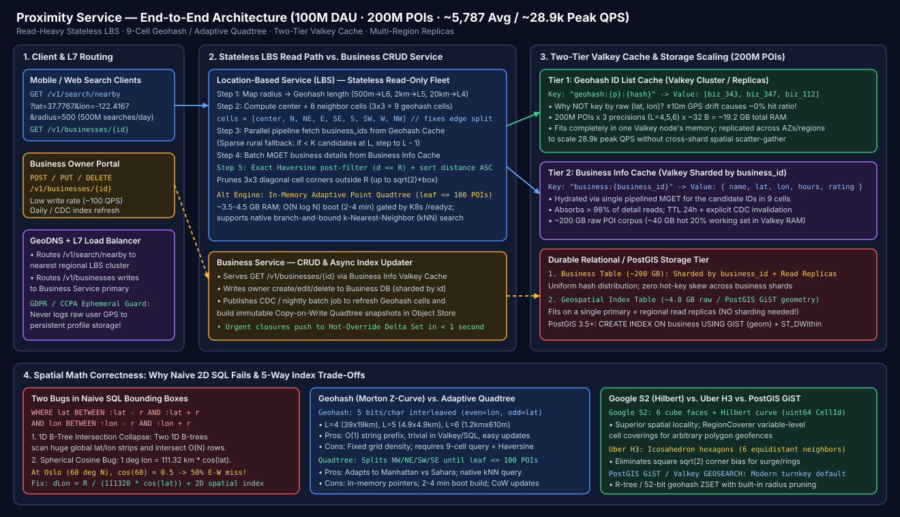
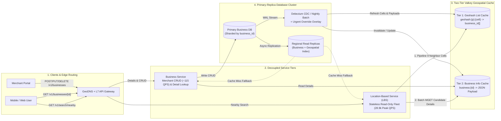
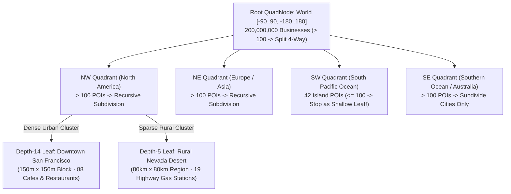
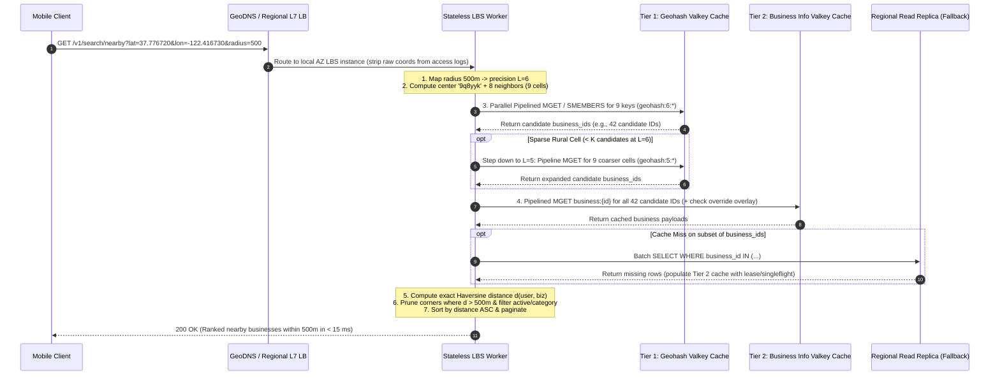
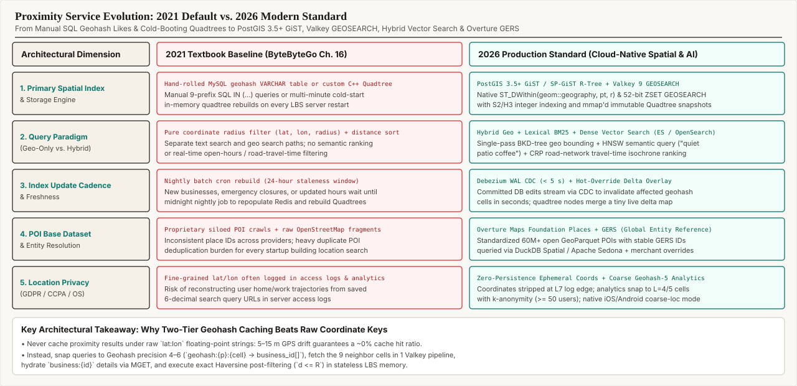

# Module 22: Proximity Service — Spatial Indexing, Geohash vs. Quadtree vs. S2/H3, Two-Tier Geospatial Caching, and Read-Heavy Scaling

A **Proximity Service** powers location-based discovery ("find restaurants, coffee shops, or gas stations within `500 meters` to `20 kilometers` of my current location") for applications such as Yelp, Google Maps Places, Apple Maps, and TripAdvisor. While moving-entity dispatch and location-sharing systems (such as Uber driver tracking and Nearby Friends in [Module 13 §3](13-canonical-designs-realtime-geo-and-streams.md#3-geospatial-dispatch-uber-proximity-service--nearby-friends)) are **write-dominated** (`250,000+` GPS updates/sec), a business proximity service is an asymmetrically **read-dominated** distributed system (`~5,787` average / `~28,935` peak search QPS against `200,000,000` slow-changing Points of Interest).

This module expands **ByteByteGo Chapter 16 (`Proximity Service`)** into a production architecture. We derive the quantitative capacity and memory model (proving why the entire `200M`-POI geospatial index fits inside a single Valkey/replica node's RAM without sharding), expose the **two fatal flaws** in the textbook's naive 2D SQL bounding-box query (`WHERE lat BETWEEN ... AND lon BETWEEN ...`, including the `50%` East-West coverage collapse at `60°N` Oslo/Helsinki when $\cos(\phi)$ is omitted), compare the five spatial indexing paradigms (**Even Grid**, **Geohash**, **In-Memory Point Quadtree**, **Google S2 / Uber H3**, and **PostGIS 3.5+ GiST / Valkey `GEOSEARCH`**), and prove why a **Two-Tier Geohash Cache** (`geohash:{p}:{cell} -> business_id[]` + `business:{id} -> details`) succeeds where raw `(lat, lon)` coordinate caching suffers a near-`0%` hit rate under `±10 m` mobile GPS drift.

> [!NOTE]
> **Cross-Track Knowledge Ownership.** Generic data-structure mechanics of Geohash bit-interleaving, Quadtrees, Google S2, and Uber H3 are introduced in [Module 09 §3](09-search-geospatial-and-specialized-components.md#3-geospatial-indexing-and-the-geohash-boundary-trap), Web Mercator map tile rendering and road-network routing live in [Module 17](17-google-maps.md), and cache stampede defenses (`singleflight`, Memcache leases, XFetch) belong to [Module 05](05-caching-strategies-and-invalidation.md). This module owns the end-to-end **read-heavy POI proximity architecture, spherical bounding-box mathematics, adaptive Quadtree vs. multi-precision Geohash operational trade-offs, two-tier geospatial caching, and GDPR/CCPA location-privacy engineering**.



---

## 1. Requirements, Read-Heavy Workload Economics, and Geospatial Storage Sizing

### 1.1 Functional and Non-Functional Requirements

- **Functional Requirements**:
  1. **Nearby Business Search (`GET /v1/search/nearby`)**: Given a user's `(latitude, longitude)`, a search `radius` (e.g., `500 m`, `1 km`, `2 km`, `5 km`, `20 km`), optional category/open-now filters, and pagination parameters, return matched businesses sorted by distance.
  2. **Business Detail View (`GET /v1/businesses/{id}`)**: Return rich merchant metadata (name, address, phone, opening hours, price tier, rating summary, and CDN photo URLs).
  3. **Business Owner CRUD (`POST`, `PUT`, `DELETE /v1/businesses/{id}`)**: Allow merchants to register, edit, or remove business listings. Updates do **not** require synchronous sub-millisecond global visibility (a nightly batch SLA is specified in the textbook baseline, upgraded in modern production to `< 5 s` Change Data Capture plus an immediate override overlay for emergency closures).
- **Non-Functional Requirements**:
  - **Low Search Latency**: `p50 < 20 ms`, `p99 < 80 ms` end-to-end for nearby queries across dense metropolitan centers.
  - **High Availability & Read Scalability**: `99.99%` search availability across regional failures and diurnal mealtime/commute traffic spikes.
  - **Location Privacy (GDPR Article 5 & CCPA)**: User search coordinates must be treated as ephemeral request state — never persisted in user profile logs or raw access logs that could reconstruct a user's home or workplace trajectory.

### 1.2 Back-of-the-Envelope Throughput & Storage Sizing (`100M DAU`, `200M POIs`)

We anchor our quantitative sizing to ByteByteGo Chapter 16's scale parameters (`100,000,000` DAU, `5` search queries/user/day, `200,000,000` global businesses):

1. **Search Read QPS vs. Business CRUD Write QPS (`> 50:1` to `1,000:1` Asymmetry)**:
   - **Total Daily Searches**: $100{,}000{,}000 \times 5 = 500{,}000{,}000\text{ searches/day}$.
   - **Average Search QPS**: $\text{Search QPS}_{\text{avg}} = \frac{500{,}000{,}000}{86{,}400\text{ s}} \approx \mathbf{5{,}787.04\text{ QPS}} \quad (\approx 5{,}000\text{ QPS textbook mental anchor})$
   - **Peak Search QPS (`5x` diurnal dining/commute rush)**: $\text{Search QPS}_{\text{peak}} = 5{,}787.04 \times 5 \approx \mathbf{28{,}935.19\text{ QPS}}$
   - **Business CRUD Writes**: Even if `1%` of `200M` businesses update hours or details daily ($2{,}000{,}000\text{ writes/day}$), average write throughput is $\frac{2{,}000{,}000}{86{,}400} \approx \mathbf{23.15\text{ writes/s}}$ (`~115 writes/s` peak) — orders of magnitude smaller than read traffic.
2. **Storage Footprint: Why the `business` Table Shards While the Spatial Index Does Not**:
   - **Business Details Table (`200,000,000` rows $\times \approx 1\text{ KB/row}$)**: $200{,}000{,}000 \times 1{,}000\text{ B} = \mathbf{200\text{ GB}}$ Including B-tree primary-key indexes and review/hour projections (`~300–400 GB`), this table is partitioned by `business_id` (or read-replicated) so detail lookups and merchant updates distribute evenly.
   - **Geospatial Index Footprint (`200,000,000` POIs)**: Each index entry stores only `(geohash_6: 6 B, business_id: 8 B, lat/lon float32/64: 8–16 B)` $\approx \mathbf{24\text{ bytes/row}}$ raw: $200{,}000{,}000 \times 24\text{ B} = \mathbf{4.80\text{ GB raw}}$
   - Even when materialized across **all three active Geohash precisions (`L = 4, 5, 6`)** inside a dedicated Tier 1 Valkey/Redis instance using packed 64-bit integer sets (`intset` / `listpack` at `~32 B` per entry including key and allocator headers, or `~24–36 GB` if stored as string `sds` sets), total memory is: $200{,}000{,}000 \times 3 \times 32\text{ B} = \mathbf{19.20\text{ GB RAM}}$
   - And an in-memory **Point Quadtree** storing packed C++/Rust structs `(business_id: 8 B, lat: 4 B float32, lon: 4 B float32)` in contiguous `100`-element leaf arrays consumes only **`~3.5–4.5 GB RAM`** (our TypeScript reference proof in [`examples/lib/proximity-models.ts`](../examples/lib/proximity-models.ts) uses V8 heap objects for readability)!
   - **Architectural Pivot**: Because `19.20 GB` fits inside a dedicated modern `64 GB` Tier 1 Valkey node with `> 3x` headroom (kept separate from the Tier 2 `business:{id}` detail cache cluster), **the geospatial index never needs to be sharded across machines**. We scale the `28,935 QPS` read workload purely via **stateless LBS instances / Valkey read replicas** across regions, avoiding cross-shard spatial scatter-gather entirely!

| Metric / Component | Mathematical Derivation | Exact / Rounded Value | Architectural Consequence |
| --- | --- | :-: | --- |
| **Search Read QPS (Avg / Peak)** | $5 \times 10^8 / 86{,}400$ (`5x` peak) | **`5,787` / `28,935 QPS`** (`~5k` rounded) | Read-dominated; offload 98%+ of reads to in-memory Valkey / Quadtree |
| **Merchant CRUD Write QPS** | `~2M` updates/day $/ 86{,}400$ | **`~23` avg / `~115 QPS` peak** | Decouple CRUD writes from hot search path via async CDC / batch |
| **`business` Metadata Table** | $2 \times 10^8\text{ POIs} \times 1\text{ KB}$ | **`~200 GB`** | Shard by `business_id` + regional read replicas + `business:{id}` cache |
| **Raw Geohash Index Table** | $2 \times 10^8\text{ POIs} \times 24\text{ B}$ | **`4.80 GB`** | Fits on a single relational primary + read replicas (zero sharding) |
| **Multi-Precision Valkey Cache (`L=4,5,6`)** | $2 \times 10^8 \times 3 \times 32\text{ B}$ | **`~19.20 GB`** | Fits in 1 Valkey node's RAM; replicate across AZs/regions for QPS |
| **In-Memory Point Quadtree (`leaf <= 100`)** | $2 \times 10^8 \times 16\text{ B}$ + internal pointers | **`~3.5–4.5 GB`** | Fits in every LBS server's RAM; requires `2–4 min` boot readiness gate |

### 1.3 Primary Literature & Specification Matrix

| Source / Specification | Year | Core Contribution | Role in This Architecture |
| --- | :-: | --- | --- |
| Finkel & Bentley — _Quad Trees: A Data Structure for Retrieval on Composite Keys_ (_Acta Informatica_) | 1974 | Recursive 4-way 2D spatial subdivision adapting depth to local point density | Foundation for the in-memory LBS Point Quadtree (`leaf <= 100`) and best-first $k$-NN traversal |
| Guttman — _R-Trees: A Dynamic Index Structure for Spatial Searching_ (_SIGMOD_) | 1984 | Balanced hierarchy of Minimum Bounding Rectangles (MBRs) on paged disk storage | Backing index structure for PostgreSQL **PostGIS `GiST`** spatial indexes (`ST_DWithin`) |
| Gustavo Niemeyer — _Geohash Specification_ | 2008 | Base-32 interleaved longitude/latitude bitstream along a Z-order (Morton) space-filling curve | Core 1D prefix key (`geohash:{p}:{cell}`) for the Two-Tier Valkey Cache and SQL index |
| Google — _S2 Geometry Library_ (`S2CellId` & `S2RegionCoverer`) | 2011–2026 | Spherical cube-face projection + 64-bit Hilbert curve + multi-level polygon covering | Eliminates polar area distortion and covers arbitrary delivery/geofence polygons in 8–32 `uint64` ranges |
| Uber Engineering — _H3: Hexagonal Hierarchical Spatial Index_ | 2018 | Icosahedron projection tiled with aperture-7 hexagons (`6` equidistant neighbors) | Eliminates the $\sqrt{2}$ diagonal corner distance skew of square Geohash/Quadtree grids |

---

## 2. High-Level Architecture: Decoupling Stateless LBS Read Path from Business CRUD

### 2.1 Why We Separate the Location-Based Service (LBS) from the Business Service

A proximity platform serves two workloads with opposite reliability, state, and scaling profiles. Coupling them inside one monolithic service lets slow merchant database writes or schema migrations degrade `28,935 QPS` of user-facing searches. We split the tier behind the L7 API Gateway into:

1. **Location-Based Service (LBS — Stateless, Read-Only, Latency-Critical)**:
   - Handles `GET /v1/search/nearby` exclusively. Executes **zero database writes**.
   - Translates `(latitude, longitude, radius)` into candidate spatial cells (`9` Geohash neighbor keys or in-memory Quadtree traversal), fetches business IDs and details from the **Two-Tier Valkey Cache**, runs exact Haversine post-filtering and distance sorting, and returns ranked results in `< 20 ms` (`p50`).
2. **Business Service (CRUD + Detail Reads)**:
   - `GET /v1/businesses/{id}` reads directly from the **Business Info Valkey Cache** (`business:{id}`), falling back to a `business` database read replica on cache miss.
   - `POST / PUT / DELETE /v1/businesses/{id}` validates merchant ownership, writes to the `business` Primary Database, and emits an asynchronous change event (via Debezium WAL CDC or daily batch processor) to refresh the affected Geohash cache keys and Quadtree snapshots.



### 2.2 API Contracts

- **Search Nearby Businesses**:
  - `GET /v1/search/nearby?latitude=37.776720&longitude=-122.416730&radius=500&category=coffee&limit=20`
  - **Parameters**: `latitude` ($\in [-90, 90]$), `longitude` ($\in [-180, 180]$), `radius` in meters (default `5000`, mapped to discrete bands `500`, `1000`, `2000`, `5000`, `20000`), optional `category` and `open_now` filters.
  - **Response (`200 OK`)**: `{ "total": 14, "precision_used": 6, "businesses": [{ "business_id": "biz_343", "name": "Blue Bottle", "distance_m": 118.4, "rating": 4.7, "lat": 37.7776, "lon": -122.4159 }] }`.
- **Business CRUD Endpoints**:
  - `GET /v1/businesses/{id}` — Fetch full business profile, hours, photos, and top reviews.
  - `POST /v1/businesses` (with `Idempotency-Key` header) — Register a new business and compute its precision `4..6` Geohash cells.
  - `PUT /v1/businesses/{id}` — Update business attributes or coordinates (if `(lat, lon)` changes, removes `business_id` from old Geohash cell and inserts into new Geohash cell).
  - `DELETE /v1/businesses/{id}` — Soft-delete listing, immediately record in the urgent closure overlay set, and purge from Geohash cell lists via CDC/batch.

---

## 3. Spatial Indexing Deep Dive: Naive 2D SQL, Even Grid, Geohash, Quadtree, and Google S2 / Uber H3

### 3.1 Option 1: Naive Two-Dimensional SQL Bounding Box (And Its Two Fatal Bugs)

The most common interview mistake is querying a relational table directly with two 1D range predicates over `latitude` and `longitude`. ByteByteGo Chapter 16 shows the textbook naive query:

```sql
-- BROKEN NAIVE QUERY (Fails on BOTH B-Tree Index Intersection AND Spherical Cosine Geometry!)
SELECT business_id, latitude, longitude
FROM business
WHERE (latitude BETWEEN :my_lat - :radius AND :my_lat + :radius)
  AND (longitude BETWEEN :my_lon - :radius AND :my_lon + :radius);
```

This query fails in production for **two independent reasons**:

1. **Algorithmic Failure — 1D B-Tree Band Intersection Collapse**:
   - Standard relational B-tree indexes order values in **one dimension**. Even if you create two separate B-tree indexes `idx_lat(latitude)` and `idx_lon(longitude)` (or a composite B-tree `idx_lat_lon(latitude, longitude)`), a range scan on the leading column (`latitude BETWEEN ...`) slices a horizontal strip across the **entire circumference of the Earth** (`360°` of longitude across New York, Madrid, Beijing, and Tokyo), while `longitude BETWEEN ...` slices a pole-to-pole vertical meridian strip from the North Pole to Antarctica!
   - Intersecting two massive 1D sets containing millions of global rows via `BitmapAnd` or linear filtering inside the first range predicate degrades to $O(N_{\text{strip}})$ disk/buffer-pool scans on every search.
2. **Geometric Bug — Omitting Spherical $\cos(\phi)$ Shrinks East-West Search by `50%` at `60°N`**:
   - First, search radius $R$ is given in **meters**, whereas `latitude` and `longitude` are stored in **degrees**.
   - One degree of **latitude** has a nearly constant arc length everywhere on Earth: $\Delta \phi_{\text{deg}} = \frac{R_{\text{meters}}}{111{,}319.49\text{ m/deg}}$
   - However, meridians of **longitude** converge toward the poles! At latitude $\phi$, the radius of the parallel circle is $R_{\text{Earth}} \cdot \cos(\phi)$, so one degree of longitude measures $111{,}319.49 \times \cos(\phi)$ meters. To cover radius $R_{\text{meters}}$ East-West, the required longitude degree delta is: $\Delta \lambda_{\text{deg}} = \frac{R_{\text{meters}}}{111{,}319.49 \times \cos(\phi)}$
   - If a developer uses the same degree delta $\Delta \lambda_{\text{naive}} = \Delta \phi_{\text{deg}}$ for both latitude and longitude, at **Oslo or Helsinki ($\phi = 60^\circ\text{N}$, where $\cos(60^\circ) = 0.5$)**, one degree of longitude is only **`55.66 km`**. The naive query's East-West bounding box covers only **`2.5 km`** instead of **`5.0 km`** — **silently missing `50%` of the East-West search radius** (e.g., failing to return a restaurant `4.0 km` due East on a `5.0 km` search, as proven in Test 3 of [`examples/16-proximity-service.test.ts`](../examples/16-proximity-service.test.ts))!

Below is the verified `boundingBoxDegreeDelta` proof from [`examples/lib/proximity-models.ts`](../examples/lib/proximity-models.ts):

```typescript
export function boundingBoxDegreeDelta(
  latDeg: number,
  radiusMeters: number,
): {
  latDeltaDeg: number;
  lonDeltaDegSpherical: number;
  lonDeltaDegNaive: number;
  naiveEastWestCoverageRatio: number;
} {
  const latDeltaDeg = radiusMeters / METERS_PER_LAT_DEGREE;
  const cosLat = Math.max(1e-6, Math.cos((latDeg * Math.PI) / 180));
  const lonDeltaDegSpherical = radiusMeters / (METERS_PER_LAT_DEGREE * cosLat);
  const lonDeltaDegNaive = latDeltaDeg;
  return {
    latDeltaDeg,
    lonDeltaDegSpherical,
    lonDeltaDegNaive,
    naiveEastWestCoverageRatio: lonDeltaDegNaive / lonDeltaDegSpherical,
  };
}
```

### 3.2 Option 2: Evenly Divided Fixed Grid

Dividing the world into uniform fixed-degree rectangles (e.g., `1° × 1°` or `0.05° × 0.05°` cells) maps 2D coordinates to a single integer `grid_id`, but fails because **human business density follows an extreme power law**: a single grid cell covering Midtown Manhattan or central Tokyo holds `50,000+` businesses, while `10,000` grid cells across the Pacific Ocean or Sahara Desert hold `0` businesses. Fixed uniform grids offer no hierarchical resolution scaling across different search radii (`500 m` vs. `20 km`).

### 3.3 Option 3: Geohash (Morton Z-Order Curve, Precision Mapping & 9-Cell Query)

As detailed in [Module 09 §3.1](09-search-geospatial-and-specialized-components.md#31-geohash-mechanics-and-precision-scaling), **Geohash** recursively bisects longitude $[-180^\circ, 180^\circ]$ (even bits) and latitude $[-90^\circ, 90^\circ]$ (odd bits), encoding every 5 interleaved bits into a base-32 character (`0123456789bcdefghjkmnpqrstuvwxyz`). For a proximity service, Geohash provides a 1D string prefix whose length $L \in \{4, 5, 6\}$ maps directly to the user's requested search radius:

| Geohash Length ($L$) | Total Bits (`Lon / Lat`) | Equatorial Cell Dimensions (`Width × Height`) | Mapped User Search Radius ($R$) | Why This Precision Is Selected |
| :-: | :-: | :-: | :-: | --- |
| **`L = 4`** | `20 bits` (`10 / 10`) | `39.1 km × 19.5 km` | **`5 km – 20 km`** (`> 2,500 m`) | 9 cells cover a metro area (`~117 km × 58.5 km`) for suburban/driving queries |
| **`L = 5`** | `25 bits` (`13 / 12`) | `4.89 km × 4.89 km` | **`1 km – 2.5 km`** (`601..2,500 m`) | 9 cells cover `~14.7 km × 14.7 km`, guaranteeing full enclosure of a `2 km` circle |
| **`L = 6`** | `30 bits` (`15 / 15`) | `1.22 km × 0.61 km` (`609.4 m` height) | **`500 m`** (`<= 600 m`) | Cell height (`609.4 m`) exceeds `500 m`, so `center + 8 neighbors` completely encloses the `500 m` circle |

> [!IMPORTANT]
> **Three Mandatory Engineering Rules for Production Geohash Search:**
>
> 1. **Always Query All 9 Cells (`Center + 8 Neighbors`)**: Two points `20 meters` apart across a Geohash bisection boundary (or across the Equator / Prime Meridian) can share **zero** common prefix characters. Querying only `my_geohash` misses businesses across the street; fetching `[center, N, NE, E, SE, S, SW, W, NW]` guarantees 100% recall of the inscribed circle.
> 2. **Mandatory Exact Haversine Post-Filtering (`d <= R`)**: A $3 \times 3$ grid of precision-6 cells covers a `3.66 km × 1.83 km` rectangle whose diagonal corners lie up to **$\approx 2.05\text{ km}$** from the center — more than **`4x` outside a `500 m` search radius**! As proven in Test 2 of [`examples/16-proximity-service.test.ts`](../examples/16-proximity-service.test.ts), returning all raw candidates from the 9 cells without filtering by `haversineMeters(userLat, userLon, biz.lat, biz.lon) <= radiusMeters` leaks corner false positives (`780 m > 500 m`) into user results.
> 3. **Sparse Rural Precision Step-Down (`L -> L - 1`)**: If a user searches in a rural highway town at precision `L = 6` and the 9 cells return fewer than `minCandidates` (e.g., `< 5` restaurants), the LBS service steps down to precision `L = 5` (expanding the 9-cell search footprint by `~32x` in area) in a second sub-millisecond Valkey pipeline call before filtering and sorting.

### 3.4 Option 4: In-Memory Adaptive Point Quadtree (`leaf <= 100` POIs)

Instead of dividing the globe into fixed-size rectangles at a single precision, a **Point Quadtree** starts with one root bounding box $[-90^\circ, 90^\circ] \times [-180^\circ, 180^\circ]$ and recursively splits any leaf node into four children (`NW`, `NE`, `SW`, `SE`) whenever its business count exceeds $C_{\max} = 100$:



- **Memory Sizing (`~3.5–4.5 GB` for `200M` POIs)**:
  - Each leaf stores a packed array of up to `100` business entries: `(business_id: 8 B, lat: 4 B float32, lon: 4 B float32) = 16 B/POI` $\implies 200{,}000{,}000 \times 16\text{ B} = \mathbf{3.20\text{ GB}}$.
  - With average leaf occupancy `~65 POIs`, there are $\approx 3.08\text{M}$ leaf nodes and $\approx \frac{3.08\text{M}}{3} \approx 1.03\text{M}$ internal nodes (`~48 B` each for bounding box + 4 child pointers $\approx 50\text{ MB}$). The entire global `200M`-POI Quadtree fits in **`~3.5–4.5 GB` of local process RAM** inside every stateless LBS server!
- **Why Quadtree Excels at $k$-Nearest-Neighbor ($k$-NN) Search**:
  - When a user opens a map in a sparse area and asks for _"the `k = 10` closest open gas stations regardless of radius"_, a branch-and-bound traversal visits child quadrants in ascending order of `minDistanceToQuadBoundsMeters(userLat, userLon, child.bounds)` and **prunes any quadrant whose bounding-box minimum distance exceeds the current $k$-th best distance** — returning the exact $k$ nearest businesses without guessing search radii.
- **Operational Hazards of In-Memory Quadtrees (And How to Solve Them)**:
  1. **`O(N log N)` Cold-Start Boot Time (`2–4 Minutes`)**: Inserting `200,000,000` points into a pointer-based Quadtree on pod startup takes `2–4 minutes` of CPU time. During this window, the pod cannot serve traffic.
     - _Mitigation_: Configure a **Kubernetes `startupProbe` / `readinessProbe` (`/readyz`)** that returns `503 Service Unavailable` until the Quadtree is 100% populated (or `mmap` a pre-compiled binary Quadtree snapshot from S3/GCS at boot in `< 10 s`), and enforce a **bounded rolling deployment (`maxUnavailable: 10%`)** so `90%` of the LBS fleet remains hot at all times.
  2. **Live Updates Without Lock Contention**: Mutating tree pointers in place while `28,935 QPS` of read threads traverse the Quadtree requires read-write locks that stall tail latency.
     - _Mitigation_: Keep the active serving Quadtree **immutable**. Buffer intra-day merchant additions/closures in a small concurrent **Hot-Override Delta Map** (`< 50,000` daily mutations checked on every query) and perform a background **Copy-on-Write (CoW) atomic pointer swap** when the nightly/hourly snapshot finishes building.

### 3.5 Option 5: Google S2, Uber H3, PostGIS GiST, and Valkey `GEOSEARCH`

| Spatial Engine | Core Geometry & Space-Filling Curve | Density Adaptation | Update & Build Cost | Polygon / Geofence Support | Best Production Role in Proximity Systems |
| --- | --- | --- | --- | --- | --- |
| **Geohash (`L=4..6`)** | Rectangular lat/lon grid + **Morton Z-order curve** (`base32` string) | Fixed per level (step down `L -> L-1` in rural areas) | **$O(1)$** key insert/delete in Valkey or SQL | Poor (Z-curve jumps across cell boundaries) | **Primary choice for Two-Tier Valkey Cache** (`geohash:{p}:{cell} -> id[]`) |
| **In-Memory Quadtree** | Recursive 4-way 2D rectangles (`leaf <= 100`) | **Automatic** (deep in cities, shallow in deserts) | **$O(N \log N)$ boot** (`2–4 min`); CoW swap + delta overlay | Moderate (bounding-box overlap traversal) | **In-process LBS engine for native $k$-NN** ("find $k$ closest gas stations") |
| **Google S2** | 6 cube faces + **64-bit Hilbert curve** (`uint64 S2CellId`) | Multi-level covering (`min_level..max_level`, `max_cells`) | **$O(1)$** `uint64` cell compute; sequential B-tree/LSM ranges | **Best-in-class** (`S2RegionCoverer` covers irregular polygons) | **Delivery-zone geofencing**, arbitrary polygon containment, Spanner/RocksDB range scans |
| **Uber H3** | Icosahedron tiled with **hexagons** (`res 0..15`) | Fixed per resolution (hierarchical aperture-7) | **$O(1)$** `uint64` cell compute | Good (`polygonToCells` hexagonal tiling) | **Equidistant ring queries (`gridDisk`)**, heatmaps, and travel-time smoothing (zero $\sqrt{2}$ corner bias) |
| **PostGIS 3.5+ `GiST` / Valkey `GEOSEARCH`** | Disk-paged **R-Tree** MBRs (`GiST`) / **52-bit Geohash ZSET** | R-Tree adapts page bounding boxes; ZSET uses 52-bit geohash | **$O(\log N)$** dynamic in-place B-tree/R-tree update | PostGIS supports full OGC `ST_Within` / `ST_DWithin` | **Turnkey 2026 default** for `< 50M` POIs without maintaining custom tree builders |

Below is the verified `GeohashProximityIndex.searchNearby` implementation from [`examples/lib/proximity-models.ts`](../examples/lib/proximity-models.ts), combining 9-cell neighbor expansion, sparse-area precision step-down (`p -> p - 1`), and exact Haversine post-filtering:

```typescript
  searchNearby(options: {
    lat: number;
    lon: number;
    radiusMeters: number;
    minCandidatesBeforeFallback?: number;
    skipHaversinePostFilterBug?: boolean;
  }): {
    results: RankedBusiness[];
    precisionUsed: number;
    cellsQueried: string[];
    rawCandidateCount: number;
  } {
    let precision: number = geohashPrecisionForRadius(options.radiusMeters);
    const minCandidates = options.minCandidatesBeforeFallback ?? 1;

    let cellsQueried: string[] = [];
    const candidateIds = new Set<string>();

    while (precision >= 4) {
      const center = encodeGeohash(options.lat, options.lon, precision);
      cellsQueried = [center, ...geohashNeighbors(center)];
      candidateIds.clear();

      const table = this.bucketsByPrecision.get(precision)!;
      for (const cell of cellsQueried) {
        const ids = table.get(cell);
        if (ids) {
          for (const id of ids) candidateIds.add(id);
        }
      }

      if (candidateIds.size >= minCandidates || precision === 4) {
        break;
      }
      precision -= 1;
    }

    const results: RankedBusiness[] = [];
    for (const id of candidateIds) {
      const biz = this.businesses.get(id)!;
      const distanceMeters = haversineMeters(options.lat, options.lon, biz.lat, biz.lon);
      if (options.skipHaversinePostFilterBug || distanceMeters <= options.radiusMeters) {
        results.push({ business: biz, distanceMeters });
      }
    }

    results.sort(
      (a, b) => a.distanceMeters - b.distanceMeters || a.business.id.localeCompare(b.business.id),
    );

    return {
      results,
      precisionUsed: precision,
      cellsQueried,
      rawCandidateCount: candidateIds.size,
    };
  }
```

---

## 4. Data Schema, Sharding vs. Read Replicas, and Two-Tier Geohash Caching

### 4.1 Relational & PostGIS Schema Design

We store authoritative merchant records in the `business` table and precomputed multi-precision Geohash mappings in `geospatial_index` (supplemented in modern PostgreSQL deployments by a native PostGIS `geography(Point, 4326)` GiST index):

```sql
-- 1. Authoritative Business Metadata Table (~200 GB across 200M businesses)
-- Sharded by business_id (hash partitioning) + regional read replicas
CREATE TABLE business (
    business_id     BIGINT PRIMARY KEY,
    name            VARCHAR(255) NOT NULL,
    category        VARCHAR(64)  NOT NULL,
    latitude        DOUBLE PRECISION NOT NULL,
    longitude       DOUBLE PRECISION NOT NULL,
    address         VARCHAR(512) NOT NULL,
    city            VARCHAR(128) NOT NULL,
    rating_avg      NUMERIC(3, 2) NOT NULL DEFAULT 0.00,
    review_count    INTEGER NOT NULL DEFAULT 0,
    price_tier      SMALLINT NOT NULL DEFAULT 2,
    hours_json      JSONB NOT NULL,
    is_active       BOOLEAN NOT NULL DEFAULT TRUE,
    updated_at      TIMESTAMPTZ NOT NULL DEFAULT NOW()
);

-- 2. Compound Geohash Index Table (~4.8 GB raw for 200M rows)
-- Fits on a single relational instance; scaled horizontally via Read Replicas (NEVER sharded!)
CREATE TABLE geospatial_index (
    geohash_6       CHAR(6) NOT NULL,
    geohash_5       CHAR(5) NOT NULL,
    geohash_4       CHAR(4) NOT NULL,
    business_id     BIGINT  NOT NULL,
    latitude        REAL    NOT NULL,
    longitude       REAL    NOT NULL,
    category        VARCHAR(64) NOT NULL,
    PRIMARY KEY (geohash_6, business_id)
);

CREATE INDEX idx_geo_hash5 ON geospatial_index (geohash_5);
CREATE INDEX idx_geo_hash4 ON geospatial_index (geohash_4);

-- 3. Modern 2026 PostGIS 3.5+ Alternative (for direct SQL spatial fallback / spatial joins)
-- CREATE INDEX idx_business_gist ON business USING GIST (ST_SetSRID(ST_MakePoint(longitude, latitude), 4326)::geography);
```

- **Why `geospatial_index` Uses Compound `(geohash_6, business_id)` Rows Instead of a JSON Array Column**:
  - Storing `business_id` as one row per business (`(geohash_6, business_id)` primary key) rather than packing a comma-separated list or JSON blob of `10,000` IDs into a single `geohash` row eliminates **row-lock contention and read-modify-write overwrite races** when adding or deleting a single business: adding a cafe executes a lock-free `INSERT INTO geospatial_index ... ON CONFLICT DO NOTHING`, and removing it executes `DELETE FROM geospatial_index WHERE geohash_6 = :h AND business_id = :id`.
- **Why We Shard `business` by `business_id` But Use Read Replicas for `geospatial_index`**:
  - The `business` table (`~200 GB` + reviews/photos metadata) is queried and mutated by primary key (`business_id`). Sharding by `hash(business_id) % N` distributes storage and merchant writes uniformly with zero hot shards.
  - Conversely, `geospatial_index` is only `4.8 GB` raw. Sharding it by `geohash` prefix creates severe **Mandelbrot urban hot-shard skew** (the Manhattan/Tokyo shard receives `100x` the traffic of an ocean shard) and forces cross-shard fan-out whenever a 9-cell query straddles shard boundaries. Because `4.8 GB` fits entirely in RAM on every replica, deploying **regional read replicas** scales read QPS linearly with zero cross-shard network hops!

### 4.2 Two-Tier Geohash Caching: Why Raw `(lat, lon)` Cache Keys Fail (`~0%` Hit Ratio)

> [!CAUTION]
> **The Raw Coordinate Cache Key Trap.** A naive engineer caches search responses under `nearby:{latitude}:{longitude}:{radius}` (e.g., `nearby:37.776720:-122.416730:500`). This design suffers a **`~0%` cache hit rate** in production for two reasons:
>
> 1. **Mobile GPS Jitter (`±5–15 meters`)**: Even when a user stands motionless on a sidewalk, civilian GNSS multipath reflection causes consecutive fixes to drift in the 4th–6th decimal place (`0.0001° ≈ 11.1 m`, `0.000001° ≈ 0.11 m`), generating a brand-new cache key on every refresh.
> 2. **Pedestrian Movement**: Walking `10 meters` down the block changes the coordinate string even though the set of restaurants inside the `1.22 km × 0.61 km` Geohash cell is identical!

As proven in Test 4 of [`examples/16-proximity-service.test.ts`](../examples/16-proximity-service.test.ts), snapping coordinates into a **Two-Tier Valkey Cache** raises cache hit ratio from **`0%` to `> 95%`**:

| Cache Tier | Valkey Key Pattern | Value Type & Payload | Sizing (`200M` POIs) | TTL & Invalidation Policy |
| --- | --- | --- | :-: | --- |
| **Tier 1: Geohash ID List Cache** | `geohash:{p}:{cell}` (e.g. `geohash:6:9q8yyk`) | Compact list / set of `business_id`s inside that cell (`[343, 347, 112]`) | `3 precisions × 200M × 32 B ≈ 19.2 GB` (fits on 1 node + replicas) | `TTL = 24h` + jitter; updated incrementally by Debezium CDC or rebuilt nightly |
| **Tier 2: Business Info Cache** | `business:{business_id}` (e.g. `business:343`) | Hash / JSON object (`{ name, lat, lon, category, rating, hours, address }`) | `~40 GB` hot `20%` working set (`~200 GB` full catalog across 4 shards) | `TTL = 24h` + jitter; invalidated immediately via CDC when merchant edits listing |

---

## 5. End-to-End Request Lifecycle, Multi-Region Deployment, and Async Update / Privacy Workflows

### 5.1 Step-by-Step Walkthrough of a `500m` Nearby Search Request

When a user in San Francisco searches for coffee shops within `500 meters` (`GET /v1/search/nearby?latitude=37.776720&longitude=-122.416730&radius=500`):



### 5.2 Multi-Region Active-Active Read Deployment & Two-Speed Update Pipeline

- **Multi-Region GeoDNS / Anycast Routing**:
  - Users in North America, Europe, and Asia-Pacific route via GeoDNS / Anycast to their closest regional stack (`us-west`, `eu-central`, `ap-northeast`).
  - Each region hosts its own **Stateless LBS Fleet**, **Tier 1 Geohash Valkey Replicas** (holding the full `~19.2 GB` global index in memory so travellers searching Tokyo restaurants from New York still hit local cache!), **Tier 2 Business Info Valkey Cluster**, and **Regional Relational Read Replicas**.
  - End-to-end search queries execute `100%` within the user's local region (`0` cross-region WAN hops on the read path).
- **Two-Speed Asynchronous Update Pipeline**:
  1. **Standard Merchant Edits (`< 5 Seconds` via Debezium CDC, or Nightly Batch in Textbook Baseline)**: When a business owner updates opening hours or adds a new restaurant, the Business Service commits to the `business` Primary DB. In the 2021 textbook design, a nightly cron job recomputes Geohash lists and pushes them to Redis. In modern 2026 production, a **Debezium WAL CDC consumer** reads the committed row mutation, updates `business:{id}` in Tier 2 Valkey, and executes `SADD` / `SREM` on the affected `geohash:{4..6}:{cell}` keys across regions within `< 5 seconds`.
  2. **Urgent Safety / Emergency Closures (`< 1 Second` Hot-Override Overlay)**: If a restaurant suffers a health/fire closure, waiting for a nightly batch is unacceptable. The Business Service writes the closed `business_id` into a tiny, globally replicated Valkey hash/set (`override:closed_businesses`, `< 10 MB`), which the LBS worker subtracts from candidate sets on every read.

### 5.3 GDPR & CCPA Location-Privacy Engineering

Under **GDPR Article 5 (Data Minimization & Storage Limitation)** and **CCPA/CPRA (Sensitive Personal Information — Precise Geolocation within `1,850 feet`)**, continuous user search coordinates reveal home addresses, medical clinic visits, religious sites, and workplaces:

1. **Zero-Persistence Ephemeral Coordinates on the Search Path**: The L7 Envoy/API Gateway and LBS workers must **scrub `latitude` and `longitude` query parameters from HTTP access logs, distributed traces, and error reports** before writing to disk. The user's exact 6-decimal coordinates exist solely in volatile request stack memory for the `15 ms` duration of the Haversine calculation and are never linked to `user_id` profile storage.
2. **Coarse Geohash-4/5 Truncation + $k$-Anonymity for Demand Analytics**: Product analytics ("which neighborhoods have unmet coffee search demand?") truncate search locations at ingestion time to **Geohash precision 4 or 5** (`~5 km` to `20 km` cells) with no user identifier and drop any cell bucket with fewer than $k = 50$ distinct queries per hour.

---

## 6. Production Gotchas, SRE Guardrails, and 2021 vs. 2026 Comparison

### 6.1 Six High-Severity Production Gotchas

1. **Naive SQL Longitude Degree Bug (`50%` East-West Blindness at `60°N`)**: Applying $\Delta \lambda = R / 111{,}320$ without dividing by $\cos(\phi)$ shrinks East-West bounding boxes by $\cos(\phi)$ (`50%` in Oslo/Helsinki, `66%` in Anchorage/Reykjavik). _Fix_: Always divide longitude degree deltas by $\cos(\phi)$ and rely on 2D spatial indexes (`Geohash`, `Quadtree`, `S2/H3`, or `PostGIS geography`).
2. **Single-Cell Geohash Boundary Blindness**: Querying only `encodeGeohash(lat, lon, p)` misses a coffee shop `10 meters` across the street whenever the user stands near a cell border, the Equator, or the Prime Meridian. _Fix_: Always fetch the `3 × 3` neighborhood (`center + 8 neighbors`).
3. **Unfiltered 9-Cell Diagonal Corner False Positives**: The corners of a $3 \times 3$ Geohash grid extend up to $\sqrt{2}$ times the bounding half-width beyond the inscribed circle (`> 1.5–2.0 km` on a `500 m` precision-6 query). _Fix_: Always compute exact Haversine distance (`d <= radiusMeters`) in LBS memory before ranking.
4. **Raw `(lat, lon)` Cache Keys Destroying Cache Hit Ratio (`~0%` Hits)**: Caching by floating-point coordinate strings turns `±10 m` GPS drift into a `100%` cache miss storm against the backing database. _Fix_: Quantize Tier 1 cache keys by Geohash cell (`geohash:{p}:{cell}`) and cache business details separately in Tier 2 (`business:{id}`).
5. **Simultaneous Quadtree Cold-Start Deployment Outage**: Restarting the LBS fleet during a deploy when each pod needs `2–4 minutes` to build an in-memory `200M`-POI Quadtree drops `100%` of search traffic (or triggers a Kubernetes `livenessProbe` crash-loop if `/livez` waits on the tree build!). _Fix_: Gate traffic on a dedicated Kubernetes `startupProbe` + `readinessProbe` (`/readyz` passes only after the Quadtree root pointer is swapped in), keep `/livez` shallow, or `mmap` pre-built immutable Quadtree snapshot files from object storage.
6. **Hot Metropolitan Cell Cache Stampede**: When `geohash:5:dr5ru` (Midtown Manhattan at 12:00 PM EDT) expires or is invalidated, `5,000` concurrent requests miss simultaneously and hammer the database read replicas. _Fix_: Combine **TTL jitter**, **in-process `singleflight` request coalescing**, **stale-while-revalidate**, and a short `2–5 second` **L1 in-process LRU cache** for the top `1,000` metro cells inside each LBS worker (see [Module 05](05-caching-strategies-and-invalidation.md)).

### 6.2 Quantitative SRE Guardrails

| SLI / Operational Metric | Target SLO / Healthy Band | Alert Threshold & Automated Remediation |
| --- | :-: | --- |
| **Nearby Search Latency (`p50` / `p99`)** | `p50 < 20 ms`, `p99 < 80 ms` | Page at `p99 > 120 ms` over `5m`; check Valkey pipeline latency and L1 metro-cell cache hit rate |
| **Tier 1 Geohash Cache Hit Ratio** | **`>= 98.0%`** | Alert if `< 95%`; verify callers are querying `geohash:{p}:{cell}` (never raw coordinates!) |
| **Tier 2 Business Detail Cache Hit Ratio** | **`>= 95.0%`** | Alert if `< 90%`; verify `singleflight` coalescing and check for bulk CDC invalidation storms |
| **High-Latitude Recall Canary (`60°N` vs Oracle)** | **`100%` exact recall** within radius $R$ | Continuous synthetic canary at `0°`, `45°N`, `60°N`, and `±180°` antimeridian against Haversine oracle |
| **Quadtree Pod Readiness Fraction** | **`>= 90%`** of LBS fleet ready | Enforce `PodDisruptionBudget` (`maxUnavailable: 10%`) and `startupProbe` timeout `>= 300 s` |
| **Access-Log Coordinate Leak Count** | **`0` raw `(lat, lon)` strings** | Automated log-scrubber regex gate; fail CI/CD if raw 5+ decimal coordinates appear in log sinks |

### 6.3 Technology Comparison: Then vs. Now (2021 vs. 2026)



| Architectural Dimension | 2021 Textbook Baseline (ByteByteGo Ch. 16) | 2026 Production Standard (Cloud-Native Spatial & AI) | Why the Industry Shifted |
| --- | --- | --- | --- |
| **Spatial Index Engine** | Hand-rolled MySQL `geohash VARCHAR` table or custom C++ cold-booting Quadtree | **PostGIS 3.5+ `GiST`/`SP-GiST`** + **Valkey 9 `GEOSEARCH`** + `mmap`'d immutable Quadtree / S2 / H3 snapshots | Native 52-bit ZSET `GEOSEARCH` and `mmap` snapshots eliminate custom tree-build downtime |
| **Discovery Query Mode** | Pure radius filter `(lat, lon, radius)` sorted by straight-line distance | **Hybrid Geo + Lexical BM25 + Dense Vector Search** (Elasticsearch / OpenSearch BKD-tree + HNSW) + road isochrones | Users search _"quiet dog-friendly patio coffee"_ ranked by actual walking/driving time (CRP) |
| **Update Freshness** | **Nightly batch cron** (`24-hour` staleness window for hours/closures) | **Debezium WAL CDC (`< 5 s`)** + **`< 1 s` Hot-Override Closure Overlay** + nightly reconciliation | Merchants and diners expect immediate visibility for emergency closures and updated hours |
| **Base POI Dataset** | Proprietary siloed web crawls + fragmented raw OpenStreetMap imports | **Overture Maps Foundation `Places`** (`60M+` open GeoParquet POIs with stable **GERS** IDs) + merchant overrides | Standardized Global Entity Reference System (GERS) IDs unify base POI catalogs across platforms |
| **Location Privacy** | Raw `lat/lon` query params frequently retained in L7 access logs and analytics | **Edge coordinate log scrubbing**, ephemeral in-memory search, and **Geohash-4/5 $k$-anonymous analytics** | Strict GDPR Article 5, CCPA/CPRA Precise Geolocation mandates, and iOS/Android coarse location modes |

---

## 7. Executable Proof Map

All five mathematical and architectural proofs for this module are implemented in [`examples/lib/proximity-models.ts`](../examples/lib/proximity-models.ts) and verified deterministically in [`examples/16-proximity-service.test.ts`](../examples/16-proximity-service.test.ts):

| Proof / Test Case | Implementation Symbol | What It Proves |
| --- | --- | --- |
| **1. Adaptive Point Quadtree & Exact $k$-NN** | `PointQuadtree` (`insert`, `getStats`, `kNearest`) | Dense downtown SF cluster subdivides deeply (`depth >= 10`) while sparse rural Nevada stays shallow (`depth <= 3`), and branch-and-bound `kNearest` matches a brute-force Haversine oracle 100% |
| **2. 9-Cell Geohash, Rural Fallback & Corner Filter** | `GeohashProximityIndex`, `geohashPrecisionForRadius` | Maps `500m -> L=6`, queries `9` neighbor cells, steps down `L=6 -> L=5` in sparse zones, and proves unfiltered cell corners (`780m > 500m`) leak false positives until exact Haversine post-filtering runs |
| **3. Spherical $\cos(\phi)$ Bounding-Box Bug (`60°N`)** | `boundingBoxDegreeDelta`, `haversineMeters` | Negative test at Oslo (`60°N`, $\cos(60^\circ) = 0.5$) proving naive constant-degree SQL misses a restaurant `4.0 km` due East on a `5.0 km` search (`50%` East-West coverage loss) |
| **4. Two-Tier Geohash Cache vs. Raw Coord Jitter** | `TwoTierProximityCache` + `fast-check` Haversine properties | Under `±10 m` mobile GPS jitter across 60 queries, raw `(lat, lon)` caching suffers `0%` hit ratio (`0/60`) while Two-Tier Geohash caching achieves `> 95%` cell hit ratio; `fast-check` proves Haversine metric axioms |
| **5. `100M` DAU & `200M` POI Capacity Model** | `estimateProximityCapacity` | Verifies `5,787.04` avg / `28,935.19` peak QPS, `200 GB` business table, `4.8 GB` raw geohash index, and `19.2 GB` multi-precision Valkey RAM fitting on a single replicated node without sharding |

---

## Interview Drill

### Question 1: Why does a relational database with B-tree indexes on `latitude` and `longitude` fail on `WHERE latitude BETWEEN :lat - :r AND :lat + :r AND longitude BETWEEN :lon - :r AND :lon + :r` — both algorithmically and geometrically?

<details><summary>Model Answer</summary>

1. **Algorithmic Failure (1D B-Tree Band Intersection)**: A B-tree establishes a total order in **one dimension**. A range scan on `latitude BETWEEN ...` selects a horizontal band wrapping `360°` around the entire Earth, while `longitude BETWEEN ...` selects a vertical meridian strip from the North Pole to the South Pole. Intersecting two massive 1D row sets (`BitmapAnd` or filtering the second column inside a composite index range scan) touches millions of out-of-region rows in $O(N_{\text{strip}})$ time instead of pruning locally in 2D.
2. **Geometric Bug (Spherical Longitude Cosine Shrinkage)**: While `1°` of latitude is nearly constant everywhere ($\approx 111.32\text{ km}$), meridians converge toward the poles so `1°` of longitude equals $111.32\text{ km} \times \cos(\phi)$. Using the same degree delta $\Delta \lambda = \Delta \phi = R / 111{,}320$ ignores $\cos(\phi)$: at `60°N` (Oslo/Helsinki), $\cos(60^\circ) = 0.5$, shrinking the East-West search box to **half** the requested radius (`2.5 km` instead of `5.0 km`) and dropping half of all eastern and western businesses.

</details>

### Question 2: Why is it a mistake to shard the `geospatial_index` table or Geohash Valkey tier by `geohash` prefix, while sharding the `business` table by `business_id` is recommended?

<details><summary>Model Answer</summary>

- **`geospatial_index` (`~4.8 GB` raw / `~19.2 GB` in Valkey across precisions 4, 5, 6 for `200M` businesses)**: The entire global spatial index fits comfortably inside a single node's RAM (`64 GB`). Sharding by `geohash` prefix creates extreme **urban hot-partition skew** (a shard holding Manhattan or Tokyo receives `100x` the QPS of rural shards) and forces multi-shard network scatter-gather whenever a 9-cell neighbor query crosses a shard prefix boundary. Scaling via **full in-memory replication (Valkey replicas / regional read replicas)** scales read QPS linearly to `28,935+ QPS` while keeping every 9-cell lookup local to one replica.
- **`business` Metadata Table (`~200 GB` base + reviews/photos)**: Queried and updated by primary key (`business_id`). Sharding by `hash(business_id) % N` distributes storage and merchant CRUD writes uniformly across shards with zero geographic hot-spot skew.

</details>

### Question 3: Walk through the three edge cases of a Geohash-based nearby search (`boundary split`, `corner false positives`, and `sparse rural zones`) and how the LBS worker resolves each one.

<details><summary>Model Answer</summary>

1. **Boundary Split (Zero Shared Prefix Across Cell Edges)**: Two locations `15 meters` apart across a Geohash bisection line (most famously the Equator or Prime Meridian) have completely different Geohash strings. The LBS worker always computes and queries **all 9 cells** (`center + 8 adjacent neighbors`: `N, NE, E, SE, S, SW, W, NW`) at the target precision.
2. **Diagonal Corner False Positives**: A $3 \times 3$ grid of rectangular Geohash cells covers an area whose corners extend well outside the requested radius $R$ (up to $\sim 2\text{ km}$ on a `500 m` precision-6 query). After hydrating candidate coordinates from Tier 2 cache, the LBS worker computes exact **Haversine great-circle distance** for each candidate and drops any point where $d > R$.
3. **Sparse Rural Zones**: In a low-density rural area, all 9 precision-6 cells (`~3.6 km × 1.8 km`) may contain `0` or `1` business. When the union of the 9 cells yields fewer than $K$ candidates, the LBS worker steps down to precision $L - 1$ (`L = 5`, expanding cell dimensions to `4.89 km × 4.89 km`) and queries the coarser 9-cell neighborhood.

</details>

### Question 4: Why does caching search results by raw `(latitude, longitude)` result in a near-`0%` cache hit rate, and how does the Two-Tier Geohash Cache solve it?

<details><summary>Model Answer</summary>

Mobile GPS receivers exhibit **`±5–15 meters` of continuous coordinate drift** even when a user stands still, and walking a few steps changes the 5th and 6th decimal places of `(latitude, longitude)`. Keying a cache by `lat:lon:radius` produces a unique cache miss on almost every request (`~0%` hit rate) and fills cache RAM with un-reusable single-use keys.

The **Two-Tier Geohash Cache** decouples spatial bucketing from entity payloads:

- **Tier 1 (`geohash:{p}:{cell} -> business_id[]`)** quantizes any coordinate inside a precision-6 cell (`1.22 km × 0.61 km`) to the **exact same 6-character key** (e.g., `geohash:6:9q8yyk`). Thousands of users walking around downtown San Francisco hit the exact same 9 cached cell lists (`> 95–98%` hit rate), fetched in a single pipelined `MGET`.
- **Tier 2 (`business:{id} -> JSON details`)** caches each business's metadata once by `business_id`, hydrated via a second pipelined `MGET` so a business appearing in searches across overlapping neighbor cells or precisions (`L = 4, 5, 6`) is stored and invalidated in only one key.

</details>

### Question 5: Compare an in-memory Point Quadtree (`leaf <= 100`) against a Valkey Geohash index for `200M` businesses. What deployment bug will take down a Quadtree-backed LBS fleet if not guarded?

<details><summary>Model Answer</summary>

- **Valkey Geohash Index**: Stateless LBS pods hold zero spatial state locally; they restart in `< 1 second`, and updates require only $O(1)$ `SADD`/`SREM` calls on `geohash:{4..6}:{cell}` keys in Valkey. However, Geohash uses fixed grid sizes per precision level and requires manual precision step-down in sparse areas.
- **In-Memory Point Quadtree**: Adapts leaf size automatically to local density (150 m blocks in Manhattan vs. 80 km leaves in Nevada) and supports native branch-and-bound **$k$-Nearest-Neighbor ($k$-NN)** queries in local process RAM (`~3.5–4.5 GB`) with zero network hops.
- **The Deployment Crash Trap**: Building a `200M`-point Quadtree in memory takes $O(N \log N)$ time (**`2–4 minutes`**). If an engineer deploys a new LBS version without a **`startupProbe` / `readinessProbe` (`/readyz`)** gated on Quadtree build completion and a **`PodDisruptionBudget` (`maxUnavailable: 10%`)**, or couples `/livez` to the tree build, Kubernetes either routes live traffic to uninitialized pods (returning `500` / empty results) or kills pods mid-build in an endless crash loop. Production Quadtree fleets gate `/readyz` on atomic root-pointer initialization, `mmap` pre-built immutable tree snapshots from object storage, and merge intra-day edits via a lightweight Hot-Override Delta Map.

</details>

### Question 6: When should a Staff engineer choose Google S2 or Uber H3 over Geohash for a location-based service?

<details><summary>Model Answer</summary>

- **Choose Google S2** when the service requires **arbitrary polygon geofencing** (e.g., restaurant delivery zones, municipal tax boundaries, or irregular search viewports) or uniform behavior at high latitudes. S2 projects the sphere onto 6 cube faces (avoiding Geohash's polar distortion) and indexes cells along a **64-bit Hilbert curve** (`uint64 S2CellId`) where consecutive integers share physical edges. `S2RegionCoverer` approximates any polygon using a small bounded number (`8–32`) of variable-level `S2CellId` integer ranges, turning complex polygon containment into a few sequential B-tree/RocksDB/Spanner range scans.
- **Choose Uber H3** when the service performs **radial ring expansion (`gridDisk`), spatial smoothing, or density/surge aggregation**. In a square grid (Geohash/Quadtree/S2), diagonal corner neighbors sit $\sqrt{2} \approx 1.414\times$ farther from the center than edge neighbors. H3 tiles an icosahedron with **hexagons**, where all **6 neighbors share an edge at identical center-to-center distance $d$**, making $k$-ring lookups and spatial gradients isotropic.

</details>

### Question 7: How do you design the Proximity Service's logging, analytics, and update pipelines to comply with GDPR Article 5 and CCPA Precise Geolocation rules while supporting immediate emergency venue closures?

<details><summary>Model Answer</summary>

1. **GDPR / CCPA Ephemeral Search Coordinates**: Precise user geolocation (`< 1,850 ft` radius under CPRA) is sensitive personal data. The L7 API Gateway and LBS service strip `latitude` and `longitude` query parameters from all HTTP access logs, error traces, and persistent user-profile tables. Exact coordinates live only in volatile request memory during the `15 ms` Haversine calculation.
2. **$k$-Anonymous Coarse Geohash Analytics**: For product heatmaps, the LBS worker emits an asynchronous counter increment keyed only by **truncated Geohash precision 4 or 5** (`~5–20 km` area) and `hour_bucket` with **zero `user_id` or device fingerprint**, and downstream analytics drop any cell with `< 50` queries/hour ($k$-anonymity).
3. **Two-Speed Closure Updates**: Standard merchant edits flow asynchronously via Debezium CDC (or nightly batch) to update Tier 1 and Tier 2 Valkey keys, while emergency safety closures write directly to a globally replicated **`override:closed_businesses` Valkey set** (`< 1 s` propagation) that LBS workers filter out on every search response.

</details>
