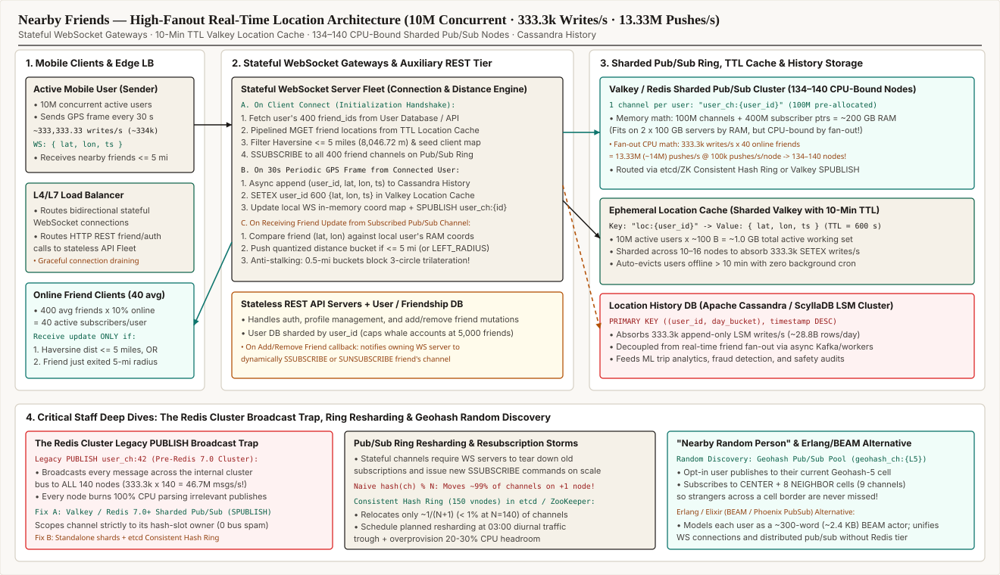
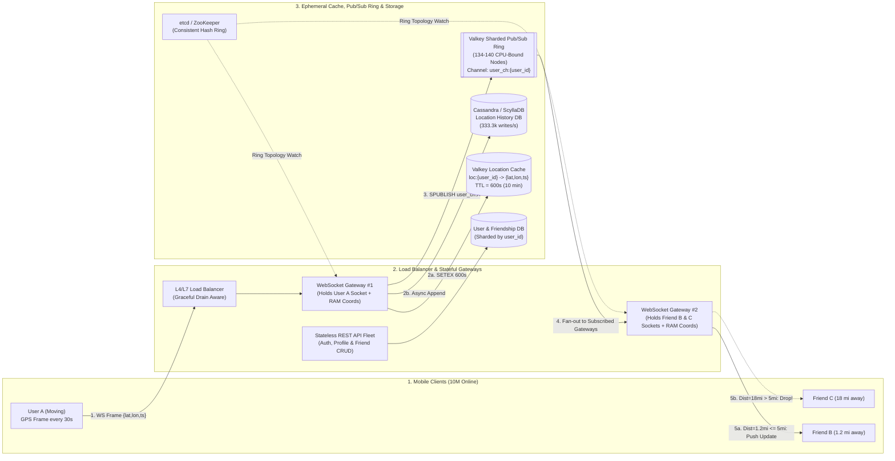
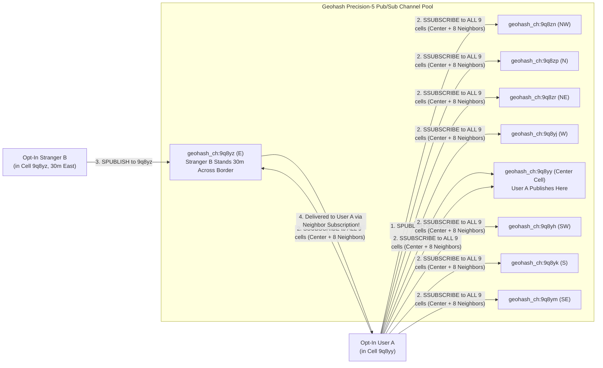
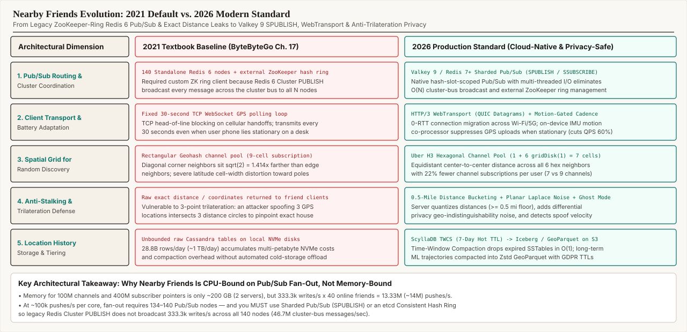

# Module 23: Nearby Friends — Ephemeral Location Sharing, Stateful WebSocket Gateways, High-Fanout Pub/Sub Scaling, and Moving-Target Proximity

A **Nearby Friends** service allows opted-in mobile users to share their real-time GPS coordinates and view friends who are currently within a configurable radius (e.g., **`5 miles` / `8,046.72 meters`**), with distance and timestamp updates pushed every few seconds (as in Find My Friends, Snapchat Snap Map, and Facebook Nearby Friends). At first glance, Nearby Friends sounds identical to the **Proximity Service** in [Module 22](22-proximity-service.md). In reality, their underlying workloads are **architectural opposites**: whereas [Module 22](22-proximity-service.md) searches `200,000,000` **static** business addresses (`~28,935` read QPS, `~115` write QPS), Nearby Friends tracks `10,000,000` **continuously moving** concurrent users transmitting GPS coordinates every `30 seconds` (`~333,333` write QPS) and fans each update out to an average of `40` online friends — generating **`~13,333,333` (`~14M`) real-time push evaluations per second**!

This module expands **ByteByteGo Chapter 17 (`Nearby Friends`)** into a production architecture. We derive the `333.3k -> 13.33M` fan-out amplification math, prove why the Redis/Valkey Pub/Sub tier is **strictly CPU-bound (`134–140` nodes) rather than memory-bound (`2` nodes for `~200 GB`)**, expose the **Legacy Redis Cluster `PUBLISH` Broadcast Trap** ($O(N)$ cluster-bus flooding of `44.7M–46.7M` inter-node messages/sec vs. Redis 7.0+ / Valkey **Sharded Pub/Sub `SPUBLISH` / `SSUBSCRIBE`** and `etcd`-coordinated consistent-hash rings), trace the complete WebSocket connection initialization and 30-second periodic update lifecycles (including `LEFT_RADIUS` boundary-exit notifications and `600-second` TTL presence eviction), and evaluate **"Nearby Random Person" 9-cell Geohash Pub/Sub pools**, **Erlang/Elixir (BEAM) actor topologies**, and **Anti-Trilateration Privacy Defenses** (`0.5-mile` distance bucketing and planar Laplace geo-indistinguishability).

> [!NOTE]
> **Cross-Track Knowledge Ownership.** Static POI geospatial indexing (Geohash, Point Quadtree, S2, H3, PostGIS) belongs to [Module 22](22-proximity-service.md) and [Module 09 §3](09-search-geospatial-and-specialized-components.md#3-geospatial-indexing-and-the-geohash-boundary-trap), ride-hailing driver dispatch locking lives in [Module 13 §3](13-canonical-designs-realtime-geo-and-streams.md#3-geospatial-dispatch-uber-proximity-service--nearby-friends), WebSocket reconnect jitter and Cassandra telemetry batching are covered in [Module 17](17-google-maps.md), consistent-hashing virtual nodes are proved in [Module 06](06-scaling-reads-writes-and-partitioning.md), and Redis/Valkey Pub/Sub internals live in [`technologies/redis`](../../../technologies/redis/README.md). This module owns **high-fanout moving-target location sharing, stateful WebSocket-to-Pub/Sub routing, CPU-bound Pub/Sub cluster sizing and resharding, geohash pub/sub random discovery, and anti-trilateration location privacy**.



---

## 1. Requirements, Moving-Target vs. Static Proximity, and High-Fanout Capacity Math

### 1.1 Functional and Non-Functional Requirements

- **Functional Requirements**:
  1. **Live Nearby Friends List (`<= 5 Miles` / `8,046.72 m`)**: Display all opted-in friends currently within a configurable radius (default `5 miles`), showing each friend's distance and last-updated timestamp, refreshed every few seconds as friends move.
  2. **Automatic 10-Minute Inactive Eviction (`TTL = 600 s`)**: Any friend whose client has not transmitted a location heartbeat within the past `10 minutes` disappears automatically from the nearby list.
  3. **Dynamic Friend Graph Updates & Location History**: Support adding/removing friends dynamically (`<= 5,000` max friends per user, Facebook cap) and persist historical location breadcrumbs for machine learning, trip analytics, and safety features.
  4. **Optional Extension — "Nearby Random Person"**: Allow opt-in users to discover random nearby strangers within their geographic neighborhood without building an $N^2$ all-pairs subscription graph.
- **Non-Functional Requirements**:
  - **Low End-to-End Push Latency**: Sub-second (`p99 < 1–2 s`) delivery from a friend's 30-second GPS heartbeat to their nearby friends' screens.
  - **Eventual Consistency & Ephemeral Tolerance**: Occasional dropped GPS frames over cellular networks are acceptable (the next frame arrives 30 seconds later), provided the service stays highly available (`99.99%`).
  - **Anti-Stalking & Trilateration Resistance**: Prevent a malicious friend from pinpointing a user's exact home or office coordinates via 3-point synthetic GPS trilateration.

### 1.2 Why Static Proximity Indexing (Module 22) Fails for Moving Friends

| Architectural Dimension | Module 22: Static Proximity Service (Yelp / Places) | Module 23: Nearby Friends (Find My / Snap Map) |
| --- | --- | --- |
| **Target Entities** | `200,000,000` static businesses (addresses rarely change) | `10,000,000` concurrently moving users (coordinates change every `30 s`) |
| **Write vs. Read Asymmetry** | **Read-dominated** (`~28,935` search reads/s vs. `~115` merchant writes/s) | **Write & Fan-Out dominated** (`~333,333` GPS writes/s $\to$ `~13.33M` pushes/s) |
| **Communication Protocol** | Stateless HTTP `GET /v1/search/nearby` request-response | **Stateful bidirectional WebSockets** (or HTTP/3 WebTransport) |
| **Routing Mechanism** | Query global 2D spatial index (`Geohash` / `Quadtree` / `PostGIS`) | **Per-user Pub/Sub channel (`user_ch:{user_id}`)** subscribed by online friends |
| **Where Distance Is Filtered** | LBS filters candidate POIs inside the 9 queried Geohash cells | **Recipient's WebSocket Gateway** computes Haversine against its local user's RAM coords |
| **Inactivity Lifecycle** | Businesses remain active until explicitly deleted by merchant | **`TTL = 600 s` (10 min)** auto-expires silent users from Valkey Location Cache |

Why not push `333,333` GPS updates/sec into a single global spatial index (like a Quadtree or PostGIS R-Tree) and have `10,000,000` users poll it? Because `333,333` structural tree mutations/sec would thrash Quadtree/R-Tree locks, AND a Nearby Friends query is **restricted to a user's social graph (`~400` friends)** rather than all strangers on Earth! Publishing each user's location update to their own dedicated **Pub/Sub channel (`user_ch:{user_id}`)** to which only their `~40` currently online friends' WebSocket gateways are subscribed avoids global spatial index contention completely.

### 1.3 Back-of-the-Envelope High-Fanout Math (`333.3k Writes/s -> 13.33M Pushes/s`)

We derive the exact throughput and resource bounds from ByteByteGo Chapter 17's baseline assumptions:

1. **Active Concurrent Users & Ingress Write QPS**:
   - Total registered users: `1,000,000,000` (`1B`).
   - Users using the Nearby Friends feature daily (`10%`): **`100,000,000` (`100M`) DAU**.
   - Concurrent online users at any moment (`10%` of feature DAU): **`10,000,000` (`10M`) concurrent active users**.
   - Location refresh interval: **`30 seconds`** (human walking speed is `~1.4 m/s`, moving only `~42 m` in 30 seconds).
   - **Location Update Write QPS**: $\text{Write QPS} = \frac{10{,}000{,}000\text{ active users}}{30\text{ s}} \approx \mathbf{333{,}333.33\text{ updates/s}} \quad (\approx 334{,}000\text{ QPS rounded})$
2. **Pub/Sub Fan-Out Push Throughput (`40x` Write Amplification)**:
   - Average friends per user: `400` friends (all enrolled in Nearby Friends).
   - Average friends online concurrently (`10%` of `400`): **`40` active online friends per user**.
   - Every incoming location update must be delivered via Pub/Sub to the WebSocket gateways holding those `40` online friends (before the gateway filters by the `5-mile` distance threshold): $\text{Pub/Sub Fan-Out Pushes/s} = 333{,}333.33 \times 40 \approx \mathbf{13{,}333{,}333.33\text{ pushes/s}} \quad (\approx 14{,}000{,}000\text{ pushes/s textbook anchor})$
3. **Location Cache vs. Location History Storage Sizing**:
   - **Valkey Ephemeral Location Cache (`TTL = 600 s`)**: Stores `10,000,000` active users $\times \approx 100\text{ B/entry}$ (`loc:{user_id} -> {lat, lon, ts}` including key/allocator overhead) $= \mathbf{1.0\text{ GB}}$ of active RAM! Even if all `100M` feature DAU visited within a 10-minute window, `100M × 100 B = 10 GB` fits trivially in memory; we shard the Location Cache across **`10–16` Valkey nodes** purely to spread the `333,333` `SETEX` writes/sec (`~21k–33k writes/s/node`).
   - **Location History Database (Cassandra / ScyllaDB)**: $333{,}333.33\text{ writes/s} \times 86{,}400\text{ s/day} = \mathbf{28.80\text{ billion rows/day}}$. At `~36 bytes/row` (`user_id: 8 B, timestamp: 8 B, lat: 8 B, lon: 8 B, metadata: 4 B`), raw daily historical ingress is **`~1.04 TB/day`** (`~378 TB/year` before Zstd compression and Time-Window Compaction expiry).

| Subsystem | Throughput / Capacity Metric | Exact Derivation | Provisioned Fleet Sizing |
| --- | --- | :-: | --- |
| **WebSocket Gateway Fleet** | `10,000,000` persistent sockets + `333.3k` inbound frames/s | `~100,000` open connections/node | **`100–150` Stateful WS Gateways** |
| **Valkey TTL Location Cache** | `10M` active keys (`TTL=600s`), `333.3k` `SETEX`/s | `~1.0 GB` RAM, `~33k` writes/s/shard | **`10–16` Sharded Valkey Nodes** |
| **Valkey Sharded Pub/Sub Tier** | `100M` channels, `400M` subscriber ptrs, **`13.33M` (`~14M`) pushes/s** | `~200 GB` RAM (`2` nodes), **`100k` pushes/s/core** | **`134–140` CPU-Bound Pub/Sub Nodes** |
| **Cassandra / ScyllaDB History** | `333.3k` append-only writes/s (`28.8B` rows/day) | `~1.04 TB/day` raw LSM appends | **`24–36` ScyllaDB / Cassandra Nodes** |

### 1.4 Primary Literature & Specification Matrix

| Source / Specification | Year | Core Mechanism | Why It Matters Here |
| --- | :-: | --- | --- |
| **IETF RFC 6455** (_The WebSocket Protocol_) & **RFC 9220** (_WebTransport over HTTP/3_) | 2011 / 2022 | Full-duplex framed messages over a single persistent TCP or QUIC connection | Bi-directional transport for 30-second client GPS heartbeats and server-pushed friend updates |
| **Redis 7.0 / Valkey 9 Sharded Pub/Sub** (`SPUBLISH` / `SSUBSCRIBE`) | 2022–2026 | Hash-slot-scoped Pub/Sub channel routing (`CRC16(channel) % 16384`) | Eliminates pre-7.0 Redis Cluster's $O(N)$ cluster-bus broadcast storm across 140 Pub/Sub nodes |
| Joe Armstrong — _Making Reliable Distributed Systems in the Presence of Software Errors_ (Erlang / BEAM) | 2003 | Share-nothing lightweight actors (`~300 words` / `~2.4 KB` per process on 64-bit) with preemptive reductions & transparent message passing | Architectural foundation for the distributed Erlang / Elixir (`Phoenix.PubSub`) alternative to Redis Pub/Sub |
| Andrés, Bordenabe, Chatzikokolakis & Palamidessi — _Geo-Indistinguishability: Differential Privacy for Location-Based Systems_ (_ACM CCS_) | 2013 | Planar Laplace mechanism satisfying $P(M(x)=z) \le e^{\epsilon d(x,y)} P(M(y)=z)$ within radius $r$ | Formal cryptographic defense against 3-circle trilateration stalking on shared friend distances |

---

## 2. High-Level Architecture: Stateful WebSocket Gateways, TTL Location Cache, and Pub/Sub Bus

### 2.1 Why Peer-to-Peer Fails and How the Shared Fan-Out Backend Works

A mobile client cannot maintain `400` direct peer-to-peer UDP/TCP sockets to all of its friends' phones: cellular NAT traversal fails frequently, waking the cellular radio `400` times every 30 seconds destroys battery life, and broadcasting your raw IP and GPS coordinate to 400 peers leaks your location even to friends who are 3,000 miles away. Instead, every mobile client maintains **one** persistent encrypted WebSocket connection to a **Stateful WebSocket Gateway**:



### 2.2 Component Responsibilities and Data Models

1. **Stateful WebSocket Gateways**:
   - Hold persistent bidirectional connections with mobile clients.
   - Maintain an **in-process local coordinate map (`wsLocalCoords: Map<user_id, {lat, lon}>`)** for every user currently connected to that gateway instance. Why? When a friend's location update arrives from Redis Pub/Sub (`{friend_id, friend_lat, friend_lon, ts}`), the recipient gateway can compute `haversineMeters(localUser.lat, localUser.lon, friend_lat, friend_lon)` **in local CPU memory in `< 1 microsecond`** without making a network lookup to the Location Cache!
   - Also track `currentlyVisibleFriends: Map<user_id, Set<friend_id>>` so that when a friend who was previously within `<= 5 miles` moves to `5.2 miles`, the gateway emits an explicit **`LEFT_RADIUS` (unpin)** frame to the client instead of silently dropping the update and leaving a frozen zombie pin on the user's map!
2. **Valkey / Redis Ephemeral Location Cache (`TTL = 600 s`)**:
   - Key-value schema: `Key = "loc:{user_id}"`, `Value = "{lat, lon, updated_at_ms}"`, **`TTL = 600 seconds` (10 minutes)**.
   - Serves two critical roles: (a) **Connection Initialization Seeding** (when a user opens the app, the WebSocket gateway runs a single pipelined `MGET` for all `400` friends to immediately display who is nearby right now without waiting up to 30 seconds for their next Pub/Sub heartbeat), and (b) **Zero-Cron Presence Eviction** (if a user closes the app or loses signal, their key expires automatically after 600 seconds).
3. **Location History Database (Apache Cassandra / ScyllaDB)**:
   - Sustaining `333,333` durable row inserts/sec (`28.8B` rows/day) on a single relational B-tree database causes severe random page-split I/O. An LSM-tree wide-column store (Cassandra or ScyllaDB) turns random writes into sequential commit-log and MemTable appends:

```sql
-- Apache Cassandra / ScyllaDB Location History Schema (333.3k writes/s)
CREATE TABLE location_history (
    user_id         BIGINT,
    day_bucket       INT,         -- YYYYMMDD integer bucket prevents unbounded partition growth
    recorded_at     TIMESTAMP,
    latitude        DOUBLE,
    longitude       DOUBLE,
    PRIMARY KEY ((user_id, day_bucket), recorded_at)
) WITH CLUSTERING ORDER BY (recorded_at DESC)
  AND compaction = { 'class': 'TimeWindowCompactionStrategy', 'compaction_window_unit': 'DAYS', 'compaction_window_size': 1 }
  AND default_time_to_live = 2592000; -- 30-day rolling retention
```

---

## 3. End-to-End Lifecycles: Client Initialization, Periodic Location Updates, and Friend Graph Mutations

### 3.1 WebSocket Client Initialization & Periodic 30-Second Update Flow

```mermaid
sequenceDiagram
  autonumber
  participant A as User A Mobile App
  participant WS1 as WS Gateway #1 (User A)
  participant UDB as User / Friend DB
  participant LCache as Valkey Location Cache (TTL=600s)
  participant PS as Valkey Sharded Pub/Sub Ring
  participant WS2 as WS Gateway #2 (Friend B)
  participant B as Friend B Mobile App

  rect rgb(18, 34, 64)
    Note over A,PS: Phase 1: WebSocket Client Initialization (User A Opens App)
    A->>WS1: 1. WSS Connect + Auth Token + Initial {lat_A, lon_A}
    WS1->>UDB: 2. Fetch User A's friend_ids (e.g., 400 friends)
    UDB-->>WS1: Return [friend_1, friend_2, ..., friend_400]
    WS1->>LCache: 3. SETEX loc:A 600 {lat_A, lon_A, ts} + Pipelined MGET loc:friend_1..400
    LCache-->>WS1: Return active non-expired friend locations (e.g., 40 online friends)
    WS1->>PS: 4. SSUBSCRIBE user_ch:{friend_1} .. user_ch:{friend_400} (even offline friends!)
    Note over WS1: 5. Compute Haversine d(A, friend_i) <= 8,046.72m (5 mi)<br/>& quantize to 0.5-mi buckets
    WS1-->>A: 6. Push Initial Nearby Friends Snapshot
  end

  rect rgb(18, 45, 38)
    Note over A,B: Phase 2: Periodic 30-Second Location Heartbeat
    A->>WS1: 7. WS Frame: {lat_A', lon_A', ts}
    WS1->>LCache: 8. SETEX loc:A 600 {lat_A', lon_A', ts} (& async enqueue Cassandra History)
    Note over WS1: 9. Update local RAM wsLocalCoords[A] = {lat_A', lon_A'}
    WS1->>PS: 10. SPUBLISH user_ch:{A} {user_id: A, lat_A', lon_A', ts}
    PS-->>WS2: 11. Deliver message to subscribed WS Gateway #2
    Note over WS2: 12. Read Friend B's RAM coords wsLocalCoords[B]<br/>Compute Haversine d(B, A')<br/>If d <= 5 mi -> NEARBY_UPDATE (0.5-mi bucket)<br/>If d > 5 mi & was visible -> LEFT_RADIUS
    WS2-->>B: 13. Push WS Frame {friend_id: A, bucket_mi: 1.0, ts}
  end
```



> [!IMPORTANT]
> **Why Does Initialization Subscribe to All 400 Friend Channels (Including Currently Offline or Distant Friends)?** During Step 4 of initialization, the WebSocket gateway subscribes to **all `400` friends' Pub/Sub channels**, not just the friends who were online and within 5 miles at connection time! Why?
>
> 1. An offline friend may open their app 2 minutes later; if User A's gateway did not subscribe to `user_ch:{friend}`, User A would never receive that friend's arrival without complex cross-gateway callback signaling.
> 2. An online friend currently `5.3 miles` away may drive `0.4 miles` closer on their next 30-second heartbeat (`4.9 miles`); because User A's gateway is already subscribed to their channel, it immediately detects $d \le 5\text{ miles}$ and pins them on User A's map!

### 3.2 Dynamic Add / Remove Friend Mutations

When User A adds a new friend $F_{\text{new}}$ or unfriends/blocks $F_{\text{old}}$ in the main social app:

1. The mobile app (or the stateless REST Friendship Service via an internal event callback) sends a control message `{ action: "SUBSCRIBE_FRIEND" | "UNSUBSCRIBE_FRIEND", friend_id }` to User A's active WebSocket gateway (and symmetrically to the friend's gateway if online).
2. On **`SUBSCRIBE_FRIEND`**, the WebSocket gateway issues `SSUBSCRIBE user_ch:{F_new}` to the Pub/Sub shard owning $F_{\text{new}}$, fetches `GET loc:{F_new}` from the TTL Location Cache, and if $F_{\text{new}}$ is active and within `5 miles`, immediately pushes their initial pin to User A.
3. On **`UNSUBSCRIBE_FRIEND`**, the WebSocket gateway issues `SUNSUBSCRIBE user_ch:{F_old}` (if no other user connected to that gateway instance is still friends with $F_{\text{old}}$ — reference-counted per gateway!), removes $F_{\text{old}}$ from `currentlyVisibleFriends[A]`, and pushes a `LEFT_RADIUS` removal event to User A's client.

---

## 4. Scaling the Pub/Sub Tier: CPU-Bound vs. Memory-Bound Sizing, Consistent Hashing, and the Redis Cluster Broadcast Trap

### 4.1 Proving the Pub/Sub Tier Is Strictly CPU-Bound (`134–140` Nodes vs. `2` RAM Nodes)

A surface-level estimate sizes Redis Pub/Sub by memory alone and reaches a dangerously wrong conclusion:

1. **Memory Sizing (`~200 GB` -> Only `2` Servers by RAM)**:
   - Pre-allocating `100,000,000` channels (`1` per feature DAU, where an empty channel with no subscribers consumes `~0` bytes and an active channel entry with hash-table and subscriber linked-list pointers consumes `~20 B` base + `~100–500 B` per subscribed WebSocket server pointer across `400M` active friend edges) requires roughly: $100{,}000{,}000\text{ channels} \times 20\text{ B} + 400{,}000{,}000\text{ subscriber pointers} \times 500\text{ B} \approx \mathbf{202\text{ GB RAM}}$
   - By memory alone, two `100 GB` (`r7g.4xlarge`) instances could hold every channel in the world!
2. **CPU & Network Fan-Out Sizing (`13.33M–14M` Pushes/s -> `134–140` Servers by CPU)**:
   - Every second, `333,333.33` location updates arrive, and each update fans out to `40` active friend subscribers: $\text{Total Pushes/sec} = 333{,}333.33 \times 40 = \mathbf{13{,}333{,}333.33\text{ pushes/s}} \quad (\approx 14{,}000{,}000\text{ pushes/s with headroom})$
   - A single-threaded Valkey/Redis Pub/Sub core (including socket write syscalls and serialization) saturates at roughly **`100,000` subscriber pushes/second** at safe p99 latency.
   - Dividing total pushes by single-node push capacity yields: $\text{Pub/Sub Nodes}_{\text{CPU}} = \left\lceil \frac{13{,}333{,}333.33}{100{,}000} \right\rceil = \mathbf{134\text{ nodes}} \quad (\mathbf{140\text{ nodes}}\text{ at } 14\text{M pushes/s})$
   - **Conclusion**: The Pub/Sub tier requires **`67x–70x` more servers for CPU/network fan-out (`134–140` nodes)** than for RAM (`2` nodes)!

### 4.2 The Legacy Redis Cluster `PUBLISH` Broadcast Trap vs. Sharded Pub/Sub (`SPUBLISH`)

> [!CAUTION]
> **The Redis Cluster Legacy `PUBLISH` Meltdown ($O(N)$ Cluster-Bus Amplification).** If an engineer deploys a standard 140-node Redis Cluster and calls legacy `PUBLISH user_ch:42 payload`, Redis Cluster **broadcasts every single `PUBLISH` message over the internal cluster bus to all 140 nodes in the cluster**!
>
> - Why? In pre-7.0 Redis Cluster, global `PUBLISH`/`SUBSCRIBE` channels were not bound to hash slots, so clients could `SUBSCRIBE` on any node and the publisher had to flood all $N$ nodes.
> - At $333{,}333.33\text{ publishes/s}$ across $N = 134\text{–}140$ nodes, the cluster bus transmits: $333{,}333.33 \times 140 = \mathbf{46{,}666{,}666\text{ internal cluster-bus messages/sec}}$
> - Every single node in the 140-node cluster is forced to process **`333,333` incoming cluster-bus messages/sec** before delivering a single message to a WebSocket subscriber — **pegging all 140 CPUs at 100% and collapsing the cluster immediately**!

We eliminate this $O(N)$ broadcast trap using one of two architectures:

1. **Architecture A (2021 Textbook Standard) — Independent Standalone Valkey/Redis Shards + `etcd` / ZooKeeper Consistent Hash Ring**:
   - Run `140` independent standalone Valkey/Redis instances (cluster bus disabled).
   - Store the active node list and virtual-node **Consistent Hash Ring** inside **`etcd` or Apache ZooKeeper**.
   - Every WebSocket gateway caches the consistent hash ring in local RAM and watches `etcd` for topology changes. To publish or subscribe to `user_ch:{user_id}`, the gateway hashes `user_id` on its local ring in $O(\log V)$ time and sends `PUBLISH`/`SUBSCRIBE` **directly to the single owning shard** (`0` cross-node broadcast!).
2. **Architecture B (2026 Modern Standard) — Valkey 9 / Redis 7.0+ Native Sharded Pub/Sub (`SPUBLISH` / `SSUBSCRIBE`)**:
   - Introduced in Redis 7.0 and enhanced with multi-threaded network I/O in Valkey 9, **`SPUBLISH`** and **`SSUBSCRIBE`** bind every channel name (`user_ch:{12345}`) to its deterministic `CRC16` hash slot (`0..16383`).
   - Messages published via `SPUBLISH` route **exclusively to the single primary shard owning that hash slot** (and its slot replicas), reducing cross-slot cluster-bus traffic to **`0` messages/sec** without needing an external ZooKeeper hash ring!

Below is the verified `estimateNearbyFriendsFanout` model and `NearbyFriendsPubSubRouter.publishLocationUpdate` implementation from [`examples/lib/nearby-friends-models.ts`](../examples/lib/nearby-friends-models.ts):

```typescript
export function estimateNearbyFriendsFanout(options: {
  totalUsers: number;
  featureDauRatio: number;
  concurrentOnlineRatio: number;
  updateIntervalSec: number;
  avgFriendsCount: number;
  onlineFriendRatio: number;
  totalChannelRamGb?: number;
  ramPerNodeGb?: number;
  maxPushesPerSecPerNode?: number;
}): NearbyFanoutEstimate {
  const channelRamGb = options.totalChannelRamGb ?? 200;
  const nodeRamGb = options.ramPerNodeGb ?? 100;
  const maxPushesPerNode = options.maxPushesPerSecPerNode ?? 100_000;

  const featureDau = options.totalUsers * options.featureDauRatio;
  const activeConcurrentUsers = featureDau * options.concurrentOnlineRatio;
  const locationUpdateQps = activeConcurrentUsers / options.updateIntervalSec;
  const onlineFriendsPerUser = options.avgFriendsCount * options.onlineFriendRatio;
  const fanoutPushesPerSec = locationUpdateQps * onlineFriendsPerUser;

  const ramBoundNodeCount = Math.ceil(channelRamGb / nodeRamGb);
  const cpuBoundNodeCount = Math.ceil(fanoutPushesPerSec / maxPushesPerNode);

  // Legacy Redis Cluster `PUBLISH` broadcasts every publish to all N nodes over the cluster bus!
  const legacyClusterBusBroadcastMsgsPerSec = locationUpdateQps * cpuBoundNodeCount;
  // Sharded Pub/Sub (`SPUBLISH` / `SSUBSCRIBE`) routes directly to the owning shard (0 broadcast)
  const shardedPubSubCrossSlotMsgsPerSec = 0;

  return {
    activeConcurrentUsers,
    locationUpdateQps,
    onlineFriendsPerUser,
    fanoutPushesPerSec,
    ramBoundNodeCount,
    cpuBoundNodeCount,
    legacyClusterBusBroadcastMsgsPerSec,
    shardedPubSubCrossSlotMsgsPerSec,
  };
}
```

```typescript
  publishLocationUpdate(
    userId: string,
    lat: number,
    lon: number,
    nowMs: number,
  ): WsClientNotification[] {
    // 1. Persist to Location History DB, refresh TTL Location Cache, and update local WS memory
    this.historyLog.push({ userId, lat, lon, timestampMs: nowMs });
    this.locationCache.setLocation(userId, lat, lon, nowMs);
    this.wsLocalCoords.set(userId, { lat, lon });

    // 2. SPUBLISH to `user_ch:{userId}` -> fan out to all subscribed online friend WS gateways
    const subscribers = this.channelSubscribers.get(userId);
    if (!subscribers) return [];

    const delivered: WsClientNotification[] = [];
    for (const friendUserId of subscribers) {
      const friendCoords = this.wsLocalCoords.get(friendUserId);
      const friendActive = this.locationCache.getLocation(friendUserId, nowMs);
      if (!friendCoords || !friendActive) continue;

      const dist = haversineMeters(friendCoords.lat, friendCoords.lon, lat, lon);
      const visibleSet = this.currentlyVisibleFriends.get(friendUserId)!;

      if (
        dist <= this.radiusMeters ||
        (visibleSet.has(userId) && dist <= this.exitRadiusMeters)
      ) {
        visibleSet.add(userId);
        const msg: WsClientNotification = {
          recipientUserId: friendUserId,
          friendId: userId,
          type: 'NEARBY_UPDATE',
          distanceMeters: dist,
          quantizedDistanceMiles: quantizeDistanceMiles(dist),
          timestampMs: nowMs,
        };
        this.clientInbox.get(friendUserId)!.push(msg);
        delivered.push(msg);
      } else if (visibleSet.has(userId)) {
        // Friend just walked/drove outside the exitRadiusMeters deadband -> notify client to remove pin!
        visibleSet.delete(userId);
        const exitMsg: WsClientNotification = {
          recipientUserId: friendUserId,
          friendId: userId,
          type: 'LEFT_RADIUS',
          distanceMeters: dist,
          quantizedDistanceMiles: quantizeDistanceMiles(dist),
          timestampMs: nowMs,
        };
        this.clientInbox.get(friendUserId)!.push(exitMsg);
        delivered.push(exitMsg);
      }
    }

    return delivered;
  }
```

### 4.3 Operational Scaling: WebSocket Draining and Consistent-Hash Resubscription Containment

1. **Graceful WebSocket Gateway Draining**:
   - Because WebSocket gateways are stateful, terminating a node abruptly drops `~100,000` active TCP connections simultaneously, triggering a thundering herd of reconnects, `40,000,000` friend-channel resubscriptions, and `MGET` cache storms.
   - Before removing a gateway node, mark it **`DRAINING`** at the L4/L7 Load Balancer so zero new connections land on it, send WebSocket `GOAWAY` / close frames with randomized jitter windows (`60–180 seconds`) so clients reconnect smoothly across the remaining pool, and only terminate the pod after active sockets hit `0`.
2. **Containing Pub/Sub Resharding Resubscription Storms**:
   - Pub/Sub channels are **stateful in-memory subscription lists**. When a new Pub/Sub server is added or removed, any channel whose hash ownership moves to the new server requires every WebSocket gateway subscribed to that channel to issue `SUNSUBSCRIBE` on the old node and `SSUBSCRIBE` on the new node.
   - As proven in Test 5 of [`examples/17-nearby-friends.test.ts`](../examples/17-nearby-friends.test.ts), naive modular hashing (`hash(channel) % N`) relocates **`~94%–99%` of all channels** when adding 1 node (`16 -> 17` or `140 -> 141`), causing a global resubscription storm!
   - Using **Consistent Hashing with `150` virtual nodes per physical server** (`ConsistentHashRing`) bounds channel relocation to **`~1 / (N + 1)`** (`~0.7%` at `N = 140`). Furthermore, because resizing a Pub/Sub ring still triggers millions of control commands, **provision `20–30%` diurnal CPU headroom** and execute planned cluster resharding via a scheduled job at the **03:00 AM traffic trough** rather than aggressive mid-day reactive autoscaling.

---

## 5. Advanced Extensions: Whale Friends, Geohash Random Discovery, Erlang/BEAM Alternatives, and Anti-Stalking Privacy

### 5.1 Handling "Whale" Users (`5,000`-Friend Ceiling & Gateway Reference Counting)

Unlike follower graphs (where a celebrity can have `100,000,000` followers), mutual friend graphs enforce a hard symmetric cap (e.g., **Facebook's `5,000` maximum friends limit**). Even at `5,000` friends, a whale user's channel has at most `~500` concurrent online subscribers (`10%`), which is spread across the `100–150` WebSocket gateway servers via **Per-Gateway Subscription Deduplication**:

- If `12` different friends of User W all happen to be connected to `WebSocket Gateway #7`, `Gateway #7` opens **only `1` Pub/Sub subscription** to `user_ch:{W}` and fans incoming messages out across its `12` local sockets in process memory! Thus a channel's subscriber list in Valkey never exceeds the number of WebSocket gateway servers (`<= 150` subscribers per channel).

### 5.2 "Nearby Random Person" Discovery via 9-Cell Geohash Pub/Sub Pools

What if product asks for an opt-in **"Nearby Random Person"** mode where strangers within `5 miles` appear on the map? We cannot subscribe a user to `10,000,000` stranger channels. Instead, we partition a **Geohash Pub/Sub Channel Pool** by spatial cell (`geohash_ch:{hash}` at **Geohash Precision `L = 5`**, `~4.89 km × 4.89 km`, or **Uber H3 Resolution 6/7**):



- **Publish to `1` Cell, Subscribe to `9` Cells (`Center + 8 Neighbors`)**:
  - Every opted-in user computes their current Geohash cell $g = \text{encodeGeohash}(\text{lat}, \text{lon}, 5)$ and publishes their location update to **only `1` channel**: `geohash_ch:{g}`.
  - To prevent the **Geohash Boundary Trap** (where Stranger B stands `30 meters` away across the eastern edge of cell `9q8yy` inside cell `9q8yz`), every opted-in user's WebSocket gateway subscribes to **all 9 channels (`center + 8 neighbors`)** (or `7` channels using Uber H3 `gridDisk(cell, 1)` hexagons!).
  - When a user walks across a cell boundary from $g_{\text{old}}$ to $g_{\text{new}}$, their gateway computes the set difference between the old 9-cell neighborhood and the new 9-cell neighborhood, unsubscribing from the `3` trailing cells and subscribing to the `3` leading cells.

### 5.3 Distributed Erlang / Elixir (BEAM / `Phoenix.PubSub`) & Rust/NATS Alternatives

ByteByteGo Chapter 17 highlights a powerful architectural alternative to running a separate 140-node Redis Pub/Sub tier: building the WebSocket and Pub/Sub tier natively in **Erlang / Elixir on the BEAM virtual machine** (as pioneered by WhatsApp and Discord):

- In the BEAM runtime, each connected user is modeled as a lightweight isolated **Erlang actor process** (`~300 words` / `~2.4 KB` initial heap on 64-bit, garbage-collected independently with zero global stop-the-world GC pauses).
- When User A connects, their BEAM actor directly subscribes to the remote PIDs (or `Phoenix.PubSub` / `pg` process groups) of their `400` friends across the distributed Erlang mesh.
- **Why it wins**: Eliminates the entire `140-node` external Redis Pub/Sub cluster and the extra `WS Gateway -> Redis -> WS Gateway` network hop (`333.3k` publishes go straight from User A's actor to the `40` online friend actors!).
- **Trade-off**: Smaller hiring pool for seasoned Erlang/OTP systems engineers (though **Elixir + Phoenix** or **Rust Tokio + NATS JetStream** subject routing have largely closed this ergonomics gap in 2026).

### 5.4 Anti-Stalking & 3-Circle Trilateration Privacy Defense

> [!WARNING]
> **The 3-Circle Trilateration Vulnerability (How Exact Distance Enables Stalking).** Even if the server never sends a friend's raw `(latitude, longitude)` and only sends `"distance": 1423.8` meters, a malicious friend can spoof their own GPS location to three non-collinear coordinates $P_1, P_2, P_3$ within 10 seconds and record the three exact distances $r_1, r_2, r_3$. The intersection of three circles $(x - x_i)^2 + (y - y_i)^2 = r_i^2$ uniquely solves for the victim's **exact house or apartment coordinates $(x, y)$ to within 1 meter**! (This exact vulnerability was exploited in several early social apps before 2015–2024 privacy remediations.)

Production location-sharing platforms close the trilateration attack with four layered defenses:

1. **Distance Quantization & Minimum Floor (`0.5-Mile` Buckets, Floor `<= 0.5 mi`)**: Never return exact meters. As implemented in `quantizeDistanceMiles` in [`examples/lib/nearby-friends-models.ts`](../examples/lib/nearby-friends-models.ts), quantize distances into coarse `0.5-mile` steps (`0.5 mi`, `1.0 mi`, `1.5 mi`, ...) and clamp any distance $< 0.5\text{ miles}$ (`~805 m`) to `"<= 0.5 miles"` so circles thicken into wide annuli (`rings`) whose intersection covers several square kilometers rather than a single building.
2. **Planar Laplace Geo-Indistinguishability Noise ($\epsilon$-Differential Privacy)**: Perturb the user's true coordinate with polar Laplace noise $(r, \theta)$ before computing friend distances so consecutive queries yield bounded differential privacy.
3. **Boundary Hysteresis Deadband (`5.0 mi` Enter vs. `5.2 mi` Exit)**: To prevent a friend walking along the 5-mile circumference from flickering on and off the map every 30 seconds (and leaking the exact boundary crossing point), require `d <= 5.0 miles` to enter the nearby list and `d > 5.2 miles` to trigger `LEFT_RADIUS`.
4. **Impossible-Velocity Spoof Detection & Pairwise Rate Limiting**: Reject client GPS updates whose implied speed $\Delta d / \Delta t$ exceeds physical flight speed (`> 300 m/s`), closing the rapid 3-point GPS teleportation attack used by trilateration scripts.

---

## 6. Production Gotchas, SRE Guardrails, and 2021 vs. 2026 Comparison

### 6.1 Six High-Severity Production Gotchas

1. **Using Legacy Redis Cluster `PUBLISH` Across 140 Nodes (`46.7M` Cluster-Bus Msgs/s Collapse)**: Calling global `PUBLISH` instead of `SPUBLISH` (or standalone shards with an `etcd` consistent hash ring) broadcasts every message to all $N$ nodes, burning 100% CPU across the cluster bus. _Fix_: Use Redis 7.0+ / Valkey **`SPUBLISH` / `SSUBSCRIBE`** or standalone shards routed via an `etcd` Consistent Hash Ring.
2. **Sizing the Pub/Sub Cluster by Memory (`2` Nodes) Instead of Fan-Out CPU (`134–140` Nodes)**: Provisioning 2 large-RAM nodes because `~200 GB` of channel state fits in memory causes immediate CPU collapse under `13.33M–14M` fan-out pushes/sec. _Fix_: Size Pub/Sub shards by **subscriber push rate per core (`~100,000 pushes/s/node`)**.
3. **Dropping Out-of-Range Updates Without Emitting `LEFT_RADIUS`**: If the recipient WebSocket gateway simply ignores updates when `d > 5 miles`, a friend who drives across the 5-mile boundary remains frozen at `4.9 miles` on the user's map for the next 10 minutes! _Fix_: Track `currentlyVisibleFriends` per connected user and send an explicit **`LEFT_RADIUS` removal frame** the moment a visible friend crosses outside the threshold.
4. **Mid-Day Pub/Sub Ring Resizing or Naive `hash % N` Resubscription Storms**: Scaling Pub/Sub nodes with `hash % N` moves `~99%` of channels, forcing `400,000,000` unsubscribe/resubscribe calls simultaneously. _Fix_: Use Consistent Hashing (`150` vnodes, moving only `~1/(N+1)` channels) and schedule capacity changes during the `03:00 AM` diurnal traffic trough.
5. **Single-Cell Geohash Subscription in "Nearby Random Person" Mode**: Subscribing only to the user's own `geohash_ch:{cell}` misses random users standing `20 meters` away across a cell boundary. _Fix_: Publish to `1` cell, subscribe to **`9` cells (`center + 8 neighbors`)** (or `7` H3 hexagons).
6. **Raw Distance Trilateration Leak**: Returning unquantized float distances allows 3-point GPS spoofing to triangulate a friend's exact bedroom window. _Fix_: Enforce `0.5-mile` distance bucketing (`<= 0.5 mi` floor), planar Laplace geo-indistinguishability noise, and impossible-velocity (`> 300 m/s`) teleport rejection.

### 6.2 Quantitative SRE Guardrails

| SLI / Operational Metric | Target SLO / Healthy Band | Alert Threshold & Automated Remediation |
| --- | :-: | --- |
| **End-to-End Friend Update Latency (`p99`)** | `p50 < 200 ms`, `p99 < 1,500 ms` | Page at `p99 > 3,000 ms` over `5m`; check Pub/Sub shard CPU and WS outbound socket buffers |
| **Pub/Sub Per-Core Push Rate** | `60k–80k pushes/s/node` (`<= 75%` CPU) | Alert at `> 90k pushes/s/node`; drain hot virtual nodes or schedule off-peak ring expansion |
| **Cluster-Bus Inter-Node Pub/Sub Traffic** | **`0` broadcast bytes/s** (`SPUBLISH`) | Page immediately if `cluster_bus_pubsub_msgs > 1,000/s` (indicates accidental legacy `PUBLISH` call!) |
| **WebSocket Reconnect / Resubscribe Rate** | `< 0.5%` of fleet connections/sec | Alert if `> 2%/s`; enforce LB graceful draining (`60–180s` jitter) and client exponential backoff |
| **Valkey Location Cache Active TTL Ratio** | `100%` of `loc:*` keys have `0 < TTL <= 600s` | Alert if `keys_without_ttl > 0` (prevents immortal ghost friends when `SET` is called without `EX 600`) |
| **Anti-Trilateration Velocity Spoof Blocks** | Block `100%` of frames with $v > 300\text{ m/s}$ | Rate-limit accounts jumping `> 1 km` in `< 3 s` across 3 non-collinear points and freeze distance output |

### 6.3 Technology Comparison: Then vs. Now (2021 vs. 2026)



| Architectural Dimension | 2021 Textbook Baseline (ByteByteGo Ch. 17) | 2026 Production Standard (Cloud-Native & Privacy-Safe) | Why the Industry Shifted |
| --- | --- | --- | --- |
| **Pub/Sub Cluster & Routing** | `140` standalone Redis 6 nodes + custom **ZooKeeper consistent-hash ring** | **Valkey 9 / Redis 7+ Sharded Pub/Sub (`SPUBLISH` / `SSUBSCRIBE`)** or **Elixir BEAM / NATS** | Native hash-slot-scoped `SPUBLISH` eliminates $O(N)$ cluster-bus broadcast without external ZooKeeper rings |
| **Client Transport & Cadence** | Fixed `30-second` TCP WebSocket GPS timer (transmits even when stationary) | **HTTP/3 WebTransport (QUIC)** + **On-Device IMU Motion-Gated Cadence** | QUIC survives Wi-Fi/5G handoffs with 0-RTT migration; suppressing stationary updates cuts write QPS by `~60%` |
| **Random Discovery Grid** | Rectangular **Geohash** channel pool (`1 + 8 = 9` channels subscribed) | **Uber H3 Hexagonal** channel pool (`1 + 6 = 7` `gridDisk(1)` channels subscribed) | Hexagons have uniform center-to-center neighbor distance (zero $\sqrt{2}$ corner skew) and `22%` fewer subscriptions |
| **Location Privacy** | Raw float distances or exact coordinates sent to friend clients | **`0.5-Mile` Bucketing (`<= 0.5 mi` floor) + Planar Laplace Noise + Velocity Guard** | Closes the 3-circle trilateration stalking vulnerability and satisfies modern mobile OS privacy rules |
| **Location History Storage** | Unbounded raw Cassandra tables on local NVMe disks (`~1 TB/day`) | **ScyllaDB TWCS (`7-Day` hot NVMe) $\to$ Zstd GeoParquet / Apache Iceberg on S3** | Time-Window Compaction drops expired SSTables in $O(1)$ while S3 Iceberg cuts long-term ML storage cost by `80%` |

---

## 7. Executable Proof Map

All five mathematical and architectural proofs for this module are implemented in [`examples/lib/nearby-friends-models.ts`](../examples/lib/nearby-friends-models.ts) and verified deterministically in [`examples/17-nearby-friends.test.ts`](../examples/17-nearby-friends.test.ts):

| Proof / Test Case | Implementation Symbol | What It Proves |
| --- | --- | --- |
| **1. High-Fanout CPU vs. RAM & Cluster-Bus Trap** | `estimateNearbyFriendsFanout` | Proves `10M` online / `30s` = `333,333.33` writes/s, `× 40` friends = `13,333,333.33` pushes/s, requiring `134` CPU-bound nodes vs `2` RAM nodes, and exposes the `44.67M` msgs/s (`134` nodes; `46.67M` at `140` nodes) legacy Redis Cluster `PUBLISH` broadcast trap vs `0` for `SPUBLISH` |
| **2. 10-Minute (`600 s`) TTL Presence Eviction** | `LocationCacheWithTtl` (`setLocation`, `mgetActiveLocations`) | Active 30-second heartbeats extend presence while a silent friend automatically expires after `600,001 ms` (`10 min`) with zero background cron |
| **3. 5-Mile Haversine Filter, Hysteresis `LEFT_RADIUS` & Anti-Trilateration Bucketing** | `NearbyFriendsPubSubRouter`, `quantizeDistanceMiles` | Seeds initial nearby friends (`<= 8,046.72 m`), pushes updates within 5 miles quantized to `0.5-mile` buckets (`0.5 mi` floor), enforces the `exitRadiusMeters` hysteresis deadband before emitting `LEFT_RADIUS`, and dynamically subscribes/unsubscribes on friend add/remove |
| **4. "Nearby Random Person" 9-Cell Geohash Pub/Sub** | `GeohashRandomDiscoveryRouter` | Negative test proving a single-cell Geohash channel misses a stranger `31 m` away across `(0, 0)`, while subscribing to all `9` neighbor channels (`center + 8 neighbors`) delivers the match |
| **5. Consistent-Hash Pub/Sub Ring Resharding** | `evaluatePubSubRingReshard` + `fast-check` | Adding `+1` Pub/Sub node relocates only `~1/(N+1)` (`~5.9%` at `16 -> 17`) of channels under Consistent Hashing vs `> 90%` resubscription storm under naive `hash % N` |

---

## Interview Drill

### Question 1: Why does Nearby Friends use a per-user Pub/Sub channel (`user_ch:{user_id}`) instead of querying the shared Geohash / Quadtree spatial index from Module 22 (Proximity Service)?

<details><summary>Model Answer</summary>

1. **Write-Heavy vs. Read-Heavy Asymmetry**: Module 22 indexes `200M` static businesses (`~115` writes/s, `~28.9k` reads/s). Nearby Friends ingests **`333,333` coordinate writes/sec** (`10M` active users updating every `30 s`). Mutating a global in-memory Quadtree or disk-backed R-Tree `333,333` times per second causes severe lock contention, tree rebalancing, and cache invalidation storms.
2. **Social-Graph Scoping vs. Global Search**: In Nearby Friends, User A only cares about their **`~400` accepted friends** (`~40` online), not the `10,000` strangers standing in the same Geohash cell in Midtown Manhattan. Assigning one dedicated lightweight Pub/Sub channel per user (`user_ch:{user_id}`) to which only their online friends' WebSocket gateways subscribe routes updates directly to the `~40` relevant friend gateways in $O(1)$ without touching a global spatial index.

</details>

### Question 2: Derive the memory and CPU requirements of the Redis/Valkey Pub/Sub cluster for `10M` concurrent users (`100M` feature DAU, `400` avg friends). Why does memory suggest `2` servers while production requires `134–140` servers?

<details><summary>Model Answer</summary>

- **Memory Calculation (`~200 GB` -> `2` Servers by RAM)**: Pre-allocating `100M` channels (`1` per feature DAU) and storing `400M` active subscriber pointers (`10M` concurrent users $\times 40$ online friends $\times \approx 500\text{ B}$ per hash-table / linked-list subscriber entry) requires $\approx 200\text{ GB}$ of RAM, which fits easily on `2` servers with `100 GB` RAM each.
- **CPU & Network Fan-Out Calculation (`13.33M–14M` Pushes/s -> `134–140` Servers by CPU)**: At `333,333.33` location writes/sec, each write triggers `40` subscriber pushes, generating **$333{,}333.33 \times 40 = 13{,}333{,}333.33\text{ pushes/s}$** (`~14M pushes/s`). Because a single Valkey/Redis core sustains roughly `100,000` subscriber pushes/sec, the cluster requires $\lceil 13.33\text{M} / 100\text{k} \rceil = \mathbf{134\text{ to } 140\text{ servers}}$. Therefore, the Pub/Sub tier is **strictly CPU- and network-fan-out-bound**, not memory-bound.

</details>

### Question 3: What happens if you deploy those `140` nodes as a standard pre-7.0 Redis Cluster and call `PUBLISH user_ch:{id}`? How do Redis 7.0+ / Valkey `SPUBLISH` and `etcd` Consistent-Hash Rings solve it?

<details><summary>Model Answer</summary>

In legacy Redis Cluster (prior to Redis 7.0), global `PUBLISH` is **not sharded by hash slot**: when a client publishes a message to any node, that node **broadcasts the message over the internal cluster bus to all $N = 140$ nodes** in the cluster ($O(N)$ amplification). At `333,333` publishes/sec, the cluster bus is flooded with $333{,}333 \times 140 \approx \mathbf{46.7\text{ million inter-node messages/sec}}$, forcing every single node to process `333,333` incoming cluster-bus messages/sec and saturating 100% of cluster CPU.

Two architectures eliminate this broadcast:

1. **Valkey / Redis 7.0+ Sharded Pub/Sub (`SPUBLISH` / `SSUBSCRIBE`)**: Binds channel `user_ch:{user_id}` to its `CRC16` hash slot (`0..16383`) and forwards messages **only** to the single shard owning that slot (and its replicas), cutting cross-shard cluster-bus broadcast to **`0`**.
2. **Standalone Valkey Shards + `etcd` / ZooKeeper Consistent Hash Ring**: Run `140` independent standalone instances and distribute a virtual-node consistent hash ring via `etcd` to all WebSocket gateways so gateways route `PUBLISH` and `SUBSCRIBE` directly to the single owning server.

</details>

### Question 4: Why does each WebSocket Gateway cache the current `(latitude, longitude)` of its locally connected users in process RAM, and why must it track `currentlyVisibleFriends`?

<details><summary>Model Answer</summary>

1. **Avoiding `14M` Cache Reads/sec on the Fan-Out Path**: When User A moves, `{user_id: A, lat_A, lon_A, ts}` arrives at the `~40` WebSocket gateways holding User A's online friends (`~13.33M–14M` deliveries/sec globally). Each recipient gateway must compute `haversineMeters(friend_B.lat, friend_B.lon, lat_A, lon_A)` to check if $d \le 5\text{ miles}$ (`8,046.72 m`). By caching `friend_B`'s latest coordinate in the gateway's local process memory (`wsLocalCoords`), the distance check runs in `< 1 microsecond` locally without issuing `14,000,000` extra network `GET` calls/sec against the Valkey Location Cache!
2. **Preventing Frozen Zombie Pins (`LEFT_RADIUS` Notification)**: If Friend A was at `4.9 miles` (pinned on Friend B's map) and drives to `5.2 miles` on their next 30-second update, simply dropping the `5.2-mile` update leaves Friend A's pin frozen at `4.9 miles` on Friend B's screen until the 10-minute TTL expires. Checking `currentlyVisibleFriends[B].has(A)` allows the gateway to remove `A` from the visible set and push an explicit **`LEFT_RADIUS` (unpin)** frame to Friend B.

</details>

### Question 5: When scaling the stateful Pub/Sub cluster up or down, what happens to active subscriptions, and why must planned resharding use Consistent Hashing during off-peak hours?

<details><summary>Model Answer</summary>

Pub/Sub channels hold **stateful in-memory subscriber lists** linking each channel to the TCP connections of subscribed WebSocket gateways. When a node is added or removed, any channel whose hash ownership moves to a new node stops delivering updates until every WebSocket gateway subscribed to that channel tears down its old subscription (`SUNSUBSCRIBE`) and establishes a new subscription (`SSUBSCRIBE`) on the new owner.

- Under naive modular hashing (`hash(channel) % N`), adding 1 node (`140 -> 141`) remaps **`~99.3%` (`140/141`) of all channels**, triggering `~400,000,000` simultaneous resubscriptions across the fleet.
- Under **Consistent Hashing (`150` vnodes/server)** stored in `etcd`/ZooKeeper, adding 1 node relocates only **`~1 / (N + 1)` (`~0.71%` at `N = 140`)** of channels. Even `0.71%` of `400M` subscriptions is `~2.8M` control commands, so production clusters overprovision `20–30%` CPU headroom and run planned ring resharding jobs at the **03:00 AM diurnal traffic trough**.

</details>

### Question 6: How do you design the "Nearby Random Person" extension without creating an $O(N^2)$ subscription graph or missing strangers across cell boundaries?

<details><summary>Model Answer</summary>

Create a pool of **spatial Pub/Sub channels** keyed by **Geohash Precision 5** (`geohash_ch:{hash}`, `~4.89 km × 4.89 km` cells) or **Uber H3 Resolution 6/7 hexagons**:

1. **Publish to `1` Cell**: When an opted-in user sends their 30-second GPS heartbeat, their WebSocket gateway computes their current cell $g = \text{encodeGeohash}(\text{lat}, \text{lon}, 5)$ and publishes to `geohash_ch:{g}`.
2. **Subscribe to `9` Cells (`Center + 8 Neighbors`)**: To ensure a stranger standing `30 meters` away across a Geohash cell border is never missed, the user's WebSocket gateway subscribes to the user's center Geohash channel **plus all 8 adjacent neighbor Geohash channels (`9` channels total)** (or `7` channels under Uber H3 `gridDisk(cell, 1)`), and applies an exact Haversine post-filter ($d \le 5\text{ miles}$) before pushing updates to the client.

</details>

### Question 7: Explain the 3-Circle Trilateration stalking attack against Nearby Friends and detail the mathematical and operational defenses required to defeat it.

<details><summary>Model Answer</summary>

- **The Attack**: If the backend returns exact floating-point distances (e.g., `1,423.8 m`) to a friend, an attacker using a GPS-spoofing client can transmit three synthetic coordinates $P_1, P_2, P_3$ from different directions around a city and record the victim's three returned distances $r_1, r_2, r_3$. Intersecting the three circles $(x - x_i)^2 + (y - y_i)^2 = r_i^2$ uniquely pinpoints the victim's exact home or office location $(x, y)$ to within meters.
- **Four Layered Defenses**:
  1. **Coarse Distance Quantization & Minimum Floor**: Round all friend distances into **`0.5-mile` buckets** with a hard **`<= 0.5 miles` (`~805 m`) minimum floor** (`quantizeDistanceMiles`), converting thin circles into `0.5-mile`-thick annuli whose intersection spans square kilometers.
  2. **Planar Laplace Geo-Indistinguishability Noise**: Add calibrated polar Laplace noise ($\epsilon$-differential privacy) to the victim's position before distance computation.
  3. **Hysteresis Deadband at the 5-Mile Boundary**: Enforce `d <= 5.0 mi` to appear and `d > 5.2 mi` to disappear so an attacker cannot binary-search the exact `5.000-mile` circumference.
  4. **Impossible-Velocity Spoof Rejection**: Reject and flag any client whose consecutive GPS frames imply a velocity $\Delta d / \Delta t > 300\text{ m/s}$, blocking rapid multi-point teleportation probes.

</details>
