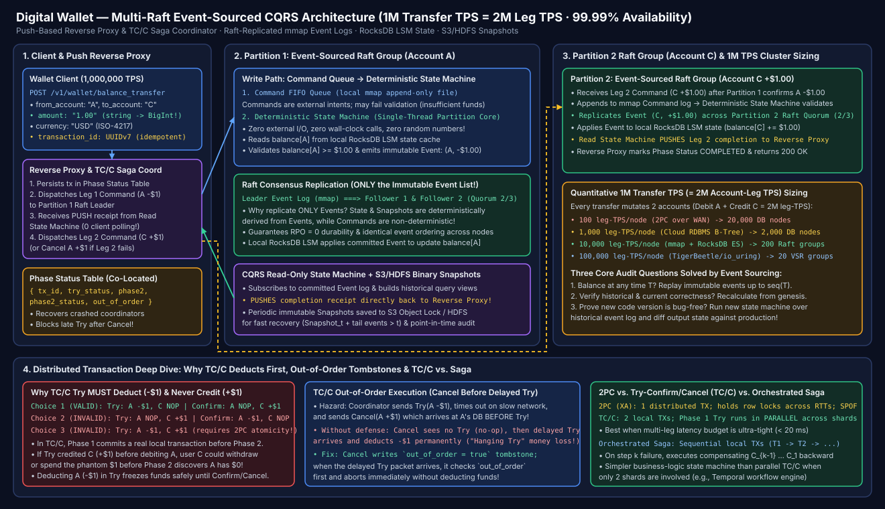
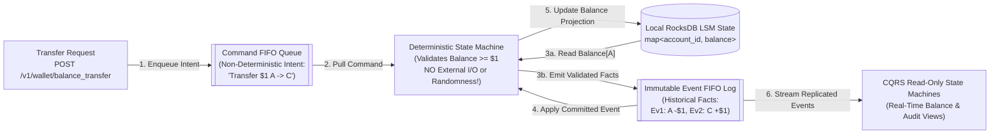
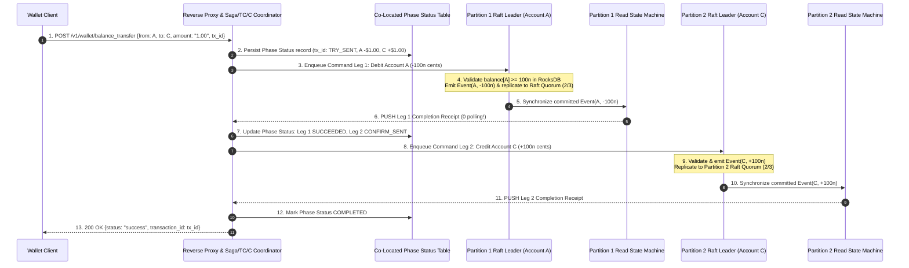
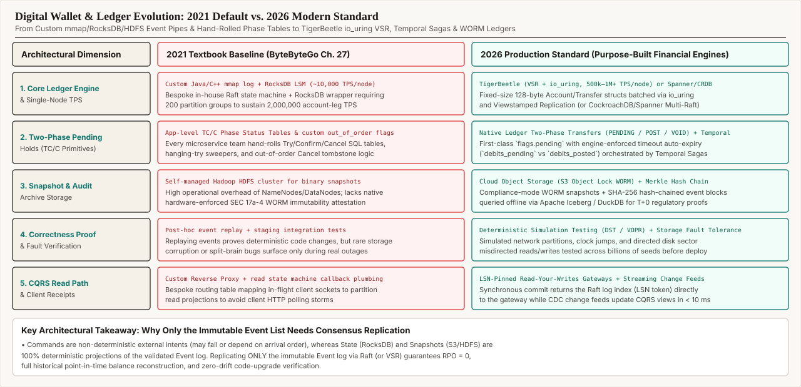

# Module 24: Digital Wallet — Distributed Transactions (2PC, TC/C, Saga), Deterministic Event Sourcing, CQRS, and Multi-Raft Sharded Ledgers

A **Digital Wallet** allows users to store monetary balances inside a payment platform and transfer funds instantaneously to other wallet accounts without paying external card-network interchange fees on every transaction (as in Alipay, WeChat Pay, PayPal/Venmo, Revolut, and Cash App). Whereas an external payment gateway ([Module 10](10-contention-inventory-and-financial-correctness.md) and [Module 14 §2](14-canonical-designs-transactional-and-staff.md#2-payment-system--digital-wallet)) is bounded by `500–2,000 ms` external PSP network calls at `~1,000–10,000 TPS`, an internal peer-to-peer digital wallet during a national holiday or flash promotion (e.g., Lunar New Year Red Packets or Singles' Day) must sustain **`1,000,000` balance transfers per second (`2,000,000` individual account-leg operations/sec)** at **`99.99%` availability** with **zero money creation or loss** and **100% deterministic historical auditability**.

This module expands **ByteByteGo Chapter 27 (`Digital Wallet`)** into a complete, six-stage architectural progression. We derive the `1M Transfer TPS -> 2M Account-Leg TPS` cluster-node sizing curve (`20,000` nodes at `100 TPS/node`, `2,000` nodes at `1,000 TPS/node`, `200` nodes at `10,000 TPS/node`, and `20` nodes at `100,000 TPS/node`), enforce fixed-point `BigInt` minor-unit wire contracts (`"1.00"` $\to$ `100n` cents), walk through the six evolutionary designs (**Sharded In-Memory Redis**, **Sharded RDBMS + Two-Phase Commit [2PC]**, **Try-Confirm/Cancel [TC/C]** with deduct-first safety and out-of-order Cancel tombstones, **Orchestrated Saga**, **Deterministic Event Sourcing + CQRS**, and **High-Performance `mmap` + RocksDB + Multi-Raft Consensus + Push Reverse Proxy**), and compare the 2021 textbook architecture against 2026 purpose-built financial engines (**TigerBeetle `io_uring` + Viewstamped Replication**, **CockroachDB/Spanner Multi-Raft**, **Temporal Sagas**, and **S3 Object Lock WORM snapshots**).

> [!NOTE]
> **Cross-Track Knowledge Ownership.** Double-entry accounting fundamentals, idempotency keys, and T+1 PSP settlement reconciliation belong to [Module 10](10-contention-inventory-and-financial-correctness.md) and [Module 14 §2](14-canonical-designs-transactional-and-staff.md#2-payment-system--digital-wallet). Formal Raft consensus proofs live in [`architecture/distributed-systems/modules/07-raft-consensus-deep-dive.md`](../../distributed-systems/modules/07-raft-consensus-deep-dive.md), formal 2PC blocking and Saga theory live in [`architecture/distributed-systems/modules/09-distributed-transactions-and-atomic-commit.md`](../../distributed-systems/modules/09-distributed-transactions-and-atomic-commit.md), and LSM-tree / RocksDB storage internals live in [`architecture/data-systems/modules/02-storage-engines-b-trees-and-lsm.md`](../../data-systems/modules/02-storage-engines-b-trees-and-lsm.md). This module owns the **1M-TPS digital wallet composition, TC/C deduct-first and out-of-order tombstone invariants, deterministic event-sourced state machines (`Command -> Event -> State`), `mmap` + RocksDB + Snapshot optimization, and Multi-Raft Push-Based Reverse Proxy CQRS**.



---

## 1. Requirements, 1M Transfer TPS Capacity Math, and Fixed-Point Monetary Contracts

### 1.1 Functional and Non-Functional Requirements

- **Functional Requirements**:
  1. **Cross-Account Balance Transfer (`POST /v1/wallet/balance_transfer`)**: Atomically transfer a positive monetary amount from `from_account` ($A$) to `to_account` ($C$) in the same currency, enforcing `balance[A] >= amount` and idempotency via `transaction_id`.
  2. **Point-in-Time Historical Balance & Reproducibility**: Reconstruct any account's exact balance at any historical timestamp $T$, verify that historical and current balances are 100% consistent, and prove that upgraded state-machine code produces bit-for-bit identical balances when replayed over historical transactions.
- **Non-Functional Requirements**:
  - **Sustained Throughput**: **`1,000,000` balance transfers/second** (`1M` Transfer TPS).
  - **High Availability & Zero Data Loss**: `99.99%` availability (`<= 52.6 min/year` downtime) and strict `RPO = 0` durability on acknowledged transfers.
  - **Strict Conservation of Money**: Total money supply across all accounts and in-flight escrow states must remain invariant ($\sum \text{debits} + \sum \text{credits} = 0$) at every committed sequence number.

### 1.2 Back-of-the-Envelope Node Sizing (`1M Transfer TPS = 2M Account-Leg TPS`)

Every balance transfer from Account $A$ to Account $C$ requires **two distinct account-leg mutations**: one debit operation (`A = A - amount`) on the shard owning $A$, and one credit operation (`C = C + amount`) on the shard owning $C$. Therefore, sustaining `1,000,000` transfers/sec requires the storage tier to execute **`2,000,000` account-leg operations/second (`2M leg-TPS`)**:

$$\text{Total Account-Leg TPS} = 1{,}000{,}000\text{ transfers/s} \times 2\text{ legs/transfer} = \mathbf{2{,}000{,}000\text{ leg-TPS}}$$

Consequently, a primary architectural objective is maximizing **per-node transactional throughput** so the cluster does not sprawl across tens of thousands of servers:

| Architecture Tier | Single-Node Throughput (`Leg-TPS / Node`) | Required Cluster Nodes (`2,000,000 / Node TPS`) | Why It Hits This Ceiling |
| --- | :-: | :-: | --- |
| **1. Sharded RDBMS + 2PC (`XA`)** | `~100 TPS` | **`20,000 nodes`** | Row locks held across multi-hop network `Prepare`/`Commit` RTTs |
| **2. Standard Cloud RDBMS (Local ACID)** | `~1,000 TPS` | **`2,000 nodes`** | Random B-tree disk page I/O + synchronous network WAL flush per row |
| **3. Local `mmap` Event Log + RocksDB LSM** | **`~10,000 TPS`** | **`200 nodes`** (or Raft groups) | Sequential `mmap` page-cache appends + in-memory RocksDB MemTable |
| **4. 2026 `io_uring` Batch Ledger (TigerBeetle)** | **`~100,000+ TPS`** | **`20 nodes`** (or VSR groups) | Fixed `128-byte` structs batched (`8,191` transfers/batch) over kernel `io_uring` |

### 1.3 API Contract & Why Floating-Point Numbers Are Forbidden for Money

```http
POST /v1/wallet/balance_transfer HTTP/2
Content-Type: application/json

{
  "from_account": "acct_A_01934a",
  "to_account": "acct_C_01934b",
  "amount": "1.00",
  "currency": "USD",
  "transaction_id": "01934a90-2664-71ec-9621-0242ac130002"
}
```

- **Why `amount` Travels as a `string` Parsed into Exact `BigInt` Minor Units**:
  - In IEEE-754 double-precision floating point (`number`), `0.1 + 0.2 === 0.30000000000000004` because `0.1` ($1/10$) has an infinite repeating binary expansion in base 2. Across `2,000,000` operations/sec, IEEE-754 rounding drift silently creates or destroys thousands of dollars per day!
  - The API contract accepts `amount` strictly as a **decimal string (`"1.00"`)** and converts it at the edge into an exact 64-bit / 128-bit integer count of **minor units (`BigInt` cents/satoshis)** according to the ISO-4217 currency exponent (`2` decimals for `USD`/`EUR` $\implies 100\text{n}$; `0` decimals for `JPY`; `3` decimals for `BHD`/`KWD`).
- **Mandatory `transaction_id` (UUIDv7 Idempotency Key) & SHA-256 Payload Binding**:
  - Generated by the client before the first network attempt and paired on ingestion with `payload_sha256 = SHA256(from_account | to_account | amount_minor)`. If a network timeout occurs and the client retries `POST /v1/wallet/balance_transfer` with the same `transaction_id` and identical payload hash, the wallet partition deduplicates the command and returns the original receipt without double-debiting Account $A$; if a duplicate `transaction_id` arrives with a mutated recipient or amount (`payload_sha256` mismatch), the partition rejects it immediately with HTTP `409 Conflict` (`IDEMPOTENCY_PAYLOAD_MISMATCH`).

### 1.4 Primary Literature & Specification Matrix

| Source / Specification | Year | Core Mechanism | Why It Matters Here |
| --- | :-: | --- | --- |
| Jim Gray — _Notes on Data Base Operating Systems_ (`2PC`) | 1978 | Two-Phase Commit (`Prepare` vote + `Commit`/`Abort` broadcast) | Explains why 2PC holds locks across network RTTs and blocks if the coordinator crashes after `Prepare` |
| Hector Garcia-Molina & Kenneth Salem — _Sagas_ (_ACM SIGMOD_) | 1987 | Sequence of local ACID transactions $T_1, \dots, T_n$ with backward compensating transactions $C_{k-1}, \dots, C_1$ | Theoretical foundation for Orchestrated Saga and Try-Confirm/Cancel (`TC/C`) cross-shard transfers |
| Martin Fowler & Greg Young — _Event Sourcing & CQRS_ | 2005–2010 | Storing state transitions as an immutable sequence of validated Events + separating write and read models | Enables deterministic balance replay at any historical point $T$ and zero-drift code-upgrade verification |
| Diego Ongaro & John Ousterhout — _In Search of an Understandable Consensus Algorithm (Raft)_ (_USENIX ATC_) | 2014 | Leader-driven replicated log consensus ($\lfloor N/2 \rfloor + 1$ majority quorum) | Guarantees `RPO = 0` durability and total event ordering across each partition's replicated Event list |
| **TigerBeetle Architecture** (_Viewstamped Replication + `io_uring` + DST_) | 2022–2026 | Fixed `128-byte` double-entry transfers, native 2-phase `pending` holds, and Deterministic Simulation Testing | Modern 2026 production standard achieving `500k–1M+` financial leg-TPS per consensus group |

---

## 2. Distributed Transaction Evolution: Sharded Redis, 2PC, Try-Confirm/Cancel (TC/C), and Saga

### 2.1 Stage 1 (Sharded In-Memory Redis) & Stage 2 (Sharded RDBMS + 2PC)

1. **Stage 1 — Sharded In-Memory Redis (`map<account_id, balance>`)**:
   - Partitioning accounts across $N$ Redis nodes by `hash(account_id) % N` (with partition addresses tracked in ZooKeeper/`etcd`) handles `1M` single-key updates/sec easily in RAM, but **fails completely as a financial wallet**: (a) in-memory caches lack `RPO = 0` transactional durability, and (b) updating Account $A$ on Redis Node 1 and Account $C$ on Redis Node 2 has **zero cross-node atomicity** (if the stateless Wallet Service crashes after debiting $A$ and before crediting $C$, the money vanishes without an atomic rollback or recovery log).
2. **Stage 2 — Sharded Relational Databases + Two-Phase Commit (2PC / XA)**:
   - Replacing Redis with sharded relational databases gives local disk durability, and running **Two-Phase Commit (2PC)** across Shard $A$ and Shard $C$ ensures atomicity (`Phase 1 Prepare` locks rows and flushes redo/undo logs on both shards; `Phase 2 Commit` commits or aborts both).
   - **Why 2PC Fails at `1M TPS`**: (a) **Lock Contention Across Network RTTs** — database row locks on popular merchant or user accounts are held open across multi-millisecond network round trips between the coordinator and all participating shards, collapsing per-node throughput to `~100–500 TPS`; and (b) **Coordinator Blocking Single Point of Failure (SPOF)** — if the coordinator crashes after both shards vote `YES` in `Prepare` and before sending `Commit`, both shards remain **blocked holding exclusive row locks** because neither shard knows whether the peer was told to commit or abort!

### 2.2 Stage 3: Distributed Transactions via Try-Confirm/Cancel (TC/C)

**Try-Confirm/Cancel (TC/C)** eliminates cross-network database lock holding by breaking a distributed transfer into **two independent, short local ACID transactions** coordinated at the application layer:

| TC/C Phase | Execution Condition | Local Transaction on Account $A$'s Shard | Local Transaction on Account $C$'s Shard | Are Database Locks Held Between Phases? |
| --- | --- | --- | --- | :-: |
| **Phase 1: `Try`** | Always runs first | **Deduct `-$1.00` from $A$'s balance** (commits immediately!) | **`NOP` (Do nothing)** | **No** (Local TX commits in `< 2 ms`) |
| **Phase 2a: `Confirm`** | All Phase 1 `Try` legs succeeded | **`NOP` (Do nothing)** | **Credit `+$1.00` to $C$'s balance** (commits immediately!) | **No** |
| **Phase 2b: `Cancel`** | Any Phase 1 `Try` leg failed / timed out | **Compensating Credit `+$1.00` back to $A$** (refunds held funds!) | **`NOP` (Do nothing)** | **No** |

> [!IMPORTANT]
> **Critical Invariant — Why Phase 1 (`Try`) MUST Deduct (`-$1`) from $A$ and Leave $C$ as `NOP`:** During the brief milliseconds between Phase 1 (`Try` committed) and Phase 2 (`Confirm` or `Cancel` committed), the global sum of visible account balances is temporarily unbalanced ($A$ has been debited `-$1`, while $C$ has not yet been credited `+$1`). ByteByteGo Chapter 27 evaluates the three possible Phase 1 designs:
>
> - **Choice 1 (`Try: A -$1, C NOP` — VALID)**: $A$'s `$1` is immediately deducted and frozen when `Try` commits. Neither $A$ nor $C$ can double-spend that `$1` while the transaction is in flight!
> - **Choice 2 (`Try: A NOP, C +$1` — INVALID / DOUBLE-SPEND BUG!)**: If `Try` credited `+$1` to $C$ first and deferred debiting $A$ to `Confirm`, User $C$ would immediately see `+$1` in their spendable balance and could withdraw or transfer that phantom `$1` away _before_ Phase 2 discovers that Account $A$ had `$0` (or fails and tries to run `Cancel`)!
> - **Choice 3 (`Try: A -$1, C +$1` — INVALID)**: Moving both balances in Phase 1 requires atomic cross-shard execution, which reduces back to 2PC.

### 2.3 TC/C Crash Recovery (`Phase Status Table`) and the Out-of-Order Cancel Tombstone

What if the Wallet Service coordinator crashes after Phase 1 (`Try: A -$1`) commits and before Phase 2 (`Confirm: C +$1`) runs? Or what if network packets arrive **out of order**?

1. **Co-Located Persistent `Phase Status Table`**:
   - Before sending any `Try` RPC, the coordinator persists the transaction state in a **`phase_status` table stored on the exact same database shard as the initiating wallet account $A$** (`transaction_id`, `from_account`, `to_account`, `amount_minor`, `payload_sha256`, `try_status`, `second_phase`, `second_phase_status`, `out_of_order_flag`). If the coordinator pod crashes mid-flight, a recovery worker scans uncommitted `phase_status` rows and drives idempotent `Confirm` or `Cancel` to completion (while strictly rejecting any `Cancel` on an `ALREADY_CONFIRMED` record so a late cancel can never refund sender $A$ after receiver $C$ was credited).
2. **The Out-of-Order Execution Bug (`Cancel` Arriving Before Delayed `Try` — "Hanging Try")**:
   - Suppose the coordinator sends `Try(A -$1)` to Shard $A$, experiences a temporary network delay/timeout, concludes `Try` failed, and immediately dispatches `Cancel` to Shard $A$.
   - Due to network packet reordering, the **`Cancel` packet arrives at Shard $A$ BEFORE the delayed `Try` packet**!
   - If `Cancel` simply sees "no `Try` record exists, do nothing and exit", and 100 ms later the delayed `Try(A -$1)` packet arrives and executes, Account $A$ is debited `-$1` **after `Cancel` already finished** — permanently locking/losing User $A$'s `$1` (**Hanging Try**)!
   - **Mandatory Fix (`out_of_order_flag` Tombstone / `OUT_OF_ORDER_CANCEL_TOMBSTONE`)**: When `Cancel` arrives at Shard $A$ and sees that `Try` has not executed yet (`try_status == NOT_SENT`), it writes a persistent tombstone row with **`out_of_order_flag = TRUE`** (`second_phase = 'CANCEL'`). When the delayed `Try` packet finally arrives, it checks `out_of_order_flag` first, sees `TRUE`, and **aborts immediately with `OUT_OF_ORDER_CANCEL_TOMBSTONE` without deducting funds**!



_Step-by-step mechanics:_ (1) In normal **debit-first TC/C**, Phase 1 (`Try`) deducts `-$1` from Account $A$ and runs `NOP` on $C$ in `< 2 ms` local transactions (holding zero cross-shard locks and preventing phantom double-spends on $C$), followed by `Confirm` (`C +$1`) or `Cancel` (`A +$1`). (2) Under network reordering, `Try(tx_9)` stalls while the coordinator times out and dispatches `Cancel(tx_9)`. (3) `Cancel` arrives first at Shard $A$, detects `try_status == NOT_SENT`, and writes a durable `out_of_order_flag = TRUE` tombstone into the co-located `phase_status` table. (4) When the delayed **Hanging Try** arrives, it reads `out_of_order_flag == TRUE` and aborts cleanly with `OUT_OF_ORDER_CANCEL_TOMBSTONE`.

Below is the verified `TccTransferCoordinator.tryPhase` and `cancelPhase` implementation from [`examples/lib/wallet-models.ts`](../examples/lib/wallet-models.ts):

```typescript
  tryPhase(options: {
    transactionId: string;
    fromAccount: string;
    toAccount: string;
    amountMinorUnits: bigint;
    unsafeCreditReceiverFirstBug?: boolean;
  }): { ok: boolean; reason?: string } {
    if (options.amountMinorUnits <= 0n) {
      return { ok: false, reason: 'INVALID_AMOUNT' };
    }
    const payloadSha256 = computeTransferPayloadSha256(
      options.fromAccount,
      options.toAccount,
      options.amountMinorUnits,
    );

    let record = this.phaseStatusTable.get(options.transactionId);
    if (record) {
      if (record.payloadSha256 !== payloadSha256) {
        return { ok: false, reason: 'IDEMPOTENCY_PAYLOAD_MISMATCH' };
      }
      if (record.outOfOrderFlag || record.secondPhase === 'CANCEL') {
        return { ok: false, reason: 'OUT_OF_ORDER_CANCEL_TOMBSTONE' };
      }
      if (record.tryStatus === 'SUCCEEDED') {
        return { ok: true }; // Idempotent retry
      }
      if (record.tryStatus === 'FAILED') {
        return { ok: false, reason: 'TRY_ALREADY_FAILED' };
      }
    } else {
      record = {
        transactionId: options.transactionId,
        fromAccount: options.fromAccount,
        toAccount: options.toAccount,
        amountMinorUnits: options.amountMinorUnits,
        payloadSha256,
        tryStatus: 'NOT_SENT',
        secondPhase: 'NONE',
        secondPhaseStatus: 'NOT_SENT',
        outOfOrderFlag: false,
      };
      this.phaseStatusTable.set(options.transactionId, record);
    }

    if (options.unsafeCreditReceiverFirstBug) {
      // BROKEN Choice 2 from ByteByteGo Table: crediting C (+amount) in Try before debiting A
      // allows C to spend unbacked phantom money during the in-flight window!
      const receiverBal = this.getBalance(options.toAccount);
      this.balances.set(options.toAccount, receiverBal + options.amountMinorUnits);
      record.tryStatus = 'SUCCEEDED';
      return { ok: true };
    }

    const senderBal = this.getBalance(options.fromAccount);
    if (senderBal < options.amountMinorUnits) {
      record.tryStatus = 'FAILED';
      return { ok: false, reason: 'INSUFFICIENT_FUNDS' };
    }

    // Choice 1 (Correct): deduct from Account A (-amount) in local ACID TX; NOP on Account C
    this.balances.set(options.fromAccount, senderBal - options.amountMinorUnits);
    record.tryStatus = 'SUCCEEDED';
    return { ok: true };
  }
```

### 2.4 Stage 4: Orchestrated Saga vs. Try-Confirm/Cancel (TC/C)

| Comparison Dimension | Try-Confirm/Cancel (`TC/C`) | Orchestrated Saga (e.g., Temporal Workflow) |
| --- | --- | --- |
| **Execution Order** | **Any / Parallelizable** (all Phase 1 `Try` reservations dispatch concurrently across $K$ shards) | **Linear Sequence** ($T_1 \to T_2 \to \dots \to T_n$ executed step-by-step) |
| **Compensating Action** | Executed in **Phase 2b (`Cancel`)** | Executed in **backward rollback order** ($C_{k-1} \to \dots \to C_1$) |
| **Central Coordination** | Yes (TC/C Coordinator + Phase Status Table) | Yes (Saga Orchestrator — preferred over Choreography for financial state) |
| **Partial Inconsistent Visibility** | Yes (between `Try` and `Confirm`; safe because `Try` deducts first) | Yes (between $T_1$ and $T_2$; safe because $T_1$ debits sender first) |
| **When to Choose** | Ultra-low-latency multi-party transfers where parallel Phase 1 `Try` saves RTTs | Complex multi-step financial workflows (FX quote $\to$ compliance $\to$ debit $\to$ credit) |

---

## 3. Deterministic Event Sourcing, Reproducibility, and CQRS Architecture

### 3.1 Why Reconciliation Is Not Enough: The Three Audit Questions

Traditional databases overwrite `UPDATE accounts SET balance = balance - 100 WHERE account_id = 'A'` in place. Nightly reconciliation against an external settlement file can tell you that Account $A$'s balance is off by `$1.00`, but it **cannot tell you which transaction or code bug caused the drift**. **Event Sourcing** solves this by treating every state mutation as an immutable, ordered sequence of validated events, answering three mandatory financial audit questions:

1. _"Do we know any account's exact balance at any historical point in time $T$?"_ $\implies$ Yes: replay the immutable Event log from genesis (or the latest snapshot before $T$) up to event sequence $\text{seq}(T)$.
2. _"How do we prove that historical and current balances are 100% correct?"_ $\implies$ Recompute the entire state projection from the immutable Event stream and verify zero divergence plus $\sum \text{deltas} = 0$.
3. _"How do we prove that a new code deployment contains zero financial regression bugs?"_ $\implies$ Run the new State Machine version over the historical Event log in shadow mode and assert that every resulting account balance is **bit-for-bit identical** to production!

### 3.2 The Four Core Primitives of Deterministic Event Sourcing



| Event-Sourcing Primitive | Formal Definition | Can It Fail or Be Rejected? | Contains Non-Determinism / External I/O? | Must Be Replicated by Raft Consensus? |
| --- | --- | :-: | :-: | :-: |
| **1. Command** | External user intent (`"Transfer $1.00 from A to C"`) ordered in a FIFO command queue | **Yes** (`INSUFFICIENT_FUNDS`, invalid account, duplicate retry) | **Yes** (arrival order, network jitter, external validation) | **No** (replaying commands across nodes could diverge!) |
| **2. Event** | Immutable, validated historical fact (`"Seq 42: Account A debited -$1.00"`) | **Never** (it is an irrevocable past fact) | **Zero** (pure data record with explicit sequence number) | **YES — The ONLY data structure needing Raft consensus!** |
| **3. State** | Key-value projection (`map<account_id, balance>` in RocksDB) | No | Derived deterministically from Events | **No** (can always be rebuilt by replaying the Event list) |
| **4. State Machine** | Pure transition function `(State, Command) -> Events` and `(State, Event) -> State'` | Deterministic validation | **Strictly Forbidden** (no `rand()`, no `Date.now()`, no network I/O!) | Code deployed identically across Raft replicas |

Below is the verified `EventSourcedWalletMachine.processTransferCommand` implementation from [`examples/lib/wallet-models.ts`](../examples/lib/wallet-models.ts):

```typescript
  processTransferCommand(cmd: {
    transactionId: string;
    fromAccount: string;
    toAccount: string;
    amountMinorUnits: bigint;
  }): { ok: boolean; eventsEmitted: number; events: readonly WalletEvent[]; reason?: string } {
    const payloadSha256 = computeTransferPayloadSha256(
      cmd.fromAccount,
      cmd.toAccount,
      cmd.amountMinorUnits,
    );
    const existingHash = this.appliedTxHashes.get(cmd.transactionId);
    if (existingHash !== undefined) {
      if (existingHash !== payloadSha256) {
        return {
          ok: false,
          eventsEmitted: 0,
          events: [],
          reason: 'IDEMPOTENCY_PAYLOAD_MISMATCH',
        };
      }
      return { ok: true, eventsEmitted: 0, events: [] }; // Idempotent replay
    }
    if (cmd.amountMinorUnits <= 0n || cmd.fromAccount === cmd.toAccount) {
      return { ok: false, eventsEmitted: 0, events: [], reason: 'INVALID_COMMAND' };
    }
    const senderBal = this.getBalance(cmd.fromAccount);
    if (senderBal < cmd.amountMinorUnits) {
      return { ok: false, eventsEmitted: 0, events: [], reason: 'INSUFFICIENT_FUNDS' };
    }

    const ev1 = this.appendAndApplyEvent(
      cmd.transactionId,
      payloadSha256,
      cmd.fromAccount,
      -cmd.amountMinorUnits,
    );
    const ev2 = this.appendAndApplyEvent(
      cmd.transactionId,
      payloadSha256,
      cmd.toAccount,
      cmd.amountMinorUnits,
    );
    this.appliedTxHashes.set(cmd.transactionId, payloadSha256);
    return { ok: true, eventsEmitted: 2, events: [ev1, ev2] };
  }
```

### 3.3 CQRS (Command Query Responsibility Segregation)

In Event Sourcing, the write-path State Machine is a single-threaded deterministic loop focused exclusively on validating Commands and appending Events at maximum throughput. It does **not** serve external read queries (`GET /v1/wallet/balance`). Instead, **CQRS** splits the architecture into:

- **Write Path**: The authoritative partition State Machine that validates Commands and appends Events.
- **Read Path**: One or more **Read-Only State Machines** that subscribe to the immutable Event stream and build query-optimized views (current balance projections, monthly statement indexes, regulatory audit trails). Read-only state machines lag by a few milliseconds behind the write state machine and always converge to the exact same state.

---

## 4. High-Performance Single-Node Optimization: `mmap` Event Logs, RocksDB LSM State, and Snapshots

If the State Machine reads Commands from an external Kafka cluster over the network, queries balances from an external relational database over the network, and writes Events back to Kafka over the network, network RTTs cap single-node throughput at `~1,000–2,000 TPS`. To jump `10x` to **`10,000+ leg-TPS` per node** (cutting cluster size from `2,000` nodes to `200` nodes), ByteByteGo Chapter 27 applies three systems-level optimizations:

1. **Co-Located Local Append-Only Command & Event Logs via `mmap`**:
   - Store the Command log and Event log on the state machine's **local NVMe disk** rather than calling an external message broker on every transfer.
   - Map the active log segments directly into the process's virtual address space using POSIX **`mmap(2)`**. Appending an event writes sequentially into the OS kernel page cache at sub-microsecond in-memory speed prior to batched Raft quorum `fsync`, avoiding `read()`/`write()` user-to-kernel buffer copies while recently appended events remain hot in the page cache for immediate read-state-machine consumption.
2. **Embedded Local RocksDB (LSM-Tree) for Balance State**:
   - Co-locate the `map<account_id, balance>` state inside the state-machine process using an embedded **RocksDB** key-value store (see [`architecture/data-systems/modules/02-storage-engines-b-trees-and-lsm.md`](../../data-systems/modules/02-storage-engines-b-trees-and-lsm.md)).
   - Because RocksDB uses a **Log-Structured Merge-Tree (LSM)** and the Raft-replicated `mmap` Event log is the authoritative `fsync`-durable source of truth, derived RocksDB balance updates can append to the in-memory `MemTable` (`skiplist`) with `WriteOptions.sync = false` (rebuilding any uncompacted tail from the Raft Event log on crash recovery), while hot account balances are served from the in-memory `BlockCache` in microseconds without B-tree random disk I/O.
3. **Periodic Binary Snapshots in Distributed Storage (S3 Object Lock / HDFS)**:
   - At `2,000,000` events/sec globally (`10,000` events/sec/partition), replaying an entire partition's Event log from Day 0 on restart would take hours.
   - Each partition periodically serializes its RocksDB balance state at sequence number $S_{\text{snap}}$ into an immutable binary **Snapshot** stored in object storage (HDFS in 2021; **Amazon S3 with Object Lock WORM** in 2026). To recover or audit at time $T$, a node loads the latest snapshot $S_{\text{snap}} \le \text{seq}(T)$ and replays only the short tail of events with $\text{seq} > S_{\text{snap}}$.

---

## 5. Multi-Raft Sharded Event Sourcing, Push-Based Reverse Proxy CQRS, and End-to-End Lifecycle

### 5.1 Why Only the Immutable Event List Requires Raft Consensus Replication

Storing `mmap` logs and RocksDB state on local disk makes a single node fast (`10,000+ TPS`), but if that node's disk dies, uncommitted local state is lost. Which of the four Event Sourcing components (`Command`, `Event`, `State`, `Snapshot`) must be replicated synchronously across nodes for `99.99%` availability and `RPO = 0`?

- **State (RocksDB) & Snapshots**: Can **always** be regenerated deterministically by replaying the Event list. They do not need consensus replication.
- **Commands**: Are **non-deterministic** (if two nodes independently validated commands against slightly different arrival timers or external I/O, they could generate divergent events!).
- **The Immutable Event List (Sole Consensus Target)**: Once the partition's **Raft Leader** validates a Command and emits an Event, it replicates **only the Event entry** across its **Raft Consensus Group** (`RF = 3` or `5`; majority quorum $\lfloor N/2 \rfloor + 1$, see [`architecture/distributed-systems/modules/07-raft-consensus-deep-dive.md`](../../distributed-systems/modules/07-raft-consensus-deep-dive.md)). Once a majority of nodes append the Event to their `mmap` log, the Event is durably committed, and every Follower applies the exact same Event to its local RocksDB state machine!

### 5.2 Solving the CQRS Polling Bottleneck: Push-Based Reverse Proxy

In a basic CQRS setup, a client sends a Command to the Raft Leader and then **polls** the Read-Only State Machine repeatedly until the balance update appears. As proven in Test 4 of [`examples/18-digital-wallet.test.ts`](../examples/18-digital-wallet.test.ts), if `1,000,000` transfers/sec each poll `4` times at `10 ms` intervals while waiting for a `35 ms` commit, the read tier is bombarded with **`4,000,000` wasted polling QPS**!

We eliminate client polling by introducing a **Push-Based Reverse Proxy / Saga Coordinator**:

1. The client sends `POST /v1/wallet/balance_transfer` to the Reverse Proxy / Coordinator.
2. The proxy submits the Command to the partition's Raft Leader and holds the client's HTTP/2 stream (or Saga workflow step) open.
3. As soon as the partition's Read-Only State Machine applies the committed Raft Event, it **pushes the completion receipt directly back to the Reverse Proxy** (`1` push RPC per leg, `0` polling overhead!).

### 5.3 Complete End-to-End Cross-Shard Transfer Lifecycle (`A -$1`, `C +$1`)



---

## 6. Production Gotchas, SRE Guardrails, and 2021 vs. 2026 Comparison

### 6.1 Six High-Severity Production Gotchas

1. **IEEE-754 Float Rounding Drift in Balance Calculations**: Storing or parsing currency amounts as 64-bit IEEE-754 floats (`0.1 + 0.2 = 0.30000000000000004`) breaks double-entry conservation. _Fix_: Transmit amounts as exact decimal strings (`"1.00"`) and execute all state-machine math in `BigInt` minor units (`cents`).
2. **TC/C Crediting Receiver (`+$1`) in Phase 1 `Try` (Phantom Double-Spend Bug)**: If Phase 1 `Try` credits Account $C$ before debiting Account $A$, User $C$ can spend or withdraw the unbacked funds before Phase 2 discovers Account $A$ has insufficient balance. _Fix_: Always **deduct from sender $A$ (`-$1`) in `Try`** and leave receiver $C$ as `NOP` until `Confirm`.
3. **TC/C Out-of-Order `Cancel` Before Delayed `Try` ("Hanging Try" Fund Loss)**: If a timeout triggers `Cancel` before a delayed `Try` packet reaches Shard $A$, and `Cancel` exits as a stateless no-op, the late `Try` packet will debit `-$1` permanently. _Fix_: `Cancel` must write a persistent **`out_of_order = true` tombstone** in the Phase Status Table so any late-arriving `Try` is rejected immediately.
4. **Non-Deterministic Calls Inside the Event-Sourcing State Machine**: Calling `Date.now()`, `Math.random()`, or external HTTP RPCs inside the deterministic state-machine transition function causes Raft followers and historical audit replays to compute divergent balances. _Fix_: Keep the state machine 100% pure; stamp wall-clock timestamps and random UUIDs on the Command/Event _before_ Raft replication.
5. **Replicating Non-Deterministic Commands Instead of Validated Events**: If a cluster replicates the raw Command queue and runs validation independently on each replica, slight differences in external state or timing cause split-brain ledger divergence. _Fix_: Validate Commands on the Raft Leader only and replicate **only the immutable Event list** via Raft consensus.
6. **Pull-Based CQRS Client Polling Storms**: Having `1,000,000` clients poll read projections every `10 ms` multiplies read QPS by `4x–10x` and stalls the query tier. _Fix_: Have read-only state machines **push** completion receipts directly to the Reverse Proxy / Saga Coordinator.

### 6.2 Quantitative SRE Guardrails

| SLI / Operational Metric | Target SLO / Healthy Band | Alert Threshold & Automated Remediation |
| --- | :-: | --- |
| **Global Money Conservation Drift** | **`0` minor units** ($\sum \Delta = 0$) | Page P0 immediately & halt partition payouts if $\sum \text{debits} + \sum \text{credits} \ne 0$ |
| **Wallet Transfer Availability & Latency** | `99.99%` availability, `p99 < 50 ms` | Page at `14.4x` burn rate (`1h/5m`) or `p99 > 150 ms`; check Raft disk `fsync` & hot-shard skew |
| **Raft Consensus Quorum Health** | `3/3` (or `5/5`) healthy nodes per shard | Page if any Raft group drops to minimum quorum (`2/3`); auto-replace dead follower node |
| **In-Flight Hanging TC/C / Saga Age** | `99.9%` complete in `< 200 ms` | Alert if any `phase_status` row stays uncommitted `> 30 s`; trigger idempotent Saga sweeper |
| **Out-of-Order TC/C Tombstone Rate** | `< 0.01%` of cancelled transfers | Alert if `> 0.1%`; indicates upstream coordinator timeout is shorter than shard p99 latency |
| **Shadow Replay Determinism Check** | **`100%` state-hash match** vs. prod | Block CI/CD release if shadow replay of new state-machine binary diverges by 1 cent on history |

### 6.3 Technology Comparison: Then vs. Now (2021 vs. 2026)



| Architectural Dimension | 2021 Textbook Baseline (ByteByteGo Ch. 27) | 2026 Production Standard (Purpose-Built Financial Engines) | Why the Industry Shifted |
| --- | --- | --- | --- |
| **Core Ledger Engine & Per-Node TPS** | Custom Java/C++ `mmap` log + embedded **RocksDB LSM** (`~10,000 TPS/node` $\to$ `200` shards) | **TigerBeetle** (Viewstamped Replication + `io_uring`, **`500k–1M+ TPS/node`**) or **CockroachDB / Spanner** | Purpose-built `128-byte` fixed financial structs + kernel `io_uring` batching cut cluster size `10x` |
| **Two-Phase Pending Holds (`TC/C`)** | Hand-rolled SQL `phase_status` tables and custom `out_of_order` tombstone code | **Native Ledger Two-Phase Transfers (`flags.pending` / `post` / `void`) + Temporal Sagas** | Ledger engine tracks `debits_pending` vs `debits_posted` and auto-expires timed-out holds natively |
| **Snapshot & Audit Storage** | Self-managed Hadoop **HDFS** clusters for binary state snapshots | **Cloud Object Storage (`S3 Object Lock` WORM)** + SHA-256 hash-chained **Iceberg** tables | SEC Rule 17a-4 hardware-enforced WORM compliance without managing Hadoop NameNodes |
| **Correctness & Fault Verification** | Post-hoc historical event replay + standard integration tests | **Deterministic Simulation Testing (DST / VOPR)** injecting network, clock, and disk-sector faults | DST tests billions of simulated consensus and storage-corruption schedules before production deploy |
| **CQRS Client Notification** | Custom Reverse Proxy callback plumbing from read state machines | **LSN-Pinned Read-Your-Writes Gateways** + real-time **CDC Change Feeds** | Returning the committed Raft log index (`LSN`) directly eliminates custom reverse-proxy callback tables |

---

## 7. Executable Proof Map

All five mathematical and architectural proofs for this module are implemented in [`examples/lib/wallet-models.ts`](../examples/lib/wallet-models.ts) and verified deterministically in [`examples/18-digital-wallet.test.ts`](../examples/18-digital-wallet.test.ts):

| Proof / Test Case | Implementation Symbol | What It Proves |
| --- | --- | --- |
| **1. TC/C Deduct-First & Out-of-Order Tombstones** | `TccTransferCoordinator` (`tryPhase`, `confirmPhase`, `cancelPhase`) | Proves `Try -> Confirm`, `Try -> Cancel` refund, blocks double-spending of held funds during the unbalanced window (vs broken credit-first `Choice 2`), and blocks delayed `Try` packets after an early `Cancel` via `outOfOrderFlag` tombstones |
| **2. Deterministic Event Sourcing, Snapshots & Fixed-Point Math** | `EventSourcedWalletMachine`, `parseExactDecimalToMinorUnits` | Proves IEEE-754 `0.1 + 0.2 !== 0.3` vs exact `BigInt` minor units, point-in-time historical balance lookup (`getBalanceAtSeq`), and `Snapshot + tail replay` equivalence |
| **3. Multi-Raft Sharded Ledger & Money Conservation** | `ShardedRaftWalletCluster` + `fast-check` | Proves cross-shard transfers, zero data loss (`RPO = 0`) across Raft leader failover, and `fast-check` strict conservation of money ($\sum \text{balances} = \text{initialSupply}$) across arbitrary transfer workloads |
| **4. Push-Based Reverse Proxy CQRS vs. Polling** | `compareCqrsPushVsPolling` | Proves Push-Based Reverse Proxy uses `1` push notification per commit vs `4,000,000` wasted polling QPS at `1M` transfer TPS |
| **5. `1M` Transfer TPS (`2M` Leg TPS) Cluster Sizing** | `estimateWalletClusterSizing` | Verifies `1M` transfers/s = `2M` leg-TPS and exact node counts across `100` (`20,000`), `1,000` (`2,000`), `10,000` (`200`), and `100,000` (`20`) leg-TPS/node tiers |

---

## Interview Drill

### Question 1: Why does `1,000,000` wallet transfer TPS require `2,000,000` database operations per second, and why are IEEE-754 floating-point numbers prohibited in the transfer payload?

<details><summary>Model Answer</summary>

1. **Two Legs per Transfer (`2M Leg-TPS`)**: Every transfer from Account $A$ to Account $C$ consists of two distinct account mutations: debiting $A$ (`A - amount`) on $A$'s partition and crediting $C$ (`C + amount`) on $C$'s partition. Therefore, `1,000,000` transfers/sec requires `2,000,000` transactional leg operations/sec (`20,000` nodes at `100 TPS/node`, `2,000` nodes at `1,000 TPS/node`, `200` nodes at `10,000 TPS/node`, or `20` nodes at `100,000 TPS/node`).
2. **IEEE-754 Binary Floating-Point Inexactness**: Standard 64-bit IEEE-754 floats (`double`) represent numbers in base 2 (`significand × 2^exponent`), so simple base-10 decimal fractions like `0.10` and `0.20` have infinite repeating binary representations (`0.1 + 0.2 = 0.30000000000000004`). Over millions of transfers, rounding drift violates money conservation. Production wallets transmit amounts as exact decimal strings (`"1.00"`) and store/compute all balances as 64-bit or 128-bit integer minor units (`BigInt` cents).

</details>

### Question 2: In a Try-Confirm/Cancel (TC/C) distributed transfer between Account $A$ and Account $C$, why must Phase 1 (`Try`) deduct `-$1` from $A$ and perform `NOP` on $C$, rather than crediting `+$1` to $C$ in `Try`?

<details><summary>Model Answer</summary>

Unlike Two-Phase Commit (2PC), where row locks remain held until Phase 2 commits, **Phase 1 (`Try`) in TC/C commits a real local database transaction immediately**, making its balance change visible to other concurrent transactions before Phase 2 starts.

- If Phase 1 (`Try`) credited `+$1` to Account $C$ and left Account $A$ untouched (`Choice 2`), User $C$ would immediately see `+$1` of spendable money and could withdraw it to a bank or transfer it to User $D$ _before_ Phase 2 discovers that Account $A$ had `$0` (or fails and attempts `Cancel`).
- By **deducting `-$1` from Account $A$ in `Try` (`Choice 1: A -$1, C NOP`)**, the `$1` is immediately removed from $A$'s spendable balance and not yet added to $C$'s balance during the brief in-flight window. Neither $A$ nor $C$ can double-spend the in-flight funds, and if Phase 1 fails on any leg, Phase 2b (`Cancel`) safely refunds `+$1` back to $A$.

</details>

### Question 3: Explain the "Out-of-Order Execution" anomaly in TC/C (where `Cancel` arrives at a shard before `Try`) and how the Phase Status Table prevents permanent fund loss.

<details><summary>Model Answer</summary>

- **The Anomaly**: Suppose the TC/C coordinator sends `Try(A -$1)` to Shard $A$, experiences a network delay or packet stall, times out, and sends `Cancel` to Shard $A$. If the `Cancel` packet arrives at Shard $A$ **before** the delayed `Try` packet, a naive `Cancel` handler sees no prior `Try` transaction, treats `Cancel` as a no-op, and returns success. Moments later, the delayed `Try(A -$1)` packet arrives at Shard $A$ and deducts `-$1` from Account $A$ — because `Cancel` has already finished, those funds are never refunded (**Hanging Try**)!
- **The Fix (`out_of_order_flag` Tombstone)**: When `Cancel` arrives at Shard $A$ and finds no existing `Try` record for `transaction_id`, it inserts a persistent row in the shard's **`phase_status` table** with **`out_of_order_flag = TRUE`** and `second_phase = 'CANCEL'`. When the delayed `Try` packet arrives later, it checks `phase_status` inside the same local transaction, sees `out_of_order_flag == TRUE`, and **rejects the `Try` immediately** without touching Account $A$'s balance.

</details>

### Question 4: Compare TC/C against an Orchestrated Saga for cross-shard wallet transfers. Why is Orchestration preferred over Choreography for financial workflows?

<details><summary>Model Answer</summary>

- **TC/C vs. Orchestrated Saga**: In **TC/C**, Phase 1 (`Try`) reservations can execute **in parallel** across multiple participating shards (e.g., debiting two funding sources simultaneously before confirming the credit), minimizing end-to-end latency when multi-leg coordination is required. In an **Orchestrated Saga**, operations execute **linearly in sequence** ($T_1 \to T_2 \to \dots \to T_n$); if step $T_k$ fails, the orchestrator executes compensating transactions backward ($C_{k-1} \to \dots \to C_1$). When latency is the primary constraint across multiple shards, TC/C wins; for two-shard `A -> C` transfers or multi-service workflows, an Orchestrated Saga (e.g., on Temporal) avoids the extra `Confirm` RPC on already-debited shards.
- **Why Orchestration Beats Choreography**: In Choreography, services subscribe to asynchronous events with no central state owner, scattering rollback and timeout rules across services and creating cyclic event deadlocks. An **Orchestrator** maintains one explicit, persisted state machine (`phase_status`) that tracks every leg's exact status and drives retries and compensations deterministically.

</details>

### Question 5: In a Deterministic Event-Sourced wallet, distinguish `Command`, `Event`, `State`, and `State Machine`. Why do we replicate ONLY the Event list via Raft consensus?

<details><summary>Model Answer</summary>

- **Command**: An external user request (`"Transfer $1 from A to C"`). Commands are **non-deterministic** because they can be rejected (insufficient funds) or influenced by arrival order and external I/O.
- **Event**: An immutable, validated historical fact (`"Seq 104: Account A debited -$1"`). Once emitted by the state machine, an Event never changes and never fails.
- **State**: The current balance map (`map<account_id, balance>` in RocksDB), which is a pure deterministic projection of the applied Event sequence.
- **State Machine**: The deterministic transition engine that validates Commands against State to emit Events, and applies Events to mutate State (containing **zero** external I/O, randomness, or wall-clock calls).
- **Why Only Events Need Raft Consensus**: Because State and binary Snapshots are 100% deterministic functions of the Event list, any node can reconstruct them from the Event log. Conversely, replicating Commands is unsafe because two replicas validating non-deterministic commands independently could diverge. Replicating **only the immutable Event list** across a Raft group (`quorum >= 2/3`) guarantees that the Leader and all Followers apply the exact same sequence of facts and hold identical balances (`RPO = 0`).

</details>

### Question 6: How do `mmap`, local RocksDB, and periodic S3/HDFS Snapshots raise single-node event-sourcing throughput from `1,000 TPS` to `10,000+ TPS`?

<details><summary>Model Answer</summary>

1. **Local `mmap` Command & Event Logs**: Replacing network round trips to an external Kafka broker with local append-only files mapped into virtual memory via POSIX `mmap(2)` lets the state machine append commands and events directly into the OS kernel page cache at sub-microsecond in-memory speed (prior to batched Raft quorum `fsync`) with zero user/kernel buffer copying, while keeping recent events hot in RAM for read projections.
2. **Embedded RocksDB (LSM-Tree) State**: Storing `map<account_id, balance>` in an embedded local RocksDB instance turns random account updates into sequential `MemTable` and WAL writes while serving hot balance reads from the in-memory `BlockCache`, eliminating external SQL network hops and B-tree random disk seeks.
3. **Periodic Binary Snapshots**: Checkpointing the RocksDB balance map at sequence number $S_{\text{snap}}$ into immutable binary snapshots in object storage (S3 Object Lock / HDFS) allows crash recovery and historical time-travel audits at time $T$ to load the nearest snapshot $\le T$ and replay only the short tail of events since $S_{\text{snap}}$.

</details>

### Question 7: Why does standard CQRS suffer a client polling bottleneck on synchronous transfer APIs, and how does the Push-Based Reverse Proxy solve it?

<details><summary>Model Answer</summary>

In CQRS, Commands enter the write-side Raft Leader while balance queries read from asynchronous Read-Only State Machines. If `1,000,000` clients per second submit a transfer Command and poll the Read-Only State Machine every `10 ms` to check whether their `transaction_id` has been applied (`~35 ms` commit latency), the read tier suffers **`4,000,000+` polling requests/sec** (`4x–10x` query amplification) plus up to `10 ms` of extra polling-interval tail latency.

Introducing a **Push-Based Reverse Proxy / Coordinator** inverts the notification direction: the client sends `POST /v1/wallet/balance_transfer` to the Reverse Proxy, which forwards the Command to the Raft Leader and awaits a callback. The moment the Read-Only State Machine applies the committed Raft Event, it **pushes a completion receipt directly back to the Reverse Proxy** (`1` push hop, `0` wasted polls), which immediately advances the Saga or returns `200 OK` to the client.

</details>
