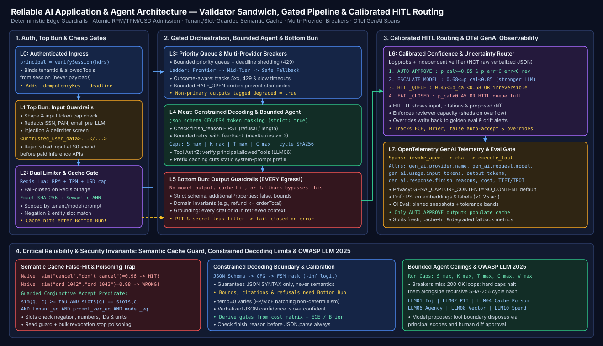
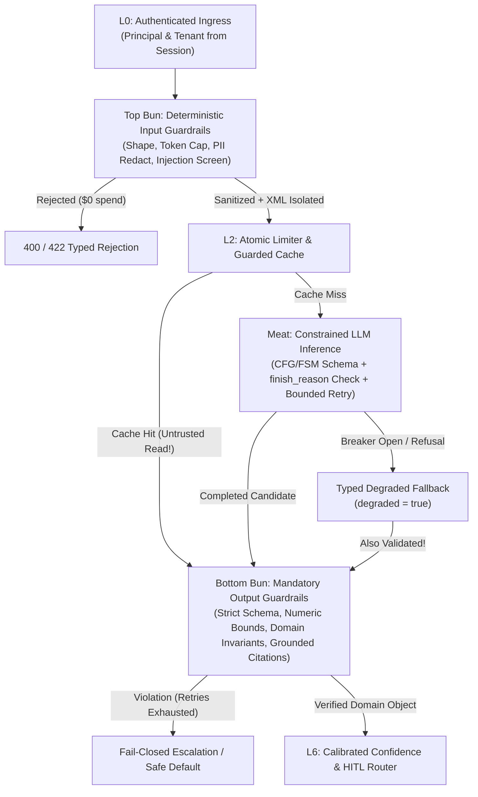
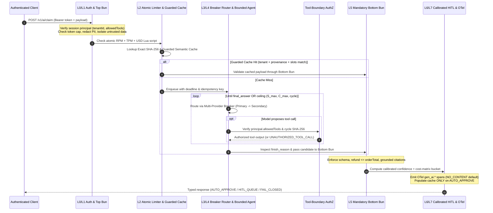
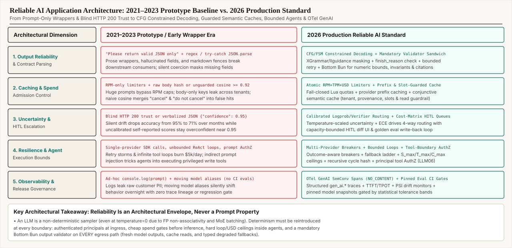

# Module 25: Reliable AI Systems — Validator Sandwich, Guarded Semantic Caching, Calibrated HITL Routing, and Bounded Agent Architectures

Deploying a Large Language Model (LLM) or autonomous tool-using agent in production shifts system design from **deterministic execution** to **probabilistic sampling wrapped inside deterministic envelopes**. In traditional distributed software, identical inputs against identical state produce identical outputs, failures throw explicit exceptions or non-`2xx` status codes, and per-request compute cost is micro-pennies. In an LLM-backed application, identical prompts at `temperature = 0` still exhibit non-determinism across batched GPU inference runs, subtle model or data drift silently degrades decision quality while returning HTTP `200 OK` with fluent prose, and a single runaway retry loop or unbounded agent trajectory can burn thousands of dollars in minutes. Reliability in production AI systems is therefore an **architectural property of the deterministic boundaries surrounding the model**, never a prompt-engineering property of the model itself.

This module establishes the end-to-end engineering design for **Reliable AI Application and Agent Systems** operating above the GPU inference layer. We dissect the three foundational production failure classes (**Contract & Schema Instability**, **Silent Accuracy Drift**, and **Uncontrolled Token/Loop Economics**), derive exact per-request cost, caching break-even, latency (`TTFT`/`TPOT`), and calibration (`ECE`/`Brier`/`PSI`) formulas, formalize the **Validator Sandwich Pattern** with grammar-constrained decoding (`CFG`/`FSM`) and mandatory egress validation across every code path, design **OpenTelemetry GenAI** observability and cost-matrix **Human-in-the-Loop (HITL)** uncertainty routing, build **Gated Admission Pipelines** combining atomic `RPM + TPM + USD` rate limiting with **Slot- and Tenant-Guarded Semantic Caching**, and enforce **Bounded Agent Execution** mapped systematically to the **OWASP Top 10 for LLM Applications (2025)**.

> [!NOTE]
> **Cross-Track Knowledge Ownership.** Low-level LLM inference serving internals (prefill vs. decode phases, KV-cache VRAM sizing, PagedAttention, continuous batching, and GPU cluster scheduling) belong to [Module 14 §6](14-canonical-designs-transactional-and-staff.md#6-llm-serving--chatgpt-architecture-modern-2026-staff-design). General distributed rate-limiting algorithms, queueing theory, retry storms, and circuit-breaker primitives belong to [Module 08](08-rate-limiting-load-shedding-and-resilience.md). Multi-window multi-burn-rate SLO math and disaster-recovery mechanics belong to [Module 11](11-reliability-slos-observability-and-dr.md). General cryptography, authentication, authorization engines (RBAC/ABAC/ReBAC), and web/API OWASP vulnerability internals belong to [`architecture/security-identity`](../../security-identity/README.md) (specifically [`10-authorization-models.md`](../../security-identity/modules/10-authorization-models.md) and [`11-web-and-api-vulnerability-classes.md`](../../security-identity/modules/11-web-and-api-vulnerability-classes.md)). This module owns **Reliable AI Application & Agent Systems Architecture** above the inference engine: the Validator Sandwich, constrained-decoding guarantee boundaries, semantic-cache false-hit and poisoning defenses, calibrated HITL uncertainty routing, OTel GenAI application instrumentation, and bounded agent tool-execution governance.



---

## 1. Probabilistic Failure Taxonomy, Capacity Math, and Primary Literature

### 1.1 Deterministic Software vs. Probabilistic AI Application Mechanics

A core placement heuristic governs every production AI architecture: **if a decision can be expressed deterministically with an `if`-statement, type check, regular expression, or lookup table, never delegate it to an LLM**. Reserve probabilistic inference strictly for resolving ambiguity over unstructured natural language, multimodal inputs, or open-ended synthesis, and reintroduce determinism at every ingress, orchestration, tool, and egress boundary.

| Engineering Dimension | Deterministic Backend Service | Probabilistic LLM / Agent Application | Architectural Consequence |
| --- | --- | --- | --- |
| **Input-to-Output Mapping** | Pure function $f(x, s) \to y$ (bit-for-bit reproducible) | Token-by-token sampling $y_t \sim P_\theta(\cdot \mid x, y_{<t})$ | Even at `temperature = 0`, outputs vary due to non-associative `BF16`/`FP16` reduction order across dynamic GPU batch sizes and Mixture-of-Experts (`MoE`) capacity-factor routing |
| **Contract Stability** | Compiler-checked wire types (Protobuf, TypeScript, OpenAPI) | Free-text distribution over formatting styles unless token-masked | Unconstrained models alternate between bare strings, prose wrappers, markdown fences, and extra keys, breaking downstream parsers |
| **Failure Visibility** | Loud: exceptions, HTTP `5xx`, non-zero exit codes, stack traces | Silent: HTTP `200 OK`, low latency, fluent hallucinated reasoning | Traditional RED telemetry (Rate, Errors, Duration) stays green while business accuracy drops from `95%` to `71%` |
| **Testing & CI Gates** | Deterministic unit assertions (`assert.equal(actual, expected)`) | Statistical evaluation over golden datasets with tolerance bands | Regressions require offline eval suites, pinned model snapshots, and shadow/canary comparisons rather than single exact-string assertions |
| **Unit Economics** | Sub-microdollar CPU/RAM per request; fixed cluster capex | Variable per-token API or GPU spend (`$0.001–$0.50+` per workflow) | Rate limiting shifts from protecting CPU saturation to protecting the wallet (`RPM + TPM + USD` ceilings) |
| **Trust Boundary** | Code (`SQL`/templates) structurally separated from user data | System instructions and untrusted user text share one token stream | Prompt injection (`LLM01`) and excessive agency (`LLM06`) require enforcing authorization in deterministic code at the tool boundary |

### 1.2 Three Production Failure Classes: Contract, Silent Drift, and Economic Blowup

Production AI incidents cluster into three orthogonal failure modes that require distinct architectural defenses:

1. **Failure Mode 1 — Inconsistent Outputs (Contract Violations & Non-Determinism)**:
   - Unconstrained generation samples across response _styles_ as well as facts. A support-triage prompt requesting a customer email can return `"alice@example.com"` on Monday, `"The email address is alice@example.com."` on Tuesday, `"Alice Smith"` (wrong entity) on Wednesday, and nested markdown-fenced JSON on Thursday. Every response appears reasonable to a human reader yet breaks deterministic routing, database writes, or downstream workflow triggers.
   - Crucially, **setting `temperature = 0` does not restore determinism** on modern hosted or self-hosted serving engines. Continuous batching groups concurrent requests into variable-sized matrix multiplications (`GEMM`), changing floating-point accumulation order (`(a + b) + c !== a + (b + c)` in IEEE-754 `FP16`/`BF16`), while sparse Mixture-of-Experts (`MoE`) layers route tokens across experts under batch-dependent capacity limits. A slight logit tie-break flip at token 12 cascades into an entirely different suffix.
2. **Failure Mode 2 — Silent Failures (Confident Hallucinations & Model/Data Drift)**:
   - Accuracy is a time-varying function of the input distribution $P_t(X)$, the prompt template, and the serving provider's backend model weights. Suppose an invoice classifier achieves `95%` accuracy at launch against 2024 vendor templates. Over eighteen months, vendors introduce multi-page summaries and new tax layouts, or a provider silently updates an unpinned model alias (`gpt-4o-mini` instead of a dated snapshot). Accuracy decays to `71%` with zero exceptions, normal latency, and `0.0%` HTTP `5xx` errors, corrupting thousands of records before a quarterly audit surfaces the drift.
   - Compounding the risk, LLMs produce **confident wrong outputs** (`LLM09: Misinformation`): fluent, grammatically spotless JSON accompanied by plausible fabricated citations and a self-reported `"confidence": 0.96`. Without calibrated uncertainty signals, independent verification, and continuous drift instrumentation, silent failure is indistinguishable from healthy operation.
3. **Failure Mode 3 — Uncontrolled Costs & Scaling Bottlenecks (Token Amplification & Runaway Loops)**:
   - Cost blowups arise from four distinct mechanics: (a) **Linear Unit-Cost Misestimation** (a `10`-ticket prototype costing `$0.50` scales to `$500/day` at `10,000` tickets if routed unnecessarily to a frontier model); (b) **Retry & Agent Loop Amplification** (an unbounded validation retry loop or autonomous ReAct agent stuck calling a tool repeatedly turns a `$0.02` request into a `$5,000/day` billing spike — a retry storm with a direct monetary invoice attached); (c) **Quadratic Prefill Context Growth** (appending full conversation history and raw tool JSON payloads into every agent turn grows prompt length $L$ linearly per step, pushing cumulative prefill compute toward $O(\sum_{k=1}^{S} (k \cdot \Delta L)^2)$ and blowing up both input-token bills and Time-to-First-Token); and (d) **Rate-Limit Cascades** (long `10–30 s` LLM response times exhaust connection pools and trigger provider HTTP `429` cascades across tenants when requests are not queued and shed under backpressure).

### 1.3 Token, Cost, and Latency Back-of-the-Envelope Equations

Every reliable AI architecture must budget **cost per request**, **effective gated cost under caching**, **end-to-end streaming latency**, and **calibration error** quantitatively before writing orchestration code.

1. **Exact Per-Request Inference Cost (Prefix Caching + Reasoning Tokens)**: Modern providers bill uncached input tokens at $p_{\text{in}}$, cached prompt-prefix tokens at a discounted rate $p_{\text{cache}}$ (typically `10%–25%` of $p_{\text{in}}$), and **both visible output tokens and hidden chain-of-thought reasoning tokens** at the higher output rate $p_{\text{out}}$ (all prices per `1,000,000` tokens):

   $$\text{Cost}_{\text{req}} = \frac{T_{\text{in}} - T_{\text{cached}}}{10^6} \cdot p_{\text{in}} + \frac{T_{\text{cached}}}{10^6} \cdot p_{\text{cache}} + \frac{T_{\text{out}} + T_{\text{reason}}}{10^6} \cdot p_{\text{out}}$$

2. **Multi-Turn Agent Context Amplification**: An agent executing $S$ sequential steps without context compaction, where an initial prompt of $L_0$ tokens grows by $\Delta L$ tokens of tool output per step (assuming no prefix cache hit on the growing tail), bills input tokens quadratically in step count $S$:

   $$T_{\text{in,total}}(S) = \sum_{k=0}^{S-1} (L_0 + k \cdot \Delta L) = S \cdot L_0 + \frac{S(S - 1)}{2} \cdot \Delta L$$

   At $L_0 = 2{,}000$, $\Delta L = 1{,}500$, and $S = 20$ runaway steps, a single request consumes $20 \times 2{,}000 + 190 \times 1{,}500 = \mathbf{325{,}000}$ input tokens — over `160x` the first step's prompt size.

3. **Gated Cache Break-Even Economics**: With cache hit rate $h \in [0, 1]$, miss inference cost $C_{\text{miss}}$, cache-hit serving cost $C_{\text{hit}}$, and per-request embedding/ANN lookup overhead $C_{\text{lookup}}$, the effective per-request cost and break-even condition are:

   $$C_{\text{eff}} = (1 - h) \cdot C_{\text{miss}} + h \cdot C_{\text{hit}} + C_{\text{lookup}}, \qquad \text{profitable} \iff h \cdot (C_{\text{miss}} - C_{\text{hit}}) > C_{\text{lookup}}$$

4. **Streaming Latency Decomposition (`TTFT` + `TPOT`)**: As detailed in [Module 14 §6](14-canonical-designs-transactional-and-staff.md#6-llm-serving--chatgpt-architecture-modern-2026-staff-design), wall-clock completion time decomposes into queue wait plus prefill (`TTFT`, Time-to-First-Token) and memory-bandwidth-bound autoregressive decode (`TPOT`, Time-Per-Output-Token):

   $$T_{\text{total}} = T_{\text{guard-in}} + \text{TTFT}(T_{\text{in}}) + N_{\text{out}} \cdot \text{TPOT} + T_{\text{guard-out}}$$

5. **Worked Daily Capacity & Cost Sizing (`100,000 Requests/Day`)**:

| Architecture Posture (`100,000 req/day`, `2,000` in / `400` out tokens) | Effective Retry / Step Multiplier | Cache Hit Rate ($h$) | Model Unit Pricing (`$2.50/1M` in, `$10.00/1M` out) | Daily Token Volume | Daily Inference Cost (`USD`) |
| --- | :-: | :-: | :-: | :-: | :-: |
| **1. Ungated Frontier Wrapper (Naive Retries)** | `1.5x` | `0%` | `$0.0090 / call` | `360M tokens/day` | **`$1,350 / day`** (`$40.5k / mo`) |
| **2. Gated Exact + Semantic Cache (`h = 35%`)** | `1.0x` | `35%` | `$0.0090 / miss` + `$0.00001` lookup | `156M tokens/day` | **`$586 / day`** (`56.6%` savings) |
| **3. Tiered Router (`80%` Mid-Tier + `20%` Frontier) + `70%` Prefix Cache** | `1.0x` | `35%` | Blended `$0.0021 / miss` | `156M tokens/day` | **`$138 / day`** (`89.8%` savings) |
| **4. Runaway Unbounded Agent Bug (`S = 20` loop on `2%` of traffic)** | `20x` on `2%` | `0%` | Growing context (`325k` in/run) | `650M+ tokens/day` | **`$2,100+ / day`** (unbounded blast!) |

### 1.4 Primary Literature & Specification Matrix

| Source / Specification | Year | Core Mechanism | Why It Matters Here |
| --- | :-: | --- | --- |
| **OWASP Top 10 for LLM Applications (`v2025`)** (`genai.owasp.org`) | 2025 | Standardized threat taxonomy `LLM01` (Prompt Injection) through `LLM10` (Unbounded Consumption), plus the OWASP Agentic Security Initiative | Anchors every ingress filter, cache isolation rule, budget cap, and tool-execution authorization boundary |
| **OpenTelemetry GenAI Semantic Conventions** (`open-telemetry/semantic-conventions-genai`) | 2024–2026 | Vendor-neutral span/metric schema (`gen_ai.provider.name`, `gen_ai.usage.*`, `gen_ai.response.finish_reasons`, `OTEL_INSTRUMENTATION_GENAI_CAPTURE_CONTENT`) | Replaces ad-hoc PII-leaking log lines with structured, privacy-safe request/inference/tool trace hierarchies |
| **Dong et al. — _XGrammar_ & Willard/Louf — _Outlines_** | 2023–2025 | Compiling JSON Schema / CFG into pushdown automata and vocabulary-trie token masks (`-∞` logit masking) | Explains the exact guarantee boundary of Structured Outputs: syntactic validity without semantic or numeric-bound enforcement |
| **Guo et al. — _On Calibration of Modern Neural Networks_** (_ICML_) | 2017 | Expected Calibration Error (`ECE`), reliability diagrams, and post-hoc temperature scaling | Proves why raw neural confidence scores are overconfident and formalizes calibration before threshold routing |
| **Kuhn, Gal & Farquhar — _Semantic Uncertainty_** (_ICLR_) | 2023 | Clustering multi-sample outputs by bidirectional entailment to compute semantic entropy | Shows how to measure meaning-level uncertainty immune to surface phrasing paraphrases |
| **OpenAI Structured Outputs Specification** (`platform.openai.com`) | 2024–2026 | Grammar-constrained decoding for completed, non-refusal outputs with explicit caller responsibility for `finish_reason` and business rules | Debunks the misconception that `strict: true` auto-retries or guarantees domain invariants |

---

## 2. The Validator Sandwich Pattern: Deterministic Brackets Around Probabilistic Inference

The **Validator Sandwich** treats the LLM as an untrusted, probabilistic "meat" layer enclosed between two mandatory deterministic layers: the **Top Bun** (input guardrails executed before spending a single cent on inference) and the **Bottom Bun** (output guardrails executed on **every** egress path before any state mutation or client reply).



### 2.1 Top Bun: Input Guardrails, PII Redaction, and Prompt-Injection Isolation

Every request enters a zero-cost deterministic gate before touching rate-limit quota or paid provider APIs:

1. **Authenticated Principal Binding (Never Trust Payload Identity)**:
   - Derive `tenantId`, `principalId`, and `allowedTools` exclusively from the verified session/OAuth token (see [`architecture/security-identity/modules/10-authorization-models.md`](../../security-identity/modules/10-authorization-models.md)). Reading `ticket.userId` from the JSON request body lets an attacker rotate arbitrary identifiers to bypass per-user quotas or probe another tenant's cache partition.
2. **Shape, Encoding, and Token-Budget Caps**:
   - Enforce minimum/maximum byte lengths, UTF-8 normalization (stripping invisible zero-width Unicode smuggling characters), and an explicit **input token ceiling** (`maxInputTokens`). A `10,000`-character body is only a byte cap; pathological punctuation or dense identifiers can expand to `5,000+` tokens and inflate quadratic prefill latency.
3. **Deterministic PII Redaction Before External Egress**:
   - Strip or tokenize high-risk PII (`SSN`, `16`-digit payment card PANs, email addresses, API keys) into deterministic placeholders (`[REDACTED_SSN]`, `[REDACTED_EMAIL]`) _before_ transmitting prompts to third-party inference APIs or writing telemetry spans (`LLM02: Sensitive Information Disclosure`).
4. **Prompt-Injection Screening vs. Structural Isolation (Why Regex Alone Is Insufficient)**:
   - Naive tutorials implement prompt-injection defense purely as a regex blocklist matching `"ignore previous instructions"`. **Critique**: regex-only filters are trivially bypassed by Base64/rot13 encoding, multilingual translation, homoglyphs, indirect injection embedded inside retrieved RAG documents or HTML emails, and split-token smuggling.
   - Production defense uses **defense-in-depth**: (a) a fast deterministic pre-filter to drop obvious script-kiddie attacks at `$0` spend; (b) **strict instruction-vs-data delimiter isolation** (escaping closing tags and wrapping untrusted text inside `<untrusted_user_data>...</untrusted_user_data>` or provider-native role/spotlight channels); (c) optional lightweight classifier screening for indirect injection on retrieved chunks; and (d) **treating the model output as permanently untrusted** so that even a successful prompt injection cannot violate Bottom-Bun business invariants or widen tool-execution privileges!

### 2.2 The Meat: Constrained Structured Outputs (`CFG` / `FSM`) vs. Naive Post-Hoc Parsing

Asking a model in prose to _"please return valid JSON only"_ fails non-locally whenever the model emits a preamble (`"Sure! Here is the JSON:"`), wraps output in markdown fences, or invents extra keys. Modern inference engines solve syntactic serialization via **Grammar-Constrained Decoding**:

1. **Underlying Mechanics (JSON Schema $\to$ CFG $\to$ Pushdown Automaton $\to$ Vocabulary-Trie FSM)**:
   - Engines such as **XGrammar**, **Outlines**, **llguidance**, and the guided-decoding backends of **vLLM**, **SGLang**, and **TensorRT-LLM** compile a strict JSON Schema (`additionalProperties: false`, all fields in `required`) into a Context-Free Grammar (`CFG`), then into a pushdown automaton / finite-state mask over the model's tokenizer vocabulary trie (often `100,000–256,000` tokens).
   - At every autoregressive decode step $t$, the FSM computes the bitmask of grammatically valid next tokens and sets the logits of every invalid token to $-\infty$ prior to `softmax` sampling. The model **physically cannot emit a syntactically invalid token**.
   - First-use grammar compilation incurs latency (`10–100 ms`) and is cached per schema hash; dynamically generating a slightly different schema per request defeats the grammar cache and wrecks `TTFT`.
2. **Exact Guarantee Boundaries & Critiquing Naive Reference-Code Myths**:
   - **Myth 1: _"Structured outputs are GUARANTEED to succeed and the API retries internally."_** — **False.** Verified against OpenAI's Structured Outputs specification, constrained decoding guarantees syntactic adherence _only for completed, non-refusal generations_. There is **no automatic internal retry**. If generation hits `max_tokens` (`finish_reason: "length"`), the JSON is truncated mid-object; if a safety classifier triggers (`finish_reason: "refusal"` or `"content_filter"`), the payload is non-conforming. **Always inspect `gen_ai.response.finish_reasons` before calling `JSON.parse`**, and fail closed immediately on `refusal` instead of wasting retries.
   - **Myth 2: _"JSON Schema enforces numeric ranges and domain logic."_** — **False.** Expressing arbitrary numeric ranges (`0 <= confidence <= 1`) or cross-field invariants (`refundAmountCents <= orderTotalCents`) as a token-level digit automaton is expensive and unsupported by most hosted constrained decoders. `{"action":"approve_refund","refundAmountCents":999999}` is 100% grammar-legal against an `integer` schema field.
   - **Myth 3: _Grammar masking is free of quality bias._** — Over-constrained schemas force rigid field ordering; putting a `"decision"` enum _before_ a `"reasoning"` field forces the model to commit to an answer before computing intermediate chain-of-thought tokens, measurably degrading accuracy on complex reasoning tasks. Furthermore, speculative decoding draft models must share the identical FSM mask or token acceptance rates collapse.
   - **Reference-Code Defect Audit**: Naive tutorials frequently publish broken integration snippets where the `json_schema` sets `additionalProperties: false` over `["category", "confidence", "priority"]` while the downstream output validator demands a `"reasoning"` field (causing **100% runtime failure**), or read `classification.tokensUsed` off the schema-parsed object even though token usage lives exclusively on the outer API response envelope (producing `NaN` cost telemetry!).
3. **Bounded Retry-with-Error-Feedback**:
   - When a response fails `finish_reason: "length"`, JSON syntax, or a deterministic Bottom-Bun check, execute at most `maxRetries` (typically `1–2`) repair calls injecting the exact machine-readable violation (`"Output failed deterministic guardrail (POLICY_REFUND_EXCEEDS_ORDER_TOTAL)"`). Never loop unboundedly; after `maxRetries` exhausted attempts, terminate fail-closed.

### 2.3 Bottom Bun: Mandatory Output Guardrails on Every Egress Path

A critical structural defect in naive implementations is the **Leaky Sandwich**: fresh LLM responses pass through the output validator, while **cache reads** (`JSON.parse(redisVal)`) and **circuit-breaker fallbacks** (`{ category: "other", confidence: 0 }`) return directly to the caller, bypassing validation and breaking the typed contract. In a production Validator Sandwich, **no egress path — fresh generation, retry repair, cache hit, or degraded fallback — may bypass the Bottom Bun**.

| Output Guardrail Class | Concrete Invariant Checked | Why CFG / JSON Schema Alone Cannot Enforce It |
| --- | --- | --- |
| **1. Strict Schema & Key Closure** | Exact required keys, zero undeclared properties (`additionalProperties: false`), integer/enum type checks | Protects against cached-object schema drift, non-constrained fallback providers, and corrupted writes |
| **2. Numeric & Range Bounds** | `refundAmountCents >= 0`, `confidence ∈ [0, 1]`, `priority ∈ [1, 5]` | Most hosted CFG decoders drop `minimum`/`maximum` constraints silently |
| **3. Cross-Field Business Invariants** | `refundAmountCents <= input.orderTotalCents`; if `action !== 'approve_refund'` then `refundAmountCents === 0` | Dynamic per-request ceilings (`orderTotalCents`) belong to runtime domain state, not static schemas |
| **4. Grounding & Citation Verification** | Every `citationId` emitted MUST exist in `input.sourceContextIds` retrieved from the authoritative store | Prevents hallucinated policy references (`LLM09`) and prompt-injected fabricated justifications |
| **5. Egress Leakage & Encoding Filter** | Zero unredacted PII (`SSN`/`PAN`/email), zero system-prompt secret markers (`LLM07`), safe output encoding before HTML/SQL sinks (`LLM05`) | Stops the model from echoing memorized sensitive data or injecting XSS/SQL payloads into downstream sinks |

Below is the verified `ValidatorSandwichPipeline.validateEgress` implementation from [`examples/lib/reliable-ai-models.ts`](../examples/lib/reliable-ai-models.ts):

```typescript
  public validateEgress(
    candidate: unknown,
    input: SupportClaimInput,
  ): { ok: true; decision: RefundDecisionPayload } | { ok: false; reason: string } {
    if (typeof candidate !== 'object' || candidate === null || Array.isArray(candidate)) {
      return { ok: false, reason: 'SCHEMA_NOT_OBJECT' };
    }
    const record = candidate as Record<string, unknown>;
    for (const key of Object.keys(record)) {
      if (!ALLOWED_DECISION_KEYS.has(key)) {
        return { ok: false, reason: `SCHEMA_UNEXPECTED_PROPERTY:${key}` };
      }
    }
    // ... structural type & integer checks ...

    // Domain Business Invariant 1: Refund cannot exceed order total
    if (refundAmountCents > input.orderTotalCents) {
      return { ok: false, reason: 'POLICY_REFUND_EXCEEDS_ORDER_TOTAL' };
    }
    // Domain Business Invariant 2: Non-approval cannot emit positive payout
    if (action !== 'approve_refund' && refundAmountCents !== 0) {
      return { ok: false, reason: 'POLICY_NON_APPROVAL_WITH_PAYOUT' };
    }
    // Domain Business Invariant 3: Grounding check — every citation MUST exist in retrieved context
    const allowedCitations = new Set(input.sourceContextIds);
    if (action !== 'escalate' && citationIds.length === 0) {
      return { ok: false, reason: 'UNGROUNDED_MISSING_CITATION' };
    }
    for (const id of citationIds) {
      if (!allowedCitations.has(id)) {
        return { ok: false, reason: `UNGROUNDED_CITATION:${id}` };
      }
    }
    // ... secret marker & PII egress leakage checks ...
    return { ok: true, decision: { action, refundAmountCents, citationIds: [...citationIds], reasoning: reasoning.trim() } };
  }
```

---

## 3. Observable AI Pipelines, Calibrated Uncertainty, and Human-in-the-Loop (HITL) Routing

### 3.1 OpenTelemetry GenAI Semantic Conventions and Privacy-Safe Telemetry

Silent degradation cannot be caught by HTTP status codes alone. Replace bespoke `logger.log({ prompt, userId, latency })` statements with a hierarchical **OpenTelemetry GenAI** distributed trace (`invoke_agent` $\to$ `chat` $\to$ `execute_tool` / `retrieval`) carrying standardized semantic-convention attributes and metric instruments. Note that the `open-telemetry/semantic-conventions-genai` specification remains in `Development` status: pin an explicit semconv version across services and separate fresh, cache-hit, and degraded fallback spans via a first-class `degraded` attribute.

| Telemetry Dimension | OpenTelemetry GenAI Attribute / Metric Instrument | Operational Purpose & Governance Rule |
| --- | --- | --- |
| **Provider & Model Lineage** | `gen_ai.provider.name` (supersedes `gen_ai.system`), `gen_ai.request.model`, `gen_ai.response.model`, `gen_ai.response.id` | Detects silent provider alias upgrades by comparing requested vs. actual served model snapshot ID |
| **Operation Taxonomy** | `gen_ai.operation.name` (`chat`, `embeddings`, `execute_tool`, `invoke_agent`, `retrieval`) | Breaks down agent wall-clock latency across LLM thinking time vs. external tool I/O |
| **Token & Cost Accounting** | Span attrs `gen_ai.usage.input_tokens`, `gen_ai.usage.output_tokens`, `gen_ai.usage.cache_read.input_tokens`; metric `gen_ai.client.token.usage` (or `gen_ai.client.inference.usage.*`) | Computes exact per-tenant USD spend and prefix-cache hit ratios from provider envelopes, never from model JSON |
| **Streaming Latency** | `gen_ai.client.operation.duration` (histogram, unit `s`), `gen_ai.server.time_to_first_token` (`TTFT`), `gen_ai.server.time_per_output_token` (`TPOT`) | Isolates prefill/queue congestion (`TTFT`) from decode memory-bandwidth saturation (`TPOT`) |
| **Terminal & Guardrail Signals** | `gen_ai.response.finish_reasons`, plus app counters `ai.guardrail.rejections`, `ai.cache.result`, `ai.degraded.fallbacks` | Surfaces truncation bursts (`length`), safety refusals (`refusal`), and Bottom-Bun policy rejections immediately |
| **Privacy & Content Capture** | `OTEL_INSTRUMENTATION_GENAI_CAPTURE_CONTENT` (`NO_CONTENT` default; opt-in `SPAN_ONLY` / `EVENT_ONLY`) + `gen_ai.*_ref` blob URIs | **Never log raw prompts or PII into general trace backends by default**; store opt-in encrypted payloads in access-controlled object storage referenced by URI |

### 3.2 Why Verbalized LLM Confidence Fails: Calibration, ECE, Brier Score, and Drift

A pervasive anti-pattern in introductory AI tutorials is asking the LLM to emit `"confidence": 0.92` inside its JSON output and wiring automated approval thresholds (`> 0.8` auto-execute) directly to that field. Empirical evaluations consistently show that **verbalized self-reported confidence is systematically overconfident, prompt-sensitive, and uncalibrated**: a model can emit `0.95` on `90%` of requests while achieving only `60%` empirical accuracy.

| Uncertainty Signal | Acquisition Method | Cost Multiplier | Calibration & Reliability Profile |
| --- | --- | :-: | --- |
| **Verbalized JSON Confidence** | Prompted field in JSON output | `1x` | **Weakest signal** — biased toward `0.85–0.99`; never use as a sole execution gate |
| **Token Log-Probabilities (`logprobs`)** | Mean/min log-prob over decision tokens from API response | `1x` | Fast and informative on classification/enum tokens; sensitive to tokenization length; requires temperature scaling |
| **Multi-Sample Self-Consistency** | Sample $k$ completions (`temp > 0`) and compute majority-vote agreement | `k×` (`3x–5x`) | Strong on reasoning and extraction; misses systematic shared hallucinations if all samples paraphrase identically |
| **Semantic Entropy (Kuhn et al.)** | Cluster $k$ samples by bidirectional NLI entailment, compute entropy over cluster probability mass | `k×` + NLI | Robust to surface phrasing variation; accurately flags high epistemic uncertainty |
| **Independent Cross-Family Verifier** | Second model (different provider/family) or deterministic solver checks claims against retrieved evidence | `~1.2x–2x` | Best defense against fluent hallucinations (`LLM09`); breaks correlated single-model blind spots |
| **Downstream Ground-Truth Join** | Human overrides, ticket reopens, chargebacks, customer escalations | Delayed | Only true accuracy ground truth; drives periodic recalibration and eval-set refresh |

Before any uncertainty score gates production actions, measure calibration on a held-out labelled validation set using **Expected Calibration Error (`ECE`)** across $M$ confidence bins $B_m$ and **Brier Score**, and monitor input-embedding or output-label distribution drift continuously using **Population Stability Index (`PSI`)**:

$$\text{ECE} = \sum_{m=1}^{M} \frac{|B_m|}{n} \left| \text{acc}(B_m) - \text{conf}(B_m) \right|, \qquad \text{Brier} = \frac{1}{n} \sum_{i=1}^{n} (p_i - y_i)^2$$

$$\text{PSI} = \sum_{b=1}^{B} (p_b - q_b) \cdot \ln\!\left(\frac{p_b}{q_b}\right) \qquad (\text{PSI} < 0.10\text{: stable},\; 0.10\text{–}0.25\text{: watch},\; > 0.25\text{: act / re-eval})$$

Apply post-hoc **temperature scaling** ($\hat{p} = \sigma(\text{logit}(p) / T)$ with $T > 1$ fitted on the validation set) or **isotonic regression** so that a calibrated score of `0.85` empirically corresponds to `85%` accuracy.

### 3.3 Cost-Matrix Uncertainty Routing and Capacity-Bounded HITL Architecture

Hardcoded universal thresholds (`0.8` / `0.6`) ignore asymmetric business impact: misclassifying a low-priority FAQ costs `$0.20`, whereas approving a fraudulent `$5,000` wire refund costs `$5,000`. Derive routing decisions from a **cost-sensitive decision rule** combining calibrated error probability $p_{\text{err}}(x) = 1 - \hat{p}(x)$ with expected error impact $C_{\text{err}}$, escalation model cost $C_{\text{esc}}$, and human review cost $C_{\text{review}}$:

$$\text{Auto-Approve} \iff \hat{p}(x) \ge \tau_{\text{auto}} \;\land\; p_{\text{err}}(x) \cdot C_{\text{err}} < C_{\text{review}} \;\land\; \neg\text{irreversible}(x)$$

| Routing Band | Trigger Condition | Operational Action & SLA | Cost & Staffing Role |
| --- | --- | --- | --- |
| **1. `AUTO_APPROVE`** | High calibrated score ($\hat{p} \ge \tau_{\text{auto}}$), expected error cost $< C_{\text{review}}$, reversible action | Execute authorized action directly; sample `1%–5%` asynchronously for human shadow audit | `$0` review cost; monitors `false_auto_accept_rate` and `override_rate` |
| **2. `ESCALATE_MODEL`** | Moderate uncertainty ($\tau_{\text{esc}} \le \hat{p} < \tau_{\text{auto}}$) or high monetary impact | Re-run with stronger frontier model or cross-family verifier before disturbing human reviewers | Pays `~$0.02–$0.08` extra compute to save `$2.50+` human review cost |
| **3. `HITL_QUEUE`** | Uncertain ($\tau_{\text{hitl}} \le \hat{p} < \tau_{\text{esc}}$) **or** any high-risk irreversible write/payment | Enqueue into priority-ordered reviewer queue with input, citations, and rendered action diff | Bounded by finite reviewer staffing throughput (`maxHitlQueueDepth`); overrides write back to golden eval set! |
| **4. `FAIL_CLOSED`** | Very low confidence ($\hat{p} < \tau_{\text{hitl}}$), guardrail/refusal failure, or HITL queue overflow | Return typed safe fallback / defer without mutating state; fire drift alert if rate spikes | Protects downstream data integrity and prevents reviewer queue collapse during model outages |

**Operationalizing HITL Without Collapsing Under Volume**: Routing `30%` of `100,000` daily requests to humans demands `30,000` daily reviews — a staffing budget, not a free architectural escape hatch. Production HITL requires: (1) **priority scoring** (`impactUsd × uncertainty`) instead of naive FIFO so high-value claims are reviewed first; (2) **evidence-rich diff UIs** displaying redacted input, retrieved source citations, and exact proposed state mutation; (3) **capacity shedding** (`FAIL_CLOSED` or deferred SLA response when queue depth breaches `maxHitlQueueDepth`); and (4) a **closed-loop feedback pipeline** writing every human override back into the CI golden eval dataset and prompt/schema version registry so model upgrades cannot regress previously corrected edge cases.

Below is the verified `ConfidenceHitlRouter.calibrate` and `route` logic from [`examples/lib/reliable-ai-models.ts`](../examples/lib/reliable-ai-models.ts):

```typescript
  public calibrate(signals: UncertaintySignals): {
    calibratedConfidence: number;
    overconfidenceDivergence: number;
  } {
    const lp = Math.max(0.001, Math.min(0.999, signals.logprobScore));
    const va = Math.max(0.001, Math.min(0.999, signals.verifierAgreement));
    const rawBlended = 0.4 * lp + 0.6 * va; // Verbalized score excluded from raising score
    const temp = this.config.calibrationTemperature ?? 1.2;
    const logit = Math.log(rawBlended / (1 - rawBlended));
    const calibrated = 1 / (1 + Math.exp(-(logit / temp)));
    const overconfidenceDivergence =
      signals.verbalizedConfidence !== undefined
        ? Math.max(0, signals.verbalizedConfidence - calibrated)
        : 0;
    return {
      calibratedConfidence: Number(calibrated.toFixed(6)),
      overconfidenceDivergence: Number(overconfidenceDivergence.toFixed(6)),
    };
  }
```

---

## 4. Gated AI Architecture Layers: Admission Control, Semantic Caching, Resilience, and Bounded Agents

Every request must earn the right to incur LLM spend by passing a sequence of cheap deterministic **blast doors** — rate limiting, caching, bounded priority queueing, and multi-provider circuit breaking — before invoking paid inference or agent tools.

### 4.1 Atomic Dual-Dimension Rate Limiting (`RPM + TPM + USD`) and Priority Queues

Standard web rate limiters ([Module 08 §3](08-rate-limiting-load-shedding-and-resilience.md#3-distributed-rate-limiting-architecture)) count requests per minute (`RPM`). In AI workloads, **RPM-only limiting fails catastrophically**: `100` requests of `200` tokens (`20k` tokens) and `100` requests of `100,000` tokens (`10M` tokens) consume identical RPM quota while differing by **`500x` in dollar cost and GPU prefill load**.

1. **Single Atomic Redis/Valkey Lua Script (`RPM + TPM + Tenant USD`)**:
   - Evaluate and debit all three dimensions (`requests + 1 <= maxRPM`, `tokens + estTokens <= maxTPM`, `spendUsd + estUsd <= maxTenantUsd`) inside **one atomic Redis/Valkey Lua script** keyed by authenticated `tenantId` (never payload `userId`). Separate per-user and global limiters executed as two non-atomic RPCs leak user quota on global rejection and serialize all traffic onto a single hot `"global"` shard key (mitigate global hot keys via local-quota batching or sharded counters).
   - After inference completes, reconcile `actualCostUsd - estimatedCostUsd` asynchronously against the tenant's rolling spend ledger, alerting at `80%` of budget and hard-stopping at `100%`.
2. **Fail-Closed Outage Posture**:
   - Explicitly specify limiter behavior when Redis/Valkey is unreachable. Default client libraries (`ioredis` with `enableOfflineQueue: true`) hang indefinitely or fail open — turning a cache outage into unbounded LLM spend. Production AI gateways **fail closed** (or fall back to a strict, conservative in-process token bucket with low hard caps) whenever the distributed limiter is unavailable.
3. **Priority Async Queues, Deadline Shedding, and Idempotency**:
   - Because LLM responses take `2–30 s`, decouple ingress HTTP workers from provider calls via a bounded priority queue (`interactive_high`, `standard`, `batch_offline`) with per-tenant fair-queueing.
   - Enforce four mandatory queue invariants: (a) **bounded depth with `429 Retry-After` shedding** (unbounded queues create unbounded latency and OOM); (b) **explicit end-to-end deadlines** so expired requests are dropped _before_ incurring inference cost; (c) **idempotent `jobId = SHA256(tenantId | idempotencyKey)`** preventing duplicate submissions from double-billing; and (d) **jittered exponential backoff** plus a **Dead-Letter Queue (`DLQ`)** capturing exhausted failures for offline replay and forensics.

### 4.2 Exact Caching, Provider Prefix Caching, and the Semantic Cache False-Hit / Poisoning Trap

AI systems combine three distinct caching layers with sharply different safety guarantees:

| Cache Layer | Match Mechanism | Savings Profile | Primary Failure Mode & Required Guard |
| --- | --- | --- | --- |
| **1. Provider Prompt Prefix Cache** | Exact prefix KV-cache reuse inside GPU serving engine (system prompt + static few-shot + shared docs) | `50%–90%` input cost cut & `2x–5x` faster `TTFT` with **zero answer staleness** | Volatile timestamps or per-user fields placed at the top of the prompt bust the entire prefix cache — always order prompts strictly from static to volatile! |
| **2. Exact Response Cache** | `SHA-256` over `(tenantId, promptVer, modelId, schemaHash, locale, normalizedQuery)` | `100%` inference cost saved on identical repeats | Omitting `promptVer`, `modelId`, `schemaHash`, or `tenantId` serves stale-model answers or leaks cross-tenant data; requires single-flight coalescing + TTL jitter + Bottom-Bun read validation |
| **3. Semantic Embedding Cache** | Vector ANN search (`cosine >= tau`, e.g., `0.92`) over query embeddings | Captures paraphrased repeats (`"reset billing pwd"` vs. `"how to reset billing password"`) | **Semantic False-Hit & Cross-Tenant Poisoning Trap** (see below) + **Embedding Model Drift** on upgrades |

> [!WARNING]
> **The Semantic Cache False-Hit & Cross-Tenant Poisoning Trap.** Dense text embeddings measure _topical proximity_, not _logical or transactional equivalence_. Pairs with opposite operational intent or distinct entity IDs routinely score cosine similarity `0.94–0.99`:
>
> - **Negation Inversion**: `"cancel my subscription"` vs. `"do not cancel my subscription"` $\implies \cos \approx 0.96 \ge 0.92$ (naive semantic cache executes cancellation on a retention request!).
> - **Numeric / Entity Swaps**: `"refund order 1042"` vs. `"refund order 1043"` $\implies \cos \approx 0.98$ (serves Order 1042's private status or executes the wrong refund!).
> - **Unit / Temporal Anchors**: `"10 km"` vs. `"10 miles"`, or `"invoice from last month"` vs. `"invoice from last year"` $\implies \cos > 0.93$.
> - **Cross-Tenant Cache Poisoning (`LLM02` / `LLM04` / `LLM08`)**: An attacker in Tenant B crafts a query near a high-traffic cluster containing an injected instruction; if cached without tenant partitioning or read validation, legitimate Tenant A queries retrieve the attacker's poisoned answer with full authority!

**Formal Conjunctive Accept Predicate**: Similarity is a _necessary_ filter, never a sufficient condition. A guarded semantic cache accepts candidate entry $c$ for query $q$ **if and only if every conjunct holds**:

$$\text{accept}(q, c) \iff \text{sim}(e_q, e_c) \ge \tau \;\land\; \text{slots}(q) = \text{slots}(c) \;\land\; \text{tenant}(q) = \text{tenant}(c) \;\land\; \text{prov}(q) = \text{prov}(c) \;\land\; \neg\text{poisoned}(c) \;\land\; \text{BottomBun}(c.\text{val})$$

where $\text{slots}(\cdot)$ extracts negation polarity, numbers/order IDs, dates, units, and currencies (optionally reinforced by a lightweight cross-encoder NLI entailment check), $\text{prov}(\cdot)$ enforces exact equality on `(promptVersion, modelId, schemaHash, locale)`, and **embedding-model upgrades** version the entire vector index (`index_v1` $\to$ dual-write $\to$ shadow-read $\to$ atomic swap) because vectors from two different embedding models are mathematically incomparable.

Below is the verified conjunctive guard in `SemanticCacheGuard.lookup` from [`examples/lib/reliable-ai-models.ts`](../examples/lib/reliable-ai-models.ts):

```typescript
for (const entry of this.entries) {
  if (now >= entry.expiresAtMs || entry.poisoned) continue;

  const sim = cosineSimilarity(req.embedding, entry.embedding);
  if (sim < this.similarityThreshold) continue;

  if (entry.provenance.tenantId !== req.provenance.tenantId) {
    if (sim > nearestRejectedSim) {
      nearestRejectedSim = sim;
      nearestRejectedReason = 'CROSS_TENANT_ISOLATION_REJECTED';
    }
    continue;
  }

  if (
    entry.provenance.promptVersion !== req.provenance.promptVersion ||
    entry.provenance.modelId !== req.provenance.modelId ||
    entry.provenance.schemaHash !== req.provenance.schemaHash ||
    entry.provenance.locale !== req.provenance.locale
  ) {
    if (sim > nearestRejectedSim) {
      nearestRejectedSim = sim;
      nearestRejectedReason = 'PROVENANCE_MISMATCH_REJECTED';
    }
    continue;
  }

  if (!areSemanticSlotsEquivalent(reqSlots, entry.slots)) {
    if (sim > nearestRejectedSim) {
      nearestRejectedSim = sim;
      nearestRejectedReason = 'SEMANTIC_SLOT_MISMATCH_REJECTED';
    }
    continue;
  }

  if (this.validateOnRead && !this.validateOnRead(entry.value)) {
    if (sim > nearestRejectedSim) {
      nearestRejectedSim = sim;
      nearestRejectedReason = 'READ_GUARDRAIL_FAILED';
    }
    continue;
  }

  if (sim > bestSim) {
    bestSim = sim;
    bestEntry = entry;
  }
}
```

### 4.3 Multi-Provider Bulkhead Circuit Breakers and Degradation Ladders

Hosted LLM APIs experience regional brownouts, silent throughput throttling, and `30 s` tail-latency hangs. A naive in-memory exception counter (`failureThreshold = 3`, no timeout, unbounded `HALF_OPEN`) fails in production for four reasons: (1) a hung provider that holds connections open for `28 s` without throwing never trips an exception-only breaker; (2) a fixed count of `3` trips prematurely on transient blips at `3,000 rps` while `N` stateless pods multiply fleet failures by `N × 3`; (3) unbounded `HALF_OPEN` lets every concurrent caller stampede a recovering provider; and (4) jumping straight from a primary frontier model to a static `"unavailable"` stub destroys availability unnecessarily.

Production LLM gateways implement **per-provider/per-model bulkhead circuit breakers** backed by an ordered **Degradation Ladder**:

1. **Outcome-Aware Failure Classification**: Count HTTP `5xx`, `429` quota exhaustion, **slow-call timeouts (`latencyMs > timeoutMs`)**, and elevated malformed/refusal spikes as circuit failures; open on sliding-window failure rate $r(t) = \text{failures}/\text{total} > r_{\max}$ once $\text{total} \ge n_{\min}$ (or consecutive hard failures in low-volume tenants).
2. **Bounded Jittered `HALF_OPEN` Probing**: Cap in-flight probes (`maxHalfOpenProbes = 1..2`) with jittered cooldowns so fleet replicas do not synchronize probe storms.
3. **Ordered Degradation Ladder with Explicit `degraded: true` Provenance**:
   - **Tier 1**: Primary frontier model (pinned snapshot, Region A) $\to$ **Tier 2**: Cross-provider or cross-region equivalent frontier model $\to$ **Tier 3**: Faster/cheaper mid-tier model (stricter confidence routing) $\to$ **Tier 4**: Validated cached prior response or deterministic rule heuristic $\to$ **Tier 5**: Typed safe fallback routed to `HITL_QUEUE` / `FAIL_CLOSED`, explicitly stamped `degraded: true` so observability never confuses fallback stubs with healthy model output.

### 4.4 Bounded Agent Loops, Tool-Boundary Authorization, and OWASP LLM Top 10:2025 Mapping

A circuit breaker **cannot** stop a runaway autonomous agent! When an agent loops `40` times calling a working search tool with slightly different parameters (or the exact same parameters), every LLM API call and tool invocation returns HTTP `200 OK` — the circuit breaker stays `CLOSED` while the bill explodes. Every agent loop MUST enforce **five hard deterministic ceilings** plus **canonical cycle detection** and **tool-boundary authorization**:

$$\text{steps} \le S_{\max} \;\land\; \text{tool-calls} \le K_{\max} \;\land\; \sum \text{tokens} \le T_{\max} \;\land\; \sum \text{cost-usd} \le C_{\max} \;\land\; \text{wall-ms} \le W_{\max}$$

$$\text{Cycle Guard}: \quad \text{count}\big(\text{SHA256}(\text{toolName} \parallel \text{canonicalSort}(\text{args}))\big) \le R_{\text{repeat}}$$

**The Iron Rule of Agentic Security (Tool-Boundary Authorization)**: **The model proposes; deterministic code disposes.** Never rely on system prompt text (`"Do not delete user accounts"`) to restrict tool access. At the tool execution boundary, verify every proposed tool call against short-lived capability scopes derived from the **authenticated session principal**, reject undeclared tools (`UNAUTHORIZED_TOOL_CALL`), re-derive target resource ownership from the principal (defeating Confused Deputy attacks), enforce allowlisted egress URLs and parameterized queries, attach idempotency keys to all writes, and require explicit **HITL rendered-diff approval** before irreversible external side effects (payments, deletions, external emails).

| OWASP LLM 2025 ID | Risk Category | Concrete Architectural Control in Module 25 |
| --- | --- | --- |
| **`LLM01`** | **Prompt Injection** | Top-Bun pre-filter + XML/role data isolation + treating all model outputs as untrusted at Bottom Bun & tool boundary |
| **`LLM02`** | **Sensitive Information Disclosure** | Pre-inference PII redaction + tenant-partitioned caches + `OTEL_INSTRUMENTATION_GENAI_CAPTURE_CONTENT=NO_CONTENT` default |
| **`LLM03`** | **Supply Chain** | Pinned dated model snapshots (`model-2026-04`, never moving aliases), versioned prompt/schema registries, CI eval gates |
| **`LLM04`** | **Data and Model Poisoning** | Signed provenance cache entries, mandatory Bottom-Bun validation on cache reads, cluster write-to-read anomaly monitoring, bulk revocation |
| **`LLM05`** | **Improper Output Handling** | Strict CFG/FSM schema + Bottom-Bun validation + context-aware encoding/parameterization before HTML, SQL, or shell sinks |
| **`LLM06`** | **Excessive Agency** | Principal-derived `allowedTools` allowlist at tool boundary, least-privilege scoped tokens, mandatory HITL diff approval on irreversible writes |
| **`LLM07`** | **System Prompt Leakage** | Non-secret posture (zero credentials in system prompts) + Bottom-Bun egress marker detection |
| **`LLM08`** | **Vector and Embedding Weaknesses** | Tenant-partitioned ANN indices, conjunctive slot-equivalence guard (negation/IDs/units), versioned index cutover on embedding upgrades |
| **`LLM09`** | **Misinformation** | Mandatory retrieved-context citation grounding checks, calibrated logprob + independent verifier routing, HITL escalation |
| **`LLM10`** | **Unbounded Consumption** | Atomic Redis Lua `RPM + TPM + USD` fail-closed limiters, input token caps, hard agent loop ceilings ($S_{\max}, K_{\max}, C_{\max}, W_{\max}$), cycle hash detection |



---

## 5. Production Gotchas, Quantitative SRE Guardrails, and 2021 vs. 2026 Comparison

### 5.1 Eight High-Severity Production Gotchas

1. **The Leaky Validator Sandwich (Cache & Fallback Bypass)**: Validating fresh LLM outputs while returning `JSON.parse(cached)` or hand-built circuit-breaker fallback objects directly lets corrupted cache entries and schema-mismatched stubs crash downstream consumers. _Fix_: Route every egress — fresh inference, retries, cache hits, and fallbacks — through the identical Bottom-Bun validator and tag fallbacks with `degraded: true`.
2. **Trusting Verbalized LLM Confidence Scores**: Wiring `confidence >= 0.8` directly to a JSON field emitted by the LLM causes silent over-automation because models systematically output `0.90+` even when wrong. _Fix_: Combine token `logprobs` and independent verifier agreement, calibrate via temperature scaling against a held-out set (`ECE < 0.05`), and derive thresholds from a business cost matrix.
3. **Semantic Cache Negation & Cross-Tenant Collisions**: Caching purely by embedding cosine similarity (`>= 0.92`) merges `"cancel"` with `"do not cancel"`, swaps order IDs (`1042` vs. `1043`), and leaks answers across tenants. _Fix_: Enforce the conjunctive accept predicate (`tenant` + `provenance` + `slots` + `BottomBun`).
4. **Unpinned Moving Model Aliases (`gpt-4o-mini` vs. Dated Snapshots)**: Calling floating aliases allows upstream provider weight updates to alter output distributions or token verbosity overnight without a single code commit in your repository. _Fix_: Pin immutable dated model snapshots in configuration, include `modelId` in cache keys and OTel spans, and gate every snapshot bump behind an offline golden eval CI suite.
5. **Calling `JSON.parse` Before Checking `finish_reason`**: Assuming `response_format: json_schema` guarantees valid JSON causes unhandled parse crashes or infinite retry loops on `length` truncations and `refusal` responses. _Fix_: Branch on `gen_ai.response.finish_reasons` first; fail closed immediately on `refusal`/`content_filter`, and apply bounded token-budget adjustment on `length`.
6. **RPM-Only Rate Limiting & Fail-Open Redis Outages**: Request-count limiters let a single tenant submit `100k`-token prompts within RPM limits, while fail-open Redis clients turn a `5`-minute cache outage into thousands of dollars of unthrottled spend. _Fix_: Enforce atomic `RPM + TPM + USD` Lua scripts keyed on authenticated principals with fail-closed (or tight local-bucket) outage behavior.
7. **Unbounded Successful Agent Loops**: Circuit breakers do not trip when an agent loops `50` times making HTTP `200 OK` calls to a provider and tools. _Fix_: Enforce hard per-run ceilings (`S_max`, `K_max`, `T_max`, `C_max`, `W_max`) and canonical `(toolName, sortedArgs)` SHA-256 cycle detection.
8. **Unconditional Prompt Logging Leaking Customer PII**: Writing raw prompts and model outputs into centralized JSON logs violates data residency, GDPR/HIPAA retention rules, and leaks PII (`LLM02`). _Fix_: Default to `OTEL_INSTRUMENTATION_GENAI_CAPTURE_CONTENT=NO_CONTENT`, redact PII at the Top Bun, and store opt-in audit payloads in encrypted, TTL-governed blob storage referenced by URI.

### 5.2 Quantitative SRE Guardrails and SLO Alerting Matrix

Alert burn rates follow the multi-window multi-burn-rate alerting rules in [Module 11 §2](11-reliability-slos-observability-and-dr.md#2-multi-window-multi-burn-rate-alerting-math).

| SLI / Operational Metric | Target SLO / Healthy Band | Alert Threshold & Automated Remediation |
| --- | :-: | --- |
| **Bottom-Bun Guardrail Violation Rate** | `< 0.5%` post-retry | Page P1 if `> 2.0%` over `15 m`; check `gen_ai.response.finish_reasons` for truncation or schema drift |
| **False Auto-Accept / Human Override Rate** | `< 1.0%` on audited `AUTO_APPROVE` | Page P1 if `override_rate > 2.5%`; automatically tighten `autoApproveThreshold` and shift traffic to `HITL_QUEUE` |
| **Calibration Error (`ECE`) & Drift (`PSI`)** | `ECE < 0.05`, `PSI < 0.10` | Warn at `PSI > 0.15`; page & trigger shadow golden-eval run + recalibration if `PSI > 0.25` or `ECE > 0.08` |
| **Provider `TTFT` / `TPOT` & Availability** | `99.9%` gated availability; `TTFT p99 < 1.5 s` | Page at `14.4x` burn rate (`1h/5m`); circuit breaker auto-routes to Tier 2 provider / mid-tier fallback |
| **Tenant Hourly/Daily Spend Velocity** | `< 80%` of `B_tenant` | Warn at `80%` budget; enforce deterministic hard stop (`429`) at `100%` (`LLM10` circuit stop) |
| **Agent Loop Ceiling & Cycle Halt Rate** | `< 0.2%` of runs hitting `S_max` / `CYCLE` | Alert if `> 1.0%`; inspect `execute_tool` spans for broken tool schemas or prompt-injection loops |
| **HITL Queue Depth & Reviewer SLA** | `< 70%` of `maxHitlQueueDepth`; `p95 < 15 min` | Shed low-impact overflow to `FAIL_CLOSED` at `100%` depth; trigger escalation model tier to absorb load |

### 5.3 Technology Comparison: Then vs. Now (2021–2023 vs. 2026)



| Architectural Dimension | 2021–2023 Prototype / Wrapper Baseline | 2026 Production Reliable AI Standard | Why the Industry Shifted |
| --- | --- | --- | --- |
| **Structured Output Enforcement** | Prompted _"Return valid JSON only"_ + regex stripping + fragile `try/catch JSON.parse` | **CFG/FSM Constrained Decoding** (`XGrammar`/`llguidance` `strict: true`) + `finish_reason` check + mandatory **Bottom-Bun** validator | Eliminates syntactic parse failures while explicitly enforcing semantic bounds and citations CFG cannot express |
| **Caching & Spend Control** | RPM-only rate limiters; body-only SHA-256 cache or naive `cosine >= 0.92` semantic cache | **Atomic `RPM + TPM + USD`** fail-closed Lua limiters + **Provider Prefix Caching** + **Tenant/Slot-Guarded Semantic Cache** | Stops `100k`-token RPM bypasses, eliminates negation/entity false hits, and cuts repeated prompt prefill bills `50%–90%` |
| **Uncertainty & Human Oversight** | Blind trust in HTTP `200 OK` or uncalibrated verbalized JSON `"confidence": 0.95` | **Calibrated Logprob + Cross-Family Verifier** scoring (`ECE`/`Brier`) + **Cost-Matrix 4-Way HITL Routing** + eval write-back | Converts silent accuracy drift into measurable, budget-bounded routing decisions with continuous dataset improvement |
| **Agent Loop & Tool Security** | Unbounded `while (!done)` ReAct loops; authorization rules written in system prompt prose | **Hard Per-Run Ceilings (`S_max, K_max, C_max, W_max`)** + SHA-256 cycle detection + **Tool-Boundary Principal AuthZ** (`OWASP LLM06`) | Prevents runaway `$5k/day` billing loops and structurally defeats prompt-injection privilege escalation |
| **Provider Resilience** | Direct single-provider SDK calls with unjittered retries and no slow-call timeouts | **Outcome-Aware Multi-Provider Bulkhead Breakers** + bounded `HALF_OPEN` probes + typed **Degradation Ladder** (`degraded: true`) | Survives regional LLM outages and `30 s` silent hangs without retry storms or masked fallback stubs |
| **Observability & Release Gates** | Ad-hoc `console.log(prompt)` leaking PII; unpinned moving model aliases; vibes-based QA | **OpenTelemetry GenAI SemConv** (`NO_CONTENT` default), pinned dated snapshots, `PSI` drift alerts, and CI golden-eval tolerance gates | Achieves privacy compliance, reproducible incident lineage, and statistical regression gating before deploy |

---

## 6. Executable Proof Map

All five mathematical, architectural, and adversarial security proofs for this module are implemented in pure deterministic TypeScript in [`examples/lib/reliable-ai-models.ts`](../examples/lib/reliable-ai-models.ts) and verified with positive, negative/counterexample, and `fast-check` property tests in [`examples/19-reliable-ai-systems.test.ts`](../examples/19-reliable-ai-systems.test.ts):

| Proof / Test Case | Implementation Symbol | What It Proves |
| --- | --- | --- |
| **1. Token Economics & Calibration Math** | `estimateAiRequestCostUsd`, `estimateWorkloadEconomics`, `computeExpectedCalibrationError`, `computeBrierScore` | Proves exact cached-prefix + reasoning-token billing, gated cache workload savings, and that an overconfident `0.95` model (`60%` accuracy) incurs `ECE = 0.35` vs. `ECE = 0.0` for a calibrated predictor |
| **2. Validator Sandwich & Grounded Egress** | `ValidatorSandwichPipeline` + `fast-check` | Proves PII redaction and XML isolation before inference, `$0`-spend rejection of token-cap and prompt-injection inputs, immediate fail-closed on `refusal`, bounded retry recovery, rejection of over-refunds and fabricated citations, and `fast-check` invariants over arbitrary model JSON payloads |
| **3. Guarded Semantic Cache vs. Naive Cosine Trap** | `SemanticCacheGuard`, `extractSemanticSlots`, `cosineSimilarity` + `fast-check` | Proves naive cosine similarity (`>= 0.92`) suffers catastrophic false hits on negated intent (`"cancel"` vs. `"do not cancel"`), swapped order IDs (`1042` vs. `1043`), and cross-tenant queries — while `SemanticCacheGuard` rejects every false hit, enforces read-path validation, and passes `fast-check` cross-tenant isolation |
| **4. Multi-Provider Breaker & Bounded Agent Ceilings** | `ProviderCircuitBreakerRouter`, `BoundedAgentExecutor`, `canonicalizeJson` + `fast-check` | Proves outcome-aware breaker tripping (including slow-call timeouts!) to secondary fallback with `degraded: true` and fake-clock `HALF_OPEN` recovery; proves unauthorized tool calls (`LLM06`), recursive nested-key cycle detection (`CYCLE_DETECTED`), cumulative token ceilings (`MAX_TOKENS_EXCEEDED`), and runaway USD spend loops (`MAX_BUDGET_EXCEEDED`, `LLM10`) halt deterministically |
| **5. Calibrated 4-Way HITL Router & Dual Limiter** | `ConfidenceHitlRouter`, `DualDimensionRateLimiter` | Proves calibrated routing across `AUTO_APPROVE`, `ESCALATE_MODEL`, `HITL_QUEUE`, and `FAIL_CLOSED`, ignoring inflated verbalized scores (`0.99`), enforcing mandatory HITL on irreversible actions and safe overflow shedding; proves atomic `RPM + TPM + USD` admission control and fail-closed Redis outage protection |

---

## Interview Drill

### Question 1: Why does setting `temperature = 0` fail to guarantee deterministic LLM outputs in production, and how does this change your testing and caching architecture?

<details><summary>Model Answer</summary>

1. **Why `temperature = 0` Still Varies**: Greedy decoding selects the highest-logit token at each step, but the underlying logits themselves vary across requests on modern GPU inference servers. Continuous batching dynamically packs concurrent requests into varying matrix-multiplication (`GEMM`) batch shapes, changing floating-point reduction order under non-associative `BF16`/`FP16` arithmetic. In sparse Mixture-of-Experts (`MoE`) architectures, per-batch expert capacity limits can also route boundary tokens differently. A tiny numerical tie-break difference at an early token cascades autoregressively into a divergent completion.
2. **Testing Consequence**: CI regression gates cannot rely on brittle exact-string equality assertions. Instead, evaluate pinned model snapshots against a golden dataset using deterministic **contract assertions** (schema, grounding, business invariants) combined with **statistical quality tolerance bands** (pass@k, accuracy delta, ECE bounds).
3. **Caching Consequence**: Never rely on the model regenerating identical bytes for idempotency or cost control; persist validated outputs in a provenance-keyed exact/guarded semantic cache so retries and repeated queries return deterministic cached records without re-sampling.

</details>

### Question 2: Explain the exact guarantee boundary of `response_format: json_schema` (`strict: true`). What three failure modes still slip past grammar-constrained decoding?

<details><summary>Model Answer</summary>

Grammar-constrained decoding compiles a JSON Schema into a CFG/FSM token mask that sets logits of grammatically invalid tokens to $-\infty$ at each decode step. It guarantees **only syntactic conformance of completed, non-refusal outputs** to the structural subset of the schema. Three production failure modes still slip past it and require a mandatory deterministic **Bottom Bun**:

1. **Non-`stop` Terminal Finish Reasons**: Hit `max_tokens` (`finish_reason: "length"`) truncates the JSON mid-object, while `refusal` or `content_filter` terminates with a non-conforming safety response. There is no automatic API-internal retry; callers must inspect `finish_reason` before `JSON.parse`.
2. **Unenforced Numeric Bounds & Dynamic Business Invariants**: Hosted CFG decoders generally omit numeric range constraints (`0 <= confidence <= 1`) and cannot encode runtime cross-field business rules (`refundAmountCents <= orderTotalCents` or `deny_refund => refundAmountCents == 0`).
3. **Fluent Misinformation & Ungrounded Citations (`LLM09`)**: Syntactically spotless JSON can still fabricate policy IDs, hallucinate facts absent from retrieved context, or echo leaked PII. Deterministic citation-ID verification and egress PII/policy checks must run post-hoc on every egress path.

</details>

### Question 3: Describe the "Semantic Cache False-Hit and Cross-Tenant Poisoning Trap." How do you design a safe semantic cache accept predicate?

<details><summary>Model Answer</summary>

Embedding cosine similarity measures topical closeness rather than logical or transactional equivalence. Because antonyms and parallel numeric templates share nearly identical context vectors, `"cancel my subscription"` vs. `"do not cancel my subscription"` or `"refund order 1042"` vs. `"refund order 1043"` routinely exceed cosine similarity `0.95`. Worse, an unpartitioned semantic cache allows an attacker in Tenant B to seed a poisoned entry near a popular cluster that gets served to Tenant A (`LLM02` / `LLM04` / `LLM08`).

A safe semantic cache replaces similarity-alone with a **conjunctive accept predicate**:

1. **Strict Tenant & Provenance Partitioning**: Require exact equality on authenticated `tenantId`, `promptVersion`, `modelId`, `schemaHash`, and `locale` (plus versioned vector indices when upgrading embedding models).
2. **Deterministic Slot Equivalence**: Extract and require exact match on negation polarity, numeric tokens/IDs, dates, units, and currencies (optionally verified by a cross-encoder NLI entailment check for ambiguous paraphrases).
3. **Mandatory Read-Path Validation & Revocation**: Run every cache hit through the Bottom-Bun output guardrail (closing the Leaky Sandwich), populate the cache only from `AUTO_APPROVE` validated outputs, and support instant bulk revocation by provenance tuple.

</details>

### Question 4: Why is routing human review on an LLM's self-reported JSON `"confidence"` field dangerous, and how do you architect a calibrated HITL routing pipeline?

<details><summary>Model Answer</summary>

Verbalized confidence emitted inside JSON is systematically overconfident and prompt-sensitive: models routinely output `0.92–0.98` on hallucinated answers, yielding a high Expected Calibration Error (`ECE`) and silent auto-approval failures while dashboards appear healthy.

A production HITL pipeline fixes this across four layers:

1. **Multi-Signal Calibrated Uncertainty**: Derive raw uncertainty from token `logprobs`, multi-sample semantic consistency, or an independent cross-family verifier, then apply post-hoc temperature scaling or isotonic regression fitted on a held-out labelled set (`ECE < 0.05`).
2. **Cost-Matrix 4-Way Routing**: Route into `AUTO_APPROVE` only when $\hat{p} \ge \tau_{\text{auto}}$ **and** expected error cost $(1 - \hat{p}) \cdot C_{\text{err}} < C_{\text{review}}$ **and** the action is reversible; route intermediate uncertainty to `ESCALATE_MODEL` (cheaper than human labor), genuine uncertainty or irreversible writes to `HITL_QUEUE`, and extreme uncertainty or queue overflow to `FAIL_CLOSED`.
3. **Staffing-Bounded Queue Design**: Prioritize the HITL queue by `impactUsd × uncertainty`, present reviewers with redacted inputs, citations, and an action diff, and shed safely when queue capacity is saturated.
4. **Closed Feedback Loop**: Persist every human override into the golden eval set and recalibration pipeline while alerting on `override_rate` and `PSI` drift.

</details>

### Question 5: Why does a standard circuit breaker fail to stop a runaway autonomous agent, and what exact controls bound agent cost and privilege (`OWASP LLM06` & `LLM10`)?

<details><summary>Model Answer</summary>

A circuit breaker opens only when downstream calls **fail** (exceptions, HTTP `5xx`, timeouts). A runaway agent trapped in a reasoning or tool-calling loop receives HTTP `200 OK` on every LLM inference and tool execution — the breaker remains `CLOSED` while quadratic context growth ($T_{\text{in}}(S) = S \cdot L_0 + \frac{S(S-1)}{2}\Delta L$) drains thousands of dollars.

Bounding agent execution requires two orthogonal deterministic enforcement planes:

1. **Hard Per-Run Execution & Cost Ceilings (`LLM10`)**: Enforce strict ceilings in the orchestrator loop on step count ($S_{\max}$), tool invocations ($K_{\max}$), cumulative tokens ($T_{\max}$), cumulative USD spend ($C_{\max}$), and wall-clock deadline ($W_{\max}$), paired with **canonical cycle detection** hashing `(toolName, sortedArgs)` to halt repeated identical calls immediately.
2. **Tool-Boundary Authorization (`LLM06`)**: Enforce permissions in deterministic code at tool execution time against the authenticated session principal's short-lived capability token — never in prompt prose and never trusting model-emitted user IDs. Require idempotency keys on all writes and mandatory HITL diff approval for irreversible side effects.

</details>

### Question 6: Why does RPM-only rate limiting fail for LLM APIs, and how should an AI gateway handle a Redis/Valkey limiter outage?

<details><summary>Model Answer</summary>

In LLM workloads, cost and GPU prefill load scale with **tokens and model tier**, not HTTP request count. A tenant allowed `100 RPM` can submit `100` prompts of `100,000` tokens each (`10M` input tokens/minute), exhausting provider TPM quotas and running up a massive bill while staying inside the RPM limit.

An AI gateway should enforce **RPM, TPM, and rolling USD spend ceilings atomically** inside a single Redis/Valkey Lua script keyed by authenticated `tenantId`, reconciling actual token usage from the provider response envelope post-call. During a Redis/Valkey outage, failing open (or letting `ioredis` queue infinitely) exposes the organization to unbounded spend and thread starvation; the gateway must **fail closed** (or switch to a tightly bounded per-replica in-memory fallback token bucket with a fraction of normal quota) until distributed state recovers.

</details>

### Question 7: How do you instrument a production AI pipeline with OpenTelemetry GenAI semantic conventions without leaking customer PII or losing drift visibility?

<details><summary>Model Answer</summary>

Replace unstructured `logger.log(prompt)` calls with a nested OpenTelemetry trace tree (`invoke_agent` $\to$ `chat` $\to$ `execute_tool` / `retrieval`) carrying standard attributes: `gen_ai.provider.name`, `gen_ai.request.model`, `gen_ai.response.model` (catching unpinned alias drift), `gen_ai.usage.input_tokens`, `gen_ai.usage.output_tokens`, `gen_ai.usage.cache_read.input_tokens`, `gen_ai.response.finish_reasons`, and latency histograms (`gen_ai.client.operation.duration`, `TTFT`, `TPOT`).

To protect privacy (`LLM02`), keep `OTEL_INSTRUMENTATION_GENAI_CAPTURE_CONTENT=NO_CONTENT` by default so raw prompts and completions never enter shared trace/log pipelines; redact PII at the Top Bun, and when debugging or auditing requires payload retention, write encrypted payloads to access-controlled object storage with strict TTLs referenced via `gen_ai.*_ref` URIs. Combine these traces with custom `degraded`, `cache_result`, `guardrail_violation`, `override_rate`, and `PSI` drift metrics so silent accuracy decay triggers automated alerts long before a manual audit.

</details>
