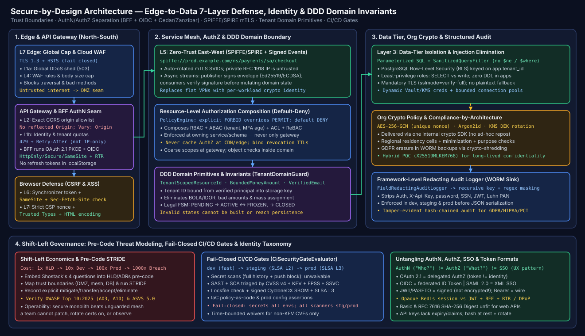
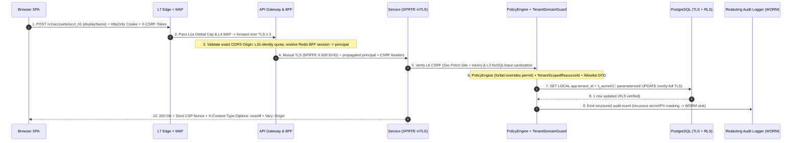
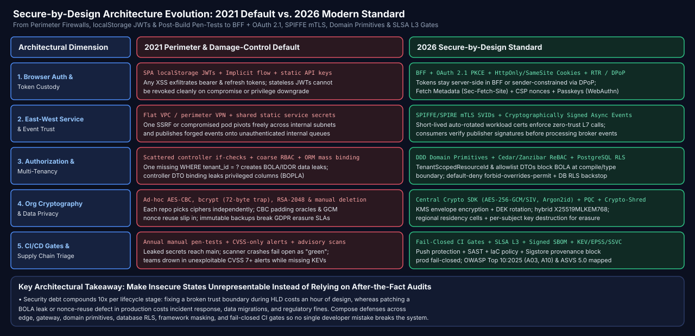

# Module 26: Secure-by-Design System Architecture — Domain Invariants, Identity Taxonomy, 7-Layer API Defense, and Fail-Closed Delivery Gates

Most production security incidents are not exotic zero-day memory exploits; they are **architectural defects** baked into the system before the first line of code was written. A missing tenant predicate in a controller creates a cross-account Broken Object Level Authorization (BOLA) breach, a SPA storing refresh tokens in `localStorage` turns a single third-party script XSS into silent account takeover, a flat VPC lets one SSRF pivot across every microservice, and a CI pipeline that treats scanner timeouts as green ships leaked credentials to production. **Secure-by-Design Architecture** treats security invariants as first-class structural requirements during High-Level Design (HLD) and domain modeling rather than as a penetration-test checklist bolted on before launch.

This module composes end-to-end security across the entire system-design stack: from **shift-left threat modeling economics** and **DDD Domain Primitives** that make invalid security states unrepresentable, through an unambiguous **AuthN / AuthZ / SSO / Token Format taxonomy** that untangles the most common interview and production confusions, to the **7-Layer Edge-to-Data API Protection pipeline**, **Zero-Trust SPIFFE/SPIRE east-west identity with cryptographically signed event streams**, **standardized organizational cryptography**, **framework-level PII log masking**, **fail-closed CI/CD release gates**, and **compliance-by-architecture** (GDPR, HIPAA, PCI-DSS v4.0, NDPA).

> [!NOTE]
> **Cross-Track Knowledge Ownership.** Primitive cryptography and AEAD internals belong to [`architecture/security-identity`](../../security-identity/README.md) ([M02](../../security-identity/modules/02-crypto-primitives-for-engineers.md)), password hashing and secret vaults to [M03](../../security-identity/modules/03-passwords-and-secrets-at-rest.md), PKI/X.509/mTLS/SPIFFE-SPIRE mechanics to [M04](../../security-identity/modules/04-pki-x509-and-mtls.md), browser cookies/CORS/CSRF/CSP internals to [M05](../../security-identity/modules/05-sessions-cookies-and-browser-security.md), OAuth 2.1/OIDC/JOSE/DPoP/WebAuthn protocols to [M06](../../security-identity/modules/06-oauth-2-1-core.md)–[M09](../../security-identity/modules/09-passkeys-webauthn-and-mfa.md), RBAC/ABAC/ReBAC/Zanzibar/Cedar engines to [M10](../../security-identity/modules/10-authorization-models.md), OWASP Top 10:2025 vulnerability mechanics to [M11](../../security-identity/modules/11-web-and-api-vulnerability-classes.md), supply-chain SLSA/Sigstore mechanics to [M12](../../security-identity/modules/12-supply-chain-and-dependency-security.md) and [`technologies/gitlab-ci`](../../../technologies/gitlab-ci/README.md) ([M06](../../../technologies/gitlab-ci/modules/06-supply-chain-security-sbom-cosign-slsa.md)), PostgreSQL RLS mechanics to [`technologies/postgres`](../../../technologies/postgres/modules/10-server-programming-and-security.md), IaC policy-as-code to [`technologies/terraform`](../../../technologies/terraform/modules/08-testing-and-policy-as-code.md), and TLS 1.3 / L7 proxy mechanics to [`architecture/networking`](../../networking/README.md). This module owns **Secure-by-Design System Architecture Composition**: embedding security invariants into HLD and domain models, untangling identity/authorization composition across distributed boundaries, placing layered API defenses across edge-to-DB topologies, and governing organizational standards, CI/CD release gates, and compliance-by-architecture.



---

## 1. Secure-by-Design vs. Damage Control: Shift-Left Economics and Pre-Code Threat Modeling

### 1.1 The Defect Remediation Cost Curve and Engineering Ownership

Treating security as a post-implementation audit ("damage control") guarantees accumulating **security debt**: once a schema lacks a `tenant_id` composite key, once APIs return raw database entities, or once microservices communicate over unauthenticated private HTTP, retrofitting isolation requires multi-quarter migrations and breaking client contracts. Empirical software-engineering studies (Boehm; NIST Planning Report 02-3) consistently demonstrate an order-of-magnitude escalation in remediation cost across lifecycle stages:

| Lifecycle Phase When Defect Is Caught | Relative Remediation Cost | Typical Structural Fix Required | Failure Blast Radius |
| --- | :-: | --- | --- |
| **1. HLD / Threat Model (Pre-Code)** | **`1x`** (minutes to hours) | Adjust Architecture Decision Record (ADR), add trust boundary or domain primitive before code exists | Zero shipped artifacts; zero customer impact |
| **2. Implementation / Local Unit & Property Tests** | **`5x–10x`** (hours to a day) | Refactor aggregate constructor, DTO allowlist, or parameterized query locally | Confined to a single developer branch |
| **3. CI/CD Gate / Staging Pen-Test** | **`15x–30x`** (days to a sprint) | Re-architect endpoint contracts, rotate leaked staging secrets, rewrite schema migrations | Delays release; burns cross-team engineering sprints |
| **4. Production (Before Exploitation)** | **`50x–100x`** (weeks to quarters) | Dual-write zero-downtime data migration, forced session invalidation, backward-compatible API deprecation | Operational toil, incident bridge, SLA risk |
| **5. Post-Breach (Exploited in Production)** | **`500x–1,000x+`** (months to years) | Forensics, mandatory breach notification (72h GDPR Art. 33), PCI/HIPAA fines, credential rotation, legal liability | Existential customer trust & regulatory damage |

Under Secure-by-Design, **the engineering team owns security as a functional requirement**, not an external AppSec review board. Concrete emergent properties distinguish a secure-by-design platform from a bolted-on checklist: the API gateway enforces identity-keyed rate limiting and strict CORS by default; the domain layer makes unauthorized cross-tenant mutations unrepresentable; the logging framework strips secrets automatically; and CI blocks releases fail-closed before an artifact ever reaches staging or production.

### 1.2 Embedding Shostack's Four Questions and STRIDE into the 60-Minute HLD

Formal threat modeling (see [`architecture/security-identity/modules/01-threat-modeling-and-security-principles.md`](../../security-identity/modules/01-threat-modeling-and-security-principles.md) for STRIDE mechanics and OWASP ASVS 5.0.0 V1–V17 verification levels) belongs directly inside the system-design framing phase alongside functional requirements and capacity estimation ([Module 01](01-framing-requirements-and-delivery.md)). Every High-Level Design review and ADR answers **Adam Shostack's Four Questions**:

1. **What are we building?** Draw the Data Flow Diagram (DFD) marking every **trust boundary** where privilege or ownership changes: `Public Internet <-> Edge/WAF`, `Gateway/BFF <-> Internal Service Mesh`, `Service <-> Database/Cache`, and `Internal System <-> Third-Party SaaS/PSP`. Trace where sensitive data enters, transforms, persists, and exits.
2. **What can go wrong?** Walk each trust-boundary crossing through **STRIDE** (`Spoofing`, `Tampering`, `Repudiation`, `Information Disclosure`, `Denial of Service`, `Elevation of Privilege`) and map structural risks against **OWASP Top 10:2025** — paying explicit attention to the two 2025 architectural additions often omitted from legacy checklists: **A03 (Software Supply Chain Failures)** and **A10 (Mishandling of Exceptional Conditions / Fail-Open paths)**.
3. **What are we going to do about it?** Record an explicit disposition for every material threat in the ADR: **Mitigate** (engineer a control), **Eliminate** (remove the feature or sensitive data storage entirely), **Transfer** (delegate cardholder custody to a PCI Level 1 PSP), or **Accept** (time-bounded risk sign-off by a named owner). Undocumented assumptions are silent risk acceptance.
4. **Did we do a good enough job?** Verify controls deterministically via unit/property tests, CI security gates, and **OWASP ASVS 5.0.0** (May 2025, 17 chapters: `V1` Encoding and Sanitization through `V13` Configuration, `V14` Data Protection, `V15` Secure Coding and Architecture, and `V17` WebRTC), and treat the threat model as a living document revisited whenever a new integration, data store, or tenant tier is added.

| Trust Boundary Crossing | Primary STRIDE Threats | Pre-Code HLD Architectural Countermeasure | Deterministic Verification Gate |
| --- | --- | --- | --- |
| **Internet $\leftrightarrow$ L7 Edge / WAF** | Denial of Service, Tampering | Global volumetric shedding (`503`), TLS 1.3 + HSTS, WAF payload & body-size cap (`413`) | Edge load-shed & WAF signature unit tests |
| **Browser $\leftrightarrow$ API Gateway / BFF** | Spoofing, Information Disclosure, Elevation | Exact CORS allowlist (`Vary: Origin`), OAuth 2.1 PKCE + BFF `HttpOnly` cookie + RTR, Fetch Metadata + CSRF token, CSP nonce | Boot-time CORS/cookie validator + CSRF negative tests |
| **Gateway $\leftrightarrow$ Internal Services / Broker** | Spoofing, Tampering, Elevation | SPIFFE/SPIRE mTLS X.509 SVIDs (no flat VPC IP trust) + publisher-signed async event envelopes | Workload identity allowlist + event signature verification |
| **Service $\leftrightarrow$ Database / Audit Sink** | Information Disclosure, Tampering, Repudiation | `TenantScopedResourceId` + PostgreSQL RLS, parameterized SQL + NoSQL `\$`-key stripping, `sslmode=verify-full`, `FieldRedactingAuditLogger` to WORM sink | `fast-check` BOLA property tests + redaction canary probes |

### 1.3 Architecture Choice by Security Operability: Overengineering Is a Security Risk

Decomposing a system into 40 microservices multiplies the east-west attack surface by $O(N^2)$ network edges, multiplies certificate rotation and secret-injection surfaces, fragments authorization enforcement across repositories, and creates patch-lag drift across language runtimes. **A well-isolated modular monolith with strict domain boundaries, PostgreSQL RLS, and one audited deployment pipeline is strictly more secure than a distributed microservice mesh the engineering team lacks the maturity to patch, rotate certificates on, and observe.** Never introduce a new network hop unless scaling, fault isolation, or compliance-boundary isolation (e.g., isolating a PCI Cardholder Data Environment) justifies the operational security tax.

### 1.4 Primary Literature and Specification Matrix

| Source / Specification | Year | Core Contribution | Architectural Application in Module 26 |
| --- | :-: | --- | --- |
| Adam Shostack — _Threat Modeling: Designing for Security_ | 2014 | Four Questions framework, DFD trust boundaries, STRIDE threat enumeration | Pre-code HLD threat modeling and ADR risk dispositions |
| Dan Bergh Johnsson, Daniel Deogun & Daniel Sawano — _Secure by Design_ (Manning) | 2019 | **Domain Primitives**, read-once objects, immutable value-object invariants | Eliminating BOLA, invalid amounts, and mass assignment inside the domain layer |
| **OWASP Top 10:2025** & **OWASP ASVS 5.0.0** | 2025 | Updated web/API risk taxonomy (including A03 Supply Chain & A10 Fail-Open) + 17-chapter (`V1`–`V17`) verification levels | Verification baseline for architecture reviews and fail-closed controls |
| **RFC 6749 / 6750 / 7636 / 8725 (BCP 225)** & **OAuth 2.1 Draft** | 2012–2026 | Delegated authorization, Bearer transport, mandatory PKCE, JWT security best current practices | Untangling AuthN vs AuthZ vs token formats and eliminating `localStorage` JWT traps |
| **RFC 7616 / 7617 / 6585 / 6598 / 9457** | 2012–2023 | HTTP Digest (SHA-256) & Basic, `429 Retry-After`, CGN `100.64.0.0/10`, Problem Details for HTTP APIs | Correcting legacy auth myths, identity-keyed quotas, and safe error responses |
| **NIST SP 800-207** (_Zero Trust Architecture_) & **SPIFFE/SPIRE** | 2020–2026 | Never trust network location; cryptographically attest every workload identity per request | Replacing flat perimeter VPNs with short-lived mTLS SVIDs and signed events |
| **Google Zanzibar** (_USENIX ATC_) & **AWS Cedar** (_OOPSLA_) | 2019–2024 | Global ReBAC relationship graph (`zookies`) and formal-verified `forbid`-overrides-`permit` policy language | Composing fine-grained resource authorization with default-deny guarantees |
| **SLSA v1.0**, **RFC 9106 (Argon2)** & **NIST FIPS 203 (ML-KEM)** | 2021–2026 | Build-level supply-chain provenance, memory-hard password hashing, hybrid post-quantum key exchange | Fail-closed CI/CD release gates and 2026 organizational crypto standards |

---

## 2. Security as a Domain Business Rule: DDD Domain Primitives and Structural Invariants

### 2.1 Why Scattered Controller `if`-Checks Fail at Scale

In a conventional layered web application, authorization and input validation live as imperative `if` statements inside HTTP controllers:

```typescript
// ANTI-PATTERN: Controller-level ad-hoc check + raw ORM binding
// If any second endpoint, GraphQL resolver, or Kafka consumer forgets the `if`,
// cross-tenant BOLA and mass-assignment vulnerabilities open silently.
if (req.user.tenantId !== account.tenantId) return res.status(403).end();
Object.assign(account, req.body); // Mass assignment: attacker sends { balanceMinor: 999999, role: "admin" }
```

This pattern fails structurally for three reasons: (1) every new entry point (REST v2, gRPC handler, GraphQL resolver, async queue consumer, admin backfill script) must remember to repeat every check; (2) raw primitives (`string`, `number`, `bigint`, plain JSON objects) carry zero semantic proof of validation once passed across function boundaries ("primitive obsession"); and (3) binding unvalidated request payloads onto persistence entities creates **Broken Object Property Level Authorization (BOPLA / Mass Assignment)**.

### 2.2 Domain Primitives: Making Invalid Security States Unrepresentable

Following Johnsson, Deogun, and Sawano (_Secure by Design_), a **Domain Primitive** is an immutable Value Object whose constructor validates all structural and domain invariants before an instance can exist. Once constructed, the type system guarantees that every downstream repository, query builder, or state-transition method receives a valid, tenant-bound, bounded value:

| Domain Primitive | Invariant Enforced at Construction | Vulnerability Class Eliminated Structurally |
| --- | --- | --- |
| **`TenantId`** | Private constructor; regex-validated canonical format (`^t_[a-z0-9]{4,32}$`) | Tenant-ID spoofing, path traversal, SQL/NoSQL injection via tenant header |
| **`TenantScopedResourceId`** | Binds `resourceId` together with the authenticated principal's `TenantId` into composite `storageKey` (`tenantId:resourceId`); never reads tenant from request body | **BOLA / IDOR** (impossible to query or mutate a row outside the caller's tenant) |
| **`BoundedMoneyAmount`** | Strictly positive `BigInt` minor units (`0n < minor <= maxMinor`), plus aggregate overflow guard (`<= MAX_BALANCE_MINOR`) | Negative-amount credit exploits, integer overflow, IEEE-754 rounding drift |
| **`VerifiedEmail`** | Can only be instantiated from an IdP identity claim where `emailVerified === true` and syntax matches RFC bounds | Account pre-hijacking via unverified OAuth/OIDC email claims |
| **`SanitizedQueryFilter`** | Rejects all keys starting with `\$`, containing `.`, or matching `__proto__`/`constructor`/`prototype`, and restricts fields to an explicit scalar allowlist | **MongoDB / NoSQL Operator Injection** (`\$ne`, `\$where`, `\$gt`) and prototype pollution |
| **`AccountStatus` Transition Table** | Explicit finite state machine (`PENDING -> ACTIVE/CLOSED`, `ACTIVE -> FROZEN/CLOSED`, `FROZEN -> ACTIVE/CLOSED`, `CLOSED -> []`) | Business-logic race conditions (debiting a `FROZEN` account or reopening a `CLOSED` account) |

### 2.3 Verified `TenantDomainGuard` Implementation and Existence-Oracle Defense

Below is the verified `TenantDomainGuard` implementation from [`examples/lib/secure-by-design-models.ts`](../examples/lib/secure-by-design-models.ts), proving that rejected cross-tenant accesses, mass-assignment payloads, negative amounts, and illegal state transitions never touch persistence:

```typescript
  private resolve(
    principal: DomainPrincipal,
    rawResourceId: unknown,
    claimedTenant?: unknown,
  ): DomainResult<{ id: TenantScopedResourceId; row: AccountRecord }> {
    try {
      if (claimedTenant !== undefined && !TenantId.parse(claimedTenant).equals(principal.tenantId)) {
        return { ok: false, code: 'CROSS_TENANT_ACCESS' };
      }
      const id = TenantScopedResourceId.bind(principal.tenantId, rawResourceId);
      const row = this.rows.get(id.storageKey);
      // Another tenant's row is indistinguishable from a missing row: no existence oracle.
      if (!row) {
        return { ok: false, code: 'NOT_FOUND' };
      }
      return { ok: true, value: { id, row } };
    } catch (error) {
      if (error instanceof DomainInvariantError) {
        return { ok: false, code: error.code };
      }
      throw error;
    }
  }

  /** Explicit allowlist DTO binding: unknown or privileged fields reject the whole command. */
  patch(principal: DomainPrincipal, rawResourceId: unknown, body: Record<string, unknown>): DomainResult<string[]> {
    const resolved = this.resolve(principal, rawResourceId);
    if (!resolved.ok) return resolved;
    const keys = Object.keys(body);
    if (keys.some((k) => !TenantDomainGuard.PATCHABLE_FIELDS.has(k))) {
      return { ok: false, code: 'MASS_ASSIGNMENT_REJECTED' };
    }
    const displayName = body['displayName'];
    if (typeof displayName !== 'string' || displayName.length === 0 || displayName.length > 80) {
      return { ok: false, code: 'MASS_ASSIGNMENT_REJECTED' };
    }
    const { id, row } = resolved.value;
    row.displayName = displayName;
    this.persistenceLog.push({ key: id.storageKey, field: 'displayName', value: displayName });
    return { ok: true, value: keys };
  }
```

> [!IMPORTANT]
> **Eliminating Existence Oracles on Multi-Tenant Lookups.** Notice why `resolve()` returns `NOT_FOUND` (HTTP `404`) when an authenticated user in `t_acme01` requests `acct_000002` belonging to `t_globex`: because the lookup key is `t_acme01:acct_000002`, Globex's row is never even fetched into application memory! Returning `403 Forbidden` for existing foreign IDs and `404 Not Found` for nonexistent IDs leaks an **existence oracle** that lets attackers enumerate competitor account identifiers. Return uniform `404` unless an explicit tenant-header mismatch proves a malformed cross-tenant claim.

---

## 3. Architectural Authentication, Authorization, and Identity Taxonomy

### 3.1 Untangling Six Perpetually Confused Concepts

One of the highest-signal differentiators in system design reviews is clean separation of identity layers. Engineers routinely say "we use OAuth2 for authentication", "we use JWT for authorization", or "SSO is our auth protocol" — each statement conflates distinct architectural responsibilities and leads directly to broken trust boundaries.

| Concept | Question Answered / Role | Protocol or Artifact Examples | Classic Architectural Misconception & Correction |
| --- | --- | --- | --- |
| **1. Authentication (`AuthN`)** | **"Who are you?"** Verifies the caller's identity with cryptographic or credential proof | Passkeys/WebAuthn ([M09](../../security-identity/modules/09-passkeys-webauthn-and-mfa.md)), OIDC ID Token, mTLS X.509 SVID, Argon2id password + MFA | Conflating an OAuth access token with user identity; access tokens are opaque to the client and authorize API access, not login |
| **2. Authorization (`AuthZ`)** | **"What may you do on this resource?"** Evaluates permissions on `(Principal, Action, Resource, Context)` | RBAC, ABAC, ACL, ReBAC (Google Zanzibar / OpenFGA), AWS Cedar ([M10](../../security-identity/modules/10-authorization-models.md)) | Enforcing AuthZ solely at the API gateway; object-level checks MUST execute inside the owning service/schema where resource ownership lives |
| **3. Single Sign-On (`SSO`)** | **User-experience & session federation pattern** — authenticate once at an Identity Provider (IdP) to access multiple Relying Parties | Built _on top of_ OIDC (modern web/mobile) or SAML 2.0 (enterprise B2B) | Calling SSO an authentication mechanism; SSO is an architectural UX topology, not a wire protocol or cipher |
| **4. Token Format & Transport** | **Wire encoding** (self-contained signed payload vs opaque reference handle) + **how it rides on HTTP** | **JWT** (RFC 7519), **PASETO** v4, opaque 256-bit random session ID; **Bearer** transport (RFC 6750) vs sender-constrained **DPoP** / mTLS | Assuming a JWT is encrypted (standard JWS JWTs are Base64URL-encoded cleartext signed for integrity; never put secrets/PII in JWT claims!) |
| **5. Delegated Authorization (`OAuth 2.1`)** | **"May Client App X access Resource Server Y on behalf of User U with scopes S?"** | Authorization Code + mandatory **PKCE** (RFC 7636), Client Credentials (M2M), Refresh Token Rotation ([M06](../../security-identity/modules/06-oauth-2-1-core.md)) | Treating OAuth 2.0/2.1 as an authentication protocol (the classic "pseudo-authentication" flaw); OAuth 2.1 removes Implicit and ROPC grants |
| **6. Federated Identity (`OIDC` vs `SAML 2.0`)** | **Cross-domain identity assertion** from an IdP to a Service Provider / Relying Party | **OIDC Core 1.0** (JSON/REST identity layer specified on OAuth 2.0 and operated under **OAuth 2.1 draft constraints**, issuing a signed **ID Token**); **SAML 2.0** (XML assertions over browser redirects + RFC 7522 OAuth bearer bridge) | Mixing front-channel SAML XML assertions directly into backend API calls instead of exchanging them at the BFF/STS for short-lived API tokens ([M07](../../security-identity/modules/07-oidc-and-federation.md)) |

### 3.2 Stateful Redis Sessions vs. Stateless JWT + BFF + Refresh Token Rotation (RTR)

Choosing how browser and mobile clients hold credentials is an architectural trade-off between **revocation consistency**, **XSS blast radius**, and **per-request verification latency**:

| Session / Token Architecture | Where State Lives | Instant Revocation? | XSS Token-Theft Resistance | Recommended Architectural Use Case |
| --- | --- | :-: | :-: | --- |
| **1. Opaque Session Cookie + Redis/Valkey Store** | Server-side session table (`256-bit` CSPRNG key in `HttpOnly; Secure; SameSite=Lax` cookie) | **Yes** (`DEL session:<id>` takes effect immediately) | **High** (JavaScript cannot read `HttpOnly` cookie; XSS cannot exfiltrate credentials off-box) | Monoliths, server-rendered web apps, and **Backend-for-Frontend (BFF)** browser edges |
| **2. BFF Pattern + OAuth 2.1 PKCE + RTR (2026 Browser Standard)** | BFF holds OAuth Access + Refresh Tokens server-side in encrypted Redis; browser holds only an opaque `HttpOnly` session cookie | **Yes** (BFF revokes session & refresh family centrally) | **Highest** (browser never sees access or refresh tokens at all) | Modern SPAs talking to multi-microservice backends ([M05](../../security-identity/modules/05-sessions-cookies-and-browser-security.md)) |
| **3. Short-Lived Stateless JWT (`<= 5–15 min`) + `HttpOnly` RTR Cookie + DPoP** | Cryptographically signed JWS (`ES256`/`EdDSA`) verified locally via cached JWKS; Refresh Token rotated on every use with reuse detection | **Bounded** (revocation window $\le$ access token TTL; immediate for high-value actions via introspection) | **High** (if refresh token is `HttpOnly` cookie or native OS Keychain + DPoP key-bound) | Native mobile apps, multi-region high-QPS APIs where gateway cannot afford a Redis hop on every read |
| **4. SPA Storing JWT / Refresh Token in `localStorage` (ANTI-PATTERN)** | Browser `window.localStorage` readable by any script on the origin | **No** (stolen tokens stay valid until expiry) | **Zero** (any XSS or compromised npm analytics package exfiltrates every user's refresh token) | **Never use in production.** Explicitly prohibited under OAuth 2.0 for Browser-Based Apps BCP |

When stateless JWTs are used on internal or mobile APIs, enforce every **RFC 8725 (JWT BCP 225)** invariant at the verification seam ([M08](../../security-identity/modules/08-tokens-jose-and-sender-constraining.md)): pin the allowed asymmetric algorithm (`ES256` or `EdDSA`, strictly rejecting `alg: none` and `HS256` key-confusion attacks), validate `iss`, `aud`, `exp`, and `nbf` on every hop, bind high-value tokens to the caller's cryptographic key using **DPoP** (RFC 9449) or **mTLS certificate-bound tokens** (RFC 8705), and pair short access-token TTLs with **Refresh Token Rotation (RTR)** that revokes the entire token family if a rotated refresh token is replayed.

### 3.3 Composing RBAC, ABAC, ACL, and ReBAC Across Microservices and Gateways

Real distributed systems rarely rely on a single authorization model; they **compose four models across two enforcement planes**:

1. **Coarse-Grained Plane (API Gateway)**: Verifies authentication (`iss`/`aud`/`exp`), checks OAuth scopes (`payments:write`), and blocks obviously unauthorized routes. The gateway does **not** know whether User `usr_alice` owns Document `doc_1` or belongs to Tenant `t_acme01`'s billing group.
2. **Fine-Grained Resource Plane (Owning Service / GraphQL Schema Execution)**: Evaluates the resource policy against live state using **default-deny** with **explicit `forbid` overriding `permit`** (the AWS Cedar evaluation algebra):
   - **RBAC** grants baseline capabilities by role (`editor -> [read, write]`, `admin -> [read, write, delete, export, admin]`).
   - **ACL / ReBAC (Google Zanzibar / OpenFGA)** grants per-object exceptions (`usr_auditor` granted `export` on `doc_1`; folder inheritance `viewer#member -> doc`).
   - **ABAC Guardrails (`forbid` policies)** enforce non-negotiable security invariants that _no role or ACL can override_: e.g., `forbid` whenever `principal.tenantId !== resource.tenantId`, or `forbid` `delete`/`export`/`admin` whenever `principal.authAgeSeconds > 300` (forcing step-up phishing-resistant MFA).

> [!WARNING]
> **Never Cache Authorization Decisions at the CDN or Edge.** Caching a `200 OK` or an authorization verdict at an edge POP turns permission revocation into a race against cache TTL. Even inside internal ReBAC engines like Google Zanzibar, reads pass a consistency token (**zookie**) to bound staleness so a revoked collaborator cannot read freshly updated documents (preventing the "new enemy" problem; see [M10](../../security-identity/modules/10-authorization-models.md)).

### 3.4 Correcting Legacy Auth Simplifications: Basic, Digest (RFC 7616), and API Keys

System design courses frequently gloss over legacy HTTP authentication schemes with half-truths. Be precise about both the standards and why they still fail modern threat models:

- **HTTP Basic Authentication (RFC 7617)**: Encodes `username:password` in Base64 (`Authorization: Basic ...`). Base64 is encoding, not encryption; Basic relies entirely on TLS confidentiality, replays long-lived credentials on every request, supports no expiry/scopes/MFA, and leaks passwords into misconfigured reverse-proxy logs. Unacceptable for user-facing APIs.
- **HTTP Digest Authentication (RFC 7616) — Correcting the "Just MD5" Myth**: Many guides claim Digest Auth is obsolete solely because it uses MD5. In fact, **RFC 7616** obsoleted RFC 2617 and made **`SHA-256` mandatory to implement** (with `SHA-512/256` as backup and MD5 marked `NOT RECOMMENDED`). Digest Auth _still_ remains unsuitable for modern web APIs for deeper structural reasons documented in RFC 7616 §5: (1) the server must store `H(A1) = H(username:realm:password)` which acts as a **plaintext-equivalent credential** (incompatible with salted memory-hard Argon2id hashes); (2) it remains vulnerable to offline dictionary attacks against human passwords; (3) it provides no payload confidentiality beyond credentials, so RFC 7616 itself advises running over HTTPS — at which point OAuth 2.1/OIDC or mTLS strictly dominates it.
- **Static API Keys**: API keys identify a _project or caller_ for quota metering, not a short-lived security principal. Unlike signed JWTs or OAuth tokens, raw API keys carry **zero built-in expiry, audience, or revocation semantics**. Every API key must be verified against a database/cache lookup, stored hashed with HMAC-SHA-256 (or SHA-256 for high-entropy `>= 256-bit` random keys — never plaintext), prefixed with an identifiable token type (e.g., `sk_live_`) for automated secret-scanner detection, scoped to minimal permissions, and rotated on a strict schedule.

---

## 4. Composing the 7-Layer API Protection Architecture (Edge to Data)

Defense-in-depth fails when controls are stacked randomly or placed at the wrong topology layer. Running expensive ReBAC policy checks before volumetric rate limiting enables amplification DoS; enforcing CORS only in a backend microservice fails when the gateway short-circuits `OPTIONS` preflights; trusting private RFC 1918 IP addresses on internal services turns any SSRF into full cluster compromise.


### 4.1 End-to-End 7-Layer Placement Matrix

| Defense Layer | Topology Placement | Concrete Engineering Control | What Breaks If Misplaced or Misconfigured | Primary Cross-Link |
| --- | --- | --- | --- | --- |
| **1. Multi-Tier Rate Limiting** | **Edge** (global volumetric cap `503`) + **Gateway** (identity/tenant/endpoint `429` + `Retry-After`, RFC 6585) | Token bucket / GCRA keyed on authenticated `sub`, `tenant_id`, or API key (never IP alone; RFC 6598 CGN `100.64.0.0/10` packs thousands of users behind one IPv4) | Placing limits only in app servers exhausts connection pools before rejecting floods; keying on IP bans entire mobile carriers or offices | [Module 08](08-rate-limiting-load-shedding-and-resilience.md) |
| **2. Strict CORS Policy** | **API Gateway / BFF** (uniformly applied across all routes, validated at boot time) | Exact-match origin allowlist (`https://app.example.com`), `Vary: Origin`, explicit methods/headers; boot-time rejection of `*` + `credentials: true`, `null`, or `*.app.com` wildcards | Browsers block `Access-Control-Allow-Origin: *` when `Access-Control-Allow-Credentials: true` is present (breaking clients); the actual cross-origin credentialed exfiltration bug is **reflecting the request `Origin`** (or allowing `null`) alongside `Access-Control-Allow-Credentials: true`; omitting `Vary: Origin` poisons CDN caches | [Security M05](../../security-identity/modules/05-sessions-cookies-and-browser-security.md) |
| **3. Injection Elimination (SQLi & NoSQLi)** | **Service Boundary** (`SanitizedQueryFilter`) + **Data Access Layer** (parameterized queries / ORM) | Bind parameters everywhere; static analysis bans string-concatenated SQL; recursively reject keys starting with `\$` (`\$ne`, `\$where`), `.`, or `__proto__` before MongoDB/JSON query construction | Treating stored procedures as a silver bullet fails if dynamic SQL (`EXECUTE`) runs inside the proc; relying on WAF regexes misses encoded JSON operator payloads | [Security M11](../../security-identity/modules/11-web-and-api-vulnerability-classes.md) |
| **4. Cloud WAF & L7 Edge Filtering** | **Edge POP / CDN** (before origin ingress) | Request size caps (`413`), malformed URL/percent-encoding rejection (`400`), path traversal and bot-mitigation rules, virtual patching during zero-day response | Treating WAF as a primary fix instead of defense-in-depth creates false security; running WAF behind the gateway lets oversized payloads consume origin RAM | [Module 03](03-networking-edge-and-cdn-composition.md) |
| **5. Private Network & Zero-Trust East-West** | **Service Mesh / Sidecar** (sync RPC) + **Message Broker Envelopes** (async streams) | Private subnets with zero direct internet ingress + **SPIFFE/SPIRE mTLS** X.509 SVIDs rotated automatically; async events signed by publisher (Ed25519/ECDSA) and verified by consumer | Relying on flat VPC/VPN perimeter trust means one SSRF or compromised sidecar can call internal admin/billing endpoints or inject forged Kafka events | [Security M04](../../security-identity/modules/04-pki-x509-and-mtls.md), [Module 07](07-asynchrony-queues-streams-and-workflows.md) |
| **6. CSRF Defense** | **BFF / Service Boundary** (whenever an ambient cookie session is present on unsafe methods: `POST`/`PUT`/`PATCH`/`DELETE`) | Triple-layered defense: `SameSite=Lax/Strict` session cookies + **Fetch Metadata** (reject `Sec-Fetch-Site: cross-site`; permit `same-origin`, `same-site` e.g. `app.example.com -> api.example.com`, and `none`) + SHA-256 constant-time Synchronizer CSRF token (`timingSafeEqual`), enforced even if a Bearer header also accompanies the cookie | Applying CSRF checks to pure non-cookie M2M Bearer endpoints breaks API clients; skipping CSRF when both a cookie and Bearer header arrive lets ambient cookies bypass CSRF; omitting CSRF with `SameSite=None` enables cross-site state changes | [Security M05](../../security-identity/modules/05-sessions-cookies-and-browser-security.md) |
| **7. XSS Defense** | **Frontend Rendering + Gateway Response Headers** | Context-aware output encoding (HTML text/quoted-attribute encoding verified in `encodeForHtml`, plus dedicated URL/JS encoders per sink), strict nonce-based CSP (`script-src 'nonce-...' 'strict-dynamic'`, `object-src 'none'`, `frame-ancestors 'none'`), **Trusted Types**, `HttpOnly` cookies, `X-Content-Type-Options: nosniff` | Using `'unsafe-inline'` or host-allowlist CSP is bypassed via JSONP/CDN gadgets; storing tokens in `localStorage` turns any XSS into full persistent session hijacking | [Security M05](../../security-identity/modules/05-sessions-cookies-and-browser-security.md) |

### 4.2 Verified Fail-Closed Pipeline Startup and Policy Algebra

Configuration bugs in CORS, session cookies, or missing cross-tenant `forbid` guardrails must **fail closed at boot time**, never silently degrade in production. Similarly, authorization evaluation must guarantee that explicit `forbid` rules override every `permit` rule. Below are the verified boot-time guard and `PolicyEngine` from [`examples/lib/secure-by-design-models.ts`](../examples/lib/secure-by-design-models.ts):

```typescript
export class PolicyEngine {
  private readonly policies: readonly Policy[];
  constructor(policies: readonly Policy[]) {
    this.policies = policies;
  }

  evaluate(ctx: PolicyContext): PolicyDecision {
    const forbids = this.policies.filter((p) => p.effect === 'forbid' && p.matches(ctx)).map((p) => p.id);
    if (forbids.length > 0) return { decision: 'DENY', determiningPolicies: forbids, reason: 'FORBID_OVERRIDE' };
    const permits = this.policies.filter((p) => p.effect === 'permit' && p.matches(ctx)).map((p) => p.id);
    if (permits.length > 0) return { decision: 'ALLOW', determiningPolicies: permits, reason: 'PERMIT' };
    return { decision: 'DENY', determiningPolicies: [], reason: 'DEFAULT_DENY' };
  }
}

export class ApiDefensePipeline {
  private readonly config: ApiDefenseConfig;
  private readonly policyEngine: PolicyEngine;
  private readonly counters = new Map<string, number>();

  constructor(config: ApiDefenseConfig) {
    const violations = [
      ...validateCorsPolicy(config.cors),
      ...validateSessionCookiePolicy(config.sessionCookie),
      ...validatePolicySet(config.policies),
    ];
    if (violations.length > 0) throw new ApiConfigError(violations);
    this.config = config;
    this.policyEngine = new PolicyEngine(config.policies);
  }
```

### 4.3 Safe Error Handling, RFC 9457 Problem Details, and Fail-Closed Dependencies

**OWASP Top 10:2025 A10 (Mishandling of Exceptional Conditions)** elevates fail-open error handling to a top architectural risk. Enforce four API boundary rules uniformly across REST, GraphQL, and gRPC ([Module 04](04-api-design-data-modeling-and-id-generation.md)):

1. **Standardized Error Envelopes (`application/problem+json`, RFC 9457)**: Populate the five standard RFC 9457 members (`type`, `title`, `status`, `detail`, `instance`) plus an opaque correlation extension member such as `trace_id` — never raw stack traces, SQL table names, ORM errors, or upstream internal hostnames.
2. **Generic Authentication Failures**: Return identical error messages and constant-time response profiles for "unknown user" and "wrong password" to eliminate account-enumeration oracles.
3. **Explicit Fail-Closed Dependency Contracts**: If the authorization policy service, token-introspection store, or WAF sidecar times out, the caller **must deny the request (`503`/`403`)** rather than falling through `catch (err) { next(); }`.
4. **Protocol-Aware Status Monitoring**: Remember that **gRPC** returns HTTP `200` on the wire with `grpc-status` in HTTP/2 trailers, and GraphQL-over-HTTP defines `200`/`400`/`405` (with `422` used as a common implementation convention, alongside `200` responses that still carry partial `errors`). Security alerting and rate-limit anomaly detectors must inspect protocol-level status codes rather than relying blindly on HTTP `5xx` counts.

---

## 5. Organizational Standards, Structured Masking, CI/CD Security Gates, and Compliance-by-Architecture

### 5.1 Standardized Organizational Cryptographic Policy (Central SDK, Zero Ad-Hoc Primitives)

Allowing individual product teams to choose cipher modes, key sizes, or password-hashing libraries is an organizational vulnerability: one service picks AES-CBC without Encrypt-then-MAC (padding oracle), another uses SHA-256 for passwords, and a third reuses a static 96-bit GCM nonce. **Standardize cryptographic policy once and ship it as a single versioned internal SDK** (a single fix point when algorithms rotate; see [Security M02](../../security-identity/modules/02-crypto-primitives-for-engineers.md), [M03](../../security-identity/modules/03-passwords-and-secrets-at-rest.md), and [M14](../../security-identity/modules/14-expert-topics.md)):

| Cryptographic Domain | 2026 Organizational Standard | Critical Pitfall Prevented by Central SDK |
| --- | --- | --- |
| **Symmetric Encryption (AEAD)** | **AES-256-GCM** (hardware AES-NI) or **ChaCha20-Poly1305**; **AES-256-GCM-SIV** where nonce-misuse resistance is needed | **Catastrophic AES-GCM Nonce Reuse**: reusing a single 96-bit `(key, nonce)` pair leaks plaintext XOR and recovers the GHASH authentication key; SDK enforces deterministic counter derivation or KMS envelope DEK rotation well below the **NIST SP 800-38D $2^{32}$ invocation cap** (keeping collision probability $\approx 2^{-32}$, far stricter than the $2^{48}$ 96-bit random-nonce birthday bound) |
| **Password Hashing** | **Argon2id** (**RFC 9106 §4/§7.4**: `t=1, p=4, m=2 GiB` default or `t=3, p=4, m=64 MiB` memory-constrained; **OWASP Password Storage Cheat Sheet minimum**: `m=19 MiB, t=2, p=1`) with per-user 128-bit salt + HSM/Vault pepper | **bcrypt 72-Byte Silent Truncation**: bcrypt silently ignores bytes beyond 72 (and has null-byte quirks in old wrappers); SHA-256/MD5 are GPU-crackable at billions of hashes/sec and strictly forbidden |
| **Asymmetric Signing & Key Exchange** | **Ed25519** / **ECDSA P-256 (`ES256`)** for JWT/event signing; **TLS 1.3** with hybrid post-quantum key exchange (**X25519MLKEM768**, FIPS 203) | Legacy **RSA-2048** signatures (`RS256`) carry larger keys and slower signing/verification than Ed25519/ES256, while legacy **RSAES-PKCS#1 v1.5 decryption/key-transport** exposes **Bleichenbacher (1998)** padding-oracle attacks; omitting hybrid PQC exposes long-lived regulated traffic to **Harvest-Now-Decrypt-Later (HNDL)** adversaries |
| **Key Lifecycle & Envelope Encryption** | **KMS Envelope Encryption**: per-record or per-tenant Data Encryption Key (DEK) wrapped by a KMS Key Encryption Key (KEK) with automated rotation | Static application-level master keys stored in `.env` files force full-table re-encryption on compromise and prevent per-tenant key revocation |

### 5.2 Database Security Architecture: Least Privilege, RLS, TLS, and Vault Credentials

Even with `TenantDomainGuard` enforcing isolation in application memory, a secure-by-design data tier treats the application layer as **potentially compromised** and places four independent barriers around the database ([PostgreSQL M10](../../../technologies/postgres/modules/10-server-programming-and-security.md)):

1. **Least-Privilege Database Roles**: Split runtime connections into separate database principals — read-only replicas use a `SELECT`-only role, transactional services hold `SELECT/INSERT/UPDATE` on their owned schema only, and **zero runtime principals hold `DROP`, `ALTER`, or `SUPERUSER` privileges** (schema migrations run under a separate short-lived CI migration role).
2. **Database Row-Level Security (RLS) Backstop**: Set `SET LOCAL app.tenant_id = '<validated_tenant>'` inside every pooled transaction and enforce PostgreSQL `CREATE POLICY ... USING (tenant_id = current_setting('app.tenant_id', true))` with `FORCE ROW LEVEL SECURITY`. Even if a raw SQL reporting query bypasses the domain guard, the storage engine refuses to return cross-tenant rows.
3. **Mandatory Encrypted Transport (`sslmode=verify-full`)**: Enforce TLS 1.3 with certificate hostname verification on every database connection. Reject `sslmode=prefer` or `allow`, which silently downgrade to cleartext under an active network MITM.
4. **Dynamic Vault Credentials and Bounded Connection Pools**: Inject short-lived, auto-rotated credentials from HashiCorp Vault or cloud Secrets Manager (via workload OIDC/SPIFFE identity — never static passwords in Git or environment snapshots) and cap pool sizes (`MaxPoolSize` + PgBouncer/RDS Proxy) so a single compromised service cannot starve cluster connections.

### 5.3 Framework-Level Structured Audit Logging and Automated PII/Secret Masking

Developer-level discipline ("remember not to log `req.body`") fails on the first 3 a.m. debugging patch. **Redaction must live inside the logging framework itself** so every log call across `dev`, `staging`, and `prod` passes through a single mandatory scrubber before serialization (dev logs are routinely exported to shared search clusters and third-party SaaS tools).

The **never-log set** covers two orthogonal passes verified in `FieldRedactingAuditLogger` ([`examples/lib/secure-by-design-models.ts`](../examples/lib/secure-by-design-models.ts)):

1. **Normalized Key Redaction**: Recursively replaces values for sensitive keys regardless of casing, punctuation, or `X-` header prefixes (`Authorization`, `Proxy-Authorization`, `X-Api-Key`, `Cookie`, `Set-Cookie`, `password`, `refresh_token`, `accessToken`, `api_key`, `client-secret`, `privateKey`, `ssn`, `nationalId`, `cvv`, `pan`, `otp`) with `[REDACTED]`, safely breaking circular references and never mutating caller objects.
2. **Free-Text Pattern Scrubbing**: Catches secrets accidentally interpolated into error strings or notes — stripping `Bearer`/`Basic` credentials, `eyJ...` JWT tokens, `XXX-XX-XXXX` national IDs, email local parts (`a***@example.com`), and **Luhn-validated** 13–19 digit payment card PANs (`[CARD ****1111]`) while avoiding false-positive masking on non-Luhn order IDs.

Security audit logs (who accessed which personal/financial record, when, from which workload identity, and for what declared business purpose) ship to a **separate tamper-evident WORM sink** (e.g., S3 Object Lock Compliance Mode with SHA-256 hash chaining) that application principals can append to but never modify or delete ([Security M13](../../security-identity/modules/13-security-operations-and-detection.md)).

### 5.4 Fail-Closed CI/CD Security Gates and Progressive Environment Strictness

Security controls that exist only in documentation decay within weeks. Encode organizational policy into **layered, fail-closed CI/CD release gates** where strictness escalates monotonically from `dev` to `staging` to `prod` ([GitLab CI M06](../../../technologies/gitlab-ci/modules/06-supply-chain-security-sbom-cosign-slsa.md), [M08](../../../technologies/gitlab-ci/modules/08-secrets-management-and-cloud-oidc.md), [Terraform M08](../../../technologies/terraform/modules/08-testing-and-policy-as-code.md)):

| Security Gate | Tooling Archetype | `dev` (Fast Feedback) | `staging` (Pre-Prod) | `prod` (Release Gate) | Fail-Closed Rule |
| --- | --- | :-: | :-: | :-: | --- |
| **1. Secret Detection** | Gitleaks (`fetch-depth: 0`) + Git host push protection | **BLOCK** (unwaivable) | **BLOCK** (unwaivable) | **BLOCK** (unwaivable) | Detected secrets OR an errored/omitted secrets scanner block in **all** environments & trigger credential rotation SLA |
| **2. SAST (Static Analysis)** | Semgrep (`owasp-top-ten`, SQLi, unsafe deserialization) | Block Critical; advise High | Block Critical; advise High | **Block Critical & High** | Scanner crash/skip/omission fails closed in `staging` & `prod` (`SCANNER_ERROR` / `SCANNER_SKIPPED`); advisory in `dev` |
| **3. SCA & Risk Triage** | Lockfile check + **CVSS v4.0 + CISA KEV + EPSS + SSVC** | Block Critical/KEV & broken lockfile | Block Critical/KEV & broken lockfile | **Block Critical, KEV, High (`CVSS >= 7` or `EPSS >= 0.5`)** | CISA KEV findings are **unwaivable**; non-KEV waivers require named approver + unexpired timestamp |
| **4. Supply Chain Provenance** | Signed **CycloneDX/SPDX SBOM** + **SLSA v1.0** + Sigstore Cosign | Lockfile integrity required | Signed SBOM + **SLSA L2** | Signed SBOM + **SLSA L3** verified | Unsigned images, omitted SBOM scanner, or unverified provenance block `staging` & `prod` |
| **5. IaC & Config Assertions** | OPA/Conftest, Checkov, prod config linter (no debug, no `*` CORS) | Block Critical; advise High | **Block Critical & High** | **Block Critical & High** | Missing env-config checks or omitted/skipped scanners halt `staging` & `prod` promotion |

> [!CAUTION]
> **Why CVSS-Only Triage Fails in 2026.** Blocking builds purely on `CVSS >= 7.0` buries engineering teams in hundreds of unreachable library alerts until they disable the gate entirely. Modern vulnerability management combines **CVSS v4.0** (intrinsic severity) with **CISA KEV** (confirmed active exploitation in the wild — always P0/unwaivable), **EPSS** (30-day exploitation probability), and **SSVC** (Stakeholder-Specific Vulnerability Categorization) so CI gates stay high-signal and strictly fail-closed ([Security M13](../../security-identity/modules/13-security-operations-and-detection.md)).

Below is the verified fail-closed release gate from [`examples/lib/secure-by-design-models.ts`](../examples/lib/secure-by-design-models.ts), iterating a fixed `REQUIRED_SCANNERS` list so omitted, errored, or skipped scanners never silently pass, while keeping leaked secrets and active CISA KEV vulnerabilities strictly unwaivable:

```typescript
for (const name of REQUIRED_SCANNERS) {
  const status: ScannerStatus = c.scanners[name] ?? 'skipped';
  if (status !== 'ok') {
    if (policy.requireAllScanners || name === 'secrets')
      violations.push(`SCANNER_${status.toUpperCase()}:${name}`);
    else advisories.push(`SCANNER_${status.toUpperCase()}:${name}`);
  }
}
// Leaked secrets block everywhere and can never be waived: the fix is rotation, not an exception.
if (c.secretsDetected > 0) violations.push(`SECRETS_DETECTED:${c.secretsDetected}`);

for (const f of c.dependencies) {
  const critical = f.cvss >= 9 || f.kev;
  const high = !critical && (f.cvss >= 7 || f.epss >= 0.5);
  if (critical) {
    if (waived(f.id) && !f.kev) advisories.push(`WAIVED_CRITICAL:${f.id}`);
    else violations.push(`CRITICAL_CVE:${f.id}`);
  } else if (high) {
    if (policy.blockDependencyHigh && !waived(f.id)) violations.push(`HIGH_CVE:${f.id}`);
    else advisories.push(`HIGH_CVE:${f.id}`);
  }
}
```

### 5.5 Compliance-by-Architecture: GDPR, HIPAA, PCI-DSS v4.0, and NDPA

Regulatory frameworks — **GDPR** (EU), **HIPAA** (US healthcare), **PCI-DSS v4.0** (payment cardholder environments), Nigeria's **NDPA 2023** (general personal-data protection statute), and sector-specific banking mandates such as the separate **Central Bank of Nigeria (CBN) BVN regulatory and data-residency framework** — collapse into **five architectural invariants** that cannot be patched onto an existing data model after launch:

1. **Data Minimization**: Collect, persist, and project only the exact fields required by the operation. Returning full database rows from a profile API simultaneously violates GDPR Art. 5(1)(c) and creates OWASP BOPLA exposure.
2. **Purpose Limitation**: Bind a declared legal/business `purpose` enum (`billing`, `fraud_review`, `support_ticket`) into internal service contracts and verify that data collected for authentication is never silently copied into marketing analytics pipelines without explicit consent lineage.
3. **Data Residency via Cell-Based Architecture**: Partition regulated regional user data into sovereign geographic cells (e.g., `eu-central-1`, `af-west-1`, `us-east-1`) pinned at tenant/user creation with regional KMS keys, regional read replicas, and regional log sinks — ensuring PII never traverses cross-border replication links.
4. **Automated Retention and Crypto-Shredding for Immutable Storage**: Manual deletion tickets do not scale and cannot delete a single user's row from immutable WORM backups or event-sourced logs (see [Module 24](24-digital-wallet.md)). Encrypt each data subject's PII payload with a **per-subject Data Encryption Key (DEK)** stored in a dedicated key table; upon erasure request or retention expiry, **destroy the subject's DEK (crypto-shredding)**, rendering every historical backup and WORM archive cryptographically unrecoverable ([Security M14](../../security-identity/modules/14-expert-topics.md)).
5. **Tamper-Evident Access Auditing**: Record every access to regulated personal or cardholder data (`who`, `subject_id`, `fields_accessed`, `purpose`, `timestamp`, `decision`) through `FieldRedactingAuditLogger` into an append-only WORM archive retained for the statutory period.

### 5.6 End-to-End Zero-Trust Request, Domain Invariant, and Redacted Audit Flow



---

## 6. Production Gotchas, SRE Guardrails, and 2021 vs. 2026 Comparison

### 6.1 Seven High-Severity Production Gotchas

1. **Wildcard CORS with Credentials or Reflected `Origin` Headers**: Developers working around local frontend CORS errors ship `Access-Control-Allow-Origin: req.headers.origin` with `Access-Control-Allow-Credentials: true`, silently turning every authenticated endpoint into a cross-origin data-exfiltration API for any malicious website. _Fix_: Enforce exact-match origin allowlists validated fail-closed at gateway startup (`validateCorsPolicy`) and always send `Vary: Origin`.
2. **Storing Refresh or Access Tokens in Browser `localStorage`**: Treating `localStorage` as a convenient SPA token vault exposes every active session to one-line theft via any XSS vulnerability or compromised third-party JavaScript dependency. _Fix_: Adopt the **BFF pattern** keeping OAuth tokens server-side behind `HttpOnly; Secure; SameSite=Lax` cookies with Refresh Token Rotation (RTR), or bind native-client tokens with DPoP.
3. **IP-Only Rate Limiting Behind Carrier-Grade NAT (RFC 6598)**: Rate limiting strictly on client IP (`X-Forwarded-For` without trusted-proxy hop stripping, or raw remote IP) lets attackers spoof `X-Forwarded-For` to bypass limits and simultaneously causes legitimate mobile or corporate users sharing a CGN IP (`100.64.0.0/10`) to suffer mass `429` lockouts. _Fix_: Strip untrusted proxy hops, keep only coarse volumetric DDoS shedding at the edge, and key API quotas on authenticated `sub`/`tenant_id`/API key.
4. **AES-256-GCM Nonce Reuse or bcrypt 72-Byte Truncation in Ad-Hoc Service Crypto**: Two different product teams copy-paste crypto snippets — one increments a process-local GCM nonce that resets to `0` on container restart (catastrophic keystream & GHASH recovery), while another uses bcrypt on 80-character passphrases that silently truncate at byte 72. _Fix_: Ban raw crypto primitives in application repos via SAST and mandate a single centralized internal crypto SDK (`Argon2id` + counter/KMS-rotated `AES-256-GCM` or `AES-256-GCM-SIV`).
5. **Fail-Open CI Scanners and Authorization Timeouts (OWASP Top 10:2025 A10)**: A CI job hits a vulnerability-DB rate limit, exits non-zero, and `allow_failure: true` promotes an unscanned container to production — or a service catches an AuthZ timeout and executes `return true` to "protect availability". _Fix_: Hardcode fail-closed semantics in both `CiSecurityGateEvaluator` (`scanner !== 'ok'` blocks prod) and runtime policy clients (deny on timeout; use short-lived signed local policy bundles like OPA/Cedar for high availability instead of fail-open).
6. **Unsigned East-West Async Event Streams**: Teams deploy mTLS on synchronous REST/gRPC routes but leave internal Kafka/RabbitMQ topics trusting any producer inside the VPC; one compromised analytics worker injects fabricated `PaymentSettled` events into the ledger consumer. _Fix_: Enforce per-topic ACLs plus publisher-signed event envelopes (Ed25519/ECDSA) verified by consumers before executing domain state transitions.
7. **Forgetting Immutable Backups in GDPR Erasure Architecture**: Deleting a user row from primary PostgreSQL still leaves plaintext PII in 30 days of WAL archives, Snowflake exports, and S3 WORM audit snapshots. _Fix_: Architect **per-subject envelope DEK crypto-shredding** and regional data-residency cells from Day 1.

### 6.2 Quantitative SRE Guardrails

| SLI / Operational Security Metric | Target SLO / Healthy Band | Alert Threshold & Automated Remediation |
| --- | :-: | --- |
| **Cross-Tenant Access / RLS Policy Violations** | **`0` confirmed cross-tenant reads or writes** | Page P0 immediately on any `CROSS_TENANT_ACCESS` spike or PostgreSQL RLS policy assertion failure; isolate offending deployment |
| **Log-Redaction Canary Leakage Rate** | **`0` unmasked synthetic canary secrets/PANs** | Inject synthetic canary tokens in staging & prod health probes; page P1 & pause log shipper if any raw secret appears in sink |
| **AuthZ Policy Evaluation Latency (`p99`)** | **`< 5 ms`** local Cedar/OPA; **`< 15 ms`** remote ReBAC | Page if `p99 > 50 ms` or fail-closed error rate `> 0.1%`; fall back to signed local policy bundle (never fail open!) |
| **SPIFFE/SPIRE mTLS SVID Rotation Margin** | Cert TTL `1–24 h`, auto-rotated at `50%` lifetime | Alert if any workload SVID reaches `< 25%` remaining lifetime; prevents fleet-wide mTLS cliff outages |
| **Leaked Secret Rotation MTTR** | **`< 15 min`** automated revocation; **`0` prod deploys** | Push protection blocks commit; any historical Gitleaks hit auto-revokes token via Vault/cloud API and pages owner |
| **CISA KEV Vulnerability Remediation SLA** | **`<= 24 h`** emergency patch / virtual WAF mitigation | Fail-closed CI gate blocks all non-hotfix promotions carrying unpatched KEV dependencies |
| **CI Security Gate Availability (Fail-Closed)** | `99.9%` scanner completion without `error`/`skipped` | Alert Platform Eng if scanner error rate `> 1%` over 15 min so developers are never pressured to bypass gates |

### 6.3 Technology Comparison: Then vs. Now (2021 vs. 2026)



| Architectural Dimension | 2021 Perimeter & Damage-Control Default | 2026 Secure-by-Design Production Standard | Migration Steps & Pitfalls of Mixing Old and New |
| --- | --- | --- | --- |
| **Browser Auth & Token Custody** | SPA storing JWT & refresh token in `localStorage`; OAuth 2.0 Implicit flow; long-lived bearer tokens | **BFF pattern** + **OAuth 2.1 (mandatory PKCE)** + `HttpOnly; Secure; SameSite=Lax` cookies + **RTR** / **DPoP** + Passkeys | **Migration**: Deploy BFF alongside existing API gateway; migrate login routes first. **Pitfall**: Leaving `localStorage` fallback code active while rolling out BFF cookies creates dual-credential CSRF + XSS exposure |
| **East-West Service & Event Trust** | Flat VPC / perimeter VPN; RFC 1918 IP allowlists; shared static API keys; unsigned Kafka events | **SPIFFE/SPIRE** auto-rotated X.509 mTLS SVIDs + **cryptographically signed async event envelopes** | **Migration**: Roll out mesh mTLS in `PERMISSIVE` mode with telemetry, then flip to `STRICT` per namespace. **Pitfall**: Staying in `PERMISSIVE` mode indefinitely leaves plaintext bypass paths open |
| **Authorization & Multi-Tenancy** | Scattered controller `if` checks; static RBAC roles; raw ORM `Object.assign` binding | **DDD Domain Primitives** (`TenantScopedResourceId`) + **Cedar/Zanzibar** default-deny `forbid`-overrides-`permit` + **PostgreSQL RLS** | **Migration**: Add composite `(tenant_id, id)` indexes, enable RLS in shadow/audit mode, then enforce `FORCE ROW LEVEL SECURITY`. **Pitfall**: Using a pooled DB connection without `SET LOCAL` leaks the previous tenant's session variable onto the next request! |
| **Organizational Cryptography & Privacy** | Ad-hoc AES-CBC, bcrypt (72-byte trap), RSA-2048 per repo; manual GDPR deletion tickets | Centralized internal crypto SDK (**Argon2id**, **AES-256-GCM/SIV**, **Ed25519**, KMS DEK rotation) + **X25519MLKEM768** hybrid PQC + **crypto-shredding** | **Migration**: Rehash passwords transparently on next successful login (bcrypt -> Argon2id) and version ciphertext headers (`v1:aes-cbc` -> `v2:aes-256-gcm`). **Pitfall**: Reusing old CBC IV logic when upgrading to AES-GCM causes catastrophic nonce reuse |
| **CI/CD Supply Chain & Triage** | Annual manual pen-tests; advisory SAST; CVSS-only dependency blocking; unverified container tags | **Fail-closed CI gates** + push protection + **SLSA v1.0 L3** + signed CycloneDX SBOM + **CVSS v4.0 + CISA KEV + EPSS + SSVC** | **Migration**: Run new scanners in advisory mode for 2 weeks to baseline false positives, then switch `prod` to fail-closed. **Pitfall**: Adding blanket waivers without expiry timestamps silently reverts fail-closed gates back to theater |

---

## 7. Executable Proof Map

All four architectural proof suites for this module are implemented in pure, deterministic TypeScript in [`examples/lib/secure-by-design-models.ts`](../examples/lib/secure-by-design-models.ts) and verified with positive tests, negative counterexamples, and `fast-check` property-based tests in [`examples/20-secure-by-design.test.ts`](../examples/20-secure-by-design.test.ts):

| Proof / Test Suite | Implementation Symbols | What It Proves Deterministically |
| --- | --- | --- |
| **1. DDD Domain Primitives & Multi-Tenant Invariants** | `TenantDomainGuard`, `TenantId`, `TenantScopedResourceId`, `BoundedMoneyAmount`, `VerifiedEmail`, `SanitizedQueryFilter`, `NaiveControllerRepository` + `fast-check` | Proves cross-tenant BOLA reads/debits return uniform `NOT_FOUND` (no existence oracle) or `CROSS_TENANT_ACCESS`, blocks negative/zero/over-limit/int64-overflow amounts, blocks mass assignment and illegal `ACCOUNT_TRANSITIONS`, contrasts with `NaiveControllerRepository`, and proves via 100 `fast-check` runs that zero cross-tenant writes ever touch persistence |
| **2. 7-Layer API Defense Pipeline & Policy Composition** | `ApiDefensePipeline`, `PolicyEngine`, `validateCorsPolicy`, `validateSessionCookiePolicy`, `validatePolicySet`, `findInjectionKey`, `encodeForHtml`, `buildStrictCsp` + `fast-check` | Proves boot-time refusal on `*` + `credentials: true` CORS, insecure cookies, or missing cross-tenant `forbid` policy; exact 9-stage ordering; WAF/CORS/identity-keyed rate limits (shared CGN IP isolation); SPIFFE east-west (including workload-only internal calls); `same-site` BFF CSRF pass + SHA-256 constant-time token check (always enforced when `session` is present, even alongside Bearer); NoSQL `\$ne`/`\$where` stripping; HTML text/attribute encoding; and default-deny `forbid`-overrides-`permit` across 100 `fast-check` runs |
| **3. Framework-Level Structured Audit Masking** | `FieldRedactingAuditLogger`, `isSensitiveKey`, `redactValue`, `maskSensitiveText` + `fast-check` | Proves recursive non-mutating redaction of `Authorization`, `X-Api-Key`/`x-api-key`, `password`, `refresh_token`, `ssn`, nested arrays, circular refs, JWTs, Bearer headers, emails, and Luhn-valid PANs (while asserting non-Luhn `orderId` is preserved verbatim) across 100 `fast-check` randomized payloads |
| **4. Fail-Closed CI/CD Security Release Gates** | `CiSecurityGateEvaluator`, `REQUIRED_SCANNERS`, `ENV_POLICIES` | Proves clean `prod` promotion, fail-closed blocking on errored/skipped/omitted required scanners, unwaivable secret detection and CISA KEV findings, expired-waiver rejection, EPSS-only high blocking, lockfile/signed-SBOM/SLSA L3/IaC enforcement, and progressive `dev -> staging -> prod` strictness |

---

## Interview Drill

### Question 1: Why does moving a multi-tenant authorization invariant from HTTP controllers into a DDD Domain Primitive (`TenantScopedResourceId`) plus PostgreSQL RLS eliminate BOLA structurally, and why should cross-tenant lookups return `404` instead of `403`?

<details><summary>Model Answer</summary>

1. **Structural Elimination vs. Developer Memory**: Controller `if (user.tenantId !== row.tenantId)` checks rely on every developer remembering to write the predicate on every REST route, GraphQL resolver, gRPC method, and async queue consumer. A **Domain Primitive** (`TenantScopedResourceId.bind(principal.tenantId, rawId)`) derives the tenant exclusively from the verified principal and bakes it into the composite storage key (`tenantId:resourceId`), making it impossible to express an unscoped query at the type boundary. Adding **PostgreSQL Row-Level Security (`FORCE ROW LEVEL SECURITY` keyed on `SET LOCAL app.tenant_id`)** provides an independent defense-in-depth backstop even if raw SQL bypasses the domain layer.
2. **Preventing Existence Oracles**: If Tenant A requests an account ID belonging to Tenant B and the API returns `403 Forbidden` when the ID exists in Tenant B versus `404 Not Found` when it does not exist anywhere, an attacker can probe and enumerate valid customer IDs across tenants. Scoping the lookup by `(principal.tenantId, resourceId)` returns uniform `404 Not Found` without ever loading Tenant B's row into application memory.

</details>

### Question 2: A candidate proposes "using OAuth 2.0 JWTs stored in `localStorage` for SPA SSO and authorization." Identify every architectural flaw in that proposal and specify the 2026 replacement.

<details><summary>Model Answer</summary>

The proposal contains five distinct architectural errors:

1. **OAuth 2.0 Is Delegated Authorization, Not Authentication**: An OAuth access token authorizes API calls; it does not prove user identity to the client. Federated login requires **OIDC** (which adds a signed **ID Token** on top of OAuth 2.1 + mandatory **PKCE**).
2. **SSO Is a UX Pattern, Not a Token Format**: SSO describes authenticating once at a central IdP across multiple relying parties (implemented via OIDC or SAML 2.0), not storing JWTs in a browser.
3. **`localStorage` Exposes Tokens to Any XSS**: Any script injection or compromised third-party frontend dependency can read `window.localStorage` and exfiltrate both access and refresh tokens off-box.
4. **JWTs Are Signed, Not Encrypted, and Hard to Revoke**: Standard JWS JWTs expose claims in Base64URL cleartext and remain valid until `exp` even after logout or role revocation unless paired with short TTLs and revocation checks.
5. **2026 Standard Replacement**: Use the **Backend-for-Frontend (BFF)** pattern running OAuth 2.1 Authorization Code + PKCE + OIDC server-side. The BFF stores access and refresh tokens (with **Refresh Token Rotation**) in encrypted server-side Redis and issues the browser only an opaque `HttpOnly; Secure; SameSite=Lax` session cookie protected by `Sec-Fetch-Site` Fetch Metadata and Synchronizer CSRF tokens (or sender-constrained **DPoP** for native clients).

</details>

### Question 3: Explain why HTTP Digest Auth is still unsuitable for modern web APIs even though RFC 7616 upgraded it from MD5 to SHA-256, and contrast it with API keys and OAuth 2.1.

<details><summary>Model Answer</summary>

- **Correcting the MD5 Myth**: RFC 7616 obsoleted RFC 2617 and made **SHA-256 mandatory** (with SHA-512/256 as backup and MD5 marked `NOT RECOMMENDED`).
- **Why Digest Still Fails Modern Architecture**: RFC 7616 requires the server to store `H(A1) = H(username:realm:password)`, which is a **plaintext-equivalent credential** — if the database leaks, an attacker can authenticate directly without cracking the password, and it prevents using modern salted memory-hard password hashes (**Argon2id**). It also remains vulnerable to offline dictionary attacks against weak passwords and provides no transport confidentiality beyond credentials, so RFC 7616 recommends running over HTTPS anyway.
- **API Keys vs. OAuth 2.1**: Static API keys lack built-in expiry, audience, user delegation, or cryptographic sender-constraining; they require a DB/cache lookup on every call, salted/HMAC hashing at rest, and manual rotation. For user-delegated or M2M workloads, **OAuth 2.1** (Authorization Code + PKCE or Client Credentials) and **SPIFFE/SPIRE mTLS** provide short-lived, scoped, automatically rotated credentials.

</details>

### Question 4: Why does the order of the 7 API protection layers matter from Edge to Data, and why does IP-based rate limiting fail in modern mobile and corporate networks?

<details><summary>Model Answer</summary>

1. **Layer Ordering Prevents Resource-Exhaustion Amplification**: Cheap, stateless volumetric filters must run outermost at the **Edge** (`L1a` global DDoS cap -> `L4` WAF & body-size cap) before TLS-decrypted payloads hit the **Gateway** (`L2` strict CORS allowlist + `Vary: Origin` -> `L1b` identity/tenant quotas), which in turn runs before **Service** checks (`L5` SPIFFE mTLS -> `L6` CSRF -> `L3` NoSQL/SQL input sanitization -> Resource `PolicyEngine` + `TenantDomainGuard` -> `L7` strict CSP nonce response). Inverting this order (e.g., querying a database or ReBAC engine before rate limiting and WAF body-size checks) lets unauthenticated traffic saturate backend CPU and connection pools.
2. **Carrier-Grade NAT (RFC 6598) Breaks IP Rate Limiting**: Mobile carriers and enterprise proxies multiplex thousands of subscribers behind a single public IPv4 address (often using RFC 6598 shared space `100.64.0.0/10`), while IPv6 privacy extensions rotate client addresses per session. Keying API quotas on client IP punishes innocent users behind the same NAT whenever one subscriber bursts, while trusting raw `X-Forwarded-For` headers lets attackers spoof arbitrary IPs. Use IP only for coarse edge DDoS mitigation and key gateway quotas on authenticated identity (`sub`, `tenant_id`, API key) returning `429` + `Retry-After` (RFC 6585).

</details>

### Question 5: Your platform already enforces SPIFFE/SPIRE mTLS on all synchronous gRPC calls between microservices. Why is east-west security still incomplete if you also use Kafka or RabbitMQ for async domain events?

<details><summary>Model Answer</summary>

mTLS authenticates the **point-to-point transport hop** between Producer -> Broker and Broker -> Consumer, not the **end-to-end origin integrity of a message stored at rest inside a shared topic**. If a compromised analytics or notification service inside the cluster gains publish access to a shared bus — or if a misconfigured broker ACL allows broad topic writes — it can inject a forged `OrderPaid` or `RoleGranted` event that downstream consumers blindly trust because the broker connection itself used mTLS.

- **Architectural Fix**: Pair strict per-workload broker topic ACLs with **cryptographically signed event envelopes**. The authoritative publisher signs the canonical event payload (including event ID, timestamp, producer SPIFFE ID, and schema version) using its workload-bound private key (**Ed25519** / **ECDSA**), and every consumer verifies the signature against the publisher's public key bundle before mutating domain state, rejecting forged or replayed envelopes deterministically.

</details>

### Question 6: Why should organizations forbid product teams from calling raw cryptographic primitives directly? Cite three specific failure modes prevented by a centralized internal crypto SDK.

<details><summary>Model Answer</summary>

Ad-hoc per-repository cryptography guarantees subtle, catastrophic defects that pass functional tests:

1. **AES-256-GCM Nonce Reuse**: Reusing a single 96-bit `(key, nonce)` pair under AES-GCM leaks the XOR of two plaintexts and allows an attacker to algebraically recover the GHASH authentication key, forging arbitrary ciphertexts. A central SDK enforces deterministic counter derivation, automatic KMS envelope DEK rotation well below the **NIST SP 800-38D $2^{32}$ invocation cap** (keeping collision probability $\approx 2^{-32}$, distinct from the $2^{48}$ birthday bound), or `AES-256-GCM-SIV` where nonce-misuse resistance is required.
2. **bcrypt Silent 72-Byte Truncation & Fast-Hash Misuse**: Developers frequently hash passwords with SHA-256 (GPU-crackable at billions of attempts/sec) or use bcrypt without realizing inputs beyond 72 bytes are silently truncated. A central SDK standardizes **Argon2id** (**RFC 9106 §4/§7.4**: `t=1, p=4, m=2 GiB` or `t=3, p=4, m=64 MiB`; **OWASP Password Storage Cheat Sheet minimum**: `m=19 MiB, t=2, p=1`) with per-user salts and Vault-managed peppers.
3. **Key-Exchange & Migration Readiness (HNDL / PQC)**: Without one central abstraction versioning ciphertext headers and TLS cipher profiles, upgrading from RSA-2048/AES-CBC to **Ed25519** and hybrid post-quantum key exchange (**X25519MLKEM768**) requires auditing hundreds of repositories instead of rolling out a single SDK version.

</details>

### Question 7: How do you design CI/CD security gates and data retention so that neither "scanner crashes" nor "immutable WORM backups" break your security and GDPR compliance invariants?

<details><summary>Model Answer</summary>

1. **Fail-Closed CI/CD Release Gates**: Every security scanner (secret scanning with full Git history + push protection, SAST, SCA, IaC policy-as-code, SBOM/SLSA provenance) must fail closed in staging and production — an `error` or `skipped` scanner status blocks promotion identically to a critical finding. To avoid alert fatigue that pressures teams into bypassing gates, prioritize SCA with **CVSS v4.0 + CISA KEV + EPSS + SSVC**: leaked secrets and CISA KEV findings are strictly unwaivable, while non-KEV vulnerabilities allow only time-bounded waivers signed by a named security owner.
2. **GDPR Erasure on Immutable WORM Backups via Crypto-Shredding**: Regulatory audit logs and disaster-recovery backups (e.g., S3 Object Lock WORM) cannot be selectively rewritten to delete one user's record. By encrypting each data subject's personal data with a dedicated **per-subject Data Encryption Key (DEK)** (wrapped by a regional KMS KEK), fulfilling a GDPR Art. 17 erasure request or automated retention expiry destroys only the subject's DEK — rendering every historical backup, replica, and archive record for that individual cryptographically unrecoverable without breaking WORM immutability.

</details>

### Question 8: How do GraphQL and gRPC APIs break naive HTTP-gateway security assumptions, and when is a modular monolith strictly more secure than microservices?

<details><summary>Model Answer</summary>

1. **Protocol-Aware Authorization & Status Monitoring**:
   - **GraphQL-over-HTTP**: Because queries and mutations multiplex over a single endpoint (`/graphql`), URL-path-based gateway RBAC cannot see which nested objects or fields a resolver traverses. Authorization must execute inside the GraphQL schema/domain layer, mutations must be rejected over HTTP `GET` (`405 Method Not Allowed`), and JSON request bodies (`application/json`) force CORS preflights as a CSRF barrier. Furthermore, GraphQL-over-HTTP defines `200`/`400`/`405` (with `422` used as a common implementation convention), and HTTP `200` responses can still carry partial `errors`.
   - **gRPC over HTTP/2**: Failed RPCs still transmit HTTP `200 OK` headers and encode the real `google.rpc.Code` (`PERMISSION_DENIED`, `UNAUTHENTICATED`, `RESOURCE_EXHAUSTED`) inside HTTP/2 trailing headers (`grpc-status`). Naive HTTP-layer security dashboards and WAF anomaly detectors that alert only on HTTP `401`/`403`/`5xx` will silently miss brute-force or authorization-probing attacks against gRPC services.
2. **Security Operability of a Modular Monolith vs. Microservices**: Splitting a product into dozens of microservices multiplies east-west network boundaries, SPIFFE/mTLS certificate lifecycles, secret-distribution paths, dependency patch surfaces, and authorization enforcement points. If a team cannot operate automated mTLS rotation, fail-closed CI gates, and centralized crypto SDK upgrades across every service, **overengineering into microservices increases breach probability**. Keep a modular monolith with strict in-process domain primitives and PostgreSQL RLS until scaling, fault isolation, or regulatory boundary isolation (such as a PCI Cardholder Data Environment) justifies the operational security tax.

</details>
