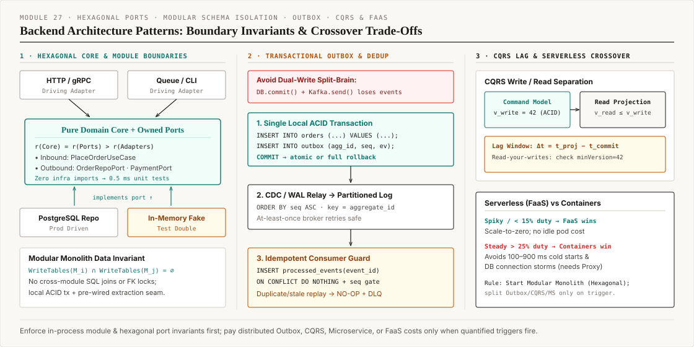
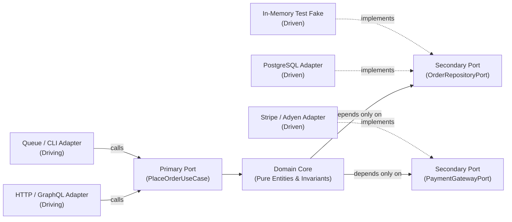
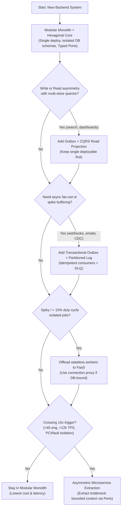

# Module 27: Backend Architecture Patterns — Modular Monolith, Microservices, Event-Driven, Serverless, Layered, Hexagonal, and CQRS

Backend topology determines where network hops, failure domains, schema locks, and team coordination costs live long before traffic scales. Choosing a seven-service mesh for a 50-TPS CRUD domain trades local ACID guarantees for distributed failure modes; leaving a 50-engineer codebase in an unpartitioned layered monolith turns every pull request into a schema-lock contention queue. This module establishes the formal dependency invariants, operational trade-offs, and quantitative crossover thresholds across the seven canonical backend architecture patterns, paired with an animated schematic, an asymmetric migration case study, and executable TypeScript proofs in [`../examples/21-backend-patterns.test.ts`](../examples/21-backend-patterns.test.ts).

> [!NOTE]
> **Cross-Track Knowledge Ownership.** Replication, LSM/B-tree storage engines, and CDC mechanics belong to [`architecture/data-systems`](../../data-systems/README.md); distributed consensus, delivery semantics, and saga correctness theory belong to [`architecture/distributed-systems`](../../distributed-systems/README.md); HTTP/gRPC/LB transport mechanics belong to [`architecture/networking`](../../networking/README.md); and ADR framing with quantitative single-PostgreSQL vs. microservice-mesh crossovers lives in [Module 01](01-framing-requirements-and-delivery.md#54-quantitative-crossover-single-well-tuned-postgresql-vs-7-service-microservice-mesh). This module owns **backend architectural pattern selection, boundary invariants, dependency inversion composition, and progressive extraction playbooks**.

---

## 1. Formal Boundary and Coupling Invariants

Every backend pattern governs two graphs: the **compile-time dependency graph** $G_{\text{dep}} = (V, E_{\text{dep}})$ across code modules and the **runtime failure-and-data graph** $G_{\text{rt}} = (V, E_{\text{rt}})$ across processes and data stores. Four formal invariants separate disciplined architectures from accidental distributed monoliths:

1. **Acyclic Dependency Invariant (All Patterns):** $G_{\text{dep}}$ must remain a Directed Acyclic Graph (DAG). Cyclic imports between modules or bidirectional synchronous RPC cycles ($A \to B \to A$) prevent independent compilation, trigger deadlocks under pool saturation (Little's Law, $L = \lambda W$), and defeat blast-radius isolation.
2. **Inward Dependency Inversion (Hexagonal / Clean):** Assign architectural ranks $r(\text{Domain Core}) = r(\text{Application Ports}) > r(\text{Adapters/Infra})$. Every compile-time edge $(u, v) \in E_{\text{dep}}$ must satisfy $r(v) \ge r(u)$ while forbidding Core/Port $\to$ Adapter edges: adapters depend on ports owned by the domain core, never the reverse.
3. **Disjoint Data Ownership (Modular Monolith & Microservices):** For modules or services $M_i \neq M_j$, persistent write ownership must be disjoint: $\text{WriteTables}(M_i) \cap \text{WriteTables}(M_j) = \emptyset$, and cross-module foreign-key joins are forbidden. Shared mutable tables turn independent deploys into schema-coupled releases.
4. **Atomic State-and-Event Commit (Event-Driven & CQRS):** Whenever a command updates aggregate state $S_k$ and emits domain event $E_k$, either both persist inside one local ACID commit $(S_k, E_k) \in \text{TX}_{\text{ACID}}$ (transactional outbox), or the event log itself is the single source of truth from which state derives. Publishing to a message broker outside the database transaction creates unrecoverable dual-write split-brain.

For CQRS read projections, write sequence $v_{\text{write}}(k)$ and projection sequence $v_{\text{read}}(k)$ satisfy $v_{\text{read}}(k) \le v_{\text{write}}(k)$ under asynchronous lag $\Delta t = t_{\text{proj}} - t_{\text{commit}}$, converging to $v_{\text{read}}(k) = v_{\text{write}}(k)$ once the ordered event stream drains and idempotent handlers reject stale or duplicate sequences.

---

## 2. The Seven Canonical Backend Architecture Patterns

### 2.1 Layered (N-Tier) Architecture

In a **Layered (N-Tier)** architecture (Fowler, _Patterns of Enterprise Application Architecture_, 2002), code is partitioned horizontally by technical responsibility—typically Presentation (HTTP controllers), Application/Service, Domain Logic, and Data Access (ORM/SQL)—with dependencies flowing strictly downward.

- **Strengths:** Lowest cognitive barrier for small teams; clear convention for request validation, transaction demarcation, and repository queries; fast initial velocity for CRUD-dominated domains.
- **Weaknesses:** Encourages database-centric modeling where domain entities mirror ORM tables; produces **sinkhole layers** (pass-through service methods adding boilerplate without invariants); creates leaky abstractions when SQL constraints or ORM lazy-loading bleed into controllers; couples domain unit tests to relational schemas.

### 2.2 Hexagonal Architecture (Ports and Adapters)

Proposed by Alistair Cockburn (2005), **Hexagonal Architecture** places the application and domain core inside a strict boundary surrounded by technology-agnostic **Ports** (interfaces owned by the core) and technology-specific **Adapters** (implementations outside the core).

- **Driving (Primary) vs. Driven (Secondary) Ports:** Driving adapters (REST controllers, gRPC handlers, queue workers) invoke inbound ports exposed by the core; driven adapters (PostgreSQL repositories, Redis caches, payment gateways) implement outbound ports defined by the core via Dependency Inversion.
- **Strengths:** Domain invariants run deterministically in sub-millisecond in-memory tests with zero Docker or network fixtures; infrastructure (Postgres $\to$ DynamoDB, REST $\to$ gRPC) swaps without touching domain rules; enforces clean seams for later service extraction.
- **Weaknesses:** Higher upfront file/mapper count (`DTO -> Domain -> PersistenceRow`); overkill for thin CRUD endpoints where business logic is trivial field validation.

### 2.3 Modular Monolith

A **Modular Monolith** (Grzybek, 2019; Fowler "MonolithFirst") packages the system as a single deployable binary/container while partitioning code vertically into **business-capability modules** (`Orders`, `Billing`, `Inventory`) with explicit public facades, isolated database schemas, and CI-enforced dependency boundaries.

- **Strengths:** Intra-process calls run in nanoseconds instead of multi-millisecond network RPCs; multi-entity workflows retain local ACID transactions without distributed sagas; single CI/CD pipeline, unified observability, and zero cross-AZ service-to-service egress tax.
- **Weaknesses:** All modules share process memory, GC pauses, and deployment blast radius; requires automated architectural fitness tests (such as `dependency-cruiser` or ArchUnit) and separate DB roles to stop engineers from writing cross-module SQL joins; scales compute as one unit unless specific hot paths are extracted.

### 2.4 Microservices

Defined by Lewis and Fowler (2014), **Microservices** decompose an application into small, independently deployable services organized around bounded business capabilities, communicating over lightweight protocols ("smart endpoints and dumb pipes") with decentralized data ownership per service.

- **Strengths:** Independent release trains for large organizations (`> 45–60` engineers); asymmetric horizontal scaling of hot endpoints (e.g., search ranking vs. user billing); strict fault-domain and compliance isolation (isolating a PCI-DSS cardholder vault from noisy analytics); polyglot runtime choice where specialized workloads justify it (Go/Rust vs. Python ML).
- **Weaknesses:** Every synchronous hop pays serialization, mTLS sidecar, and cross-AZ latency; composite availability drops multiplicatively ($\prod_{i=1}^n A_i$—seven `99.95%` hops yield `99.65%`); local ACID transactions fracture into distributed sagas and eventual consistency; demands mature distributed tracing, contract testing, and platform automation before paying off.

### 2.5 Event-Driven Architecture (EDA)

In **Event-Driven Architecture** (Hohpe & Woolf, _Enterprise Integration Patterns_, 2003), components communicate asynchronously by producing and consuming immutable domain events through a durable message broker or partitioned log (Kafka, Pulsar, SQS/SNS).

- **Three Variants:** **Event Notification** (thin `{ eventId, orderId }` signal requiring callback fetch), **Event-Carried State Transfer (ECST)** (self-contained snapshot avoiding synchronous callbacks), and **Event Sourcing** (the append-only event log is the authoritative database of record; see [Module 24](24-digital-wallet.md)).
- **Strengths:** Temporal decoupling (producers stay available during downstream maintenance); smooths traffic spikes via durable backpressure buffers; native multi-consumer fan-out (billing, search indexing, fraud scoring, analytics) without modifying producers.
- **Weaknesses:** Eliminates synchronous feedback—callers observe eventual consistency; requires the **transactional outbox** (or WAL CDC) to prevent dual-write loss; demands **idempotent consumers** and per-aggregate partition ordering to survive at-least-once redelivery; debugging distributed causality requires correlation IDs and Dead-Letter Queues ([Module 07](07-asynchrony-queues-streams-and-workflows.md)).

### 2.6 Serverless (Function-as-a-Service / FaaS)

**Serverless (FaaS)** (Roberts, 2016) runs stateless, event-triggered functions (AWS Lambda, Cloud Run Functions, Cloudflare Workers) where the cloud provider owns host provisioning, OS patching, horizontal scaling, and scale-to-zero billing per invocation and GB-second.

- **Strengths:** Zero idle compute cost for spiky, cron-driven, or low-duty-cycle workloads (`< 15%` average utilization); near-instant elasticity for embarrassingly parallel async tasks (image resizing, webhook fan-out, PDF parsing); minimal operational overhead for small teams.
- **Weaknesses:** **Cold-start tail latency** (`100–900 ms` on JVM/heavy containers, mitigated via SnapStart, provisioned concurrency, or V8 isolates); **database connection-pool exhaustion** when thousands of ephemeral invocations open direct TCP connections to PostgreSQL (mandatory RDS Proxy / PgBouncer / HTTP data API); execution duration caps; and **unit-economics inversion** where steady high-QPS traffic (`> 25–30%` sustained utilization) costs `2×–4×` more than right-sized containers or spot pods.

### 2.7 Command Query Responsibility Segregation (CQRS)

Originated by Greg Young and formalized by Fowler (2011), **CQRS** splits the application's **Command (Write) Model**—optimized for strict invariant enforcement, normalization, and transactional integrity—from one or more **Query (Read) Models**—denormalized projections materialized in stores tailored to fast retrieval (PostgreSQL read views, Redis hashes, Elasticsearch).

- **Strengths:** Enables independent read and write scaling and polyglot read stores (e.g., ACID Postgres for orders projected via outbox/CDC into OpenSearch for faceted search); eliminates complex multi-join read queries from the hot transactional primary.
- **Weaknesses:** Introduces **projection lag** between command commit and read visibility, breaking naive read-your-writes unless clients receive a monotonic version cursor or push notification (see [Module 24](24-digital-wallet.md)); doubles model and schema evolution surface; represents severe over-engineering for standard CRUD endpoints where indexed SQL views suffice.

---

## 3. Comparative Decision Matrix and Selection Flow

| Pattern | Dependency Direction | Data Ownership | Scaling Axis | Consistency Model | Primary Failure Mode | Ideal Sweet Spot |
| :-- | :-- | :-- | :-- | :-- | :-- | :-- |
| **Layered (N-Tier)** | Top-down (`UI -> Service -> DB`) | Shared relational schema | Vertical / whole-process horizontal | Strong ACID | Anemic sinkhole layers & ORM leakage | Small CRUD apps (`1–8` engineers) |
| **Hexagonal (Ports & Adapters)** | Strictly inward toward domain core | Technology-agnostic ports | Mirrors host (monolith or service) | Defined per adapter | Interface/mapper bloat on trivial CRUD | Complex business invariants needing fast unit proofs |
| **Modular Monolith** | DAG across vertical domain facades | Disjoint schemas per module | Whole-process (extract hot path later) | Local ACID; async between modules | Boundary erosion into "big ball of mud" | Default v1–v3 backend (`2–45` engineers, `<= 10k` TPS) |
| **Microservices** | Service-to-service over versioned APIs | Strict database-per-service | Independent per service | Eventual across services (Sagas) | Distributed latency, $\prod A_i$ penalty, ops tax | Large orgs (`45+` engineers), asymmetric scale, PCI isolation |
| **Event-Driven (EDA)** | Decoupled via immutable event contracts | Producer owns write; consumers materialize | Independent consumer groups | Eventual (bounded by lag SLO) | Dual-write loss, duplicate/out-of-order delivery | Multi-consumer fan-out, spike buffering, audit streams |
| **Serverless (FaaS)** | Event-trigger $\to$ stateless handler | Externalized (stateless runtime) | Per-request elastic (`0 -> N`) | Depends on backing store | Cold starts, DB connection storms, steady-load cost | Spiky workloads (`< 15%` duty), media/webhook workers |
| **CQRS** | Write commands $\to$ Events $\to$ Read projections | Separate write store & read projections | Independent read vs. write tiers | Eventual ($\Delta t$ lag; version-tracked) | Stale read-your-writes & double-schema drift | High read/write skew (`100:1+`) or heterogeneous search views |

---

## 4. Real-World Migration Case Study: Asymmetric Extraction Without a Big-Bang Rewrite

Consider a B2B commerce and fulfillment platform starting at launch load (`3,000` peak QPS, `12` engineers, PostgreSQL primary + Redis) and scaling over three years to `65,000` peak QPS and `55` engineers:

1. **Stage 1 — Layered $\to$ Hexagonal Modular Monolith (`12` engineers):** The team initially suffers slow integration tests coupled to Dockerized PostgreSQL and cross-table joins between `orders`, `payments`, and `warehouse_inventory`. Refactoring into a **Hexagonal Modular Monolith** isolates `OrderPlacementService` behind `OrderRepositoryPort` and `PaymentGatewayPort`, bans cross-schema SQL joins via separate Postgres schemas, and enforces module import boundaries in CI. Test suite runtime drops from `4 min` to `1.8 s`, while preserving single-commit ACID checkout.
2. **Stage 2 — Outbox + CQRS Read Projection (`25` engineers, `18,000` QPS):** Complex merchant analytics (`GET /v1/orders?status=...&sku=...` with `GROUP BY`) begin starving checkout `INSERT` transactions on the PostgreSQL primary. Instead of splitting into microservices, the team inserts an `outbox` row inside the checkout transaction, streams events via Debezium/Kafka into an **idempotent CQRS projector**, and serves merchant search/dashboards from OpenSearch + Redis while transactional writes stay local ACID. Checkout primary CPU drops by `62%`.
3. **Stage 3 — Asymmetric Microservice + FaaS Extraction (`55` engineers, `65,000` QPS):** Two concrete reversal triggers fire (see [Module 01 §5.1](01-framing-requirements-and-delivery.md#51-architecture-decision-records-with-rejection-rationales)): PCI-DSS scope requires isolating card tokenization, and bursty PDF invoice generation (`50×` end-of-month spikes, `8%` average duty cycle) causes OOMs in the monolith. Because `PaymentGatewayPort` and the outbox contract already exist, `Payments` extracts into a dedicated microservice in two weeks behind gRPC/mTLS, and `InvoiceRenderer` moves to FaaS Lambda workers triggered off Kafka—while `Catalog`, `Orders`, and `Accounts` remain happily inside the modular monolith.

---

## 5. Executable Proof Map

The deterministic TypeScript suite in [`../examples/21-backend-patterns.test.ts`](../examples/21-backend-patterns.test.ts) proves three architectural invariants under `node --experimental-strip-types --test`:

- **Hexagonal Port/Adapter Inversion:** Proves pure `OrderPlacementService` executes identically against an in-memory adapter and cleanly rejects faults injected via failing repository/payment adapters without leaking infrastructure errors, verified further with `fast-check` property checks.
- **CQRS Eventual Consistency & Lag Convergence:** Simulates delayed projection delivery (`lagTicks`), demonstrates transient `readVersion < writeVersion` divergence, verifies `satisfiesReadYourWrites` gating, and confirms out-of-order events are ignored while converging monotonically.
- **Event-Driven Transactional Outbox & Idempotency:** Proves atomic state-plus-outbox commit (and zero phantom outbox rows on aborted transactions), strict `(aggregateId, sequence)` relay ordering, and `processedEventIds` consumer deduplication across duplicate and out-of-order redeliveries.

---

## 6. Then vs. Now (2021 vs. 2026)

| Dimension | Earlier Default (2021) | Modern Practice (2026) | Why It Changed |
| :-- | :-- | :-- | :-- |
| **Default Starting Topology** | Microservices-first with shared K8s mesh for greenfield teams | **Hexagonal Modular Monolith** with CI import boundaries and disjoint schemas | Operational tax, cross-AZ egress fees, and $\prod A_i$ availability losses punished premature splits |
| **Service Extraction** | Big-bang rewrite into 10+ services once monolith slows down | **Asymmetric extraction** using pre-wired Hexagonal Ports and Outbox events when a quantified trigger fires | Isolates only the bottleneck or compliance boundary without fracturing transactional cores |
| **Async Event Publishing** | Dual-write (`db.save()` followed by `kafka.send()`) | **Transactional Outbox / WAL CDC** with idempotent consumer `processed_events` guards | Dual-write fails silently on partial crashes or transaction rollbacks |
| **Serverless Compute** | Routing entire REST APIs onto FaaS Lambdas with direct DB pools | **FaaS for spiky/async edges (`< 15%` duty cycle)** or edge isolates, paired with containers for steady hot paths | Cold-start jitter, proxy/pool costs, and `2×–4×` steady-load price inversion drove workload-aware hybrid placement |

---

## 7. Primary Literature & Source Matrix

| Source | Type | Core Contribution |
| :-- | :-- | :-- |
| Alistair Cockburn — _Hexagonal Architecture (Ports and Adapters)_ (2005) | Technical Report | Driving/driven port taxonomy and inward dependency inversion for deterministic testing |
| Martin Fowler — _Patterns of Enterprise Application Architecture_ (2002) | Book | Canonical Layered (N-Tier) architecture, Transaction Script, and Domain Model patterns |
| James Lewis & Martin Fowler — _Microservices_ (2014) | Article | Bounded capabilities, smart endpoints/dumb pipes, decentralized data ownership |
| Martin Fowler & Greg Young — _CQRS_ (2011) | Bliki / Monograph | Separating command invariance from denormalized read projections and eventual consistency trade-offs |
| Gregor Hohpe & Bobby Woolf — _Enterprise Integration Patterns_ (2003) | Book | Message channels, Event-Driven topologies, idempotent receivers, and Dead-Letter Channels |
| Kamil Grzybek — _Modular Monolith with DDD_ (2019) | Engineering Series | Vertical module isolation, separate schemas, internal integration events, and extraction readiness |
| Mike Roberts — _Serverless Architectures_ (2016) | Article | FaaS elasticity, cold-start latency, statelessness constraints, and steady-load economics |
| Chris Richardson — _Microservices Patterns_ (2018) | Book | Transactional Outbox, Polling/CDC Publisher, and Idempotent Consumer patterns |

---

## Interview Drill

**Q1. A 15-engineer startup asks whether to build their new marketplace as 8 microservices or a Modular Monolith. How do you decide, and what seams do you require if choosing the monolith?**

Model Answer

Choose a **Hexagonal Modular Monolith** backed by a single tuned PostgreSQL primary. At 15 engineers, 8 microservices impose 8 CI pipelines, cross-AZ RPC latency, multiplicative availability loss ($A^8$), and distributed sagas where local ACID transactions work. Require three load-bearing seams so extraction stays cheap later: (1) disjoint database schemas per vertical module with zero cross-module SQL joins, (2) typed internal Ports (`OrdersPort`, `BillingPort`) enforced by CI architecture/import tests, and (3) a Transactional Outbox for cross-module integration events.

**Q2. Contrast Layered (N-Tier) architecture with Hexagonal (Ports & Adapters) architecture. When does Hexagonal pay for its extra boilerplate?**

Model Answer

In Layered architecture, dependencies point downward (`Controller -> Service -> Repository/ORM -> DB`), coupling business logic to persistence schemas and requiring database fixtures for unit tests. In Hexagonal architecture, dependencies point **inward**: the pure domain core defines outbound Port interfaces (`OrderRepositoryPort`), and concrete Postgres or In-Memory adapters implement them from the outside. Hexagonal pays off when domain invariants are complex, external providers (PSPs, search, queues) evolve or need deterministic simulation tests, or future service extraction is anticipated; plain Layered suffices for simple CRUD admin APIs.

**Q3. Why is `await db.save(order); await kafka.publish(event)` a critical bug in Event-Driven Architecture, and how does the Transactional Outbox fix it?**

Model Answer

Those are two separate network calls without an atomic commit boundary (the dual-write problem): if `db.save` succeeds and the process crashes before `kafka.publish`, the event is silently lost forever; if `kafka.publish` runs inside an uncommitted transaction that later rolls back, consumers receive a phantom event for a nonexistent order. The **Transactional Outbox** writes the domain mutation and the `outbox` row inside the **same local ACID transaction**, then a relay (WAL CDC or sequential poller) publishes at-least-once to the broker while consumers deduplicate via a persisted `processed_events(event_id)` table.

**Q4. Your team adopts CQRS by projecting PostgreSQL writes via Kafka into OpenSearch. Immediately after placing an order, users refresh `/orders` and see a 404. Diagnose and fix this without abandoning CQRS.**

Model Answer

CQRS read projections are **eventually consistent** ($v_{\text{read}} \le v_{\text{write}}$ during the broker + indexing lag window $\Delta t$). Fix it through one of three bounded-lag mechanisms: (1) return the committed `aggregateVersion` (or write timestamp) in the `POST` response and have the client pass `minVersion` on `GET`, routing queries with `readVersion < minVersion` to a short primary/read-after-write fallback or brief bounded wait; (2) return the newly created projection state directly in the `POST` response (`201 Created` body) for optimistic client caching; or (3) push projection-applied notifications over SSE/WebSocket (Push-Based CQRS).

**Q5. When does Serverless (FaaS) win over always-on containers, and what breaks first when an engineer moves a high-throughput transactional API onto AWS Lambda?**

Model Answer

FaaS wins on spiky, bursty, or event-triggered workloads with low average duty cycle (`< 15%`) where scale-to-zero eliminates idle compute cost. Moving a high-QPS transactional API onto FaaS breaks three things first: (1) **PostgreSQL connection exhaustion**, as thousands of concurrent Lambda sandboxes open individual TCP connections unless fronted by RDS Proxy / PgBouncer; (2) **cold-start p99 latency spikes** (`100–900 ms`) during traffic ramps; and (3) **cost inversion**, where sustained `> 25–30%` utilization costs `2×–4×` more per GB-second than always-on containers.

**Q6. Name three quantitative signals that justify splitting one bounded context out of a Modular Monolith into a Microservice, and explain why you extract one context rather than all of them.**

Model Answer

Three concrete triggers are: (1) **asymmetric resource/scaling pressure** (e.g., search indexing or video transcoding saturates CPU/RAM and degrades checkout p99), (2) **regulatory or security fault isolation** (isolating PCI-DSS cardholder custody or untrusted LLM/plugin execution into its own blast radius and network perimeter), and (3) **organizational contention** (`> 45–60` engineers colliding on one migration lock or merge queue). Extract only the single context crossing its trigger (**asymmetric extraction**) so the remaining core keeps zero-hop ACID transactions and unified operations.

