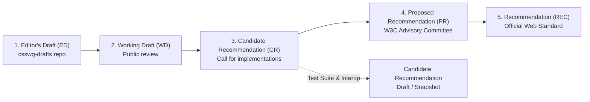
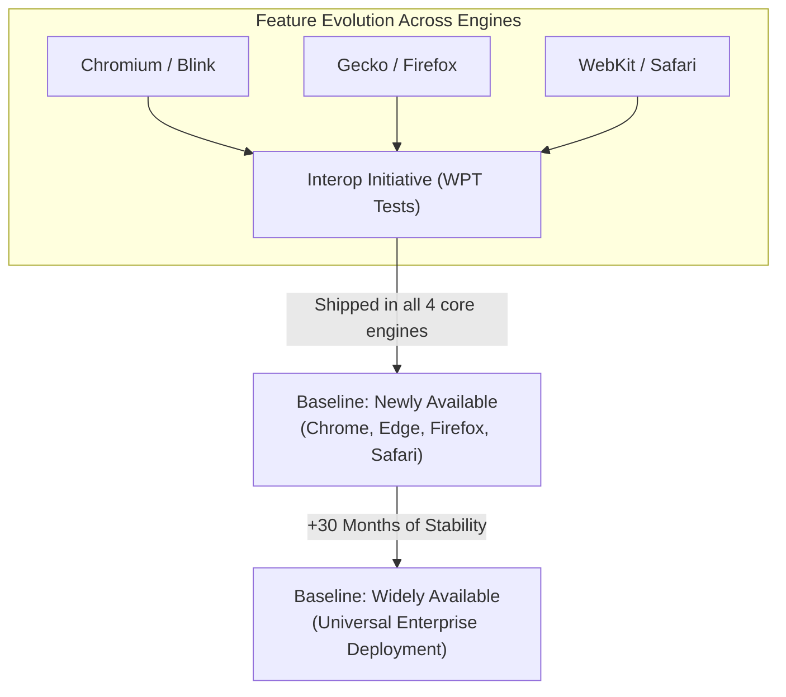
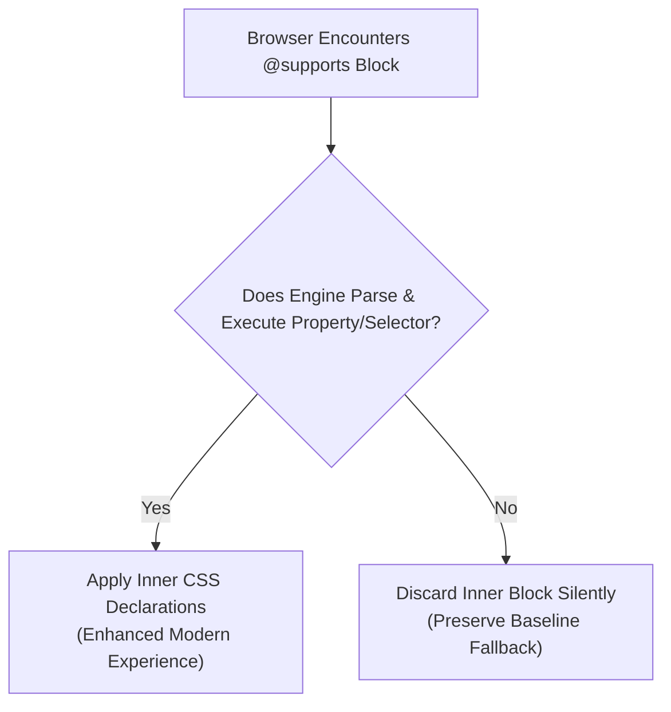

# Module 01 — CSS as a Platform: Specifications, Baseline & Tooling

CSS is not a single monolithic programming language or library with a global version number. It is an extensible open collection of independent, modular specifications governed by the World Wide Web Consortium (W3C) Cascading Style Sheets Working Group (CSSWG). Each module (such as CSS Grid, CSS Cascade, or CSS Color) progresses through its own standardized maturity lifecycle independently of other modules. Understanding the web platform requires understanding how specifications are authored, how browser implementers align on features via the Baseline compatibility model, and how modern Rust-based tooling lowers future CSS into cross-engine production stylesheets.

---

## 1. The W3C Specification Process & The Snapshot Model

### The Modular Specification Lifecycle
In the early web (CSS1 in 1996 and CSS2 in 1998), CSS was standardized as single monolithic specification documents. When CSS2.1 was finalized in 2011 after a decade of erratic browser implementations, the W3C CSSWG fundamentally restructured the standard into independent modules. The term "CSS3" was an informal marketing umbrella covering the initial batch of modularized Level 3 specifications (`css-color-3`, `css-grid-1`, `css-flexbox-1`); there is no "CSS4" or "CSS5".

Every CSS module advances through five formal W3C Process Document maturity stages:



1. **Editor's Draft (ED)**: The working document hosted on `drafts.csswg.org`. It reflects ongoing discussions, issues, and consensus resolutions by WG members. Syntax and semantics are subject to breaking changes.
2. **Working Draft (WD)**: An official snapshot published on `w3.org/TR/` to solicit public review and architectural feedback.
3. **Candidate Recommendation (CR / CRD)**: The specification is technically mature and stable. The W3C calls for independent browser implementations and begins assembling an executable test suite within the shared `web-platform-tests` (WPT) repository. Once two independent, interoperable implementations pass the test suite, the module advances.
4. **Proposed Recommendation (PR)**: Formal review by the W3C Advisory Committee confirming that interoperability criteria have been proven in the field.
5. **W3C Recommendation (REC)**: The final, authoritative W3C standard. Because browser engines ship features during Candidate Recommendation, most production CSS features you use daily are in CR or CRD status rather than REC.

### The W3C CSS Snapshot
To provide software implementers and developers with a cohesive reference for "what constitutes CSS today", the CSSWG publishes periodic **CSS Snapshots** as W3C Group Notes. The authoritative reference for modern web development is the **CSS Snapshot 2026** (W3C Group Note, 26 February 2026), which formally lists all stable modules that have reached Candidate Recommendation or Recommendation with demonstrated cross-engine interoperability:

| Module Category | Current Definitive Specification | Snapshot Status | Primary Mechanics |
| :--- | :--- | :---: | :--- |
| **Syntax & Cascade** | CSS Syntax 3 / CSS Cascade 5 & 6 | CR / WD | Tokenization, `@layer` priority, `@scope` proximity |
| **Box Model & Layout** | CSS Display 3 / Flexbox 1 / Grid 2 | CR / REC | Visual formatting model, subgrid, intrinsic sizing |
| **Positioning** | CSS Position 3 / Anchor Position 1 | CR / WD | Inset resolution, top layer, anchor coordinates |
| **Color Spaces** | CSS Color 4 & 5 / Color HDR | CR / WD | OKLCH, wide-gamut Display P3, `color-mix()`, relative color |
| **Values & Units** | CSS Values 4 & 5 | CR / WD | Dynamic math (`min`, `max`, `clamp`), container units (`cqi`, `cqb`) |
| **Animations & Motion** | CSS Transitions 1 / Animations 1 / View Transitions 1 | CR / WD | Interpolation, state transitions, shared-element morphing |

### Anatomy of a Specification Property Definition
Every formal property definition table in a W3C specification dictates the normative behavior browser engines must implement. Below is an anatomical breakdown of how to read a specification table:

```
Name:                accent-color
Value:               auto | <color>
Initial:             auto
Applies to:          input elements with checkable states, progress, range
Inherited:           yes
Percentages:         n/a
Computed value:      keyword 'auto' or a computed <color>
Canonical order:     per grammar
Animation type:      by computed value type
```

- **Initial**: The default value assigned to the property before cascading or inheritance takes place (e.g., `margin` defaults to `0`, `display` defaults to `inline`).
- **Applies to**: The subset of elements or pseudo-elements in the box tree capable of generating the property's behavior.
- **Inherited**: Indicates whether a child element automatically inherits this computed value from its parent element in the document tree when no explicit rule matches.
- **Computed value**: The formal representation computed during the cascade (e.g., relative units like `em` or `rem` resolved to absolute pixel lengths, keywords canonicalized).
- **Animation type**: Determines how interpolation between two values behaves during CSS transitions and `@keyframes` animations (e.g., `discrete` vs. `by computed value`).

---

## 2. The Baseline Compatibility Standard & web-features

Historically, web developers tracked browser support using crowdsourced tables or vendor blog posts. In modern engineering, the authoritative standard is **Baseline**, managed under the W3C WebDX Community Group and backed by the open-source `web-features` dataset.



### Baseline Status Tiers
Baseline categorizes web platform features into three unambiguous operational tiers:

1. **Limited Availability**: The feature is implemented in one or two browser engines, or is gated behind experimental feature flags. It is not ready for un-polyfilled, general-audience production code.
2. **Newly Available**: The feature is fully supported out-of-the-box in the latest stable releases of all four core desktop and mobile browser engines:
   - Google Chrome & Microsoft Edge (Chromium / Blink)
   - Mozilla Firefox (Gecko)
   - Apple Safari (WebKit on macOS & iOS)
3. **Widely Available**: Exactly **30 months** have elapsed since the feature achieved "Newly Available" status. This 30-month buffer accounts for slower enterprise upgrade cycles, long-term support (LTS) operating systems, and older mobile handsets, representing safe, frictionless deployment without polyfills or fallbacks.

### The Interop Program
The **Interop Program** (e.g., Interop 2024, Interop 2025, Interop 2026) is an annual joint initiative between Apple, Google, Microsoft, Mozilla, and Bocoup. Rather than competing with proprietary CSS extensions, browser vendors agree on a targeted list of focus areas and write thousands of automated tests in `web-platform-tests`. The Interop score directly drives features from experimental status into Baseline Newly Available.

---

## 3. Progressive Enhancement with `@supports`

CSS provides first-class progressive enhancement through the `@supports` at-rule (CSS Conditional Rules Level 3 & Level 4). The browser parses the condition; if the engine supports the declared syntax, the inner block is evaluated. If not, the engine ignores the block entirely without throwing runtime JavaScript errors or halting execution.

### Feature Queries Syntax
```css
/* Property-value support check */
@supports (display: grid) {
  .gallery {
    display: grid;
    grid-template-columns: repeat(auto-fit, minmax(240px, 1fr));
    gap: 1.5rem;
  }
}

/* Logical operators (and, or, not) */
@supports (backdrop-filter: blur(10px)) and (not (border-image: none)) {
  .glass-card {
    backdrop-filter: blur(10px);
    background-color: oklch(100% 0 0 / 60%);
  }
}

/* Selector support checking: @supports selector(...) */
@supports selector(:has(> img)) {
  .card:has(> img) {
    grid-template-rows: 200px auto;
  }
}

/* Font technology and format query */
@supports font-format(woff2) {
  @font-face {
    font-family: "Inter Variable";
    src: url("/fonts/inter-var.woff2") format("woff2");
  }
}
```



---

## 4. Modern Build Tooling: Lightning CSS & Stylelint 17

For over a decade, CSS preprocessing relied on Node.js-based tools (PostCSS, Autoprefixer) that parsed CSS into large JavaScript object trees. Modern toolchains use compiled, native Rust engines that parse, transform, and optimize CSS at tens of thousands of lines per millisecond.

### Lightning CSS Architecture
**Lightning CSS** is an extremely fast CSS parser, transformer, bundler, and minifier written in Rust. It reads your target browser matrix directly from `browserslist` or Baseline configurations and compiles modern CSS into backward-compatible CSS without runtime overhead:
- **Nesting Lowering**: Lowers native CSS nesting into flat selectors or `:is()` wrappers for legacy browsers.
- **Color Gamut Transpilation**: Converts high-dynamic-range OKLCH or Display P3 colors into sRGB `rgb()` fallbacks for older devices.
- **Custom Media & Imports**: Resolves `@import` trees and inlines `@custom-media` queries.
- **Vendor Prefix Generation**: Automatically inserts vendor prefixes (e.g., `-webkit-`) based on exact target browser versions, eliminating the need for standalone Autoprefixer.

```typescript
// lightningcss-transform.ts: Programmatic compilation with targeted browser support
import { transform, browserslistToTargets } from 'lightningcss';
import browserslist from 'browserslist';

const targets = browserslistToTargets(browserslist('baseline widely available'));

const sourceCSS = `
  @layer components {
    .hero-banner {
      color: oklch(65% 0.25 140);
      background: light-dark(#ffffff, #121212);

      & > h1 {
        font-size: clamp(1.5rem, 4vw, 3rem);
      }
    }
  }
`;

const { code } = transform({
  filename: 'input.css',
  code: Buffer.from(sourceCSS),
  minify: true,
  targets,
});

console.log(code.toString());
```

### Linting against Baseline with Stylelint 17
Stylelint 17 provides static analysis to enforce design system rules and catch invalid syntax. Combined with `stylelint-plugin-use-baseline`, teams can enforce that engineers only commit CSS properties that have reached a designated Baseline status (e.g. `widely`):

```json
// .stylelintrc.json
{
  "extends": ["stylelint-config-standard"],
  "plugins": ["stylelint-plugin-use-baseline"],
  "rules": {
    "use-baseline/use-baseline": [
      true,
      {
        "available": "widely",
        "severity": "error"
      }
    ]
  }
}
```

---

## 5. Then vs. Now: Platform Philosophy Shift

| Dimension | Legacy CSS Era (2010–2018) | Modern CSS Platform (2024–2026+) |
| :--- | :--- | :--- |
| **Release Cadence** | Monolithic "CSS3" branding; slow, multi-year W3C updates | Independent continuous modules; yearly W3C Snapshots (Snapshot 2026) |
| **Browser Compatibility** | Vendor prefixes (`-webkit-`, `-moz-`, `-ms-`), CSS hacks (`*html`), CanIUse scraping | W3C Interop initiative, automated WPT test suites, Baseline Newly & Widely |
| **Build Pipelines** | Heavy Node.js pipelines (Sass / Less $\rightarrow$ PostCSS $\rightarrow$ Autoprefixer) | Native Rust toolchains (Lightning CSS) with direct Baseline browser targeting |
| **Feature Detection** | JavaScript user-agent sniffing or heavy Modernizr libraries | Native `@supports (...)` and `@supports selector(...)` conditional rules |
| **Language Features** | Relied on preprocessors for variables, nesting, and mixins | Native Custom Properties, native nesting, `@layer`, and `@scope` built into the browser |

---

## 6. CSS Platform Major Milestones

| Year | Spec Snapshot / Milestone | Landmark Features Released |
| :--- | :--- | :--- |
| **2011** | CSS 2.1 Recommendation | Formal modularization of CSS; establishment of modern box formatting context |
| **2017** | CSS Grid Layout Level 1 | Two-dimensional native grid system shipped across all engines within months |
| **2022** | Interop 2022 / Baseline Birth | `@layer` (Cascade Layers), subgrid cross-engine push, container queries origin |
| **2023** | Interop 2023 | Native CSS Nesting, `:has()` relational selector, wide-gamut OKLCH colors |
| **2024** | CSS Snapshot 2024 / Baseline 2024 | `@property` registered variables, Popover API, `@starting-style` transitions |
| **2025** | Baseline 2025 | Same-document View Transitions, `@scope`, `content-visibility`, light-dark() |
| **2026** | CSS Snapshot 2026 (W3C Note) | Native Anchor Positioning, Style Queries, `contrast-color()`, Grid-Lanes |

---

## 7. Interview Drill: Platform, Specifications & Tooling

### Q1: Why does the term "CSS4" have no formal technical meaning in web standards?
<details><summary>Answer</summary>

After CSS 2.1 was finalized in 2011, the W3C CSSWG abandoned monolithic language versions in favor of independent, modular specifications. Each module (such as CSS Grid, Selectors, or Cascade) advances at its own pace through the W3C recommendation track and increments its own version level independently (e.g., `css-grid-2`, `selectors-4`). The CSSWG publishes yearly "CSS Snapshots" (e.g. CSS Snapshot 2026) to define the current stable state of the platform, but there is no overarching "CSS4" specification.
</details>

### Q2: What exact criteria distinguish a feature marked "Baseline: Newly Available" from one marked "Baseline: Widely Available"?
<details><summary>Answer</summary>

"Newly Available" indicates that a feature has shipped in the stable releases of all four core browser engines: Google Chrome, Microsoft Edge, Mozilla Firefox, and Apple Safari (both desktop and mobile). "Widely Available" occurs exactly 30 months after the date a feature became Newly Available. This 30-month buffer provides a standardized operational signal that a feature can be used safely in enterprise and consumer environments without polyfills or fallbacks.
</details>

### Q3: What is the difference between `@supports (selector: ...)` and `@supports selector(...)`?
<details><summary>Answer</summary>

`@supports (selector: ...)` is invalid syntax because `selector` is not a CSS property. The correct syntax defined in CSS Conditional Rules Level 4 is `@supports selector(<selector>)`. It tests whether the browser's selector engine can successfully parse and query a specific selector pattern (such as `:has(img)` or `:focus-visible`). If the browser does not support the selector, it discards the entire rule block without throwing an error.
</details>

### Q4: In a CSS specification property definition table, what is the operational significance of the "Initial" value versus the "Inherited" descriptor?
<details><summary>Answer</summary>

The "Initial" value is the property's default value specified by the standard (e.g. `margin: 0`, `font-size: medium`). The "Inherited" descriptor (either `yes` or `no`) specifies whether an element inherits the computed value from its parent when no author or user styles match the element. For inherited properties (e.g. `color`, `font-family`), the value cascades down the DOM tree. For non-inherited properties (e.g. `border`, `padding`, `background`), the element receives the property's Initial value unless explicitly set.
</details>

### Q5: Why is Lightning CSS substantially faster than traditional PostCSS pipelines, and how does it determine which vendor prefixes to generate?
<details><summary>Answer</summary>

Lightning CSS is written in Rust and operates on strongly typed abstract syntax trees (ASTs) in native machine code, avoiding the garbage collection pauses and object allocation overhead of JavaScript engines. It embeds a complete browser compatibility database (compatible with Browserslist and CanIUse). Based on the developer's declared browser target matrix, Lightning CSS performs a single-pass AST traversal to insert required vendor prefixes and down-level modern CSS features only for engines that strictly require it.
</details>
