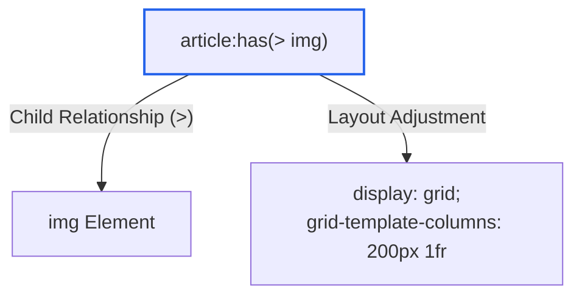
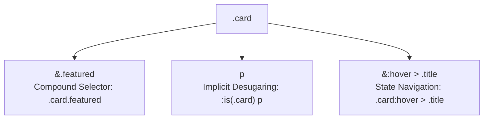

# Module 02 — Syntax, Selectors & Specificity

CSS evaluation is governed by two fundamental subsystems: the tokenization and parsing engine, which transforms raw stylesheet text into an Abstract Syntax Tree (AST), and the selector matching engine, which evaluates DOM elements against selector queries and resolves conflicting author declarations using deterministic specificity math. Understanding how browsers parse tokens, recover from syntax errors, and calculate selector weights is essential for architecting predictable stylesheets without defensive hacks or `!important` escalations.

---

## 1. CSS Syntax, Tokenization & Error Recovery

### Tokenization & The Grammar of Declarations
According to the CSS Syntax Module Level 3, a stylesheet is parsed into a sequence of tokens (identifiers, at-keywords, strings, numbers, punctuation, and whitespace). A CSS declaration consists of an identifier property name, a colon (`:`), a list of component values, and an optional `!important` flag.

```
       ┌────────── Declaration ──────────┐
       │                                 │
       color : oklch(0.65 0.22 140) !important ;
       ▲     ▲ └─────────┬────────┘ └────┬────┘ ▲
       │     │           │               │      │
Property  Colon   Component Value     Priority Semicolon
```

### The Error Recovery Invariant
CSS engines are designed around the principle of **resilient graceful degradation**:
1. **Unknown or Malformed Declarations**: If a browser encounters a property name or value it does not recognize, it discards that *single declaration* by consuming all tokens until the next semicolon or closing brace, and continues parsing the remaining declarations in the block.
2. **Unforgiving vs. Forgiving Selector Lists**:
   - In traditional **unforgiving** selector lists (e.g. `h1, h2, :invalid-pseudo`), if any single selector in the comma-separated list is syntactically invalid or unsupported by the engine, **the entire rule block is invalidated and discarded**.
   - In modern **forgiving** selector lists (specifically inside `:is()` and `:where()`), the engine parses each selector independently. If one selector fails or is unsupported, it is discarded, while the remaining valid selectors in the list continue to match.

```css
/* UNFORGIVING LIST: If any pseudo-class is unknown, the whole rule FAILS in that engine */
button:hover,
button:-moz-focusring, /* In WebKit/Blink, this invalidates the entire block! */
button:focus-visible {
  outline: 2px solid blue;
}

/* FORGIVING LIST with :is(): Valid selectors continue to match across all engines */
button:is(:hover, :-moz-focusring, :focus-visible) {
  outline: 2px solid blue;
}
```

---

## 2. Modern Selectors: Functional & Relational Pseudo-Classes

CSS Selectors Level 4 introduces functional pseudo-classes that dramatically alter how selectors compose, match, and calculate specificity.

### Functional Grouping: `:is()` and `:where()`
Both `:is()` and `:where()` take a forgiving selector list as arguments and match any element that matches any selector in the list:
- **`:is()`**: Adopts the specificity of its **highest-specificity argument**.
- **`:where()`**: Always contributes **zero specificity** `(0, 0, 0)` regardless of what selectors are inside it. This makes `:where()` the ultimate primitive for CSS resets, design-system base styles, and component library defaults that developers can override effortlessly with a single class name.

```css
/* Specificity of :is() is (1, 0, 0) because #nav is an ID */
:is(section, article, #nav) h2 {
  color: #1a1a1a;
}

/* Specificity of :where() is strictly (0, 0, 1) for the h2 element alone */
:where(section, article, #nav) h2 {
  color: #1a1a1a;
}
```

### The Relational Selector: `:has()`
`:has()` (Baseline Widely Available since June 2026) is the relational "parent selector". It accepts a relative selector list and matches an element if any element matching the argument can be reached from it:

```css
/* Selects an <article> only if it contains an  child */
article:has(> img) {
  grid-template-columns: 200px 1fr;
}

/* Selects a <label> that immediately precedes an invalid <input> */
label:has(+ input:user-invalid) {
  color: oklch(0.55 0.25 25);
}

/* Previous-sibling selection: Selects an <li> that precedes a selected <li> */
li:has(+ li.selected) {
  border-bottom: 2px dashed #999;
}
```



### Interaction & State Selectors
- **`:focus-visible`**: Matches an element with focus only when the browser heuristic determines that a visible indicator is needed (e.g. keyboard navigation via Tab key, but not pointer clicks).
- **`:user-valid` / `:user-invalid`**: Unlike `:valid` and `:invalid` (which fire immediately on page load before the user has touched the field), `:user-valid` and `:user-invalid` match only after the user has interacted with the input (typing, blurring, or submitting), preventing hostile initial validation errors.
- **`:open`**: Matches elements currently in an open state (such as native `<details open>`, `<dialog>`, or popovers).

---

## 3. Specificity Mathematics: The (A, B, C) Tuple

When multiple matching rules declare conflicting properties for the same element, the cascade compares their specificity weights. Specificity is calculated as an ordered 3-tuple $(A, B, C)$:

```
           ┌──────────────── Specificity 3-Tuple (A, B, C) ────────────────┐
           │                                                               │
           │   [ A ]           ,         [ B ]          ,      [ C ]       │
           │                                                               │
     ID Selectors                  Classes, Attributes,         Element (Type)
     (#header, #nav)               Pseudo-classes               & Pseudo-elements
                                   (.card, [type], :hover)      (div, span, ::before)
```

1. **Category A (IDs)**: Count of ID selectors (e.g., `#main-header`).
2. **Category B (Classes, Attributes, Pseudo-classes)**: Count of class selectors (`.btn`), attribute selectors (`[aria-expanded="true"]`), and pseudo-classes (`:hover`, `:focus`).
3. **Category C (Elements & Pseudo-elements)**: Count of element type selectors (`h1`, `div`, `article`) and pseudo-elements (`::before`, `::after`, `::placeholder`).

### Specificity Comparison Rules
Specificity comparison is **lexicographical** from left to right:
- First, compare $A$. Whichever rule has a higher $A$ value wins, regardless of the values of $B$ and $C$. Ten thousand classes $(0, 10000, 0)$ can never override a single ID selector $(1, 0, 0)$ in conforming browser engines.
- If $A$ values are equal, compare $B$. The higher $B$ wins.
- If $B$ values are equal, compare $C$. The higher $C$ wins.
- If all three values $(A, B, C)$ are identical, specificity is tied; the conflict is resolved by **order of appearance** (the rule declared later in the stylesheet wins).

### Specificity Calculation Matrix
| Selector | A (IDs) | B (Classes/Attrs/Pseudo) | C (Elements) | Total Tuple |
| :--- | :---: | :---: | :---: | :---: |
| `h1` | 0 | 0 | 1 | `(0, 0, 1)` |
| `h1.title` | 0 | 1 | 1 | `(0, 1, 1)` |
| `#hero h1.title` | 1 | 1 | 1 | `(1, 1, 1)` |
| `header[data-theme="dark"] .nav-link:hover` | 0 | 3 | 1 | `(0, 3, 1)` |
| `:is(#sidebar, .menu) a` | 1 | 0 | 1 | `(1, 0, 1)` |
| `:where(#sidebar, .menu) a` | 0 | 0 | 1 | `(0, 0, 1)` |
| `article:has(> img.hero)` | 0 | 1 | 2 | `(0, 1, 2)` |

> [!IMPORTANT]
> The universal selector (`*`), the parent combinator (`>`), sibling combinators (`+`, `~`), and the column combinator (`||`) contribute **zero** to specificity: `(0, 0, 0)`. The pseudo-class `:not()` itself contributes zero specificity, but the selectors *inside* its parenthesis contribute normally.

---

## 4. Native CSS Nesting & `CSSNestedDeclarations`

Native CSS Nesting (Baseline Widely Available since June 2026) allows rule blocks to be nested directly within parent rules without external preprocessors like Sass or Less.

### The Nesting Selector (`&`) and Implicit Wrapping
In native nesting, nested rules can reference the parent selector using the ampersand (`&`). If an ampersand is omitted, the engine automatically desugars the nested selector by wrapping the parent in an implicit `:is()` functional pseudo-class:

```css
/* Author Source */
.card {
  color: black;

  &.featured {
    border: 2px solid gold; /* Desugars to: .card.featured */
  }

  p {
    margin: 0;              /* Desugars to: :is(.card) p */
  }

  &:hover > .title {
    color: blue;            /* Desugars to: .card:hover > .title */
  }
}
```



### The `CSSNestedDeclarations` Object Model Fix
In early implementations of native nesting (2023), mixing declarations *after* a nested rule created a severe parsing bug: declarations declared after a nested block were parsed as though they preceded the nested block. The CSSWG resolved this in the **CSS Cascading and Inheritance Level 6** specification by introducing the `CSSNestedDeclarations` interface. 

In the browser's CSS Object Model (CSSOM), any declarations that appear after a nested child rule are automatically grouped into a dedicated `CSSNestedDeclarations` rule node, preserving author declaration ordering and cascade behavior exactly as written:

```css
.card {
  padding: 1rem;       /* Direct style declaration */

  & > h2 {
    color: red;        /* Child rule */
  }

  color: blue;         /* In modern CSSOM, wrapped in CSSNestedDeclarations */
                       /* Retains declaration order after the h2 rule */
}
```

---

## 5. Then vs. Now: Selectors and Nesting

| Dimension | Legacy Practice (Sass / Preprocessors) | Modern Web Platform (2024–2026+) |
| :--- | :--- | :--- |
| **Nesting** | Sass compiled nesting into duplicated, bloated flat selector strings (`.card .title`) | Native browser nesting with `&` and implicit `:is()` wrapping in the CSSOM |
| **Parent Selection** | Required custom JavaScript event listeners or class toggling (`parent.classList.add('has-child')`) | Native `:has()` relational selector evaluated directly by browser style engine |
| **Specificity Reset** | Heavy specificity hacks (`.reset.reset.reset` or `!important` wars) | `:where()` provides complete zero-specificity `(0, 0, 0)` architectural defaults |
| **Form Validation** | Immediate `:invalid` state caused red borders on empty initial inputs | `:user-invalid` waits for user focus, change, and blur before showing errors |
| **Selector Grouping** | Repetitive duplication of long selector chains | `:is()` groups selectors cleanly and tolerates invalid arguments forgivingly |

---

## 6. Interview Drill: Syntax, Selectors & Specificity

### Q1: Given the selector `:is(.alert, #notification) p`, what is its exact specificity tuple $(A, B, C)$?
<details><summary>Answer</summary>

The specificity tuple is `(1, 0, 1)`. The functional pseudo-class `:is()` takes the specificity of its most specific argument. Between `.alert` (specificity `(0, 1, 0)`) and `#notification` (specificity `(1, 0, 0)`), the highest is `#notification` with `A=1`. The descendant element `p` contributes `C=1`. Therefore, the combined specificity is $A=1, B=0, C=1$.
</details>

### Q2: Why does `div:has(> img)` have a specificity of `(0, 0, 2)` while `div:where(> img)` has a specificity of `(0, 0, 1)`?
<details><summary>Answer</summary>

`:has()` adopts the specificity of the most specific selector in its relative selector argument list. In `div:has(> img)`, `div` is an element `(0, 0, 1)` and `img` is an element `(0, 0, 1)`, yielding a total specificity of `(0, 0, 2)`. In contrast, `:where()` *always* has a specificity of exactly `(0, 0, 0)` regardless of what selectors appear inside its argument list; only the outer `div` contributes to specificity, resulting in `(0, 0, 1)`.
</details>

### Q3: What is the fundamental difference between an unforgiving selector list and a forgiving selector list when encountering an unsupported pseudo-class?
<details><summary>Answer</summary>

In an unforgiving selector list (such as standard comma-separated rules: `h1, h2, :unsupported`), if the browser engine fails to parse any single selector in the list, the entire rule block is considered invalid and discarded. In a forgiving selector list (used inside `:is()` and `:where()`), the parser evaluates each selector independently; unsupported or invalid selectors are dropped silently, while all valid selectors in the list continue to match and apply styles.
</details>

### Q4: Why does `:user-invalid` represent a superior UX pattern over the standard `:invalid` pseudo-class for form inputs?
<details><summary>Answer</summary>

The `:invalid` pseudo-class evaluates the validity constraints of an input immediately upon DOM parsing. If an input has a `required` attribute, it is immediately invalid on initial page load, causing red error states to appear before the user has even focused the input. In contrast, `:user-invalid` only matches if the field is invalid *and* the user has actively interacted with it (altered its value, blurred focus, or attempted to submit the parent form), preventing premature error presentation.
</details>

### Q5: In native CSS nesting, what is the role of `CSSNestedDeclarations` in the CSSOM?
<details><summary>Answer</summary>

When CSS nesting was initially standardized, author declarations placed after a nested child rule were inadvertently hoisted to the beginning of the parent style rule in the CSSOM, altering the intended cascade order. The CSS Cascading and Inheritance Level 6 specification introduced `CSSNestedDeclarations` as an internal CSSOM grouping node. Declarations appearing after a nested rule are grouped into a `CSSNestedDeclarations` object that preserves their exact source order and cascade position relative to preceding rules.
</details>
