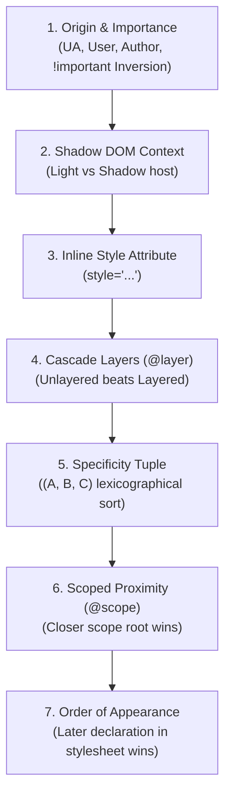
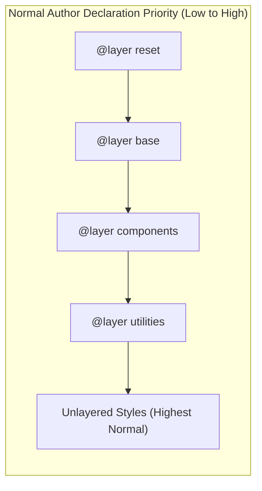
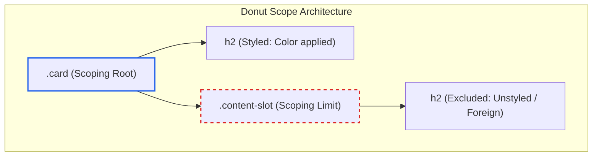

# Module 03 — The Cascade, Layers & Scope

The Cascade is the algorithmic engine at the heart of CSS. When multiple style rules match the same DOM element and declare conflicting values for a property, the cascade executes a rigorous, deterministic sorting algorithm to select a single winning declaration. Historically, developers managed the cascade using naming conventions (such as BEM) and artificial specificity inflation. Modern CSS provides explicit structural control over the cascade through **Cascade Layers (`@layer`)** and **Scoped Styles (`@scope`)**, giving authors complete authority over rule prioritization independent of selector specificity.

---

## 1. The Formal Cascade Sort Order

According to CSS Cascading and Inheritance Level 5, the browser resolves conflicting property declarations by evaluating candidate rules through an ordered 8-step precedence hierarchy. Evaluation halts as soon as a criterion breaks the tie:



### 1. Origin and Importance
The origin determines where the rule came from, and importance determines whether it carries the `!important` annotation. Normal and important declarations have **inverted** hierarchies:

| Precedence (Low to High) | Origin & Importance Level | Description |
| :---: | :--- | :--- |
| **1** (Lowest) | User Agent Normal | Default browser styles (e.g. `display: block` on `<div>`) |
| **2** | User Normal | User custom stylesheets or reader-mode preferences |
| **3** | Author Normal | Styles declared by the website developer |
| **4** | Author Important (`!important`) | Developer styles marked with `!important` |
| **5** | User Important (`!important`) | User overrides (e.g. forced high-contrast preferences) |
| **6** (Highest) | User Agent Important (`!important`) | Built-in browser safety constraints (e.g. popover styles) |

> [!NOTE]
> The inversion of `!important` across origins is intentional: a user's `!important` rule overrides an author's `!important` rule, ensuring accessibility tools and assistive user stylesheets always take precedence over website author styles.

### 2. Context
Declarations from the outer document tree (light DOM) vs. inside a Shadow DOM boundary.

### 3. Element-Attached Styles
Declarations written directly in an HTML `style="..."` attribute take precedence over stylesheet selectors (except when competing against `!important` rules).

### 4. Cascade Layers
Author declarations defined inside `@layer` rules are evaluated by layer priority. **Unlayered author styles always take precedence over layered author styles** for normal declarations.

### 5. Specificity
The lexicographical $(A, B, C)$ tuple comparison derived from the rule's selector.

### 6. Scope Proximity
When comparing rules within `@scope`, declarations whose scoping root is physically closer (fewer DOM hops) to the matched element take precedence.

### 7. Order of Appearance
If all preceding criteria are identical, the rule declared later in document or stylesheet order wins.

---

## 2. Cascade Layers (`@layer`)

Cascade Layers (CSS Cascading Level 5, Baseline Widely Available since September 2024) solve the architectural problem of third-party libraries, resets, and utility classes clashing over specificity.

### Layer Declaration & Order of Precedence
Layers can be declared upfront in a comma-separated list, establishing their priority regardless of when their contents are loaded:

```css
/* Explicit layer order definition */
@layer reset, base, themes, components, utilities;

@layer utilities {
  .hidden {
    display: none; /* Low specificity (0, 1, 0), but high layer priority! */
  }
}

@layer components {
  /* High specificity (1, 1, 1), but component layer is LOWER than utilities! */
  #main-nav .menu-item.active {
    display: flex;
  }
}
```

In the example above, `.hidden` wins over `#main-nav .menu-item.active`. Because `utilities` was declared after `components` in the layer list, its layer priority is higher. **Specificity only compares rules within the same layer.**



### The Unlayered Styles Hazard
> [!WARNING]
> Unlayered author declarations (styles not placed inside any `@layer`) sit at the very top of normal author precedence. If you adopt `@layer` for your application, any legacy or third-party stylesheet that is loaded outside of a layer will override your layered styles regardless of specificity.
> To tame third-party stylesheets, import them into an explicit layer using `@import url(...) layer(vendor)` or wrap them in `@layer vendor { ... }`.

### The `!important` Layer Inversion Rule
When an author rule inside a layer carries the `!important` flag, **the layer precedence order inverts completely**:
- For normal declarations: `utilities` beats `reset`.
- For `!important` declarations: **`reset !important` beats `utilities !important`**.

```css
@layer base, overrides;

@layer base {
  p {
    color: red !important; /* WINS over overrides layer! */
  }
}

@layer overrides {
  p {
    color: blue !important; /* Loses due to layer inversion! */
  }
}
```

This inversion mirrors the origin-importance inversion and ensures that defensive "reset" or foundational constraints cannot be broken by aggressive utility `!important` rules.

---

## 3. Scoped Styles (`@scope`) & Proximity

CSS Scoping Module Level 1 (Baseline Newly Available since March 2026) allows authors to define styles that apply strictly within a subtree, eliminating global class pollution and establishing **donut scope** boundaries.

### Scope Root and Limits
The `@scope` rule defines a scoping root and an optional scoping limit (the "donut hole"):

```css
/* Scopes styles to .card, but stops at any nested .content-slot */
@scope (.card) to (.content-slot) {
  /* Matches <h2> inside .card, but NOT inside an embedded .content-slot */
  h2 {
    color: oklch(0.35 0.15 250);
    margin-block-end: 0.5rem;
  }

  /* The :scope pseudo-class refers directly to the scoping root (.card) */
  :scope {
    border: 1px solid #e2e8f0;
    padding: 1.5rem;
  }
}
```



### Scope Proximity Resolution
When two scoped rules have identical specificity and declare conflicting properties, the cascade evaluates **scope proximity**: the rule whose scoping root is physically closer (fewer parent ancestor steps) to the target element in the DOM tree wins:

```html
<div class="light-theme">
  <div class="dark-theme">
    <p>Which color wins?</p>
  </div>
</div>
```

```css
@scope (.light-theme) { p { color: black; } } /* 2 DOM hops to <p> */
@scope (.dark-theme)  { p { color: white; } } /* 1 DOM hop to <p> (CLOSER!) */
```
Both selectors have specificity `(0, 0, 1)`. In modern CSS, `color: white` wins because `.dark-theme` is closer in proximity to `<p>`.

---

## 4. Resetting Values: `initial`, `inherit`, `unset`, `revert`, and `revert-layer`

When you need to clear or roll back a property value, CSS provides five explicit global keywords:

```
        ┌──────────────── Property Reset Keywords ────────────────┐
        │                                                         │
   [ initial ]       [ inherit ]       [ unset ]     [ revert ]    [ revert-layer ]
        │                 │                │             │                │
Sets to CSS spec   Forces parent    Inherit if naturally Rolls back to    Rolls back to
initial default    computed value   inherited; else      User/UA origin   previous layer
                                    initial
```

1. **`initial`**: Sets the property to its formal specification default (e.g. `color: canvastext` / black, `display: inline`).
2. **`inherit`**: Forces the property to take the computed value of its immediate parent element.
3. **`unset`**: Acts as `inherit` if the property is naturally inherited (e.g., `color`, `font-size`); acts as `initial` if the property is non-inherited (e.g., `border`, `padding`).
4. **`revert`**: Rolls back the cascade to the value that would have existed if the current author origin had not declared it (i.e. reverts to the User stylesheet or User-Agent default).
5. **`revert-layer`**: Rolls back the property to the value declared in the **previous (lower-priority) cascade layer**. If no previous layer declared the property, it behaves as `revert`.

```css
@layer base {
  button {
    background-color: blue;
    color: white;
  }
}

@layer components {
  button.ghost {
    /* Rolls back background-color to the 'base' layer (blue), */
    /* ignoring everything in the 'components' layer */
    background-color: revert-layer;
  }
}
```

---

## 5. Then vs. Now: Cascade Control

| Dimension | Legacy CSS Era (BEM & ITCSS) | Modern CSS Platform (2024–2026+) |
| :--- | :--- | :--- |
| **Cascade Priority** | Controlled via selector specificity games (`.c-card__title--large.is-active`) | Controlled via `@layer` definitions (`@layer reset, base, components, utils`) |
| **Component Encapsulation** | BEM naming conventions to avoid accidental selector leakage (`.block__element--modifier`) | Native `@scope (.component) to (.limit)` with automated donut hole boundaries |
| **Resetting Styles** | Verbose property resets (`all: unset; border: none; background: transparent;`) | Native `all: revert-layer` or `all: revert` to cleanly fall back to base layers |
| **Specificity Battles** | Escalating `!important` markers across utility classes | Utility layers win over component layers naturally at specificity `(0, 1, 0)` |
| **Contextual Overrides** | Long descendant selectors (`.theme-dark .sidebar .widget p`) | Scope proximity resolves the closer theme ancestor automatically |

---

## 6. Interview Drill: The Cascade, Layers & Scope

### Q1: In normal (non-important) author declarations, why does an unlayered rule with specificity `(0, 0, 1)` override a rule inside an `@layer` that has specificity `(1, 0, 0)`?
<details><summary>Answer</summary>

According to the formal cascade sort order, Cascade Layers (Step 4) are evaluated before Selector Specificity (Step 5). For normal author declarations, unlayered styles have higher precedence than all layered styles. Because the unlayered rule wins at the layer evaluation step, the cascade algorithm halts and never compares selector specificity. The single element selector `(0, 0, 1)` wins over the ID selector `(1, 0, 0)` in the layer.
</details>

### Q2: How does the presence of `!important` alter the precedence order of Cascade Layers?
<details><summary>Answer</summary>

When declarations contain `!important`, the precedence order between cascade layers inverts completely. For normal declarations, later layers override earlier layers (e.g., `utilities` beats `base`). For `!important` declarations, earlier layers override later layers (e.g., `base !important` beats `utilities !important`). This mechanism ensures that foundational constraints or reset rules marked as critical cannot be inadvertently clobbered by downstream utility layers.
</details>

### Q3: What is "donut scoping" in `@scope`, and how does it prevent leaking styles into nested components?
<details><summary>Answer</summary>

Donut scoping is achieved using the `@scope (<root>) to (<limit>)` syntax. The first argument defines the scoping root where matching begins, and the `to` argument defines a scoping limit (the donut hole) where matching stops. Any element inside the subtree that matches or sits inside the limit selector is excluded from the scoped rules. This allows a container component (like an article or card) to style its own typography and layout without bleeding styles into embedded sub-components (such as comments or embedded widgets).
</details>

### Q4: What is the exact difference between `unset` and `revert-layer`?
<details><summary>Answer</summary>

`unset` resets a property based on its natural inheritance: it inherits from the parent element if the property is naturally inherited (like `color`), or resets to the property's specification initial value if non-inherited (like `padding`). In contrast, `revert-layer` does not look at inheritance or initial values; it rolls back the cascade evaluation to the value declared in the immediate preceding (lower-priority) cascade layer. If no earlier layer exists, it falls back to the user or browser default.
</details>

### Q5: If two conflicting rules inside `@scope` match an element with identical specificity and no `!important` flags, how does the engine break the tie?
<details><summary>Answer</summary>

The engine evaluates Scope Proximity (Step 6 of the cascade). It measures the physical distance (number of DOM ancestor hops) between the matched element and the scoping root of each rule. The rule whose scoping root is closer in proximity to the matched element wins. Order of appearance is only evaluated if both scoping roots are at the exact same distance.
</details>
