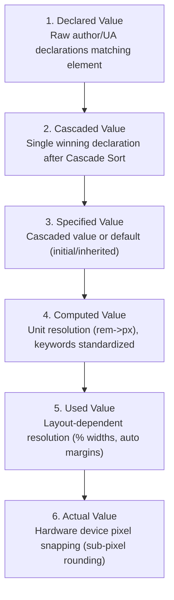
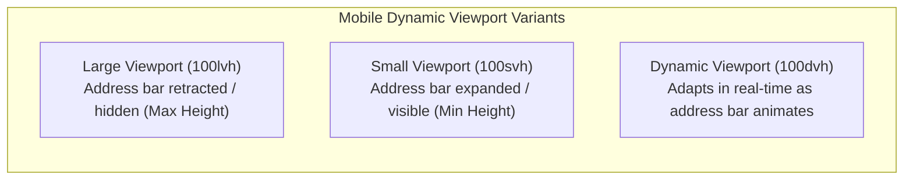

# Module 04 — Value Processing & Units

CSS property values undergo a multi-stage compilation lifecycle within the browser engine before pixels are rasterized onto the screen. A declaration like `width: calc(100% - 2rem)` cannot be rendered directly; the engine must parse the declared string, resolve cascade precedence, convert relative units into absolute pixel quantities during style calculation, execute layout passes to resolve percentages, and snap floating-point results to device hardware pixels. Understanding the six formal stages of value processing and the modern taxonomy of units is essential for writing resilient layouts and debugging discrepancies between CSS source code and `window.getComputedStyle()`.

---

## 1. The Six Stages of Value Processing

According to the CSS Cascading and Inheritance specification, every CSS property on every element passes through six sequential states:



### 1. Declared Value
The raw property value specified in any matching stylesheet rule, inline `style` attribute, or user-agent style sheet (e.g. `color: red;`, `width: 50%`). An element may have zero, one, or dozens of declared values for a single property.

### 2. Cascaded Value
The single winning declaration chosen by the 8-step cascade sort algorithm (origin, context, inline, layer, specificity, proximity, appearance). If no declarations match, there is no cascaded value.

### 3. Specified Value
The value chosen to proceed into inheritance:
- If a cascaded value exists, the specified value is the cascaded value.
- If no cascaded value exists and the property inherits, the specified value is inherited from the parent element's computed value.
- If no cascaded value exists and the property does not inherit, the specified value is the property's specification **Initial value**.

### 4. Computed Value
The value calculated during the styling phase without performing layout. The browser resolves relative units where the reference is already known:
- Relative font lengths (`em`, `rem`, `ch`, `ex`) are multiplied by the known font metrics and converted to absolute pixels (`px`).
- Relative URLs (`url("../img.png")`) are resolved against the stylesheet's base URI into absolute URLs.
- Keywords like `inherit`, `initial`, and `unset` are resolved to their target values.
- Mathematical functions (`calc()`, `min()`, `max()`) are simplified as far as possible without layout context.

### 5. Used Value
The value calculated after the layout pass (LayoutNG / Box Tree generation) takes place. Some properties cannot be resolved to absolute pixels during styling because their reference point depends on the geometry of containing blocks or sibling elements:
- Percentages on `width`, `height`, `padding`, and `margin` are multiplied against the resolved size of the containing block box.
- `auto` margins (e.g., `margin-inline: auto`) are resolved to exact pixel offsets by dividing leftover space.

### 6. Actual Value
The final value applied to the hardware rasterizer. Displays can only render discrete, integer device pixels. If the used value is a fractional number like `width: 254.667px` on a $1\times$ display, the engine rounds or snaps the value to a physical sub-pixel boundary (e.g. `255px`).

---

## 2. The `window.getComputedStyle()` Resolved Value Ambiguity

Developers frequently assume `window.getComputedStyle(element).width` returns the **Computed Value**. In the CSS Object Model (CSSOM) specification, `getComputedStyle()` technically returns what is termed the **Resolved Value**:

| Property Category | What `getComputedStyle()` Actually Returns |
| :--- | :--- |
| **Most Properties** (`color`, `font-size`, `opacity`, `transform`) | The **Computed Value** (e.g., `font-size` returns `"16px"`, `color` returns `"rgb(255, 0, 0)"`). |
| **Layout Properties** (`width`, `height`, `left`, `right`, `top`, `bottom`) | The **Used Value** (returns the absolute rendered pixel width after layout, e.g. `"420.5px"`, even if author CSS declared `width: 50%`!). |

```javascript
// Demonstrating the resolved value difference
const box = document.querySelector('.card');
box.style.width = '50%';

// Returns "400px" (the used layout width), NOT "50%"!
console.log(window.getComputedStyle(box).width);

// If you want the declared percentage string, read the CSSOM inline declaration:
console.log(box.style.width); // "50%"
```

---

## 3. Mathematical Functions: Values Level 4 & 5

Modern CSS provides a powerful suite of native mathematical expressions evaluated directly in the browser engine without JavaScript.

### Core Comparison & Clamping: `calc()`, `min()`, `max()`, and `clamp()`
```css
/* Fluid Typography without media queries */
/* clamp(MIN, VAL, MAX) -> clamp(1rem, 2.5vw + 0.5rem, 2.5rem) */
h1 {
  font-size: clamp(1.25rem, 4vw + 0.5rem, 3rem);
}

/* Mixed-unit layout calculations */
.sidebar {
  width: min(320px, 100vw - 2rem);
}
```

### Advanced Rounding & Modular Arithmetic
- **`round(strategy, value, interval)`**: Rounds `value` to the nearest multiple of `interval`. Strategies: `nearest`, `up`, `down`, `to-zero`.
- **`mod(A, B)`**: Modulus operator (computes the remainder with standard sign matching the divisor).
- **`rem(A, B)`**: Remainder operator (computes remainder with sign matching the dividend).

```css
/* Snap element width to a rigid 8px design-token grid */
.grid-item {
  width: round(nearest, 33.33vw, 8px);
}
```

### Trigonometric, Exponential & Interpolation Functions
CSS Values Level 4 introduces formal math operations:
- Trigonometry: `sin()`, `cos()`, `tan()`, `asin()`, `acos()`, `atan()`, `atan2()`.
- Exponentials: `pow()`, `sqrt()`, `hypot()`, `log()`, `exp()`.
- Progress: `progress(value, min, max)` computes a 0.0 to 1.0 ratio.
- Extensible Sizing: `calc-size(any, size)` allows smooth animating to and from intrinsic sizes like `auto` and `max-content` in modern Chromium.

```css
/* Circular radial positioning using pure CSS trigonometry */
.orbit-node {
  --angle: 45deg;
  --radius: 120px;
  transform: translate(
    calc(cos(var(--angle)) * var(--radius)),
    calc(sin(var(--angle)) * var(--radius))
  );
}
```

---

## 4. Modern Unit Taxonomy

Modern CSS extends far beyond the traditional `px`, `%`, and `rem`.

```
                        ┌────────────────── Modern CSS Units ──────────────────┐
                        │                                                      │
         ┌──────────────┴─────────────┐                         ┌──────────────┴─────────────┐
         ▼                            ▼                         ▼                            ▼
   Font-Relative               Viewport-Relative         Container-Relative            Sibling
  em, rem, ch, cap,          Small (svh), Large (lvh),   cqi (inline), cqb (block),   sibling-index(),
  ic, lh, rlh                Dynamic (dvh)               cqw, cqh, cqmin, cqmax       sibling-count()
```

### 1. Font-Relative Units
- **`rem`**: Font size of the root element (`<html>`), default 16px.
- **`em`**: Font size of the current element (or parent element if used on `font-size`).
- **`ch`**: Width of the zero glyph (`0`) in the element's current font (ideal for readable line lengths, e.g. `max-width: 65ch`).
- **`cap`**: Cap-height of the font (height of capital letters like `H`).
- **`ic`**: Ideographic count (width of Chinese/Japanese/Korean full-width characters).
- **`lh` / `rlh`**: Current element line-height (`lh`) or root line-height (`rlh`), allowing vertical margins and padding to align to the typographic baseline grid.

### 2. Viewport Variants: Small (`svh`), Large (`lvh`), and Dynamic (`dvh`)
On mobile devices (iOS Safari and Android Chrome), browser navigation bars expand and retract dynamically as the user scrolls. The legacy `100vh` unit was pinned permanently to the largest possible viewport height, causing bottom buttons and navigation bars to sit underneath the mobile browser address bar:



- **`svh` / `svw` (Small Viewport)**: Viewport size assuming all browser UI chrome (address bar, toolbars) is fully **expanded**. Guarantees content will never be occluded.
- **`lvh` / `lvw` (Large Viewport)**: Viewport size assuming all browser UI chrome is fully **collapsed/hidden**.
- **`dvh` / `dvw` (Dynamic Viewport)**: Dynamically scales in real-time as browser chrome animates during scrolling.

> [!TIP]
> Use `100svh` for fixed modal dialogues and initial app shells to prevent jarring relayouts while the address bar animates. Use `100dvh` for full-screen hero sections.

### 3. Container Query Units
When an ancestor element declares `container-type: inline-size` or `size`, its children gain access to container query units:
- **`cqi`**: $1\%$ of the query container's inline size (width in horizontal writing modes).
- **`cqb`**: $1\%$ of the query container's block size (height in horizontal writing modes).
- **`cqmin` / `cqmax`**: The smaller or larger of `cqi` and `cqb`.

---

## 5. Then vs. Now: Values & Units

| Dimension | Legacy CSS Era (2010–2018) | Modern CSS Platform (2024–2026+) |
| :--- | :--- | :--- |
| **Mobile Height** | `height: 100vh` caused bottom buttons to be clipped by mobile address bars | `100dvh` / `100svh` adapt cleanly to expanded/retracted mobile browser chrome |
| **Fluid Scaling** | JavaScript `window.onresize` listeners or hundreds of media query breakpoints | Pure CSS `clamp(min, val, max)` provides seamless fluid typography and spacing |
| **Grid Alignment** | Arbitrary pixels without rounding caused sub-pixel visual seams | Native `round(nearest, val, 8px)` enforces pixel-grid alignment |
| **Baseline Grid** | Hardcoded pixel spacing easily desynchronized from changing fonts | Typographic `1lh` / `1rlh` units scale directly with the active font line-height |
| **Component Layout** | Components sized against the entire global viewport (`vw`) | Components size against their parent card using Container Units (`cqi`, `cqb`) |

---

## 6. Interview Drill: Value Processing & Units

### Q1: What is the exact difference between a property's "Computed Value" and its "Used Value"?
<details><summary>Answer</summary>

The Computed Value is determined during the style calculation phase prior to layout; relative units like `rem` and `em` are converted to absolute pixels, and keywords like `inherit` are resolved. The Used Value is calculated during the subsequent layout phase when geometry is computed; properties that depend on containing block dimensions (such as percentages on `width`, `height`, or `margin-inline: auto`) can only be resolved to final pixel lengths once the box tree layout is finalized.
</details>

### Q2: Why does `window.getComputedStyle(element).width` return `"300px"` even if the stylesheet declares `width: 50%`?
<details><summary>Answer</summary>

According to the CSSOM specification, `getComputedStyle()` does not return the strict Computed Value for all properties. For layout-dependent properties (including `width`, `height`, `left`, and `top`), it returns the "Resolved Value", which is defined as the Used Value (the final pixel width after layout computation). To inspect the author's declared value string, one must read the element's style attribute (`element.style.width`) or inspect the matching CSSOM rule.
</details>

### Q3: On mobile web browsers, what layout bug occurs when using `height: 100vh`, and how do `100svh` and `100dvh` resolve it?
<details><summary>Answer</summary>

The legacy `100vh` unit is calculated based on the maximum screen height where browser URL bars and toolbars are completely hidden. When the page initially loads with the toolbar visible, the bottom portion of a `100vh` element is covered by the browser chrome, cutting off call-to-action buttons. `100svh` evaluates the viewport height when the toolbar is fully expanded, ensuring content is never clipped. `100dvh` scales dynamically as the user scrolls and the address bar retracts.
</details>

### Q4: When would an engineer use the `lh` unit instead of `em`?
<details><summary>Answer</summary>

The `em` unit is relative to the element's `font-size`, whereas the `lh` unit is relative to the element's computed `line-height`. When implementing a vertical rhythm or baseline grid, sizing icons, vertical margins, or input heights using `1lh` guarantees that the component matches the exact vertical height of a single line of text, preventing misalignments regardless of line-height scaling.
</details>

### Q5: In the calculation `clamp(1rem, 5vw, 3rem)`, under what exact viewport width will the element's size begin to grow larger than `1rem` (assuming `1rem = 16px`)?
<details><summary>Answer</summary>

The value `5vw` will exceed `1rem` (16px) when $5\% \times \text{viewport width} > 16\text{px}$. Solving for viewport width: $\text{width} > 16 / 0.05 = 320\text{px}$. Therefore, on viewports narrower than 320px, the clamp clamps to the minimum bound of 1rem (16px); between 320px and 960px ($3 \times 16 / 0.05$), it scales dynamically with `5vw`; above 960px, it clamps to the maximum bound of 3rem (48px).
</details>
